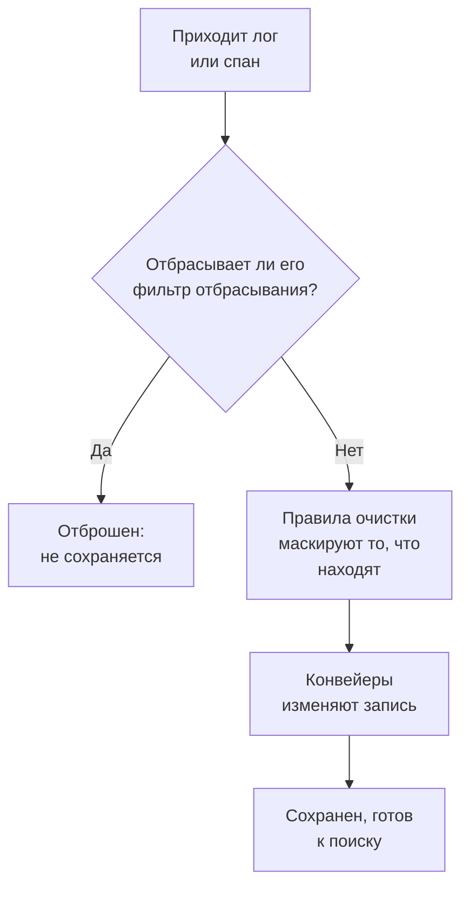

# Фильтры отбрасывания и правила очистки

Фильтры отбрасывания и правила очистки обрабатывают ваши логи и спаны по мере их поступления, до того как что-либо будет сохранено. Фильтр отбрасывания выбрасывает записи, которые вам никогда не нужны, или оставляет только их выборку. Правило очистки маскирует персональные данные и секреты, например адреса электронной почты, номера карт и пароли, чтобы они никогда не попали в хранилище.

:::cards
- [Где они работают](#где-они-работают): До конвейеров, до хранения.
- [Отбрасывать записи или делать выборку](#отбрасывать-записи-или-делать-выборку): Выберите записи, затем отбросьте их или оставьте долю.
- [Очищать конфиденциальные данные](#очищать-конфиденциальные-данные): Скрыть, замаскировать или захешировать найденное шаблоном.
- [Проверить, что отбросил фильтр](#проверить-что-отбросил-фильтр): Счетчики на каждом фильтре.
:::

## Где они работают

Для логов они находятся в **Логи → Настройки**, для спанов — в **Трассировка → Настройки**. Когда приходит запись, OneUptime применяет их в таком порядке:



- **Они действуют только на новые записи.** Правило, которое вы создаете или меняете, применяется к записям, которые приходят примерно через минуту. Уже сохраненные записи не меняются.
- **Отброшенная запись исчезает.** Ее никогда не видят поиск, графики, мониторы и правила записи, и из нее не создается исключение. В OneUptime Cloud она также не оплачивается.
- **Каждый список выполняется по порядку.** Перетаскивайте строки списка, чтобы изменить порядок. Выполняются только включенные фильтры и правила.

Фильтры отбрасывания и правила очистки логов одинаково применяются к логам из OpenTelemetry, Syslog, Fluent Bit и Fluentd. [Конвейеры логов](/docs/telemetry/log-pipelines) описывают следующий за ними шаг.

## Перед началом

- **Поступающие логи или спаны.** См. [OpenTelemetry](/docs/telemetry/open-telemetry).
- **Роль, которая меняет настройки телеметрии.** Project Owner или Project Admin либо пользовательская роль с разрешением на то, что вы меняете, например Create Log Drop Filter или Create Trace Scrub Rule. Роли Telemetry видят фильтры и правила, но не могут их менять.

## Отбрасывать записи или делать выборку

:::steps
### Открыть фильтры отбрасывания

Перейдите в **Логи → Настройки → Фильтры отбрасывания** или в **Трассировка → Настройки → Фильтры отбрасывания** для спанов.

### Выбрать записи

Нажмите **Создать: Журнал Сброс Фильтр** или **Создать: Трассировка Сброс Фильтр** для спанов. На шаге **Совпадение** задайте фильтру **Имя**, затем составьте его **Запрос фильтра**: поле, оператор и значение для каждого условия, а также должны ли совпасть **Все условия** или **Любое условие**. Нажмите **Далее**.

### Выбрать действие

На шаге **Действие** оставьте **Отбросить**, чтобы выбрасывать каждую совпавшую запись, или выберите **Образец** и введите **Процент выборки**, который нужно сохранить, от 1 до 99. Затем создайте фильтр.
:::

Фильтр начинает отбрасывать в течение минуты. Чтобы сохранить его, пока ничего не отбрасывая, выключите **Включено** в разделе **Расширенный** перед созданием.

> [!WARNING]
> Отброшенную запись нельзя вернуть. Делайте запрос фильтра узким и следите за его счетчиком **Dropped** после создания.

Фильтр может проверять эти поля, а также любой атрибут через **Custom Attribute...**:

| Записи | Поля |
| --- | --- |
| Логи | **Серьёзность**, **Тело лога**, **ID сервиса** |
| Спаны | **Имя span**, **Тип span**, **Статус**, **Сообщение о статусе**, **ID сервиса**, **Есть исключение**, **Является корневым спаном** |

| Оператор | Совпадает с |
| --- | --- |
| **равно** | Точным значением с учетом регистра: `Debug` совпадает, `DEBUG` — нет. |
| **не равно** | Всем, кроме точного значения. |
| **содержит** | Значением в любом месте поля без учета регистра. `%` в значении — подстановочный знак. |
| **является одним из** | Одним из списка точных значений через запятую. |

**Preview query** показывает запрос, который составляют условия. Этот отбрасывает отладочные строки проверки работоспособности:

```text
severityText = 'Debug' AND body LIKE 'healthcheck'
```

Выборка решается для каждой записи отдельно: при **Процент выборки**, равном 10, сохраняется примерно одна из десяти совпавших записей. Фильтры выполняются в порядке списка, и решает первый, который отбрасывает запись; запись, которую выборка оставила, переходит к следующему фильтру.

## Очищать конфиденциальные данные

:::steps
### Открыть правила очистки

Перейдите в **Логи → Настройки → Правила очистки** или в **Трассировка → Настройки → Правила очистки** для спанов.

### Выбрать, что искать

Нажмите **Создать: Журнал Очистка Правило** или **Создать: Трассировка Очистка Правило** для спанов и выберите **Тип шаблона**. Правило получает имя по нему, например **Очистка адресов электронной почты**, пока вы не введете свое. Для **Пользовательское регулярное выражение** заполните также **Пользовательский шаблон Regex**.

### Выбрать способ очистки

В разделе **Расширенный** выберите **Действие очистки** и **Поля для очистки** или оставьте их как есть: новое правило заменяет каждое совпадение на `[REDACTED]`, где бы оно ни было в записи. Затем создайте правило.
:::

| Тип шаблона | Что он находит |
| --- | --- |
| **Адрес электронной почты** | Адреса электронной почты, например `jane@example.com` |
| **Номер кредитной карты** | Шестнадцать цифр группами по четыре, например `4111 1111 1111 1111` |
| **SSN (номер социального страхования)** | Номера социального страхования США, например `123-45-6789` |
| **Номер телефона** | Североамериканские номера телефонов, например `555-123-4567` |
| **IP-адрес** | Адреса IPv4, например `192.168.1.1` |
| **Sensitive Attribute Keys** | Все значение любого атрибута, ключ которого похож на секретный, например `password`, `token`, `api_key`, `authorization` или `cookie` |
| **Пользовательское регулярное выражение** | Ваше собственное регулярное выражение, записанное без косых черт и флагов, с учетом регистра |

| Действие очистки | Чем становится совпадение |
| --- | --- |
| **Скрыть** | `[REDACTED]`, по умолчанию |
| **Маска** | Скрыто почти полностью: адрес электронной почты сохраняет первую букву и конец домена, номер карты, телефона или социального страхования — последние четыре цифры, а пользовательское совпадение или секретное значение — первый и последний символ. IP-адрес скрывается полностью. |
| **Хеш** | Короткий хеш значения, всегда одинаковый для одного и того же значения, чтобы повторы по-прежнему можно было посчитать |

Например, правило **Адрес электронной почты** сохраняет такое тело лога:

```text
Payment failed for jane@example.com
```

в одном из этих видов, в зависимости от его **Действие очистки**:

```text
Redact: Payment failed for [REDACTED]
Mask:   Payment failed for j***@***.com
Hash:   Payment failed for [HASHED:8c87b489]
```

**Поля для очистки** — это **Оба (тело и атрибуты)** для правила логов, если вы не выберете **Только тело** или **Только атрибуты**, и **Все (имя, атрибуты и события)** для правила спанов, если вы не выберете **Только имя спана**, **Только атрибуты** или **Только атрибуты события**. Правило **Sensitive Attribute Keys** всегда очищает значения атрибутов, поскольку читает ключи атрибутов.

- **Исключения берутся из очищенной записи.** Исключение, найденное в логе, создается после очистки, а правила, которые очищают события спанов, очищают и исключения, записанные в них.
- **Session Replays тоже очищаются.** Правила очистки логов также применяются к записям Session Replay, в дополнение к маскированию, которое выполняет запись в браузере.
- **Правила выполняются в порядке списка.** Каждое правило видит то, что оставили предыдущие.
- **Пользовательский шаблон работает за время, соразмерное записи.** Он сохраняет синтаксис и ответы JavaScript, включая опережающие и ретроспективные проверки, как бы он ни был написан. Обратная ссылка, например `\1`, так выполняться не может: правило с ней отклоняется при сохранении, как и шаблон, слишком большой для выполнения. Если для поиска всех совпадений пришлось бы снова и снова перечитывать длинное значение, правило очищает значение целиком. Фильтры отбрасывания, правила очистки и конвейеры проекта также делят общую квоту работы на каждый отправленный им пакет, соразмерную размеру пакета: когда их шаблонам нужно больше, пользовательское правило очистки очищает значение целиком, а фильтр, на который не удается получить ответ, к записи не применяется.

## Проверить, что отбросил фильтр

Список **Фильтры отбрасывания** показывает для каждого фильтра его счетчик **Dropped** и время, когда он последний раз что-то отбросил, **Last Dropped**. **Nothing dropped yet** означает, что он ни разу не совпал. Собственная страница фильтра показывает то же в разделе **Активность**, обновляемом в течение минуты после отбрасывания. Его карточка **Условия фильтра** показывает, что он выбирает, и там можно изменить условия.

## Устранение неполадок

:::details Фильтр отбрасывания ничего не отбрасывает
**равно**, **не равно** и **является одним из** сравнивают точный текст с учетом регистра. Уровни серьезности пишутся `Information` и `Warning`, а не `INFO` или `WARN`. Проверьте, что фильтр включен, и подождите минуту после изменения.
:::

:::details Пропали логи, которых я ждал
Посмотрите на счетчик **Dropped** и время **Last Dropped** каждого фильтра отбрасывания. Выключите **Включено** у подозрительного фильтра, и следующие логи снова начнут поступать.
:::

:::details Пользовательское правило очистки показывает Ничего не очищает
Его шаблон пуст, не является допустимым регулярным выражением или не может выполняться, например из-за обратной ссылки вроде `\1`, поэтому оно ничего не очищает. Отредактируйте правило и задайте шаблон, который совпадает хотя бы с одним символом.
:::

:::details Старые записи все еще показывают данные, которые очищает новое правило
Правила очистки действуют при поступлении записей. Записи, сохраненные до правила, сохраняют свое содержимое до окончания срока хранения. См. [Хранение данных](/docs/telemetry/data-retention).
:::

## Дальнейшие шаги

:::cards
- [Конвейеры логов](/docs/telemetry/log-pipelines): Разбирайте и обогащайте логи, которые вы храните.
- [Обозреватель журналов](/docs/telemetry/logs-explorer): Ищите то, что было сохранено.
- [Обозреватель трассировок](/docs/telemetry/traces-explorer): Следите за спанами, которые вы храните.
- [Хранение данных](/docs/telemetry/data-retention): Решите, как долго они хранятся.
:::
