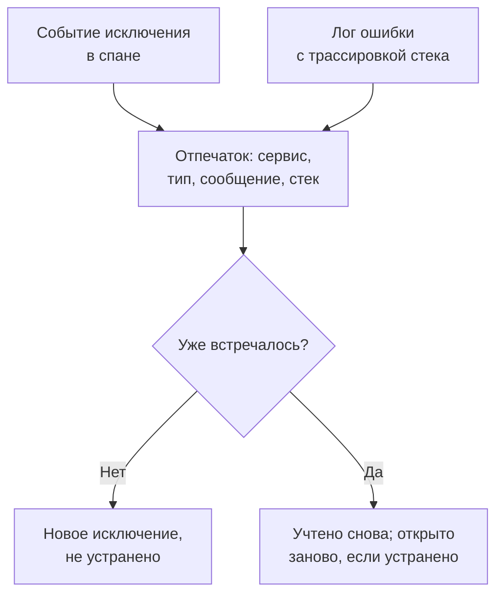

# Отслеживание исключений

Отслеживание исключений собирает ошибки, которые выбрасывает ваш код, и объединяет все появления одной и той же ошибки в одно исключение с его трассировкой стека, динамикой и запросами, в которых оно произошло. Разбирайте их как список дел: исправляйте, отмечайте как устранённые или архивируйте шум, а ИИ пусть открывает pull request для тех, что он может исправить.

:::cards
- [Откуда берутся исключения](#откуда-берутся-исключения): Спаны и логи, которые ваши сервисы уже отправляют.
- [Разбор списка](#разбор-списка): Сначала неустранённые, шум скрыт.
- [Страница исключения](#страница-исключения): Трассировка стека, появления и контекст.
- [Исправить с помощью ИИ](#исправить-с-помощью-ии): Pull request с исправлением или регрессионным тестом.
:::

## Откуда берутся исключения

Отдельно отправлять исключения не нужно. OneUptime находит их в телеметрии, которую ваши сервисы уже отправляют:

- событие исключения в спане — именно его записывает `recordException()` в OpenTelemetry;
- лог с атрибутами `exception.type`, `exception.message` или `exception.stacktrace`;
- лог с серьёзностью Error или Fatal, сообщение которого содержит трассировку стека, если лог был записан не внутри спана (спан уже сообщает о нём).

Каждое появление объединяется с прежними появлениями той же ошибки в одно исключение:

- **Одно исключение на сервис и ошибку.** Отпечаток строится из сервиса, типа исключения, сообщения и трассировки стека. Значения, которые меняются от вызова к вызову, сначала убираются: UUID и другие идентификаторы, метки времени, IP- и email-адреса, а также числа из семи и более цифр. Поэтому `Order id=1042 not found` и `Order id=2077 not found` — одно исключение.
- **Новое появление снова открывает устранённое исключение.** Если ошибка повторилась после того, как вы её устранили, исправление не сработало.
- **Архивированное исключение остаётся в архиве.** Его новые появления по-прежнему учитываются, но уведомления больше не отправляются.

> [!TIP]
> Чтобы ожидаемая ошибка не попадала в Отслеживание исключений, например некорректный ввод, отклонённый вашим сервисом, задайте атрибуту `error.class` значение `user-error` или `expected-denial` в событии исключения спана. Тогда OneUptime не записывает для неё исключение.

## Перед началом

- **Поступающие спаны или логи.** Инструментируйте свои сервисы с помощью [OpenTelemetry](/docs/telemetry/open-telemetry). Вкладка **Руководство по настройке** показывает код для вашего языка.
- **Роль, которая читает телеметрию.** Project Owner, Project Admin, Project Member, Viewer, Telemetry Admin, Telemetry Member или Telemetry Viewer либо пользовательская роль с разрешением Read Telemetry Service Exception. Чтобы устранять и архивировать, нужны Project Owner или Project Admin либо разрешение Edit Telemetry Service Exception.

## Разбор списка

:::steps
### Откройте исключения

Перейдите в **Продукты → Наблюдаемость → Исключения**. Значок на вкладке **Исключения** показывает число неустранённых проблем, а список открывается на исключениях со статусом **Не устранён**.

### Выберите статус

Переключайтесь между **Не устранён**, **Устранён**, **Архивировано** и **Все**. График над списком показывает, сколько появлений во времени были **Необработано** и сколько **Обработано**.

### Выберите, что считать проблемой

**Проблемы**, вариант по умолчанию, скрывает ошибки пользователей и ожидаемые отказы, чтобы список показывал то, что нужно исправить. **User errors** показывает только их, а **Все** — все исключения.

### Ищите и фильтруйте

Введите запрос, например `type:TypeError env:production`, см. [Синтаксис поиска](/docs/telemetry/search-syntax#исключения), или нажмите на значение на боковой панели **Фильтры**: сервис, хост или другой ресурс, **Тип исключения**, **Окружение** или **Error Class**.

### Откройте исключение

Нажмите на строку, чтобы открыть страницу исключения.
:::

## Страница исключения

Боковое меню страницы группирует то, что вы делаете с исключением:

| Страница | Что она показывает |
| --- | --- |
| **Обзор** | Сообщение, сервис, как часто оно происходило, когда его увидели впервые и в последний раз, его динамику во времени и последнее появление: релиз, окружение, спан, трассировку и сеанс пользователя. |
| **Трассировка стека** | Кадры стека. Для браузерного кода — исходные файлы и строки, как только вы загрузите [Карты исходного кода](/docs/telemetry/source-maps) для релиза. |
| **Occurrences** | Каждое появление с его временем, сообщением и трассировкой, в которой оно произошло. |
| **Context** | Атрибуты последнего появления, его запись сеанса, если она велась, и шаги, которые к нему привели. |
| **Журналы** | Логи, записанные вокруг последнего появления. |
| **AI Assistance** | Задачи ИИ, которые исправляют исключение или тестируют его. |
| **Настройки** | Устранить или архивировать исключение. Страница находится в разделе **Manage**, который изначально свёрнут. |

## Устранить, открыть заново и архивировать

Кнопки вверху страницы исключения и его страница **Настройки** меняют его статус:

| Действие | Когда его использовать | Что происходит дальше |
| --- | --- | --- |
| **Устранить** | Вы выпустили исправление. | Оно уходит из списка **Не устранён**. Новое появление снова открывает его. |
| **Reopen** | Исправление не сработало. | Оно снова не устранено. |
| **Архивировать** | Это шум, который вы не собираетесь исправлять. | Оно уходит из списка. Новые появления учитываются, но уведомления больше не отправляются. |
| **Извлечь из архива** | Вы снова хотите о нём знать. | Оно возвращается в свой список. |

**Настройки** показывает, кто последним устранил или архивировал исключение и когда. Её кнопки называются **Отметить как решённое** или **Отметить как нерешённое** и **Архивировать** или **Извлечь из архива**.

## Классы ошибок

У каждого исключения есть класс ошибки, который говорит, чья это проблема. OneUptime AI задаёт его, когда разбирает аналитическое наблюдение об исключении, например новое исключение или резкий рост: см. [AI SRE](/docs/ai/ai-sre#инсайты-упреждающее-обнаружение). Исключение, которое он ещё не разбирал, остаётся `unknown`.

| Класс | Что он означает | В списке **Проблемы** |
| --- | --- | --- |
| `code-fault` | Дефект в коде. Единственный класс, который ИИ исправляет сам. | Да |
| `infrastructure` | Тайм-аут, разорванное соединение или исчерпанные ресурсы. | Да |
| `unknown` | Ещё не классифицировано. | Да |
| `user-error` | Результат некорректного ввода пользователя. | Нет |
| `expected-denial` | Проверка, которая делает свою работу, например отказ во входе. | Нет |

Когда в настройках AI Insights включено **Архивировать ожидаемые исключения**, исключения, которые разбор признаёт ожидаемыми отказами, архивируются за вас.

## Исправить с помощью ИИ

Страница **AI Assistance** предлагает три задачи. Каждая выполняется как задача ИИ, которая открывает pull request в вашем репозитории кода:

| Задача | Что делает pull request |
| --- | --- |
| **Fix this exception with AI** | Исправляет первопричину. Запустите её кнопкой **Исправить с ИИ**. |
| **Generate Regression Test** | Добавляет тест, который падает, пока ошибка не исправлена. |
| **Улучшить обработку ошибок** | Для ожидаемых ошибок: раньше проверяет ввод, не пускает данные пользователей в сообщения и помечает ошибку как обработанную. |

Сначала ИИ нужны три вещи: провайдер LLM, подключённый репозиторий (на GitHub, GitLab, Forgejo или Gitea либо на любом Git-сервере), и агент ИИ в сети, который выполнит задачу. Страница проверяет каждое условие и даёт ссылку на то, чего не хватает. Задачи приостанавливаются, пока исключение устранено или архивировано. См. [Код](/docs/ai/ai-agent).

## Аналитика исключений

Вкладка **Аналитика** считает ваши исключения со статусами **Не устранён**, **Устранён** и **Архивировано** и долю устранённых, а также перечисляет самые частые исключения, затронутые ими сервисы и те, что встречались последними.

## Устранение неполадок

:::details Исключения, которое я только что выбросил, нет в списке
Сначала проверьте фильтр: **Проблемы** скрывает ошибки пользователей и ожидаемые отказы, поэтому выберите **Все**. Затем расширьте диапазон времени и проверьте, что исключение было записано в спане или в логе с трассировкой стека.
:::

:::details Одна ошибка видна как несколько исключений
Отпечаток включает сообщение и трассировку стека. Если они различаются, например когда сообщение содержит короткое число или имя, меняющееся при каждом вызове, каждый вариант становится отдельным исключением.
:::

:::details Устранённое исключение всё время возвращается
Новое появление снова открывает устранённое исключение намеренно: ошибка всё ещё происходит. Проверьте, что исправление попало в релиз, который о ней сообщает, или архивируйте исключение, если больше не хотите о нём слышать.
:::

## Дальнейшие шаги

:::cards
- [Мониторинг исключений](/docs/monitor/exceptions-monitor): Получайте оповещения при резком росте исключений.
- [Карты исходного кода](/docs/telemetry/source-maps): Читаемые трассировки стека для браузерного кода.
- [Код](/docs/ai/ai-agent): Как ИИ исправляет код и открывает pull request.
- [Обозреватель трассировок](/docs/telemetry/traces-explorer): Посмотрите запрос, в котором произошло исключение.
:::
