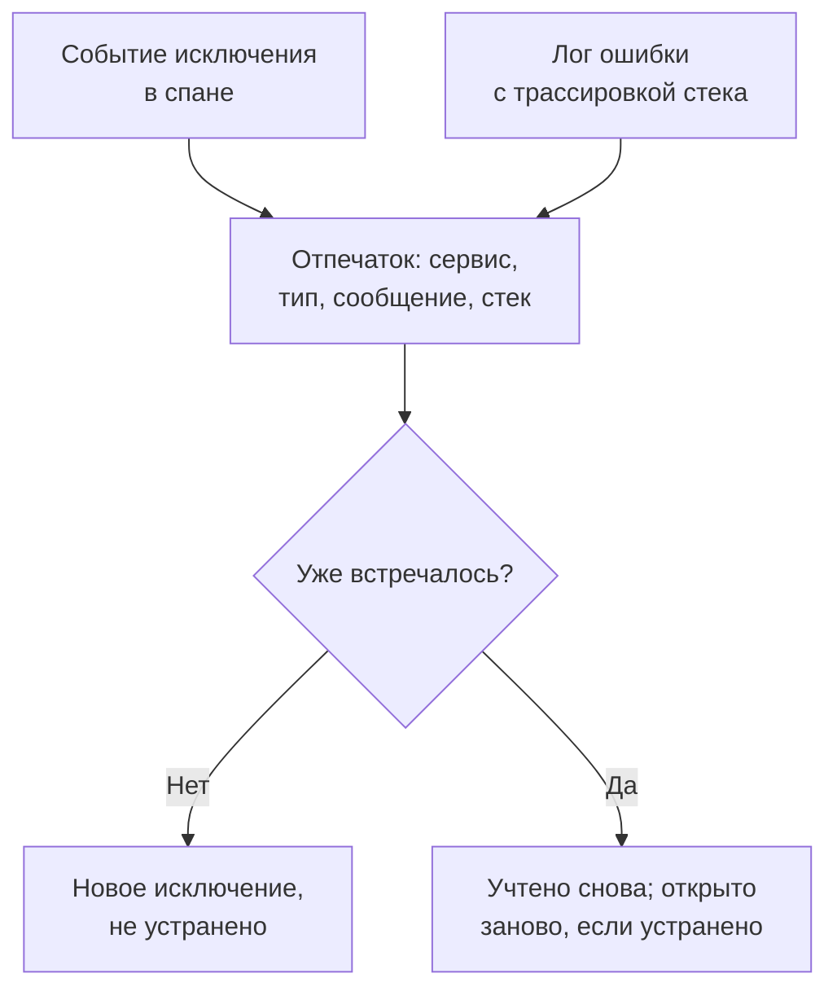

# Отслеживание исключений

Отслеживание исключений собирает ошибки, которые выбрасывает ваш код, и объединяет все появления одной и той же ошибки в одно исключение с его трассировкой стека, динамикой и запросами, в которых оно произошло. Разбирайте их как список дел: исправляйте, отмечайте как устранённые или архивируйте шум, а ИИ пусть открывает pull request для тех, что он может исправить.

:::cards
- [Откуда берутся исключения](#откуда-берутся-исключения): Спаны и логи, которые ваши сервисы уже отправляют.
- [Разбор списка](#разбор-списка): Сначала неустранённые, шум скрыт.
- [Страница исключения](#страница-исключения): Трассировка стека, появления и контекст.
- [Исправить с помощью ИИ](#исправить-с-помощью-ии): Pull request с исправлением или регрессионным тестом.
- [Поиск и исправление новых и растущих исключений с ИИ](#поиск-и-исправление-новых-и-растущих-исключений-с-ии): Pull request для исключений, которые находит OneUptime.
:::

## Откуда берутся исключения

Отдельно отправлять исключения не нужно. OneUptime находит их в телеметрии, которую ваши сервисы уже отправляют:

- событие исключения в спане — именно его записывает `recordException()` в OpenTelemetry;
- лог с атрибутами `exception.type`, `exception.message` или `exception.stacktrace`;
- лог с серьёзностью Error или Fatal, сообщение которого содержит трассировку стека, если лог был записан не внутри спана (спан уже сообщает о нём).

Каждое появление объединяется с прежними появлениями той же ошибки в одно исключение:

- **Одно исключение на сервис и ошибку.** Отпечаток строится из сервиса, типа исключения, сообщения и трассировки стека. Значения, которые меняются от вызова к вызову, сначала убираются: UUID и другие идентификаторы, метки времени, IP- и email-адреса, а также числа из семи и более цифр. Поэтому `Order id=1042 not found` и `Order id=2077 not found` — одно исключение. Новое исключение вместо этого группируется по типу и по функциям и файлам вашего собственного кода в трассировке стека: номера строк, кадры библиотек и сообщение не учитываются, поэтому варианты, выброшенные одним и тем же кодом, — одно исключение. Без трассировки стека его группирует сообщение, как выше. Исключения, записанные до этой группировки, сохраняют свою.
- **Новое появление снова открывает устранённое исключение.** Если ошибка повторилась после того, как вы её устранили, исправление не сработало, и исключение помечается как **Регрессия**. Появление до устранения, которое дошло до OneUptime с опозданием, его не открывает.
- **Архивированное исключение остаётся в архиве.** Его новые появления по-прежнему учитываются, но уведомления больше не отправляются.

> [!TIP]
> Чтобы ожидаемая ошибка не попадала в Отслеживание исключений, например некорректный ввод, отклонённый вашим сервисом, задайте атрибуту `error.class` значение `user-error` или `expected-denial` в событии исключения спана. Тогда OneUptime не записывает для неё исключение.

## Перед началом

- **Поступающие спаны или логи.** Инструментируйте свои сервисы с помощью [OpenTelemetry](/docs/telemetry/open-telemetry). Вкладка **Руководство по настройке** показывает код для вашего языка.
- **Роль, которая читает телеметрию.** Project Owner, Project Admin, Project Member, Viewer, Telemetry Admin, Telemetry Member или Telemetry Viewer либо пользовательская роль с разрешением Read Telemetry Service Exception. Чтобы устранять и архивировать, нужны Project Owner или Project Admin либо разрешение Edit Telemetry Service Exception.

## Разбор списка

:::steps
### Откройте исключения

Перейдите в **Продукты → Наблюдаемость → Исключения**. Значок на вкладке **Исключения** показывает число неустранённых проблем, а список открывается на исключениях со статусом **Не устранён**.

### Выберите статус

Переключайтесь между **Не устранён**, **Устранён**, **Архивировано** и **Все**. График над списком показывает, сколько появлений во времени были **Необработано** и сколько **Обработано**. Строка с пометкой **Регрессия** вернулась после устранения, а строка с пометкой **Новое** впервые замечена за последние 24 часа.

Каждая строка также показывает, скольких пользователей исключение затронуло за выбранный период, и небольшой график его появлений за этот период. Появление называет своего пользователя атрибутом `user.id`, `enduser.id` или `enduser.pseudo.id` в событии исключения, в его спане или записи лога либо в его ресурсе; появления, не называющие пользователя, не учитываются.

### Выберите, что считать проблемой

**Проблемы**, вариант по умолчанию, скрывает ошибки пользователей и ожидаемые отказы, чтобы список показывал то, что нужно исправить. **User errors** показывает только их, а **Все** — все исключения.

### Ищите и фильтруйте

Введите запрос, например `type:TypeError env:production`, см. [Синтаксис поиска](/docs/telemetry/search-syntax#исключения), или нажмите на значение на боковой панели **Фильтры**: сервис, хост или другой ресурс, **Тип исключения**, **Окружение** или **Error Class**. **Назначенные мне** показывает только назначенные вам исключения, а меню сортировки упорядочивает список по **Последнее появление**, **Впервые замечено** или **Больше всего событий**.

**Сохранённые представления** хранит список под именем для всех участников проекта: поиск, фильтры, диапазон времени, статус, что считать проблемой, **Назначенные мне**, сортировку и размер страницы. Представление с включённым **Назначенные мне** показывает каждому исключения, назначенные ему, а **Сбросить представление** возвращает список к тому виду, в котором он открывается сначала. Адрес страницы называет выбранное представление, поэтому ссылка, которой вы делитесь, открывает его. В остальном сохранённые представления работают так же, как в [Обозреватель журналов](/docs/telemetry/logs-explorer#сохранить-представление).

### Откройте исключение

Нажмите на строку, чтобы открыть страницу исключения.
:::

## Страница исключения

Боковое меню страницы группирует то, что вы делаете с исключением:

| Страница | Что она показывает |
| --- | --- |
| **Обзор** | Сообщение, сервис, как часто оно происходило, когда его увидели впервые и в последний раз, его динамику во времени и последнее появление: релиз, окружение, спан, трассировку и сеанс пользователя. Вверху — объяснение OneUptime AI того, что произошло, когда ИИ включён. |
| **Трассировка стека** | Кадры стека. Для браузерного кода — исходные файлы и строки, как только вы загрузите [Карты исходного кода](/docs/telemetry/source-maps) для релиза. |
| **Occurrences** | Каждое появление с его временем, сообщением и трассировкой, в которой оно произошло. |
| **Context** | Атрибуты последнего появления, его запись сеанса, если она велась, и шаги, которые к нему привели. |
| **Журналы** | Логи, записанные вокруг последнего появления. |
| **AI Assistance** | Задачи ИИ, которые исправляют исключение или тестируют его. |
| **Настройки** | Устранить или архивировать исключение. Страница находится в разделе **Управлять**, который изначально свёрнут. |

## Устранить, открыть заново и архивировать

Кнопки вверху страницы исключения, его страница **Настройки** и меню ⋯ в его строке в списке меняют его статус:

| Действие | Когда его использовать | Что происходит дальше |
| --- | --- | --- |
| **Устранить** | Вы выпустили исправление. | Оно уходит из списка **Не устранён**. Новое появление снова открывает его. |
| **Устранить в следующем релизе** | Исправление выйдет в вашем следующем релизе. | Оно уходит из списка **Не устранён**. Появления из релиза, в котором его видели последним, не открывают его снова, а появление из любого другого релиза открывает. |
| **Открыть снова** | Исправление не сработало. | Оно снова не устранено. |
| **Архивировать** | Это шум, который вы не собираетесь исправлять. | Оно уходит из списка. Новые появления учитываются, но уведомления больше не отправляются. |
| **Извлечь из архива** | Вы снова хотите о нём знать. | Оно возвращается в свой список. |

**Устранить в следующем релизе** находится в меню рядом с **Устранить**, в меню ⋯ строки, в **Массовые действия** и на странице **Настройки**, пока появления исключения называют свой релиз: атрибут ресурса `service.version`.

**Настройки** показывает, кто последним устранил или архивировал исключение и когда. Её кнопки называются **Отметить как решённое** или **Отметить как нерешённое** и **Архивировать** или **Извлечь из архива**.

Чтобы изменить несколько сразу, отметьте их строки в списке или флажок над строками для всех исключений на странице и используйте те же действия в **Массовые действия**. Результат показывает, какие исключения изменились, какие остались как были и почему.

**Назначить** в заголовке исключения отдаёт его одному человеку или одной команде, а если убрать выбор, назначение снимается. В каждой строке видно, чьё это исключение, её меню ⋯ предлагает **Назначить мне**, а **Назначить…** в **Массовые действия** назначает несколько сразу. Человек, которому оно назначено, или каждый участник команды получает уведомление так, как задаёт строка **Исключение, назначенное мне** в его [Настройки уведомлений](/docs/notifications/notification-settings); тот, кто назначил, его не получает.

**Активность** внизу страницы **Обзор** исключения показывает, кто и когда его изменял, сначала новые: кто его решил, открыл снова, архивировал или назначил, объединил с ним другое исключение или отделил одно, и когда оно появилось снова после решения. Там есть каждое изменение — сделанное на странице исключения, в списке, в **Массовые действия**, через API или самим OneUptime, — а изменение, сделанное с API-ключом, подписано именем ключа.

## Классы ошибок

У каждого исключения есть класс ошибки, который говорит, чья это проблема. OneUptime AI задаёт его, когда разбирает аналитическое наблюдение об исключении, например новое исключение или резкий рост: см. [AI SRE](/docs/ai/ai-sre#инсайты-упреждающее-обнаружение). Исключение, которое он ещё не разбирал, остаётся `unknown`.

| Класс | Что он означает | В списке **Проблемы** |
| --- | --- | --- |
| `code-fault` | Дефект в коде. Единственный класс, который ИИ исправляет сам. | Да |
| `infrastructure` | Тайм-аут, разорванное соединение или исчерпанные ресурсы. | Да |
| `unknown` | Ещё не классифицировано. | Да |
| `user-error` | Результат некорректного ввода пользователя. | Нет |
| `expected-denial` | Проверка, которая делает свою работу, например отказ во входе. | Нет |

Когда в настройках AI Insights включено **Архивировать ожидаемые исключения**, исключения, которые разбор признаёт ожидаемыми отказами, архивируются за вас.

## Объяснить с помощью ИИ

Вверху страницы **Обзор** исключения кнопка **Объяснить с OneUptime AI** спрашивает OneUptime AI, что пошло не так. Он читает трассировку стека, трассировку и журналы последнего появления, а также развёртывания сервиса около времени, когда исключение началось, и отвечает в карточке **Что произошло**:

| Часть | Что в ней |
| --- | --- |
| **Что произошло** | Одно-два предложения, насколько OneUptime AI уверен и где кроется сбой: в коде, в зависимости, в инфраструктуре, во входных данных или в конфигурации. |
| **Вероятная корневая причина** | Причина и фрейм, спан, строка журнала или развёртывание, которые её показывают. |
| **Предлагаемое исправление** | Что изменить. |
| **Куда смотреть** | Фреймы трассировки стека, которые стоит открыть первыми. |
| **Следующие шаги** | Не больше трёх шагов, чтобы подтвердить или исправить её. |

Объяснение хранится в исключении, поэтому следующий, кто его откроет, сразу его прочтёт, а **Объяснить заново** запрашивает новое. **Открыть пул-реквест с исправлением** открывает страницу **AI Assistance** исключения, а **Задать уточняющий вопрос** открывает Ask AI по этому исключению.

Идентификаторы, адреса электронной почты и IP-адреса и токены убираются из всего, что отправляется, а из атрибутов спана отправляются лишь немногие, например маршрут и код состояния. Объяснение использует LLM-провайдера и кредиты ИИ проекта и не предлагается, пока **Включить ИИ** выключено. Объяснение может запросить любой, кто может читать исключение.

Под карточками **Похожие исключения** перечисляет до пяти других исключений, похожих на это: **То же сообщение**, если убрать значения, **То же место в коде** вашего кода или **Похожее сообщение** с большинством тех же слов. Одна причина может попасть в несколько исключений, поэтому **Проверить с OneUptime AI** говорит о каждом, **Вероятно, та же ошибка** это, **Связанная ошибка** или **Другая ошибка**, и почему. Проверка расходует ИИ-кредиты проекта и не предлагается, пока **Включить ИИ** выключено. Ответ хранится до следующего появления исключения.

Исключение, которое OneUptime AI называет **Вероятно, та же ошибка**, из того же сервиса, объединяется с этим кнопкой **Объединить** рядом с ним: его появления, прошлые и каждое новое, с этого момента учитываются в этом исключении и видны на его странице, а само оно уходит из списка. **Объединены с этим исключением** ниже перечисляет объединённые, а **Разъединить** рядом с каждым или на странице объединённого исключения возвращает ему собственное место в списке вместе с его появлениями с тех пор. Для объединения и разъединения нужно право редактировать исключения.

## Исправить с помощью ИИ

Страница **AI Assistance** предлагает три задачи. Каждая выполняется как задача ИИ, которая открывает pull request в вашем репозитории кода:

| Задача | Что делает pull request |
| --- | --- |
| **Fix this exception with AI** | Исправляет первопричину. Запустите её кнопкой **Исправить с ИИ**. |
| **Generate Regression Test** | Добавляет тест, который падает, пока ошибка не исправлена. |
| **Улучшить обработку ошибок** | Для ожидаемых ошибок: раньше проверяет ввод, не пускает данные пользователей в сообщения и помечает ошибку как обработанную. |

Сначала ИИ нужны три вещи: провайдер LLM, подключённый репозиторий (на GitHub, GitLab, Forgejo или Gitea либо на любом Git-сервере), и агент ИИ в сети, который выполнит задачу. Страница проверяет каждое условие и даёт ссылку на то, чего не хватает. Задачи приостанавливаются, пока исключение устранено или архивировано. См. [Код](/docs/ai/ai-agent). Чтобы запустить задачу, нужно право изменять репозиторий, в котором она работает: тот, кто может только читать исключение, видит его задачи, но не может запустить ни одной.

## Поиск и исправление новых и растущих исключений с ИИ

Каждые 15 минут OneUptime просматривает ваши исключения в поисках новых, тех, что вдруг происходят гораздо чаще, и сервисов, чьи исключения приходят без трассировки стека, и регистрирует найденное как выводы ИИ вместе с доказательствами. Затем OneUptime AI изучает каждый вывод и открывает pull request для каждого, который может исправить. Ничего не сливается автоматически: каждый pull request проверяет ваша команда.

| Находка | Когда OneUptime её регистрирует | Pull request |
| --- | --- | --- |
| **Новое исключение** | Исключение, впервые замеченное за последние 24 часа и уже произошедшее 3 раза или больше. | Исправляет исключение или лучше его обрабатывает. |
| **Всплеск исключений** | Исключение, которое произошло 10 раз или больше за последний час, в 5 раз или больше чаще своей почасовой частоты за 24 часа до того. | Исправляет исключение или лучше его обрабатывает. |
| **Нет трассировки стека** | Исключения, записанные сервисом за последние сутки, не содержат трассировки стека и вместе произошли 20 раз или больше. | Заставляет сервис записывать трассировку стека с каждым исключением. |

Pull request для нового или растущего исключения — это собственная задача ИИ этого исключения, та, которую запускает его страница **AI Assistance**, и он ждёт, пока OneUptime AI изучит находку. Если он находит виновный код (`code-fault`), pull request исправляет его, как это делает **Fix this exception with AI**. Если он находит ожидаемую ошибку (`user-error` или `expected-denial`), pull request лучше обрабатывает эту ошибку, как это делает **Улучшить обработку ошибок**. Любой другой вердикт сам по себе не открывает pull request. Когда включено **Архивировать ожидаемые исключения**, ожидаемый отказ вместо этого архивируется и не получает pull request.

OneUptime AI сам открывает его только для исключения, выброшенного в вашем собственном коде: исключения, в трассировке стека которого есть кадр вашего кода, а не только кадры библиотек или среды выполнения. Pull request, который кто-то закрыл без слияния, приостанавливает автоматические для этого исключения. Любой по-прежнему может запросить любой из них через **Исправить с ИИ** на находке.

### Включение

В **Исключения → ИИ → Настройки** находится переключатель **Находить и исправлять новые и растущие исключения**, включённый для новых проектов. Пока он выключен, новые и растущие исключения, как и раньше, остаются за выводами ИИ: см. [AI SRE](/docs/ai/ai-sre#инсайты-упреждающее-обнаружение). Когда **Включить ИИ** выключено, они по-прежнему находятся, но OneUptime AI ничего с ними не делает. Чтобы открывать pull request, OneUptime AI нужен репозиторий, подключённый в разделе [Код](/docs/ai/ai-agent): страница сначала говорит, чего не хватает. Код каждого репозитория меняется на том Runner, который выбран для репозитория в разделе «Код».

OneUptime AI сам открывает не более 5 pull request в день (UTC), по одному на каждую находку, и никогда больше, чем допускает лимит репозитория на открытые pull request ИИ.

### Правила ИИ

Без правил OneUptime AI сразу изучает каждое найденное исключение и открывает pull request для каждого, которое может исправить. **Правила ИИ** в **Дополнительные настройки** сужают это в три шага:

| Шаг | Что он решает |
| --- | --- |
| **Совпадение** | Какие сервисы: выбранные, с определёнными метками или те, чьё имя соответствует шаблону. |
| **Расследовать** | **Сразу** или **Только если всё ещё находится после ожидания**: исключение, которое исчезает во время ожидания, не изучается. |
| **Исправление** | **Не исправлять**, **Спрашивать перед исправлением** или **Исправлять, не спрашивая**. Если сначала нужно спросить, pull request остаётся за человеком: находка предлагает **Исправить с ИИ**. |

В **Дополнительные поля** правило выбирает репозитории кода, MCP-серверы и поставщика LLM, которых OneUptime AI может для него использовать. Если ничего не выбрано, он может использовать любые, а также поставщика LLM проекта по умолчанию.

### Что он сделал

- **Исключения → ИИ → Аналитика** показывает, что нашёл OneUptime, каждую находку с доказательствами, включая кадры вашего кода в её трассировке стека. **View Exception Group** открывает исключение, а для трассировок стека, которых нет у сервиса, **Открыть в исключениях** открывает его неустранённые исключения за последние сутки.
- **Исключения → ИИ → Журналы** показывает каждое расследование и каждый pull request, сначала новые, с состоянием каждого и тем, что нашло каждое расследование.
- Pull request объясняет, почему он открыт, со ссылкой на свою находку. Pull request нового или растущего исключения также ссылается на само исключение и появляется на его странице **AI Assistance**. В разделе «Код» его задача называет исключение, которое она исправляет, или находку, из которой она возникла.

## Аналитика исключений

Вкладка **Аналитика** считает ваши исключения со статусами **Не устранён**, **Устранён** и **Архивировано** и долю устранённых, а также перечисляет самые частые исключения, затронутые ими сервисы и те, что встречались последними.

**Что нового** вверху вкладки просит OneUptime AI кнопкой **Подвести итог с OneUptime AI** подытожить исключения, впервые замеченные за последние 24 часа, и те, что вернулись после устранения: несколько предложений обо всех, затем каждое одной строкой, самое срочное первым, со ссылкой на исключение. Итог пишется по запросу и хранится до следующего появления исключения, так что повторный запрос ничего не стоит; он расходует ИИ-кредиты проекта и не предлагается, пока **Включить ИИ** выключено.

## Устранение неполадок

:::details Исключения, которое я только что выбросил, нет в списке
Сначала проверьте фильтр: **Проблемы** скрывает ошибки пользователей и ожидаемые отказы, поэтому выберите **Все**. Затем расширьте диапазон времени и проверьте, что исключение было записано в спане или в логе с трассировкой стека.
:::

:::details Одна ошибка видна как несколько исключений
Отпечаток включает сообщение и трассировку стека. Если они различаются, например когда сообщение содержит короткое число или имя, меняющееся при каждом вызове, каждый вариант становится отдельным исключением. Новые исключения вместо этого группируются по функциям вашего собственного кода, так что это касается в основном исключений, записанных раньше; объедините два, которые являются одной ошибкой, в **Похожие исключения**.
:::

:::details Устранённое исключение всё время возвращается
Новое появление снова открывает устранённое исключение намеренно: ошибка всё ещё происходит. Проверьте, что исправление попало в релиз, который о ней сообщает, или архивируйте исключение, если больше не хотите о нём слышать. Если старые поды релиза продолжают сообщать о нём во время развёртывания, используйте вместо этого **Устранить в следующем релизе**.
:::

## Дальнейшие шаги

:::cards
- [Мониторинг исключений](/docs/monitor/exceptions-monitor): Получайте оповещения при резком росте исключений.
- [Карты исходного кода](/docs/telemetry/source-maps): Читаемые трассировки стека для браузерного кода.
- [Код](/docs/ai/ai-agent): Как ИИ исправляет код и открывает pull request.
- [Обозреватель трассировок](/docs/telemetry/traces-explorer): Посмотрите запрос, в котором произошло исключение.
:::
