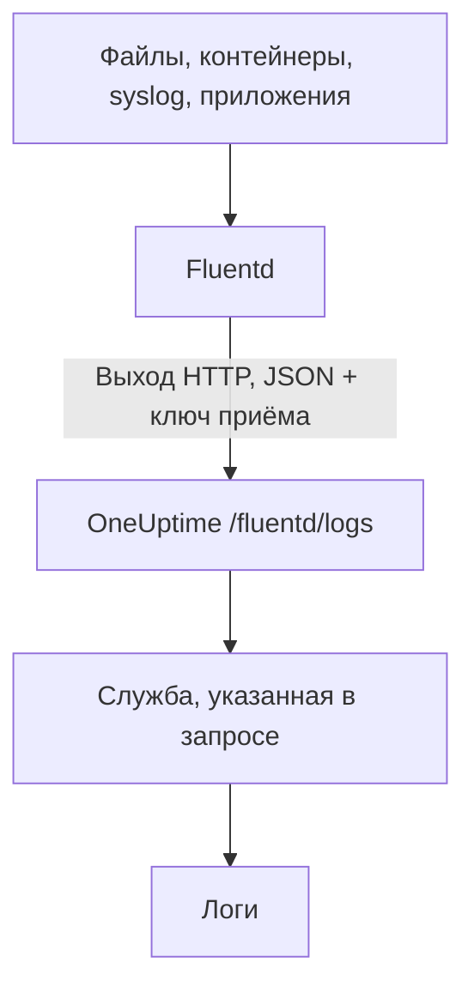

# Fluentd

[Fluentd](https://www.fluentd.org/) собирает логи из файлов, контейнеров, syslog, приложений и [многих других источников](https://www.fluentd.org/datasources). Его встроенный [выход HTTP](https://docs.fluentd.org/output/http) отправляет их на адрес Fluentd в OneUptime, где они становятся доступными для поиска в **Продукты → Журналы**.

:::cards
- [Настройка Fluentd](#настройка-fluentd): Добавьте выход HTTP, направленный на OneUptime.
- [Как читаются записи](#как-читаются-записи): Какие поля становятся сообщением, уровнем важности и атрибутами.
- [Собственная установка OneUptime](#собственная-установка-oneuptime): Направьте Fluentd на свой экземпляр.
:::

## Как это работает



Fluentd отправляет записи пакетами в формате JSON, с вашим ключом приёма в заголовке `x-oneuptime-token` и именем службы в `x-oneuptime-service-name`. OneUptime превращает каждую запись в лог этой службы и создаёт службу при первой отправке.

## Перед началом

- **Установите Fluentd** — см. [руководство по установке](https://docs.fluentd.org/installation).
- **Проект OneUptime.** В OneUptime Cloud телеметрия оплачивается за каждый принятый ГБ — см. [цены](https://oneuptime.com/pricing), — а проекту на плане Free нужен способ оплаты, прежде чем он сможет отправлять телеметрию.
- **Ключ приёма телеметрии.** Если его ещё нет:

:::steps
### Откройте ключи приёма

Перейдите в **Продукты → Настройки проекта**, откройте в боковом меню **Телеметрия и APM** и выберите **Ключи приёма**.


### Создайте ключ

Нажмите **Создать ключ приёма**. В окне уже заполнено имя ключа и выбран тип **Сервер** — именно с таким ключом отправляют данные приложение или коллектор, — так что нажмите **Создать ключ приёма**, чтобы создать его, или сначала переименуйте.

### Скопируйте секрет

Новый ключ открывается на отдельной странице. Скопируйте его **Секретный ключ**: это `YOUR_SERVICE_TOKEN` в конфигурации ниже.


:::

## Настройка Fluentd

Файл конфигурации Fluentd обычно находится в `/etc/fluent/fluentd.conf`, а для старого пакета td-agent — в `/etc/td-agent/td-agent.conf`.

:::steps
### Добавьте выход HTTP

Добавьте секцию `<match>`, которая отправляет записи в OneUptime. Замените `YOUR_SERVICE_TOKEN` вашим ключом приёма, а `YOUR_SERVICE_NAME` — именем, под которым должны появляться логи (любым на ваш выбор):

```text title="fluentd.conf"
# Send the time Fluentd gave each event: the HTTP output sends only the record
<filter **>
  @type record_transformer
  enable_ruby true
  <record>
    fluentd_time ${time.utc.strftime("%Y-%m-%dT%H:%M:%S.%NZ")}
  </record>
</filter>

# Match all patterns
<match **>
  @type http

  endpoint https://oneuptime.com/fluentd/logs
  open_timeout 2

  headers {"x-oneuptime-token":"YOUR_SERVICE_TOKEN", "x-oneuptime-service-name":"YOUR_SERVICE_NAME"}

  content_type application/json
  json_array true

  # Send a batch again when OneUptime is busy (429) or restarting (502, 503, 504)
  retryable_response_codes 429,502,503,504

  <format>
    @type json
  </format>
  <buffer>
    # Keep the batches on disk until OneUptime takes them: a restart of Fluentd loses none
    @type file
    path /var/log/fluent/buffer/oneuptime
    total_limit_size 512m
    flush_interval 10s
    chunk_limit_size 900k
    # Try again at least every 30 seconds, for up to 72 hours
    retry_max_interval 30s
    retry_timeout 72h
  </buffer>
</match>

# Keep Fluentd's own logs out of OneUptime
<label @FLUENT_LOG>
  <match **>
    @type null
  </match>
</label>
```

`json_array true` отправляет каждый блок буфера одним массивом JSON, а `flush_interval 10s` отправляет буфер каждые 10 секунд. `chunk_limit_size 900k` держит каждый запрос меньше 1 МБ: больше OneUptime на этом адресе не принимает.

Работает и настройка Fluentd по умолчанию: без `content_type` и `json_array true` Fluentd отправляет JSON с разделением по строкам, по одной записи в строке, и OneUptime читает каждую строку как её запись, с `compress gzip` или без него.

`@type file` хранит пакеты, которые ещё предстоит отправить, в папке, указанной в `path`, поэтому перезапуск Fluentd не теряет ни одного из них; буфер в памяти, который Fluentd использует по умолчанию, теряет всё, что в нём было. Пользователь Fluentd должен иметь право писать в эту папку: `/var/log/fluent` — папка fluent-package, `/var/log/td-agent` — td-agent, а `/fluentd/log` — образа `fluent/fluentd`. `total_limit_size 512m` хранит там не больше 512 МБ; когда буфер полон, Fluentd не принимает новые записи, пока не отправит пакет.

`retryable_response_codes 429,502,503,504` отправляет пакет заново, когда OneUptime перегружен (`429`) или перезапускается (`502`, `503`, `504`); без этой настройки Fluentd отбрасывает пакет при любом ответе, кроме `503`. `retry_max_interval 30s` ждёт между попытками не больше 30 секунд, а `retry_timeout 72h` отбрасывает пакет, который не удалось отправить за 72 часа. Фильтр `record_transformer` добавляет в каждую запись время, которое ей дал Fluentd, как `fluentd_time`: HTTP-вывод отправляет только запись, а OneUptime читает время лога из неё.

### Перезапустите Fluentd

Перезапустите службу Fluentd, чтобы она загрузила новый выход.

### Проверьте, что логи приходят

Через несколько секунд после следующего сброса логи появятся в **Продукты → Журналы**. Служба появится в **Продукты → Сервисы**; если её ещё не было, OneUptime создаст её.
:::

## Полный пример

Эта конфигурация принимает записи по протоколу forward Fluentd на порту `24224`, только с этого хоста, и отправляет их все в OneUptime:

```text title="fluentd.conf"
####
## Source descriptions:
##

## built-in TCP input
## @see https://docs.fluentd.org/input/forward
<source>
  @type forward
  port 24224
  # This host alone: see "Take records from other hosts" to open it
  bind 127.0.0.1
</source>

# Send the time Fluentd gave each event: the HTTP output sends only the record
<filter **>
  @type record_transformer
  enable_ruby true
  <record>
    fluentd_time ${time.utc.strftime("%Y-%m-%dT%H:%M:%S.%NZ")}
  </record>
</filter>

<match **>
  @type http

  endpoint https://oneuptime.com/fluentd/logs
  open_timeout 2

  headers {"x-oneuptime-token":"YOUR_SERVICE_TOKEN", "x-oneuptime-service-name":"YOUR_SERVICE_NAME"}

  content_type application/json
  json_array true

  # Send a batch again when OneUptime is busy (429) or restarting (502, 503, 504)
  retryable_response_codes 429,502,503,504

  <format>
    @type json
  </format>
  <buffer>
    # Keep the batches on disk until OneUptime takes them: a restart of Fluentd loses none
    @type file
    path /var/log/fluent/buffer/oneuptime
    total_limit_size 512m
    flush_interval 10s
    chunk_limit_size 900k
    # Try again at least every 30 seconds, for up to 72 hours
    retry_max_interval 30s
    retry_timeout 72h
  </buffer>
</match>

# Keep Fluentd's own logs out of OneUptime
<label @FLUENT_LOG>
  <match **>
    @type null
  </match>
</label>
```

`bind 127.0.0.1` принимает записи только с этого хоста, например записи драйвера логов `fluentd` в Docker, который отправляет их на `localhost:24224`. Чтобы отправлять разные источники как разные службы, используйте по одной секции `<match>` на тег, каждую со своим `x-oneuptime-service-name` и своим `path` буфера: с двумя буферами на одном пути Fluentd не запускается.

## Приём записей с других хостов

С `bind 0.0.0.0` и без секции `<security>` любой, кто может достучаться до порта `24224`, может отправлять логи в OneUptime под вашим ключом приёма. Чтобы принимать записи от Fluentd или Fluent Bit на других хостах, слушайте на всех адресах, требуйте от каждого отправителя общий ключ и используйте TLS. Замените секцию `<source>` полного примера на:

```text title="fluentd.conf on this host"
<source>
  @type forward
  port 24224
  bind 0.0.0.0
  <transport tls>
    cert_path /etc/fluent/certs/fluentd.crt
    private_key_path /etc/fluent/certs/fluentd.key
  </transport>
  <security>
    self_hostname fluentd.example.com
    shared_key YOUR_SHARED_KEY
  </security>
</source>
```

`cert_path` и `private_key_path` — это сертификат для имени этого хоста, здесь `fluentd.example.com`, и его ключ; пользователь Fluentd должен иметь право их читать. Fluentd предупреждает, когда у ключа нет парольной фразы; `private_key_passphrase` задаёт её. Замените `YOUR_SHARED_KEY` длинным случайным секретом, например полученным из `openssl rand -base64 32`, и дайте тот же каждому отправителю:

```text title="fluentd.conf on each sender"
<match **>
  @type forward
  transport tls
  # The certificate of the authority that signed this host's; not needed for a public one
  tls_cert_path /etc/fluent/certs/ca.crt
  <security>
    self_hostname app-1.example.com
    shared_key YOUR_SHARED_KEY
  </security>
  <server>
    host fluentd.example.com
    port 24224
  </server>
  <buffer>
    @type file
    path /var/log/fluent/buffer/forward
  </buffer>
</match>

# Keep Fluentd's own logs out of OneUptime
<label @FLUENT_LOG>
  <match **>
    @type null
  </match>
</label>
```

Вывод `forward` в Fluent Bit принимает те же настройки: `Shared_Key`, `Self_Hostname`, `tls On` и `tls.ca_file`.

Отправитель без ключа или без TLS получает отказ. Сам ключ никогда не передаётся по сети: каждая сторона доказывает, что он у неё есть. Без TLS любой в сети между хостами может читать записи. Откройте порт `24224` в брандмауэре хоста только для хостов, которые отправляют данные. Если Fluentd запущен из файла Docker Compose из руководства по логам, опубликуйте порт и там на всех адресах, `"24224:24224"`, и смонтируйте папку сертификата в контейнер.

## Как читаются записи

OneUptime читает из каждой записи такие поля:

| Поле лога | Берётся из первого присутствующего поля среди | Примечания |
| --- | --- | --- |
| Тело | `message`, `log`, `msg`, `body`, `text` | Строка лога. Запись без этих полей сохраняется целиком, в виде JSON. |
| Уровень важности | `level`, `severity`, `loglevel`, `log_level`, `priority`, `severityText`, `severity_text` | Названия вроде `trace`, `debug`, `info`, `notice`, `warn`, `error`, `critical` и `fatal`, в любом регистре. Любое другое значение сохраняется как `Unspecified`. |
| ID трассировки | `trace_id`, `traceId`, `traceid` | Связывает лог с его трассировкой. |
| ID спана | `span_id`, `spanId`, `spanid` | Связывает лог с его спаном. |
| Служба | заголовок `x-oneuptime-service-name` | `Fluentd`, если заголовок не задан. |
| Время | `time`, `timestamp`, `@timestamp`, `ts`, `fluentd_time` | Время в формате ISO 8601, например `2026-11-14T08:00:00.123Z`, или секунды, миллисекунды, микросекунды либо наносекунды от начала эпохи Unix; время без часового пояса считается временем UTC. Время раньше 2000 года или больше чем на сутки вперёд не читается. Поле, из которого прочитано время, не сохраняется как атрибут. Запись без времени сохраняется с моментом, когда OneUptime её получает. |

Все остальные поля становятся атрибутами с именем `fluentd.` и названием поля, по которым можно искать и фильтровать: поле `container_name` — это `@fluentd.container_name` в обозревателе журналов. Вложенный объект разворачивается через точки, например в `fluentd.kubernetes.pod_name`, а список сохраняется в виде JSON.

Логи Fluentd проходят через ваши [конвейеры логов](/docs/telemetry/log-pipelines), фильтры отбрасывания и правила маскирования, как и любые другие логи.

## Собственная установка OneUptime

Замените `https://oneuptime.com` в `endpoint` на URL вашего экземпляра OneUptime: `http(s)://YOUR_ONEUPTIME_HOST/fluentd/logs`.

## Устранение неполадок

:::details Fluentd пишет `401` от выхода HTTP
Ключ приёма отсутствует, неизвестен или истёк. Проверьте значение `x-oneuptime-token` в `headers`.
:::

:::details Fluentd пишет `402` или `422`
`402`: в OneUptime Cloud проект на плане Free и без способа оплаты. Добавьте его в **Настройки проекта → Биллинг и счета → Биллинг**. `422`: ключ отключён, или это ключ браузера. Снова включите **Включено** в настройках ключа или создайте ключ типа **Сервер**.
:::

:::details Fluentd пишет `413`
Запрос больше 1 МБ, а больше OneUptime на этом адресе не принимает. Задайте `chunk_limit_size 900k` в секции `<buffer>`, как в конфигурации выше.
:::

:::details Fluentd пишет `429`, `502`, `503` или `504`
OneUptime перегружен или перезапускается. С `retryable_response_codes 429,502,503,504` в секции `<match>`, как в конфигурации выше, Fluentd сохраняет пакет и отправляет его заново; без этой настройки Fluentd отбрасывает пакет. С `@type file` в секции `<buffer>` Fluentd сохраняет пакет и при перезапуске.
:::

:::details Логи показывают момент, когда OneUptime их получил, а не своё время
OneUptime читает время лога из его записи, а HTTP-вывод Fluentd отправляет только запись. Секция `<parse>` убирает поле `time` из записи как время события: добавьте в неё `time_key fluentd_time`, чтобы она не читала время ни одной записи и оставляла `time` как есть. Добавьте и фильтр `record_transformer` из конфигурации выше: он добавляет в каждую запись время, которое ей дал Fluentd, как `fluentd_time`.
:::

:::details JSON-строка, у которой `time` равно `null`, `true`, списку или объекту, никогда не доходит
Парсер `json` в Fluentd читает поле `time` строки как время события и без предупреждения отбрасывает строку, у которой `time` не текст и не число. Добавьте `time_key fluentd_time` в его секцию `<parse>`, как выше: тогда Fluentd оставляет `time` в записи как есть. С фильтром `record_transformer` выше OneUptime сохраняет лог на момент, когда Fluentd его прочитал, `fluentd_time`; без него — на момент, когда OneUptime его получает.
:::

:::details Логи приходят под службой `Fluentd`
Нет заголовка `x-oneuptime-service-name`. Добавьте его в `headers` в каждой секции `<match>`.
:::

:::details Тело лога показывает всю запись в виде JSON
OneUptime берёт тело из первого присутствующего поля среди `message`, `log`, `msg`, `body` и `text`, а если ни одного из них нет, сохраняет запись целиком. Переименуйте поле со строкой лога в одно из этих, например фильтром `record_transformer` в Fluentd.
:::

Если у вас есть вопросы или нужна помощь с конфигурацией, напишите нам на support@oneuptime.com.

## Что дальше

:::cards
- [Конвейеры логов](/docs/telemetry/log-pipelines): Разбирайте и обогащайте логи, которые отправляет Fluentd.
- [Синтаксис поиска](/docs/telemetry/search-syntax): Находите логи в обозревателе журналов.
- [Fluent Bit](/docs/telemetry/fluentbit): Более лёгкий агент, который отправляет данные по OpenTelemetry.
- [Мониторинг журналов](/docs/monitor/logs-monitor): Получайте оповещения, когда появляются подходящие логи.
:::
