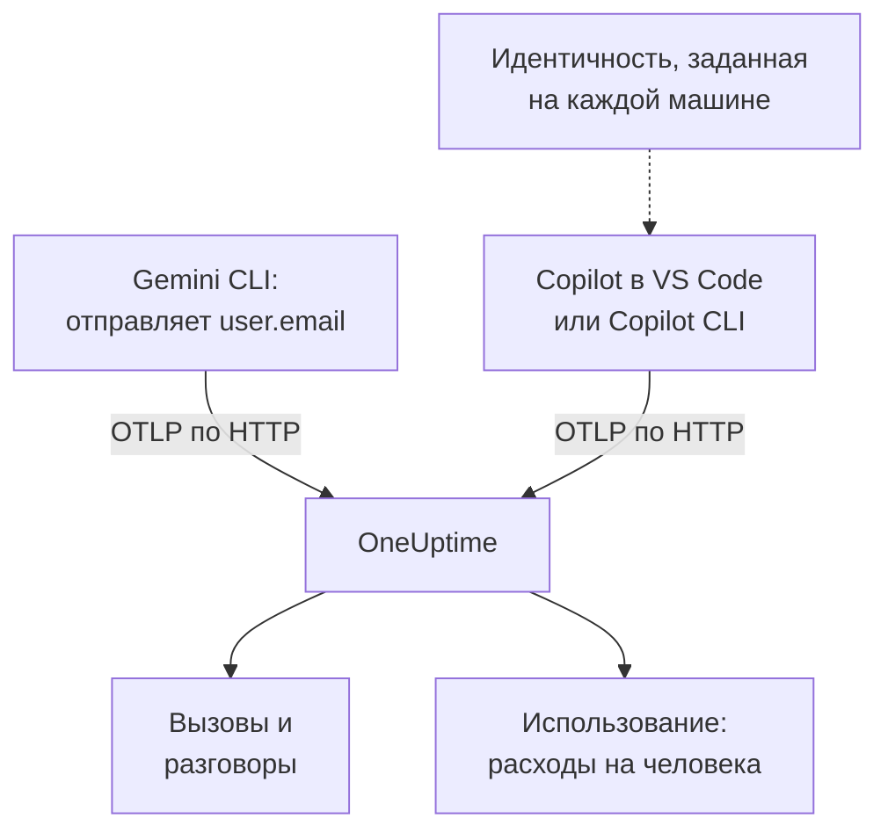

# Gemini CLI и GitHub Copilot

Gemini CLI и GitHub Copilot сами экспортируют OpenTelemetry: направьте их в OneUptime, и их вызовы моделей, токены, стоимость и вызовы инструментов появятся в [AI / LLM](/docs/telemetry/ai-llm-observability) рядом с ИИ-вызовами ваших собственных приложений. Они различаются тем, что важнее всего для распределения затрат: Gemini CLI называет человека в каждой записи, а Copilot не называет никого, поэтому каждого разработчика вы указываете сами.

:::cards
- [Gemini CLI](#настройте-gemini-cli): Включите телеметрию с трассировками и отправляйте её прямо в OneUptime.
- [GitHub Copilot](#настройте-github-copilot): Экспорт из VS Code или Copilot CLI.
- [Укажите каждого разработчика](#укажите-каждого-разработчика): Идентичность, которую Copilot не передаёт.
- [Устранение неполадок](#устранение-неполадок): Что проверить, если ничего не приходит.
:::

## Как это работает



| | Gemini CLI | GitHub Copilot |
| --- | --- | --- |
| Отправляет | Трассировки, метрики и логи | Трассировки, метрики и события, только из своих агентных интерфейсов |
| Называет человека | `user.email`, когда выполнен вход | Никого: вы задаёте `enduser.id` и `user.email` |
| Текст промптов | Отправляется, если вы не отключите `logPrompts` | Не отправляется, если вы не включите `captureContent` |
| По умолчанию отправляет на | `http://localhost:4317`, по gRPC | `http://localhost:4318`, по HTTP |

## Перед началом

- Ключ приёма: откройте **Настройки проекта → Телеметрия и APM → Ключи приема** и нажмите **Создать ключ приёма**.
- Базовый URL OTLP: `https://oneuptime.com/otlp` или `https://YOUR-ONEUPTIME-HOST/otlp`, если вы размещаете OneUptime самостоятельно.
- Ключ передаётся в заголовке `x-oneuptime-token` каждого запроса экспорта.

## Настройте Gemini CLI

Gemini CLI отправляет трассировки, метрики и события журнала и ставит `user.email` в каждую запись, когда выполнен вход. OneUptime читает `user.email` как сотрудника, поэтому расходы каждого человека видны без таблицы соответствий и без настройки на каждой машине.

:::steps
### Включите телеметрию

Добавьте блок `telemetry` в файл пользовательских настроек на каждой машине или в `.gemini/settings.json` в репозитории:

```json title="~/.gemini/settings.json"
{
  "telemetry": {
    "enabled": true,
    "target": "local",
    "otlpEndpoint": "https://oneuptime.com/otlp",
    "otlpProtocol": "http",
    "otlpHeaders": {
      "x-oneuptime-token": "YOUR_INGESTION_TOKEN"
    },
    "traces": true,
    "logPrompts": false
  }
}
```

### Начните новый сеанс

Gemini CLI читает настройки при запуске, поэтому перезапустите его и выполните промпт.

### Проверьте, что данные приходят

Откройте **Продукты → AI / LLM → Вызовы**: вызовы перечислены под сервисом `gemini-cli`, с моделью и токенами.
:::

Три настройки в этом блоке важнее остальных:

- `otlpProtocol: "http"`. Gemini CLI использует gRPC, если не указано иное. По HTTP он сам добавляет `/v1/traces`, `/v1/metrics` и `/v1/logs` к базовому URL. OneUptime также принимает gRPC на порту 443 (см. [OTLP по gRPC](/docs/telemetry/open-telemetry#otlp-поверх-grpc)), но HTTP проще.
- `traces: true`. По умолчанию эта настройка выключена, и без неё спаны Gemini CLI не несут ни модели, ни счётчиков токенов, так что рассчитать цену нельзя. Метрику стоимости Gemini CLI тоже не отправляет: включите трассировки, чтобы видеть, сколько стоят его вызовы.
- `logPrompts: false`. Прочитайте предупреждение ниже.

> [!WARNING]
> `logPrompts` по умолчанию равно `true`, поэтому включение телеметрии отправляет текст, который набирают ваши инженеры: часто исходный код, данные клиентов и вставленные учётные данные. Установите `false` тем же изменением, которое включает телеметрию. Если промпты нужны для отладки, решите это осознанно и маскируйте необходимое правилами очистки в **Трассировка → Настройки**.

### Настройки для парка машин

У каждой настройки есть переменная окружения, и переменные важнее файла `.gemini/settings.json` в репозитории, поэтому именно в них стоит задавать политику для парка машин, распространяемую через MDM:

```bash
export GEMINI_TELEMETRY_ENABLED=true
export GEMINI_TELEMETRY_TARGET=local
export GEMINI_TELEMETRY_OTLP_ENDPOINT="https://oneuptime.com/otlp"
export GEMINI_TELEMETRY_OTLP_PROTOCOL=http
export GEMINI_TELEMETRY_OTLP_HEADERS="x-oneuptime-token=YOUR_INGESTION_TOKEN"
export GEMINI_TELEMETRY_TRACES_ENABLED=true
export GEMINI_TELEMETRY_LOG_PROMPTS=false
```

| Настройка | Переменная | По умолчанию | Что делает |
| --- | --- | --- | --- |
| `enabled` | `GEMINI_TELEMETRY_ENABLED` | `false` | Включает телеметрию |
| `target` | `GEMINI_TELEMETRY_TARGET` | `local` | `local` отправляет на заданный вами эндпоинт; `gcp` отправляет в Google Cloud |
| `otlpEndpoint` | `GEMINI_TELEMETRY_OTLP_ENDPOINT` | `http://localhost:4317` | Куда отправляется телеметрия |
| `otlpProtocol` | `GEMINI_TELEMETRY_OTLP_PROTOCOL` | `grpc` | `grpc` или `http` |
| `otlpHeaders` | `GEMINI_TELEMETRY_OTLP_HEADERS` | Нет | Заголовки каждого экспорта: объект в файле, пары `key=value` или JSON в переменной |
| `traces` | `GEMINI_TELEMETRY_TRACES_ENABLED` | `false` | Добавляет в спаны модель, токены и содержимое |
| `logPrompts` | `GEMINI_TELEMETRY_LOG_PROMPTS` | `true` | Добавляет текст промптов в события журнала |
| `outfile` | `GEMINI_TELEMETRY_OUTFILE` | Нет | Записывает телеметрию в файл, чтобы увидеть, что было бы отправлено |

Флаги командной строки важнее переменных `GEMINI_TELEMETRY_*`, те важнее стандартных переменных `OTEL_EXPORTER_OTLP_*`, а те важнее `settings.json`. Gemini CLI читает и `OTEL_EXPORTER_OTLP_HEADERS`, так что заголовок, который вы уже задали для других инструментов, дойдёт и до него.

:::details Отправка через OpenTelemetry Collector
Коллектор на каждой машине или по одному на команду может собирать в пакеты, повторять и маршрутизировать телеметрию до того, как она попадёт в OneUptime. Оставьте у Gemini CLI значения по умолчанию, при которых он отправляет gRPC на `http://localhost:4317`, и пусть ключ добавляет коллектор:

```yaml title="otel-collector-config.yaml"
receivers:
  otlp:
    protocols:
      grpc:
        endpoint: 0.0.0.0:4317
      http:
        endpoint: 0.0.0.0:4318

exporters:
  otlphttp:
    endpoint: "https://oneuptime.com/otlp"
    headers:
      "x-oneuptime-token": "YOUR_INGESTION_TOKEN"

service:
  pipelines:
    traces:
      receivers: [otlp]
      exporters: [otlphttp]
    metrics:
      receivers: [otlp]
      exporters: [otlphttp]
    logs:
      receivers: [otlp]
      exporters: [otlphttp]
```

О запуске коллектора см. [OpenTelemetry](/docs/telemetry/open-telemetry).
:::

### Что отправляет Gemini CLI

| Метрика | Что содержит |
| --- | --- |
| `gen_ai.client.token.usage` | Входные и выходные токены: ряд, который считает OneUptime |
| `gemini_cli.token.usage` | Те же токены под собственным именем Gemini CLI плюс его токены `thought`, `cache` и `tool`; не учитывается, чтобы токены никогда не считались дважды |
| `gen_ai.client.operation.duration` | Сколько длился каждый вызов модели |
| `gemini_cli.api.request.count` | Вызовы модели |
| `gemini_cli.tool.call.count` | Вызовы инструментов |
| `gemini_cli.session.count` | Начатые сеансы |
| `gemini_cli.lines.changed` | Строки, изменённые агентом |

Его события журнала включают `gemini_cli.user_prompt`, `gemini_cli.api_request`, `gemini_cli.api_response`, `gemini_cli.api_error`, `gemini_cli.tool_call` и `gemini_cli.file_operation`. Каждая запись несёт `session.id`, `installation.id`, `active_approval_mode` и, когда выполнен вход, `user.email`. OneUptime читает `session.id` как ID разговора, поэтому весь сеанс Gemini CLI отображается как один разговор в **Разговоры**, сколько бы трассировок он ни занял.

Это обычные метрики OpenTelemetry: выведите любую из них на график дашборда или настройте по ней оповещение с помощью [монитора метрик](/docs/monitor/metrics-monitor).

## Настройте GitHub Copilot

GitHub документирует OpenTelemetry только для агентных интерфейсов Copilot:

| Интерфейс | Отправляет OpenTelemetry |
| --- | --- |
| Copilot Chat и режим агента в VS Code | Да |
| Copilot CLI | Да |
| Copilot SDK | Да |
| Агентные сценарии в IDE JetBrains | Да, задаётся в настройках плагина Copilot |
| Встроенные подсказки, Copilot на github.com, ревью кода Copilot | Не задокументировано |

Поэтому команда, которая в основном пользуется встроенными подсказками, выглядит в OneUptime бездействующей, как бы ни был настроен экспорт.

:::tabs
@tab VS Code
```json title="settings.json"
{
  "github.copilot.chat.otel.enabled": true,
  "github.copilot.chat.otel.exporterType": "otlp-http",
  "github.copilot.chat.otel.otlpEndpoint": "https://oneuptime.com/otlp",
  "github.copilot.chat.otel.captureContent": false
}
```
@tab Copilot CLI
```bash
export COPILOT_OTEL_ENABLED=true
export OTEL_EXPORTER_OTLP_ENDPOINT="https://oneuptime.com/otlp"
export OTEL_EXPORTER_OTLP_HEADERS="x-oneuptime-token=YOUR_INGESTION_TOKEN"
```
@tab Управляемые настройки
```json
{
  "telemetry": {
    "enabled": true,
    "endpoint": "https://oneuptime.com/otlp",
    "protocol": "http/protobuf",
    "serviceName": "github-copilot",
    "captureContent": false,
    "lockCaptureContent": true,
    "headers": {
      "x-oneuptime-token": "YOUR_INGESTION_TOKEN"
    }
  }
}
```
:::

- В настройках VS Code нет ключа для заголовков: задайте `OTEL_EXPORTER_OTLP_HEADERS` в окружении, из которого запускается VS Code, как и для Copilot CLI. Переменные окружения важнее настроек VS Code.
- Управляемые настройки, которые организация распространяет на VS Code и Copilot CLI, несут ключ в `headers` и важнее того, что задаёт каждый разработчик. `lockCaptureContent` оставляет сбор промптов выключенным для всех. `protocol` там означает формат передачи: `http/protobuf` или `http/json`.
- `captureContent` по умолчанию выключено, поэтому промпты и ответы не отправляются, пока вы его не включите.

## Укажите каждого разработчика

Copilot не отправляет идентичность, которую OneUptime мог бы использовать. Его настройка `captureIdentity` добавляет `user.name`, а Copilot CLI может добавить `enduser.pseudo.id`, но OneUptime не читает ни то, ни другое как сотрудника. Без идентичности все расходы Copilot попадают в одну строку **Без привязки** на вкладке **Использование**.

Задайте идентичность на каждой машине, в окружении, из которого запускаются VS Code и Copilot CLI: в профиле оболочки или в скрипте, который выполняет ваша MDM.

```bash
export OTEL_RESOURCE_ATTRIBUTES="enduser.id=alice@example.com,user.email=alice@example.com,team.id=platform,cost_center=eng-tools"
```

| Атрибут | OneUptime читает его как |
| --- | --- |
| `enduser.id` | ID сотрудника |
| `user.email` | Электронную почту сотрудника: имя, которое показывает вкладка **Использование** |
| `team.id`, `team`, `cost_center`, `department` | Команду или центр затрат |

Это атрибуты ресурса, поэтому они приходят как `resource.enduser.id`, `resource.user.email` и так далее: OneUptime читает каждый ключ идентичности и команды как с префиксом `resource.`, так и без него. Gemini CLI уже отправляет `user.email`; задавайте ему `OTEL_RESOURCE_ATTRIBUTES` только ради команды.

- Задайте идентичность до первого вызова: вызовы, пришедшие без неё, нельзя привязать задним числом.
- Не задавайте `resourceAttributes` в управляемых настройках Copilot: они важнее `OTEL_RESOURCE_ATTRIBUTES` и заменили бы идентичность, заданную на каждой машине.
- Не используйте `gen_ai.user` или `llm.user`. В приложении, которое обслуживает клиентов, они называют клиента, поэтому OneUptime никогда не читает их как сотрудника.

## Как выглядят данные Copilot

Copilot следует соглашениям OpenTelemetry GenAI, поэтому его вызовы видны в **Вызовы**, **Разговоры** и **Использование** так же, как вызовы ваших собственных приложений.

| Спан | Один на |
| --- | --- |
| `invoke_agent` | Ход агента |
| `chat` | Вызов модели |
| `execute_tool` | Вызов инструмента |
| `execute_hook` | Запуск хука |

Его спаны несут модель, `gen_ai.usage.input_tokens`, `gen_ai.usage.output_tokens` и `gen_ai.conversation.id`, поэтому весь ход агента отображается как один разговор. Оба интерфейса также отправляют метрики `gen_ai.client.token.usage` и `gen_ai.client.operation.duration` и события в сигнале логов OTLP: оставьте конвейер `logs` в любом коллекторе, который вы ставите посередине.

OneUptime рассчитывает цену каждого вызова по его модели и токенам по тарифам из **Цены**. Это стоимость токенов по прейскуранту, а не то, что вам выставляет GitHub: Copilot оплачивается за место и за премиум-запрос.

Места, их активности и оплаты премиум-запросов в OpenTelemetry нет вовсе: они доступны в REST API GitHub, который OneUptime не читает. Данные о местах и оплате берите из GitHub.

## Устранение неполадок

:::details Из Gemini CLI ничего не приходит
Обычная причина в том, что `otlpProtocol` остался со значением по умолчанию `grpc`, а эндпоинт задан как HTTP-адрес. Установите `otlpProtocol` в `http` и проверьте, что `otlpEndpoint` — это базовый URL, оканчивающийся на `/otlp`, и что задан заголовок `x-oneuptime-token`. Ненадолго задайте `outfile`, чтобы увидеть, что отправил бы Gemini CLI.
:::

:::details Вызовы Gemini CLI приходят без модели, токенов и стоимости
`traces` выключено. Включите его: без него спаны Gemini CLI не несут ни модели, ни счётчиков токенов, а метрику стоимости он не отправляет.
:::

:::details Расходы Copilot показываются как Без привязки
Идентичность не дошла до экспортёра. Проверьте, что `OTEL_RESOURCE_ATTRIBUTES` задана в окружении, из которого запустились VS Code или Copilot CLI, и что управляемые настройки Copilot не задают `resourceAttributes`, которые заменили бы её.
:::

:::details Copilot вообще ничего не отправляет
Проверьте, что нужные люди пользуются агентным интерфейсом, а не встроенными подсказками, и что `OTEL_EXPORTER_OTLP_HEADERS` содержит ключ: собственные настройки VS Code этого не умеют.
:::

:::details Ключ отклоняется
OneUptime отвечает `401` на отсутствующий, неизвестный или истёкший ключ и `422` на отключённый ключ или ключ браузера. Используйте серверный ключ, отправляемый в `x-oneuptime-token`.
:::

## Дальнейшие шаги

:::cards
- [ИИ-ассистенты для программирования](/docs/telemetry/ai-coding-assistants): Кто каким инструментом пользуется и сколько тратит каждый человек и каждая команда.
- [Наблюдаемость ИИ / LLM](/docs/telemetry/ai-llm-observability): Атрибуты, которые читает OneUptime, как рассчитывается стоимость, и дневные бюджеты.
- [Шлюзы ИИ](/docs/telemetry/ai-gateways): Инструменты без собственного экспорта, через шлюз.
:::
