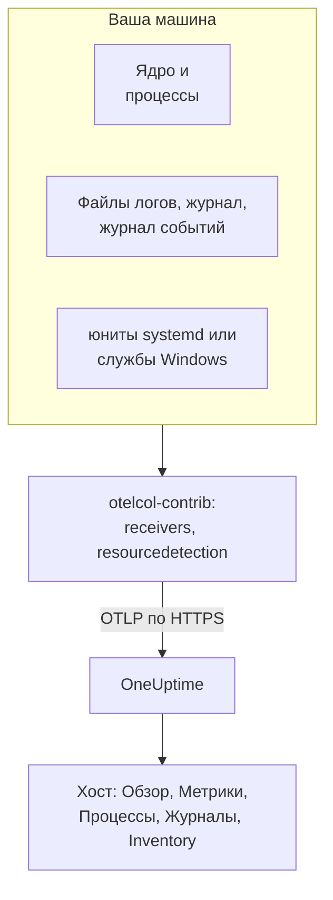

# OpenTelemetry-коллектор на хосте

Запустите OpenTelemetry Collector на машине с Linux, macOS или Windows, чтобы отправлять её метрики, процессы, логи и состояния служб в OneUptime. Машина появляется в разделе **Продукты → Инфраструктура → Хосты** со своими страницами, и никакой агент OneUptime устанавливать не нужно: коллектор — это выпуск `otelcol-contrib` из upstream. [Мониторы хостов](/docs/monitor/host-monitor) оповещают о том, что он отправляет.

:::cards
- [Установка коллектора](#установка-коллектора): Три шага на Linux, macOS или Windows.
- [Что собирать](#что-собирать): Метрики, файловые логи, журнал, журналы событий и состояния служб.
- [Атрибуты инвентаря](#атрибуты-инвентаря-ip-mac-серийный-номер-производитель-модель-прошивка): IP, MAC, серийный номер, производитель, модель и прошивка для вашей CMDB.
- [Отправляйте меньше](#сокращение-объёма-собираемых-данных): Меньше строк логов, более редкие интервалы, меньше рядов.
:::

## Как это работает

Коллектор читает машину через свои приёмники, помечает каждую запись идентичностью машины и отправляет её в OneUptime по OTLP с вашим ключом приёма. OneUptime регистрирует хост по его первым метрикам и заполняет его страницы по мере поступления данных.



| Что вы видите на хосте | Откуда это берётся |
| --- | --- |
| **Обзор** и **Метрики** | Приёмник `hostmetrics`: CPU, память, диски, файловые системы, сеть, нагрузка, подкачка. |
| **Процессы** | Сборщик `process` приёмника `hostmetrics`: один набор рядов на процесс. |
| **Журналы** | Приёмники `filelog`, `journald` и `windowseventlog`. |
| **Systemd Units** (Linux) | Приёмник `systemd`. |
| **Службы** (Windows) | Приёмник `windows_service`. |
| Элемент инвентаря | Процессор `resourcedetection`, а также [атрибуты, которые вы проставляете](#атрибуты-инвентаря-ip-mac-серийный-номер-производитель-модель-прошивка). |
| **Версия агента** | `oneuptime.agent.version` в процессоре `resource`. |

Хост регистрируется, как только пакет с `host.name` также содержит метрики `hostmetrics` или `process` либо атрибут `os.type`. Процессор `resourcedetection` задаёт их все, поэтому каждая конфигурация ставит его первым. Одни лишь `host.id` или `host.arch` хост не регистрируют, а телеметрия с идентичностью Kubernetes (`k8s.cluster.name`, `k8s.node.name`, `k8s.pod.name`) вместо этого относится к своему кластеру: узлы Kubernetes отслеживайте с помощью [агента Kubernetes](/docs/telemetry/kubernetes-agent).

## Перед началом

- Ключ приёма. Создайте его в разделе **Настройки проекта → Телеметрия и APM → Ключи приема** и скопируйте значение. Коллектор отправляет его в заголовке `x-oneuptime-token`.
- Права администратора на машине: `sudo` в Linux и macOS, PowerShell с повышенными правами в Windows.
- Исходящий HTTPS с машины на ваш URL OneUptime.
- Дистрибутив коллектора contrib, `otelcol-contrib`. В базовой сборке `otelcol` нет приёмников и процессоров, которые используют эти конфигурации. Приёмник `systemd` (Linux) работает начиная с v0.143.0, а приёмник `windows_service` (Windows) — с v0.155.0; команды ниже устанавливают v0.161.0, выпуск, который закрепляет OneUptime.

## Установка коллектора

:::steps
### Сохраните конфигурацию

Сохраните это как `config.yaml` в папке, из которой будете запускать команды установки, и замените `YOUR_TELEMETRY_INGESTION_TOKEN` своим ключом приёма (а конечную точку — своим URL, если OneUptime размещён у вас).

:::tabs
@tab Linux
```yaml title="config.yaml"
receivers:
  hostmetrics:
    collection_interval: 30s
    scrapers:
      cpu:
        metrics:
          system.cpu.utilization:
            enabled: true
          system.cpu.logical.count:
            enabled: true
      memory:
        metrics:
          system.memory.utilization:
            enabled: true
      disk:
      filesystem:
        metrics:
          system.filesystem.utilization:
            enabled: true
      load:
      network:
      paging:
      processes:
      process:
        mute_process_name_error: true
        mute_process_exe_error: true
        mute_process_io_error: true
        metrics:
          process.cpu.utilization:
            enabled: true
          process.memory.utilization:
            enabled: true

  # The systemd journal: every unit's logs, info and above.
  journald:
    directory: /var/log/journal
    priority: info

  # Powers the Systemd Units tab (otelcol-contrib v0.143.0+).
  systemd:
    collection_interval: 30s
    units: ["*.service"]
    metrics:
      systemd.service.cpu.time:
        enabled: false

processors:
  # Stamps host.name, host.id and os.type: this is how OneUptime attaches
  # telemetry to the host. Without it the host's pages stay empty.
  resourcedetection:
    detectors: [system, env]
    system:
      hostname_sources: [os]
      resource_attributes:
        host.name:
          enabled: true
        host.id:
          enabled: true
        host.arch:
          enabled: true
        host.ip:
          enabled: true
        host.mac:
          enabled: true
        os.type:
          enabled: true
        os.description:
          enabled: true
        os.version:
          enabled: true
  # The collector release this config is for: the host's Agent Version.
  resource:
    attributes:
      - key: oneuptime.agent.version
        value: "0.161.0"
        action: upsert
  batch:

exporters:
  otlphttp/oneuptime:
    endpoint: https://oneuptime.com/otlp
    headers:
      x-oneuptime-token: YOUR_TELEMETRY_INGESTION_TOKEN

service:
  pipelines:
    metrics:
      receivers: [hostmetrics, systemd]
      processors: [resourcedetection, resource, batch]
      exporters: [otlphttp/oneuptime]
    logs:
      receivers: [journald]
      processors: [resourcedetection, resource, batch]
      exporters: [otlphttp/oneuptime]
```
@tab macOS
```yaml title="config.yaml"
receivers:
  hostmetrics:
    collection_interval: 30s
    scrapers:
      cpu:
        metrics:
          system.cpu.utilization:
            enabled: true
          system.cpu.logical.count:
            enabled: true
      memory:
        metrics:
          system.memory.utilization:
            enabled: true
      disk:
      filesystem:
        metrics:
          system.filesystem.utilization:
            enabled: true
      load:
      network:
      paging:
      processes:
      process:
        mute_process_name_error: true
        mute_process_exe_error: true
        mute_process_io_error: true
        metrics:
          process.cpu.utilization:
            enabled: true
          process.memory.utilization:
            enabled: true

  filelog/system:
    include:
      - /var/log/install.log
      - /var/log/wifi.log
    start_at: end

processors:
  # Stamps host.name, host.id and os.type: this is how OneUptime attaches
  # telemetry to the host. Without it the host's pages stay empty.
  resourcedetection:
    detectors: [system, env]
    system:
      hostname_sources: [os]
      resource_attributes:
        host.name:
          enabled: true
        host.id:
          enabled: true
        host.arch:
          enabled: true
        host.ip:
          enabled: true
        host.mac:
          enabled: true
        os.type:
          enabled: true
        os.description:
          enabled: true
        os.version:
          enabled: true
  # The collector release this config is for: the host's Agent Version.
  resource:
    attributes:
      - key: oneuptime.agent.version
        value: "0.161.0"
        action: upsert
  batch:

exporters:
  otlphttp/oneuptime:
    endpoint: https://oneuptime.com/otlp
    headers:
      x-oneuptime-token: YOUR_TELEMETRY_INGESTION_TOKEN

service:
  pipelines:
    metrics:
      receivers: [hostmetrics]
      processors: [resourcedetection, resource, batch]
      exporters: [otlphttp/oneuptime]
    logs:
      receivers: [filelog/system]
      processors: [resourcedetection, resource, batch]
      exporters: [otlphttp/oneuptime]
```
@tab Windows
```yaml title="config.yaml"
receivers:
  hostmetrics:
    collection_interval: 30s
    scrapers:
      cpu:
        metrics:
          system.cpu.utilization:
            enabled: true
          system.cpu.logical.count:
            enabled: true
      memory:
        metrics:
          system.memory.utilization:
            enabled: true
      disk:
      filesystem:
        metrics:
          system.filesystem.utilization:
            enabled: true
      load:
      network:
      paging:
      processes:
      process:
        mute_process_name_error: true
        mute_process_exe_error: true
        mute_process_io_error: true
        metrics:
          process.cpu.utilization:
            enabled: true
          process.memory.utilization:
            enabled: true

  windowseventlog/system:
    channel: System
    start_at: end

  windowseventlog/application:
    channel: Application
    start_at: end

  windowseventlog/security:
    channel: Security
    start_at: end

  # Powers the Services tab (otelcol-contrib v0.155.0+).
  windows_service:
    collection_interval: 30s

processors:
  # Stamps host.name, host.id and os.type: this is how OneUptime attaches
  # telemetry to the host. Without it the host's pages stay empty.
  resourcedetection:
    detectors: [system, env]
    system:
      hostname_sources: [os]
      resource_attributes:
        host.name:
          enabled: true
        host.id:
          enabled: true
        host.arch:
          enabled: true
        host.ip:
          enabled: true
        host.mac:
          enabled: true
        os.type:
          enabled: true
        os.description:
          enabled: true
        os.version:
          enabled: true
  # The collector release this config is for: the host's Agent Version.
  resource:
    attributes:
      - key: oneuptime.agent.version
        value: "0.161.0"
        action: upsert
  batch:

exporters:
  otlphttp/oneuptime:
    endpoint: https://oneuptime.com/otlp
    headers:
      x-oneuptime-token: YOUR_TELEMETRY_INGESTION_TOKEN

service:
  pipelines:
    metrics:
      receivers: [hostmetrics, windows_service]
      processors: [resourcedetection, resource, batch]
      exporters: [otlphttp/oneuptime]
    logs:
      receivers:
        - windowseventlog/system
        - windowseventlog/application
        - windowseventlog/security
      processors: [resourcedetection, resource, batch]
      exporters: [otlphttp/oneuptime]
```
:::

Каждая конфигурация — это та, которую панель выводит в разделе **Продукты → Инфраструктура → Хосты → Документация**, с добавленным пайплайном логов: её процессоры — `resourcedetection`, `resource` и `batch`, а экспортёр — `otlphttp/oneuptime`. Она не задаёт `service.name`, поэтому телеметрия хоста принадлежит самому хосту и хранится как `host/<hostname>`. Добавляйте `service.name` в процессор `resource`, только если хотите, чтобы она хранилась под телеметрическим сервисом с этим именем.

### Установите и запустите коллектор

:::tabs
@tab Linux
В Debian или Ubuntu:

```bash
VERSION=0.161.0                      # the release OneUptime pins
ARCH=$(dpkg --print-architecture)   # amd64 or arm64

curl -fL -o /tmp/otelcol-contrib.deb \
  "https://github.com/open-telemetry/opentelemetry-collector-releases/releases/download/v${VERSION}/otelcol-contrib_${VERSION}_linux_${ARCH}.deb"
sudo dpkg -i /tmp/otelcol-contrib.deb
```

В RHEL, CentOS, Fedora или Amazon Linux:

```bash
VERSION=0.161.0
ARCH=$(uname -m | sed 's/x86_64/amd64/;s/aarch64/arm64/')

curl -fL -o /tmp/otelcol-contrib.rpm \
  "https://github.com/open-telemetry/opentelemetry-collector-releases/releases/download/v${VERSION}/otelcol-contrib_${VERSION}_linux_${ARCH}.rpm"
sudo rpm -Uvh /tmp/otelcol-contrib.rpm
```

Пакет устанавливает `/usr/bin/otelcol-contrib` и юнит systemd и запускает коллектор с конфигурацией по умолчанию. Положите на её место свою, разрешите пользователю коллектора читать журнал и перезапустите его:

```bash
sudo install -m 0644 config.yaml /etc/otelcol-contrib/config.yaml
sudo usermod -aG systemd-journal otelcol-contrib
sudo systemctl enable otelcol-contrib
sudo systemctl restart otelcol-contrib
sudo systemctl status otelcol-contrib
```

Юнит из пакета запускает коллектор от непривилегированного пользователя `otelcol-contrib`. Группа `systemd-journal` позволяет ему читать журнал; чтобы следить за файлами в `/var/log` (в Debian и Ubuntu их может читать группа `adm`), добавьте и эту группу. Чтобы сборщик `process` видел процессы других пользователей, выдайте ему capability `CAP_SYS_PTRACE`.
@tab macOS
```bash
VERSION=0.161.0
ARCH=$(uname -m | sed 's/x86_64/amd64/')   # arm64 on Apple silicon, amd64 on Intel

curl -fL -o /tmp/otelcol-contrib.tar.gz \
  "https://github.com/open-telemetry/opentelemetry-collector-releases/releases/download/v${VERSION}/otelcol-contrib_${VERSION}_darwin_${ARCH}.tar.gz"

sudo mkdir -p /usr/local/otelcol-contrib /usr/local/bin /etc/otelcol-contrib
sudo tar -xzf /tmp/otelcol-contrib.tar.gz -C /usr/local/otelcol-contrib
sudo ln -sf /usr/local/otelcol-contrib/otelcol-contrib /usr/local/bin/otelcol-contrib
sudo install -m 0644 config.yaml /etc/otelcol-contrib/config.yaml
```

Создайте `/Library/LaunchDaemons/com.oneuptime.otelcol-contrib.plist`, чтобы launchd запускал коллектор вместе с Mac и перезапускал его, если он остановится:

```xml title="/Library/LaunchDaemons/com.oneuptime.otelcol-contrib.plist"
<?xml version="1.0" encoding="UTF-8"?>
<!DOCTYPE plist PUBLIC "-//Apple//DTD PLIST 1.0//EN" "http://www.apple.com/DTDs/PropertyList-1.0.dtd">
<plist version="1.0">
<dict>
  <key>Label</key><string>com.oneuptime.otelcol-contrib</string>
  <key>ProgramArguments</key>
  <array>
    <string>/usr/local/bin/otelcol-contrib</string>
    <string>--config=/etc/otelcol-contrib/config.yaml</string>
  </array>
  <key>RunAtLoad</key><true/>
  <key>KeepAlive</key><true/>
  <key>StandardOutPath</key><string>/var/log/otelcol-contrib.out.log</string>
  <key>StandardErrorPath</key><string>/var/log/otelcol-contrib.err.log</string>
</dict>
</plist>
```

Загрузите его:

```bash
sudo launchctl load -w /Library/LaunchDaemons/com.oneuptime.otelcol-contrib.plist
sudo launchctl list | grep otelcol-contrib
```

Используйте этот архив tarball, а не Homebrew: формула Homebrew — это базовая сборка, которая отказывается запускаться с этой конфигурацией.
@tab Windows
В PowerShell с повышенными правами, в папке с `config.yaml`, выполните этот блок целиком: каждая строка зависит от переменных выше.

```powershell
$VERSION = "0.161.0"                          # the release OneUptime pins; v0.155.0+ has the Services tab
$ARCH    = "amd64"                            # use "arm64" on ARM hosts
$dest    = "C:\Program Files\otelcol-contrib"
$tar     = "$env:TEMP\otelcol-contrib.tar.gz"

# Note the "-contrib" in the asset name; otelcol_... is the wrong archive.
$url = "https://github.com/open-telemetry/opentelemetry-collector-releases/releases/download/v$VERSION/otelcol-contrib_${VERSION}_windows_${ARCH}.tar.gz"

New-Item -ItemType Directory -Force -Path $dest | Out-Null
Invoke-WebRequest -Uri $url -OutFile $tar
tar -xf $tar -C $dest                          # tar.exe ships with Windows 10 1803+ / Server 2019+
Get-ChildItem $dest                            # expect otelcol-contrib.exe, not otelcol.exe
Copy-Item config.yaml "$dest\config.yaml" -Force

# --% hands the rest of the line to sc.exe unchanged, so its quoting
# survives PowerShell — keep the command on one line.
sc.exe --% create "otelcol-contrib" binPath= "\"C:\Program Files\otelcol-contrib\otelcol-contrib.exe\" --config=\"C:\Program Files\otelcol-contrib\config.yaml\"" start= auto DisplayName= "OpenTelemetry Collector (OneUptime)"
sc.exe description "otelcol-contrib" "Collects host telemetry and forwards it to OneUptime over OTLP."
sc.exe start "otelcol-contrib"
sc.exe query "otelcol-contrib"
```

Служба работает от `LocalSystem`, которая может читать журнал событий `Security` и все службы Windows. В Windows сборщик `load` лишь эмулирует среднюю нагрузку по счётчику *Processor Queue Length*, начиная с 0.

Имя файла выпуска должно начинаться с `otelcol-contrib_`. Базовый архив `otelcol_<version>_windows_amd64.tar.gz` распаковывает `otelcol.exe`, в котором нет приёмников `windowseventlog` и `windows_service`; переименование в `otelcol-contrib.exe` их не добавляет. Предпочитаете установщик? На той же [странице выпусков](https://github.com/open-telemetry/opentelemetry-collector-releases/releases) есть подписанный `otelcol-contrib_<version>_windows_x64.msi`, который регистрирует службу за вас: укажите ему этот `config.yaml` и оставьте службу на `LocalSystem`.
:::

### Убедитесь, что хост появился

Откройте **Продукты → Инфраструктура → Хосты → Все хосты**. Хост появляется под своим именем, как только приходят первые метрики, обычно в течение 30 секунд, и его страницы **Обзор**, **Метрики**, **Процессы** и **Журналы** заполняются. Если этого не происходит, прочитайте собственные логи коллектора:

:::tabs
@tab Linux
```bash
sudo journalctl -u otelcol-contrib -f
```
@tab macOS
```bash
tail -f /var/log/otelcol-contrib.err.log
```
@tab Windows
```powershell
Get-WinEvent -LogName Application -MaxEvents 20 | Where-Object ProviderName -eq "otelcol-contrib"
```
:::
:::

Чтобы создать тестовую строку лога, выполните `logger "hello from oneuptime"` (Linux, macOS) или `eventcreate /T INFORMATION /ID 999 /L APPLICATION /SO OneUptimeTest /D "hello from oneuptime"` (Windows, с повышенными правами), а затем откройте страницу **Журналы** хоста.

## Что собирать

Все конфигурации устроены одинаково: приёмники для того, что читать, процессоры `resourcedetection`, `resource` и `batch` и экспортёр `otlphttp/oneuptime`. Добавьте приёмники ниже в `receivers:` и в их пайплайн, затем перезапустите коллектор (`sudo systemctl restart otelcol-contrib`, `launchctl unload` и `load` на Mac, `Restart-Service otelcol-contrib` в Windows). Встраивайте каждый фрагмент в уже имеющиеся разделы конфигурации: второй ключ `processors:` или `service:` заменяет первый.

### Метрики хоста

`hostmetrics` работает в любой ОС. Он читает из ядра CPU, память, диски, файловые системы, сеть, нагрузку, подкачку и процессы с интервалом `collection_interval`. Метрики `*.utilization` и `system.cpu.logical.count` в приёмнике по умолчанию выключены, а графики хоста и шаблоны оповещений Host их читают, поэтому оставляйте их включёнными, как в конфигурациях выше. Сборщик `process` наполняет страницу **Процессы**; он же — крупнейший источник рядов (см. [Отправляйте меньше](#сокращение-объёма-собираемых-данных)).

В Linux коллектор читает `/proc` и `/sys`. Коллектор в контейнере должен смонтировать их с хоста и задать `HOST_PROC` и `HOST_SYS` (см. [В контейнере Docker](#в-контейнере-docker)); нативной установке ничего не нужно.

### Файловые логи

Следите за любым файлом лога на диске с помощью приёмника `filelog` и добавьте его в пайплайн `logs`:

```yaml
receivers:
  filelog/app:
    include:
      - /var/log/myapp/*.log
    start_at: end
    multiline:
      # A new entry starts with a timestamp; continuation lines (the
      # "at ...", "File ...", "Caused by: ..." frames) are folded into it.
      line_start_pattern: '^\d{4}-\d{2}-\d{2}[ T]\d{2}:\d{2}:\d{2}'
```

`start_at: end` читает только новые строки; используйте `beginning`, чтобы при первом запуске прочитать файлы с начала. Коллектор запоминает позицию в каждом файле, поэтому после перезапуска продолжает с нужного места.

OneUptime ищет трассировки стека в строках логов уровней error и fatal и группирует их в **Исключения** под хостом. Для этого многострочная трассировка стека (Java, Python, .NET, Ruby) должна приходить одной записью — это и делает `multiline`; без него каждый фрейм становится отдельным логом. Если ваше приложение может само записывать атрибуты OpenTelemetry `exception.type`, `exception.message` и `exception.stacktrace`, это ещё надёжнее.

На хосте с systemd файлы `/var/log/syslog` и `/var/log/messages` повторяют то, что уже есть в журнале, поэтому читайте что-то одно.

### Журнал systemd

На хосте с systemd приёмник `journald` читает логи всех юнитов в одном месте, вместе с их структурированными полями. Конфигурация для Linux выше читает их все с уровня `info` и выше; ограничьте её некоторыми юнитами:

```yaml
receivers:
  journald:
    directory: /var/log/journal
    units:
      # Drop this list to ingest everything; restrict it to limit volume.
      - ssh.service
      - cron.service
      - nginx.service
    priority: info
```

Приёмник запускает `journalctl`, который есть на каждом хосте с systemd, а пользователь коллектора должен входить в группу `systemd-journal`.

### Службы Linux (юниты systemd, метрики)

Страница хоста **Systemd Units** показывает каждый юнит и его состояние на основе [`systemdreceiver`](https://github.com/open-telemetry/opentelemetry-collector-contrib/tree/main/receiver/systemdreceiver) (тип в конфигурации `systemd`) — это аналог страницы **Службы** в Windows для Linux. Конфигурация для Linux выше включает его:

```yaml
receivers:
  systemd:
    collection_interval: 30s
    # The service manager to read: "system" (default) or "user".
    scope: system
    # Which units to scrape, as systemctl unit patterns. The default is
    # every service; widen it to include timers, sockets or mounts, or
    # narrow it to cut volume on hosts with hundreds of units:
    units: ["*.service"]
    # units: [nginx.service, postgresql.service, "*.timer"]
    metrics:
      # Per-service CPU time is on by default and doubles this receiver's
      # datapoint count. The Systemd Units tab does not use it, so turn it
      # off unless you chart it. On v0.142.0 the key is
      # systemd.unit.cpu.time — naming a metric the running build does not
      # have stops the collector at startup.
      systemd.service.cpu.time:
        enabled: false

service:
  pipelines:
    metrics:
      receivers: [hostmetrics, systemd]
      processors: [resourcedetection, resource, batch]
```

Приёмник впервые появился в `otelcol-contrib` v0.142.0, а первый выпуск, который стоит запускать, — v0.143.0. На любой более старой версии добавление `systemd` приводит к ошибке при запуске `'receivers' unknown type: "systemd"`; только v0.142.0 называет свою метрику CPU `systemd.unit.cpu.time` и ищет статистику cgroup у каждого юнита, из-за чего пишет ошибку опроса для каждого юнита, который не является `.service`.

Он отправляет `systemd.unit.state` как набор состояний: при каждом опросе каждый юнит получает по одной точке данных на каждое возможное состояние (`active`, `reloading`, `inactive`, `failed`, `activating`, `deactivating`, `maintenance`, `refreshing`) — `1` для текущего состояния и `0` для остальных. Имя юнита — это атрибут ресурса `systemd.unit.name`, а состояние — атрибут точки данных `systemd.unit.active_state`. Поскольку имя юнита — атрибут ресурса, `resourcedetection` должен оставаться в пайплайне метрик: он проставляет `host.name` на ресурс каждого юнита, и без него выборки никогда не привязываются к хосту.

Он читает состояние юнитов через системную шину D-Bus с помощью вызовов только для чтения, которые делает `systemctl list-units` и которые systemd разрешает без привилегий. Поэтому службе из пакета, работающей от пользователя `otelcol-contrib`, а не от root, дополнительные права не нужны. Шина же ей нужна: у коллектора в контейнере нет `/run/dbus/system_bus_socket`, если вы не смонтируете его с хоста, поэтому используйте нативную установку. Приёмник находится в стадии alpha и работает только в Linux.

> [!WARNING]
> Набор состояний стоит восемь точек данных на юнит за опрос, а включённая по умолчанию `systemd.service.cpu.time` добавляет ещё две (`user` и `system`): 10 точек данных на юнит за опрос. Хост, отслеживающий 300 юнитов каждые 30 секунд, отправляет около 6 000 точек данных в минуту только от этого приёмника, или около 4 800 с выключенной метрикой CPU. Прежде чем включать его на целом парке машин, сузьте `units:` до служб, по которым вы настраиваете оповещения, или увеличьте `collection_interval`.

### Apple Unified Log

macOS пишет системные логи в Apple Unified Log, который читается командами `log show` и `log stream`, а не в `/var/log/system.log`. Чтобы собирать его, направляйте его поток в файл небольшим скриптом `/usr/local/otelcol-contrib/log-stream.sh`:

```bash title="/usr/local/otelcol-contrib/log-stream.sh"
#!/bin/bash
exec /usr/bin/log stream --style ndjson --level info \
  --predicate 'subsystem != "com.apple.cfnetwork"' \
  >> /var/log/apple-unified.log
```

Сделайте его исполняемым и запустите под launchd (или через `nohup` для быстрой проверки), затем направьте приёмник `filelog` на этот файл:

```yaml
receivers:
  filelog/apple-unified:
    include:
      - /var/log/apple-unified.log
    start_at: end
    operators:
      - type: json_parser
        timestamp:
          parse_from: attributes.timestamp
          layout: "%Y-%m-%d %H:%M:%S.%f%j"
```

Многим паркам Mac достаточно метрик хоста и нескольких файловых логов, без unified log.

### Журналы событий Windows

Конфигурация для Windows выше подписывается на каналы `System`, `Application` и `Security`. Чтобы ограничить объёмный канал `Security` некоторыми идентификаторами событий:

```yaml
windowseventlog/security:
  channel: Security
  start_at: end
  query: "*[System[(EventID=4625 or EventID=4740)]]"
```

Чтобы читать другой канал (что угодно в *Event Viewer → Applications and Services Logs*), укажите его точное имя:

```yaml
windowseventlog/iis:
  channel: Microsoft-IIS-Logging/Logs
  start_at: end
```

### Службы Windows (метрики)

Страница хоста **Службы** показывает каждую службу Windows с её состоянием и типом запуска на основе [`windowsservicereceiver`](https://github.com/open-telemetry/opentelemetry-collector-contrib/tree/main/receiver/windowsservicereceiver) (тип в конфигурации `windows_service`). Он входит в `otelcol-contrib` начиная с v0.155.0: в более ранних выпусках добавление `windows_service` приводит к ошибке при запуске `'receivers' unknown type: "windows_service"`. Конфигурация для Windows выше включает его:

```yaml
receivers:
  windows_service:
    collection_interval: 30s
    # Collect every service by default. To cut volume — and avoid the
    # "access denied" noise from services the collector can't open —
    # list just the ones you care about:
    # include_services: [Spooler, W3SVC, MSSQLSERVER]
    # Or collect everything except a few:
    # exclude_services: [TrustedInstaller]

service:
  pipelines:
    metrics:
      receivers: [hostmetrics, windows_service]
```

Он отправляет по одному показателю `windows.service.status` на службу — состояние службы Win32 (`4` — работает, `1` — остановлена) — с атрибутами `name` и `startup_mode`. Коллектор читает все службы от имени `LocalSystem` и пропускает те, которые не может открыть. Приёмник находится в стадии alpha и работает только в Windows; если ошибка опроса или `access denied` на одной службе влияет на остальные, ограничьте его с помощью `include_services`.

`include_services` может только сузить набор. Если вы перечислили службы, но по-прежнему видите все, изменённая конфигурация не дошла до работающего коллектора: перезапустите службу, проверьте, что `include_services` — заполненный список с тем же отступом, что и `collection_interval`, и подождите несколько минут, пока службы, о которых сообщалось до изменения, не уйдут из скользящего окна страницы **Службы**. Имена — это точные имена ключей служб с учётом регистра (`Spooler`, `W3SVC`), которые выводит `Get-Service | Select-Object Name`.

### Метки

Любой атрибут ресурса, начинающийся с `oneuptime.label.`, становится меткой проекта на хосте: `oneuptime.label.<dimension>=<value>` — это метка `<dimension>:<value>`. Добавьте для них процессор и укажите его в пайплайнах:

```yaml
processors:
  resource/oneuptime-labels:
    attributes:
      - key: oneuptime.label.team
        value: payments
        action: upsert
      - key: oneuptime.label.env
        value: production
        action: upsert

service:
  pipelines:
    metrics:
      processors: [resourcedetection, resource, resource/oneuptime-labels, batch]
```

Метки сравниваются без учёта регистра, поэтому существующая метка `Production` используется повторно, а не дублируется, а метки, добавленные в OneUptime, коллектор никогда не удаляет.

### Атрибуты инвентаря (IP, MAC, серийный номер, производитель, модель, прошивка)

Каждый хост также получает элемент инвентаря — запись, которую читает экспорт в CMDB. Его сведения заполняются прямо из атрибутов ресурса в отправляемой вами телеметрии, поэтому что пришло, то и может забрать синхронизация с CMDB.

| Что нужно | Атрибут | Откуда берётся |
| --- | --- | --- |
| IP-адреса | `host.ip` | `resourcedetection`, через запятую, если у машины их несколько |
| MAC-адреса | `host.mac` | `resourcedetection`, по одному на каждый активный интерфейс, через запятую |
| Архитектура | `host.arch` | `resourcedetection` |
| Идентификатор машины | `host.id` | `resourcedetection`: GUID машины в Windows, `/etc/machine-id` в Linux |
| ОС | `os.type`, `os.description`, `os.version` | `resourcedetection` |
| Серийный номер | `host.serial_number` | Проставляется вами, из WMI или DMI |
| Производитель | `device.manufacturer` | Проставляется вами, из WMI или DMI |
| Модель | `device.model.name` | Проставляется вами, из WMI или DMI |
| Версия прошивки (BIOS или UEFI) | `device.firmware.version` | Проставляется вами, из WMI или DMI |

Конфигурации выше включают все обнаруживаемые атрибуты: в детекторе system по умолчанию включены только `host.name` и `os.type`, поэтому остальные перечислены в `resource_attributes`. Если вы собираете собственную конфигурацию, сохраните этот блок `resourcedetection`: без него нет `host.name`, а значит, нет ни хоста, ни элемента инвентаря.

#### Для серийного номера, производителя, модели и версии прошивки детектора нет

Они хранятся в прошивке машины, которую коллектор не читает. В Linux это не настройка, которую можно изменить: коллектор из пакета работает от непривилегированного пользователя `otelcol-contrib`, а `/sys/class/dmi/id/product_serial` может читать только root. Поэтому прочитайте их один раз, при подготовке машины, и проставьте на ресурс отдельным процессором:

```yaml
processors:
  resource/oneuptime-hardware:
    attributes:
      - key: host.serial_number
        value: "7XYZ123"
        action: upsert
      - key: device.manufacturer
        value: "Dell Inc."
        action: upsert
      - key: device.model.name
        value: "OptiPlex 7090"
        action: upsert
      - key: device.firmware.version
        value: "1.21.0"
        action: upsert

service:
  pipelines:
    metrics:
      processors: [resourcedetection, resource, resource/oneuptime-hardware, batch]
```

Добавьте `resource/oneuptime-hardware` в уже имеющийся список процессоров, а не вставляйте эту строку вместо него: уберёте `resource` — и хост потеряет поле **Версия агента**. В любом случае держите `resourcedetection` первым: именно он привязывает пакет к хосту.

`host.manufacturer`, `host.model.name`, `host.firmware.version` и `host.bios.version` принимаются как альтернативные написания и сохраняются под ключами `device.*` выше, поэтому конфигурация, написанная любым из способов, попадает в одно место; если есть оба, побеждает значение `device.*`. С серийным номером наоборот: `device.serial_number` принимается и сохраняется как `host.serial_number`.

> [!NOTE]
> На ресурсе без идентичности хоста `device.manufacturer` означает «мобильное приложение»: это один из атрибутов, по которым пакет считается мобильным Real User Monitoring. У ресурса хоста всегда есть `host.name` или `host.id`, поэтому конфигурацию коллектора вроде приведённой выше никогда не примут за телефон, но не используйте тот же блок в конфигурации SDK мобильного приложения.

#### Чтение значений

В Windows, из PowerShell с повышенными правами. Скрипт выводит YAML-блок для машины, на которой его запускают:

```powershell
$bios = Get-CimInstance -ClassName Win32_BIOS
$cs   = Get-CimInstance -ClassName Win32_ComputerSystem

# Quote for YAML: trim, escape any embedded quote, wrap in single quotes.
# The cast to string first is what keeps this working on machines whose
# firmware leaves a field empty — .Trim() on $null throws.
function Format-YamlValue($value) {
  "'" + ("$value".Trim() -replace "'", "''") + "'"
}

@"
  resource/oneuptime-hardware:
    attributes:
      - key: host.serial_number
        value: $(Format-YamlValue $bios.SerialNumber)
        action: upsert
      - key: device.manufacturer
        value: $(Format-YamlValue $cs.Manufacturer)
        action: upsert
      - key: device.model.name
        value: $(Format-YamlValue $cs.Model)
        action: upsert
      - key: device.firmware.version
        value: $(Format-YamlValue $bios.SMBIOSBIOSVersion)
        action: upsert
"@
```

Он выводит одну запись процессора, уже с отступами: добавьте её внутрь вашего блока `processors:`, а не вторым ключом `processors:`. Используйте `Get-CimInstance`, а не устаревший `Get-WmiObject`, которого в PowerShell 7 и новее больше нет. Поле, которое прошивка оставляет пустым, выводится как `''`: уберите такой атрибут, а не отправляйте пустой. У виртуальных машин серийного номера часто нет вовсе.

В Linux, от root:

```bash
cat /sys/class/dmi/id/product_serial   # host.serial_number
cat /sys/class/dmi/id/sys_vendor       # device.manufacturer
cat /sys/class/dmi/id/product_name     # device.model.name
cat /sys/class/dmi/id/bios_version     # device.firmware.version
```

`bios_version` — единственный из четырёх, который может читать любой пользователь. На машинах без `/sys/class/dmi` команды `dmidecode -s system-serial-number`, `-s system-manufacturer`, `-s system-product-name` и `-s bios-version` возвращают те же значения. Виртуальные машины сообщают здесь свой гипервизор (`QEMU`, `VMware, Inc.`, `Amazon EC2`), что обычно и нужно в CMDB.

На Mac:

```bash
ioreg -l | awk -F'"' '/IOPlatformSerialNumber/{print $4}'   # host.serial_number
sysctl -n hw.model                                          # device.model.name
system_profiler SPHardwareDataType | awk -F': ' '/System Firmware Version/{print $2}'   # device.firmware.version
```

Производитель — `Apple Inc.` `hw.model` возвращает идентификатор модели, например `Mac14,7` или `MacBookPro18,3`, а не маркетинговое название, которое Mac не сообщает: если оно нужно, сопоставьте идентификатор в своей CMDB. Всё равно указывайте его в `device.model.name`: `device.model.identifier` помечает пакет как мобильное приложение, что бы ещё в нём ни было, поэтому Mac с этим атрибутом будет сохранён как телефон и отвязан от своего хоста.

#### Использование переменных окружения вместо процессора

Детектор `env` включён, поэтому вместо процессора работает `OTEL_RESOURCE_ATTRIBUTES`:

```text
OTEL_RESOURCE_ATTRIBUTES=host.serial_number=7XYZ123,device.manufacturer=Dell%20Inc.,device.model.name=OptiPlex%207090
```

Кодируйте каждое значение процентным кодированием. Переменная читается как список W3C Baggage вида `key=value`, где `,` и `=` разделяют записи, а пробелы не переносимы между версиями коллектора; кавычки не помогают, и `device.manufacturer="Dell Inc."` может прийти с кавычками внутри значения. В Windows значение кодирует `[System.Uri]::EscapeDataString($value)`.

Задайте её для собственной службы коллектора, а не для всей машины:

- **Linux:** `sudo systemctl edit otelcol-contrib`, затем секция `[Service]` с `Environment="OTEL_RESOURCE_ATTRIBUTES=…"`.
- **Windows:** значение `Environment` (тип `REG_MULTI_SZ`) в `HKLM\SYSTEM\CurrentControlSet\Services\otelcol-contrib`. `sc.exe create` не умеет задавать переменные окружения службы, а `setx` задаёт переменную, которую работающая служба больше никогда не перечитывает.

> [!WARNING]
> Не задавайте её для всей машины (`setx /M`, `/etc/environment`). Каждый процесс с OpenTelemetry SDK на машине наследует `OTEL_RESOURCE_ATTRIBUTES`, поэтому ваши приложения сообщали бы `device.manufacturer` машины как свой, а ресурс приложения с `device.manufacturer` и без `host.name` или `host.id` считается мобильным приложением, из-за чего он отвязывается от своего сервиса.

С процессором проще не ошибиться: он по своей конструкции ограничен коллектором, а значения для машины никогда не меняются. Предпочитайте его, если вы ещё не генерируете файлы окружения по шаблонам.

#### MAC-адрес — не проставляемое значение

`host.mac` берётся из детектора `system`, как и `host.ip`: один адрес на каждый активный сетевой интерфейс, кроме loopback, в форме IEEE, которую задаёт OpenTelemetry (`AC-DE-48-23-45-67`). Машина с Docker или Hyper-V сообщает и свои виртуальные коммутаторы, поэтому значение — это список. Интерфейс, сообщающий нулевую заглушку (`00-00-00-00-00-00`), не учитывается.

Ничто на машине не сообщает о доступной для обновления версии прошивки, поэтому OneUptime записывает установленную версию.

#### Проверка результата

Откройте элемент хоста в разделе **Продукты → Инвентарь** и посмотрите на карточку **Сведения об активе**. Значения появляются в течение нескольких минут после следующего пакета; сведение, о котором коллектор ещё не сообщил, отображается как неизвестное, со ссылкой обратно на этот раздел. Поскольку они проставляются, а не обнаруживаются, сами они не обновляются: проставьте их заново после замены материнской платы, обновления прошивки или переустановки системы.

## Другие способы запуска коллектора

### В контейнере Docker

Запустите коллектор в контейнере, который видит процессы и файловые системы хоста, из папки с `config.yaml`:

```bash
docker run -d \
  --name otel-collector \
  --restart unless-stopped \
  --network host \
  --pid host \
  -v $(pwd)/config.yaml:/etc/otelcol-contrib/config.yaml:ro \
  --volume /:/hostfs:ro,rslave \
  -e HOST_PROC=/hostfs/proc \
  -e HOST_SYS=/hostfs/sys \
  -e HOST_ETC=/hostfs/etc \
  -e HOST_VAR=/hostfs/var \
  -e HOST_RUN=/hostfs/run \
  -e HOST_DEV=/hostfs/dev \
  otel/opentelemetry-collector-contrib:0.161.0 \
  --config /etc/otelcol-contrib/config.yaml
```

`--network host`, `--pid host`, монтирование `/hostfs` и переменные `HOST_*` позволяют `hostmetrics` и `process` читать ядро хоста, а не контейнера. Используйте только пайплайн метрик из конфигурации: в образе нет `journalctl`, а приёмнику `systemd` нужна D-Bus хоста.

### Из архива выпуска

Там, где пакеты не подходят, распакуйте статический бинарный файл и создайте для него собственный юнит systemd:

```bash
VERSION=0.161.0
ARCH=$(uname -m | sed 's/x86_64/amd64/;s/aarch64/arm64/')

curl -fL -o /tmp/otelcol.tar.gz \
  "https://github.com/open-telemetry/opentelemetry-collector-releases/releases/download/v${VERSION}/otelcol-contrib_${VERSION}_linux_${ARCH}.tar.gz"
sudo mkdir -p /opt/otelcol-contrib
sudo tar -xzf /tmp/otelcol.tar.gz -C /opt/otelcol-contrib
sudo install -m 0644 config.yaml /opt/otelcol-contrib/config.yaml
```

```ini title="/etc/systemd/system/otelcol-contrib.service"
[Unit]
Description=OpenTelemetry Collector
After=network.target

[Service]
ExecStart=/opt/otelcol-contrib/otelcol-contrib --config /opt/otelcol-contrib/config.yaml
Restart=on-failure
RestartSec=5s
User=root

[Install]
WantedBy=multi-user.target
```

```bash
sudo systemctl daemon-reload
sudo systemctl enable --now otelcol-contrib
```

`User=root` позволяет этому юниту читать все файлы логов и все процессы; установка из пакета выше — непривилегированная альтернатива.

### На узлах Kubernetes

Узлы Kubernetes в OneUptime не являются хостами: их телеметрия несёт идентичность Kubernetes и относится к кластеру. Установите [агент Kubernetes](/docs/telemetry/kubernetes-agent): каждый узел появится на странице кластера **Узлы**, рядом со своими подами.

## Обновление коллектора

Каждая конфигурация на этой странице проставляет выпуск коллектора, для которого она написана, как `oneuptime.agent.version` в своём процессоре `resource`. OneUptime показывает его как **Версия агента** на странице **Обзор** хоста и выводит рядом предупреждающий значок, когда OneUptime закрепляет более новый выпуск. Нажмите на значок, чтобы увидеть, как обновиться тем же способом, которым вы устанавливали.

Чтобы обновиться вручную, установите новый выпуск так же, как устанавливали этот, с новой `VERSION` (в Debian и Ubuntu `sudo dpkg -i --force-confold` сохраняет вашу конфигурацию без вопросов), задайте ту же версию в `oneuptime.agent.version` в `config.yaml` и перезапустите коллектор. Коллектор, конфигурация которого не проставляет версию, не показывает её и никогда не показывает значок.

## Сокращение объёма собираемых данных

Конфигурация принадлежит вам, поэтому ничто не покидает машину, если его не читает добавленный вами приёмник. Если хост отправляет больше, чем нужно (это видно по росту приёма, а в OneUptime Cloud — по росту затрат), урежьте его здесь. Два главных рычага — какие логи вы читаете и как часто опрашиваете метрики; остальное делает процессор `filter`. Меняйте по одному рычагу за раз и перезапускайте коллектор после каждой правки.

### Откуда берётся объём

| Сигнал | Главный фактор | Как уменьшить |
| --- | --- | --- |
| Логи | Каждая строка каждого файла, юнита журнала или канала событий | Меньше приёмников, более узкие `units:` или `query:`, `filter` по важности |
| Метрики хоста | Частота опроса, умноженная на число рядов | Более длинный `collection_interval`, меньше сборщиков |
| Кардинальность метрик | Метрики по процессам: один набор рядов на процесс | Исключение или сужение сборщика `process` |
| Юниты systemd | 10 точек данных на юнит за опрос (набор состояний и CPU) | Более узкий `units:`, выключенная метрика CPU, более длинный `collection_interval` |

### Читайте только нужные логи

Логи почти всегда составляют наибольшую долю, а коллектор читает только то, что вы перечислили, поэтому перечисляйте меньше:

- Направляйте `filelog` на конкретные файлы, а не на широкие маски: `/var/log/myapp/error.log` вместо `/var/log/**`.
- Сузьте `journald` до нужных юнитов и поднимите `priority`, чтобы отбрасывать `info` и `debug` ещё до того, как они покинут машину:

```yaml
receivers:
  journald:
    directory: /var/log/journal
    units:
      - ssh.service
      - nginx.service
    priority: warning # info and debug are dropped before export
```

- Сузьте объёмный канал событий `Security` до идентификаторов событий, которые вы проверяете, с помощью `query:` (как в разделе [Журналы событий Windows](#журналы-событий-windows)), или откажитесь от канала.

### Опрашивайте метрики реже

Объём `hostmetrics` растёт вместе с `collection_interval`: если разрешение в 30 секунд избыточно, интервал в 60 секунд вдвое сокращает число точек данных.

```yaml
receivers:
  hostmetrics:
    collection_interval: 60s
```

### Сузьте сборщик по процессам

Сборщик `process` отправляет набор рядов для каждого работающего процесса, поэтому на загруженной машине он — крупнейший источник рядов. Исключите его, если вам не нужна страница **Процессы**, или ограничьте важными процессами (в любом случае оставьте `processes` — несколько счётчиков процессов):

```yaml
receivers:
  hostmetrics:
    collection_interval: 60s
    scrapers:
      cpu:
      memory:
      disk:
      filesystem:
      network:
      load:
      paging:
      processes: # aggregate counts only — cheap
      process:
        mute_process_name_error: true
        mute_process_exe_error: true
        mute_process_io_error: true
        include:
          names: [nginx, postgres, node]
          match_type: strict
```

Это урезает приёмник до его метрик по умолчанию: верните блоки `metrics:` из конфигураций выше под `cpu`, `memory`, `filesystem` и `process`, если вы пользуетесь графиками хоста и шаблонами оповещений Host.

### Сузьте юниты systemd

Приёмник `systemd` при каждом опросе отправляет по точке данных на каждое состояние каждого юнита, восемь на юнит, плюс две для включённой по умолчанию `systemd.service.cpu.time`, поэтому его объём зависит от того, сколько юнитов подходит под `units:`. Значение по умолчанию `["*.service"]` включает десятки разовых юнитов, которые никогда не меняют состояние. Перечислите юниты, по которым настраиваете оповещения, и выключите метрику CPU, если не строите по ней графики:

```yaml
receivers:
  systemd:
    collection_interval: 60s
    units: [nginx.service, postgresql.service, ssh.service]
    metrics:
      # On otelcol-contrib v0.142.0 this key is systemd.unit.cpu.time.
      systemd.service.cpu.time:
        enabled: false
```

Вместе эти меры сокращают хост с 300 юнитами примерно с 6 000 точек данных в минуту до значительно меньше 100. Юниты, убранные из списка, исчезают со страницы **Systemd Units** через несколько минут, когда их последние выборки выходят из скользящего окна.

### Отбрасывайте записи процессором filter

Если приёмник нужен, но не весь его вывод, добавьте процессор [`filter`](https://github.com/open-telemetry/opentelemetry-collector-contrib/tree/main/processor/filterprocessor). Он вычисляет условие [OTTL](https://github.com/open-telemetry/opentelemetry-collector-contrib/blob/main/pkg/ottl/README.md) и отбрасывает каждую подходящую запись ещё до отправки.

Отбрасывайте логи ниже заданной важности:

```yaml
processors:
  filter/drop-low-severity:
    error_mode: ignore
    logs:
      log_record:
        # Drop anything less severe than WARN (info, debug, trace).
        # The UNSPECIFIED guard is required — see the warning below.
        - "severity_number != SEVERITY_NUMBER_UNSPECIFIED and severity_number < SEVERITY_NUMBER_WARN"
```

> [!WARNING]
> Сохраните защиту `UNSPECIFIED`. `SEVERITY_NUMBER_UNSPECIFIED` равно `0`, а `SEVERITY_NUMBER_WARN` — `13`, поэтому голое условие `severity_number < SEVERITY_NUMBER_WARN` истинно для каждой записи, важность которой так и не была разобрана. Обычный приёмник `filelog` не извлекает важность из строки, поэтому без защиты условие молча удаляет каждую прочитанную строку, нигде не выдавая ошибки. С защитой неразобранные записи сохраняются и приходят с важностью `Unspecified` — а это говорит о том, что вам нужен парсер важности.

Чтобы правильно фильтровать файловые логи по важности, сначала разберите её оператором [`severity_parser`](https://github.com/open-telemetry/opentelemetry-collector-contrib/blob/main/pkg/stanza/docs/operators/severity_parser.md) в приёмнике:

```yaml
receivers:
  filelog/app:
    include:
      - /var/log/myapp/*.log
    start_at: end
    operators:
      # Pull a level out of lines like "2026-01-01 ERROR something broke".
      - type: regex_parser
        regex: '(?i)(?P<level>TRACE|DEBUG|INFO|WARN(?:ING)?|ERROR|FATAL)'
        parse_from: body
        # Lines with no recognisable level fall through unparsed rather
        # than being discarded, and are then kept by the guard above.
        on_error: send
      - type: severity_parser
        parse_from: attributes.level
        preset: default
        mapping:
          warn: warning
          error: err
          fatal: panic
```

На хосте с systemd журналу всё это не нужно: `priority:` в `journald` фильтрует по уровню прямо в `journalctl`.

Отбрасывайте метрики, по которым не строите графики, по точному имени или по шаблону:

```yaml
processors:
  filter/drop-metrics:
    error_mode: ignore
    metrics:
      metric:
        # Exact metric name.
        - 'name == "system.paging.faults"'
        # Or a whole family. IsMatch is RE2 and UNANCHORED, so anchor it
        # yourself with ^ when you mean "starts with".
        - 'IsMatch(name, "^system\\.paging\\.")'
```

Чтобы отправлять только фиксированный набор метрик, инвертируйте условие: `filter` отбрасывает то, что подходит, поэтому `not (...)` отбрасывает всё, что вы не назвали. Держите условие в одной строке:

```yaml
processors:
  filter/allowlist:
    error_mode: ignore
    metrics:
      metric:
        - 'not (name == "system.cpu.utilization" or name == "system.memory.utilization" or name == "system.filesystem.utilization")'
```

Список разрешённых — тяжёлый молот: всё, что вы забыли назвать, пропадает вместе с построенными на нём мониторами. Лучше отбрасывайте немногие ненужные метрики или исключите сборщик, который их создаёт: метрику, которая никогда не собирается, фильтровать ничего не стоит.

Затем добавьте процессор в его пайплайн перед `batch`:

```yaml
service:
  pipelines:
    metrics:
      receivers: [hostmetrics]
      processors: [filter/drop-metrics, resourcedetection, resource, batch]
      exporters: [otlphttp/oneuptime]
    logs:
      receivers: [journald]
      processors: [filter/drop-low-severity, resourcedetection, resource, batch]
      exporters: [otlphttp/oneuptime]
```

Пайплайн, в котором указан процессор или экспортёр, не определённый в конфигурации, останавливает коллектор при запуске. Оставьте `resourcedetection`, который привязывает телеметрию к хосту, и `resource`, который сообщает версию коллектора. `filter` — процессор из contrib, поэтому базовая сборка эту конфигурацию отклоняет.

### Минимальная отправная точка

Хост только с метриками, с крупным интервалом и без рядов по процессам — наименьший полезный объём:

```yaml title="config.yaml"
receivers:
  hostmetrics:
    collection_interval: 60s
    scrapers:
      cpu:
        metrics:
          system.cpu.utilization:
            enabled: true
          system.cpu.logical.count:
            enabled: true
      memory:
        metrics:
          system.memory.utilization:
            enabled: true
      disk:
      filesystem:
        metrics:
          system.filesystem.utilization:
            enabled: true
      load:
      network:
      paging:
      processes:

processors:
  # Stamps host.name, host.id and os.type: this is how OneUptime attaches
  # telemetry to the host. Without it the host's pages stay empty.
  resourcedetection:
    detectors: [system, env]
    system:
      hostname_sources: [os]
      resource_attributes:
        host.name:
          enabled: true
        host.id:
          enabled: true
        host.arch:
          enabled: true
        host.ip:
          enabled: true
        host.mac:
          enabled: true
        os.type:
          enabled: true
        os.description:
          enabled: true
        os.version:
          enabled: true
  # The collector release this config is for: the host's Agent Version.
  resource:
    attributes:
      - key: oneuptime.agent.version
        value: "0.161.0"
        action: upsert
  batch:

exporters:
  otlphttp/oneuptime:
    endpoint: https://oneuptime.com/otlp
    headers:
      x-oneuptime-token: YOUR_TELEMETRY_INGESTION_TOKEN

service:
  pipelines:
    metrics:
      receivers: [hostmetrics]
      processors: [resourcedetection, resource, batch]
      exporters: [otlphttp/oneuptime]
```

Верните пайплайн `logs` с узким приёмником `filelog` или `journald`, когда он понадобится.

> [!CAUTION]
> Следите за тем, что урезаете. Монитору логов нужно, чтобы логи приходили, поэтому отфильтрованная важность или канал заглушают мониторы, которые за ними следят, а шаблонам оповещений Host нужны метрики `*.utilization`. Урезайте данные, по которым вы не действуете, а не те, за которыми следит монитор, и через день-два проверьте снижение в разделе **Настройки проекта → История использования** (использование считается по дням), прежде чем браться за следующий рычаг.

## Самостоятельно размещённый OneUptime и прокси

В самостоятельно размещённом OneUptime направьте экспортёр на собственный экземпляр; если он работает только по HTTP, используйте `http://` и его порт:

```yaml
exporters:
  otlphttp/oneuptime:
    endpoint: https://your-oneuptime-host.example.com/otlp
    headers:
      x-oneuptime-token: YOUR_TELEMETRY_INGESTION_TOKEN
```

За прокси коллектор использует стандартные переменные `HTTPS_PROXY`, `HTTP_PROXY` и `NO_PROXY`. Задайте их для его службы:

- **Linux:** дополнительный файл `/etc/systemd/system/otelcol-contrib.service.d/proxy.conf` с секцией `[Service]` и `Environment="HTTPS_PROXY=http://proxy.example.com:3128"`; затем `sudo systemctl daemon-reload` и перезапуск коллектора.
- **macOS:** словарь `EnvironmentVariables` в plist.
- **Windows:** значение `Environment` в `HKLM\SYSTEM\CurrentControlSet\Services\otelcol-contrib`.

## ИИ-агент

Коллектор отправляет то, что сообщает хост; **ИИ-агент хоста** позволяет OneUptime AI спрашивать сам хост, пока он расследует там инцидент или оповещение. Он выполняет команды только для чтения — `systemctl status nginx --no-pager -n 50`, `journalctl -u nginx -n 200 --no-pager`, `df -h`, `free -m`, `ps aux --sort=-%cpu`, `ss -tulpn` — и, только если вы это разрешите, применяет исправления, например перезапуск указанного юнита systemd. Это Linux-контейнер (образ `oneuptime/resource-ai-agent:release`) со своим установщиком, которому нужны Docker (системный движок, а не rootless Docker) и плагин Docker Compose:

```bash
curl -fsSL https://raw.githubusercontent.com/OneUptime/oneuptime/master/agents/HostAIAgent/install.sh -o install.sh
sudo bash install.sh
```

- **ИИ-расследования включены по умолчанию.** Как только агент подключается, OneUptime AI расследует с его помощью инциденты и оповещения на этом хосте, а страница **Обзор** хоста показывает статус агента. Чтобы отключить это, задайте `ONEUPTIME_AI_INVESTIGATION=false` там, где работает агент (как это сделать, показывает **Изменить** в разделе **Что может делать ИИ** на странице ИИ-агента), или удалите агента.
- Он регистрируется под `HOST_NAME`; оставьте его пустым, чтобы использовать собственное имя хоста — именно его этот коллектор сообщает как `host.name`, если вы не задали другое имя. Они должны совпадать, чтобы агент обслуживал хост, созданный этим коллектором. Он появляется на странице хоста **ИИ-агент** в OneUptime.
- Он запускает собственные программы хоста, входя в его пространства имён через `nsenter`, поэтому работает привилегированно, от root, с `pid: host`: на хосте он — root. Границу задаёт политика команд агента: только команды для чтения, если вы не задали `ONEUPTIME_AI_ALLOW_WRITES=true`, никогда оболочка, `sudo` или программа не из его списка, и никогда он сам, юнит этого коллектора или что-либо из `ONEUPTIME_AI_PROTECTED_TARGETS`.
- При `ONEUPTIME_AI_ALLOW_WRITES=true` переменная `ONEUPTIME_AI_WRITE_TARGETS` (полные имена юнитов, например `nginx.service,app-*`) ограничивает, какие юниты может затрагивать исправление. `ONEUPTIME_AI_FIXES` задаёт, как выполняются исправления — `ask-for-approval` (каждое одобряет человек), `automatic` или `bypass-approval`, — а страница ИИ-агента показывает это только для чтения; установщик записывает обе переменные из своего окружения в `.env` агента ([Что может делать ИИ, задаётся агентом](/docs/ai/infrastructure-ai-agents#what-ai-may-do-set-by-the-agent)).

Что он может запускать, как работают исправления и как устранять неполадки: [Infrastructure AI Agents](/docs/ai/infrastructure-ai-agents#hosts).

## Устранение неполадок

:::details Хост не появляется в OneUptime
1. Прочитайте логи коллектора на предмет ошибок экспорта (см. [Убедитесь, что хост появился](#убедитесь-что-хост-появился)). Для подробностей добавьте в конфигурацию `service.telemetry.logs.level: debug`.
2. HTTP `401` означает, что ключ приёма отсутствует, неверен или истёк; `422` — что он отключён или является ключом браузера, который не может отправлять телеметрию хоста. Создайте ключ в разделе **Настройки проекта → Телеметрия и APM → Ключи приема** и обновите `x-oneuptime-token`.
3. Проверьте, что машина достигает OneUptime: `curl -v https://oneuptime.com/otlp` (или ваш собственный URL) с той же машины.
4. Оставьте `resourcedetection` в пайплайне метрик: он задаёт `host.name`, по которому OneUptime распознаёт хост.
:::

:::details Коллектор не может прочитать журнал или файл лога
Коллектор из пакета работает от непривилегированного пользователя `otelcol-contrib`. Добавьте его в группу, которая может читать логи, и перезапустите: `sudo usermod -aG systemd-journal otelcol-contrib` для журнала и группу `adm` для большей части `/var/log` в Debian и Ubuntu. Для `journald` команда `journalctl` должна быть в `PATH` коллектора, а каталог `/var/log/journal` должен существовать (его создаёт `sudo systemd-tmpfiles --create --prefix /var/log/journal`).
:::

:::details Служба Windows завершается с ошибкой Error 2: The system cannot find the file specified
Диспетчер управления службами не находит программу, с которой была зарегистрирована служба. Выполните `sc.exe qc "otelcol-contrib"` и сравните `BINARY_PATH_NAME` с содержимым `C:\Program Files\otelcol-contrib`. Почти всегда был скачан базовый архив `otelcol_<version>_windows_amd64.tar.gz`: он распаковывает `otelcol.exe`, тогда как служба указывает `otelcol-contrib.exe`, который есть только в архиве `otelcol-contrib_<version>_...`. Скачайте файл contrib заново; не переименовывайте `otelcol.exe` — это даст ошибку `1064`, описанную ниже. Другая причина — `binPath=` без кавычек: путь через `C:\Program Files` разбивается на пробеле, если не заключён в кавычки ровно так, как показано в шаге установки.
:::

:::details Служба Windows завершается с ошибкой Error 1064
Диспетчер служб запустил программу, но коллектор завершился при запуске. Так ведёт себя переименованный `otelcol.exe`: в базовой сборке нет приёмников `windowseventlog` и `windows_service`, поэтому она отклоняет конфигурацию. То же делает путь `--config` без кавычек, который разбивается на пробеле в `Program Files`. Проверьте, что у вас:

- `otelcol-contrib.exe --version` должен выводить `otelcol-contrib version ...`; `otelcol version ...` — это переименованная базовая сборка.
- `otelcol-contrib.exe components` должен перечислять `windowseventlog` и `windows_service` среди приёмников (а не `hostmetrics`, который есть и в базовой сборке).
- Запустите его на переднем плане, чтобы увидеть настоящую ошибку: `& "C:\Program Files\otelcol-contrib\otelcol-contrib.exe" --config="C:\Program Files\otelcol-contrib\config.yaml"`.
- *Event Viewer → Windows Logs → Application*, источник `otelcol-contrib`, содержит ошибку запуска, которую проглотил диспетчер служб.
:::

:::details Журнал событий Security возвращает отказ в доступе
У службы не хватает прав. Запускайте её от `LocalSystem` (значение по умолчанию для `sc.exe create`) или выдайте её учётной записи право пользователя *Manage auditing and security log*.
:::

:::details Приёмник systemd сообщает об ошибке D-Bus, или страница Systemd Units пуста
- Коллектор не может достучаться до системной шины: проверьте, что `/run/dbus/system_bus_socket` существует и что пользователь коллектора может его открыть; быстрее всего проверить это командой `systemctl list-units`, запущенной от этого пользователя. Root не требуется. Коллектор в контейнере не видит шину, если вы не смонтируете сокет хоста.
- Страница пуста, хотя приёмник работает: оставьте `resourcedetection` в том же пайплайне метрик. Приёмник привязывает к ресурсу каждого юнита только `systemd.unit.name`, поэтому без `resourcedetection` нет `host.name`, и выборки никогда не привязываются к хосту.
- Ошибка опроса для каждого юнита или отказ коллектора запускаться из-за неизвестной метрики — это расхождение версий: v0.142.0 читает статистику cgroup у каждого юнита и называет свою метрику CPU `systemd.unit.cpu.time`; v0.143.0 и новее читают только службы и называют её `systemd.service.cpu.time`. Используйте v0.143.0 или новее и в любом переопределении `metrics:` указывайте ключ, который есть в вашей сборке.
:::

:::details Графики CPU и памяти или шаблоны оповещений Host не показывают данных
Они читают `system.cpu.utilization`, `system.memory.utilization` и `system.filesystem.utilization`, которые `hostmetrics` оставляет выключенными, пока вы их не включите. Скопируйте блоки `metrics:` под `cpu`, `memory` и `filesystem` из конфигураций выше в свою и перезапустите коллектор.
:::

:::details Слишком много данных или большой счёт
См. [Сокращение объёма собираемых данных](#сокращение-объёма-собираемых-данных): сузьте приёмники (каналы Windows, юниты systemd, файлы логов), опрашивайте реже, сузьте сборщик по процессам или отбрасывайте записи процессором `filter` до отправки.
:::

## Дальнейшие шаги

:::cards
- [Мониторинг хостов](/docs/monitor/host-monitor): Оповещения по CPU, памяти, диску и процессам.
- [Мониторинг журналов](/docs/monitor/logs-monitor): Оповещения по шаблонам в логах, например по неудачным входам в 5-минутном окне.
- [Экспорт в CMDB](/docs/inventory/cmdb-sync): Передавайте атрибуты инвентаря в вашу CMDB.
- [Мониторинг сервера / ВМ](/docs/monitor/server-monitor): Следите и за доступностью сервера извне.
:::
