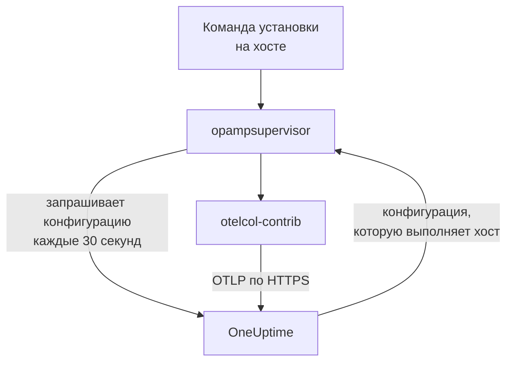

# Хосты

Добавьте машину с Linux, Windows или macOS в OneUptime одной командой. Команда устанавливает на хост OpenTelemetry Collector, а OneUptime отправляет коллектору конфигурацию и поддерживает её в актуальном состоянии: не нужно писать `config.yaml`, копировать его на каждый хост и следить, чтобы копии совпадали. Чтобы изменить, что собирают ваши хосты, один раз измените конфигурацию коллектора, и каждый хост, к которому она относится, получит изменение в течение минуты.

:::cards
- [Добавить хост](#добавить-хост): Одна команда в Linux, Windows или macOS.
- [Изменить, что собирают хосты](#изменить-что-собирают-хосты): Конфигурации коллектора по системе и метке, с сохранением каждой версии.
- [Проверить коллектор хоста](#проверить-коллектор-хоста): Какую конфигурацию он выполняет, её версия и почему конфигурация не запустилась.
- [Что разрешено конфигурации](#что-разрешено-конфигурации): Читать хост и отправлять данные только в этот OneUptime.
:::

## Как это работает

Команда устанавливает две программы из релизов OpenTelemetry Collector, каждую из которых проверяет по SHA-256, опубликованному для релиза: `otelcol-contrib`, коллектор, который читает хост, и `opampsupervisor`, который запускает коллектор и держит его на конфигурации, отправляемой OneUptime по OpAMP, OpenTelemetry Agent Management Protocol. Обе работают как служба `oneuptime-collector`.



Супервизор запрашивает у OneUptime конфигурацию хоста примерно каждые 30 секунд с вашим ключом приёма и сообщает, какую конфигурацию выполняет хост и запустилась ли она. Хост регистрируется в разделе **Хосты** при первом подключении супервизора, под именем машины, и его страницы заполняются по мере поступления метрик и логов.

Каждый хост выполняет одну конфигурацию, выбранную в таком порядке:

| Хост выполняет | Когда |
| --- | --- |
| Конфигурацию, выбранную для него на его странице **Коллектор** | Кто-то её выбрал. |
| Первую подходящую ему конфигурацию из списка **Конфигурации коллектора** | Конфигурация относится к хосту, если она предназначена для его системы и, если в ней указаны метки, у хоста есть одна из них. |
| Конфигурацию OneUptime по умолчанию для его системы | Ни одна конфигурация не подходит. |

Конфигурация OneUptime по умолчанию читает процессор, память, диски, файловые системы, сеть и процессы в любой системе; журнал и юниты systemd в Linux, если они есть на хосте; журналы событий System, Application и Security и службы Windows в Windows; и логи установки и Wi-Fi в `/var/log` в macOS. Она не учитывает файловые системы, заполненные по замыслу, например пакеты snap и `/dev` в macOS, поэтому из-за них шаблон High Filesystem Usage никогда не срабатывает без конца. Она обновляется вместе с релизами OneUptime, поэтому хост на конфигурации по умолчанию получает все её улучшения.

## Перед началом

- Ключ приёма. **Добавить хост** создаст его для вас, или выберите созданный в разделе **Настройки проекта → Телеметрия и APM → Ключи приема**.
- Права администратора на хосте: `sudo` в Linux и macOS, PowerShell от имени администратора в Windows.
- Linux с systemd, Windows 10 или Windows Server 2019 и новее, либо macOS на Apple silicon или Intel.
- Исходящий HTTPS с хоста на ваш URL OneUptime, напрямую или через прокси.

## Добавить хост

:::steps
### Откройте «Добавить хост»

Откройте **Продукты → Инфраструктура → Хосты** и выберите **Добавить хост**. Укажите, что работает на хосте: Linux, Windows или macOS. Узлы кластера Kubernetes отслеживает [Kubernetes Agent](/docs/telemetry/kubernetes-agent).

### Выберите ключ приёма

Выберите ключ или создайте его в диалоге. Команда ниже подставит его.

### Выполните команду на хосте

Скопируйте команду из диалога и выполните её на хосте. Это занимает около минуты. Вот те же команды, где вместо примеров будут ваш URL OneUptime и ваш ключ:

:::tabs
@tab Linux
```bash
curl -fsSL https://oneuptime.com/docs/static/scripts/host-collector/install.sh | sudo sh -s -- --url https://oneuptime.com --key YOUR_INGESTION_KEY
```
@tab macOS
```bash
curl -fsSL https://oneuptime.com/docs/static/scripts/host-collector/install.sh | sudo sh -s -- --url https://oneuptime.com --key YOUR_INGESTION_KEY
```
@tab Windows
```powershell
[Net.ServicePointManager]::SecurityProtocol = [Net.ServicePointManager]::SecurityProtocol -bor [Net.SecurityProtocolType]::Tls12; & ([scriptblock]::Create((Invoke-RestMethod -Uri 'https://oneuptime.com/docs/static/scripts/host-collector/install.ps1'))) -Url 'https://oneuptime.com' -Key 'YOUR_INGESTION_KEY'
```
:::

Каждый OneUptime раздаёт собственные установщики, поэтому самостоятельно размещённый OneUptime выдаёт установщик своего релиза: замените `https://oneuptime.com` на свой URL в обоих местах.

### Дождитесь хоста

Последний шаг диалога сообщает, когда хост подключится, и даёт ссылку на него. В списке он отображается как **Запускается**, пока не придут первые метрики, обычно в течение минуты, а затем как подключённый, с коллектором в состоянии **Выполняется**. Страница **Топология** хоста рисует на одной карте то, что на нём работает, что его вызывает и что вызывает он: см. [Топология](/docs/telemetry/topology#открыть-карту-отдельного-ресурса).
:::

## Метки хостов

Добавьте метки в команду, и они будут у хоста с момента подключения:

:::tabs
@tab Linux
```bash
curl -fsSL https://oneuptime.com/docs/static/scripts/host-collector/install.sh | sudo sh -s -- --url https://oneuptime.com --key YOUR_INGESTION_KEY --label env=production --label team=payments
```
@tab macOS
```bash
curl -fsSL https://oneuptime.com/docs/static/scripts/host-collector/install.sh | sudo sh -s -- --url https://oneuptime.com --key YOUR_INGESTION_KEY --label env=production --label team=payments
```
@tab Windows
```powershell
[Net.ServicePointManager]::SecurityProtocol = [Net.ServicePointManager]::SecurityProtocol -bor [Net.SecurityProtocolType]::Tls12; & ([scriptblock]::Create((Invoke-RestMethod -Uri 'https://oneuptime.com/docs/static/scripts/host-collector/install.ps1'))) -Url 'https://oneuptime.com' -Key 'YOUR_INGESTION_KEY' -Label 'env=production','team=payments'
```
:::

`env=production` становится меткой `env:production`. Метки только добавляются и никогда не снимаются: выполните команду снова с другой меткой, и у хоста будут обе. Метки также можно ставить в списке **Хосты** или в разделе **Правила меток**. Конфигурация коллектора, в которой указаны метки, предназначена только для хостов с одной из них, поэтому одна и та же команда с разными метками даёт каждой группе хостов свою конфигурацию.

## Изменить, что собирают хосты

:::steps
### Создайте конфигурацию коллектора

Откройте **Продукты → Инфраструктура → Хосты → Конфигурации коллектора** и выберите **Создать: Конфигурация коллектора**. Задайте ей имя, систему хостов, для которых она предназначена, и, чтобы охватить только часть из них, их метки. Её конфигурация начинается с конфигурации OneUptime по умолчанию для этой системы.

### Измените её config.yaml

На странице конфигурации выберите **Изменить конфигурацию**, измените YAML и сохраните. OneUptime сначала проверяет его и отклоняет конфигурацию, которую не может отправить, объясняя причину: см. [Что разрешено конфигурации](#что-разрешено-конфигурации).

### Проследите, как она доходит до хостов

Каждое сохранённое изменение — новая версия, и хосты, к которым она относится, получают её в течение минуты. Список **Хосты** конфигурации показывает каждый хост, состояние его коллектора и версию, которую он выполняет.
:::

Хост выполняет первую подходящую ему конфигурацию из списка: перетаскивайте строки в разделе **Конфигурации коллектора**, чтобы изменить порядок. Ставьте первыми самые узкие конфигурации, например для веб-серверов с `env:production`, а широкие, например для всех хостов Linux, после них. Карточка **Конфигурации OneUptime по умолчанию** под списком показывает, что выполняет хост, если ни одна конфигурация не подходит.

### Версии и возврат

Список **Версии** конфигурации хранит каждое сохранённое изменение, сначала новые, с тем, кто и когда его сохранил. Выберите **Просмотр**, чтобы прочитать версию, и **Вернуть**, чтобы снова отправить её на хосты: она сохраняется как новая версия с пометкой, какую версию она вернула, поэтому список всегда показывает, что получил каждый хост.

### Выберите конфигурацию для одного хоста

На странице **Коллектор** хоста выберите **Сменить конфигурацию** и укажите конфигурацию только для этого хоста. Предлагаются конфигурации для системы хоста и для любой системы. Выберите «Автоматически», чтобы вернуть хост к списку. Хост, выбранная конфигурация которого удалена, сам возвращается к списку.

### Когда конфигурация не запускается

Супервизор проверяет новую конфигурацию коллектором, прежде чем перейти на неё, и возвращается к последней рабочей конфигурации, если новая не запускается. Хост всё это время продолжает отправлять данные. На его странице **Коллектор** отображается **Сбой конфигурации** с причиной от коллектора, например файл лога, который коллектору нельзя читать, и OneUptime не отправляет эту конфигурацию хосту снова, пока она не изменится. Устранив причину на хосте, выберите **Повторить попытку**, чтобы отправить её ещё раз.

## Что разрешено конфигурации

Конфигурация, которую отправляет OneUptime, выполняется на каждом хосте, к которому она относится, поэтому OneUptime проверяет её при каждом сохранении и отклоняет ту, что нарушает правило:

| Правило | Почему |
| --- | --- |
| Только receivers, processors, exporters, extensions и connectors из списка OneUptime | Она читает хост и службы на нём. Компонента, который запускает программы или читает учётные данные облака или кластера, в списке нет. |
| Данные покидают хост только через экспортёр `otlp_http`, на `${env:ONEUPTIME_URL}/otlp` с заголовком `x-oneuptime-token: ${env:ONEUPTIME_INGESTION_KEY}` | Каждый хост отправляет данные в этот OneUptime с ключом, с которым он был установлен. Ни одна конфигурация не содержит ключа. |
| `${env:NAME}` — единственный `${...}`, который она может использовать | `${file:...}` или `${https:...}` читались бы на каждом хосте и могли бы быть переданы дальше. |
| Нет параметров, которые запускают программу или отправляют прочитанный файл, например `journalctl_path` в journald | Конфигурации нельзя выходить за пределы чтения хоста. |

Конфигурация всё же может оказаться такой, которую хост не может выполнить, например receiver для другой системы или файл лога, которого там нет. Коллектор на каждом хосте проверяет это перед переходом, как описано в разделе [Когда конфигурация не запускается](#когда-конфигурация-не-запускается).

## Проверить коллектор хоста

Откройте хост и его страницу **Коллектор**. Она показывает состояние коллектора, выполняемую конфигурацию и **Почему эта конфигурация**, выполняемую версию, его **Последний отчёт** и **Релиз коллектора**. В разделе **На хосте** приведены команды для проверки из командной оболочки на хосте: работает ли его служба, его лог и перезапуск.

:::tabs
@tab Linux
```bash
sudo systemctl status oneuptime-collector
sudo journalctl -u oneuptime-collector -n 50
sudo systemctl restart oneuptime-collector
```
@tab macOS
```bash
sudo launchctl print system/com.oneuptime.collector
sudo tail -n 50 /usr/local/oneuptime-collector/log/collector.log
sudo launchctl kickstart -k system/com.oneuptime.collector
```
@tab Windows
```powershell
Get-Service oneuptime-collector
Get-WinEvent -FilterHashtable @{ LogName = 'Application'; ProviderName = 'oneuptime-collector' } -MaxEvents 50 | Format-List TimeCreated, Message
Restart-Service oneuptime-collector
```
:::

В Linux коллектор работает от непривилегированного пользователя `oneuptime-collector` в группах `systemd-journal` и `adm`, чтобы читать журнал и логи в `/var/log`. В macOS он работает от root, как демоны launchd, а в Windows от LocalSystem, чтобы читать все журналы событий и службы Windows.

## Хосты, настроенные вручную

Хост, коллектор которого вы установили сами по руководству [OpenTelemetry Collector на хосте](/docs/telemetry/host-otel-collector), продолжает передавать данные как раньше, и OneUptime не отправляет ему конфигурацию. Чтобы передать его OneUptime, откройте страницу **Коллектор** хоста: её команда добавляет `--replace-existing`, что останавливает и отключает установленный вручную коллектор (службу `otelcol-contrib`), чтобы хост не передавал данные дважды. Хост сохраняет имя, историю и метки.

## Параметры установки

Выполните команду снова, чтобы изменить любой из них или перейти на более новый релиз: она заменяет то, что установила, и сохраняет хост в OneUptime как есть.

| Linux и macOS | Windows | Что делает |
| --- | --- | --- |
| `--url URL` | `-Url URL` | Где находится OneUptime. |
| `--key KEY` | `-Key KEY` | Ключ приёма телеметрии вашего проекта. |
| `--label KEY=VALUE` | `-Label KEY=VALUE` | Ставит метку на хост. Повторите параметр для других меток; в Windows перечислите их через запятую. |
| `--env NAME=VALUE` | `-EnvVar NAME=VALUE` | Передаёт коллектору переменную окружения для конфигураций, которые читают `${env:NAME}`. |
| `--version VERSION` | `-Version VERSION` | Устанавливаемый релиз коллектора, по умолчанию 0.161.0. |
| `--download-url URL` | `-DownloadUrl URL` | Загружает релизы с зеркала с той же структурой папок, что и на GitHub. |
| `--proxy URL` | `-Proxy URL` | Направляет загрузки и весь трафик коллектора через HTTP-прокси. |
| `--replace-existing` | `-ReplaceExisting` | Останавливает и отключает коллектор, установленный вручную. |
| `--uninstall` | `-Uninstall` | Удаляет коллектор и всё, что установила команда. |

## Удаление

:::tabs
@tab Linux
```bash
curl -fsSL https://oneuptime.com/docs/static/scripts/host-collector/install.sh | sudo sh -s -- --uninstall
```
@tab macOS
```bash
curl -fsSL https://oneuptime.com/docs/static/scripts/host-collector/install.sh | sudo sh -s -- --uninstall
```
@tab Windows
```powershell
& ([scriptblock]::Create((Invoke-RestMethod -Uri 'https://oneuptime.com/docs/static/scripts/host-collector/install.ps1'))) -Uninstall
```
:::

Хост остаётся в OneUptime со своей историей: заархивируйте или удалите его в списке **Хосты**.

## Устранение неполадок

:::details Команда сообщает, что OneUptime отклонил ключ
HTTP `401`: ключ неверный, истёк или был удалён. HTTP `422`: он отключён, это ключ для браузера или он привязан к одному сервису. Выберите включённый серверный ключ в **Добавить хост** и выполните команду снова: она заменит ключ на хосте.
:::

:::details Хост не появляется
Проверьте, что хост может связаться с вашим URL OneUptime по HTTPS, затем прочитайте лог коллектора командой для его системы из раздела [Проверить коллектор хоста](#проверить-коллектор-хоста).
:::

:::details Хост сообщает о сбое конфигурации
Его страница **Коллектор** показывает, почему конфигурация не запустилась. Хост продолжает выполнять последнюю рабочую конфигурацию и снова получит неудавшуюся, когда конфигурация изменится или когда вы выберете **Повторить попытку**.
:::

:::details Хост показывает «Не передаёт данные»
OneUptime не получал вестей от супервизора хоста больше 15 минут. Проверьте, что служба `oneuptime-collector` работает и что хост по-прежнему может связаться с OneUptime.
:::

## Дальнейшие шаги

:::cards
- [OpenTelemetry Collector на хосте](/docs/telemetry/host-otel-collector): Установите коллектор и напишите его конфигурацию сами.
- [Монитор хоста](/docs/monitor/host-monitor): Получайте оповещения о том, что сообщают ваши хосты.
- [Ключи приёма](/docs/telemetry/ingestion-keys): Создавайте, ограничивайте и меняйте ключи, с которыми хосты отправляют данные.
- [Kubernetes Agent](/docs/telemetry/kubernetes-agent): Отслеживайте узлы и рабочие нагрузки кластера.
:::
