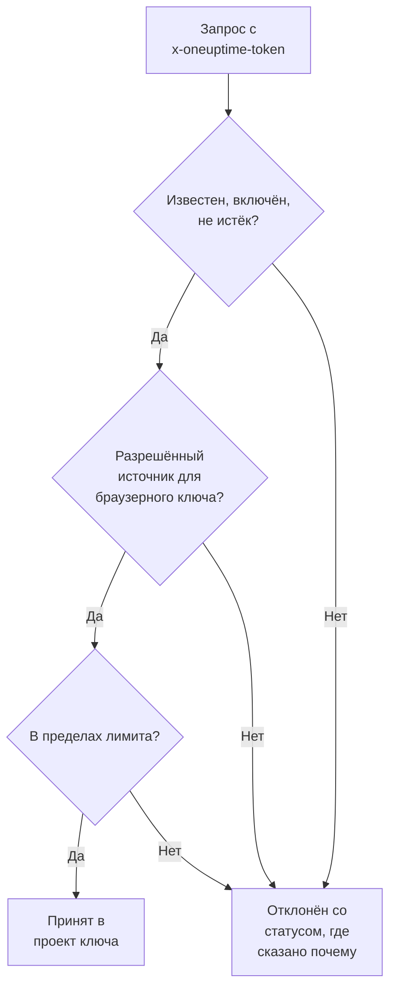

# Ключи приема

Ключ приема связывает вашу телеметрию с вашим проектом. Приложения, OpenTelemetry Collectors и агенты отправляют его с каждым запросом, и OneUptime относит их логи, трассировки и метрики к проекту, которому принадлежит ключ. На этой странице показано, как создать ключ, какой тип выбрать и как хранить ключи в безопасности.

:::cards
- [Создать ключ приема](#создать-ключ-приема): Имя, тип и секрет, который нужно скопировать.
- [Сервер или браузер](#сервер-или-браузер): Какой ключ нужен отправителю.
- [Защитить браузерный ключ](#защитить-браузерный-ключ): Источники, одно имя сервиса и лимит.
- [Сменить, отключить или удалить ключ](#сменить-отключить-или-удалить-ключ): Что делать, если ключ утек.
:::

## Как проверяется ключ

Каждый запрос несет секрет ключа, обычно в заголовке `x-oneuptime-token`. OneUptime находит ключ, проверяет, что он еще может отправлять, и только тогда принимает данные в проект ключа.



- **Ключ определяет проект.** Вы никогда не отправляете ID проекта: данные, отправленные с ключом, попадают в проект, которому принадлежит ключ.
- **Изменения доходят до всех серверов в течение минуты.** Отключение ключа, сброс его секрета или изменение его источников, срока действия или лимита вступают в силу примерно через минуту.
- **Серверный ключ — это пароль.** Любой, у кого он есть, может отправлять телеметрию в ваш проект. Храните его в секретах ваших серверов, никогда — в системе контроля версий или на веб-странице.

## Сервер или браузер

Выбирайте тип по тому, где будет находиться ключ. Тип нельзя изменить после создания ключа.

| | **Сервер** | **Браузер** |
| --- | --- | --- |
| Для | Приложения, коллекторы и агенты на машинах, которыми вы управляете | Веб-страницы и React Native Session Replay |
| Отправляет | Любую телеметрию на любые конечные точки | Трассировки, логи, метрики и Session Replays |
| Секрет | Да: храните его на своих серверах | Нет: его может прочитать любой, кто открыл страницу |
| Источники | Не проверяются | Принимаются только перечисленные источники |
| Запросов в минуту | Без лимита, если вы его не зададите | 6000, если вы не зададите другой лимит |

Во всех остальных местах OneUptime отклоняет браузерный ключ, например по gRPC и MQTT, для профилей, Syslog, Fluent Bit и Fluentd, а также для загрузки source maps. Чтобы перевести отправителя на другой тип, создайте ключ этого типа, переключите отправителя на него, а затем удалите старый ключ.

## Перед началом

- **Роль, которая управляет ключами приема.** Project Owner или Project Admin либо пользовательская роль с разрешением Create Telemetry Ingestion Key. Роли Telemetry не включают ключи приема.
- **В OneUptime Cloud — способ оплаты.** Телеметрия оплачивается по мере использования, поэтому проекту на плане Free нужен способ оплаты, прежде чем он сможет создать ключ. Тогда окно создания завершается шагом **Биллинг** с ценами.

## Создать ключ приема

:::steps
### Открыть ключи приема

Перейдите в **Настройки проекта → Телеметрия и APM → Ключи приема**. **Телеметрия и APM** сначала свернут в боковом меню: нажмите на него, чтобы открыть. Список показывает для каждого ключа столбцы **Имя**, **Тип**, **Last Used** и **Описание**.

### Назвать ключ и выбрать его тип

Нажмите **Создать ключ приёма**. Окно открывается с именем **Ключ сервера** и типом **Сервер**. Выберите **Тип ключа** и переименуйте ключ по тому, что будет его использовать, например `checkout-collector`. **Описание** находится в разделе **Расширенный**.

### Добавить источники браузерного ключа

Ключ типа **Браузер** запрашивает свои **Разрешённые источники** на следующем шаге, **Настройки браузера**, а свое **Закреплённое имя сервиса** — в разделе **Расширенный**. См. [Защитить браузерный ключ](#защитить-браузерный-ключ).

### Создать ключ и скопировать его секрет

Нажмите **Создать ключ приёма**. Откроется страница ключа: скопируйте его **Секретный ключ** и передайте его отправителям.
:::

**Руководство по настройке** каждого продукта начинается с **Выберите ключ приёма**, где перечислены ключи, которые может использовать это руководство, и можно сразу создать новый. Фрагменты кода в руководстве затем содержат этот ключ.

## Отправлять телеметрию с ключом

Отправители кладут секрет в заголовок `x-oneuptime-token`:

```text
x-oneuptime-token: YOUR_ONEUPTIME_INGESTION_KEY
```

- SDK OpenTelemetry читают его из `OTEL_EXPORTER_OTLP_HEADERS`. См. [быстрый старт OpenTelemetry](/docs/telemetry/open-telemetry#быстрый-старт).
- По OTLP/gRPC он передается в метаданных `x-oneuptime-token`.
- Устройство MQTT отправляет его как пароль. См. [IoT-устройства](/docs/telemetry/iot-devices).
- OneUptime также читает ключ из заголовка `x-oneuptime-ingestion-key` или `x-oneuptime-service-token`, который отправляют некоторые старые настройки.

## Защитить браузерный ключ

Браузерный ключ находится на вашей странице, где его может скопировать кто угодно. Эти настройки ограничивают то, что может сделать копия. Меняйте их на странице ключа через **Редактировать: Телеметрия Приём Key**.

| Настройка | Что она делает |
| --- | --- |
| **Разрешённые источники** | Единственные источники, с которых принимается ключ. Запрос с любого другого источника или вовсе без заголовка `Origin` отклоняется. У браузерного ключа должен остаться хотя бы один. |
| **Закреплённое имя сервиса** | Относит все, что ключ отправляет по OTLP/HTTP, к этому одному сервису, какое бы `service.name` ни задал отправитель. Копия ключа тогда может писать только в этот сервис. |
| **Requests Per Minute Limit** | Наибольшее число запросов, для которых ключ принимается каждую минуту, общее для всех посетителей. Браузерный ключ получает 6000, если оставить поле пустым. |
| **Истекает в** | Дата, после которой ключ отклоняется, чтобы опубликованная копия перестала работать. |

Источник — это схема, хост и необязательный порт: `https://app.example.com` не покрывает `https://app.example.com:8443`. Один ведущий `*.` покрывает все поддомены, но не сам домен. React Native Session Replay отправляет точную идентичность `app://`, которая не допускает подстановочных знаков:

```json
[
  "https://app.example.com",
  "https://*.example.com",
  "app://com.example.mobile"
]
```

[Каталог служб](/docs/telemetry/services#как-сервис-попадает-в-каталог) показывает, как закрепленное имя определяет сервис. Runner и ИИ-агент агента Kubernetes, а также ИИ-агенты инфраструктуры не регистрируются с закрепленным ключом: дайте им серверный ключ без закрепленного имени.

## Сменить, отключить или удалить ключ

Страница ключа показывает его **Статус**, его **Секретный ключ** за **Click to reveal** и его **Last Used At**: время, когда OneUptime последний раз принял данные, отправленные с ним.

| Чтобы | Сделайте это | Что видят отправители |
| --- | --- | --- |
| Сразу остановить ключ с возможностью отменить это позже | Нажмите **Редактировать: Телеметрия Приём Key**, откройте **Доступ и ограничения** и выключите **Включено**. Статус показывает **Disabled — telemetry refused**. | `422`, пока вы снова его не включите |
| Заменить утекший секрет | Нажмите **Сбросить секретный ключ** и подтвердите. Ключ сохраняет свои настройки и получает новый секрет. | `401`, пока они не отправят новый секрет |
| Остановить ключ навсегда | Нажмите **Удалить: Телеметрия Приём Key** внизу его страницы. | `401` |

Чтобы сменить секрет без потери данных, создайте второй ключ, переведите на него отправителей и удалите старый ключ, когда его **Last Used At** перестанет меняться. **Last Used At** обновляется раз в несколько минут, а не при каждом запросе.

## Устранение неполадок

Отклоненный запрос получает статус и фразу, объясняющую причину.

| Ответ | Что это значит |
| --- | --- |
| `401` с `Missing ingestion token` | В запросе нет ключа. Отправьте его в `x-oneuptime-token`. |
| `401` с `Invalid ingestion token` | Ни у одного ключа нет такого секрета: он набран с ошибкой, сброшен или удален. |
| `401` с `This telemetry ingestion key expired.` | Дата **Истекает в** прошла. Задайте более позднюю дату или используйте другой ключ. |
| `402` с `Add a payment method` | В OneUptime Cloud проект находится на плане Free и еще не имеет способа оплаты. |
| `422` с `This telemetry ingestion key has been disabled.` | Кто-то выключил **Включено**. |
| `422` с `A browser ingestion key cannot be used for` | Браузерный ключ попал на конечную точку, которая принимает только серверные ключи. |
| `422` с `did not send an Origin header` | Браузерный ключ был отправлен не из браузера. Используйте там серверный ключ. |
| `422` с `is not allowed for this browser ingestion key` | Источника страницы нет в **Разрешённые источники**. |
| `422` с `is pinned to a single service` | Ключ с **Закреплённое имя сервиса** использовали для регистрации агента. Используйте серверный ключ без закрепленного имени. |
| `429` с `Too many telemetry requests for this ingestion key` | Ключ достиг своего **Requests Per Minute Limit**. Экспортеры повторяют попытку после времени из `Retry-After`. |

Другие ответы, которые может получить экспортер OTLP, см. в разделе [Ответы](/docs/telemetry/open-telemetry#ответы).

:::details Данные все еще приходят через минуту после отключения ключа
Каждый сервер OneUptime хранит сведения о ключе не дольше минуты, поэтому изменение доходит до всех примерно за минуту. Запросы после этого отклоняются.
:::

:::details Браузерный ключ работает на моем ноутбуке, но не в продакшене
Источник включает схему и порт. `http://localhost:3000` и `https://app.example.com` — разные источники: перечислите каждый, с которого отдается страница.
:::

:::details Last Used At по-прежнему показывает Никогда
Никто не отправлял данные с этим ключом с тех пор, как OneUptime начал учитывать его использование. Проверьте, что у ваших отправителей есть секрет этого ключа и что их запросы доходят до OneUptime.
:::

## Дальнейшие шаги

:::cards
- [OpenTelemetry](/docs/telemetry/open-telemetry): Отправляйте трассировки, метрики и логи с вашим ключом.
- [Каталог служб](/docs/telemetry/services): Смотрите сервисы, к которым относится ваша телеметрия.
- [Хранение данных](/docs/telemetry/data-retention): Решите, как долго хранятся данные.
- [Фильтры отбрасывания и правила очистки](/docs/telemetry/drop-filters-and-scrub-rules): Отбрасывайте или маскируйте данные до сохранения.
:::
