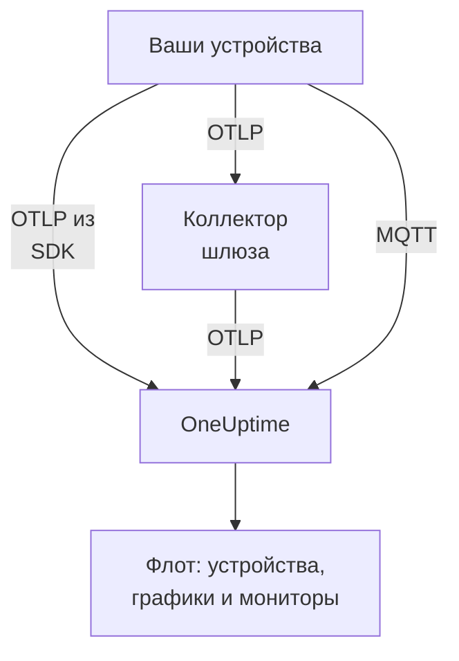

# IoT-устройства

OneUptime отслеживает флоты IoT-устройств — датчиков, шлюзов, контроллеров и пограничных устройств — по небольшому набору метрик `iot_*`, которые они отправляют. Он группирует устройства во флоты, ведёт инвентарь устройств каждого флота и строит графики их батареи, сигнала, температуры, CPU, памяти и доступности. Агент OneUptime на устройство устанавливать не нужно: устройства отправляют стандартный OpenTelemetry или публикуют данные в MQTT-точку OneUptime. [Мониторы IoT-устройств](/docs/monitor/iot-device-monitor) оповещают о том, что они отправляют.

:::cards
- [Выбор способа отправки](#выбор-способа-отправки): OpenTelemetry SDK, коллектор шлюза или MQTT.
- [Отправка метрик через MQTT](#отправка-метрик-через-mqtt): Топики, учётные данные для каждого устройства и Last Will.
- [Соглашения о метриках](#соглашения-о-метриках): Имена `iot_*`, по которым OneUptime строит графики и оповещения.
- [Устранение неполадок](#устранение-неполадок): Отсутствующие флоты, отсутствующие устройства, ложные переходы в офлайн.
:::

## Как это работает

Каждое показание относится к флоту и устройству. OneUptime создаёт флот по его первому показанию, добавляет каждое новое устройство в инвентарь флота и затем обновляет последние значения устройства с каждым показанием. Показания, отправленные по OpenTelemetry и по MQTT, попадают в одни и те же флоты, инвентарь, графики и мониторы.



## Как OneUptime моделирует IoT

- **Флот**: группа устройств, например `building-a-sensors` или `field-gateways`. Он берётся из атрибута ресурса `iot.fleet.name` и отображается в OneUptime как телеметрический сервис `iot/<fleet>`. Задайте также `service.name=iot/<fleet>`, чтобы логи и метрики оказались под одним сервисом.
- **Устройство**: одно устройство во флоте, названное атрибутом `device.id` у каждой точки данных. Инвентарь флота индексируется по `device.id`.

| Атрибут | Где задаётся | Обязателен | Описание |
| --- | --- | --- | --- |
| `iot.fleet.name` | Ресурс | Да | Флот, к которому относится устройство. Он становится сервисом OneUptime `iot/<fleet>`. |
| `device.id` | Каждая точка данных | Да | Стабильный идентификатор устройства, уникальный в его флоте. |
| `iot.device.kind` | Каждая точка данных | Нет | Класс устройства, например `Device`, `Sensor` или `Gateway`. По умолчанию `Device`. |
| `iot.device.type` | Каждая точка данных | Нет | Более точный тип или модель для фильтрации мониторов, например `temp-sensor`. |
| `iot.device.firmware` | Каждая точка данных | Нет | Версия прошивки, которую сообщает устройство. |

При отправке через MQTT флот и устройство задаёт за вас топик.

## Выбор способа отправки

| Способ | Когда использовать | Что нужно |
| --- | --- | --- |
| [OpenTelemetry SDK](#отправка-метрик-через-opentelemetry-sdk) | На устройстве работает OpenTelemetry SDK, и оно само достигает OneUptime. | Ключ приёма на устройстве. |
| [OpenTelemetry Collector](#отправка-метрик-через-opentelemetry-collector) | Многие устройства отчитываются через шлюз. | Шлюз, на котором работает коллектор. |
| [MQTT](#отправка-метрик-через-mqtt) | Устройство уже работает с MQTT или должно сообщать об офлайне в момент отключения. | Любой MQTT-клиент, подключающийся по WebSocket. |

## Перед началом

- Ключ приёма. Создайте его в разделе **Настройки проекта → Телеметрия и APM → Ключи приема** и скопируйте значение. Устройства отправляют его в заголовке `x-oneuptime-token` или как пароль MQTT.
- Сетевой доступ с устройства или шлюза к вашему URL OneUptime.
- Имя флота для каждой группы устройств и стабильный идентификатор для каждого устройства.

## Отправка метрик через OpenTelemetry SDK

:::steps
### Направьте SDK на OneUptime

Задайте на устройстве стандартные переменные окружения OpenTelemetry. Замените ключ, имя флота и идентификатор устройства своими:

```bash
export OTEL_EXPORTER_OTLP_ENDPOINT=https://oneuptime.com/otlp
export OTEL_EXPORTER_OTLP_PROTOCOL=http/protobuf
export OTEL_EXPORTER_OTLP_HEADERS=x-oneuptime-token=YOUR_TELEMETRY_INGESTION_TOKEN
export OTEL_RESOURCE_ATTRIBUTES=iot.fleet.name=building-a-sensors,device.id=sensor-001,service.name=iot/building-a-sensors
```

Не меняйте `iot.fleet.name`: изменение регистрирует новый флот.

### Записывайте показания как метрики IoT

Отправляйте каждое показание как метрику с одним из [стандартных имён](#соглашения-о-метриках) и задайте каждой точке данных атрибут `device.id`:

| Метрика | Значение | Атрибут точки данных |
| --- | --- | --- |
| `iot_device_up` | `1` | `device.id=sensor-001` |
| `iot_battery_percent` | `87` | `device.id=sensor-001` |
| `iot_temperature_celsius` | `21.5` | `device.id=sensor-001` |

Инвентарь индексируется по `device.id` точки данных, а не ресурса, поэтому задавайте его в каждом измерении, а также в `OTEL_RESOURCE_ATTRIBUTES`.
:::

Затем [убедитесь, что флот появился](#убедитесь-что-флот-появился).

## Отправка метрик через OpenTelemetry Collector

Если многие устройства отчитываются через шлюз, запустите на шлюзе OpenTelemetry Collector. Он принимает OTLP от ваших устройств, помечает каждое показание флотом и пересылает их в OneUptime.

:::steps
### Сохраните конфигурацию шлюза

Сохраните это на шлюзе как `config.yaml`:

```yaml title="config.yaml"
receivers:
  otlp:
    protocols:
      grpc:
        endpoint: 0.0.0.0:4317
      http:
        endpoint: 0.0.0.0:4318

processors:
  batch:
    send_batch_size: 512
    timeout: 5s
  resource:
    attributes:
      - key: iot.fleet.name
        value: field-gateways
        action: upsert
      - key: service.name
        value: iot/field-gateways
        action: upsert

exporters:
  otlphttp:
    endpoint: "https://oneuptime.com/otlp"
    headers:
      "x-oneuptime-token": "YOUR_TELEMETRY_INGESTION_TOKEN"

service:
  pipelines:
    metrics:
      receivers: [otlp]
      processors: [resource, batch]
      exporters: [otlphttp]
```

- `otlp` принимает данные от ваших устройств по gRPC (`4317`) и HTTP (`4318`). Принимайте показания любым другим способом, который поддерживает коллектор (мост MQTT, файловые логи), и отправляйте их через тот же пайплайн.
- `resource` помечает каждое показание флотом. Задайте `iot.fleet.name` и соответствующий `service.name=iot/<fleet>` для каждого шлюза, чтобы устройства каждого шлюза попадали в свой флот.
- Сохраняйте `device.id`, а также любые из `iot.device.kind`, `iot.device.type` и `iot.device.firmware`, у каждой точки данных, чтобы OneUptime мог различать устройства во флоте.
- `otlphttp` отправляет данные в OneUptime по HTTPS с ключом приёма. Принимается как кодирование protobuf по умолчанию, так и `encoding: json`.

### Запустите коллектор на шлюзе

:::tabs
@tab Docker
Запустите его из папки с `config.yaml`:

```bash
docker run -d \
  --name otel-collector \
  --restart unless-stopped \
  -p 4317:4317 \
  -p 4318:4318 \
  -v $(pwd)/config.yaml:/etc/otelcol-contrib/config.yaml:ro \
  otel/opentelemetry-collector-contrib:0.161.0 \
  --config /etc/otelcol-contrib/config.yaml
```
@tab otelcol-contrib
Если на шлюзе уже есть `otelcol-contrib`, укажите ему этот файл:

```bash
otelcol-contrib --config config.yaml
```
:::

Затем устройства отправляют OTLP на шлюз, например с `OTEL_EXPORTER_OTLP_ENDPOINT=http://<gateway-host>:4318` в SDK каждого устройства.
:::

Затем [убедитесь, что флот появился](#убедитесь-что-флот-появился).

## Отправка метрик через MQTT

У OneUptime есть собственная точка подключения MQTT, поэтому устройства, работающие с MQTT, публикуют показания прямо в неё, без SDK, коллектора или моста. Всё, что приходит по MQTT, проходит через тот же пайплайн, что и OTLP: создаются флоты, обновляется инвентарь, и каждый монитор IoT и шаблон оповещения работают так же.

### Точки подключения

| Транспорт | Адрес | Примечания |
| --- | --- | --- |
| MQTT через WebSocket | `wss://<your-host>/mqtt` | Работает в любом развёртывании, через обычный порт HTTPS. |
| MQTT через TCP | `<app-host>:1883` | Только при самостоятельном размещении и только внутри кластера или сети Compose, пока вы его не откроете. Порт задаёт `MQTT_INGEST_PORT`. |

### Аутентификация

- **С ключом приёма**: отправляйте его как пароль MQTT. Имя пользователя игнорируется; если в клиенте есть только поле имени пользователя, укажите ключ там. Это подходит для шлюза, который публикует данные многих устройств.
- **С учётными данными для каждого устройства**: рекомендуется для устройств, которые подключаются напрямую. Откройте страницу флота **Device Registry** и зарегистрируйте устройство с **Device ID**, который оно использует как `device.id`. **MQTT Username** устройства — его имя пользователя, а **MQTT Password (Secret)** — его пароль.

Учётные данные устройства позволяют публиковать только в его собственные топики `oneuptime/<fleet>/<device>/`. Можно отозвать одно устройство, не затрагивая остальной флот: выключите его переключатель **Включено** или удалите его, и подключённое устройство будет отключено примерно в течение минуты. Зарегистрированное устройство, которое замолкает, остаётся в инвентаре как офлайн, и для него срабатывает шаблон оповещения Device Offline, даже если оно выходит из строя без Last Will.

OneUptime отклоняет неверные учётные данные при CONNECT с кодом возврата 4 (неверное имя пользователя или пароль), поэтому неправильно настроенное устройство сбоит заметно. Ключи браузера по MQTT отклоняются.

### Топики и полезная нагрузка

Публикуйте под фиксированным префиксом `oneuptime/`. Сегменты флота и устройства не должны содержать `/`, `+` или `#`, не должны начинаться с `$` и должны быть не длиннее 100 символов.

| Топик | Полезная нагрузка |
| --- | --- |
| `oneuptime/<fleet>/<device>/telemetry` | JSON-объект с показаниями: `{"metrics":{"iot_temperature_celsius":21.5}}` или плоский объект, числовые поля которого и есть метрики. |
| `oneuptime/<fleet>/<device>/metrics/<metricName>` | Одно значение: голое число (`23.4`) или `{"value":23.4}`. |
| `oneuptime/<fleet>/<device>/status` | `online` или `offline` (также `1` или `0`, `true` или `false`, `up` или `down`). Задаёт `iot_device_up`. |

Полезная нагрузка телеметрии может также содержать `"attributes"` — словарь строк, которые проставляются на каждую точку данных (используйте его для `iot.device.kind`, `iot.device.type`, `iot.device.firmware` или собственных меток), и `"timestamp"` в формате ISO 8601 или в секундах либо миллисекундах Unix. Оба необязательны: без `timestamp` используется время, когда OneUptime получил показание.

### Обнаружение офлайна с Last Will

Зарегистрируйте MQTT Last Will на `oneuptime/<fleet>/<device>/status` с полезной нагрузкой `offline`. Если устройство выходит из строя или пропадает из сети, OneUptime публикует для него `iot_device_up = 0` в момент завершения его сеанса, что запускает стандартный шаблон оповещения Device Offline и помечает устройство в инвентаре как недоступное, без какого-либо опроса. После подключения публикуйте `online` в тот же топик, чтобы устройство снова отображалось как доступное.

### Примеры

:::tabs
@tab mosquitto_pub
Через сырой TCP, на собственном экземпляре:

```bash
mosquitto_pub -h YOUR-ONEUPTIME-APP-HOST -p 1883 \
  -u oneuptime -P "YOUR_TELEMETRY_INGESTION_TOKEN" \
  -t "oneuptime/building-a-sensors/sensor-001/telemetry" \
  -m '{"metrics":{"iot_device_up":1,"iot_battery_percent":87,"iot_temperature_celsius":21.5},"attributes":{"iot.device.type":"temp-sensor","iot.device.firmware":"1.4.2"}}'
```
@tab Node.js
С пакетом `mqtt`, через WebSocket, к oneuptime.com или любому собственному экземпляру:

```javascript
const mqtt = require("mqtt");

const client = mqtt.connect("wss://oneuptime.com/mqtt", {
  username: "oneuptime", // ignored — the token below is what authenticates
  password: "YOUR_TELEMETRY_INGESTION_TOKEN",
  will: {
    topic: "oneuptime/building-a-sensors/sensor-001/status",
    payload: "offline",
  },
});

client.on("connect", () => {
  client.publish("oneuptime/building-a-sensors/sensor-001/status", "online");
  setInterval(() => {
    client.publish(
      "oneuptime/building-a-sensors/sensor-001/telemetry",
      JSON.stringify({
        metrics: {
          iot_device_up: 1,
          iot_battery_percent: readBattery(),
          iot_temperature_celsius: readTemperature(),
        },
      }),
    );
  }, 60 * 1000);
});
```
@tab Python
С `paho-mqtt`, через WebSocket:

```python
import json
import paho.mqtt.client as mqtt

client = mqtt.Client(transport="websockets")
client.username_pw_set("oneuptime", "YOUR_TELEMETRY_INGESTION_TOKEN")
client.tls_set()
client.will_set("oneuptime/building-a-sensors/sensor-001/status", "offline")
client.ws_set_options(path="/mqtt")
client.connect("oneuptime.com", 443)

client.publish("oneuptime/building-a-sensors/sensor-001/status", "online")
client.publish(
    "oneuptime/building-a-sensors/sensor-001/telemetry",
    json.dumps({"metrics": {"iot_device_up": 1, "iot_temperature_celsius": 21.5}}),
)
```
:::

### Ограничения и доставка

- Точка подключения только принимает показания: подписки отклоняются (сбой SUBACK), а сохраняемые (retained) сообщения не хранятся.
- Приём выполняется по принципу «хотя бы один раз». Используйте QoS 1, чтобы OneUptime подтверждал каждую публикацию; повторная отправка с QoS 1 или 2 после потерянного подтверждения может дать дублирующиеся точки данных.
- Публикация размером более 128 KB или с более чем 100 метриками отбрасывается, а пакет, в котором заявлено больше, закрывает соединение.
- Публикация вне этих топиков или с неправильно сформированной полезной нагрузкой принимается и отбрасывается, потому что в MQTT 3.1.1 нет ошибки для отдельного сообщения. OneUptime пишет в лог предупреждение с причиной (`MQTT: dropped publish to …`).
- На точке подключения WebSocket держите keepalive MQTT меньше 5 минут. Ingress закрывает WebSocket, простаивающий 300 секунд, что запускает Last Will и ложное оповещение Device Offline. Значения по умолчанию в клиентских библиотеках (60 секунд для `mqtt` и `paho-mqtt`) подходят, а у точки подключения TCP такого ограничения нет.

## Соглашения о метриках

OneUptime распознаёт эти имена метрик `iot_*`. Отправляйте только те, которые имеют смысл для вашего устройства: отсутствующие просто не попадают на графики. Каждая точка данных несёт `device.id` устройства (при отправке через MQTT устройство называет топик).

| Имя метрики | Значение |
| --- | --- |
| `iot_device_up` | Доступность: `1` — работает и доступно, `0` — недоступно. Её читает монитор IoT Device. |
| `iot_device_info` | Только идентичность. Несёт `device.id`, класс, тип и прошивку, чтобы устройство появилось в инвентаре до того, как начнёт отправлять показания. |
| `iot_battery_percent` | Заряд батареи, от `0` до `100` (%). |
| `iot_signal_strength_dbm` | Мощность беспроводного сигнала в dBm, например RSSI Wi-Fi, LoRa или сотовой связи. |
| `iot_temperature_celsius` | Температура устройства или датчика в °C. |
| `iot_cpu_usage_ratio` | Использование CPU как доля от `0` до `1`. OneUptime хранит и показывает его в процентах. |
| `iot_memory_usage_bytes` | Используемая память в байтах. |
| `iot_memory_size_bytes` | Общий объём памяти устройства в байтах. |
| `iot_uptime_seconds` | Секунды с последней загрузки устройства. |

## Убедитесь, что флот появился

1. Проверьте, что устройство, коллектор шлюза или MQTT-клиент отправляют данные без ошибок: ищите в их логах ошибки экспорта и ответы HTTP `401` или `422` либо подключение, отклонённое с кодом возврата 4.
2. Откройте **Продукты → Инфраструктура → IoT → All Fleets**. Флот появится как `iot/<fleet>` примерно через минуту после первых показаний.
3. Откройте страницу флота **Devices**. Каждое устройство, от которого вы отправляли данные, должно быть в списке с последними значениями батареи, сигнала, температуры, CPU, памяти и состоянием доступности.
4. Откройте страницу флота **Метрики**, чтобы построить график любого из рядов `iot_*`.

## Самостоятельно размещённый OneUptime

Направьте конечную точку на собственный экземпляр:

```bash
export OTEL_EXPORTER_OTLP_ENDPOINT=https://your-oneuptime-host.example.com/otlp
```

Или в коллекторе:

```yaml
exporters:
  otlphttp:
    endpoint: https://your-oneuptime-host.example.com/otlp
    headers:
      "x-oneuptime-token": "YOUR_TELEMETRY_INGESTION_TOKEN"
```

Для MQTT подключайтесь к `wss://your-oneuptime-host.example.com/mqtt` или откройте сырой TCP-порт MQTT сервиса приложения (`MQTT_INGEST_PORT`, по умолчанию `1883`) для устройств, которые не могут использовать WebSocket. Задайте `MQTT_INGEST_ENABLED=false` в сервисе приложения, чтобы выключить оба слушателя MQTT. Если экземпляр работает только по HTTP, используйте `http://` (и `ws://` для MQTT) и его порт.

## Устранение неполадок

:::details Флот не появляется
1. Проверьте, что `iot.fleet.name` — атрибут ресурса (а не метка точки данных) и что `service.name` равно `iot/<fleet>`.
2. Проверьте, что конечная точка — `https://oneuptime.com/otlp` (или ваш собственный `…/otlp`) и что заголовок `x-oneuptime-token` содержит действительный ключ приёма.
3. При отправке через MQTT проверьте, что топик точно следует шаблону `oneuptime/<fleet>/<device>/…`: флот создаёт именно сегмент флота в топике.
:::

:::details Устройства отсутствуют в инвентаре
1. Задайте каждой точке данных метку `device.id`: устройства индексируются по ней. При отправке через MQTT это сегмент устройства в топике.
2. Для устройства, которое ещё не отправляло показаний, отправьте `iot_device_info` (или, через MQTT, сообщение `status`), чтобы оно появилось в инвентаре.
3. Не меняйте значения `device.id`: меняющийся идентификатор создаёт дубликаты устройств.
:::

:::details HTTP 401 или 422 от экспортёра
`401` означает, что ключ приёма отсутствует, неверен или истёк; `422` — что он отключён или является ключом браузера, который не может отправлять телеметрию устройств. Создайте новый в разделе **Настройки проекта → Телеметрия и APM → Ключи приема** и обновите заголовок `x-oneuptime-token`.
:::

:::details Подключение MQTT отклоняется с ошибкой "bad username or password"
OneUptime отклоняет неверные учётные данные при CONNECT с кодом возврата 4. Проверьте, что пароль — действительный ключ приёма, который не отключён и не истёк, или, для зарегистрированного устройства, секрет учётных данных, а имя пользователя — его **MQTT Username**. Ключи браузера по MQTT отклоняются.
:::

:::details Устройства переходят в офлайн, хотя работают
На точке подключения WebSocket ingress закрывает соединение, простаивающее 300 секунд, что запускает Last Will и ложное оповещение Device Offline. Держите keepalive MQTT меньше 5 минут: значения по умолчанию в клиентских библиотеках, 60 секунд, подходят.
:::

:::details Показания не отображаются на графиках флота
1. Используйте точные имена `iot_*` из раздела [Соглашения о метриках](#соглашения-о-метриках): другие имена хранятся как обычные метрики и не наполняют графики IoT.
2. Отправляйте `iot_cpu_usage_ratio` как долю от `0` до `1`; OneUptime показывает её в процентах.
3. После того как устройство начнёт отправлять данные, первые точки данных могут появиться в течение минуты.
:::

## Дальнейшие шаги

:::cards
- [Мониторинг IoT-устройств](/docs/monitor/iot-device-monitor): Оповещения, когда устройство уходит в офлайн, разряжается или перегревается.
- [OpenTelemetry](/docs/telemetry/open-telemetry): Как OneUptime принимает OTLP от любого SDK или коллектора.
- [OpenTelemetry-коллектор на хосте](/docs/telemetry/host-otel-collector): Мониторинг самого шлюза на Linux, macOS или Windows.
:::
