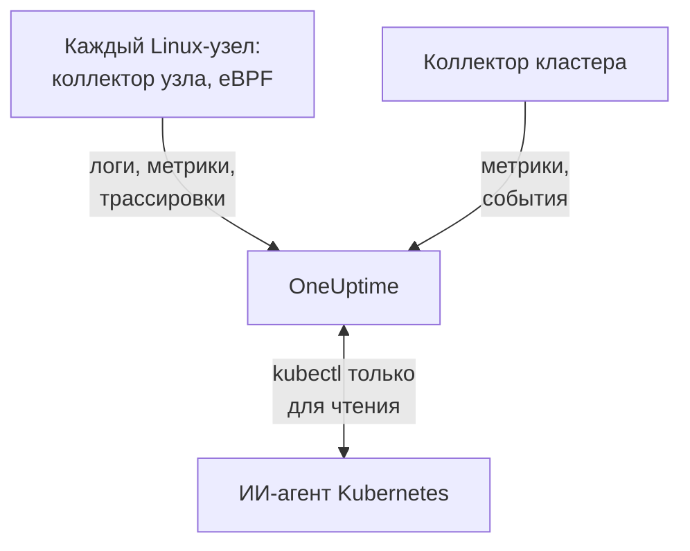

# Агент Kubernetes

Агент Kubernetes от OneUptime — это Helm-чарт, который собирает метрики, события и логи подов вашего кластера, а с помощью eBPF — трассировки, метрики запросов, граф сервисов и сетевые потоки каждого пода, без изменений в коде и без SDK. Он также запускает [ИИ-агент Kubernetes](#ии-агент-kubernetes), который позволяет OneUptime AI выполнять `kubectl` только для чтения, пока тот расследует инцидент или оповещение. Одна команда `helm install` разворачивает его; [мониторы Kubernetes](/docs/monitor/kubernetes-monitor) оповещают о том, что он отправляет.

:::cards
- [Установка агента](#установка-агента): Четыре шага с Helm.
- [Параметры конфигурации](#параметры-конфигурации): Фильтры, сэмплирование, плоскость управления, сервисная сетка, затраты и метки.
- [ИИ-агент Kubernetes](#ии-агент-kubernetes): `kubectl` только для чтения для OneUptime AI и исправления, когда вы их разрешаете.
- [Отправляйте меньше](#сокращение-объёма-собираемых-данных): Рычаги в порядке их влияния.
:::

## Как это работает

Чарт запускает несколько рабочих нагрузок в собственном пространстве имён. Каждая отправляет собранное на ваш URL OneUptime по OTLP с ключом приёма, который вы ей передаёте, а кластер регистрируется под именем, заданным в `clusterName`.



| Рабочая нагрузка | Вид | Что делает | Работает |
| --- | --- | --- | --- |
| Коллектор кластера | Deployment | Метрики кластера, события Kubernetes и спецификации подов, узлов и рабочих нагрузок из API Kubernetes. | Всегда |
| Коллектор узла | DaemonSet | Логи подов из `/var/log/pods`, метрики kubelet и cAdvisor, а также метрики ОС узла. | Везде, кроме EKS Fargate |
| Инструментирование eBPF (OBI) | DaemonSet | Трассировки и метрики запросов HTTP, gRPC, SQL и Redis от каждого пода, а также карта сервисов. | По умолчанию, кроме GKE Autopilot и EKS Fargate |
| ИИ-агент Kubernetes | Deployment | `kubectl` только для чтения для OneUptime AI, пока тот расследует инцидент или оповещение. | По умолчанию |
| Сборщик логов | Deployment | Логи подов через API Kubernetes там, где коллектор узла не может их прочитать. | С пресетами `gke-autopilot` и `eks-fargate` |
| Движок затрат и опросчик | Deployments | Расходы по пространствам имён, рабочим нагрузкам и подам. | С `cost.enabled=true` |

Все образы агента работают только в Linux, поэтому каждая рабочая нагрузка привязана к узлам Linux.

## Перед началом

- Кластер Kubernetes версии v1.23 или новее и `kubectl`, настроенный на доступ к нему.
- Helm 3. Обновления используют `--reset-then-reuse-values`, для которого нужен Helm 3.14 или новее.
- Ключ приёма. Создайте его в разделе **Настройки проекта → Телеметрия и APM → Ключи приема**. Агент отправляет его в заголовке `x-oneuptime-token`, поэтому ключ API проекта здесь не подойдёт.
- Имя кластера, уникальное в вашем проекте и стабильное, например `prod-us-east-1`: под ним кластер появится в OneUptime.
- Исходящий HTTPS из кластера на ваш URL OneUptime.

## Установка агента

:::steps
### Добавьте репозиторий Helm

```bash
helm repo add oneuptime https://helm-chart.oneuptime.com
helm repo update
```

### Установите чарт

Замените `YOUR_ONEUPTIME_URL`, `YOUR_ONEUPTIME_API_KEY` (ключ приёма) и имя кластера своими значениями и выберите вкладку своей платформы (см. [Выбор пресета](#выбор-пресета)).

:::tabs
@tab Standard
Самостоятельно управляемые кластеры, EKS on EC2, GKE Standard, AKS, minikube, kind и k3s:

```bash
helm install kubernetes-agent oneuptime/kubernetes-agent \
  --namespace oneuptime-agent \
  --create-namespace \
  --set oneuptime.url="YOUR_ONEUPTIME_URL" \
  --set oneuptime.apiKey="YOUR_ONEUPTIME_API_KEY" \
  --set clusterName="my-cluster" \
  --set aiAgent.enabled=true
```
@tab GKE Autopilot
```bash
helm install kubernetes-agent oneuptime/kubernetes-agent \
  --namespace oneuptime-agent \
  --create-namespace \
  --set oneuptime.url="YOUR_ONEUPTIME_URL" \
  --set oneuptime.apiKey="YOUR_ONEUPTIME_API_KEY" \
  --set clusterName="my-cluster" \
  --set aiAgent.enabled=true \
  --set preset=gke-autopilot
```
@tab EKS Fargate
```bash
helm install kubernetes-agent oneuptime/kubernetes-agent \
  --namespace oneuptime-agent \
  --create-namespace \
  --set oneuptime.url="YOUR_ONEUPTIME_URL" \
  --set oneuptime.apiKey="YOUR_ONEUPTIME_API_KEY" \
  --set clusterName="my-cluster" \
  --set aiAgent.enabled=true \
  --set preset=eks-fargate
```
:::

**ИИ-расследования включены по умолчанию.** `aiAgent.enabled=true` запускает [ИИ-агент Kubernetes](#ии-агент-kubernetes) рядом с коллектором: когда в этом кластере возникает инцидент или оповещение, OneUptime AI расследует его с помощью `kubectl` только для чтения (`get`, `describe`, `logs`, `events`, `top`) и ничего не меняет. Исправления выключены, пока вы их не разрешите. Чтобы установить без него, используйте вместо этого `--set aiAgent.enabled=false`.

### Убедитесь, что поды работают

```bash
kubectl get pods -n oneuptime-agent
```

Каждый под должен перейти в состояние `Running` в течение минуты-двух:

:::tabs
@tab Standard
Коллектор кластера, ИИ-агент, а на каждом узле — коллектор узла и под eBPF:

```text
NAME                                          READY   STATUS    RESTARTS   AGE
kubernetes-agent-xxxxxxxxxx-xxxxx             1/1     Running   0          1m
kubernetes-agent-ai-agent-xxxxxxxxxx-xxxxx    1/1     Running   0          1m
kubernetes-agent-ebpf-xxxxx                   1/1     Running   0          1m
kubernetes-agent-logs-xxxxx                   1/1     Running   0          1m
```
@tab GKE Autopilot
Коллектор узла по-прежнему работает и читает метрики kubelet и cAdvisor без `hostPath`, а Deployment сборщика логов читает логи подов через API Kubernetes:

```text
NAME                                          READY   STATUS    RESTARTS   AGE
kubernetes-agent-xxxxxxxxxx-xxxxx             1/1     Running   0          1m
kubernetes-agent-ai-agent-xxxxxxxxxx-xxxxx    1/1     Running   0          1m
kubernetes-agent-logs-yyyyyyyyyy-yyyyy        1/1     Running   0          1m
kubernetes-agent-logs-xxxxx                   1/1     Running   0          1m
```
@tab EKS Fargate
Три Deployment и ни одного DaemonSet: Fargate выделяет каждому поду собственную микро-ВМ и никогда не планирует DaemonSet, поэтому метрики узлов там недоступны:

```text
NAME                                          READY   STATUS    RESTARTS   AGE
kubernetes-agent-xxxxxxxxxx-xxxxx             1/1     Running   0          1m
kubernetes-agent-ai-agent-xxxxxxxxxx-xxxxx    1/1     Running   0          1m
kubernetes-agent-logs-yyyyyyyyyy-yyyyy        1/1     Running   0          1m
```
:::

### Найдите кластер в OneUptime

Откройте **Продукты → Инфраструктура → Kubernetes → Все кластеры**. Кластер появится под своим `clusterName` в течение нескольких минут, и его узлы, поды и рабочие нагрузки заполнятся. ИИ-агент Kubernetes отображается как подключённый на странице кластера **Агент** в разделе **ИИ**.
:::

## Выбор пресета

`preset` выбирает значения по умолчанию, которые работают на вашей платформе: читаются ли логи подов с узла через `hostPath` или через API Kubernetes и каким рабочим нагрузкам разрешено работать в привилегированном режиме.

| `preset` | Для чего | Логи подов | Метрики узлов |
| --- | --- | --- | --- |
| `standard` (по умолчанию) | Самостоятельно управляемые кластеры, **EKS on EC2**, **GKE Standard**, **AKS**, minikube, kind, k3s | Коллектор узла читает `/var/log/pods` через `hostPath` (минимальные накладные расходы) | Kubelet, cAdvisor и метрики ОС узла |
| `gke-autopilot` | **GKE Autopilot** | Сборщик логов читает их через API Kubernetes (без `hostPath`, без доступа к хосту) | Kubelet и cAdvisor, без `hostPath` |
| `eks-fargate` | **EKS Fargate** | Сборщик логов читает их через API Kubernetes (без `hostPath`, без доступа к хосту) | Нет: Fargate не запускает DaemonSet |

Если не уверены, начните со `standard`. Если установка завершается ошибкой Pod Security, в которой упоминается `hostPath`, установите заново с `preset=gke-autopilot` (или `eks-fargate` на Fargate). GKE Autopilot и EKS Fargate также отклоняют привилегированные поды, которые нужны eBPF и профилировщику, поэтому эти два пресета исключают и то и другое.

## Что собирается

| Категория | Данные |
| --- | --- |
| Метрики узлов | Использование CPU, памяти, файловой системы и сети |
| Метрики подов | CPU, память, сеть и перезапуски |
| Метрики контейнеров | CPU и память по каждому контейнеру |
| Метрики кластера | Состояния узлов, выделяемые ресурсы, число подов |
| События Kubernetes | Предупреждения, ошибки и события планирования |
| Логи подов | stdout и stderr каждого контейнера (через `hostPath` в стандартных кластерах, через API Kubernetes в Autopilot и Fargate) |
| Трассировки приложений (eBPF, включены по умолчанию) | Спаны HTTP, gRPC, SQL и Redis от каждого пода, без SDK и изменений в коде |
| HTTP-метрики RED (eBPF) | `http.server.request.duration`, а также размеры тел запросов и ответов по каждому сервису |
| Граф сервисов (eBPF) | Частота запросов, задержка и ошибки на связях от вызывающего к вызываемому, по которым строится карта сервисов |
| Метрики сетевых потоков (eBPF) | Счётчики байтов и пакетов TCP и UDP между подами, с метаданными Kubernetes |
| Статистика TCP (eBPF) | Время приёма-передачи, неудачные подключения и счётчики повторных передач на уровне узла |
| Затраты рабочих нагрузок (по желанию, `cost.enabled=true`) | Расходы по пространствам имён, рабочим нагрузкам и подам, с простоем и эффективностью, а также почасовая стоимость узлов и томов: см. [Наблюдаемость затрат Kubernetes](/docs/telemetry/kubernetes-cost) |

## Параметры конфигурации

Каждый параметр ниже — это значение Helm. Задайте его при установке или на уже установленном агенте с помощью `helm upgrade ... --reset-then-reuse-values --set <value>`.

### Фильтрация по пространствам имён

`namespaceFilters.rules` применяет шаблоны пространств имён к четырём областям, к каждой отдельно:

| Область | Где фильтрует | На что влияет |
| --- | --- | --- |
| `podLogs` | В приёмнике filelog через hostPath или в сборщике логов через API | Только stdout и stderr подов; события Kubernetes и журналы аудита не затрагиваются |
| `ebpfDiscovery` | При обнаружении процессов в OBI | И трассировки eBPF, и метрики eBPF от подходящих рабочих нагрузок |
| `metrics` | В коллекторе, после добавления метаданных Kubernetes | Ряды метрик с пространством имён; ряды узлов и кластера без пространства имён сохраняются |
| `traces` | В коллекторе, после добавления метаданных Kubernetes | И спаны eBPF, и спаны, которые приложения отправляют по OTLP |

Шаблон сопоставляется с полным именем пространства имён и может содержать `*` (`team-*`). Если у области есть хотя бы одно правило `include`, для неё сохраняются только подходящие пространства имён, а правила `exclude` всегда имеют приоритет. Правило по умолчанию исключает `kube-system` только из `podLogs` и `ebpfDiscovery`.

Чтобы ограничить логи подов и обнаружение eBPF некоторыми пространствами имён:

```bash
helm install kubernetes-agent oneuptime/kubernetes-agent \
  --namespace oneuptime-agent \
  --create-namespace \
  --set oneuptime.url="YOUR_ONEUPTIME_URL" \
  --set oneuptime.apiKey="YOUR_ONEUPTIME_API_KEY" \
  --set clusterName="my-cluster" \
  --set-json 'namespaceFilters.rules=[{"action":"include","namespaces":["default","production","staging"],"scopes":["podLogs","ebpfDiscovery"]}]'
```

Чтобы остановить логи шумного пространства имён, сохранив его трассировки eBPF, карту сервисов и метрики, ограничьте исключение областью `podLogs`:

```bash
  --set-json 'namespaceFilters.rules=[{"action":"exclude","namespaces":["kube-system"],"scopes":["podLogs","ebpfDiscovery"]},{"action":"exclude","namespaces":["noisy-*"],"scopes":["podLogs"]}]'
```

Правила для `podLogs` и `ebpfDiscovery` фильтруют у источника: исключённые файлы логов никогда не открываются, а исключённые рабочие нагрузки никогда не инструментируются. Правила для `metrics` и `traces` срабатывают позже, в коллекторе, после того как к данным привязано пространство имён.

#### Фильтрация метрик и трассировок по пространству имён

Добавьте эти области в правило, чтобы фильтровать также метрики или спаны с пространством имён:

```bash
  --set-json 'namespaceFilters.rules=[{"action":"exclude","namespaces":["kube-system","noisy-*"],"scopes":["podLogs","ebpfDiscovery","metrics","traces"]}]'
```

> [!NOTE]
> Метрики уровня узла и кластера сохраняются всегда. Пространство имён принадлежит поду, а не узлу, поэтому таким рядам, как CPU узла, память узла и использование файловой системы, не с чем сопоставляться, и они никогда не отбрасываются: правило с областью `metrics` урезает ряды по подам, не скрывая выходящий из строя узел.

События Kubernetes нельзя фильтровать по пространству имён на стороне агента: они приходят из приёмника `k8sobjects` без атрибута `k8s.namespace.name` (пространство имён находится внутри тела события), поэтому фильтру не с чем сопоставляться. Вместо этого отбрасывайте их в OneUptime через **Журналы → Настройки → Фильтры отбрасывания**.

### Фильтрация по важности логов

`filters.logs.minSeverity` отбрасывает записи логов подов ниже заданной важности на стороне агента, ещё до отправки:

```bash
  --set filters.logs.minSeverity=WARN
```

Он принимает `TRACE`, `DEBUG`, `INFO`, `WARN`, `ERROR` и `FATAL`. `WARN` сохраняет WARN, ERROR и FATAL и отбрасывает INFO, DEBUG и TRACE; значение по умолчанию (`""`) сохраняет всё. Он действует в обоих режимах логов (через коллектор в режиме `daemonset`, внутри сборщика логов в режиме `api`), поэтому пресет никогда не выключит его незаметно для вас.

Среды выполнения контейнеров не записывают важность, поэтому агент определяет её по самому тексту лога (`[ERROR]`, `WARN:`, `"level":"info"`, …). Что происходит со строкой без распознаваемого уровня, зависит от режима логов, потому что два режима знают разное:

| Режим | Строка без уровня | Почему |
| --- | --- | --- |
| `daemonset` | `stderr` считается ERROR (сохраняется), `stdout` — INFO (отбрасывается порогом WARN) | Среда выполнения контейнеров записывает, из какого потока пришла каждая строка. |
| `api` | Всегда сохраняется | API Kubernetes `pods/log` объединяет stdout и stderr в один поток без пометки у каждой строки, поэтому агент не гадает, а сохраняет строку. |

Поэтому режим `api` намеренно отбрасывает строго меньше, чем режим `daemonset`: трассировка Python или `npm ERR!` не содержат ключевого слова важности, а молча удалить их — именно та ошибка, от которой должен защищать порог. В гибридном режиме (`logs.windowsPods.enabled`) действуют обе строки в зависимости от ОС узла: поды Linux следуют `daemonset`, поды Windows — `api`.

В обоих режимах многострочные события собираются заново до фильтрации, поэтому трассировка стека Java оценивается по первой строке и сохраняется или отбрасывается целиком.

> [!IMPORTANT]
> События Kubernetes и спецификации ресурсов этим никогда не фильтруются. Они приходят из API Kubernetes без собственной важности, поэтому порог удалил бы весь поток, включая предупреждения `FailedScheduling`, `BackOff` и `OOMKilling`, которые нужны больше всего. Их мало, и они ценны, поэтому агент отправляет их всегда; чтобы их проредить, используйте **Журналы → Настройки → Фильтры отбрасывания** в OneUptime.

### Включение или исключение метрик по имени

`filters.metrics` определяет, какие метрики покидают кластер, по всем приёмникам.

Отбросьте несколько шумных метрик (список запрещённых, обычно это то, что нужно):

```bash
  --set-json 'filters.metrics.exclude=["k8s.volume.available","k8s.volume.capacity"]'
```

Отправляйте только фиксированный набор (список разрешённых: всё остальное отбрасывается):

```bash
  --set-json 'filters.metrics.include=["k8s.pod.cpu.utilization","k8s.pod.memory.usage"]'
```

Сопоставление по шаблону вместо точного имени:

```bash
  --set filters.metrics.matchType=regexp \
  --set-json 'filters.metrics.exclude=["^container_network_"]'
```

| Ключ | Значение |
| --- | --- |
| `filters.metrics.exclude` | Имена метрик, которые нужно отбросить. Применяется после `include`, поэтому исключение всегда имеет приоритет. |
| `filters.metrics.include` | Если не пусто, отправляются только эти метрики. |
| `filters.metrics.matchType` | `strict` (точное имя, по умолчанию) или `regexp` (RE2, без привязки). |

- `regexp` не привязан: `system.cpu` совпадает и с `system.cpu.time`. Привяжите его (`^system\.cpu$`), когда имеете в виду ровно одну метрику.
- В RE2 нет просмотра вперёд, поэтому `^(?!container_)` не компилируется. Выражайте «всё, кроме» через `include`, а не отрицательным шаблоном.
- `include` действует сразу на все приёмники. Список разрешённых, в котором забыта метрика, молча удаляет построенные на ней мониторы, поэтому предпочитайте `exclude`, если вам не нужен закрытый набор.
- Для списков используйте `--set-json` (или файл значений): обычный `--set` заменяет список, а не дополняет его.

> [!WARNING]
> Проверьте шаблон, прежде чем раскатывать его. Коллектор компилирует шаблоны при запуске, поэтому неверный шаблон не ведёт себя тихо неправильно: коллектор отказывается запускаться и уходит в цикл перезапусков, забирая с собой логи этого коллектора вместе с его метриками. Helm не умеет компилировать RE2, поэтому `helm upgrade` принимает плохой шаблон без возражений.

### Сэмплирование трассировок

Фильтры выше удаляют категорию телеметрии: пространство имён, важность, имя метрики. Сэмплирование сохраняет все категории и вместо этого прореживает совокупность. Задайте в `sampling.traces.percentage` долю сохраняемых трассировок:

```bash
helm upgrade kubernetes-agent oneuptime/kubernetes-agent \
  --namespace oneuptime-agent --reset-then-reuse-values \
  --set sampling.traces.percentage=10
```

Это сохраняет одну трассировку из десяти, а остальные девять отбрасывает на стороне агента, до того как они покинут ваш кластер.

- **Вы получаете целые трассировки, а не фрагменты.** Решение — это хеш идентификатора трассировки, а не подбрасывание монетки для каждого спана, поэтому все спаны трассировки сохраняются или отбрасываются вместе, и уцелевшие трассировки читаются от начала до конца.
- **Мониторы на основе метрик не меняются.** OBI вычисляет метрики RED из eBPF (частоту запросов, частоту ошибок, длительность) по каждому запросу, и они идут по пайплайну метрик, в котором сэмплера нет. При 10 % вы получаете десятую часть трассировок и точные частоту, ошибки и задержку.
- **Мониторы на основе спанов меняются.** Всё, что OneUptime подсчитывает по самим спанам, уменьшается пропорционально частоте: см. предупреждение ниже.

| Ключ | Значение |
| --- | --- |
| `sampling.traces.percentage` | Процент сохраняемых трассировок, от 0 до 100. По умолчанию `100` (сохранять всё). |
| `sampling.traces.hashSeed` | Начальное значение хеша идентификатора трассировки. По умолчанию `22`. |

- `0` не сохраняет ни одной трассировки. Это частота, а не выключатель: она удаляет каждую трассировку, а DaemonSet eBPF продолжает работать и стоить вам денег. Чтобы не было трассировок, используйте `ebpf.enabled=false`; чтобы не было трассировок, но остались метрики RED и карта сервисов, оставьте eBPF включённым и сознательно задайте `0`.
- Он действует, только когда включён `ebpf.enabled`: иначе пайплайна трассировок нет, и значение ни на что не влияет.
- Он сэмплирует только трассировки. `sampling.logs` и `sampling.metrics` нет намеренно: см. примечание ниже.
- Дробные значения требуют `--set-json`, и у них есть нижняя граница. `--set sampling.traces.percentage=0.5` не работает, потому что Helm читает `0.5` как строку: используйте `--set-json 'sampling.traces.percentage=0.5'` или файл значений. Ниже примерно `0.0061` частота округляется до нуля и ведёт себя ровно как `0`, без ошибки; `0.01` (одна из десяти тысяч) — наименьшее значение, которое делает то, что обещает.
- Несколько кластеров работают по умолчанию. Два агента сохраняют одну и ту же трассировку, только если совпадают и `hashSeed`, и `percentage`, а у обоих везде одинаковые значения по умолчанию, поэтому трассировка, проходящая через два кластера, сохраняется целиком. Меняйте `hashSeed` только для того, чтобы сделать два уровня сэмплирования независимыми: при одинаковом начальном значении более низкая частота сохраняет подмножество трассировок более высокой.
- Логи подов никогда не сэмплируются, поэтому при `ebpf.logToTraceCorrelation: true` каждая запись лога по-прежнему несёт идентификатор трассировки, хотя существует лишь сохранённая доля этих трассировок. Примерно (100 − `percentage`) % записей логов тогда ссылаются на отсутствующую трассировку; переход от трассировки к её логам не затрагивается.

> [!WARNING]
> Перенастройте мониторы на основе спанов, когда задаёте это значение. Сэмплирование уменьшает число спанов, доходящих до OneUptime, поэтому всё, что их считает, насчитывает меньше: монитор **Трассировки** по `Span Count` и монитор **Исключения** по `Exception Count` видят примерно `percentage` % вчерашнего объёма. Порог, настроенный на трафике без сэмплирования, тихо перестаёт пересекаться: монитор не выдаёт ошибку, он просто замолкает. Разделите эти пороги на тот же коэффициент; частота действует на весь кластер, поэтому ни один сервис нельзя исключить. Группировка ошибок ухудшается сильнее, чем линейно: частое исключение по-прежнему видно, но редкое разовое скорее исчезнет, чем станет появляться в десять раз реже.

> [!NOTE]
> Почему нет сэмплирования логов или метрик: сэмплер коллектора вообще не умеет сэмплировать метрики. Логи он сэмплировать может, но случайность берёт из идентификатора трассировки, которого у логов подов нет, поэтому каждая запись лога хешировалась бы одинаково, и частота для логов сохраняла бы всё или удаляла бы всё в зависимости от начального значения. Вместо того чтобы предлагать настройку, которая молча удаляет ваши логи, чарт не предлагает никакой. Прореживайте логи с помощью [Фильтрация по важности логов](#фильтрация-по-важности-логов) и [Фильтрация по пространствам имён](#фильтрация-по-пространствам-имён), которые точно определяют, что удаляют.

### Отключение сбора логов

Если логи подов вам не нужны:

```bash
helm install kubernetes-agent oneuptime/kubernetes-agent \
  --namespace oneuptime-agent \
  --create-namespace \
  --set oneuptime.url="YOUR_ONEUPTIME_URL" \
  --set oneuptime.apiKey="YOUR_ONEUPTIME_API_KEY" \
  --set clusterName="my-cluster" \
  --set logs.enabled=false
```

Метрики это не затрагивает: коллектор узла продолжает работать ради метрик kubelet, cAdvisor и хоста и лишь перестаёт читать логи подов. Перестают работать оповещения на основе логов, и больше ничего.

### Принудительный выбор режима сбора логов

`logs.mode` переопределяет выбор пресета и всегда имеет над ним приоритет:

- `logs.mode=daemonset`: DaemonSet с hostPath (минимальные накладные расходы; нужен `hostPath`).
- `logs.mode=api`: Deployment сборщика логов через API Kubernetes (работает в любом кластере).
- `logs.mode=disabled`: без логов подов.

Режим определяет только то, откуда берутся логи подов: метрики узлов собираются в любом случае, поэтому `api` и `disabled` сохраняют ваши метрики kubelet, cAdvisor и хоста. Исключение — платформа: EKS Fargate вообще не может планировать DaemonSet, поэтому там нет коллектора узла и нет метрик узлов, подов и контейнеров. GKE Autopilot запускает коллектор узла, но блокирует `hostPath`, поэтому собирает метрики kubelet и cAdvisor без метрик `hostmetrics` (дисковый ввод-вывод, inode, ошибки сетевых карт), которые читают `/proc` и `/sys` хоста.

В кластерах с пулами узлов Windows режим `daemonset` охватывает только узлы Linux, потому что все образы агента работают только в Linux. Добавьте `--set logs.windowsPods.enabled=true`, чтобы рядом работал сборщик логов через API — только для подов на узлах Windows: поды Linux сохраняют чтение файлов на узле, и два способа никогда не отправляют одну и ту же строку дважды. Для этого нужен образ `kubernetes-log-tailer` не старше чарта: более старый образ игнорирует ограничение и отправляет логи Linux дважды.

### Включение мониторинга плоскости управления

Страница кластера **Плоскость управления** строит графики для etcd, API-сервера, планировщика и диспетчера контроллеров. Агент опрашивает все четыре, когда `controlPlane.enabled` равно `true`:

```bash
helm upgrade kubernetes-agent oneuptime/kubernetes-agent \
  --namespace oneuptime-agent \
  --reset-then-reuse-values \
  --set controlPlane.enabled=true
```

Каждый компонент опрашивается по адресам из собственного списка: `controlPlane.etcd.endpoints`, `controlPlane.apiServer.endpoints`, `controlPlane.scheduler.endpoints` и `controlPlane.controllerManager.endpoints`. Опрос выполняется в поде агента, у которого нет сети хоста, поэтому значения по умолчанию (`https://localhost:<port>/metrics`) указывают на сам этот под: задайте в каждом списке адрес, доступный поду. Внутри любого кластера API-сервер отвечает на `https://kubernetes.default.svc:443/metrics`:

```bash
helm upgrade kubernetes-agent oneuptime/kubernetes-agent \
  --namespace oneuptime-agent \
  --reset-then-reuse-values \
  --set controlPlane.enabled=true \
  --set "controlPlane.apiServer.endpoints={https://kubernetes.default.svc:443/metrics}"
```

`controlPlane.enabled` включает все четыре опроса сразу. Если компонент недоступен по своим конечным точкам (etcd, планировщик и диспетчер контроллеров в управляемом кластере или по своим значениям по умолчанию с `localhost`), его опрос завершается ошибкой на каждом интервале: коллектор пишет ошибку опроса и сообщает, что цель недоступна, и больше ничего не меняется.

Агент опрашивает только по HTTPS, с токеном сервисного аккаунта и без клиентского сертификата. Поэтому:

- **etcd** нужен HTTPS-адрес метрик, который не требует клиентского сертификата. Обычные порты метрик etcd недоступны: простой HTTP на `2381` (`--listen-metrics-urls` в kubeadm) опрашивается как HTTPS и даёт ошибку, а `2379` требует клиентских сертификатов.
- **Планировщик** (`10259`) и **диспетчер контроллеров** (`10257`) работают по HTTPS и принимают токен, но kubeadm привязывает их к `127.0.0.1` на узлах плоскости управления: им нужен `--bind-address`, доступный поду агента.

Управляемые сервисы Kubernetes (EKS, GKE, AKS) не открывают etcd, планировщик и диспетчер контроллеров, поэтому эти вкладки там остаются пустыми. Пока метрики вкладки не пришли, страница **Плоскость управления** показывает вместо графиков, что нужно задать, с командой для копирования.

### Включение метрик CoreDNS

Вкладка **CoreDNS** страницы **Плоскость управления** строит графики DNS-запросов, задержки, кеша и перенаправления. По умолчанию их сбор выключен:

```bash
helm upgrade kubernetes-agent oneuptime/kubernetes-agent \
  --namespace oneuptime-agent \
  --reset-then-reuse-values \
  --set coreDns.enabled=true
```

Агент опрашивает порт `9153` подов с меткой `k8s-app=kube-dns` в `kube-system` — так CoreDNS работает в кластерах kubeadm, EKS и AKS. Если у вас он работает иначе, задайте также `coreDns.namespace`, `coreDns.service` (метку `k8s-app`) и `coreDns.port`. GKE использует kube-dns (dnsmasq) или Cloud DNS вместо CoreDNS, поэтому там вкладка остаётся пустой.

### Включение метрик сервисной сетки

Страница кластера **Сервисная сетка** строит графики для Istio и Linkerd. Агент опрашивает одну сетку — ту, которую называет `serviceMesh.provider` (`istio` или `linkerd`):

```bash
helm upgrade kubernetes-agent oneuptime/kubernetes-agent \
  --namespace oneuptime-agent \
  --reset-then-reuse-values \
  --set serviceMesh.enabled=true \
  --set serviceMesh.provider=istio
```

Для Istio он читает статистику Envoy каждого sidecar `istio-proxy` (порт `15090`); для Linkerd — порт администрирования каждого `linkerd-proxy`. Плоскость управления ни одной из сеток не опрашивается: istiod (карточка **Pilot**) и компоненты Linkerd identity, destination и proxy-injector (карточка **Плоскость управления**) отдают метрики на собственных портах администрирования, поэтому эти карточки сообщают об этом вместо графиков.

### Метрики, которые агент не собирает

Некоторые графики показывают метрики, которые агент не опрашивает: **kube-proxy** на странице **Плоскость управления**; **Cilium** (с Hubble) на странице **Сервисная сетка**; а на вкладках Istio и Linkerd — собственные плоскости управления сеток (**istiod** и компоненты Linkerd identity, destination и proxy-injector). Они заполняются, когда эти метрики попадают в OneUptime другим путём, например из вашего собственного [OpenTelemetry Collector](/docs/telemetry/open-telemetry), который их опрашивает, с атрибутом ресурса `k8s.cluster.name`, равным имени кластера (`clusterName` агента). В кластерах, работающих без kube-proxy, метрик kube-proxy нет вовсе.

### Включение наблюдаемости затрат

Узнайте, сколько стоят каждое пространство имён, рабочая нагрузка и под, с простаивающими мощностями и долей использования каждого request, на странице кластера **Costs**:

```bash
helm upgrade kubernetes-agent oneuptime/kubernetes-agent \
  --namespace oneuptime-agent \
  --reset-then-reuse-values \
  --set cost.enabled=true
```

Этого достаточно для полной установки: чарт включает движок с открытым исходным кодом [OpenCost](https://opencost.io) (с небольшим Prometheus, который ему нужен) и оценивает ваши узлы и тома по публичным прайс-листам облачного провайдера, без учётных данных. Он добавляет два небольших пода, а первые затраты появляются после первого закрытого часа. Уже используете Kubecost или OpenCost? Вместо этого добавьте `--set cost.engine.url=<its service URL>`, и ничего встроенного не будет. Локальные кластеры могут задать тариф через `cost.opencost.customPricing`. Полное руководство с ценами для локальных кластеров и устранением неполадок — [Наблюдаемость затрат Kubernetes](/docs/telemetry/kubernetes-cost).

### Автоматические метки проекта

Каждый атрибут ресурса, начинающийся с `oneuptime.label.`, становится меткой проекта и привязывается к кластеру, а также к сервисам и хостам, о которых сообщает этот агент: `oneuptime.label.<dimension>=<value>` — это метка `<dimension>:<value>`. Передайте метки при установке с помощью `--set oneuptime.labels.<key>=<value>`:

```bash
helm install kubernetes-agent oneuptime/kubernetes-agent \
  --namespace oneuptime-agent \
  --create-namespace \
  --set oneuptime.url="YOUR_ONEUPTIME_URL" \
  --set oneuptime.apiKey="YOUR_ONEUPTIME_API_KEY" \
  --set clusterName="prod" \
  --set oneuptime.labels.team=payments \
  --set oneuptime.labels.env=production \
  --set oneuptime.labels.region=us-east-1
```

Или храните их в файле значений:

```yaml title="values.yaml"
oneuptime:
  url: YOUR_ONEUPTIME_URL
  apiKey: YOUR_ONEUPTIME_API_KEY
  labels:
    team: payments
    env: production
    region: us-east-1
clusterName: prod
```

Метки сравниваются без учёта регистра, поэтому существующая метка `Production`, созданная вручную, используется повторно, а не дублируется, а метки, добавленные в OneUptime, агент никогда не удаляет.

## Трассировки приложений и HTTP-метрики через eBPF (включено по умолчанию)

Чарт запускает на каждом узле DaemonSet с [OpenTelemetry eBPF Instrumentation (OBI)](https://opentelemetry.io/docs/zero-code/obi/). Он загружает программы eBPF в ядро и перехватывает трафик HTTP и HTTPS, gRPC, SQL и Redis всех поддерживаемых сред выполнения (Go, .NET, Java, Node.js, Python, Ruby, Rust) без SDK и без sidecar. Затем трассировки и метрики запросов идут через коллектор внутри кластера в OneUptime.

Нужно ядро Linux 5.8 или новее с BTF (по умолчанию в Debian 11+, Ubuntu 20.10+, Fedora 34+, RHEL и Stream 9+), а его DaemonSet работает в привилегированном режиме, потому что без этого программы eBPF не загрузить.

### Как выглядят трассировки eBPF

eBPF видит сетевые вызовы, а не ваш код, поэтому трассировка строится из запросов, которые обрабатывает сервис, и вызовов, которые он делает при их обработке:

- **Запрос и его вызовы образуют одну трассировку.** Входящий в сервис запрос — корневой спан с именем `<METHOD> <route>`, а вызовы HTTP, gRPC, SQL и Redis, которые сервис делает при его обработке, — его дочерние спаны. (Для Node.js это опирается на агент Node.js в OBI, который чарт включает через `ebpf.nodejs.enabled`.) Вызовы, которые параллельные запросы отправляют по одному общему соединению, что типично для клиентов Redis, не всегда удаётся различить, поэтому часть из них не попадает в трассировку своего запроса.
- **Вызов сервиса на другом узле начинает новую трассировку**, если только что-то не переносит контекст трассировки: OpenTelemetry SDK или необязательное распространение контекста, описанное ниже. Когда обе стороны работают на одном узле, OBI видит обе и связывает их сам.
- **Работа, которую не начал ни один запрос, стоит отдельно.** У обработчика очереди, опрашивающего Redis, или у задания cron нет запроса, к которому могли бы относиться их вызовы.
- **Серверы баз данных обычно стоят отдельно.** Протоколы баз данных не переносят контекст трассировки, поэтому, если вызывающий не работает на том же узле, спан, который OBI записывает внутри сервера базы данных для каждой команды, становится трассировкой из одного спана.

Такие отдельные вызовы баз данных приходят как трассировки из одного спана, названные по голой команде (`set`, `evalsha`, `SELECT`), и в загруженном кластере они могут составлять большую часть того, что перехватывает OBI. По умолчанию агент отбрасывает их до выхода из кластера: собственный спан сервера базы данных, который всегда дублирует спан вызывающего (`ebpf.dropDatabaseServerSpans=true`), и вызов приложения, не принадлежащий ни одной трассировке (`ebpf.dropUnlinkedDatabaseCalls=true`). Вызовы баз данных из приложения внутри трассировки запроса сохраняются, спаны, которые ваши приложения отправляют из собственных SDK, никогда не затрагиваются, а метрики баз данных по-прежнему учитывают каждую команду.

Есть компромисс: OneUptime обнаруживает базы данных и рисует их на карте сервисов по клиентским спанам баз данных. База данных, с которой работает только фоновая работа (очередь обработчика, хранилище задания cron), тогда больше не обнаруживается по трассировкам и показывается на карте сервисов как удалённая конечная точка. Её метрики не затрагиваются. Задайте `ebpf.dropUnlinkedDatabaseCalls=false`, чтобы сохранить эти спаны.

Вызовы HTTP и gRPC фоновой работы (обработчик, запрашивающий ClickHouse по HTTP, контроллер, продлевающий свою аренду в Kubernetes) тоже приходят как трассировки из одного спана (`POST /`, `PUT /apis/*/...`). Задайте `ebpf.dropUnlinkedClientCalls=true`, чтобы отбрасывать и их вместе с вызовами, которые OBI не смог поместить в трассировку их запроса и которые выглядят так же; вызовы баз данных, систем сообщений и GenAI (включая MCP) он никогда не отбрасывает. По умолчанию он выключен, потому что стоит данных: когда вызываемый сервис работает на том же узле, OBI связывает обработанный им запрос под вызовом, так что вызов становится корнем этой трассировки, и его отбрасывание оставляет трассировку без корня. При включённом `ebpf.contextPropagation` это происходит на любом узле, а также с сервисом, у которого есть собственный OpenTelemetry SDK. Карта сервисов тоже читает эти вызовы: зависимость, которую вызывает только фоновая работа, тогда рисуется только по метрикам графа сервисов OBI, а связь, которая видна и внутри запросов, учитывает только эти вызовы. Обзор сервиса считает его спаны, поэтому обработчик или проба, у которых большинство спанов — такие вызовы, показывают гораздо меньше запросов, с частотой ошибок и задержкой p95 по оставшимся спанам. Метрики клиентских запросов OBI по-прежнему учитывают каждый вызов.

В самостоятельно размещённом OneUptime обновите сервер раньше агента: трассировщик eBPF, который запускает этот чарт (OBI v0.14), называет вызываемые сервисы и сообщает собственные спаны брокеров сообщений так, как старые серверы OneUptime не читают.

Имена берутся из трафика. HTTP-спаны используют шаблон маршрута приложения, если OBI может его прочитать, а иначе — шаблон, построенный из URL, где похожие на идентификаторы сегменты заменены на `*`; задайте `ebpf.routes.patterns`, чтобы назвать их самостоятельно. OBI читает шаблоны маршрутов приложений на Go (net/http, Gorilla mux, Gin), Java (Spring, JAX-RS), Node.js (Express, Fastify, Koa, NestJS, Next.js), Python (Django, FastAPI, Flask), Ruby (Rails), .NET (маршруты атрибутов ASP.NET Core) и PHP (Symfony, Laravel, Slim). Имена уровня приложения, например `OrderService.charge`, существуют только в коде и требуют OpenTelemetry SDK.

Если приложение уже экспортирует трассировки через OpenTelemetry SDK, OBI замечает это и перестаёт отправлять для него трассировки eBPF, чтобы оно не трассировалось дважды (`ebpf.excludeOtelInstrumentedServices=true`, значение по умолчанию в OBI). Задайте `false`, если этот SDK отправляет данные в другой проект, а вам нужны трассировки eBPF для приложения и в этом.

### Отключение автоинструментирования eBPF

Отключайте eBPF, когда:

- Вы устанавливаете на **GKE Autopilot** или **EKS Fargate**: эти платформы отклоняют привилегированные поды, поэтому `preset=gke-autopilot` и `preset=eks-fargate` уже исключают eBPF за вас, а вместе с ним и профилировщик.
- На узлах работает ядро старше 5.8 без бэкпортов BTF.
- Вы уже отправляете трассировки из OpenTelemetry SDK в каждом приложении и метрики eBPF вам тоже не нужны. (Ради одних только трассировок этого делать не нужно: OBI перестаёт отправлять трассировки eBPF для приложения, которое, как он видит, экспортирует собственные, как описано выше.)

```bash
helm install kubernetes-agent oneuptime/kubernetes-agent \
  --namespace oneuptime-agent \
  --create-namespace \
  --set oneuptime.url="YOUR_ONEUPTIME_URL" \
  --set oneuptime.apiKey="YOUR_ONEUPTIME_API_KEY" \
  --set clusterName="my-cluster" \
  --set ebpf.enabled=false
```

### Включение и выключение отдельных семейств сигналов

Все они включены по умолчанию, кроме одного. Выключить любое можно с помощью `--set ebpf.features.<name>=false`:

| `ebpf.features.*` | По умолчанию | Что добавляет |
| --- | --- | --- |
| `httpMetrics` | вкл. | Метрики RED для HTTP и gRPC (частота запросов, задержка, ошибки) по каждому сервису |
| `spanMetrics` | вкл. | Число вызовов и длительность спанов (`traces.span.metrics.*`) |
| `serviceGraph` | вкл. | Метрики связей от вызывающего к вызываемому, по которым строится карта сервисов |
| `networkMetrics` | вкл. | Счётчики потоков TCP и UDP между подами |
| `networkInterZoneMetrics` | выкл. | Межзонный вариант сетевых метрик (удваивает их кардинальность) |
| `tcpStats` | вкл. | Время приёма-передачи TCP, неудачные подключения и счётчики повторных передач на уровне узла |

Распространение контекста трассировки между сервисами, при котором OBI внедряет W3C `traceparent`, чтобы запрос, переходящий из пода A в под B, отображался одной трассировкой без какого-либо SDK, по умолчанию выключено. Включите его с помощью `--set ebpf.contextPropagation=true`. Ему не нужно ядро новее того, что нужно остальному агенту, и нет версии ядра, на которой оно не действовало бы.

Оно выключено, потому что внедрение заголовка означает переписывание уже передаваемого трафика: открытые HTTP-запросы расширяются на месте в ядре, а к TLS и сырому TCP добавляется параметр TCP из хука Traffic Control. Если учёт байтов соединения не исправлен точно, поток сбивается; известный симптом — передачи через прокси уровня L7, например nginx, зависают посреди тела, как только ответ превышает примерно 64KB, а небольшие запросы продолжают работать. Не исключайте это по возрасту ядра: на ядрах ниже 5.17 OBI переходит на программы с ограниченным сканированием и переписывает трафик так же. Трассировки, метрики RED и карта сервисов от него не зависят; для связывания сервисов OpenTelemetry SDK распространяет `traceparent` в пространстве пользователя, без переписывания в ядре, и это более безопасный выбор.

## ИИ-агент Kubernetes

Когда в этом кластере возникает инцидент или оповещение, OneUptime AI его расследует. **ИИ-агент Kubernetes** из чарта даёт ему терминал: он выполняет `kubectl` только для чтения так, как это сделал бы дежурный инженер (описывает сбойный под, читает его события, просматривает логи падающего контейнера, проверяет ёмкость узлов), и приводит каждую команду на странице инцидента.

Агент **включён по умолчанию** и работает **только для чтения**: один небольшой Deployment (`kubernetes-agent-ai-agent`, метка пода `component=ai-agent`, образ `oneuptime/kubernetes-ai-agent`), чей ServiceAccount может только читать. Он регистрируется с тем же `oneuptime.apiKey` и `clusterName`, что и коллектор, поэтому в панели ничего настраивать не нужно: страница кластера **ИИ-агент** (Kubernetes → кластер → ИИ → Агент) в течение минуты показывает его как подключённый, а **Проверить подключение** в меню **⋯** рядом с этим статусом выполняет через него `kubectl version` и `kubectl auth can-i --list`. Всё, что ИИ сделал с его помощью, находится на странице кластера **Журналы ИИ** (ИИ → Журналы), а то, что стоит знать о кластере, — повторяющиеся проблемы и их причины, узел или рабочая нагрузка, стоящие за большинством из них, что ИИ исправил, — на странице **AI Insights** (ИИ → Insights). Агент поставляется с закреплённой версией kubectl (v1.36.4). Это не Runner, и он никогда не появляется в Runbooks → Runners: OneUptime никогда не передаёт ему учётные данные, никогда не запускает на нём runbook, и он никогда не принимается как Runner команд правила автоматического исправления.

На агенте, установленном до появления ИИ-агента, сначала обновите индекс чартов, а затем выполните обновление (в самостоятельно размещённом OneUptime сначала обновите OneUptime — см. [Обновление агента](#обновление-агента)):

```bash
helm repo update
helm upgrade kubernetes-agent oneuptime/kubernetes-agent \
  --namespace oneuptime-agent --reset-then-reuse-values \
  --set aiAgent.enabled=true
```

Используйте имя релиза и пространство имён, с которыми устанавливали агент, если они другие (`helm list -A | grep kubernetes-agent` показывает их). Без `helm repo update` Helm может взять чарт, из которого вы устанавливали, — он не знает `aiAgent` и завершается ошибкой `Additional property aiAgent is not allowed`. Версии опубликованных чартов следуют версии OneUptime, поэтому если `helm show values oneuptime/kubernetes-agent | grep aiAgent` ничего не выводит, ваш индекс всё ещё старый. Чтобы запустить чарт без ИИ-агента, передайте `--set aiAgent.enabled=false`.

### Что может делать ИИ

Что OneUptime AI может делать в кластере, задаётся в чарте двумя значениями, а страница ИИ-агента кластера показывает их в разделе **Что может делать ИИ** без возможности изменить их там:

- `aiAgent.investigation` — `true`: ИИ выполняет `kubectl` только для чтения, пока расследует инцидент или оповещение в кластере. `false`: он всё равно расследует, но по данным, которые уже есть в OneUptime.
- `aiAgent.fixes` — `off`, `ask-for-approval`, `automatic` или `bypass-approval` (ниже). Каждый уровень, кроме `off`, даёт ИИ-агенту доступ на запись; `off` не даёт никакого, и тогда агент сам отклоняет любую запись.

ИИ-агент сообщает оба значения в OneUptime, который применяет их к кластеру и отклоняет изменение, сделанное где-либо ещё, — на странице ИИ-агента, через API или Terraform. **Изменить** на этой странице показывает команду для выбранного варианта. Оба значения не заданы в `values.yaml`: релиз, в котором не задано ни одно из них, позволяет агенту использовать свои значения по умолчанию (расследование включено, исправления выключены), и OneUptime применяет их только к кластеру, настройки которого никто не выбирал на его странице ИИ-агента, — выбранные там настройки сохраняются как есть, а страница показывает, как перенести их в чарт.

### Разрешите ИИ исправлять найденное

Исправления выключены, пока вы не включите их с помощью `aiAgent.fixes` — это отдельный необязательный шаг, который также даёт ИИ-агенту доступ на запись. Рекомендуемый вариант даёт его только в тех пространствах имён, где ИИ может исправлять, с выключенными операциями над узлами:

```bash
helm repo update
helm upgrade kubernetes-agent oneuptime/kubernetes-agent \
  --namespace oneuptime-agent --reset-then-reuse-values \
  --set aiAgent.enabled=true \
  --set aiAgent.investigation=true \
  --set aiAgent.fixes=ask-for-approval \
  --set "aiAgent.remediation.namespaces={web,api}" \
  --set aiAgent.remediation.nodeOperations=false
```

Или на весь кластер:

```bash
helm repo update
helm upgrade kubernetes-agent oneuptime/kubernetes-agent \
  --namespace oneuptime-agent --reset-then-reuse-values \
  --set aiAgent.enabled=true \
  --set aiAgent.investigation=true \
  --set aiAgent.fixes=ask-for-approval \
  --set-json 'aiAgent.remediation.namespaces=[]'
```

Каждое указанное пространство имён должно уже существовать: чарт создаёт по одному RoleBinding в каждом и никогда не создаёт пространство имён, поэтому отсутствующее приводит к ошибке всего обновления — и коллектора тоже — с `namespaces "api" not found`. Сначала создайте его или уберите из списка, а пространство имён убирайте из списка до его удаления. Если флаг не указан при обновлении, сохраняется записанный список; `--set-json 'aiAgent.remediation.namespaces=[]'` (Helm 3.10+) возвращает к привязке на весь кластер — но не `={}`, которое Helm читает как одно пустое имя. `--set aiAgent.remediation.namespaces=null` не сбрасывает записанный список при `--reuse-values`: Helm сохраняет записанный список. `aiAgent.remediation.nodeOperations=false` не допускает исправления на узлах; задайте `true`, чтобы разрешить ИИ выполнять cordon, uncordon, drain и taint узлов.

`aiAgent.fixes` выбирает, как выполняются исправления; чтобы снова их выключить, выполните обновление с `--set aiAgent.fixes=off`, что также отзывает доступ на запись:

- **ask-for-approval** — OneUptime AI составляет точный план `kubectl`, и человек одобряет его одним щелчком на странице инцидента;
- **automatic** — безопасные изменения выполняются сами; более рискованное изменение — никогда. Если раунд нашёл только более рискованные исправления, он завершается предложением именно их на одобрение одним щелчком; если он также выполнил безопасное исправление, более рискованное предлагается, только если проверка показывает, что безопасное исправление не восстановило сигнал (последующий раунд, который спрашивает);
- **bypass-approval** — ИИ не спрашивает: каждое изменение, разрешённое политикой, выполняется само, включая последующие раунды, за исключением того, что раунд спрашивает, когда срабатывает почасовой предохранитель, когда другой автономный раунд OneUptime AI ещё изменяет или проверяет тот же кластер или когда он следует за исправлением, откат которого не завершился.

В любом режиме запись в kube-system, kube-public или kube-node-lease всегда требует человека, как и `drain`, `taint` и `patch` узла (drain вытесняет поды во всех пространствах имён, включая собственное пространство агента, и то же делает taint `NoExecute`, задан ли он через `kubectl taint` или через `patch` узла); пользовательский ресурс оценивается по своему пространству имён, даже если он назван как встроенный вид; а ИИ-агент никогда ничего не меняет в собственном пространстве имён, за пределами `aiAgent.remediation.namespaces` или на узле при `aiAgent.remediation.nodeOperations=false`. OneUptime читает эту область из того, что сообщает ИИ-агент, и отклоняет такое исправление, когда оно предлагается или одобряется, а не только в агенте. В обоих автономных режимах раунд предлагает свой план на одобрение вместо выполнения, когда срабатывает почасовой предохранитель или другой автономный раунд уже удерживает кластер. Что может запускать каждый режим и что политика команд отклоняет сразу, см. в [AI SRE — Доступ к кластеру](/docs/ai/ai-sre).

**Чему равен доступ на запись.** Patch/update для рабочих нагрузок, подов и CronJob и create для Job в пространстве имён равнозначны запуску любого образа от имени любого ServiceAccount в этом пространстве имён и чтению его Secret — в шаблоне пода можно указать любой образ, ServiceAccount и том Secret. Поэтому RBAC чарта ограничивает, *где* ИИ-агент может писать, но не то, что может сделать запись: политика команд отклоняет патчи безопасности шаблонов подов, патчи, заменяющие спецификацию пода или весь список `containers`, `set serviceaccount`, `create … --image`, `expose --overrides` (который может создать Job или объект любого другого вида вместо Service) и тела патчей не в формате JSON. Она не отклоняет `set image` или патч поля образа: это более рискованное изменение — новый образ работает от собственного ServiceAccount рабочей нагрузки, с её Secret, — которое одобряет человек, если только кластер не обходит подтверждения или его список разрешённых не называет эту команду. При пустом `aiAgent.remediation.namespaces` роль записи привязывается на весь кластер, и RBAC не может не пустить её в kube-system, kube-public, kube-node-lease или собственное пространство имён агента; там границу держат политика и ИИ-агент. Перечислите пространства имён, и чарт привяжет её только в них, а запись в любом другом месте отклоняется, когда предлагается или одобряется, и ещё раз ИИ-агентом.

### Значения ИИ-агента

`aiAgent.remediation.*` и `aiAgent.extraEnv` не заданы в `values.yaml`, поэтому значение, записанное под старым ключом `aiAccess`, продолжает действовать, пока вы их не зададите (см. [Обновление агента](#обновление-агента)). Значения по умолчанию, которые указаны для них в таблице, действуют, только когда не задан ни ключ `aiAgent`, ни ключ `aiAccess`. `aiAgent.investigation` и `aiAgent.fixes` тоже не заданы, поэтому настройки ИИ, выбранные на странице ИИ-агента кластера, сохраняются, пока вы не зададите одно из них.

| Значение | По умолчанию | Что делает |
| --- | --- | --- |
| `aiAgent.enabled` | `true` | Запускает ИИ-агент Kubernetes с RBAC только для чтения (на весь кластер). `false` удаляет его. |
| `aiAgent.investigation` | не задано (`true`) | Выполняет ли OneUptime AI `kubectl` только для чтения во время расследования. Страница ИИ-агента кластера показывает это только для чтения. |
| `aiAgent.fixes` | не задано (`off`) | `off`, `ask-for-approval`, `automatic` или `bypass-approval`. Каждый уровень, кроме `off`, даёт перечисленные ниже глаголы записи. Страница ИИ-агента кластера показывает это только для чтения. |
| `aiAgent.remediation.enabled` | `false` | Устарело в пользу `aiAgent.fixes` и читается, только пока оно не задано. Дополнительно даёт глаголы записи, которые используют исправления OneUptime AI: patch/update для Deployments, StatefulSets, DaemonSets, ReplicaSets (и их подресурса scale), Jobs, CronJobs, Pods и HPA; create для Jobs и HPA; delete только для Pods и Jobs. Оно никогда не даёт Secrets, `exec`, `attach`, `port-forward`, CRD и запись RBAC, поэтому изменение любого другого вида — удаление Deployment, установка метки на Service или ConfigMap — завершается ошибкой `Forbidden` даже после одобрения. |
| `aiAgent.remediation.namespaces` | `[]` | Привязывает роль записи только в этих пространствах имён, по одному RoleBinding в каждом; запись в другом месте отклоняется, когда предлагается или одобряется, и ИИ-агентом. Каждое должно уже существовать, иначе обновление завершится ошибкой. Пустой список привязывает её на весь кластер; `--set-json 'aiAgent.remediation.namespaces=[]'` сбрасывает записанный список (`--set aiAgent.remediation.namespaces=null` не сбрасывает записанный список при `--reuse-values`). Собственное пространство имён агента указать нельзя. |
| `aiAgent.remediation.nodeOperations` | `true` | Вместе с `remediation.enabled` также даёт cordon/uncordon/taint (patch узлов) и drain (вытеснение подов) на весь кластер. Задайте `false`, чтобы не допускать исправления на узлах: никакого RBAC для узлов, операции над узлами отклоняются, когда предлагаются или одобряются, и ИИ-агент их отклоняет (`ONEUPTIME_KUBECTL_ALLOW_NODE_OPERATIONS=false`). |
| `aiAgent.image.repository` | `oneuptime/kubernetes-ai-agent` | Образ агента. Укажите своё зеркало, если узлы не могут скачивать из Docker Hub. |
| `aiAgent.image.tag` | `release` | `release` меняется с каждым выпуском OneUptime; закрепите версию, чтобы её зафиксировать. |
| `aiAgent.image.pullPolicy` | `Always` для `release`, `IfNotPresent` для закреплённого тега | Оставьте пустым для этого значения по умолчанию, чтобы закешированный на узле агент никогда не пережил обновление. |
| `aiAgent.imagePullSecrets` | `[]` | Секреты для скачивания из частного реестра или зеркала в виде `[{name: <secret>}]`. |
| `aiAgent.resources` | requests `50m` / `64Mi`, limits `500m` / `256Mi` | Между командами агент простаивает. |
| `aiAgent.extraEnv` | `[]` | Дополнительные объекты `EnvVar` для контейнера агента — например, `HTTPS_PROXY` / `NO_PROXY` за исходящим прокси, которые агент учитывает. Имена, которые чарт задаёт сам (например, `ONEUPTIME_KUBECTL_ALLOW_WRITES`, `ONEUPTIME_KUBECTL_WRITE_NAMESPACES`, `ONEUPTIME_KUBECTL_ALLOW_NODE_OPERATIONS` или `ONEUPTIME_KUBERNETES_CLUSTER_NAME`), приводят к ошибке рендеринга, а не к тихой замене значения чарта. |

### Если ИИ-агент не подключается

Если через пару минут страница ИИ-агента всё ещё сообщает, что агент не подключён, прочитайте его лог:

```bash
kubectl logs -n oneuptime-agent -l component=ai-agent --tail=100
```

- **"This OneUptime server does not have the Kubernetes AI agent API"** — чарт новее вашего сервера OneUptime. Обновите OneUptime или установите версию чарта, соответствующую вашему серверу (`--version <your OneUptime version>`). Агент повторяет попытку каждые 5 минут.
- **Отказ, который проходит сам** — прежний под агента, который ещё отчитывается (под, заменённый без корректного завершения), или старый Runner внутри кластера, который ещё завершает работу во время обновления. Агент повторяет попытку через время ожидания, указанное сервером.
- **Отказ, требующий вашего участия** — пустое или слишком длинное `clusterName` либо проект, исчерпавший лимит ИИ-агентов; лог указывает, что изменить. Если агент так и не подключается, а в его логе написано `Another Kubernetes AI agent for cluster "<name>" is online`, две установки используют одно `clusterName` (страница ИИ-агента тоже об этом предупреждает): уже подключённая сохраняет его, пока работает, поэтому дайте каждому кластеру своё `clusterName` или удалите лишний релиз. Ключ приёма с **Pinned Service Name** не может зарегистрировать агента — передайте чарту ключ без него.

**Сбросить агент** в меню **⋯** рядом со статусом агента на странице ИИ-агента заставляет сервер забыть ключ агента после вашего подтверждения (это может сделать владелец проекта, администратор проекта или **Edit Auto Remediation Rule**); под переподключается сам в течение нескольких минут. Готовность агента не зависит от OneUptime, поэтому неверно настроенный ИИ-агент никогда не приводит к ошибке `helm upgrade --wait` — к ней приводит только под, который не может скачать свой образ.

## Обновление агента

Когда агент старше вашего OneUptime, рядом с **Версия агента** в разделе **Сведения о кластере** кластера появляется предупреждающий значок. Нажмите на него, чтобы увидеть эту команду.

```bash
helm repo update
helm upgrade kubernetes-agent oneuptime/kubernetes-agent \
  --namespace oneuptime-agent \
  --reset-then-reuse-values
```

`--reset-then-reuse-values` (Helm 3.14+) сохраняет заданные вами значения (пресет, имя кластера, фильтры) и берёт все остальные из нового чарта; добавьте поверх него любые новые переопределения `--set`. В Helm 3.13 и старше вместо этого выполняйте обновление с заданными вами значениями:

```bash
helm repo update
helm get values kubernetes-agent --namespace oneuptime-agent -o yaml > values.yaml && \
  helm upgrade kubernetes-agent oneuptime/kubernetes-agent \
  --namespace oneuptime-agent -f values.yaml
```

Не используйте `--reuse-values`: он сохраняет и значения по умолчанию того чарта, с которого вы обновляетесь, поэтому значения по умолчанию более нового чарта (в том числе его образ eBPF) так и не применяются. Когда релиз работает на значениях по умолчанию старого чарта, примечания, которые Helm выводит после установки или обновления, заканчиваются предупреждением и командой, которая это исправляет.

Если обновление завершается ошибкой `namespaces "<name>" not found`, значит `aiAgent.remediation.namespaces` (или более старый `aiAccess.remediation.namespaces`) перечисляет пространство имён, которого нет (или уже нет): чарт помещает RoleBinding в каждое перечисленное пространство имён и никогда не создаёт его. Создайте пространство имён или выполните обновление со списком без него (`--set "aiAgent.remediation.namespaces={web}"`), либо с `--set-json 'aiAgent.remediation.namespaces=[]'`, чтобы вернуться к привязке на весь кластер. `--set aiAgent.remediation.namespaces=null` не сбрасывает записанный список при `--reuse-values`, поэтому даёт ту же ошибку.

> **У метрик спанов eBPF новые имена.** `ebpf.features.spanMetrics` теперь отправляет `traces.span.metrics.calls` и `traces.span.metrics.duration` (секунды) вместо `traces_spanmetrics_calls_total` и `traces_spanmetrics_latency`: те же ряды под именами, которые сохраняет OBI (старые он объявил устаревшими). Панель, график или монитор метрик со старым именем после обновления не получает новых данных, без какой-либо ошибки — перенесите его на новое имя и обновите каждую запись `filters.metrics`, в которой указано старое.

### Переход на ИИ-агент Kubernetes

Теперь чарт по умолчанию запускает [ИИ-агент Kubernetes](#ии-агент-kubernetes). Он заменяет Runner внутри кластера (`component=ai-runner`), который в прежних версиях устанавливал `aiAccess.enabled=true`. Перед обновлением:

- **Самостоятельно размещённый OneUptime: сначала обновите сервер OneUptime.** ИИ-агенту нужен API, которого нет у старых серверов. Против такого сервера он пишет в лог "This OneUptime server does not have the Kubernetes AI agent API" и повторяет попытку каждые 5 минут — а обновление уже удалило старый Runner внутри кластера, поэтому у OneUptime AI нет доступа к kubectl, пока сервер не обновлён. Если обновить сервер пока нельзя, установите версию чарта, соответствующую ему (`--version <your OneUptime version>`).
- **Обновление добавляет под, который скачивает `docker.io/oneuptime/kubernetes-ai-agent`.** Если ваши узлы скачивают образы через зеркало или список разрешённых образов, а обновление выполняется с `--wait` или `--atomic`, через Terraform или Flux (оба по умолчанию ждут), сначала отзеркальте образ и задайте `aiAgent.image.repository` (и `aiAgent.imagePullSecrets` для частного реестра) — или передайте `--set aiAgent.enabled=false`. Иначе под так и не станет готовым, обновление завершится по тайм-ауту, а `--atomic` откатит весь релиз вместе с коллектором.

Ваши настройки `aiAccess` переносятся:

- Доступ на запись (`aiAccess.enabled` вместе с `aiAccess.remediation.enabled`), `aiAccess.remediation.namespaces`, `aiAccess.remediation.nodeOperations` и `aiAccess.extraEnv` продолжают действовать, пока вы не зададите соответствующее значение `aiAgent.*`, которое всегда имеет приоритет. Отзовите доступ на запись с помощью `--set aiAgent.fixes=off`, вернитесь к привязке на весь кластер с помощью `--set-json 'aiAgent.remediation.namespaces=[]'` и очистите записанную настройку прокси с помощью `--set-json 'aiAgent.extraEnv=[]'`.
- `aiAccess.enabled=false` не выключает ИИ-агент; это делает `--set aiAgent.enabled=false`.
- `aiAccess.image` и `aiAccess.resources` не переносятся: ИИ-агент — это другой образ со своими `aiAgent.image` и `aiAgent.resources`.
- В OneUptime каждый кластер сохраняет свои настройки ИИ, с двумя изменениями, которые вносятся при обновлении сервера: кластер, у которого кто-то отвязал или удалил Runner (Runner внутри кластера или любой другой), начинает с выключенными **Расследование с помощью kubectl** и исправлениями (снова включите их на его странице ИИ-агента), а **Автоматически** или **Без подтверждения** в кластере, проект которого так и не включил **Enable AI Command Execution**, превращается в **Запрашивать подтверждение** — раньше этот переключатель сдерживал такие исправления, а исправлениям через ИИ-агент он больше не нужен.

Чтобы вернуться назад, используйте `helm rollback kubernetes-agent <revision> --namespace oneuptime-agent` (`helm history` перечисляет ревизии), а не `helm upgrade --version <older version>`: схема старого чарта отклоняет значения `aiAgent`, записанные в релизе. В течение недели после обновления откат возвращает Runner внутри кластера, и он сам переподключается, как только ИИ-агент остановится. После этого OneUptime может уже удалить старый Runner (**Feed** кластера сообщает когда). Тогда откаченный Runner подключается, но не используется, пока вы снова не привяжете его к кластеру через API или Terraform (**AI Access Runner** кластера; это может сделать владелец проекта, администратор проекта или **Edit Auto Remediation Rule**) или снова не обновите чарт.

ИИ-агент Kubernetes не связан с AI Agent, выведенным из эксплуатации в OneUptime 12.

## Удаление агента

```bash
helm uninstall kubernetes-agent --namespace oneuptime-agent
kubectl delete namespace oneuptime-agent
```

Кластер остаётся в OneUptime с отправленными данными и отображается как отключённый. Если он больше не нужен, удалите его через **Удалить кластер** в его меню.

## Сокращение объёма собираемых данных

Изначально агент настроен на полноту охвата: он отправляет метрики, логи подов и трассировки eBPF со всего кластера, чтобы каждая панель и каждый монитор работали с первого дня. В большом или загруженном кластере это может оказаться больше, чем нужно, что видно по росту приёма (а в OneUptime Cloud — по росту затрат). Ничего из этого не обязательно, но если кластер отправляет больше, чем вы хотите, вот настройки, которые стоит менять, примерно в порядке их влияния. Каждая — это значение Helm: применяйте его через `--set` в `helm upgrade --reset-then-reuse-values` и отменяйте так же.

### Откуда берётся объём

| Сигнал | Главный фактор | Как уменьшить |
| --- | --- | --- |
| Логи подов | Каждая строка каждого контейнера во всём кластере | `namespaceFilters`, `filters.logs.minSeverity`, `logs.enabled`, `logs.mode` |
| Трассировки eBPF и метрики спанов | Одна трассировка на запрос от каждого инструментированного процесса | `sampling.traces.percentage`, `ebpf.enabled`, `ebpf.features.*`, `ebpf.autoTargetExe`, `ebpf.excludeExePaths` |
| Точки данных метрик | Частота опроса агента, умноженная на число подов и контейнеров | `collectionInterval`, `hostMetrics.collectionInterval`, `cadvisor.scrapeInterval` |
| Кардинальность метрик | Число различных рядов (на контейнер, на PVC, …) | `filters.metrics.exclude`, `namespaceFilters.rules` с областью `metrics`, `cadvisor.metricsAllowlist`, `kubeletstats.volumeMetrics` |
| Дополнительные функции | Профилирование, журналы аудита, плоскость управления, межзонные метрики | Оставить их выключенными, как по умолчанию |

Есть три способа сократить объём, и стоит знать, каким из них вы пользуетесь:

- **В приёмнике**: данные вообще не собираются. `namespaceFilters` для логов подов, `cadvisor.metricsAllowlist`, более длинный `collectionInterval`. Это ничего не стоит в работе и одновременно экономит CPU, исходящий трафик и приём, поэтому предпочитайте этот способ там, где он подходит.
- **В процессоре filter**: данные собираются, а затем отбрасываются до отправки. `filters.logs.minSeverity`, `filters.metrics.*` и `namespaceFilters.rules` с областью `metrics` или `traces`. Немного больше CPU в коллекторе, но работает по всем приёмникам и умеет выразить то, чего не может приёмник.
- **В сэмплере**: данные собираются, а затем сохраняется репрезентативная доля. `sampling.traces.percentage`. Два других способа удаляют целую категорию телеметрии; сэмплирование сохраняет все категории и прореживает их, поэтому уцелевшее остаётся полным и репрезентативным.

Все три необратимы: отброшенное никогда не попадает в OneUptime, и все три могут заглушить монитор. Первые два заглушают монитор, удаляя то, за чем он следит. Сэмплирование действует уже: метрики RED из eBPF вычисляются до сэмплера, поэтому мониторы метрик остаются точными, но мониторы, считающие спаны (**Трассировки** по `Span Count`, **Исключения** по `Exception Count`), видят пропорционально меньше, и их пороги нужно перенастроить. Чтобы решать позже, отбрасывайте данные в OneUptime (**Журналы → Настройки → Фильтры отбрасывания**, **Метрики → Настройки → Правила пайплайнов**): исходящий трафик всё равно тратится, зато менять это можно без повторного развёртывания.

### Начните с логов подов

Логи контейнеров почти всегда составляют наибольшую долю приёма: одна запись на строку от каждого контейнера в кластере.

- Нужны логи только из некоторых пространств имён? Используйте правило include для `podLogs`. Сопоставление выполняется у источника, поэтому отфильтрованные пространства имён никогда не читаются, а телеметрия eBPF не затрагивается:

```bash
helm upgrade kubernetes-agent oneuptime/kubernetes-agent \
  --namespace oneuptime-agent --reset-then-reuse-values \
  --set-json 'namespaceFilters.rules=[{"action":"include","namespaces":["default","production"],"scopes":["podLogs"]}]'
```

- Чтобы сохранить все пространства имён, кроме семейства шумных, используйте правило exclude с `"namespaces":["noisy-*"]` и `"scopes":["podLogs"]`.
- Важны только предупреждения и ошибки? `filters.logs.minSeverity` отбрасывает остальное на стороне агента. В многословном кластере это часто самое большое разовое сокращение, потому что INFO и DEBUG составляют большую часть того, что пишут приложения (как определяется важность, см. в разделе [Фильтрация по важности логов](#фильтрация-по-важности-логов)):

```bash
helm upgrade kubernetes-agent oneuptime/kubernetes-agent \
  --namespace oneuptime-agent --reset-then-reuse-values \
  --set filters.logs.minSeverity=WARN
```

- Логи подов в OneUptime вообще не нужны? Выключите их:

```bash
helm upgrade kubernetes-agent oneuptime/kubernetes-agent \
  --namespace oneuptime-agent --reset-then-reuse-values \
  --set logs.enabled=false
```

Это останавливает только логи подов. Метрики узлов, подов и контейнеров продолжают поступать, а построенные на них мониторы (OOM-kill, троттлинг CPU, нехватка места на PVC) продолжают работать: коллектор узла остаётся, он лишь перестаёт читать `/var/log/pods`. То же верно для `logs.mode: api` и `logs.mode: disabled`.

### Урежьте автоинструментирование eBPF

eBPF даёт трассировки, метрики RED, карту сервисов и метрики сетевых потоков без изменений в коде, но это и второй по величине источник данных: один спан на запрос и несколько семейств метрик на сервис.

- Уже отправляете трассировки из OpenTelemetry SDK или не нужны автоматические трассировки? Выключите eBPF:

```bash
helm upgrade kubernetes-agent oneuptime/kubernetes-agent \
  --namespace oneuptime-agent --reset-then-reuse-values \
  --set ebpf.enabled=false
```

- Сохраните трассировки и отбросьте тяжёлые семейства метрик. В [таблице семейств сигналов](#включение-и-выключение-отдельных-семейств-сигналов) перечислен каждый флаг `ebpf.features.*`; сетевые метрики и метрики спанов — самые объёмные, и их выключение сохраняет трассировки, HTTP-метрики RED и карту сервисов:

```bash
helm upgrade kubernetes-agent oneuptime/kubernetes-agent \
  --namespace oneuptime-agent --reset-then-reuse-values \
  --set ebpf.features.networkMetrics=false \
  --set ebpf.features.tcpStats=false \
  --set ebpf.features.spanMetrics=false
```

- Оставьте `ebpf.features.networkInterZoneMetrics` выключенным, как по умолчанию: он удваивает ряды сетевых потоков.
- Инструментируйте только нужные вам среды выполнения. По умолчанию OBI подключается к каждому распознанному процессу (`ebpf.autoTargetExe: "*"`); сузьте это или добавьте бинарные файлы в список пропуска (`ebpf.excludeExePaths` в значениях чарта), чтобы сократить число сервисов и трассировок, которые создаёт агент. `--set` разбивает по запятым, поэтому экранируйте запятую между двумя шаблонами:

```bash
helm upgrade kubernetes-agent oneuptime/kubernetes-agent \
  --namespace oneuptime-agent --reset-then-reuse-values \
  --set 'ebpf.autoTargetExe=*/python\,*/java'
```

### Опрашивайте реже

Объём метрик пропорционален частоте опроса агента. Удвоение интервала примерно вдвое сокращает число точек данных метрики при том же охвате и более грубом разрешении. Если разрешение в 30 секунд избыточно, 60 или 120 секунд — большое и безопасное сокращение:

```bash
helm upgrade kubernetes-agent oneuptime/kubernetes-agent \
  --namespace oneuptime-agent --reset-then-reuse-values \
  --set collectionInterval=60s \
  --set hostMetrics.collectionInterval=60s \
  --set cadvisor.scrapeInterval=60s
```

- `collectionInterval` (по умолчанию `30s`) управляет метриками узлов, подов и контейнеров (`kubeletstats`) и метриками состояния кластера (`k8s_cluster`): это большая часть объёма метрик.
- `hostMetrics.collectionInterval` и `cadvisor.scrapeInterval` охватывают метрики ОС узлов и счётчики троттлинга и OOM.
- `resourceSpecs.interval` (по умолчанию `300s`) задаёт, как часто читаются полные спецификации ресурсов (метки, аннотации, статус): увеличьте его, если изменения спецификаций не нужно видеть быстро.
- У дополнительных сборщиков свои интервалы: `kubeStateMetrics.scrapeInterval`, `serviceMesh.*.scrapeInterval`, `coreDns.scrapeInterval`, `csi.scrapeInterval`.

### Ограничивайте кардинальность метрик

Кардинальность — число различных рядов — важна не меньше частоты, потому что каждый ряд хранится и тарифицируется отдельно.

- Для cAdvisor намеренно используется список разрешённых. Приёмник cAdvisor (включён по умолчанию) может выдавать сотни метрик; чарт пересылает только те немногие, что используют мониторы (`cadvisor.metricsAllowlist`). Держите список коротким: каждая запись хранится по каждому контейнеру, поэтому одна лишняя метрика умножается на число контейнеров в кластере. kube-state-metrics по умолчанию выключен; если вы его включите (`kubeStateMetrics.enabled=true`), его `kubeStateMetrics.metricsAllowlist` работает так же.
- Метрики томов по PVC (`kubeletstats.volumeMetrics.enabled`, включены по умолчанию) дают по одному ряду на PVC на под: для большинства кластеров это нормально, но много для рабочих нагрузок с состоянием (Kafka, базы данных) с тысячами PVC. Если вы не следите за местом на PVC, выключите их там с помощью `--set kubeletstats.volumeMetrics.enabled=false`.
- Метрики насыщения (`kubeletstats.utilizationMetrics.enabled`, включены по умолчанию) добавляют 8 производных семейств вида «% от request или limit». Отдельного опроса они не требуют, но если вы не пользуетесь мониторами CPU и памяти относительно limit, отбросьте их с помощью `--set kubeletstats.utilizationMetrics.enabled=false`.
- Отбрасывайте метрики по имени с помощью `filters.metrics.exclude`, который действует по всем приёмникам, — для всего, что не выразить списками разрешённых в приёмниках (см. [Включение или исключение метрик по имени](#включение-или-исключение-метрик-по-имени)):

```bash
helm upgrade kubernetes-agent oneuptime/kubernetes-agent \
  --namespace oneuptime-agent --reset-then-reuse-values \
  --set filters.metrics.matchType=regexp \
  --set-json 'filters.metrics.exclude=["^container_network_"]'
```

- Отбросьте все метрики пространства имён правилом exclude с областью `metrics`. Ряды по подам и контейнерам фильтруются, а ряды узлов и кластера без пространства имён сохраняются всегда:

```bash
helm upgrade kubernetes-agent oneuptime/kubernetes-agent \
  --namespace oneuptime-agent --reset-then-reuse-values \
  --set-json 'namespaceFilters.rules=[{"action":"exclude","namespaces":["noisy-*"],"scopes":["metrics"]}]'
```

### Не включайте тяжёлые дополнительные функции

Они выключены по умолчанию, потому что добавляют нагрузку. Включайте функцию, только когда пользуетесь тем, что она даёт, и выключайте снова, если только пробовали:

| Значение | Что добавляет |
| --- | --- |
| `profiling.enabled` | DaemonSet непрерывного профилирования CPU, тяжелее трассировок eBPF |
| `auditLogs.enabled` | Каждый запрос к API Kubernetes как запись лога (большой объём) |
| `controlPlane.enabled` | Метрики etcd, API-сервера, планировщика и диспетчера контроллеров |
| `kubeStateMetrics.enabled` | Метрики CrashLoop, ImagePull и причин планирования (добавляет Deployment kube-state-metrics и опрос) |
| `ebpf.features.networkInterZoneMetrics` | Удваивает ряды сетевых потоков |
| `serviceMesh.enabled` / `csi.enabled` / `coreDns.enabled` | Дополнительные задания опроса Prometheus |
| `cost.enabled` | Затраты рабочих нагрузок (включает OpenCost и небольшой Prometheus; почасовые строки затрат и опрос метрик со строгим списком разрешённых; умеренный приём, ещё два пода) |

### Сэмплируйте трассировки вместо отбрасывания

Каждая настройка выше выигрывает в объёме, чем-то жертвуя: пространством имён, за которым вы перестаёте следить, важностью, которую перестаёте сохранять, семейством метрик, которое перестаёте собирать. Сэмплирование — исключение, и в загруженном кластере оно часто даёт наибольшее сокращение при наименьших потерях:

```bash
helm upgrade kubernetes-agent oneuptime/kubernetes-agent \
  --namespace oneuptime-agent --reset-then-reuse-values \
  --set sampling.traces.percentage=10
```

Это сокращение объёма трассировок на 90 %, причём сохранённые трассировки целые, а ваши метрики RED остаются точными. Теряете вы в основном примеры трассировок: когда срабатывает монитор, открыть можно в десять раз меньше. В кластере, обрабатывающем тысячи одинаковых запросов в секунду, это обычно выгодный обмен; в тихом — нет, потому что у вас может не оказаться примера того редкого запроса, который сломался. Сначала проверьте мониторы, которые считают спаны (см. [Сэмплирование трассировок](#сэмплирование-трассировок)), и предпочитайте выключать функции eBPF, когда хотите полностью перестать что-то инструментировать.

### Минимальная отправная точка

Чтобы отправлять меньше, сохранив работу каждого монитора, этот профиль сохраняет полный охват метрик и сокращает две вещи, определяющие объём, — строки логов и спаны eBPF:

```yaml title="lean-values.yaml"
# lean-values.yaml
oneuptime:
  url: YOUR_ONEUPTIME_URL
  apiKey: YOUR_ONEUPTIME_API_KEY
clusterName: my-cluster

# Halve the metric data points. Coarser resolution, same coverage.
collectionInterval: 60s
hostMetrics:
  collectionInterval: 60s
cadvisor:
  scrapeInterval: 60s

# Keep pod logs, but only ship the ones worth alerting on. (Metrics do
# not depend on this — the node collector runs either way.)
logs:
  enabled: true
  mode: daemonset

filters:
  logs:
    minSeverity: WARN # drop INFO / DEBUG / TRACE at the agent

namespaceFilters:
  rules:
    - action: exclude
      namespaces: [kube-system]
      scopes: [podLogs, ebpfDiscovery]
    - action: exclude
      namespaces: [noisy-*]
      scopes: [podLogs]

ebpf:
  enabled: true
  features:
    networkMetrics: false # the heaviest eBPF families
    tcpStats: false
    spanMetrics: false
```

```bash
helm upgrade --install kubernetes-agent oneuptime/kubernetes-agent \
  --namespace oneuptime-agent --create-namespace \
  -f lean-values.yaml
```

Ужесточайте дальше по мере необходимости: поднимите `minSeverity` до `ERROR`, добавьте `metrics` в области правила пространств имён или задайте `ebpf.enabled=false`, если уже отправляете трассировки из OpenTelemetry SDK.

> [!CAUTION]
> Следите за тем, что урезаете. Некоторые мониторы зависят от определённых сигналов: выключение `cadvisor` убирает мониторы OOM-kill и троттлинга CPU, выключение `kubeletstats.volumeMetrics` убирает монитор нехватки места на PVC, а выключение логов убирает оповещения на основе логов. `sampling.traces.percentage` не убирает ни одного монитора, но уменьшает показатели мониторов на основе спанов (**Трассировки** по `Span Count`, **Исключения** по `Exception Count`), поэтому перенастройте их пороги. Урезайте сигналы, по которым вы не действуете, а не те, за которыми следит монитор.

### Измерьте эффект

Использование телеметрии считается по дням, поэтому смотрите на тенденцию в разделе **Настройки проекта → История использования** в течение дня-двух: она не меняется в момент применения изменения. Меняйте по одной настройке за раз (выключили логи, затем увеличили интервал, затем урезали eBPF), чтобы видеть, что дала каждая, а не урезать всё сразу и потерять монитор, на который вы рассчитывали.

## Устранение неполадок

Начните с диагностического скрипта. Он проверяет состояние подов, декодирует и проверяет ключ приёма, проверяет, что кластер может достучаться до OneUptime, и спрашивает OneUptime, принимает ли он ваш ключ, а затем выводит один вердикт с наиболее вероятной причиной:

```bash
curl -fsSL https://raw.githubusercontent.com/OneUptime/oneuptime/master/HelmChart/Public/kubernetes-agent/troubleshoot.sh \
  | bash -s -- -n oneuptime-agent
```

Он только читает состояние кластера и выполняет пару проб; он ничего не меняет. Для самой точной проверки исходящего трафика сначала установите агент с `--set debug.enabled=true`: это добавляет в поды агента небольшой sidecar с сетевыми инструментами, чтобы скрипт проверял собственный путь коллектора наружу.

:::details Установка завершается ошибкой "hostPath volumes are not allowed" или ошибкой Pod Security
Ваш кластер отклоняет `hostPath`, как это делают GKE Autopilot и EKS Fargate. Перейдите на пресет режима API. Он также исключает eBPF и профилировщик, которым нужны привилегированные поды, отклоняемые этими платформами:

```bash
helm repo update
helm upgrade kubernetes-agent oneuptime/kubernetes-agent \
  --namespace oneuptime-agent \
  --reset-then-reuse-values \
  --set preset=gke-autopilot   # or eks-fargate
```
:::

:::details Кластер отображается как отключённый
Статус подключения кластера зависит от поступающей телеметрии: если около 15 минут данные не приходят, кластер отображается как отключённый. Поэтому у «отключён» и «нет метрик» почти всегда одна причина: OneUptime не принимает телеметрию агента.

Самая частая причина, особенно после переустановки, — неверный или отозванный ключ приёма. OneUptime отклоняет такой ключ: конечные точки OTLP отвечают HTTP `401` на отсутствующий, неизвестный или истёкший ключ и `422` на отключённый ключ или ключ браузера. Ни то ни другое не повторяется, поэтому коллектор отбрасывает каждый пакет и пишет по одной ошибке `Exporting failed. Dropping data.` на пакет, а поды при этом остаются в состояниях Running и Ready, из-за чего эту строку легко пропустить.

1. Проверьте, что поды агента работают: `kubectl get pods -n oneuptime-agent`
2. Проверьте логи коллектора метрик: `kubectl logs -n oneuptime-agent -l component=metrics-collector -c otel-collector` (строка `Exporting failed` с `HTTP Status Code 401` или `422` означает, что ключ отклонён)
3. Спросите OneUptime, принимается ли ваш ключ (`200` — действителен, `401` — неизвестен или отозван):

```bash
curl -i -H "x-oneuptime-token: <YOUR_API_KEY>" https://oneuptime.com/otlp/v1/validate
```

4. Если ответ `401`, ключ в вашем релизе неверен или отозван. Скопируйте действующий ключ из раздела **Настройки проекта → Телеметрия и APM → Ключи приема** и разверните его:

```bash
helm upgrade kubernetes-agent oneuptime/kubernetes-agent \
  --namespace oneuptime-agent --reset-then-reuse-values \
  --set oneuptime.apiKey=<LIVE_KEY>
```

5. Проверьте, что `oneuptime.url` указан верно и кластер может достучаться до него по сети.
6. Если при переустановке вы изменили `clusterName`, агент отображается как новый кластер, а старый остаётся отключённым: это ожидаемо, он устарел.
:::

:::details Метрики не появляются
1. Сначала исключите отклонённый ключ приёма: это самая частая причина, и со стороны агента её трудно заметить. См. *Кластер отображается как отключённый* выше или запустите диагностический скрипт.
2. Проверьте, что **Имя кластера (clusterName)** кластера совпадает с переданным вами `clusterName`. Оно находится на странице кластера **Настройки**, в разделе **Сведения о кластере**; чтобы исправить его, выберите **Изменить сведения** и откройте **Дополнительные поля**.
3. Проверьте права RBAC: `kubectl get clusterrolebinding | grep kubernetes-agent`
4. Поищите ошибки экспорта в логах коллектора.
:::

:::details Логи подов не появляются (режим API)
1. Проверьте, что под сборщика логов в состоянии Ready: `kubectl get pods -n oneuptime-agent -l component=log-collector`
2. Проверьте его `/healthz`: сборщик логов отвечает на порту `13133` числом активных потоков и последней ошибкой экспорта.
3. Прочитайте его логи: `kubectl logs -n oneuptime-agent deployment/kubernetes-agent-logs`
4. В очень большом кластере одна реплика может стать узким местом: распределите пространства имён между релизами с помощью правил include с областью `podLogs` в `namespaceFilters.rules`.
:::

:::details Поды eBPF уходят в цикл перезапусков или не запускаются
Прочитайте их логи:

```bash
kubectl logs -n oneuptime-agent -l component=ebpf-instrument --tail=200
```

- **Ядро слишком старое или без BTF.** OBI нужен Linux 5.8 или новее с BTF; выполните `uname -r` на узле. Если обновить нельзя, выключите eBPF с помощью `--set ebpf.enabled=false`.
- **Привилегированные поды отклоняются.** На GKE Autopilot и EKS Fargate их пресеты уже исключают eBPF; в других защищённых кластерах выключите eBPF.
- **`debugfs` или `tracefs` не смонтированы на хосте.** Семейство `tcpStats` подключается к точкам трассировки ядра, которым они нужны. Чарт монтирует обе через `hostPath`; если на ваших хостах их нет, выключите только это семейство с помощью `--set ebpf.features.tcpStats=false`.
:::

:::details Трассировки приложений не появляются
1. Проверьте, что DaemonSet eBPF исправен: `kubectl get pods -n oneuptime-agent -l component=ebpf-instrument`
2. Включите вывод трассировок OBI, чтобы проверить, что он перехватывает трафик: `--set ebpf.printTraces=true --set ebpf.logLevel=debug`, затем прочитайте `kubectl logs -n oneuptime-agent -l component=ebpf-instrument --tail=200`.
3. Если OBI выводит спаны, которых не показывает панель, проблема в экспорте из коллектора в OneUptime: прочитайте логи коллектора метрик.
:::

## Дальнейшие шаги

:::cards
- [Мониторинг Kubernetes](/docs/monitor/kubernetes-monitor): Оповещения о циклах падений, OOM-kill, троттлинге CPU и заполненных дисках.
- [Наблюдаемость затрат Kubernetes](/docs/telemetry/kubernetes-cost): Узнайте, сколько стоит каждая рабочая нагрузка и какие request стоит уменьшить.
- [Базы данных](/docs/telemetry/databases): Рабочие нагрузки баз данных в кластере обнаруживаются и получают собственные страницы.
- [OpenTelemetry-коллектор на хосте](/docs/telemetry/host-otel-collector): Мониторинг машин с Linux, macOS и Windows вне Kubernetes.
:::
