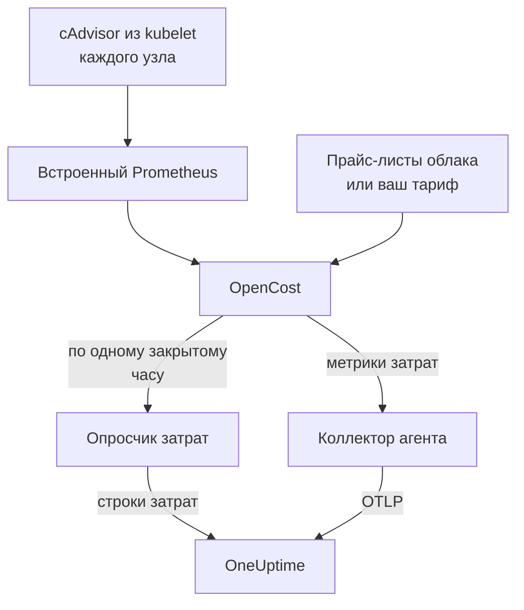

# Наблюдаемость затрат Kubernetes

Узнайте, сколько стоит каждая рабочая нагрузка Kubernetes — расходы по пространствам имён, рабочим нагрузкам и подам, простаивающие мощности и доля использования каждого request, — рядом с метриками, логами и трассировками, которые уже собирает [агент Kubernetes](/docs/telemetry/kubernetes-agent). Это включено по умолчанию и не требует облачных учётных данных: обзор кластера показывает, сколько он стоит, его страница **Затраты** подсказывает, какие request стоит уменьшить, а по метрикам затрат можно строить графики и настраивать оповещения, как по любым другим.

:::cards
- [Включение](#включение-наблюдаемости-затрат): Включено по умолчанию; где нет, хватит одной команды `helm upgrade`.
- [Оповещения о затратах](#оповещения-о-затратах): Затраты по кластерам, пространствам имён и рабочим нагрузкам в виде метрик.
- [Свой движок](#уже-используете-kubecost-или-opencost): Агент находит уже работающий у вас Kubecost или OpenCost и читает его данные.
- [Right-sizing](#right-sizing): Рекомендации по request и то, как они строятся.
- [Устранение неполадок](#устранение-неполадок): Пустые страницы, отсутствующие рекомендации.
:::

## Как это работает

Когда мониторинг затрат включён, а по умолчанию так и есть (`cost.enabled: auto`), чарт запускает рядом с агентом четыре компонента:



1. **OpenCost** — движок затрат с открытым исходным кодом (Apache-2.0, CNCF; тот самый [cost-model](https://github.com/kubecost/cost-model), на котором работает и Kubecost). Он следит за кластером, оценивает стоимость ваших узлов, томов и балансировщиков нагрузки и вычисляет, сколько стоит каждая рабочая нагрузка.
2. **Небольшой Prometheus**, который нужен OpenCost для истории использования и цен. Он работает в одной реплике, хранит историю за 7 дней и опрашивает ровно две цели: cAdvisor в kubelet каждого узла (через прокси узла API-сервера с пресетом `eks-fargate`, где ни один под не может обратиться к kubelet), оставляя только те ряды, которые читает OpenCost, и сам OpenCost (который выдаёт собственные метрики запросов ресурсов, поэтому kube-state-metrics не участвует). Он никогда не открывается за пределы кластера, и его данные никогда его не покидают.
3. **Опросчик затрат** (`cost.agent`). Раз в закрытый час он читает Allocation API OpenCost и отправляет в OneUptime по одной строке затрат на рабочую нагрузку: CPU, память, GPU, тома, сеть, балансировщики нагрузки и простой, с эффективностью. Каждый час отправляется один раз; сервер пропускает час, который у него уже есть, поэтому перезапуск не может посчитать расходы дважды. Из этих строк OneUptime также записывает [метрики затрат](#оповещения-о-затратах).
4. **Опрос метрик затрат** (`cost.metrics`). Коллектор агента опрашивает ценовые метрики OpenCost — сколько стоит час работы каждого узла, тома и балансировщика нагрузки — и отправляет их вместе с остальными метриками кластера.

OpenCost оценивает узлы по публичным прайс-листам вашего облачного провайдера (AWS, Google Cloud, Azure), без учётных данных. В остальных случаях он использует свои тарифы по умолчанию, которые заменяет ваш собственный [тариф](#цены-для-локальных-кластеров-и-bare-metal).

Вместе три пода запрашивают около 150m CPU и 450Mi памяти. С пресетами `gke-autopilot` и `eks-fargate` мониторинг затрат по умолчанию выключен: эти платформы выставляют счёт за каждый под по запрошенным им ресурсам, поэтому поды затрат увеличили бы тот самый счёт, который они измеряют, а OpenCost оценивает стоимость узлов, тогда как ни одна из этих платформ не берёт плату за узлы.

## Включение наблюдаемости затрат

Новой установке ничего не нужно: мониторинг затрат включён по умолчанию. Обновите агент, установленный до того, как мониторинг затрат стал включаться по умолчанию, или включите его с пресетом `gke-autopilot` или `eks-fargate`:

:::steps
### Обновите агент

```bash
helm upgrade kubernetes-agent oneuptime/kubernetes-agent \
  --namespace oneuptime-agent \
  --reset-then-reuse-values \
  --set cost.enabled=true
```

Это полная установка: три небольших дополнительных пода — OpenCost, его Prometheus и агент затрат. Если вы установили агент под другим именем релиза или в другое пространство имён, используйте свои (`helm list -A | grep kubernetes-agent` показывает их). Чтобы выключить мониторинг затрат, задайте `--set cost.enabled=false` тем же способом.

### Дождитесь первого закрытого часа

Первые затраты появляются после того, как закроется первый полный час, а OpenCost после запуска нужно несколько минут, чтобы оценить свой первый час.

### Откройте страницы «Затраты»

- **Продукты → Инфраструктура → Kubernetes → Затраты** показывает расходы по всем кластерам проекта.
- В кластере обзор показывает его расходы за последние 24 часа, прогноз расходов на месяц, расходы на простой, эффективность и самые затратные пространства имён и рабочие нагрузки.
- В кластере **Затраты** показывает динамику его расходов, **Spend by Namespace** с разбивкой на CPU, память и хранилище, **Spend by Workload**, расходы на простой, эффективность и карточку **Right-Sizing**.
:::

Метрики затрат (`node_total_hourly_cost`, `pv_hourly_cost` и остальные) — обычные метрики: они доступны в обозревателе метрик, на пользовательских панелях и в мониторах метрик. Чтобы получить готовую панель, откройте **Продукты → Панели**, выберите **Создать панель** и выберите **Kubernetes Cost Dashboard**: динамика почасовой стоимости узлов, удельная стоимость CPU и памяти, а также расходы на тома и балансировщики нагрузки.

Под цифрами обзор и страница **Затраты** указывают, откуда взяты цены: прайс-листы облака, ваш тариф или тарифы OpenCost по умолчанию, какой бы движок ни оценивал кластер, в том числе Kubecost 3. Kubecost, читающий ваш облачный счёт, сверяет свои цены с этим счётом примерно через полтора дня после каждого часа, поэтому строка тогда указывает, что цифры — его цены по прайс-листу до этой сверки. Эффективность везде считается одинаково, в том числе в метрике эффективности: какая доля запрошенных CPU и памяти была использована, причём каждый час работы контейнера взвешивается по стоимости его CPU и памяти, так что дешёвое задание, которое ничего не использует, не может занизить эффективность хорошо загруженного кластера, а простаивающие мощности не учитываются.

## Уже используете Kubecost или OpenCost?

Агент затрат находит ваш движок и читает его вместо встроенного OpenCost, поэтому кластер оценивается так, как вы это настроили: по вашему тарифу или по вашему облачному счёту, подключённому к Kubecost. При запуске, а затем каждый час он ищет через API Kubernetes сервисы, которые собственные чарты движков создают в любом пространстве имён (`cost-analyzer` или `frontend` у Kubecost, чарт OpenCost и сервис `opencost`, который создаёт манифест OpenCost), начиная с Kubecost. Движок, который не отвечает, требует входа или отвечает за несколько кластеров, он пропускает и тогда читает встроенный. Затем коллектор опрашивает и ценовые метрики вашего движка для Kubernetes Cost Dashboard, так что панель и страницы «Затраты» показывают одни и те же цены, а right-sizing берёт пики памяти из того Prometheus, который читает ваш движок.

Затем обзор кластера называет ваш движок и сообщает, что встроенный OpenCost не нужен. Отключите его:

```bash
helm upgrade kubernetes-agent oneuptime/kubernetes-agent \
  --namespace oneuptime-agent \
  --reset-then-reuse-values \
  --set cost.engine.url=auto
```

С `cost.engine.url=auto` ничего встроенного не будет, а агент читает ваш движок, где бы тот ни работал; если движок не установлен, ничего не оценивается. Чарт не может сам искать движок: функция `lookup` в Helm ничего не видит при `helm template`, в Argo CD или при пробном запуске. Чтобы оставить встроенный OpenCost рядом со своим движком, задайте `cost.engine.preferExisting=false`; чтобы указать, какой движок читать, задайте в `cost.engine.url` его сервис:

| Движок | Обычный URL сервиса |
| --- | --- |
| OpenCost | `http://opencost.opencost.svc.cluster.local:9003` |
| Kubecost 2 | `http://kubecost-cost-analyzer.kubecost.svc.cluster.local:9090` |
| Kubecost 3 | `http://kubecost-frontend.kubecost.svc.cluster.local:9090` |

Путь Allocation API определяется автоматически (`/model/allocation` для Kubecost, `/allocation/compute` или `/allocation` для OpenCost). Задавайте `cost.engine.allocationPath` только для нестандартной установки. Prometheus, который читает ваш движок, для рекомендаций по памяти тоже находится автоматически, кроме случая Kubecost 3, который никакого не читает: тогда задайте `cost.engine.prometheusUrl` (см. [Данные, на которых это строится](#данные-на-которых-это-строится)). Ценовые метрики находятся так же, какой бы сервис движка вы ни указали: агент пробует его `/metrics`, затем `/model/metrics`, который фронтенд Kubecost 2 или интерфейс OpenCost передаёт движку, затем FinOps-агент Kubecost 3, и коллектор опрашивает первый адрес, где есть ценовые ряды. Чтобы указать их самостоятельно, задайте `cost.metrics.endpoint`.

## Цены для локальных кластеров и bare metal

Кластеры, у узлов которых нет публичного облачного прайс-листа, могут задать тариф. Если тариф не задан, OpenCost оценивает такие узлы по своим тарифам по умолчанию (локальные серверы, bare metal, kind, k3s), которые могут сильно расходиться с реальной стоимостью вашего оборудования, и об этом сообщают обзор кластера и страница **Затраты**; в облаке, которое он распознаёт, узел сохраняет цену из прайс-листа, а тариф оценивает только то, чего в прайс-листе нет. Если тариф задан, OpenCost оценивает каждый ресурс по этим цифрам, все в долларах США за ресурс-час:

```yaml title="values.yaml"
cost:
  enabled: true
  opencost:
    customPricing:
      enabled: true
      cpuPerCoreHour: "0.031611"       # ~$23 per core-month
      ramPerGiBHour: "0.004237"        # ~$3 per GiB-month
      storagePerGBHour: "0.00005479452" # ~$0.04 per GB-month
      gpuPerHour: "0.95"
```

Это собственные тарифы OpenCost по умолчанию: укажите свои цифры, иначе страница **Затраты** будет по-прежнему сообщать, что кластер оценивается по тарифам OpenCost по умолчанию.

## Полезные настройки

Все они необязательны; полный список есть в `values.yaml` чарта:

```yaml title="values.yaml"
cost:
  enabled: auto           # on, except with the gke-autopilot and eks-fargate presets
  agent:
    windowSeconds: 3600   # allocation window length (hourly = native)
    includeIdle: true     # ship the engine's __idle__ allocation
    currency: USD         # currency code shown in the UI (informational)
  prometheus:
    retention: 7d         # bundled TSDB history; right-sizing reads peaks back over days
    persistence:
      enabled: false      # set true for a small PVC; emptyDir otherwise
  metrics:
    enabled: true         # cost metrics for dashboards / Metric Explorer
    scrapeInterval: 60s
```

## Right-sizing

Карточка **Right-Sizing** на странице кластера **Затраты** рекомендует request CPU и request памяти для каждого контейнера, по которому накоплено достаточно истории, и упорядочивает их по тому, сколько каждое изменение экономит в месяц.

Рекомендация — это наблюдаемая потребность плюс 25 % запаса, округлённая до значения, которое можно вставить в манифест (10m CPU, 16Mi памяти):

- CPU рассчитывается по 95-му перцентилю среднего почасового использования: достаточно высоко, чтобы покрыть реальную нагрузку, и достаточно низко, чтобы один всплеск не раздувал request на месяц.
- Память рассчитывается по пиковому working set, а не по среднему (см. [Данные, на которых это строится](#данные-на-которых-это-строится)).

Рекомендуются request, но не limit. Request — это то, что резервирует планировщик и от чего считается счёт, поэтому именно это число двигает затраты. Limit — это решение о том, ограничивать или убивать контейнер, который ведёт себя неправильно, а такое решение данные об использовании за вас принять не могут.

Каждый контейнер сравнивается со своим текущим request:

| Вывод | Что это значит |
| --- | --- |
| Избыточный ресурс | Он резервирует явно больше, чем использует. Именно отсюда берётся экономия. |
| Недостаточный ресурс | Он резервирует меньше, чем использует, поэтому его ограничивают или ему грозит OOM-kill. Исправление стоит денег, и карточка показывает это как рост. |
| Request не задан | Уменьшать нечего, но планировщик не может безопасно разместить контейнер, и под нагрузкой его вытесняют первым. |

Контейнер в пределах 15 % от своей рекомендации считается правильно подобранным и не показывается: никому не стоит править манифест, чтобы срезать 3 % с request.

Честность советов обеспечивают две защиты. Рабочей нагрузке нужно не меньше 24 часов окон затрат, прежде чем для неё вообще что-то рассчитывается, потому что четырёхчасовое окно может застать ночное пакетное задание в простое и посоветовать урезать его до нуля. А экономия прогнозируется по длине окна, которое вы смотрите, а не по числу строк, поэтому экономия Deployment не умножается на число его реплик. Оценка предполагает, что расходы растут вместе с тем, что выделил движок, то есть `max(request, usage)`; для контейнера с избыточным ресурсом это request, поэтому цифра экономии точна.

### Данные, на которых это строится

Помимо расходов опросчик собирает то, что нужно рекомендации: request и limit CPU и памяти каждого контейнера и их использование.

Памяти нужен ещё один источник. Allocation API сообщает только среднее по каждому окну, а почасовое среднее скрывает всплеск, из-за которого контейнер убивает OOM, поэтому рассчитывать по нему память было бы опасно. Вместо этого опросчик читает пик памяти каждого контейнера из Prometheus, сопоставляя по `(namespace, pod, container)`:

- Со встроенным движком (по умолчанию) он использует собственный Prometheus чарта. Ничего настраивать не нужно.
- С вашим собственным движком он использует Prometheus, который читает этот движок и который агент находит сам: `PROMETHEUS_SERVER_ENDPOINT` у OpenCost или Prometheus, входящий в состав Kubecost 2, как только тот отвечает за ряды cAdvisor этого кластера. Kubecost 3 никакого не читает, и тогда используется встроенный Prometheus, пока чарт его запускает.
- В остальных случаях, или чтобы выбрать Prometheus самостоятельно, направьте `cost.engine.prometheusUrl` на Prometheus, который опрашивает cAdvisor, и задайте `cost.engine.prometheusCadvisorJob`, если он опрашивает cAdvisor в нескольких заданиях и нужное называется не `kubernetes-nodes-cadvisor`. Без Prometheus рекомендации по CPU по-прежнему работают на основе сохранённых почасовых средних, а рекомендации по памяти не выдаются, а не угадываются.

Сбой Prometheus никогда не останавливает сбор расходов: пики — это дополнение, и час отправляется без них. CPU намеренно не использует Prometheus: слишком большой request CPU лишь приводит к троттлингу, тогда как слишком маленький request памяти убивает контейнер, поэтому для CPU почасовые средние безопасны, а запрос скорости CPU каждого контейнера по всему кластеру достаточно тяжёл, чтобы уронить небольшой Prometheus.

## Оповещения о затратах

Из строк затрат за каждый час OneUptime записывает четыре метрики, выраженные в деньгах и названные по тому, что они означают, поэтому по затратам можно строить графики, выводить их на панели и настраивать оповещения в [мониторе Kubernetes](/docs/monitor/kubernetes-monitor) или [мониторе метрик](/docs/monitor/metrics-monitor):

| Метрика | Что это | Атрибуты |
| --- | --- | --- |
| `oneuptime.kubernetes.cost.total` | Сколько стоил кластер за каждый час, включая простаивающие мощности | `k8s.cluster.name` |
| `oneuptime.kubernetes.cost.idle` | Часть этой суммы, которую не использовала ни одна рабочая нагрузка: простаивающие и нераспределённые мощности | `k8s.cluster.name` |
| `oneuptime.kubernetes.cost.workload` | Сколько стоила каждая рабочая нагрузка за каждый час; в сумме по пространству имён — сколько стоило это пространство имён | `k8s.cluster.name`, `k8s.namespace.name` и имя рабочей нагрузки в атрибуте, соответствующем её виду, например `k8s.deployment.name` |
| `oneuptime.kubernetes.cost.efficiency` | Какую долю запрошенных CPU и памяти использовала каждая рабочая нагрузка, в процентах, с весом по затратам | Те же, что у рабочей нагрузки выше |

Каждая точка — это затраты за один час в валюте агента (по умолчанию USD); её метка времени — начало часа, а записывается она примерно через час после его окончания: суммируйте точки за окно из нескольких часов, и точки за день в сумме дадут затраты за этот день. Они получены из того, что кластер уже отправил, поэтому не тарифицируются как принятые метрики и хранятся столько же, сколько остальные метрики кластера.

Для них у монитора Kubernetes есть три шаблона: Cluster Daily Cost Over Budget, Namespace Daily Cost Over Budget и High Idle Spend, у каждого — бюджет, который нужно заменить своим. Ценовые метрики OpenCost — тоже обычные метрики: монитор метрик может оповещать, когда среднее `node_total_hourly_cost` превышает бюджет или когда появляется `pv_hourly_cost` для класса томов, которого в кластере быть не должно.

## Модель данных и хранение

Строки затрат хранятся в ClickHouse, по одной на кластер, окно, пространство имён, контроллер, под и контейнер. Для них действует срок хранения телеметрии кластера: `retainTelemetryDataForDays` кластера или срок хранения данных проекта, если первый не задан. Простаивающие и нераспределённые мощности хранятся как обычные строки в пространствах имён `__idle__` и `__unallocated__`, поэтому группируются и фильтруются так же, как расходы рабочих нагрузок.

## Устранение неполадок

:::details Страницы Costs пусты
С пресетами `gke-autopilot` и `eks-fargate` мониторинг затрат по умолчанию выключен: включите его с помощью `--set cost.enabled=true`. В остальных случаях прочитайте логи опросчика затрат: `kubectl logs -n oneuptime-agent deploy/kubernetes-agent-cost`. (Deployment называется `<release>-kubernetes-agent-cost`, если имя релиза не содержит `kubernetes-agent`; `kubectl get deploy -n oneuptime-agent` перечисляет их.) `HTTP 401` означает, что OneUptime отклонил ключ приёма. `did not answer any known allocation path` означает, что движок ещё не запущен (встроенному OpenCost нужно несколько минут, чтобы оценить первые часы) или `cost.engine.url` указан неверно.
:::

:::details Встроенный OpenCost не готов
Прочитайте его логи: `kubectl logs -n oneuptime-agent deploy/kubernetes-agent-opencost`. В них видно, какого облачного провайдера он определил и загрузились ли его данные о ценах.
:::

:::details Обзор сообщает, что встроенный OpenCost не нужен
В кластере работает собственный Kubecost или OpenCost, и агент затрат читает его, поэтому встроенный в чарт OpenCost ничего не оценивает. Обновитесь с `--set cost.engine.url=auto`, чтобы больше не запускать его и его Prometheus, или задайте `cost.engine.preferExisting=false`, чтобы вместо этого читать встроенный движок. С Kubecost 3, который не читает никакого Prometheus, рекомендации по памяти берутся из встроенного: укажите другой в `cost.engine.prometheusUrl` в том же обновлении.
:::

:::details Агент затрат не читает ваш движок
В логе агента затрат сказано, какой движок он читает и почему пропустил остальные: `kubectl logs -n oneuptime-agent deploy/kubernetes-agent-cost`. Он пропускает движок, который не отвечает (например, из-за NetworkPolicy между пространствами имён), требует входа или отвечает за несколько кластеров, как Kubecost, объединяющий другие кластеры в федерацию. Укажите движок, который нужно читать, в `cost.engine.url`.
:::

:::details В логе OpenCost сообщение mkdir /var/configs: permission denied
Старый чарт запускал OpenCost без каталога конфигурации, доступного для записи, поэтому из-за `Error downloading default pricing data` его Allocation API не мог отвечать и опросчик останавливался, хотя под оставался в состоянии `Running`, `/healthz` оставался зелёным, а метрики затрат узлов продолжали публиковаться. Текущие чарты это исправляют: выполните `helm repo update`, затем обновитесь с `--reset-then-reuse-values`. Строки затрат появятся при следующем опросе.
:::

:::details Kubernetes Cost Dashboard не показывает данных
Шаблон читает опрошенные метрики затрат: проверьте, что `cost.metrics.enabled` равно `true`. Агент затрат сам находит, где их отдаёт движок, который он читает, встроенный или ваш, и в его логе сказано, где именно или какие адреса он пробовал: `kubectl logs -n oneuptime-agent deploy/kubernetes-agent-cost`. Чтобы указать их самостоятельно, задайте `cost.metrics.endpoint`.
:::

:::details Карточка Right-Sizing пуста
Либо выбранный период короче 24 часов, которые нужны рекомендации (расширьте его), либо каждый контейнер уже в пределах 15 % от рекомендованного request — об этом сообщает карточка.
:::

:::details Рекомендации по памяти показывают -, а по CPU работают
Ни один пик памяти не дошёл до OneUptime, поэтому память осталась без расчёта, а не была угадана по среднему. Со своим движком в логе агента затрат сказано, какой Prometheus он читает или почему не нашёл ни одного: укажите нужный в `cost.engine.prometheusUrl` (Kubecost 3 никакого не читает). Карточка сообщает, скольких контейнеров это касается.
:::

:::details Цифры отличаются от собственного интерфейса движка
OneUptime отправляет целые закрытые часы такими, какими движок оценил их после закрытия, с учётом его корректировок сверки: расходы текущего часа появляются после его закрытия. Kubecost, читающий ваш облачный счёт, сверяет с ним каждый час примерно через полтора дня, а OneUptime сохраняет час таким, каким он был оценён в первый раз.
:::

:::details Встроенный Prometheus перезапустился
При хранилище по умолчанию `emptyDir` перезапуск теряет несколько часов истории использования, поэтому затраты за эти часы могут оказаться меньше. Задайте `cost.prometheus.persistence.enabled=true`, если для вас это важно.
:::

## Дальнейшие шаги

:::cards
- [Агент Kubernetes](/docs/telemetry/kubernetes-agent): Установите агент и всё остальное, что он собирает.
- [Мониторинг метрик](/docs/monitor/metrics-monitor): Оповещение, когда расходы превышают бюджет.
- [Мониторинг Kubernetes](/docs/monitor/kubernetes-monitor): Оповещения и о здоровье кластера.
:::
