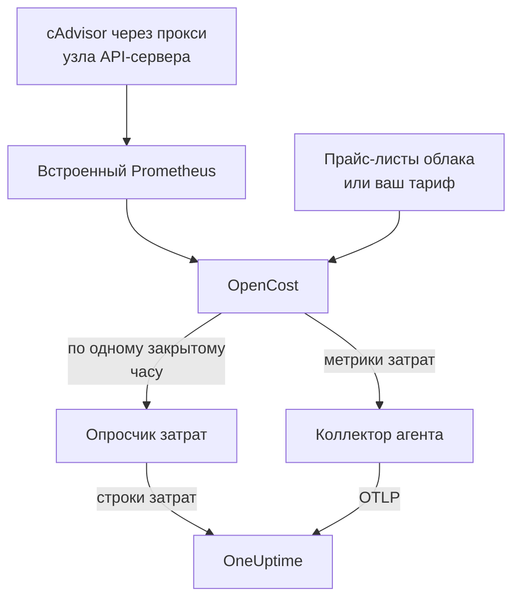

# Наблюдаемость затрат Kubernetes

Узнайте, сколько стоит каждая рабочая нагрузка Kubernetes — расходы по пространствам имён, рабочим нагрузкам и подам, простаивающие мощности и доля использования каждого request, — рядом с метриками, логами и трассировками, которые уже собирает [агент Kubernetes](/docs/telemetry/kubernetes-agent). Это включается одним значением Helm, без облачных учётных данных, и затем страница кластера **Costs** подсказывает, какие request стоит уменьшить.

:::cards
- [Включение](#включение-наблюдаемости-затрат): Одна команда `helm upgrade`.
- [Свой движок](#уже-используете-kubecost-или-opencost): Направьте агента на Kubecost или OpenCost.
- [Right-sizing](#right-sizing): Рекомендации по request и то, как они строятся.
- [Устранение неполадок](#устранение-неполадок): Пустые страницы, отсутствующие рекомендации.
:::

## Как это работает

С `cost.enabled=true` чарт запускает рядом с агентом четыре компонента:



1. **OpenCost** — движок затрат с открытым исходным кодом (Apache-2.0, CNCF; тот самый [cost-model](https://github.com/kubecost/cost-model), на котором работает и Kubecost). Он следит за кластером, оценивает стоимость ваших узлов, томов и балансировщиков нагрузки и вычисляет, сколько стоит каждая рабочая нагрузка.
2. **Небольшой Prometheus**, который нужен OpenCost для истории использования и цен. Он работает в одной реплике, хранит историю за 7 дней и опрашивает ровно две цели: cAdvisor через прокси узла API-сервера и сам OpenCost (который выдаёт собственные метрики запросов ресурсов, поэтому kube-state-metrics не участвует). Он никогда не открывается за пределы кластера, и его данные никогда его не покидают.
3. **Опросчик затрат** (`cost.agent`). Раз в закрытый час он читает Allocation API OpenCost и отправляет в OneUptime по одной строке затрат на рабочую нагрузку: CPU, память, GPU, тома, сеть, балансировщики нагрузки и простой, с эффективностью. Каждый час отправляется один раз; сервер пропускает час, который у него уже есть, поэтому перезапуск не может посчитать расходы дважды.
4. **Опрос метрик затрат** (`cost.metrics`). Коллектор агента опрашивает метрики затрат OpenCost и отправляет их вместе с остальными метриками кластера.

OpenCost оценивает узлы по публичным прайс-листам вашего облачного провайдера (AWS, Google Cloud, Azure), без учётных данных. Кластеры без облачного прайс-листа вместо этого задают [тариф](#цены-для-локальных-кластеров-и-bare-metal).

## Включение наблюдаемости затрат

:::steps
### Обновите агент с cost.enabled

```bash
helm upgrade kubernetes-agent oneuptime/kubernetes-agent \
  --namespace oneuptime-agent \
  --reset-then-reuse-values \
  --set cost.enabled=true
```

Это полная установка: два небольших дополнительных пода — OpenCost и его Prometheus. Если вы установили агент под другим именем релиза или в другое пространство имён, используйте свои (`helm list -A | grep kubernetes-agent` показывает их).

### Дождитесь первого закрытого часа

Первые затраты появляются после того, как закроется первый полный час, а OpenCost после запуска нужно несколько минут, чтобы оценить свой первый час.

### Откройте страницы Costs

- **Продукты → Инфраструктура → Kubernetes → Costs** показывает расходы по всем кластерам проекта.
- В кластере **Costs** показывает динамику его расходов, **Spend by Namespace** с разбивкой на CPU, память и хранилище, **Spend by Workload**, расходы на простой, эффективность и карточку **Right-Sizing**.
:::

Метрики затрат (`node_total_hourly_cost`, `pv_hourly_cost` и остальные) — обычные метрики: они доступны в обозревателе метрик, на пользовательских панелях и в мониторах метрик. Чтобы получить готовую панель, откройте **Продукты → Панели**, выберите **Создать: Панель** и выберите **Kubernetes Cost Dashboard**: динамика почасовой стоимости узлов, удельная стоимость CPU и памяти, а также расходы на тома и балансировщики нагрузки.

## Уже используете Kubecost или OpenCost?

Вместо этого направьте агента на свой движок, и ничего встроенного не будет:

```bash
helm upgrade kubernetes-agent oneuptime/kubernetes-agent \
  --namespace oneuptime-agent \
  --reset-then-reuse-values \
  --set cost.enabled=true \
  --set cost.engine.url=http://kubecost-cost-analyzer.kubecost.svc.cluster.local:9090
```

| Движок | Обычный URL сервиса |
| --- | --- |
| OpenCost | `http://opencost.opencost.svc.cluster.local:9003` |
| Kubecost | `http://kubecost-cost-analyzer.kubecost.svc.cluster.local:9090` |

Путь Allocation API определяется автоматически (`/model/allocation` для Kubecost, `/allocation/compute` или `/allocation` для OpenCost). Задавайте `cost.engine.allocationPath` только для нестандартной установки. Для рекомендаций по памяти задайте также `cost.engine.prometheusUrl` (см. [Данные, на которых это строится](#данные-на-которых-это-строится)).

## Цены для локальных кластеров и bare metal

Кластеры, у узлов которых нет публичного облачного прайс-листа, могут задать тариф. Тогда OpenCost оценивает каждый ресурс по этим цифрам, все в долларах США за ресурс-час:

```yaml title="values.yaml"
cost:
  enabled: true
  opencost:
    customPricing:
      enabled: true
      cpuPerCoreHour: "0.031611"       # ~$23 per core-month
      ramPerGiBHour: "0.004237"        # ~$3 per GiB-month
      storagePerGBHour: "0.00005479452" # ~$0.04 per GB-month
      gpuPerHour: "0.95"
```

## Полезные настройки

Все они необязательны; полный список есть в `values.yaml` чарта:

```yaml title="values.yaml"
cost:
  agent:
    windowSeconds: 3600   # allocation window length (hourly = native)
    includeIdle: true     # ship the engine's __idle__ allocation
    currency: USD         # currency code shown in the UI (informational)
  prometheus:
    retention: 7d         # bundled TSDB history; right-sizing reads peaks back over days
    persistence:
      enabled: false      # set true for a small PVC; emptyDir otherwise
  metrics:
    enabled: true         # cost metrics for dashboards / Metric Explorer
    scrapeInterval: 60s
```

## Right-sizing

Карточка **Right-Sizing** на странице кластера **Costs** рекомендует request CPU и request памяти для каждого контейнера, по которому накоплено достаточно истории, и упорядочивает их по тому, сколько каждое изменение экономит в месяц.

Рекомендация — это наблюдаемая потребность плюс 25 % запаса, округлённая до значения, которое можно вставить в манифест (10m CPU, 16Mi памяти):

- CPU рассчитывается по 95-му перцентилю среднего почасового использования: достаточно высоко, чтобы покрыть реальную нагрузку, и достаточно низко, чтобы один всплеск не раздувал request на месяц.
- Память рассчитывается по пиковому working set, а не по среднему (см. [Данные, на которых это строится](#данные-на-которых-это-строится)).

Рекомендуются request, но не limit. Request — это то, что резервирует планировщик и от чего считается счёт, поэтому именно это число двигает затраты. Limit — это решение о том, ограничивать или убивать контейнер, который ведёт себя неправильно, а такое решение данные об использовании за вас принять не могут.

Каждый контейнер сравнивается со своим текущим request:

| Вывод | Что это значит |
| --- | --- |
| Избыточный ресурс | Он резервирует явно больше, чем использует. Именно отсюда берётся экономия. |
| Недостаточный ресурс | Он резервирует меньше, чем использует, поэтому его ограничивают или ему грозит OOM-kill. Исправление стоит денег, и карточка показывает это как рост. |
| Request не задан | Уменьшать нечего, но планировщик не может безопасно разместить контейнер, и под нагрузкой его вытесняют первым. |

Контейнер в пределах 15 % от своей рекомендации считается правильно подобранным и не показывается: никому не стоит править манифест, чтобы срезать 3 % с request.

Честность советов обеспечивают две защиты. Рабочей нагрузке нужно не меньше 24 часов окон затрат, прежде чем для неё вообще что-то рассчитывается, потому что четырёхчасовое окно может застать ночное пакетное задание в простое и посоветовать урезать его до нуля. А экономия прогнозируется по длине окна, которое вы смотрите, а не по числу строк, поэтому экономия Deployment не умножается на число его реплик. Оценка предполагает, что расходы растут вместе с тем, что выделил движок, то есть `max(request, usage)`; для контейнера с избыточным ресурсом это request, поэтому цифра экономии точна.

### Данные, на которых это строится

Помимо расходов опросчик собирает то, что нужно рекомендации: request и limit CPU и памяти каждого контейнера и их использование.

Памяти нужен ещё один источник. Allocation API сообщает только среднее по каждому окну, а почасовое среднее скрывает всплеск, из-за которого контейнер убивает OOM, поэтому рассчитывать по нему память было бы опасно. Вместо этого опросчик читает пик памяти каждого контейнера из Prometheus, сопоставляя по `(namespace, pod, container)`:

- Со встроенным движком (по умолчанию) он использует собственный Prometheus чарта. Ничего настраивать не нужно.
- Со своим движком (`cost.engine.url`) направьте `cost.engine.prometheusUrl` на Prometheus, который опрашивает cAdvisor, и задайте `cost.engine.prometheusCadvisorJob`, если его задание опроса называется не `kubernetes-nodes-cadvisor`.
- Без Prometheus рекомендации по CPU по-прежнему работают на основе сохранённых почасовых средних, а рекомендации по памяти не выдаются, а не угадываются.

Сбой Prometheus никогда не останавливает сбор расходов: пики — это дополнение, и час отправляется без них. CPU намеренно не использует Prometheus: слишком большой request CPU лишь приводит к троттлингу, тогда как слишком маленький request памяти убивает контейнер, поэтому для CPU почасовые средние безопасны, а запрос скорости CPU каждого контейнера по всему кластеру достаточно тяжёл, чтобы уронить небольшой Prometheus.

## Оповещения о затратах

Метрики затрат — обычные метрики, поэтому [монитор метрик](/docs/monitor/metrics-monitor) может оповещать по ним, как по любым другим: например, когда среднее `node_total_hourly_cost` превышает бюджет или когда появляется `pv_hourly_cost` для класса томов, которого в кластере быть не должно.

## Модель данных и хранение

Строки затрат хранятся в ClickHouse, по одной на кластер, окно, пространство имён, контроллер, под и контейнер. Для них действует срок хранения телеметрии кластера: `retainTelemetryDataForDays` кластера или срок хранения данных проекта, если первый не задан. Простаивающие и нераспределённые мощности хранятся как обычные строки в пространствах имён `__idle__` и `__unallocated__`, поэтому группируются и фильтруются так же, как расходы рабочих нагрузок.

## Устранение неполадок

:::details Страницы Costs пусты
Прочитайте логи опросчика затрат: `kubectl logs -n oneuptime-agent deploy/kubernetes-agent-cost`. (Deployment называется `<release>-kubernetes-agent-cost`, если имя релиза не содержит `kubernetes-agent`; `kubectl get deploy -n oneuptime-agent` перечисляет их.) `HTTP 401` означает, что OneUptime отклонил ключ приёма. `did not answer any known allocation path` означает, что движок ещё не запущен (встроенному OpenCost нужно несколько минут, чтобы оценить первые часы) или `cost.engine.url` указан неверно.
:::

:::details Встроенный OpenCost не готов
Прочитайте его логи: `kubectl logs -n oneuptime-agent deploy/kubernetes-agent-opencost`. В них видно, какого облачного провайдера он определил и загрузились ли его данные о ценах.
:::

:::details В логе OpenCost сообщение mkdir /var/configs: permission denied
Старый чарт запускал OpenCost без каталога конфигурации, доступного для записи, поэтому из-за `Error downloading default pricing data` его Allocation API не мог отвечать и опросчик останавливался, хотя под оставался в состоянии `Running`, `/healthz` оставался зелёным, а метрики затрат узлов продолжали публиковаться. Текущие чарты это исправляют: выполните `helm repo update`, затем обновитесь с `--reset-then-reuse-values`. Строки затрат появятся при следующем опросе.
:::

:::details Kubernetes Cost Dashboard не показывает данных
Шаблон читает опрошенные метрики затрат: проверьте, что `cost.metrics.enabled` равно `true`.
:::

:::details Карточка Right-Sizing пуста
Либо выбранный период короче 24 часов, которые нужны рекомендации (расширьте его), либо каждый контейнер уже в пределах 15 % от рекомендованного request — об этом сообщает карточка.
:::

:::details Рекомендации по памяти показывают -, а по CPU работают
Ни один пик памяти не дошёл до OneUptime, поэтому память осталась без расчёта, а не была угадана по среднему. Со своим движком задайте `cost.engine.prometheusUrl`. Карточка сообщает, скольких контейнеров это касается.
:::

:::details Цифры отличаются от собственного интерфейса движка
OneUptime включает корректировки сверки движка в каждую составляющую затрат и отправляет целые закрытые часы: расходы текущего часа появляются после его закрытия.
:::

:::details Встроенный Prometheus перезапустился
При хранилище по умолчанию `emptyDir` перезапуск теряет несколько часов истории использования, поэтому затраты за эти часы могут оказаться меньше. Задайте `cost.prometheus.persistence.enabled=true`, если для вас это важно.
:::

## Дальнейшие шаги

:::cards
- [Агент Kubernetes](/docs/telemetry/kubernetes-agent): Установите агент и всё остальное, что он собирает.
- [Мониторинг метрик](/docs/monitor/metrics-monitor): Оповещение, когда расходы превышают бюджет.
- [Мониторинг Kubernetes](/docs/monitor/kubernetes-monitor): Оповещения и о здоровье кластера.
:::
