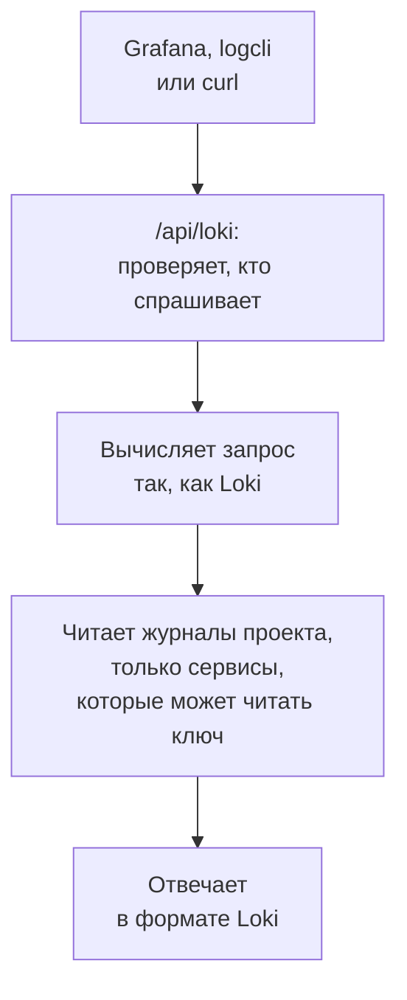

# Запросы журналов на LogQL

LogQL — язык запросов Grafana Loki. OneUptime отвечает на API запросов Loki по журналам вашего проекта, поэтому источник данных Loki в Grafana, logcli или любой клиент Loki читает их, а панели и сохранённые запросы, которые вы написали для Loki, продолжают работать.

:::cards
- [Подключить Grafana](#подключить-grafana): Добавьте OneUptime как источник данных Loki.
- [Как журналы получают метки](#как-журналы-получают-метки): Что находит селектор потока.
- [Что поддерживается в LogQL](#что-поддерживается-в-logql): Запросы журналов, парсеры и запросы метрик.
- [Ограничения](#ограничения): Что может читать запрос и как часто.
:::

## Как это работает

Grafana спрашивает OneUptime так же, как спрашивает Loki. OneUptime проверяет, что API-ключ может читать журналы проекта, читает только те сервисы, которые он может читать, и вычисляет запрос так, как это делает Loki.



## Перед началом

- **Поступающие журналы.** Отправляйте их через [OpenTelemetry](/docs/telemetry/open-telemetry) или из Promtail, Grafana Alloy, Fluent Bit или Vector через [API отправки Loki](/docs/telemetry/compatible-endpoints).
- **API-ключ проекта, который читает журналы**, с ролью Владелец проекта, Администратор проекта, Участник проекта, Зритель, Администратор телеметрии, Участник телеметрии или Зритель телеметрии либо с разрешением Read Logs. Ключ, ограниченный некоторыми сервисами, читает только их журналы. См. [Создайте API-ключ](/docs/api-reference/api-reference#создайте-api-ключ). В OneUptime Cloud API-ключам нужен план **Growth**.
- **Не ключ приёма.** Ключ приёма отправляет телеметрию и ничего не читает, поэтому Grafana не может войти с ним.

## Подключить Grafana

:::steps
### Создайте API-ключ

В OneUptime откройте **Настройки проекта → Расширенный → Ключи API** и нажмите **Создать: API-ключ**. Дайте ключу роль, которая читает телеметрию, или разрешение Read Logs.

### Добавьте источник данных Loki

В Grafana откройте **Connections → Data sources → Add data source** и выберите **Loki**.

### Укажите URL

В поле **URL** укажите адрес вашего OneUptime, а за ним `/api/loki`. В OneUptime Cloud это `https://oneuptime.com/api/loki`.

### Отправьте API-ключ

В разделе **HTTP headers** добавьте заголовок `Authorization` со значением `Bearer`, за которым следуют пробел и ваш API-ключ. Базовая аутентификация тоже работает: любое имя пользователя и API-ключ в качестве пароля.

### Сохраните и проверьте

Нажмите **Save & test**. Grafana выполнит запрос и сообщит, что источник данных работает.
:::

После этого Explore, объём журналов над строками, обозреватели меток и панели читают OneUptime так же, как Loki. logcli и любой другой клиент Loki работают так же. С curl:

```bash title="Query OneUptime's Loki API"
curl -G -H "Authorization: Bearer $ONEUPTIME_API_KEY" \
  "https://oneuptime.com/api/loki/loki/api/v1/query_range" \
  --data-urlencode 'query={service_name="checkout"} |= "error"'
```

## Как журналы получают метки

Селектор потока находит атрибуты журнала, названные так, как Loki 3 называет журналы OpenTelemetry:

| В OneUptime | В LogQL |
| --- | --- |
| Атрибут ресурса `service.name` | Метка `service_name` |
| Атрибут ресурса `k8s.pod.name` | Метка `k8s_pod_name` |
| Атрибут `http.method` | Метка `http_method` |
| Метка, которую отправил клиент Loki, например `job` | Метка `job` |
| Важность журнала | Метка `detected_level`: `trace`, `debug`, `info`, `warn`, `error`, `fatal` или `unknown` |

- **Каждый атрибут — метка.** Запрос журналов отвечает одним потоком на набор меток, поэтому журналы с разными атрибутами — разные потоки, как Loki 3 отвечает для журналов со структурированными метаданными.
- **Собственный атрибут журнала идёт первым**, когда у его ресурса есть атрибут с тем же именем.
- **Селектор называет значение**, как требует Loki: хотя бы один сопоставитель, которому не отвечает журнал без этой метки, например `{service_name="checkout"}` или `{service_name=~"check.+"}`.

Несколько запросов для начала:

```text title="LogQL"
# The checkout service's lines that say error
{service_name="checkout"} |= "error"

# Requests slower than 250ms, read from JSON lines
{service_name="checkout"} | json | duration > 250ms

# Error logs per second, by service
sum by (service_name) (rate({detected_level="error"} [5m]))
```

## Что поддерживается в LogQL

- **Запросы журналов**: селекторы потоков с `=`, `!=`, `=~` и `!~`; фильтры строк `|=`, `!=`, `|~` и `!~`, с `or`; парсеры `json` и `logfmt`; фильтры меток по тексту, числам, длительностям и размерам, с `and`, `or` и `__error__`; `line_format` с `{{.label}}`; `drop`, `keep` и `decolorize`.
- **Запросы метрик**: `count_over_time`, `rate`, `bytes_over_time`, `bytes_rate` и `absent_over_time`; по метке, взятой через `unwrap` (с `duration()` или `bytes()`), — `rate`, `sum_over_time`, `avg_over_time`, `min_over_time`, `max_over_time`, `first_over_time`, `last_over_time`, `stddev_over_time`, `stdvar_over_time` и `quantile_over_time`; и `offset`.
- **Вокруг них**: `sum`, `avg`, `min`, `max`, `count`, `stddev`, `stdvar`, `topk` и `bottomk`, с `by` или `without`; арифметика, сравнения (с `bool`), `and`, `or` и `unless`, с `on`, `ignoring`, `group_left` и `group_right`; `sort`, `sort_desc`, `label_replace` и `vector()`.

Парсеры `pattern`, `regexp` и `unpack`, `label_format`, `json` с именованными полями, фильтры `ip()` и шаблоны `line_format` сложнее `{{.label}}` пока недоступны. Запрос, который использует что-то из этого, отклоняется с сообщением, где это названо.

## API

API отвечает на маршруты HTTP API Loki, через `GET` или `POST`, под `/api/loki`:

| Маршрут | Что он возвращает |
| --- | --- |
| `/loki/api/v1/query_range` | Строки запроса журналов от `start` до `end` или запрос метрик на каждом `step`. |
| `/loki/api/v1/query` | Запрос метрик в один момент (`time`, по умолчанию сейчас). |
| `/loki/api/v1/labels` | Имена меток — журналов, которые выбирает `query`, или всех журналов. |
| `/loki/api/v1/label/<name>/values` | Значения одной метки. |
| `/loki/api/v1/series` | Наборы меток журналов, которые выбирает `match[]`. |

Время задаётся в наносекундах с 1970 года, в секундах Unix или в RFC 3339, а диапазон — это час до `end`, если не указано иное. Запрос журналов возвращает `limit` строк, по умолчанию 100, сначала новые, если не указано `direction=forward`. Ответы приходят в формате Loki, а ошибки — обычным текстом, как их пишет Loki. `/loki/api/v1/status/buildinfo` отвечает как сервер Loki 3.

## Ограничения

Каждый запрос ограничен, чтобы панель со множеством графиков не могла перегрузить OneUptime:

| Ограничение | Значение |
| --- | --- |
| Строки, которые возвращает запрос журналов | 5 000 |
| Журналы, которые читает запрос журналов, когда фильтры после его парсеров отбрасывают часть | 20 000 |
| Журналы, которые запрос метрик читает сам, когда ClickHouse не может их сосчитать | 100 000 |
| Ряды, которые возвращает запрос метрик | 500 |
| Точки в одном ряду запроса по диапазону | 11 000 |
| Журналы, которые возвращает одно чтение | 64 МБ |
| Время, которое может занять чтение | 30 секунд |
| Запросы, которые проект может отправить за минуту | 1 200 |

Запрос метрик, у которого конвейер состоит только из фильтров строк, например `sum(count_over_time({service_name="checkout"} |= "error" [5m]))`, считается там, где лежат журналы, поэтому он вовсе не читает строк.

## Устранение неполадок

:::details Grafana сообщает, что источник данных не работает
Проверьте, что URL заканчивается на `/api/loki`, а заголовок `Authorization` содержит `Bearer`, пробел и API-ключ. Ключ приёма или API-ключ без роли, которая читает журналы, отклоняется: дайте ключу такую роль в **Настройки проекта → Расширенный → Ключи API**.
:::

:::details "queries require at least one regexp or equality matcher that does not have an empty-compatible value"
Селектор находит журналы, не называя значения, например `{service_name=~".*"}`. Добавьте сопоставитель, который называет значение, например `{service_name="checkout"}`.
:::

:::details "This project sent more queries this minute than OneUptime answers."
Панели и клиенты проекта отправили в API больше 1 200 запросов за эту минуту. Панели загрузятся снова в следующую минуту; обновляйте панели реже, чтобы не выходить за предел.
:::

## Дальнейшие шаги

:::cards
- [Обозреватель журналов](/docs/telemetry/logs-explorer): Ищите и фильтруйте журналы без запросов.
- [PromQL](/docs/telemetry/promql): Запрашивайте метрики на PromQL, в том числе из источника данных Prometheus в Grafana.
- [Мониторинг журналов](/docs/monitor/logs-monitor): Получайте оповещения об объёме и содержании журналов.
:::
