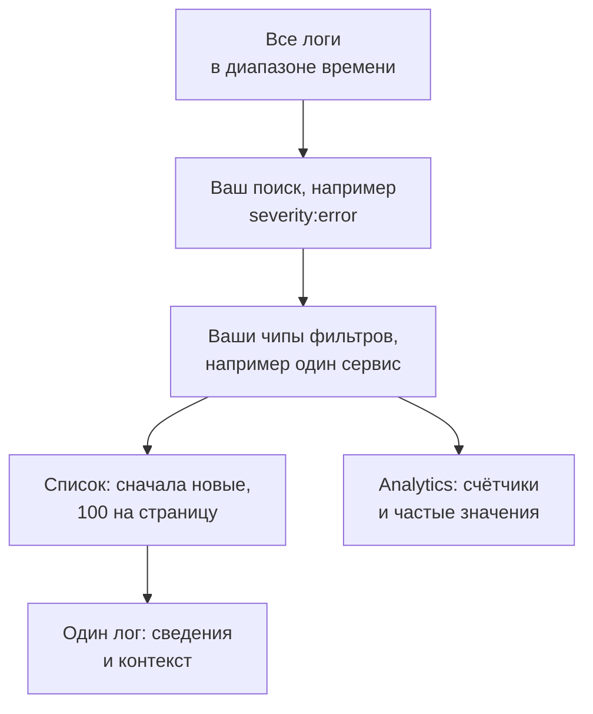

# Обозреватель журналов

Обозреватель журналов — это место, где вы ищете и читаете логи, которые ваши сервисы, хосты и агенты отправляют в OneUptime. Сузьте миллионы строк до тех немногих, что важны, следите за новыми по мере поступления, стройте по ним графики и сохраняйте представления, к которым возвращается ваша команда.

:::cards
- [Найти строку лога](#найти-строку-лога): Диапазон времени, поиск и несколько фильтров.
- [Прочитать лог](#прочитать-лог): Его атрибуты, его трассировка и соседние строки.
- [Следить за логами вживую](#следить-за-логами-вживую): Новые строки каждые 10 секунд.
- [Сохранить представление](#сохранить-представление): Поиск, его фильтры и столбцы, сохранённые для всех.
- [Аналитика логов](#аналитика-логов): Главные ошибки, уровни серьёзности и кто что пишет в логи.
- [Поиск и исправление ошибок, пробелов и шума в журналах с ИИ](#поиск-и-исправление-ошибок-пробелов-и-шума-в-журналах-с-ии): Пул-реквесты, которые исправляют ошибки, добавляют недостающие записи в журнал и приглушают шумные строки.
:::

## Как обозреватель сужает ваши логи

Всё на вкладке **Зритель** работает с одним набором логов: теми, что попадают в диапазон времени и подходят под ваш поиск и каждый чип фильтра. Измените любое из них, и список, график объёма и счётчики на боковой панели изменятся вместе.

У обозревателя пять вкладок:

| Вкладка | Для чего она |
| --- | --- |
| **Зритель** | Поиск, фильтрация и чтение логов. Открывается на последнем часе, сначала новые, по 100 логов на страницу. |
| **Аналитика** | Что ваши сервисы писали в логи за диапазон времени и что пошло не так. |
| **ИИ** | Ошибки, пробелы и шум, которые OneUptime находит в ваших журналах, и что с ними сделал OneUptime AI. См. [Поиск и исправление ошибок, пробелов и шума в журналах с ИИ](#поиск-и-исправление-ошибок-пробелов-и-шума-в-журналах-с-ии). |
| **Руководство по настройке** | Как отправлять логи через OpenTelemetry, Fluent Bit или Fluentd с одним из ваших [ключей приёма](/docs/telemetry/ingestion-keys). |
| **Настройки** | Что происходит с логами при поступлении: **Пайплайны**, **Фильтры отбрасывания**, **Правила очистки** и **Правила записи**. |

## Перед началом

- **Поступающие логи.** Отправляйте их через [OpenTelemetry](/docs/telemetry/open-telemetry), [Fluent Bit](/docs/telemetry/fluentbit), [Fluentd](/docs/telemetry/fluentd) или [Syslog](/docs/telemetry/syslog). Вкладка **Руководство по настройке** показывает конфигурацию для вашего языка или коллектора.
- **Роль, которая читает телеметрию.** Project Owner, Project Admin, Project Member, Viewer, Telemetry Admin, Telemetry Member или Telemetry Viewer либо пользовательская роль с разрешением Read Telemetry Service Log. Её область определяет, чьи логи вы видите: см. [Телеметрия](/docs/permissions/index#телеметрия).

## Найти строку лога

:::steps
### Откройте Зритель

Перейдите в **Продукты → Наблюдаемость → Логи**. **Зритель** показывает логи за последний час, сначала новые, с полями **Время**, **Сервис**, **Серьёзность** и **Сообщение**.

### Выберите диапазон времени

Выберите диапазон в селекторе времени или выделите участок на графике объёма над списком, чтобы приблизить всплеск. Дважды щёлкните по графику, чтобы отдалить его. См. [Масштабирование до диапазона времени](/docs/telemetry/charts-and-time-ranges).

### Ищите

Введите запрос в поле поиска и нажмите Enter, например `severity:error service:checkout timeout`. Отдельные слова ищутся в сообщении, а `@key:value` ищет по атрибуту. См. [Синтаксис поиска](/docs/telemetry/search-syntax#логи).

### Сузьте результаты фильтрами

Нажмите на значение на боковой панели **Фильтры**, чтобы добавить его как чип: уровень серьёзности, сервис либо хост, кластер или другой ресурс, отправивший логи. У каждого значения указано, сколько логов его содержат. На телефоне нажмите **Фильтры**, чтобы открыть боковую панель.

### Откройте лог

Нажмите на строку. Её сведения откроются рядом со списком.
:::

Ваш поиск, ваши чипы и диапазон времени хранятся в адресе страницы, поэтому обновление, закладка или ссылка, которой вы поделились, открывают те же логи.

## Прочитать лог

У панели сведений две вкладки:

| Вкладка | Что она показывает |
| --- | --- |
| **Подробности** | **Тело лога**, его **ID трассировки**, **ID span** и **Сеанс**, если они есть, и его **Атрибуты** списком или в виде JSON. |
| **Context** | Лог среди соседей. **Nearby (service + time)** показывает пять строк до и после него из того же сервиса, а **This trace** — до 100 логов его трассировки. |

- Нажмите на ID трассировки, чтобы открыть весь запрос в [Обозреватель трассировок](/docs/telemetry/traces-explorer).
- Наведите указатель на атрибут и нажмите его значок фильтра, чтобы искать это значение, или скопируйте его. Все атрибуты сразу можно скопировать в виде JSON.
- **This trace** появляется только у лога, записанного внутри трассировки.

## Следить за логами вживую

Нажмите **В реальном времени** над списком. Обозреватель переходит на первую страницу, отсортированную от новых к старым, и проверяет новые логи каждые 10 секунд, так что строки появляются по мере того, как их пишут ваши сервисы.

Режим Live выключается сам, когда вы меняете поиск, фильтр или диапазон времени либо переходите на другую страницу результатов: он показывает только самые новые логи. Нажмите **В реальном времени** снова, чтобы продолжить.

## Выбрать столбцы и экспортировать

- **Столбцы** задают, что показывает список. **Время**, **Сервис**, **Серьёзность** и **Сообщение** идут первыми; добавьте **ID трассировки**, **ID span** или любой атрибут, перемещайте столбцы вверх и вниз или нажмите **Сбросить**, чтобы вернуть значения по умолчанию.
- **Экспорт** скачивает логи страницы, которую вы просматриваете. **Экспорт в формате CSV** записывает показанные столбцы, а **Экспорт в формате JSON** — все поля каждого лога со всеми его атрибутами.

## Сохранить представление

Сохранённое представление хранит под именем поиск, его чипы фильтров, диапазон времени, столбцы, сортировку и размер страницы.

:::steps
### Настройте представление

Выполните поиск, задайте фильтры и выберите столбцы, которые хотите сохранить.

### Сохраните его

Откройте **Сохранённые представления** и нажмите **+ Сохранить текущее представление**. Введите **Имя**, отметьте **Установить по умолчанию**, если это представление должно открываться всякий раз, когда кто-либо открывает логи, и нажмите **Сохранить представление**.

### Пользуйтесь им

Выберите представление в **Сохранённые представления**, чтобы применить его, и **Сбросить представление**, чтобы вернуться к последнему часу без фильтров. Наведите указатель на представление в списке, чтобы **Редактировать** или **Удалить** его, а пока оно применено — чтобы **Обновить** его с вашими изменениями.
:::

Сохранённые представления принадлежат проекту, поэтому все его участники видят один и тот же список. Скользящий диапазон, например последний час, остаётся скользящим: представление показывает час до момента открытия, а не час, когда вы его сохранили. Пока в проекте нет представления по умолчанию, им становится следующее сохранённое, и в проекте одновременно бывает только одно представление по умолчанию.

## Графики по логам

Переключите список на **Analytics**, чтобы считать логи, а не читать их. Выберите временной ряд, топ-список или таблицу; считайте все логи или уникальные значения одного поля; группируйте по серьёзности, сервису, трассировке, спану или любому атрибуту, а затем по второму полю. Топ-список или таблица показывают первые 5, 10, 25 или 50 групп.

Нажмите **Список**, чтобы вернуться к самим строкам.

## Связанные трассировки и метрики

Кнопки **Трассировки** и **Метрики** рядом с **Сохранённые представления** открывают [Обозреватель трассировок](/docs/telemetry/traces-explorer) или [Обозреватель метрик](/docs/telemetry/metrics-explorer) для того же окна времени, перенося столько ваших фильтров, сколько этот обозреватель может использовать. Наведите указатель на кнопку, чтобы увидеть, что она не может перенести.

## Аналитика логов

Вкладка **Аналитика** показывает, что ваши сервисы писали в логи за диапазон времени и что пошло не так. Ограничьте её некоторыми сервисами, хостами или кластерами с помощью списка рядом с селектором времени.

| Панель | Что она показывает |
| --- | --- |
| Сводные карточки | **Всего логов**, **Ошибки**, **Distinct errors** и **Reporting sources**. |
| **Severity distribution** | Как логи распределяются по уровням серьёзности. |
| **Top errors** | Различные сообщения, записанные с серьёзностью Error или Fatal, начиная с самых частых. |
| **Sources reporting logs** | Объём и сигнал ошибок каждого сервиса, хоста или другого источника. |

Выберите одну из главных ошибок, чтобы увидеть, что происходило вокруг неё: когда она случалась, что общего у её появлений, где она возникает, трассировки, в которых она встречается, и её последние строки. **Open matching logs** открывает их во вкладке **Зритель**, а **Explain with AI** открывает [Спросить ИИ](/docs/ai/ask-ai) с ошибкой и её свидетельствами в виде запроса, который можно изменить.

## Поиск и исправление ошибок, пробелов и шума в журналах с ИИ

Каждый час OneUptime ищет в журналах каждого сервиса за последний час ошибки, которые он записывает снова и снова, сбои, которые он не записывает, и строки, которые заполоняют его журналы, и регистрирует найденное как выводы ИИ вместе с доказательствами. Затем OneUptime AI изучает каждый вывод и открывает пул-реквест, который его исправляет. Ничего не сливается автоматически: каждый пул-реквест проверяет ваша команда.

OneUptime регистрирует находки трёх видов:

| Находка | Когда OneUptime её регистрирует | Пул-реквест |
| --- | --- | --- |
| **Ошибка в журналах** | Сервис записал одно и то же сообщение с уровнем Error или Fatal 20 или более раз за час, сообщение со своими словами и без исключения. Сообщение, записанное с исключением или со стеком вызовов внутри, вместо этого отслеживается в разделе [Отслеживание исключений](/docs/telemetry/exceptions). | Устраняет причину, по которой ошибка попадает в журнал, или записывает её с тем уровнем, которого она заслуживает. |
| **Недостающее журналирование** | Не менее 20 спанов операции завершились ошибкой за час, 5 % или более из них, при этом не менее 100 записей журнала сервиса несут идентификатор трассировки, и ни один из 20 последних неудачных запросов операции не записал строку в журнал. Или сервис отправил за час 500 или более записей журнала и 100 или более спанов, и менее 1 % его записей несут идентификатор трассировки. | Записывает сбой в журнал там, где он происходит, или добавляет идентификатор трассировки в записи журнала сервиса. |
| **Шум в журналах** | Одно сообщение уровня ниже Error составляет 25 % или более строк сервиса за час, примерно 10 000 строк или больше. | Записывает строку реже: с уровнем Debug, раз на пакет или вовсе не записывает. |

Находка хранит сообщение как шаблон: части, которые меняются от строки к строке, например числа и идентификаторы, маскируются. Пул-реквест запрашивается с этим шаблоном, а не со строкой в том виде, в каком она была записана, и OneUptime AI получает указание никогда не записывать в журнал секреты или персональные данные и не копировать строки журнала в пул-реквест.

OneUptime AI сам открывает пул-реквест для ошибки в журналах, только когда находит виновный код. Ошибка, которая приходит откуда-то ещё, например от недоступной зависимости, не получает пул-реквеста, если только кто-нибудь не запросит его через **Исправить с ИИ**.

### Включение

В **Логи → ИИ → Настройки** находится переключатель **Находить и исправлять ошибки, пробелы и шум в журналах**, включённый для новых проектов. Когда **Включить ИИ** выключено, ошибки, пробелы и шум в журналах по-прежнему находятся, но OneUptime AI ничего с ними не делает. Чтобы открывать пул-реквесты, OneUptime AI нужен репозиторий, подключённый в разделе [Код](/docs/ai/ai-agent): страница сначала говорит, чего не хватает. Код каждого репозитория меняется на том Runner, который выбран для репозитория в разделе «Код».

OneUptime AI сам открывает не более 5 пул-реквестов в день (UTC) на всю телеметрию, которую он исправляет, по одному на каждую находку, и никогда больше, чем допускает лимит репозитория на открытые пул-реквесты ИИ.

### Правила ИИ

Без правил OneUptime AI сразу изучает каждую проблему, найденную в ваших журналах, и открывает пул-реквест для каждой, которую может исправить. **Правила ИИ** в **Дополнительные настройки** сужают это в три шага:

| Шаг | Что он решает |
| --- | --- |
| **Совпадение** | Какие сервисы: выбранные, с определёнными метками или те, чьё имя соответствует шаблону. |
| **Расследовать** | **Сразу** или **Только если всё ещё находится после ожидания**: проблема, которая исчезает во время ожидания, не изучается. |
| **Исправление** | **Не исправлять**, **Спрашивать перед исправлением** или **Исправлять, не спрашивая**. Если сначала нужно спросить, пул-реквест остаётся за человеком: находка предлагает **Исправить с ИИ**. |

В **Дополнительные поля** правило выбирает репозитории кода, MCP-серверы и поставщика LLM, которых OneUptime AI может для него использовать. Если ничего не выбрано, он может использовать любые, а также поставщика LLM проекта по умолчанию.

### Что он сделал

- **Логи → ИИ → Аналитика** показывает, что нашёл OneUptime, каждую находку с доказательствами и **Открыть в журналах**, которая открывает строки, о которых идёт речь, за час, когда она была найдена, на вкладке **Зритель**. У сбоя, который не пишет ни одной строки в журнал, нет строк, которые можно открыть: вместо этого **Открыть в трассировках** открывает его спаны с ошибкой. Для ошибки в журналах **Создать монитор** настраивает монитор журналов, который считает строки сообщения.
- **Логи → ИИ → Активность** показывает каждое расследование и каждый пул-реквест, сначала новые, с состоянием каждого. Завершённое расследование также сообщает, что нашёл OneUptime AI, например причину ошибки вне кода, и поэтому для этой ошибки в журналах пул-реквест сам не открылся.
- В разделе «Код» задача сообщает, что её запустил OneUptime, со ссылкой на находку, а пул-реквест объясняет, почему он открыт.

## Что происходит с логами при поступлении

Вкладка **Настройки** содержит правила, которые OneUptime применяет к каждому логу перед сохранением. Они действуют на логи, поступающие после этого, а не на уже сохранённые. Срок хранения каждого лога тоже определяется при его поступлении: см. [Хранение данных](/docs/telemetry/data-retention).

| Правило | Что оно делает |
| --- | --- |
| **Фильтры отбрасывания** | Отбрасывают логи, которые вы не хотите хранить, или сохраняют их выборку. См. [Отбрасывать записи или делать выборку](/docs/telemetry/drop-filters-and-scrub-rules#отбрасывать-записи-или-делать-выборку). |
| **Правила очистки** | Маскируют конфиденциальные данные, например адреса электронной почты и номера карт. См. [Очищать конфиденциальные данные](/docs/telemetry/drop-filters-and-scrub-rules#очищать-конфиденциальные-данные). |
| **Пайплайны** | Извлекают поля из сообщения, исправляют серьёзность, переименовывают атрибуты. См. [Конвейеры логов](/docs/telemetry/log-pipelines). |
| **Правила записи** | Превращают подходящие логи в метрики. См. [Правила записи для логов](/docs/telemetry/log-recording-rules). |

## Сочетания клавиш

Нажмите `?` во вкладке «Зритель», чтобы увидеть их.

| Клавиша | Что она делает |
| --- | --- |
| `j` / `k` | Переход к следующему или предыдущему логу. |
| Enter | Открывает или закрывает выбранный лог. |
| Esc | Закрывает панель сведений. |
| `/` | Переход к полю поиска. |
| ⌘ + Enter или Ctrl + Enter | Применяет поиск. |
| `?` | Показывает или скрывает сочетания клавиш. |

## Устранение неполадок

:::details Логи не появляются
Сначала расширьте диапазон времени: вкладка «Зритель» открывается на последнем часе. Если список по-прежнему пуст, сравните свою настройку с **Руководство по настройке** и проверьте, что область вашей роли охватывает сервис, который отправляет логи.
:::

:::details Поиск сообщает, что время вышло
Поиск, который выполняется дольше 45 секунд, останавливается. Выберите более короткий диапазон времени или добавьте точное значение, например сервис, чтобы OneUptime мог использовать свой индекс. См. [Синтаксис поиска](/docs/telemetry/search-syntax#полезно-знать).
:::

:::details Live всё время выключается
Режим Live следит только за самыми новыми логами, поэтому изменение поиска, фильтра, диапазона времени или страницы выключает его. Нажмите **В реальном времени** снова, когда фильтры настроены.
:::

## Дальнейшие шаги

:::cards
- [Синтаксис поиска](/docs/telemetry/search-syntax): Все фильтры, которые понимает поле поиска.
- [Мониторинг журналов](/docs/monitor/logs-monitor): Получайте оповещения, когда появляются нужные вам логи.
- [Конвейеры логов](/docs/telemetry/log-pipelines): Превращайте части строки лога в атрибуты для фильтрации.
- [Обозреватель трассировок](/docs/telemetry/traces-explorer): Проследите запрос лога через ваши сервисы.
:::
