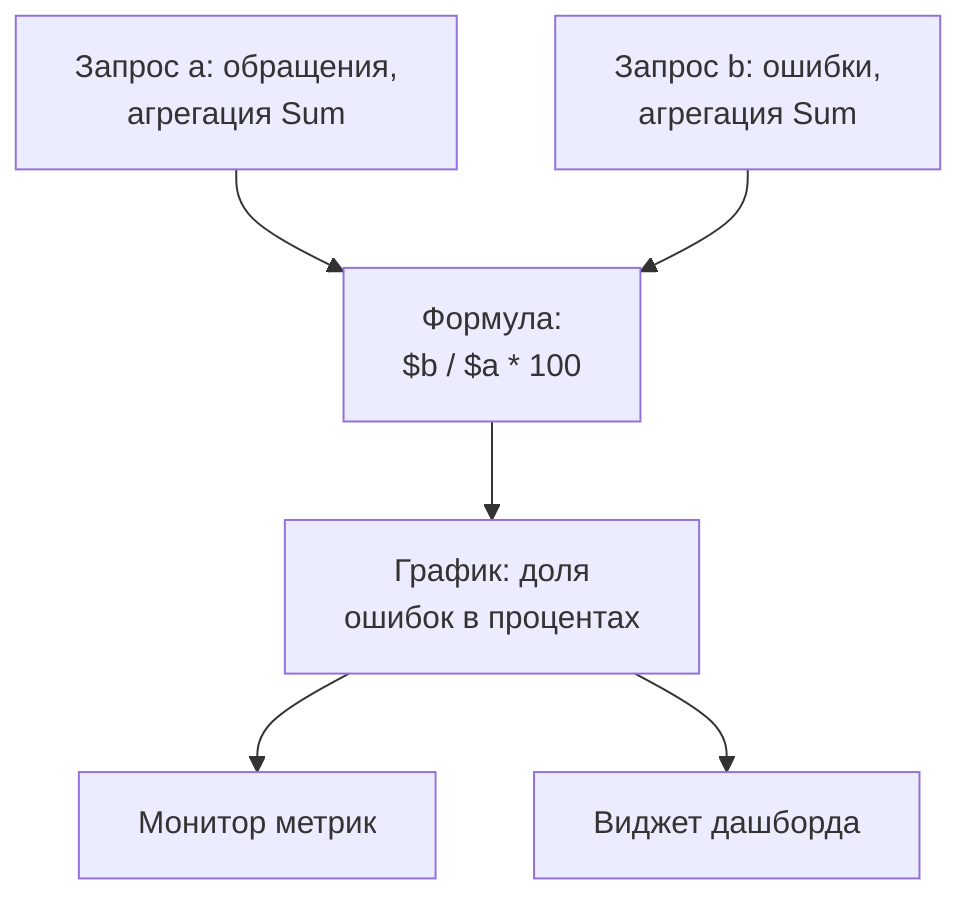

# Обозреватель метрик

Метрики — это числа, которые ваши сервисы и инфраструктура сообщают во времени: число запросов, задержки, загрузка CPU, глубина очереди. Обозреватель метрик перечисляет все метрики, которые получает ваш проект, строит график любой из них, объединяет их формулами и превращает график в монитор или виджет дашборда.

:::cards
- [Найти метрику](#найти-метрику): Ищите в списке имён метрик.
- [Построить график метрики](#построить-график-метрики): Агрегируйте, фильтруйте и группируйте запрос.
- [Объединить запросы формулой](#объединить-запросы-формулой): Доля ошибок и другие отношения.
- [Использовать построенный график](#использовать-построенный-график): Монитор, виджет дашборда или ссылка.
- [Улучшение метрик и добавление недостающих с ИИ](#улучшение-метрик-и-добавление-недостающих-с-ии): Пул-реквесты, которые исправляют ваши метрики и добавляют те, которых не хватает сервису.
:::

## Как устроен обозреватель

У обозревателя два уровня. Вкладка **Зритель** перечисляет метрики, которые получает ваш проект. Нажмите на одну из них, и откроется обозреватель метрик с запросом для неё: метрика, способ её агрегации, а также её фильтрация и группировка. Каждый запрос — это переменная, `a`, `b` и так далее, которую может использовать формула.

У обозревателя пять вкладок:

| Вкладка | Для чего она |
| --- | --- |
| **Зритель** | Список метрик, у каждой — небольшой график и последнее значение. Открывается на последнем часе. |
| **Аналитика** | Какие сервисы сообщают метрики и сколько. |
| **ИИ** | Проблемы, которые OneUptime находит в ваших метриках (слишком много значений, неподходящие корзины гистограмм, недостающие метрики), и что с ними сделал OneUptime AI. См. [Улучшение метрик и добавление недостающих с ИИ](#улучшение-метрик-и-добавление-недостающих-с-ии). |
| **Руководство по настройке** | Как отправлять метрики через OpenTelemetry с одним из ваших ключей приёма. |
| **Настройки** | **Правила пайплайнов** и **Правила записи**: что происходит с метриками при поступлении. |

## Перед началом

- **Поступающие метрики.** Отправляйте их через [OpenTelemetry](/docs/telemetry/open-telemetry) или от агента, например [OpenTelemetry Collector для хостов](/docs/telemetry/host-otel-collector) или [агента Kubernetes](/docs/telemetry/kubernetes-agent).
- **Роль, которая читает телеметрию.** Project Owner, Project Admin, Project Member, Viewer, Telemetry Admin, Telemetry Member или Telemetry Viewer либо пользовательская роль с разрешением Read Telemetry Service Metrics. О том, какие метрики она читает, см. [Телеметрия](/docs/permissions/index#телеметрия).

## Найти метрику

Перейдите в **Продукты → Наблюдаемость → Метрики**. **Зритель** перечисляет по имени каждую метрику, которую получил ваш проект, с небольшим графиком за диапазон времени и последним значением.

- Ищите по именам отдельными словами или через `name:`, например `name:http.server` находит `http.server.request.duration`. См. [Синтаксис поиска](/docs/telemetry/search-syntax#метрики).
- Фильтруйте по полю **Сервис** на боковой панели, чтобы видеть только метрики одного сервиса.
- Нажмите на метрику, чтобы построить её график в обозревателе метрик.

## Построить график метрики

:::steps
### Откройте метрику

Нажмите на метрику во вкладке **Зритель**. Обозреватель откроется с одним запросом, `a`, для диапазона времени и фильтров списка.

### Выберите способ агрегации

В **Aggregate by** выберите, как объединяются значения в каждой точке графика: Avg, используемый по умолчанию, Sum, Min, Max, Count или перцентиль, P50, P75, P90, P95 или P99. Перцентиль метрики-гистограммы, например длительности запроса, вычисляется по её корзинам.

### Отфильтруйте и сгруппируйте её

Откройте **Filters & grouping**. **Filter by attributes** оставляет точки данных с подходящими атрибутами, например с одним `http.route`, а **Group by** рисует по линии на каждое значение выбранных атрибутов, например по линии на хост.

### Настройте график

Откройте **Display Settings**, чтобы выбрать **Chart type** (линия, область или столбцы), задать **Warning Threshold** и **Critical Threshold** для отображения на графике или включить **Convert to per-second rate**.
:::

> [!TIP]
> Счётчик, который только растёт, например `system.disk.io`, удобнее читать как скорость. Включите **Convert to per-second rate**, чтобы показать, как быстро он меняется, а не его нарастающий итог; обозреватель предлагает это, когда видит такой счётчик.

Каждый запрос рисует собственный график. Чтобы нарисовать запрос на том же графике, что и предыдущий, включите **Overlay with previous query** в его **Display Settings**.

## Объединить запросы формулой

:::steps
### Добавьте запросы

Нажмите **Добавить метрику** для каждой нужной метрики. Новые запросы называются `b`, `c` и так далее.

### Добавьте формулу

Нажмите **Добавить формулу** и запишите **Формула** с переменными запросов, операторами `+`, `-`, `*`, `/`, `%` и `^` и скобками. Для доли ошибок в процентах напишите `$b / $a * 100`.
:::

Переменную можно писать со знаком `$` или без него, в любом регистре. Формула, которая ссылается на неопределённый запрос, сообщает об этом вместо построения графика.

## Исследовать вокруг графика

Кнопки над графиками работают с диапазоном времени, который вы просматриваете:

| Кнопка | Что она делает |
| --- | --- |
| **Журналы** | Открывает [Обозреватель журналов](/docs/telemetry/logs-explorer) для этого диапазона времени и ваших фильтров. |
| **Трассировки** | Открывает [Обозреватель трассировок](/docs/telemetry/traces-explorer) для этого диапазона времени и ваших фильтров. |
| **Расследовать** | Открывает боковую панель с логами, трассировками и исключениями за этот диапазон времени. |
| **События** | Отмечает на графиках инциденты и оповещения за этот диапазон времени. |
| **Compare** | Рисует на каждом графике предыдущий период пунктирной линией, чтобы было видно, что изменилось. |

Выделите участок графика, чтобы приблизить момент, и дважды щёлкните, чтобы отдалить: см. [Масштабирование до диапазона времени](/docs/telemetry/charts-and-time-ranges).

## Использовать построенный график

- **Действия → Создать монитор из этого представления** открывает новый монитор метрик с уже заполненными запросами и формулами. См. [Мониторинг метрик](/docs/monitor/metrics-monitor).
- **Действия → Add to dashboard** добавляет график на выбранный вами дашборд. Нужно разрешение на редактирование этого дашборда.
- **Скопировать ссылку** копирует ссылку ровно на это представление: запросы, формулы и диапазон времени.
- **Saved Views** хранит представление под именем для всех участников проекта. У вкладки **Зритель** есть свои сохранённые представления для её поиска и фильтров. Сохранённые представления работают так же, как в [Обозреватель журналов](/docs/telemetry/logs-explorer#сохранить-представление).

## Аналитика метрик

Вкладка **Аналитика** считает метрики за диапазон времени: **Активные метрики**, **Службы отчётности** и среднее на сервис. Она группирует метрики по категориям и перечисляет сервисы, которые их сообщают.

## Улучшение метрик и добавление недостающих с ИИ

Каждый час OneUptime ищет в метриках, которые ваши сервисы отправили за последний час, те, что записывают слишком много значений, гистограммы, чьи корзины не подходят, и загруженные сервисы, которые не отправляют метрики. Найденное он регистрирует как выводы ИИ вместе с доказательствами. Затем OneUptime AI изучает каждый вывод и открывает пул-реквест, который его исправляет. Ничего не сливается автоматически: каждый пул-реквест проверяет ваша команда.

OneUptime внимательно читает 10 метрик, по которым ваши сервисы отправили больше всего точек данных за этот час, каждая не менее чем с 1 000 точек, и регистрирует находки трёх видов:

| Находка | Когда OneUptime её регистрирует | Пул-реквест |
| --- | --- | --- |
| **Высокая кардинальность** | Атрибут, который код ставит на одну из этих метрик, принял за час 1 000 или больше значений, например идентификаторы пользователей или полные URL, так что каждое значение становится отдельным рядом. Или 50 или больше имён метрик сервиса — одно имя с разным идентификатором внутри. | Перестаёт записывать это значение в метрику или убирает идентификаторы из её имён. |
| **Неверные корзины гистограммы** | Одна из этих метрик — гистограмма, которая записала 1 000 или больше значений, и 90 % или больше из них попали в её самую маленькую корзину или выше самой большой, или у неё нет корзин, так что её перцентили нельзя различить. | Задаёт гистограмме корзины, подходящие к её значениям, или исправляет её единицу измерения. |
| **Недостающие метрики** | Сервис отправил за час 1 000 или больше спанов и ни разу не отправлял метрику. | Добавляет как метрики число запросов, ошибки и длительность его самых загруженных операций. |

Находка никогда не хранит значения атрибута: только имя атрибута, сколько значений он принял и как они выглядят.

### Включение

В **Метрики → ИИ → Настройки** находится переключатель **Улучшать метрики и добавлять недостающие**, включённый для новых проектов. Когда **Включить ИИ** выключено, проблемы в ваших метриках по-прежнему находятся, но OneUptime AI ничего с ними не делает. Чтобы открывать пул-реквесты, OneUptime AI нужен репозиторий, подключённый в разделе [Код](/docs/ai/ai-agent): страница сначала говорит, чего не хватает. Код каждого репозитория меняется на том Runner, который выбран для репозитория в разделе «Код».

OneUptime AI сам открывает не более 5 пул-реквестов в день (UTC), по одному на каждую находку, и никогда больше, чем допускает лимит репозитория на открытые пул-реквесты ИИ.

### Правила ИИ

Без правил OneUptime AI сразу изучает каждую проблему, найденную в ваших метриках, и открывает пул-реквест для каждой, которую может исправить. **Правила ИИ** в **Дополнительные настройки** сужают это в три шага:

| Шаг | Что он решает |
| --- | --- |
| **Совпадение** | Какие сервисы: выбранные, с определёнными метками или те, чьё имя соответствует шаблону. |
| **Расследовать** | **Сразу** или **Только если всё ещё находится после ожидания**: проблема, которая исчезает во время ожидания, не изучается. |
| **Исправление** | **Не исправлять**, **Спрашивать перед исправлением** или **Исправлять, не спрашивая**. Если сначала нужно спросить, пул-реквест остаётся за человеком: находка предлагает **Исправить с ИИ**. |

В **Дополнительные поля** правило выбирает репозитории кода, MCP-серверы и поставщика LLM, которых OneUptime AI может для него использовать. Если ничего не выбрано, он может использовать любые, а также поставщика LLM проекта по умолчанию.

### Что он сделал

- **Метрики → ИИ → Аналитика** показывает, что нашёл OneUptime, каждую находку с доказательствами и **Открыть в метриках**, которая открывает её метрику для её сервиса за час, когда она была найдена. Сервис без метрик вместо этого предлагает **Открыть в трассировках**: спаны, которые измеряли бы его метрики.
- **Метрики → ИИ → Журналы** показывает каждое расследование и каждый пул-реквест, сначала новые, с состоянием каждого.
- В разделе «Код» задача сообщает, что её запустил OneUptime, со ссылкой на находку, а пул-реквест объясняет, почему он открыт.

## Что происходит с метриками при поступлении

**Метрики → Настройки → Правила пайплайнов** изменяет метрики при поступлении, до их сохранения. Правила выполняются в порядке списка, который меняется перетаскиванием; правило для одного сервиса выполняется раньше правил для всех сервисов.

| Тип правила | Что оно делает |
| --- | --- |
| Фильтр (список разрешённых) | Оставляет только подходящие точки данных, а остальные отбрасывает. |
| Отбросить | Отбрасывает подходящие точки данных. |
| Переименовать метрику | Переименовывает метрику. |
| Переименовать атрибут | Переименовывает ключ атрибута в подходящих точках данных. |
| Добавить атрибут | Добавляет атрибут в подходящие точки данных. |
| Удалить атрибут | Удаляет атрибут, например тот, у которого слишком много значений, чтобы быть полезным. |
| Скрыть атрибут | Заменяет значение атрибута заполнителем. |
| Образец | Оставляет процент подходящих точек данных. |

**Метрики → Настройки → Правила записи** каждую минуту вычисляет новые метрики из других метрик. О том, как работают правила записи, см. [Правила записи для логов](/docs/telemetry/log-recording-rules).

## Устранение неполадок

:::details График счётчика только растёт
Это накопительный счётчик. Включите **Convert to per-second rate** в **Display Settings** запроса.
:::

:::details Список сообщает, что метрики не найдены
Сначала очистите поиск и чипы фильтров. Если список по-прежнему пуст, метрики ещё не дошли до OneUptime: сравните свою настройку с **Руководство по настройке**.
:::

:::details Метрики сервиса отсутствуют
Отфильтруйте вкладку **Зритель** по этому значению поля **Сервис** и расширьте диапазон времени. Если их по-прежнему нет, область вашей роли может не включать этот сервис: см. [Телеметрия](/docs/permissions/index#телеметрия).
:::

## Дальнейшие шаги

:::cards
- [Мониторинг метрик](/docs/monitor/metrics-monitor): Получайте оповещения, когда метрика пересекает порог.
- [Создание дашборда](/docs/dashboards/authoring): Разместите графики рядом.
- [Синтаксис поиска](/docs/telemetry/search-syntax): Все фильтры, которые понимает поле поиска.
:::
