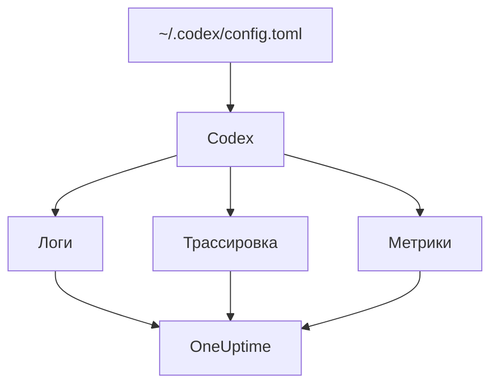

# OpenAI Codex

В Codex CLI встроены три экспортёра OpenTelemetry — для логов, трассировок и метрик. Направьте их на OneUptime в `~/.codex/config.toml`, и каждый ход Codex будет приходить со своими токенами и стоимостью, без обёрток и прокси посередине.

:::cards
- [Настройка Codex](#настройка-codex): Один блок `[otel]` с полным URL для каждого сигнала.
- [Привязка использования к человеку](#привязка-использования-codex-к-человеку): Codex никого не называет в спанах и метриках, поэтому это делаете вы.
- [Токены и стоимость](#токены-и-стоимость): Какой сигнал читает OneUptime и что он показывает.
- [Устранение неполадок](#устранение-неполадок): Что проверить, если ничего не приходит.
:::

## Как это работает

Каждый экспортёр отправляет один сигнал на свой URL. Трассировки и логи выключены, пока вы их не настроите; метрики — нет.



> [!WARNING]
> Codex отправляет свои метрики в OpenAI, если вы это не измените. В релизной сборке `metrics_exporter` по умолчанию равен `statsig`, и метрики уходят на `https://ab.chatgpt.com/otlp/v1/metrics`. Значение `metrics_exporter`, указывающее на экспортёр OTLP, как ниже, или `none` это прекращает. `[analytics]` с `enabled = false` тоже отключает Statsig по умолчанию, но оставляет работающим настроенный вами экспортёр метрик OTLP.

## Перед началом

1. Создайте ключ приёма телеметрии в разделе **Настройки проекта → Телеметрия и APM → Ключи приема**.
2. Ваш OTLP-адрес — `https://oneuptime.com/otlp` или `https://YOUR-ONEUPTIME-HOST/otlp`, если вы размещаете OneUptime у себя.
3. Каждый экспорт передаёт ключ в заголовке `x-oneuptime-token`.

## Настройка Codex

:::steps
### Добавьте блок otel

Поместите это в `~/.codex/config.toml`. Так включаются все три сигнала, а заодно заменяется Statsig по умолчанию:

```toml title="~/.codex/config.toml"
[otel]
environment = "prod"
log_user_prompt = false

[otel.exporter.otlp-http]
endpoint = "https://oneuptime.com/otlp/v1/logs"
protocol = "binary"
headers = { "x-oneuptime-token" = "YOUR_INGESTION_TOKEN" }

[otel.trace_exporter.otlp-http]
endpoint = "https://oneuptime.com/otlp/v1/traces"
protocol = "binary"
headers = { "x-oneuptime-token" = "YOUR_INGESTION_TOKEN" }

[otel.metrics_exporter.otlp-http]
endpoint = "https://oneuptime.com/otlp/v1/metrics"
protocol = "binary"
headers = { "x-oneuptime-token" = "YOUR_INGESTION_TOKEN" }

[otel.span_attributes]
"user.id" = "dev@example.com"
"user.email" = "dev@example.com"
"team" = "platform"
```

### Дайте каждому экспортёру полный URL

Codex использует каждый `endpoint` в точности так, как он записан: он не добавляет `/v1/logs`, `/v1/traces` или `/v1/metrics`, как это делает большинство SDK. Три экспортёра, указывающие на голый `https://oneuptime.com/otlp`, ничего никуда не отправляют, и без ошибки.

### Выполните ход

Запустите интерактивную сессию `codex`, задайте небольшой вопрос и дождитесь завершения хода. Затем откройте **Логи** в OneUptime: там появятся события Codex, такие как `codex.conversation_starts`, `codex.api_request` и `codex.turn_cost`.
:::

> [!IMPORTANT]
> Codex без предупреждения игнорирует незнакомые ему ключи в `[otel]`. Его ключи пишутся в snake_case (`trace_exporter`, `metrics_exporter`, `span_attributes`), а имена экспортёров и поля TLS — в kebab-case (`otlp-http`, `ca-certificate`). Ключ `trace-exporter` отключает трассировки вообще без ошибки.

## Ключи конфигурации

| Ключ | По умолчанию | Что делает |
| --- | --- | --- |
| `environment` | `"dev"` | Задаёт атрибут ресурса `env` |
| `log_user_prompt` | `false` | Отправляет текст промпта в `codex.user_prompt`; иначе там `[REDACTED]` |
| `log_agent_responses` | `false` | Отправляет финальные ответы агента в экспортёр логов |
| `exporter` | `none` | Экспортёр логов |
| `trace_exporter` | `none` | Экспортёр трассировок |
| `metrics_exporter` | `statsig` | Экспортёр метрик: задайте его |
| `span_attributes` | — | Атрибуты, добавляемые к каждому экспортируемому спану |
| `tracestate` | — | Члены W3C `tracestate` |
| `tool_result` | `{ max_bytes = 2048 }` | Сколько результата инструмента сохраняет запись лога, в байтах UTF-8 |

Экспортёр — это `none`, `statsig`, `otlp-http` или `otlp-grpc`. `otlp-http` принимает `endpoint`, `headers`, `protocol` (`"binary"` или `"json"`, OneUptime принимает оба) и `tls` (`ca-certificate`, `client-certificate`, `client-private-key`); `otlp-grpc` принимает то же самое без `protocol`.

## Привязка использования Codex к человеку

Codex называет разработчика только в одном месте:

- **Записи логов** несут `user.account_id` и `user.email`.
- **Спаны** — нет: Codex намеренно не помещает их в свои трассировки.
- **Метрики** — тоже нет: они несут `auth_mode`, `session_source`, `originator`, `service_name`, `model` и `app.version`, но не человека.

OneUptime читает людей из спанов и точек данных метрик, но никогда из записей логов. Поэтому задайте идентичность в каждом спане сами, в `[otel.span_attributes]`:

```toml title="~/.codex/config.toml"
[otel.span_attributes]
"user.id" = "dev@example.com"
"user.email" = "dev@example.com"
"team" = "platform"
"cost_center" = "eng-123"
```

`user.id` — ключ, который OneUptime предпочитает, а `user.email` заполняет колонку email. У Codex нет атрибутов ресурса, поэтому ключи команды (`team.id`, `team`, `cost_center`, `department`) тоже задайте здесь. Этот блок находится в собственном файле конфигурации каждого разработчика: распространяйте его для каждого разработчика отдельно, через ваши dotfiles или профиль MDM. Один общий файл с одной идентичностью записал бы расходы всех на одного человека.

## Токены и стоимость

| Сигнал | Что отправляет Codex | Что OneUptime с этим делает |
| --- | --- | --- |
| Трассировки | `gen_ai.usage.input_tokens`, `gen_ai.usage.output_tokens` и токены кэша, но без модели | Считает токены по людям; не может оценить их стоимость |
| Метрики | `codex.turn.token_usage` по `token_type` и `codex.turn.cost_microusd` в миллионных долях USD | Пересчитывает стоимость в USD; читает метрики только там, где спаны ничего не сообщают |
| Логи | `codex.turn_cost` с `usage.estimated_usd` и человеком | Сохраняет в обозревателе **Логи**; с расходами не связывается |

С приведённой выше конфигурацией на вкладке **Использование** получается следующее:

- Токены берутся из спанов, по людям, и `codex.turn.token_usage` к ним не прибавляется: одно с другим никогда не складывается ([почему](/docs/telemetry/ai-llm-observability#сначала-спаны-метрики-дополняют)).
- Спаны Codex не называют модель, поэтому OneUptime не может оценить их стоимость, и она равна 0. Тогда итоги стоимости берут стоимость Codex из `codex.turn.cost_microusd`, пересчитанную для вас в USD.
- Таблицы **Сотрудник**, **Команда** и **Модель** показывают строки из спанов: токены по людям, но без стоимости по людям.
- Без трассировок эти таблицы заполняют метрики, только стоимостью и целиком в строке **Без привязки**, поскольку метрики Codex никого не называют.

Самая точная стоимость за ход, с указанием человека, — запись лога `codex.turn_cost`. OneUptime пока не связывает записи логов с расходами, но оставьте экспортёр логов включённым: когда это появится, история уже будет.

## Codex в CI и как MCP-сервер

`codex`, `codex exec` и `codex mcp-server` строят телеметрию из одного и того же блока `[otel]` со всеми тремя экспортёрами. Запуски `codex exec` несут `originator` `codex_exec`, а `codex mcp-server` экспортирует как `codex_mcp_server`, поэтому по этим значениям запуски в CI и через MCP можно отличить от интерактивных сессий.

## Конфиденциальность

`log_user_prompt` и `log_agent_responses` по умолчанию равны `false`: оставьте их выключенными. Событие `codex.user_prompt` всё равно приходит, с промптом, заменённым на `[REDACTED]`, поэтому у вас остаются ход, его токены и стоимость без текста промпта. Человек (`user.email`, `user.account_id`) есть в записях логов независимо от этих переключателей.

Если вы включаете содержимое для расследования, **Правила очистки** и **Фильтры отбрасывания** трассировок в разделе **Трассировка → Настройки** маскируют или отбрасывают его до сохранения.

## Использование API OpenAI вместо Codex

Платформенный API OpenAI сам не отправляет OpenTelemetry: каждый спан появляется за счёт инструментирования вашего собственного клиента. С OneUptime работают три инструментирования:

- **OpenTelemetry**: `opentelemetry-instrumentation-genai-openai` для Python, заменяющее `opentelemetry-instrumentation-openai-v2`. `OTEL_INSTRUMENTATION_GENAI_CAPTURE_MESSAGE_CONTENT` определяет, записываются ли сообщения.
- **OpenLLMetry** (Traceloop): `opentelemetry-instrumentation-openai`.
- **OpenInference** (Arize): `openinference-instrumentation-openai`.

Направьте любое из них на OneUptime, как показано в разделе [Наблюдаемость ИИ / LLM](/docs/telemetry/ai-llm-observability). Ни одно из них не знает, кто ваш сотрудник: задайте `user.id` сами.

**OpenAI Agents SDK** отправляет трассировки на собственный адрес OpenAI, а не по OTLP. Подключите его через `opentelemetry-instrumentation-openai-agents-v2` или `openinference-instrumentation-openai-agents`, которые передают спаны SDK экспортёру OTLP.

## Устранение неполадок

:::details Ничего не приходит
Сначала проверьте три значения `endpoint`: каждое должно заканчиваться на `/v1/logs`, `/v1/traces` или `/v1/metrics`. Затем проверьте заголовок `x-oneuptime-token`: OneUptime отклоняет неверный ключ.
:::

:::details Трассировки не приходят, а логи приходят
Поищите опечатку в ключе в `[otel]`: Codex молча её игнорирует. Обычно это `trace-exporter` вместо `trace_exporter`.
:::

:::details Стоимость Codex видна в итогах, но у каждого человека $0
Так и должно быть: спаны Codex несут токены, но не модель, поэтому их стоимость не оценить, а метрика стоимости никого не называет. См. [Токены и стоимость](#токены-и-стоимость).
:::

:::details Расходы всех отображаются под одним человеком
Одна и та же идентичность в `[otel.span_attributes]` стоит на каждой машине. Дайте каждому разработчику свою.
:::

## Дальнейшие шаги

:::cards
- [ИИ-ассистенты для программирования](/docs/telemetry/ai-coding-assistants): Как расходы привязываются для всех ассистентов для программирования.
- [Наблюдаемость ИИ / LLM](/docs/telemetry/ai-llm-observability): Разговоры, оповещения, стоимость и бюджеты для ваших собственных ИИ-вызовов.
- [Шлюзы ИИ](/docs/telemetry/ai-gateways): Один шлюз, который трассирует и оценивает каждый вызов модели.
:::
