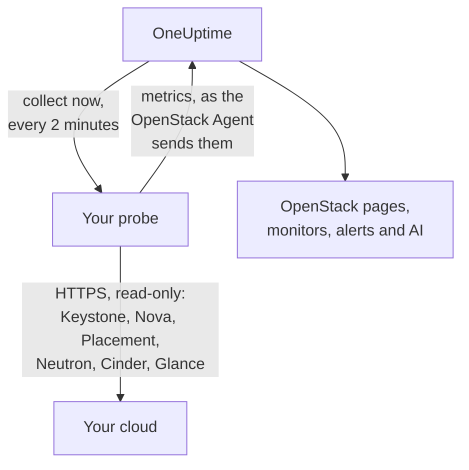

# OpenStack без агента

Мониторьте облако OpenStack, ничего не устанавливая: введите в OneUptime адрес Keystone и application credential, выберите зонд, который достаёт до облака, и зонд соберёт те же данные, что и [агент OpenStack](/docs/telemetry/openstack). Агент не нужно устанавливать, обновлять и поддерживать в рабочем состоянии, и отдельную машину под него выделять тоже не нужно.

> [!IMPORTANT]
> Зонд общается с облаком только по HTTPS. Учётные данные и токен никогда не отправляются по обычному HTTP, а DevStack и Kolla-Ansible по умолчанию отдают свои API по обычному HTTP. Для такого облака включите TLS на его API или используйте [агент OpenStack](/docs/telemetry/openstack), который работает рядом с облаком. Проверка подключения сообщит об этом, если найдёт адрес с обычным HTTP.

:::cards
- [Перед началом](#перед-началом): Зонд, который достаёт до API, и учётные данные.
- [Подключение облака](#подключение-облака): Адрес, учётные данные, проверка и имя.
- [Устранение неполадок](#устранение-неполадок): Что означает каждое сообщение и как это исправить.
:::

## Как это работает



Каждые две минуты зонд опрашивает каждую службу в каждом выбранном вами регионе и отправляет найденное в OneUptime. Данные приходят точно так же, как от агента OpenStack, поэтому каждая страница OpenStack, каждый [монитор OpenStack](/docs/monitor/openstack-monitor) и каждый шаблон оповещения читают их одинаково.

Каждая служба опрашивается отдельно и одновременно с остальными. Если Neutron отказывает или зависает, теряются только его ряды, а данные Nova приходят как обычно, с одной оговоркой, которую создаёт сам Nova: он запрашивает у Neutron сведения о каждом экземпляре из своего списка. Поэтому, пока Neutron недоступен, зонд сохраняет экземпляры, прочитанные в прошлый раз, и спрашивает только о том, что изменилось. Если экземпляр изменился или зонд только что запущен, Nova не может ответить и на этот список: Nova отображается как отказавший, остальные его ряды продолжают поступать, а каждый экземпляр остаётся на своей странице в том состоянии, в каком был, пока Neutron не вернётся.

Heat, Magnum, Manila, Trove, Gnocchi, Designate, Swift и Barbican читаются там, где их называет каталог Keystone. Облако, в котором их нет, ничего на них не тратит, ничего о них не слышит от проверки подключения и [не показывает о них никаких следов](/docs/telemetry/openstack#heat-и-magnum).

Если в каталоге облака есть Octavia, зонд читает его балансировщики нагрузки, пулы, listener и amphorae по одному списку на каждый, затем участников каждого пула и счётчики трафика каждого балансировщика и listener в состоянии `ACTIVE`, по одному запросу на каждого. Облако с 3 балансировщиками, 1 пулом и 1 listener обходится в 9 запросов за сбор; настоящий DevStack, записанный на стенде, стоил ровно столько. За один сбор читаются участники не более чем 25 пулов и не более 50 счётчиков, начиная с тех, что дольше всего не читались, а остальные сообщают то, что сообщили при последнем чтении. Счётчики Octavia накопительные, поэтому зонд хранит последнее значение каждого и строит график разности в секунду между двумя значениями: график начинается со второго сбора, а счётчик, который уменьшился (listener пересоздан), не рисует ничего за этот интервал. Провайдер OVN сообщает 0 для каждого счётчика, это ровная линия, а не сбой.

Для чтения amphorae нужно административное правило Octavia. Учётные данные ниже администратора видят балансировщики нагрузки, пулы, listener и участников своего проекта и свои счётчики, но не видят amphorae: страница Load Balancers сообщает об этом, и никаких предупреждений нет. Роль мониторинга в проекте без балансировщиков нагрузки не видит ничего. `load-balancer_global_observer` в этом релизе отказывают во всех чтениях.

Остановленный API Octavia для зонда означает `up 0`, чего экспортёр агента сообщить не может.

## Зонд или агент?

| | Зонд (эта страница) | Агент OpenStack |
|---|---|---|
| Что вы запускаете | Зонд, который у вас уже есть, или новый | Агент на отдельной машине |
| Где хранятся учётные данные | В зашифрованном виде в OneUptime, передаются только зонду | В файле `clouds.yaml` агента |
| До чего нужно достать | До Keystone и API каждой службы по HTTPS | До Keystone и API каждой службы |
| API по обычному HTTP | Не собираются: токен никогда не отправляется без шифрования | Собираются |
| Самое большое облако | Проверено на [200 000 экземпляров](/docs/telemetry/openstack-very-large-clouds) на имитированном, а не настоящем облаке, в виде до десяти загрузок по 48 МиБ | Пока ни на чём не проверено: [его опрос не укладывается по времени](/docs/telemetry/openstack-very-large-clouds#через-агент) задолго до этого |
| Журналы служб и AI-агент | Не входят | Входят |
| На чём стоит облако: RabbitMQ, MariaDB, Memcached, HAProxy, OVN, libvirt | Не входит: зонд читает API облака | Входит, с названием целей |
| Реальные CPU, память и диск каждого экземпляра из libvirt или Ceilometer | Не входят | Входят, с названием экспортёров |
| Входы в Keystone | Один на время жизни токена, обычно час | Один на каждый опрос |
| Обычный `reader` в одном проекте | Экземпляры, тома и сети этого проекта | Тома и сети этого проекта, без экземпляров |

Оба способа отправляют одни и те же ряды, поэтому страницы и мониторы работают с любым из них. Зонд дополнительно отправляет то, что может прочитать только нативный клиент: адреса экземпляра, состояние задачи и сообщение об ошибке, образ, с которого он загружен, принудительно ли оператор отключил службу Nova, какие сети обслуживает агент DHCP, какой пул хранит том, когда экземпляр, том или образ менялись в последний раз, и состояние каждого снимка и резервной копии тома. Cinder сообщает, какой пул хранит том, только тем учётным данным, которые считает административными. В облаке, где работает [Heat или Magnum](/docs/telemetry/openstack#heat-и-magnum), зонд также отправляет причину сбоя стека или кластера, какие экземпляры и тома принадлежат стеку, проект, шаблон и версию Kubernetes каждого кластера, а также работает ли каждый движок Heat и каждый conductor Magnum.

Выбирайте агент, если нужны журналы служб, AI-агент, данные о том, на чём стоит облако, и реальное использование каждого экземпляра, если API облака отвечают только по обычному HTTP, как у DevStack и Kolla-Ansible по умолчанию, или если облако настолько велико, что его приходится [читать из баз данных](/docs/telemetry/openstack-very-large-clouds#путь-через-базу-данных). Во всех остальных случаях выбирайте зонд: ничего устанавливать не нужно, и он читает больше того, что сообщают Nova и Cinder. [Очень большие облака OpenStack](/docs/telemetry/openstack-very-large-clouds) рассказывает, во что обходится каждый способ при любом размере.

Переключить облако с одного способа на другой можно в любой момент на странице **Настройки**.

## Перед началом

- **Зонд, который достаёт до Keystone и до API каждой службы по HTTPS.** Обычно это [собственный зонд](/docs/probe/custom-probe) в сети облака. Каталог Keystone называет, где отвечает каждая служба, и зонд подключается именно к этим адресам, поэтому каждый из них должен быть доступен зонду и каждый должен быть HTTPS. В OneUptime Cloud общие зонды никогда не получают учётные данные OpenStack, поэтому добавьте свой зонд. В самостоятельно развёрнутом экземпляре собирать могут и собственные зонды этого экземпляра.
- **Учётные данные.** Лучше всего application credential, потому что его можно ограничить чтением и задать срок действия. Подойдут и имя пользователя с паролем, но они могут всё, что может их учётная запись.

В OpenStack нет глобальной роли только для чтения, поэтому то, сколько видит зонд, зависит от учётных данных:

| Уровень | Что нужно | Что читает зонд |
|---|---|---|
| Полный обзор | Application credential учётной записи с ролью `admin` в собственном проекте, ограниченный правилами доступа только чтением | Всё, кроме пользователей и групп Keystone, которые правила намеренно исключают |
| Только инфраструктура | Роли `oneuptime_monitoring` и `reader` в собственном проекте, где ничего нет и квота равна нулю, и файлы политик, поставляемые с агентом OpenStack | Гипервизоры, службы Nova, агенты Neutron, пулы адресов, Placement, список проектов и экземпляры каждого проекта. Тома, сети и маршрутизаторы только там, где назначена роль. Не читаются состояние `cinder-volume` и `cinder-scheduler` и пулы хранения: собственный код Cinder требует администратора |
| Вид проекта | Обычный `reader` в одном проекте | Экземпляры, тома и сети этого проекта, без инфраструктуры |

Проверка подключения сообщает, какому из этих уровней соответствуют учётные данные, и предупреждает, если в их собственном проекте что-то есть: там, где в Cinder выключен `enforce_new_defaults` (это его значение по умолчанию), любая роль в проекте может создавать тома этого проекта, включая `reader`.

> [!IMPORTANT]
> Application credential, ограниченный правилами доступа, отклоняется с ошибкой `401` любой службой, у `keystonemiddleware` которой не задан `service_type`. Проверка подключения сообщает об этом для каждого чтения. Задайте его в конфигурации каждой службы и перезапустите её. В разделе [Создание учётных данных](/docs/telemetry/openstack#создайте-учётные-данные) описаны правила, файлы политик и настройки для каждой службы, а [что читает каждый уровень](/docs/telemetry/openstack#что-читает-каждый-уровень) показывает то, что отвечали реальные облака.

## Подключение облака

:::steps
### Откройте свои облака
В OneUptime откройте **OpenStack → Все облака** и нажмите **Подключить облако**.

### Введите адрес и учётные данные
Введите `auth_url` из файла `clouds.yaml` или `openrc`, например `https://keystone.example.com:5000/v3`, а также ID и секрет application credential. Выберите зонд, который достаёт до облака.

### Проверьте подключение
Нажмите **Проверить подключение**. Зонд входит в систему, пробует каждое чтение, которое выполняет сбор, в каждом регионе, и выходит. Он сообщает, какие регионы называет каталог, что могут читать учётные данные, в чём им отказано, какие страницы останутся без данных и строку, которая их откроет. Неудавшееся чтение проверку не прерывает.

### Доверьте сертификат облака
Облако с собственным удостоверяющим центром предъявляет сертификат, которому зонд не доверяет. Тогда проверка показывает сертификат и хост, который его предъявил. Сверьте его отпечаток с отпечатком самого API, затем нажмите **Доверять этому сертификату**. У облака с отдельным хостом на каждую службу может быть сертификат на каждую службу, и вы можете довериться не более чем 32.

### Выберите регионы и подключите
Выберите регионы для чтения, назовите облако и нажмите **Подключить облако**. Откроется страница облака.
:::

На странице **Обзор** облака есть карточка **Сбор данных**. Она показывает **Проверка** до первого сбора, который начинается в течение минуты, затем **Сбор идёт**, и страницы заполняются. Если одни службы прочитаны, а другая нет, карточка называет, какая именно. Если зонд не приходит за облаком 15 минут, потому что он не в сети или слишком старый, она показывает **Сбор не идёт** и сообщает об этом, что бы ни нашёл последний сбор.

Карточка **Сбор данных** на странице **Настройки** облака хранит то, с чем вы его подключили:


## Подключение облака через API или Terraform

Параметры подключения облака являются обычными полями [ресурса OpenStack Cloud](/reference/open-stack-cloud) в API по адресу `/api/openstack-cloud`, поэтому облако можно подключить совсем без дашборда. В Terraform для этого есть `oneuptime_openstack_cloud`:

```hcl
resource "oneuptime_openstack_cloud" "prod_eu" {
  name                      = "prod-eu"
  collection_method         = "Probe"
  auth_url                  = "https://keystone.example.com:5000/v3"
  credential_kind           = "applicationCredential"
  application_credential_id = var.openstack_application_credential_id
  credential_secret         = var.openstack_application_credential_secret
  collection_probe_id       = oneuptime_probe.eu_west.id
  collection_regions        = jsonencode(["RegionOne"])

  # A cloud with its own certificate authority: the fingerprints it presents.
  trusted_certificate_fingerprints = jsonencode(["AB:CD:EF:..."])
}
```

Для имени пользователя и пароля задайте `credential_kind` равным `password`, а также `keystone_username`, `project_name` и, если они не равны `Default`, `user_domain_name` и `project_domain_name`. `endpoint_interface`, `collection_interval_in_minutes` и `collection_options` — это поля, которые форма прячет под **Дополнительные поля**. Обязательно только `name`, потому что у облака, которое присылает агент, этих полей нет.

`credential_secret` доступен только для записи, поэтому ни одно чтение его не возвращает, а Terraform не выводит его в планах и результатах. [Правила для сохранённых учётных данных](#сохранённые-учётные-данные) действуют и здесь: чтобы изменить адрес, зонд или доверенные сертификаты, секрет нужно передать в том же запросе. То, что сообщает зонд, например `collection_status`, `collection_error` и `presented_certificate`, можно прочитать, но нельзя задать.

## Во что это обходится вашему облаку

Мониторинг не должен становиться причиной падения облака, поэтому сбор по своему устройству щадящий:

- **Один вход, который сохраняется.** Токен используется до тех пор, пока до его истечения не останется пять минут. Вход — это то, что Keystone в беде может позволить себе меньше всего.
- **Списки постранично.** Каждый список читается по тысяче строк за раз с помощью `limit` и `marker`.
- **Экземпляры по изменениям.** Между полными чтениями, раз в полчаса, зонд спрашивает у Nova только то, что изменилось с прошлого чтения, с помощью `changes-since`.
- **Инвентарь гипервизора один раз.** Placement меняет generation провайдера всякий раз, когда инвентарь меняется, и один вызов списка сообщает это обо всех, поэтому инвентарь перечитывается только тогда.
- **Заданная нагрузка.** То, что требует по одному вызову на объект, читается по очереди сверх 2 000 за сбор, а для лимитов сверх 250 проектов. То, что в этот раз не прочитано, отправляется как при последнем чтении, поэтому в рядах нет разрывов, а нагрузка перестаёт расти вместе с облаком.
- **Только нужные поля.** Списки Neutron называют свои поля, а группы безопасности запрашиваются только по ID.
- **Никогда внахлёст.** Сбор, который длится дольше своего интервала, пропускается, а не запускается рядом со следующим.
- **Лимит времени.** На сбор отводится девять десятых его интервала и не более десяти минут. То, что к этому моменту прочитано, отправляется, а служба, которой не хватило времени, сообщает об этом.
- **Пауза перед повтором.** Получив просьбу подождать с помощью `429` или `Retry-After`, зонд ждёт. Служба, которая отвечает `429`, `503` или не отвечает вовсе, оставляется в покое на минуту, затем на две, на четыре и так до получаса, и её ряды всё это время сообщают, что она недоступна.
- **Замедление.** Ответ втрое медленнее обычного для этой службы и не короче секунды, либо пяти секунд при любой обычной скорости, задерживает следующий запрос к этой службе на столько же. Карточка **Сбор данных** сообщает, когда так случилось.
- **Отклонённые учётные данные ждут дольше всего.** Повторные попытки с ними блокируют учётную запись, поэтому зонд ждёт пять минут, затем десять и так до часа. Исправленные вами учётные данные пробуются сразу.

- **Меньше данных для большого облака.** При более чем 5 000 экземплярах облако хранит счётчики и свои части, но не ряды по каждому экземпляру или тому, если вы не выберете иное в разделе **Реальное использование по экземплярам** на странице **Настройки**. То, что изменилось, то, что вы решили сохранить, и то, за чем следит оповещение, по-прежнему идёт при каждом сборе. Остальное идёт по очереди, а карточка **Сбор данных** сообщает, сколько длится один круг.

При каждом сборе с настройками по умолчанию регион обходится в 7 вызовов к Nova, 7 к Neutron и 5 к Cinder, один вызов к Placement и ещё два на каждый гипервизор, до 4 дополнительных, чтобы спросить Placement, [сколько штук каждого flavor помещается](/docs/telemetry/openstack#ёмкость), а примерно раз в пять минут 5 к Keystone и 1 к Glance. Инвентарь гипервизора читается один раз и снова только когда Placement сообщает, что он изменился. Список длиннее тысячи строк требует вызова на каждую тысячу. Каждый изменившийся экземпляр требует ещё одного вызова к Nova, чтобы прочитать, через что он прошёл, и за один сбор читается не более 25: в спокойном облаке их нет вовсе. На ML2/OVS Neutron требует ещё одного вызова на каждый маршрутизатор, чтобы спросить, какие агенты L3 его держат, а каждые десять минут по вызову на каждый агент DHCP, не более 20, чтобы спросить, какие сети он обслуживает. Облако с большим числом агентов DHCP обходит их по очереди, облако сверх размера сводки это пропускает, а медленный Neutron не опрашивается вовсе. В облаке на OVN спрашивать не о чем. В разделе [Очень большие облака OpenStack](/docs/telemetry/openstack-very-large-clouds#нагрузка-на-плоскость-управления) указано, сколько это составляет запросов в минуту при каждом размере.

Облако с Manila платит примерно раз в пять минут 2 вызова к нему, с Trove 1, с Gnocchi 1, с Barbican 3. Designate берёт 2 и ещё один на каждую зону не в состоянии `ACTIVE`, не более 50 за сбор. Swift берёт 1 для собственного проекта учётных данных, а при наличии `ResellerAdmin` ещё по одному на каждый другой проект, не более 200 за сбор. Облако с Heat или Magnum платит примерно раз в пять минут 2 вызова к Heat и 3 к Magnum. Ни один из списков не говорит всего: список Magnum не сообщает, чей это кластер и почему он сбойнул, а список Heat не сообщает, чем владеет стек. Поэтому зонд читает кластер или стек отдельно, когда его состояние изменилось, не более 25 каждого за сбор. Облако с большим числом продолжает заполняться в следующих сборах, а то, что стоит на месте, никогда не читается дважды.

Три вещи выключены, пока вы их не включите, в разделе **Что читается сверх умолчаний** карточки **Сбор данных** на странице **Настройки** облака или в **Дополнительные поля** при подключении, потому что каждая обходится вашему облаку дороже:

| Параметр | Что вы получаете | Во что это обходится |
|---|---|---|
| Порты | Один ряд на порт, а также сколько портов без адреса и сколько балансировщиков нагрузки не работает | Один постраничный список на каждую названную вами сеть или проект либо всех портов, если вы ничего не назвали. Список всех портов без ограничений может перегрузить Neutron в большом облаке |
| Лимиты проектов | Квоты и лимиты по проектам | Четыре вызова на проект, не более 250 проектов за сбор |
| Серверы хранения Swift | Отвечает ли каждый, его репликация и одинаковы ли у всех кольца, если вы укажете порт `/recon` каждого сервера как `host:port`. Это предлагается только облаку со Swift, на его странице **Настройки** после того, как первый сбор прочитал Swift | 5 вызовов на сервер при каждом сборе. Учётные данные им не передаются |

## Сертификаты

Зонд никогда не пропускает проверку сертификата. Каждое соединение проходит полное TLS-рукопожатие, а затем:

- если ни один сертификат не доверенный, сертификат API должен быть выдан центром, которому доверяет машина зонда, для адреса, по которому API отвечает;
- если доверенные сертификаты заданы, API должен предъявить один из них, определяемых по отпечаткам SHA-256. Ничего другого не принимается, даже публично доверенный сертификат.

Чтобы проверить отпечаток, выполните это на машине зонда:

```bash
openssl s_client -connect keystone.example.com:5000 </dev/null | openssl x509 -noout -fingerprint -sha256
```

Когда сертификат перевыпущен, сбор останавливается с сообщением **Сертификат API изменился**, и показывается новый сертификат. Ничего не отправляется, пока вы не доверитесь ему на странице **Обзор** или **Настройки** облака.

## Сохранённые учётные данные

Секрет шифруется и доступен только для записи: прочитать его обратно нельзя, и API никогда его не возвращает. Он отправляется только зонду, который собирает данные облака, и тот хранит его в памяти.

Сохранённые учётные данные отправляются только по тому адресу, через тот зонд и для тех сертификатов, для которых были введены. Изменение адреса, зонда или доверенных сертификатов снова запрашивает секрет, поэтому никто из тех, кто может редактировать облако, не может отправить его в другое место. Доверие сертификату, который зонд нашёл по сохранённому адресу, секрет сохраняет, как и доверие меньшему числу сертификатов.

Каталог подчиняется тем же правилам, что и введённый вами адрес, потому что токен уходит туда, куда он указывает. Зонд не подключается к loopback-адресу, link-local адресу или адресу метаданных облака, называет ли его каталог или имя хоста разрешается в него, и подключается к тем адресам, которые проверил, а не к тому, что DNS скажет мгновением позже. Перенаправления он не выполняет.

## Переключение между агентом и зондом

Откройте страницу **Настройки** облака. Её карточка **Сбор данных** предлагает **Собирать зондом** для облака, которое присылает агент, и **Использовать агент OpenStack** для облака, которое собирает зонд. При переключении на агент сохранённые учётные данные забываются.

> [!WARNING]
> Остановите агент OpenStack, как только первый сбор зондом пройдёт успешно. Пока работают оба, каждая метрика приходит дважды.

При [более чем 5 000 экземплярах](/docs/telemetry/openstack-very-large-clouds#сводный-режим) первый сбор зонда знает всё облако и отправляет его часть, поэтому списки нового облака заполняются в течение первого цикла, а карточка **Сбор данных** сообщает, когда они будут полными.

## Bare metal

Если в каталоге облака есть Ironic, зонд читает его узлы и запрашивает каждое поле по имени, поэтому `driver_info` узла никогда не читается при сборе. Он добавляет то, чего нет у экспортёра агента: драйвер узла, его conductor, его сбой и причину сбоя. Ironic может очистить `last_error` примерно за минуту, поэтому страница хранит последнее значение, которое увидел сбор, и сообщает, когда это было.

Зонд сначала читает каталог, поэтому может сказать, что API Ironic не работает, чего экспортёр агента сделать не может. У облака без Ironic о нём ничего не спрашивается.

Ironic показывает проекту только узлы, которыми тот владеет, и отказывает ему в списке conductor. По политике Ironic по умолчанию читать их может только учётная запись с системной областью (system scope), а учётные данные зонда не могут быть системными, потому что через них же он читает списки Nova. Поэтому, пока политика облака не даст его роли `baremetal:node:list_all` и `baremetal:conductor:get`, зонд видит узлы, которыми владеет его проект, и не видит conductor, и страницы говорят об этом. Остальное описано в разделе [Bare metal](/docs/telemetry/openstack#bare-metal).

## Справочник

| Параметр | По умолчанию | Примечания |
|---|---|---|
| Собирать каждые | 2 минуты | От 1 до 60 минут. Большое облако собирайте реже, чтобы не нагружать его. Keystone и Glance читаются примерно раз в пять минут, как бы часто ни читалось остальное. |
| Интерфейс конечной точки | public | Какой из URL каталога использовать: public, internal или admin. |
| Одновременных сборов | 4 на зонд | Сбор, который медленнее своего интервала, пропускается, а не накладывается. |
| Наибольшая загрузка | 48 МиБ | Сбор отправляется столькими загрузками, сколько нужно, до десяти. При [более чем 5 000 экземплярах](/docs/telemetry/openstack-very-large-clouds#сводный-режим) то, что не изменилось, идёт по очереди. |
| Запросов к каждой службе | По одному | Вызовы Placement по провайдерам идут по четыре одновременно. |
| Ожидание одного ответа | 60 секунд | Всего три попытки, если это `429` или ошибка сервера. |
| Проверка подключения | 90 секунд до начала | Проверка, которую ни один зонд не взял вовремя или которая идёт дольше 3 минут, получает ответ «не удалась». В проекте могут одновременно ждать или выполняться пять проверок. |

## Устранение неполадок

:::details Сертификат API не является доверенным
Облако предъявляет сертификат от собственного центра. Сверьте показанный отпечаток с сертификатом API, затем нажмите **Доверять этому сертификату**.
:::

:::details Сертификат API изменился
Сертификат перевыпущен, или кто-то вклинился посередине. Ничего не отправляется, пока вы не доверитесь новому. Проверьте его отпечаток, затем доверьтесь ему.
:::

:::details Недопустимый auth URL
Введите адрес Keystone по HTTPS, например `https://keystone.example.com:5000/v3`. Адрес с обычным HTTP отклоняется до отправки чего-либо. Для облака, API которого отвечают только по обычному HTTP, включите TLS или используйте [агент OpenStack](/docs/telemetry/openstack).
:::

:::details Каталог называет конечную точку с обычным HTTP
Токен учётных данных никогда не отправляется без шифрования. Включите TLS для этого API, выберите другой интерфейс конечной точки или используйте для этого облака [агент OpenStack](/docs/telemetry/openstack). Проверка подключения не проходит, пока каждый читаемый API не станет HTTPS. При сборе без данных остаётся только служба с этой конечной точкой: остальные читаются как обычно.
:::

:::details Keystone отклонил учётные данные
ID, секрет или пароль неверны, срок их действия истёк или они удалены, либо учётная запись потеряла роль в проекте. Создайте новые и введите их через **Изменить подключение** на странице **Настройки** облака.
:::

:::details У учётной записи нет роли в этом проекте
Имя пользователя и пароль вошли в систему, но не в этот проект. Проверьте имя проекта и оба домена. Application credential этого избегает: его область задаётся при создании.
:::

:::details Учётные данные не могут читать то, что нужно мониторингу
Проверка перечисляет каждое отклонённое чтение, что остаётся без него и строку, которая его откроет. Ошибка `401` у учётных данных с правилами доступа означает, что в них этот путь не указан или что у `keystonemiddleware` этой службы не задан `service_type` и она не перезапущена.
:::

:::details Зонд не получает ответа от облака
Сеть зонда не достаёт до этого API. Разрешите доступ в межсетевом экране или выберите зонд в сети облака. У каждой службы свой адрес: сообщение называет ту, что не ответила.
:::

:::details На этом порту никто не отвечает
Проверьте адрес и порт. Keystone обычно работает на 5000 или на 443 за путём вроде `/identity`.
:::

:::details Не удалось установить защищённое соединение
Скорее всего, адрес указывает на порт, который не говорит по HTTPS. Проверьте его. Если API облака отвечают только по обычному HTTP, включите TLS или используйте агент OpenStack.
:::

:::details OneUptime не подключается к этому адресу
Адрес или то, что называет каталог, является loopback-адресом, link-local адресом или адресом метаданных облака либо разрешается в него. Используйте адрес, по которому API отвечает в вашей сети.
:::

:::details Этот адрес не принадлежит Keystone
Введите конечную точку Identity из файла `clouds.yaml` или `openrc`: его `auth_url`.
:::

:::details Региона нет в каталоге
Выберите из регионов, которые называет каталог. Проверка подключения их перечисляет.
:::

:::details Keystone даёт сбои
Keystone ответил ошибкой сервера. Зонд ждёт дольше между входами, пока тот не восстановится, а без входа ничего другого прочитать нельзя. Проверьте службу Keystone и базу данных за ней.
:::

:::details Служба остановлена или слишком занята, чтобы ответить
Она продолжала отвечать `429` или ошибкой сервера, поэтому зонд ждёт дольше между сборами, пока она не восстановится. Проверьте, что она запущена, затем её нагрузку. Занятой службе помогает более редкий сбор.
:::

:::details Сбор занял слишком много времени
Облако отвечало слишком медленно для этого интервала. Собирайте реже или проверьте его нагрузку.
:::

:::details Зонд не взял это в работу
Зонд не в сети или работает на версии OneUptime старше сбора OpenStack. Проверьте, что он подключён, на странице **Зонды**, и обновите его. Карточка облака сообщает об этом и когда сбор опаздывает на 15 минут, как бы ни прошёл последний, и возвращается сама, когда возвращается зонд.
:::

:::details Это облако слишком велико для сбора зондом
Его метрик больше, чем может отправить один сбор, а это облако настроено хранить ряды каждого экземпляра. Пусть оно хранит счётчики, в разделе **Реальное использование по экземплярам** на странице **Настройки**, или используйте [агент OpenStack](/docs/telemetry/openstack). [Сводный режим](/docs/telemetry/openstack-very-large-clouds#сводный-режим) описывает, от чего при этом приходится отказаться.
:::

## Дальнейшие шаги

:::cards
- [Монитор OpenStack](/docs/monitor/openstack-monitor): Оповещения по службам, гипервизорам, экземплярам, сетям и томам.
- [Собственный зонд](/docs/probe/custom-probe): Запустите зонд в сети облака.
- [Агент OpenStack](/docs/telemetry/openstack): Соберите данные облака агентом.
:::
