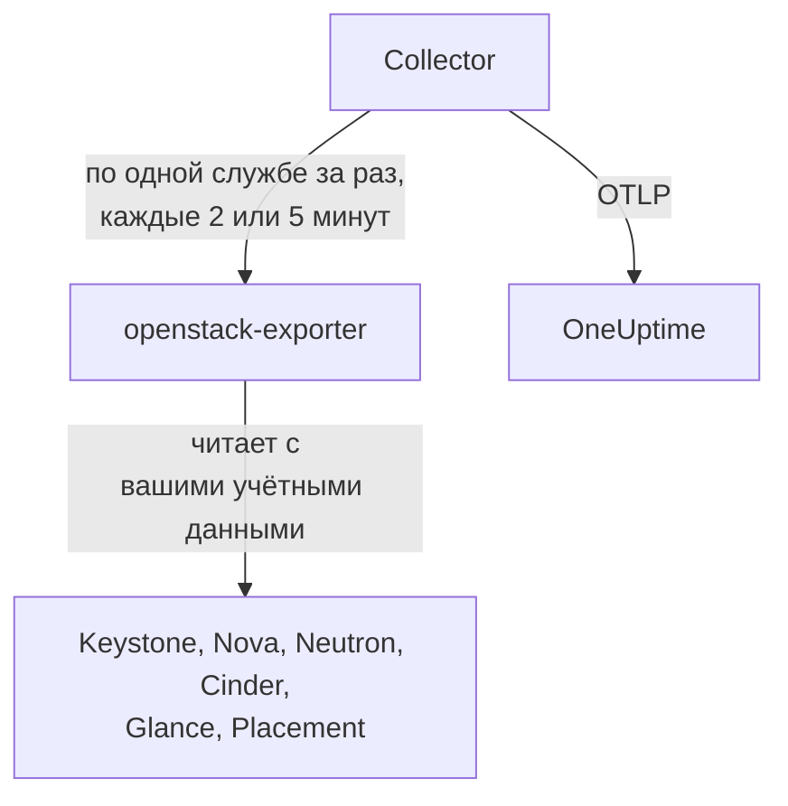

# Агент OpenStack

Агент OneUptime для OpenStack следит за облаком OpenStack: его службами и агентами, гипервизорами, экземплярами, сетями, маршрутизаторами, томами, пулами хранилища, образами и проектами во всех регионах. Он читает API облака с выбранными вами учётными данными и отправляет найденное в OneUptime, где облако отображается вместе со своими регионами, гипервизорами и проектами. [Мониторы OpenStack](/docs/monitor/openstack-monitor) оповещают о том, что приходит, а [проба](/docs/telemetry/openstack-agentless) может собирать данные облака без какой-либо установки.

:::cards
- [Проба или агент?](/docs/telemetry/openstack-agentless#зонд-или-агент): Что выбрать для облака, которому подойдёт любой из вариантов.
- [Выберите, как много он видит](#выберите-как-много-видит-агент): В OpenStack нет глобальной роли только для чтения, поэтому уровней три.
- [Установка агента](#установка-агента): Сначала учётные данные, затем скрипт установки, Docker Compose или вообще без Docker.
- [Сколько это стоит вашему облаку](#сколько-это-стоит-вашему-облаку): Что читает каждая настройка и как её изменить.
- [Ёмкость](#ёмкость): Сколько ещё поместится каждого типа и через сколько дней всё заполнится.
- [Расходы](#расходы): Кто что использует, во сколько это обходится по вашим ценам или по оценке CloudKitty и что можно вернуть.
- [Страницы статуса и оповещение проектов](#страницы-статуса-и-оповещение-проектов): Страница на каждый регион за один шаг и оповещение только тех проектов, которых касается сбой.
- [Журналы служб](#журналы-служб): Разобранные, с прослеживанием запроса через службы.
- [События жизненного цикла](#события-жизненного-цикла): Действия с экземплярами в ленте и на графиках, из уведомлений или с помощью пробы.
- [Кто что сделал](#кто-что-сделал): Журналы аудита в события безопасности.
- [Проследить запрос](#трассировка-запросов-через-плоскость-управления): Один подписанный запрос, прослеженный через плоскость управления.
- [Проверка снаружи](#проверка-облака-снаружи): Может ли кто-нибудь на самом деле запустить экземпляр, с пробы за пределами облака.
- [Без интернета](#без-интернета): Четыре образа агента и как скопировать их в собственный реестр.
- [По инструменту развёртывания](/docs/telemetry/openstack-deployment-tools): Kolla-Ansible, OpenStack-Ansible, OpenStack-Helm, Atmosphere, Sunbeam, Red Hat и Mirantis.
- [Устранение неполадок](#устранение-неполадок): Диагностический скрипт и типичные проблемы.
:::

## Как это работает

Агент состоит из двух закреплённых по версии сторонних программ и их конфигурации на одной машине: [openstack-exporter](https://github.com/openstack-exporter/openstack-exporter) читает API облака и превращает их в ряды `openstack_*`, а OpenTelemetry Collector запрашивает у него по одной службе OpenStack за раз, помечает каждый ряд облаком и регионом, откуда он пришёл, и отправляет их в OneUptime. На ваших контроллерах и вычислительных узлах ничего не запускается, если только вы не добавите необязательный [профиль журналов](#журналы-служб), который читает их журналы.



Облако регистрируется само по первым данным, под именем, которое агент ставит на каждую метрику как `openstack.cloud.name`. Один агент следит за одним облаком: одним Keystone с одним регионом или несколькими.

## Перед началом

- Docker Engine 20.10 или новее с плагином Docker Compose v2 либо, чтобы работать без Docker, машина Linux (x86_64 или arm64) с systemd 235 или новее, glibc 2.34 или новее (RHEL 9, Ubuntu 22.04, Debian 12) и root.
- Маршрут с этой машины до Keystone и до публичной конечной точки каждой службы.
- Командная строка `openstack` под пользователем, который может создать приведённые ниже учётные данные.
- Ключ приема. Создайте его в разделе **Настройки проекта → Телеметрия и APM → Ключи приема** и скопируйте его значение.
- Исходящий HTTPS с этой машины на URL вашего OneUptime.

### Где запускать агент

Запускайте агент вне облака, за которым он следит: небольшая виртуальная машина на отдельном оборудовании, управляющий хост, другое облако. Агент внутри отказавшего облака замолкает вместе с ним, а молчание выглядит как здоровое облако, которое перестало отправлять данные.

## Выберите, как много видит агент

В OpenStack нет глобальной роли только для чтения, и это самая сложная часть его мониторинга:

- `reader` ограничена проектом везде, кроме Keystone и Ironic.
- Гипервизоры, службы, агенты, пулы и Placement по умолчанию доступны только администратору.
- Переопределение политики не открывает списки по всем проектам в Neutron и Cinder: они ограничивают их по контексту администратора в собственном коде.
- Службы и пулы хранилища Cinder отвечают любому, кроме администратора, ошибкой `403` из собственного кода Cinder, уже после проверки политики. Никакое переопределение не открывает и их.
- Neutron и Cinder отвечают обычному читателю `200` и отдают только его собственный проект. Выглядит так, будто всё получилось, но это не так.
- Там, где у Cinder выключен `enforce_new_defaults` (это значение Cinder по умолчанию), любая роль на проекте может создавать тома этого проекта, включая `reader` и `oneuptime_monitoring`. На Epoxy, Flamingo и Gazpacho и обычный читатель, и роль на настоящем проекте создали том (`202`). На Hibiscus обоим отказали (`403`), потому что DevStack включает `enforce_new_defaults` только там. Роль только для чтения на настоящем проекте не гарантирует только чтения.

Поэтому уровней три, и каждый чего-то стоит. Если можете, начните с первого.

| Уровень | Что нужно | Что видно | Чего не будет |
| --- | --- | --- | --- |
| **1. Полный обзор** | Учётные данные приложения для учётной записи с ролью `admin` на собственном проекте, ограниченные правилами доступа только чтением, с `service_type`, заданным для каждой службы | Все чтения, которые делает агент, а также состояние `cinder-volume` и `cinder-scheduler` и пулы хранилища, которые видит только этот уровень | Пользователей и групп Keystone, намеренно. Писать он не может: любая запись получила `401` |
| **2. Только инфраструктура** | Роли `oneuptime_monitoring` и `reader` на собственном проекте, где ничего нет и квота нулевая, и переопределения политики, которые поставляет агент | Все проекты, домены, службы и конечные точки Keystone, всё из Nova, включая серверы всех проектов, всё из Placement, а также агенты Neutron и доступность IP-адресов | Сети, подсети, маршрутизаторы, плавающие IP и порты Neutron, а также тома и снимки Cinder видны только из его собственного проекта, поэтому на пустом проекте остаются лишь общие и внешние. Нет состояния `cinder-volume` и `cinder-scheduler` и пулов хранилища. Писать он не может: любая запись получила `403`, а из-за квоты `409` и `413` |
| **3. Обзор проекта** | Обычная `reader` на настоящем проекте, для команды, которая следит за своей частью облака, которым управляет кто-то другой | Тома, сети и маршрутизаторы этого проекта из Cinder и Neutron | Вся инфраструктура: ни гипервизоров, ни служб, агентов, пулов, ни ёмкости. Через агента нет и экземпляров, потому что чтение всех проектов у экспортера отклоняется. И на многих облаках `reader` может там записывать |

Шаблоны **Block Storage Service Down**, **Storage Pool Warning** и **Storage Pool Critical** требуют уровня 1. **Compute Service Down**, **Network Agent Down** и шаблоны Placement и гипервизоров требуют уровня 1 или 2, а на уровне 3 ни один экземпляр не читается.

### Что читает каждый уровень

Так отвечали пять настоящих облаков на Epoxy, Flamingo, Gazpacho (OVN и OVS) и Hibiscus. Каждая ячейка написана по этим записям.

| Чтение | Уровень 1: Полный обзор | Уровень 2: Только инфраструктура | Уровень 3: Обзор проекта |
| --- | --- | --- | --- |
| Keystone: проекты | все | все | отказано |
| Keystone: домены | все | все | отказано |
| Keystone: регионы | все | то, что видит любой | то, что видит любой |
| Keystone: службы | все | все | отказано |
| Keystone: конечные точки | все | все | отказано |
| Nova: серверы, все проекты | все | все | отказано |
| Nova: службы | все | все | отказано |
| Nova: гипервизоры | все | все | отказано |
| Nova: агрегаты | все | все | отказано |
| Nova: зоны доступности, подробно | все | все | отказано |
| Nova: типы виртуальных машин (flavors) | все | то, что видит любой | то, что видит любой |
| Nova: использование по проектам | все | все | отказано |
| Placement: поставщики ресурсов | все | все | отказано |
| Neutron: агенты | все | все | ничего |
| Neutron: сети | все | только свой проект | только свой проект |
| Neutron: подсети | все | только свой проект | только свой проект |
| Neutron: маршрутизаторы | все | только свой проект | только свой проект |
| Neutron: плавающие IP | все | только свой проект | только свой проект |
| Neutron: доступность IP | все | все | ничего |
| Neutron: группы безопасности | все | 409, ожидаемо | только свой проект |
| Neutron: порты | все | только свой проект | только свой проект |
| Neutron: квоты | все | отказано | отказано |
| Cinder: тома, все проекты | все | только свой проект | только свой проект |
| Cinder: службы | все | отказано | отказано |
| Cinder: пулы | все | отказано | отказано |
| Cinder: снимки, все проекты | все | только свой проект | только свой проект |
| Cinder: резервные копии, все проекты | все | не зафиксировано | не зафиксировано |
| Cinder: типы томов | все | то, что видит любой | то, что видит любой |
| Glance: образы | все | то, что видит любой | то, что видит любой |

- **все**: те же строки, что видел администратор.
- **только свой проект**: строки этого проекта и всё общее или внешнее. На проекте, где ничего нет, это только общие и внешние.
- **отказано**: `401` или `403`.
- **то, что видит любой**: каждые учётные данные увидели каждую строку, на облаках, где есть только публичные типы виртуальных машин, типы томов и образы. Частный в другом проекте требует уровня 1.
- **ничего**: `200` без строк, на проекте, где сети тоже есть. Выглядит так, будто всё получилось, но это не так.
- **не зафиксировано**: `200` без строк там, где администратор тоже не увидел ни одной, так что сравнивать было не с чем.
- **409, ожидаемо**: при выводе списка Neutron пытается создать группу безопасности проекта по умолчанию, а нулевая квота этого не позволяет, поэтому он отвечает `409 Quota exceeded`. Это безвредно, и исправлять ничего не нужно.

Octavia, Ironic, Heat, Magnum, Manila, Designate, Barbican, Swift, Trove и Gnocchi здесь не приведены, потому что у этих облаков их нет. [Диагностический скрипт](#устранение-неполадок) спрашивает и их, если облако их запускает, читает каждый путь с вашими настоящими учётными данными и сообщает, что эти данные могут видеть.

Что получил экспортер агента с каждыми из них, в рядах на службу. Числа зависят от того, что содержит облако в момент запроса, поэтому сравнивайте их между собой, а не со своими:

| Служба экспортера | Администратор | Уровень 1: Полный обзор | Уровень 2: Только инфраструктура | Уровень 3: Обзор проекта |
| --- | --- | --- | --- | --- |
| identity | 14 | 13 | 13 | 4 |
| compute | 33 | 33 | 33 | 15 |
| placement | 25 | 25 | 25 | 1 |
| network | от 36 до 40 | от 36 до 40 | от 24 до 26 | 14 |
| volume | 33 | от 33 до 41 | 23 | от 29 до 37 |
| image | 4 | 4 | 4 | 4 |

## Установка агента

Каждый OneUptime отдаёт скрипт установки агента и файлы для своего релиза: приведённые ниже команды скачивают их с `https://oneuptime.com`, поэтому на собственном OneUptime замените его своим URL. Скрипт установки сначала сохраняется как `install.sh`, чтобы вы могли прочитать его до запуска.

:::steps
### Создайте учётные данные

Выберите уровень, который вы определили. Каждый создаёт учётные данные приложения, и выводится `id` и `secret`: секрет показывается только один раз. Задайте срок действия и никогда не используйте `--unrestricted`, который позволил бы создавать новые учётные данные.

:::tabs
@tab Level 1: Full view
От имени администратора создайте проект и учётную запись для агента:

```bash
openstack project create --domain default oneuptime-monitoring
openstack user create --domain default --password-prompt oneuptime-monitoring
openstack role add --project oneuptime-monitoring --user oneuptime-monitoring admin
```

Затем, войдя под этой учётной записью в этот проект, создайте учётные данные. Правила — это точные пути `GET`, которые использует агент, подогнанные под ваше облако:

```bash
curl -fsSLO https://oneuptime.com/install/openstack-agent/access/application-credential-access-rules.json
curl -fsSLO https://oneuptime.com/install/openstack-agent/access/access-rules-for-cloud.py
openstack catalog list -f json | python3 access-rules-for-cloud.py \
  application-credential-access-rules.json > access-rules-for-this-cloud.json
openstack application credential create oneuptime-agent \
  --role admin \
  --access-rules "$(cat access-rules-for-this-cloud.json)" \
  --expiration 2027-11-01T00:00:00
```

Правило доступа сопоставляется с путём, который видит служба. Служба за префиксом пути, например `https://cloud.example/compute/v2.1`, видит `/compute/v2.1/servers` и отклоняет поставляемое правило для `/v2.1/servers` ошибкой `401`. `access-rules-for-cloud.py` добавляет каждое правило ещё раз под префиксом его службы, прочитанным из вашего каталога.

Два чтения экспортера требуют правил, которые легко пропустить вручную. Он читает корень Octavia раньше всего остального, а за Apache служба видит его как `/load-balancer//`, с двумя косыми чертами. При отказе экспортер отвечает пустым `200`, и кажется, что в облаке нет Octavia. И он перечисляет аккаунт Swift с косой чертой в конце, которую `/v1/*` не покрывает. При отказе `openstack_object_store_up` равен `0`. Подогнанные правила содержат оба. Правила учётных данных изменить нельзя, поэтому, если ваши созданы из более старой копии, создайте новые.

Правилам доступа также нужен `service_type`, заданный для keystonemiddleware на каждой службе, и перезапуск этой службы. Без него служба отклоняет учётные данные ошибкой `401`:

```ini title="nova.conf"
[keystone_authtoken]
service_type = compute
```

| Файл конфигурации | `service_type` |
| --- | --- |
| `nova.conf` | `compute` |
| `neutron.conf` | `network` |
| `cinder.conf` | `block-storage`. Правила содержат также `volume` и `volumev3`, для Cinder, настроенного так |
| `glance-api.conf` | `image` |
| `placement.conf` | `placement` |
| `octavia.conf` | `load-balancer` |
| `ironic.conf` | `baremetal` |
| `heat.conf` | `orchestration` |
| `magnum.conf` | `container-infra` |
| `manila.conf` | `sharev2`. Правила содержат также `shared-file-system`, для Manila, настроенной так |
| `designate.conf` | `dns` |
| `barbican.conf` | `key-manager` |
| `trove.conf` | `database` |
| `gnocchi.conf` | `metric` |
| `cloudkitty.conf` | `rating` |
| `proxy-server.conf`, в `[filter:authtoken]` | `object-store` и рядом `include_service_catalog = True`. keystonemiddleware сверяет правила с каталогом токена, поэтому при `False`, которое задаёт DevStack, Swift отвечает на эти учётные данные `500` |

Строка нужна только службам, которые запускает ваше облако.

На службах, которых в облаке может не быть, результат каждого уровня на настоящих облаках отличается от приведённых выше таблиц в четырёх случаях:

- **Ironic** отвечает на учётные данные проекта, даже администратора, только узлами, которыми владеет этот проект, и отклоняет чтение его conductor. Все узлы и conductor читает только системная область действия, а учётные данные агента привязаны к проекту. Чтобы прочитать узел с ними, сделайте его проект владельцем: `openstack baremetal node set --owner`.
- **Swift** перечисляет контейнеры только собственного проекта учётных данных и никакого другого. Аккаунт другого проекта отвечает `403`, если у учётных данных нет `ResellerAdmin`.
- **Barbican** отвечает учётным данным только о собственном проекте и отклоняет обычного читателя. OneUptime не читает ни одного секрета.
- **Gnocchi** позволяет любой роли на проекте создать метрику, поэтому на облаке, где он запущен, уровни 2 и 3 могут там записывать.

Keystone ничего не требует. При подогнанных правилах, заданном `service_type` и перезапущенных API любое чтение отвечало `200`, а любая запись `401`, на каждом зафиксированном нами релизе. Экспортер получает то же, что и администратор, кроме пользователей и групп Keystone, намеренно. Это верно и для служб, которых в облаке может не быть: по записям на DevStack уровень 1 получил те же ряды, что и учётные данные администратора, от каждой службы, которую читает экспортер, и любая запись отвечала `401`.

Если вы не будете вносить это изменение, создайте те же учётные данные без `--access-rules`: обычные учётные данные приложения с ролью администратора. Они работают и могут записывать, поэтому диагностический скрипт помечает их соответствующим образом.
@tab Level 2: Infrastructure only
От имени администратора создайте роль, проект, где ничего нет и квота нулевая, и учётную запись:

```bash
openstack role create oneuptime_monitoring
openstack project create --domain default --description "OneUptime monitoring: holds nothing" oneuptime-monitoring
openstack quota set --instances 0 --cores 0 --ram 0 --key-pairs 0 oneuptime-monitoring
openstack quota set --volumes 0 --gigabytes 0 --snapshots 0 --backups 0 --backup-gigabytes 0 oneuptime-monitoring
openstack quota set --networks 0 --subnets 0 --ports 0 --routers 0 --floating-ips 0 --secgroups 0 --secgroup-rules 0 oneuptime-monitoring
openstack user create --domain default --password-prompt oneuptime-monitoring
openstack role add --project oneuptime-monitoring --user oneuptime-monitoring oneuptime_monitoring
openstack role add --project oneuptime-monitoring --user oneuptime-monitoring reader
```

В проекте намеренно ничего нет и квота нулевая. Там, где у Cinder выключен `enforce_new_defaults`, любая роль на проекте может создавать тома этого проекта. Когда трогать нечего и нет квоты, чтобы что-то создать, записывать нечего: на каждом зафиксированном нами релизе любая запись получала `403`, а из-за квоты `409` и `413`.

Скачайте переопределения политики и объедините каждый файл, на каждом контроллере, с файлом, указанным в `[oslo_policy] policy_file` в конфигурации этой службы (`nova.conf`, `neutron.conf` и так далее). Это `/etc/nova/policy.yaml` и так далее, если ваше развёртывание не говорит иного: DevStack указывает `policy.json`. Каждое правило сохраняет значение службы по умолчанию и добавляет роль, а oslo.policy сама замечает изменённый файл, поэтому перезапуск не нужен.

```bash
curl -fsSLO https://oneuptime.com/install/openstack-agent/access/policy/nova.yaml
curl -fsSLO https://oneuptime.com/install/openstack-agent/access/policy/neutron.yaml
curl -fsSLO https://oneuptime.com/install/openstack-agent/access/policy/keystone.yaml
curl -fsSLO https://oneuptime.com/install/openstack-agent/access/policy/placement.yaml
```

Для Cinder файла нет. Его `os-services` и `scheduler-stats/get_pools` отвечают этой роли `403 User does not have admin privileges` на всех пяти зафиксированных нами облаках. Это происходит из собственного кода Cinder, который требует контекст администратора, уже после проверки политики, поэтому никакое переопределение их не откроет.

**Чтобы снять переопределения, опустошите файл (`{}`) и ни в коем случае не удаляйте его.** На Flamingo (2025.2) и Epoxy (2025.1) oslo.policy выдаёт ошибку на каждой проверке, как только прочитанный ею файл политики исчезает, и эта служба отказывает на каждом запросе. Если это Keystone, он перестаёт проверять токены и всё облако отвечает `503`. Если это уже случилось, перезапустите службу.

Затем, войдя под этой учётной записью в этот проект, создайте учётные данные:

```bash
openstack application credential create oneuptime-agent --expiration 2027-11-01T00:00:00
```

Если назначить роль на настоящем проекте, чтобы видеть его тома и маршрутизаторы, учётная запись также сможет там записывать, на облаке, где у Cinder выключен `enforce_new_defaults`. Диагностический скрипт предупреждает, когда в проекте учётных данных что-то есть.
@tab Level 3: Project view
Выдайте учётной записи обычную роль `reader` на проекте, затем, войдя под этой учётной записью в этот проект, создайте учётные данные:

```bash
openstack role add --project my-team --user my-monitoring-account reader
openstack application credential create oneuptime-agent --expiration 2027-11-01T00:00:00
```

Агент видит строки этого проекта из Cinder и Neutron и никакой инфраструктуры. Три вещи, которые нужно знать, прежде чем выбрать этот вариант:

- **Через агента он не показывает экземпляров вообще.** Экспортер запрашивает у Nova серверы всех проектов, Nova отклоняет обычного читателя, и это чтение целиком завершается ошибкой. Перечислить экземпляры одного проекта может только проба OneUptime, которая собирает данные без этого агента.
- **Он может записывать.** На облаке, где у Cinder выключен `enforce_new_defaults`, обычная `reader` может создавать тома и в своём проекте. На Epoxy, Flamingo и Gazpacho так и было (`202`), а на Hibiscus отказали (`403`), потому что DevStack включает `enforce_new_defaults` только там. По умолчанию у Cinder он выключен.
- **Placement выглядит как не отвечающий.** Каждый его вызов отклоняется, и экспортер сообщает об этом так же, как об остановленном Placement: `openstack_placement_up 0`, на всех пяти зафиксированных нами облаках. Страницы могут определить это по тому, что ещё закрыто для этих учётных данных, и говорят об этом. Шаблон [Placement API Down](/docs/monitor/openstack-monitor#готовые-шаблоны-оповещений) этого сделать не может, поэтому на этом уровне его лучше не использовать.
:::

### Установите и запустите агент

:::tabs
@tab install.sh
Скачайте скрипт установки и запустите его на машине, где будет работать агент:

```bash
curl -fsSL https://oneuptime.com/install/openstack-agent -o install.sh
bash install.sh
```

Скрипт спрашивает URL вашего OneUptime, ключ приема, постоянное имя облака, URL аутентификации Keystone, названия регионов, учётные данные приложения (имя пользователя и пароль, если вы откажетесь от них) и файл частного центра сертификации, если у облака есть собственный. Ничего секретного не выводится на экран и не попадает в командную строку. Скрипт проверяет учётные данные в Keystone, прежде чем что-либо записать или запустить, устанавливает всё в `/opt/oneuptime-openstack-agent` или, если у вас нет прав на `/opt`, в `oneuptime-openstack-agent` в вашей домашней папке (нужна лишь группа `docker`), записывает `.env` и `clouds.yaml` с режимом `0600` и запускает агент через Docker Compose. Каждый ответ можно задать и переменной окружения, а повторный запуск скрипта использует их вместо повторных вопросов: так вы [обновляете агент](#обновление-агента).
@tab Docker Compose
Скачайте `docker-compose.yml` и `otel-collector-config.yaml` из вашего OneUptime в новую папку:

```bash
mkdir oneuptime-openstack-agent && cd oneuptime-openstack-agent
curl -fsSLO https://oneuptime.com/install/openstack-agent/docker-compose.yml
curl -fsSLO https://oneuptime.com/install/openstack-agent/otel-collector-config.yaml
```

Создайте рядом `clouds.yaml` с одной записью на регион, **названной по региону**, потому что ряды экспортера не говорят, из какого они региона, и коллектор помечает их именем записи как `openstack.region.name`:

```yaml title="clouds.yaml"
clouds:
  RegionOne:
    region_name: RegionOne
    identity_api_version: 3
    auth_type: v3applicationcredential
    auth:
      auth_url: https://keystone.example.com:5000/v3
      application_credential_id: your-credential-id
      application_credential_secret: your-credential-secret
```

Затем файл `.env`:

```bash title=".env"
ONEUPTIME_URL=YOUR_ONEUPTIME_URL
ONEUPTIME_TELEMETRY_INGESTION_KEY=YOUR_TELEMETRY_INGESTION_TOKEN
OPENSTACK_CLOUD_NAME=my-cloud
OPENSTACK_EXPORTER_CLOUDS=[RegionOne,RegionTwo]
COMPOSE_PROFILES=openstack-exporter,openstack-ai-agent
```

`OPENSTACK_EXPORTER_CLOUDS` перечисляет все регионы в квадратных скобках, а `COMPOSE_PROFILES` запускает встроенный экспортер и [ИИ-агента](#ии-агент). Оба файла содержат секреты. Экспортер работает с uid 65532 и должен быть единственной учётной записью, которая может читать `clouds.yaml`. Запустите агент:

```bash
chmod 600 .env
sudo chown 65532:65532 clouds.yaml
sudo chmod 600 clouds.yaml
docker compose up -d
```
@tab Without Docker
На Linux (x86_64 или arm64) с systemd 235 или новее и glibc 2.34 или новее скрипт установки запускает официальные релизы тех же двух программ как службы systemd. У RHEL 8 и её родственников более старая glibc, на которой релиз экспортера не запустится: скрипт сообщает об этом и ничего не меняет, поэтому там используйте Docker.

```bash
curl -fsSL https://oneuptime.com/install/openstack-agent -o install.sh
sudo bash install.sh --without-docker
```

Те же вопросы, та же проверка в Keystone и те же файлы. Каждый архив релиза сверяется с sha256, закреплённым в `install.sh`, а загрузка, которая не совпала, останавливает установку до каких-либо изменений. Коллектор работает от одноразового непривилегированного пользователя, который никогда не видит учётные данные OpenStack, а экспортер от системного пользователя `oneuptime-openstack`, единственной учётной записи, которая может читать `clouds.yaml`, и слушает только `127.0.0.1:9180`.

Запускайте по одному агенту на облако: при переходе с установки Docker сначала выполните `docker compose down`, иначе каждая метрика придёт дважды.
:::

Уже запускаете openstack-exporter с `--multi-cloud`? Направьте агент на него, и встроенный не запустится: `OPENSTACK_EXPORTER_ADDRESS=10.0.0.5:9180 bash install.sh`, либо уберите `COMPOSE_PROFILES` из `.env` и задайте там `OPENSTACK_EXPORTER_ADDRESS`. В его `clouds.yaml` нужна запись, названная по каждому региону, и он должен отключить то, что отключает встроенный: см. [Сколько это стоит вашему облаку](#сколько-это-стоит-вашему-облаку). Используйте адрес, до которого дотянется контейнер агента: `localhost` — это сам контейнер.

Экспортер Kolla-Ansible запускается без `--multi-cloud`, поэтому у него нет `/probe`, и он закреплён за релизом, который сообщает меньше. [Используйте экспортер, который уже работает](/docs/telemetry/openstack-deployment-tools#используйте-экспортёр-который-уже-работает) объясняет, как его прочитать и чего именно не будет на страницах. В [OpenStack по инструментам развёртывания](/docs/telemetry/openstack-deployment-tools) остальные шаги для каждого инструмента.

### Проверьте, что агент работает

```bash
cd /opt/oneuptime-openstack-agent    # or the folder the script said it installed to
docker compose ps
docker logs oneuptime-openstack-agent
```

`docker compose ps` показывает коллектор (`oneuptime-openstack-agent`), встроенный экспортер (`oneuptime-openstack-exporter`) и [ИИ-агента](#ии-агент) (`oneuptime-openstack-ai-agent`). После запуска в журналах коллектора должна появиться эта строка:

```text
Everything is ready. Begin running and processing data.
```

Без Docker выполните `systemctl status oneuptime-openstack-agent oneuptime-openstack-exporter` и `journalctl -u oneuptime-openstack-agent`.

### Найдите облако в OneUptime

Откройте **Продукты → Инфраструктура → OpenStack**. Облако появляется под своим `OPENSTACK_CLOUD_NAME` после первого сбора, в течение нескольких минут. Compute, network, volume и Placement читаются каждые 2 минуты, identity и образы каждые 5.
:::

На странице **Обзор** облака видно, доходят ли его данные до OneUptime, что требует внимания в первую очередь и как дела у каждой службы:


Страница **Гипервизоры** показывает, что Nova и Placement пообещали на каждом вычислительном хосте:


Страница **Экземпляры** перечисляет каждый экземпляр со статусом словами самой Nova, его проектом, типом виртуальной машины и гипервизором:


## Переменные окружения

Скрипт установки записывает их в `/opt/oneuptime-openstack-agent/.env`; установка через Docker Compose читает их из `.env` рядом с `docker-compose.yml`. После изменения любой из них выполните `docker compose up -d` в этой папке или, без Docker, `sudo systemctl restart oneuptime-openstack-agent`. Учётные данные содержит только `clouds.yaml`.

| Переменная | Обязательна | Описание |
| --- | --- | --- |
| `ONEUPTIME_URL` | Да | URL вашего OneUptime, например `https://oneuptime.com` или ваш собственный экземпляр. |
| `ONEUPTIME_TELEMETRY_INGESTION_KEY` | Да | Ключ приема из **Настройки проекта → Телеметрия и APM → Ключи приема**. |
| `OPENSTACK_CLOUD_NAME` | Да | Имя облака в OneUptime, которое ставится на каждую метрику как атрибут ресурса `openstack.cloud.name`. Держите его неизменным: после смены регистрируется новое облако. По умолчанию `openstack`. |
| `OPENSTACK_AUTH_URL` | Встроенный экспортер | Ответ на вопрос скрипта установки: URL аутентификации Keystone. `/v3` добавляется, если его нет. |
| `OPENSTACK_EXPORTER_CLOUDS` | Да | Регионы в квадратных скобках, например `[RegionOne,RegionTwo]`, каждый — имя записи в `clouds.yaml`. По умолчанию `[RegionOne]`. |
| `OPENSTACK_EXPORTER_ADDRESS` | Нет | `host:port` вашего собственного экспортера, без схемы. Для встроенного не указывайте. |
| `OPENSTACK_CA_FILE` | Нет | Файл PEM с центром сертификации облака, у которого есть собственный. Скрипт установки хранит копию как `ca.pem` рядом с `clouds.yaml`. |
| `OPENSTACK_EXPORTER_USER` | Нет | `uid:gid`, от имени которых работает контейнер экспортера; они должны владеть `clouds.yaml`. По умолчанию `65532:65532`. |
| `COMPOSE_PROFILES` | Встроенный экспортер | `openstack-exporter` запускает встроенный экспортер, а `openstack-ai-agent` — [ИИ-агента](#ии-агент). |
| `OPENSTACK_LIBVIRT_EXPORTER_TARGETS` | Нет | Вычислительные узлы, с которых через `prometheus-libvirt-exporter` читается [реальное использование](#реальное-использование), в квадратных скобках, например `[compute-01:9177,compute-02:9177]`. По умолчанию пусто. |
| `OPENSTACK_CEILOMETER_EXPORTER_TARGETS` | Нет | То же через собственный экспортер Ceilometer, например `[compute-01:9101]`. По умолчанию пусто. |
| `OPENSTACK_SINGLE_CLOUD_EXPORTER_TARGETS` | Нет | Экспортер, который уже работает без `--multi-cloud`, например экспортер Kolla-Ansible: `[10.0.0.254:9198]`. См. [Используйте экспортер, который уже работает](/docs/telemetry/openstack-deployment-tools#используйте-экспортёр-который-уже-работает). |
| `OPENSTACK_RABBITMQ_TARGETS` | Нет | Плагин Prometheus RabbitMQ на каждом узле, для раздела [на чём стоит облако](#на-чём-стоит-облако): `[10.0.0.11:15692,10.0.0.12:15692]`. По умолчанию пусто. |
| `OPENSTACK_MARIADB_TARGETS` | Нет | mysqld_exporter рядом с каждым узлом MariaDB, обычно на `9104`. По умолчанию пусто. |
| `OPENSTACK_MEMCACHED_TARGETS` | Нет | memcached_exporter рядом с каждым Memcached, обычно на `9150`. По умолчанию пусто. |
| `OPENSTACK_HAPROXY_TARGETS` | Нет | Собственный экспортер Prometheus у HAProxy. По умолчанию пусто. |
| `OPENSTACK_NETWORK_EXPORTER_TARGETS` | Нет | openstack-network-exporter на каждом узле, для OVN и Open vSwitch, обычно на `1981`. По умолчанию пусто. |
| `OPENSTACK_LIBVIRT_HEALTH_TARGETS` | Нет | prometheus-libvirt-exporter на каждом вычислительном узле, обычно на `9177`: показывает, отвечает ли libvirt, и ничего по экземплярам. По умолчанию пусто. |
| `OPENSTACK_CONTROL_PLANE_REGION` | Нет | Регион цели выше, которая не указывает свой. Цель может указать: `RegionTwo@10.1.0.11:15692`. По умолчанию первый регион. |
| `OPENSTACK_AGENT_SERVICES` | Нет | Какие службы читает этот агент, для [разделения облака между агентами](/docs/telemetry/openstack-very-large-clouds#совместный-сбор-данных-облака), например `compute\|placement`. По умолчанию все. |
| `OPENSTACK_AGENT_MEMORY_LIMIT_MIB` | Нет | Сколько памяти может занимать коллектор. Сбору данных очень большого облака нужно больше значения по умолчанию, `512`. |
| `OPENSTACK_DATABASE_EXPORTER_TARGETS` | Нет | `openstack_database_exporter`, для [пути через базу данных](/docs/telemetry/openstack-very-large-clouds#путь-через-базу-данных): `[openstack-database-exporter:9180]`. По умолчанию пусто. Остальные настройки этого пути перечислены там. |

Скрипт установки также читает учётные данные из окружения, чтобы пропустить вопросы: `OPENSTACK_APPLICATION_CREDENTIAL_ID` и `OPENSTACK_APPLICATION_CREDENTIAL_SECRET` либо `OPENSTACK_USERNAME`, `OPENSTACK_PASSWORD`, `OPENSTACK_PROJECT_NAME`, `OPENSTACK_USER_DOMAIN_NAME` и `OPENSTACK_PROJECT_DOMAIN_NAME`. У них собственные имена, а не `OS_*`, которые задаёт файл openrc, поэтому подключённый администратором openrc никогда не становится учётными данными агента без чьего-либо ведома. Учётные данные приложения лучше имени пользователя и пароля: их можно ограничить чтением, и у них есть срок действия.

## На чём стоит облако

Большинство сбоев OpenStack начинается под ним: пропал RabbitMQ, Galera потеряла кворум, у базы данных OVN нет лидера. Агент может каждую минуту читать экспортеры, которые у них уже есть, и пока вы их не назовёте, эта возможность выключена. Здесь ничего не пишется ни в один из них, и сохраняется лишь несколько рядов от каждого.

Назовите каждый в `.env` агента, все члены кластера, затем выполните `docker compose up -d`:

```bash
OPENSTACK_RABBITMQ_TARGETS=[10.0.0.11:15692,10.0.0.12:15692,10.0.0.13:15692]
OPENSTACK_MARIADB_TARGETS=[10.0.0.11:9104,10.0.0.12:9104,10.0.0.13:9104]
OPENSTACK_MEMCACHED_TARGETS=[10.0.0.11:9150,10.0.0.12:9150]
OPENSTACK_HAPROXY_TARGETS=[10.0.0.11:9101,10.0.0.12:9101]
OPENSTACK_NETWORK_EXPORTER_TARGETS=[10.0.0.21:1981,10.0.0.22:1981,RegionTwo@10.1.0.21:1981]
OPENSTACK_LIBVIRT_HEALTH_TARGETS=[10.0.0.21:9177,10.0.0.22:9177]
OPENSTACK_CONTROL_PLANE_REGION=RegionOne
```

Цель может указать, в каком она регионе, как последняя в этом списке. Цель без региона относится к `OPENSTACK_CONTROL_PLANE_REGION`. В Kolla-Ansible, чей Prometheus уже знает их все, `control-plane-targets.py` выводит эти строки за вас, а [OpenStack по инструментам развёртывания](/docs/telemetry/openstack-deployment-tools) говорит, где находится каждый экспортер в остальных инструментах.

Что читает каждая настройка и что нужно агенту от неё:

| Настройка | Читает | Как включить |
| --- | --- | --- |
| `OPENSTACK_RABBITMQ_TARGETS` | Собственный плагин RabbitMQ, `/metrics` и каждую очередь из `/metrics/detailed` | `rabbitmq-plugins enable rabbitmq_prometheus` на каждом узле |
| `OPENSTACK_MARIADB_TARGETS` | mysqld_exporter рядом с каждым узлом. Его значения по умолчанию уже сообщают о Galera | Ничего, кроме самого экспортера |
| `OPENSTACK_MEMCACHED_TARGETS` | memcached_exporter рядом с каждым Memcached | Ничего, кроме самого экспортера |
| `OPENSTACK_HAPROXY_TARGETS` | Собственный экспортер HAProxy | `http-request use-service prometheus-exporter` на отдельном `frontend` |
| `OPENSTACK_NETWORK_EXPORTER_TARGETS` | openstack-network-exporter на каждой машине с базами данных Open vSwitch или OVN | Его коллекторы по умолчанию. Машина сообщает о том, что на ней работает |
| `OPENSTACK_LIBVIRT_HEALTH_TARGETS` | prometheus-libvirt-exporter на каждом вычислительном узле, и только отвечает ли libvirt | Ничего, кроме самого экспортера |

После этого на карточке **Плоскость управления** облака появляется по строке на каждую настройку, а по каждой зависимости есть страница со строкой на каждую машину. **Не отслеживается** на этой карточке значит, что вы её не назвали: она никогда не выглядит здоровой. Проблемы там попадают в **Требует внимания** облака. Страница **Рекомендации** облака предлагает [шаблоны оповещений](/docs/monitor/openstack-monitor#на-чём-стоит-облако), а `troubleshoot.sh` проверяет, что каждая цель отвечает и является тем, чем вы её назвали.

Если от RabbitMQ или базы данных нужно больше, чем требует здоровье облака, продукты [Очереди](/docs/telemetry/queues) и [Базы данных](/docs/telemetry/databases) читают их через собственных агентов, это больше данных, чем здесь, и на их условиях. Страницы плоскости управления ссылаются на них. Установка этих агентов отдельная, потому что те продукты читают ряды тех агентов, а не этих.

Две вещи об openstack-network-exporter 0.3.0, версии, с которой это записывалось:

- **Он подключается к базе данных Open vSwitch один раз.** После перезапуска Open vSwitch `ovs_build_info`, его мосты, его интерфейсы и все ряды ovn-controller пропадают, пока не перезапустится и экспортер, тогда как собственные ряды Open vSwitch возвращаются сразу. **Exporter Lost Open vSwitch's Database** сообщает, что это произошло.
- **Он читает состояние кластера только одной базы данных OVN на машине.** Это Southbound, если на машине есть оба сокета, как у Kolla-Ansible. Поэтому лидер Northbound виден только там, где на машине нет Southbound.

## Что собирает агент

Коллектор создаёт по одному заданию сбора на каждую службу OpenStack через `/probe?cloud=<region>&include_services=<service>` экспортера, поэтому при сбое Nova пропадают только ряды Nova:

| Задание сбора | Как часто | Тайм-аут | Ряды |
| --- | --- | --- | --- |
| `oneuptime-openstack-compute` | 2 минуты | 110 с | `openstack_nova_agent_state`, `openstack_nova_running_vms`, `openstack_nova_vcpus_used`, `openstack_nova_memory_used_bytes`, `openstack_nova_local_storage_used_bytes`, `openstack_nova_total_vms`, `openstack_nova_server_status`, `openstack_nova_flavors`, `openstack_nova_availability_zones` |
| `oneuptime-openstack-network` | 2 минуты | 110 с | `openstack_neutron_agent_state`, `openstack_neutron_networks`, `openstack_neutron_subnets`, `openstack_neutron_routers`, `openstack_neutron_router`, `openstack_neutron_l3_agent_of_router`, `openstack_neutron_floating_ips`, `openstack_neutron_security_groups`, `openstack_neutron_network_ip_availabilities_total`, `openstack_neutron_network_ip_availabilities_used` |
| `oneuptime-openstack-volume` | 2 минуты | 110 с | `openstack_cinder_agent_state`, `openstack_cinder_volumes`, `openstack_cinder_volume_gb`, `openstack_cinder_snapshots`, `openstack_cinder_pool_capacity_free_gb`, `openstack_cinder_pool_capacity_total_gb` |
| `oneuptime-openstack-placement` | 2 минуты | 110 с | `openstack_placement_resource_total`, `openstack_placement_resource_usage`, `openstack_placement_resource_allocation_ratio`, `openstack_placement_resource_reserved` |
| `oneuptime-openstack-identity` | 5 минут | 120 с | `openstack_identity_projects`, `openstack_identity_project_info`, `openstack_identity_domains`, `openstack_identity_regions` |
| `oneuptime-openstack-image` | 5 минут | 120 с | `openstack_glance_images`, `openstack_glance_image_bytes`, `openstack_glance_image_created_at` |
| `oneuptime-openstack-load-balancer` | 5 минут | 120 с | `openstack_loadbalancer_total_loadbalancers`, `openstack_loadbalancer_loadbalancer_status`, `openstack_loadbalancer_total_amphorae`, `openstack_loadbalancer_amphora_status`, `openstack_loadbalancer_total_pools`, `openstack_loadbalancer_pool_status` |
| `oneuptime-openstack-baremetal` | 5 минут | 120 с | `openstack_ironic_node`, `openstack_ironic_node_updated_at`, `openstack_ironic_node_provision_updated_at` |
| `oneuptime-openstack-orchestration` | 5 минут | 120 с | `openstack_heat_stack_status`, `openstack_heat_stack_status_counter` |
| `oneuptime-openstack-container-infra` | 5 минут | 120 с | `openstack_container_infra_total_clusters`, `openstack_container_infra_cluster_masters`, `openstack_container_infra_cluster_nodes`, `openstack_container_infra_cluster_status` |
| `oneuptime-openstack-sharev2` | 5 минут | 120 с | `openstack_sharev2_shares_counter`, `openstack_sharev2_share_gb`, `openstack_sharev2_share_status`, `openstack_sharev2_share_status_counter` |
| `oneuptime-openstack-dns` | 5 минут | 120 с | `openstack_designate_zones`, `openstack_designate_zone_status`, `openstack_designate_recordsets`, `openstack_designate_recordsets_status` |
| `oneuptime-openstack-object-store` | 5 минут | 120 с | `openstack_object_store_objects`, `openstack_object_store_bytes` |
| `oneuptime-openstack-database` | 5 минут | 120 с | `openstack_trove_total_instances`, `openstack_trove_instance_status`, `openstack_trove_instance_volume_size_gb`, `openstack_trove_instance_volume_used_gb` |
| `oneuptime-openstack-gnocchi` | 5 минут | 120 с | `openstack_gnocchi_status_metricd_processors`, `openstack_gnocchi_status_metric_having_measures_to_process`, `openstack_gnocchi_status_measures_to_process` |

Последние девять — службы, которых в облаке может не быть. Если спросить о той, которой нет в каталоге, экспортер входит в Keystone, пишет в журнал одну строку (`No suitable endpoint could be found in the service catalog`) и отвечает пустотой, и у такого облака нет никаких следов этой службы. Это один вход раз в 5 минут на службу и регион, поэтому у всех них интервал 5 минут. Чтобы спрашивать только о службах, которые вы запускаете, задайте `OPENSTACK_AGENT_SERVICES`, например `identity|compute|placement|network|volume|image`.

Каждая служба также сообщает `openstack_<service>_up`, например `openstack_nova_up`. [Монитор OpenStack](/docs/monitor/openstack-monitor#собираемые-метрики) перечисляет все ряды с пояснением, что они значат. Каждый ряд несёт:

| Атрибут | Что он говорит |
| --- | --- |
| `openstack.cloud.name` | Имя облака, атрибут ресурса |
| `oneuptime.agent.version` | Версия файлов агента, атрибут ресурса: версия коллектора, которую они закрепляют, с последним числом, увеличиваемым при каждом изменении файлов на этом коллекторе |
| `openstack.region.name` | Регион, по имени записи в `clouds.yaml`, на каждой точке данных |
| `openstack_service` | Служба OpenStack задания (`compute`, `network`, ...), на каждой точке данных |

Фильтры монитора сопоставляют по равенству, поэтому при изменении конфигурации сохраняйте процессор `transform/openstack-identity` и два удаления `service.name` и `service.instance.id` в процессоре `resource`: без этих удалений данные регистрируют фантомный Service вместо того, чтобы дойти до облака.

## Сколько это стоит вашему облаку

Мониторинг никогда не должен быть причиной падения облака, поэтому значения по умолчанию щадящие. Каждый сбор снова входит в Keystone и делает настоящие вызовы API. В [Очень больших облаках OpenStack](/docs/telemetry/openstack-very-large-clouds) сказано, во что это обходится в запросах в минуту и гигабайтах в день при каждом размере.

| Настройка | По умолчанию | Что даёт её включение или изменение | Во что это обходится |
| --- | --- | --- | --- |
| Квоты проектов | Выключено | Сколько каждой квоты использовал проект, на его странице и в **Требует внимания**, и оповещение Project Quota Nearly Reached | Четыре вызова API на проект и регион раз в час (один к Nova, два к Cinder, один к Neutron), от собственного экспортера |
| Медленные метрики | Выключено | Собственные списки квот Nova и использование по серверам | Один вызов на проект при каждом сборе, поэтому растёт с числом проектов |
| Ряды по портам | Выключено | `openstack_neutron_port`, `openstack_neutron_ports`, `openstack_neutron_ports_no_ips`, `openstack_neutron_ports_lb_not_active` | Неограниченный список всех портов. На большом облаке это [может перегрузить Neutron и вызвать каскадные сбои](https://github.com/openstack-exporter/openstack-exporter/issues/540), поэтому не включайте, если не уверены, что портов мало |
| Службы, которых в облаке может не быть | Включено | Балансировщики нагрузки, bare metal, стеки, кластеры, ресурсы, DNS, объектное хранилище, базы данных и Gnocchi, где они есть в облаке | Облако без какой-либо из них платит одним входом раз в 5 минут. Designate стоит одного вызова на зону при каждом сборе, поэтому растёт с числом зон |
| Интервалы сбора | 2 и 5 минут | Более свежие данные или меньшая нагрузка | Вдвое чаще — вдвое больше вызовов API. Держите каждый `scrape_timeout` меньше его `scrape_interval`, чтобы медленный сбор никогда не наслаивался на предыдущий |

**Квоты проектов:** снова запустите `install.sh` с `OPENSTACK_COLLECT_QUOTAS=true`. При установке через Docker Compose добавьте `openstack-quotas` в `COMPOSE_PROFILES` в `.env` и задайте `OPENSTACK_QUOTA_CLOUDS` равным тому, что указано в `OPENSTACK_EXPORTER_CLOUDS`. Любой из способов запускает второй экспортер, `openstack-quota-exporter`, который не читает ничего другого, и коллектор раз в час запрашивает у него `openstack_nova_limits_*`, `openstack_neutron_quota_*`, `openstack_cinder_limits_*` и `openstack_cinder_volume_type_quota_gigabytes`. Они меняются медленно, а экспортер читает одно и то же, какое бы задание ни спрашивало, поэтому читать их реже можно только отдельным экспортером. У вашего экспортера такого нет: агент читает то, что он отдаёт, при каждом сборе.

**Медленные метрики:** удалите строку `--disable-metric` для нужной метрики из `command` экспортера в `docker-compose.yml` или, без Docker, из `ExecStart` в `oneuptime-openstack-exporter.service`. Цена — один вызов на проект при каждом сборе.

| Удалите | Чтобы собирать |
| --- | --- |
| `--disable-metric=nova-quota_cores` | `openstack_nova_quota_*` |
| `--disable-metric=nova-server_local_gb` | `openstack_nova_server_local_gb`, использование по серверам. Это один отчёт об использовании, который обходит все серверы, а не вызов на проект, и на большом облаке он всё равно медленный |

Три строки, которые исключают квоты проектов из этого экспортера (`--disable-metric=nova-limits_vcpus_max`, `--disable-metric=neutron-quota_network`, `--disable-metric=cinder-limits_volume_max_gb`), остаются. Если их удалить, они будут читаться и каждые две минуты.

Каждый флаг называет ряд, который читает остальное в своей строке, поэтому одна строка отключает их все. Не используйте вместо этого собственный `--disable-slow-metrics` экспортера: он отключает и `openstack_glance_image_*`, список образов, который страница «Образы» читает одним вызовом. Список квот Neutron доступен только администратору на любом уровне, кроме уровня 1, поэтому `openstack_neutron_quota_*` требует этого уровня.

**Ряды по портам:** удалите четыре строки `--disable-metric=neutron-port*` в том же месте.

**Интервалы:** измените `scrape_interval` и `scrape_timeout` в задании в `otel-collector-config.yaml`.

Затем выполните `docker compose up -d --force-recreate` или, без Docker, `sudo systemctl daemon-reload` и перезапустите обе службы. Обновление заменяет эти файлы и сохраняет вашу копию как `<file>.bak.<timestamp>`, поэтому после него внесите правку снова.

Ещё три строки остаются, потому что вы по ним не заскучаете. `--disable-metric=neutron-subnets_total` убирает много рядов, говорящих то, что уже говорят пулы адресов (`openstack_neutron_subnets_total`, `openstack_neutron_subnets_used`, `openstack_neutron_subnets_free`). `--disable-metric=nova-security_groups` убирает чтение маршрута, которого в Nova больше нет, и оно лишь заполняло бы журнал экспортера. `--disable-metric=gnocchi-total_metrics` убирает чтение каждой метрики в Gnocchi, страница за страницей, ради одного числа (`openstack_gnocchi_total_metrics`): в Gnocchi могут быть миллионы.

Чтобы читать внутренние конечные точки, а не публичные, добавьте `--endpoint-type=internal` в том же месте.

На всё это влияют три открытые проблемы в upstream, и проект также [искал мейнтейнеров](https://github.com/openstack-exporter/openstack-exporter/issues/443):

- [Issue 660](https://github.com/openstack-exporter/openstack-exporter/issues/660): одна неисправная служба опустошает весь сбор. Поэтому на каждую службу своё задание сбора. Не объединяйте их.
- [Issue 540](https://github.com/openstack-exporter/openstack-exporter/issues/540): неограниченный список портов может перегрузить Neutron. Поэтому ряды по портам выключены, а диагностический скрипт запрашивает одну небольшую страницу портов.
- [Issue 244](https://github.com/openstack-exporter/openstack-exporter/issues/244): на больших облаках сбор уходит в тайм-аут. Поэтому интервалы измеряются минутами, а не секундами, и у каждого есть тайм-аут меньше его. Если на большом облаке пропал `openstack_*_up` для одной службы, прежде всего увеличьте интервал и тайм-аут этого задания.

## Bare metal

Если ваше облако запускает Ironic, у него появляется раздел **Bare Metal** со всеми узлами, которые Ironic показывает этим учётным данным: где узел находится в конечном автомате Ironic, его питание, не поставил ли кто-то его на обслуживание и почему, его класс ресурсов и когда Ironic в последний раз видел его движение. У облака без Ironic такого раздела нет, нет и оповещений о нём, и ни на одной странице нет ни строки.

Узел не является гипервизором, хотя Nova и Placement оба перечисляют его как гипервизор под его UUID, поэтому он не считается местом для запуска виртуальной машины. Сколько узлов каждого класса ресурсов могут принять экземпляр, видно на странице Bare Metal, для узлов, которые Ironic показывает этим учётным данным, и на странице [Ёмкость](#ёмкость), для всех узлов, которые знает Placement.

Что требует чьего-то вмешательства, по тем же строкам, что и [шаблоны оповещений](/docs/monitor/openstack-monitor#готовые-шаблоны-оповещений):

| Читается | Значит |
| --- | --- |
| Состояние сбоя, например `clean failed` или `deploy failed`, либо `error` | Остаётся сбойным, пока кто-нибудь не вмешается: Ironic не повторяет ни одно из них и не всегда переводит узел на обслуживание |
| Одно и то же временное состояние, например `wait call-back`, в течение 2 часов | По умолчанию Ironic перестаёт ждать через 30 минут, значит, что-то другое его удерживает. Долгая очистка диска действительно может занять столько: страница читает время самого Ironic, которое сдвигают сигналы очистки, а оповещение читает только слово |
| На обслуживании 7 дней | До этого запланировано, как отключённая кем-то служба, поэтому до этого ничто не говорит, что требуется внимание |
| `active` с выключенным питанием | Всё, что на нём работало, остановилось. Если владелец остановил на нём экземпляр, страница узла говорит, что это запланировано. Оповещение читает один ряд и не может этого определить |

### Чего он не видит

Каждое из этого записано на настоящем DevStack, и каждая страница говорит об этом там, где это важно:

- **Ironic показывает проекту только узлы, которыми тот владеет.** Placement отвечает всем, поэтому там, где он знает узел, которого Ironic не перечислил, страница сообщает, что список не охватывает всё облако. По политике Ironic по умолчанию все узлы читает только учётные данные системной области действия или с ролью, имеющей `baremetal:node:list_all`.
- **Экспортер не передаёт, почему узел отказал.** У него есть причина обслуживания и нет `last_error`, а Ironic может очистить `last_error` примерно за минуту, хотя узел остаётся в сбое: так было с неудачной очисткой, а у неудачного развёртывания значение осталось. Поэтому смотрите сразу: `openstack baremetal node show <node> -c last_error` или в журнале conductor. [Проба](/docs/telemetry/openstack-agentless) читает `last_error` и сохраняет последнее увиденное значение.
- **В экспортере нет conductor.** Их читает только проба, а Ironic отказывает учётным данным проекта в этом списке, если политика не говорит иного (`baremetal:conductor:get`).
- **Остановленный Ironic выглядит так же, как отсутствие Ironic.** Если спросить об остановленном, экспортер отвечает пустым 200, как и облаку, где его никогда не было. Поэтому страница говорит лишь, что от Ironic нет вестей и узлы такие, какими были при последнем чтении. Она никогда не говорит, что он не работает. Через две недели после того, как остальное облако в последний раз сообщило без него, эти строки исчезают, а если он вернётся, появляются снова.

## Ёмкость

«Поместится ли это?» — вопрос, который чаще всего задают оператору OpenStack, и свободные счётчики Nova на него не отвечают: важны коэффициенты выделения, резервы и фрагментация, поэтому в облаке могут быть свободны тысячи vCPU и при этом не найтись места для одного большого экземпляра. Страница **Ёмкость** облака показывает, сколько ещё поместится каждого типа виртуальной машины и чего не хватает, начиная с самого скорого. Она читает одну сводку, пересчитываемую каждые две минуты, поэтому то, что она загружает, не растёт с числом хостов. **Экспорт в CSV** в таблице типов скачивает всё, что есть на странице.

Всё на ней относится к выделению: к тому, что обещано, а не к тому, что занято. Простаивающий экземпляр удерживает всё.

**Что такое ёмкость.** Для каждого поставщика ресурсов и класса ресурсов ёмкость равна `(total - reserved) x allocation_ratio`, а выделено то, что пообещал Placement. Это суммируется по зоне, агрегату, региону и облаку. Хост, у которого `nova-compute` не работает, продолжает сообщать свои последние числа, а отключённый ничего не принимает, поэтому ни один не считается местом. То, что на них есть, по-прежнему там, и прогноз это учитывает.

**Bare metal.** Узел целиком принимает один экземпляр, поэтому у облака с Ironic появляется отдельная таблица по классам ресурсов: сколько узлов, сколько из них могут принять экземпляр, сколько занято и сколько удерживается, потому что драйвер Ironic в Nova сейчас не может их использовать. Это собственные числа Placement, поэтому они относятся ко всему облаку, даже там, где Ironic показывает проекту только то, чем тот владеет, и их нет в vCPU и памяти выше. Проба читает, какой класс запрашивает тип виртуальной машины, и считает его по этим числам. Экспортер агента этого не сообщает, поэтому на агенте тип bare metal считается как его vCPU, память и диск, на хостах.

**Сколько ещё поместится.** Каждый тип считается хост за хостом, потому что экземпляру нужно всё запрошенное на одном хосте. Рядом с числом показано, каким оно было бы, если бы всё свободное было на одном хосте: так отличают полное облако от фрагментированного. Тип, который не вместил бы ни один хост даже пустой, помечен **Слишком велик для любого хоста**, и оповещений о нём не бывает никогда. Числа даны для экземпляра, загруженного из образа: загруженному из тома корневой диск не нужен.

Страница сообщает, откуда взято каждое число:

| | Через пробу | Через агента |
| --- | --- | --- |
| **Считается с** | `GET /allocation_candidates`, это и спрашивает планировщик Nova, как [os-capacity от StackHPC](https://github.com/stackhpc/os-capacity). Инвентаризации заполняются, пока не дойдёт очередь типа | Ряды Placement, которые экспортер уже отправляет: `openstack_placement_resource_{total,reserved,allocation_ratio,usage}` |
| **Видит свойства (traits) и вложенных поставщиков** | Да. Дополнительные спецификации типа тоже запрашиваются, поэтому `trait:` и `resources:` учитываются | Нет: в рядах типов экспортера нет дополнительных спецификаций, поэтому тип, которому нужно свойство, считается по всем хостам, и страница об этом говорит |
| **`max_unit` хоста** | Собственный Placement | Берётся равным общему количеству хоста, как задаёт Nova |

Проба спрашивает бережно, потому что это единственное чтение, которое заставляет Placement работать. Она спрашивает об одной форме типа за раз, поэтому типы, запрашивающие одно и то же, — один вопрос, и не больше 4 за сбор, по очереди, сколько бы типов ни было. Так облако с 40 типами при сборе каждые 2 минуты стоит 2 вызова в минуту и обходит их за 20 минут. Каждый ответ ограничен 1000 хостов — это собственный `max_placement_results` Nova: объём работы одной загрузки. Число из такого длинного ответа — нижняя граница, и страница пишет **Не меньше**. При первом сборе она ничего не спрашивает, не спрашивает, если Placement в этот сбор был медленным, и час ничего не спрашивает после отказа учётным данным, потому что число по инвентаризациям всё равно есть. Для учётных данных приложения или роли `oneuptime_monitoring` нужно разрешить `/allocation_candidates`: оно есть в `access/application-credential-access-rules.json` и `access/policy/placement.yaml`.

**Рядом с тем, что хосты действительно используют.** Там, где [реальное использование](#реальное-использование) доходит до OneUptime, страница ставит заданный вами коэффициент рядом с тем, что хосты действительно используют в пике за сутки, и коэффициентом, при котором они достигли бы линии 90%, которую проводят **Hypervisor CPU Saturated** и **Hypervisor Memory Pressure**. Это прямая линия по одному дню одной нагрузки, поэтому она говорит, насколько можно сдвинуть коэффициент, а не то, что его нужно сдвигать. Пока не сообщают больше половины хостов зоны, она ничего не говорит.

**Когда что-то заполнится.** У классов ресурсов каждой зоны, IPv4-адресов каждой внешней сети и каждого пула хранилища есть прогноз: прямая линия по тому, что было выделено за последнюю неделю, против того, что есть сегодня. Новое облако пишет **Недостаточно истории**, пока у него нет суток данных.

**Сможет ли зона потерять хост.** То, что выделено в зоне, в том числе на потерянном хосте, против того, что могли бы пообещать её остальные хосты без самого крупного, как спрашивает у кластера Host failure в VMware. Сравниваются объёмы, а не то, куда попал бы каждый экземпляр, поэтому зона, которая проходит проверку, имеет место для эвакуации, но это не обещание, что каждый экземпляр найдёт хост: фрагментацию показывает таблица типов. Зоне из одного хоста сказать нечего, как и зоне с хостом, который кто-то отключил, потому что это плановая работа.

**Выделения, которые не объясняет ни один экземпляр.** Когда Placement удерживает на хосте больше, чем в сумме набирают типы его экземпляров, дольше получаса, страница называет хост. Обычно это [осиротевшее выделение](https://docs.openstack.org/nova/latest/admin/troubleshooting/orphaned-allocations.html), оставшееся после удаления или перемещения, которое не завершилось, и оно молча съедает ёмкость. Сравниваются vCPU и память, потому что экземпляр, загруженный из тома, не занимает диска своего типа. О хосте, на котором что-то перемещается, или об экземпляре типа, которого в облаке больше нет, она ничего не говорит. Чтобы увидеть, что это, и удалить после проверки, что каждое действительно не принадлежит ни одному экземпляру или миграции:

```bash
nova-manage placement audit --verbose
nova-manage placement audit --verbose --delete
```

**Оповещения.** **Flavor Can No Longer Be Placed**, **Capacity Forecast Under 14 Days** и **Reserved Headroom Gone** читают ряды, которые OneUptime записывает из той же сводки. Они есть в [шаблонах монитора](/docs/monitor/openstack-monitor#готовые-шаблоны-оповещений) и на странице **Рекомендации** облака.

**Сколько это стоит.** На агенте ничего. Проба добавляет перечисленные выше вызовы. OneUptime записывает примерно 2 ряда на класс ресурсов каждой зоны, внешнюю сеть и пул хранилища и по одному на каждый тип, который могут запросить, каждые две минуты, и они тарифицируются как любая другая метрика.

## Расходы

Частные облака тоже стоят денег, и у того, кто ими управляет, спрашивают, кто что использует и что можно вернуть. Страница **Расходы** облака отвечает на оба вопроса и работает вообще без настройки. Она показывает использование и оценки для планирования. OneUptime никому не выставляет счета, и ничто здесь не является суммой, которую арендатор должен.

Вверху **Этот месяц в сравнении с прошлым**, затем те, чьё потребление растёт, затем каждый проект, начиная с крупнейшего, с **Экспортом в CSV**. Ниже домены и то, что использовано по типам виртуальных машин и типам томов. На странице самого проекта его месяц разобран построчно, а перед ним предыдущие месяцы.

### Как считается использование

Каждые 15 минут рабочий процесс читает, что держит каждый проект в инвентаризации облака, и прибавляет это за время с прошлого чтения: vCPU-часы и часы памяти по типам виртуальных машин, ГБ-часы томов по типам, часы плавающих IP, а также хранилище образов и снимков. Ряды по отдельным экземплярам не читаются и не записываются, поэтому это ничего не стоит хранилищу метрик и счёту за телеметрию, и работает так же на облаке в [сводном режиме](/docs/telemetry/openstack-very-large-clouds#сводный-режим).

Что это значит для чисел:

- **Изменение размера переносит часы с одного типа на другой**, а удаление их останавливает. Изменение считается с первого чтения, которое его показывает, поэтому каждое может быть неточным до 15 минут. Экземпляр, проживший меньше этого, может вообще не попасться на глаза.
- **Часть учитывается, пока инвентаризация её не отпустит,** то есть до 15 минут после её исчезновения. На большом облаке, читаемом по очереди, изменение доходит так долго, как идёт его очередь.
- **Экземпляр держит свой тип с момента размещения до удаления.** Выключенный всё равно учитывается, отдельной строкой, потому что Nova оставляет его vCPU и память зарезервированными на хосте. Тот, что так и не попал на хост, не учитывается, как и отложенный (shelved) и снятый с хоста.
- **Том или снимок в состоянии ошибки или ещё создаваемый не учитывается,** потому что за ним в целом нет места.
- **Часы, когда OneUptime не читал данные, не угадываются.** Пропуск дольше часа засчитывает свой последний час, а страница сообщает, сколько часов не было учтено.
- **Экспортер агента сообщает, сколько снимков, но не какие,** поэтому хранилище снимков учитывается только на облаке, [подключённом без агента](/docs/telemetry/openstack-agentless).

### Цены

Цены ваши, и они необязательны. Без них страница показывает использование. В разделе **Цены** задайте валюту и цену за час vCPU, ГБ памяти, ГБ тома, плавающего IP, ГБ образа и ГБ снимка. В **Расширенный** есть цена за час экземпляра по типу виртуальной машины, которая тогда составляет всю цену этого типа, цена по типу тома и переключатель, исключающий выключенные экземпляры. Месяц составляет около 730 часов.

Цена ноль означает отсутствие цены, а не бесплатное облако. О том, у чего нет цены, так и сказано, а проект, использовавший что-то без цены, учитывается на странице, поэтому итог по тому, что с ценой, никогда не выдаётся за итог по всему. Сегодняшние цены применяются ко всему каждому показанному периоду, и к прошлому месяцу тоже, поэтому смена цены не выглядит как изменение использования проекта. Изменённая сейчас цена появляется в течение 15 минут.

### CloudKitty

Если облако запускает [CloudKitty](https://github.com/openstack/cloudkitty), то оценённое им заменяет расчёт, проект за проектом, и страница сообщает, чем она воспользовалась. Проба спрашивает раз в час, за этот месяц и прошлый, и спрашивает `GET /v2/summary` или, у CloudKitty, слишком старого для него, `GET /v1/report/summary`. Это не больше двух запросов на 1000 проектов в час плюс запрос его версии при каждом чтении.

- **Прочитать его может только [проба](/docs/telemetry/openstack-agentless).** В экспортере агента нет рядов для CloudKitty, поэтому облако, подключённое через агента, рассчитывается само и сообщает об этом.
- **Он видит то, что может видеть учётная запись.** По собственной политике CloudKitty учётные данные администратора видят каждый проект, с правилами доступа или без, а любые менее привилегированные только свой. Проекты, которые он не оценивает, продолжают считаться по вашим ценам.
- **CloudKitty на каждый регион суммируются.** Каждый читается в своё время, и цифра проекта — это то, что они оценили вместе. Один CloudKitty, который каталог перечисляет для нескольких регионов, опрашивается один раз.
- **Его цифры — единственная часть всего этого, которая является телеметрией.** Они доходят до OneUptime как `openstack_cloudkitty_rated`, по одной точке данных на проект и месяц, раз в час: 20 000 в час при 10 000 проектов, что ничтожно рядом с остальным в облаке такого размера.
- **Он не называет валюту.** Ставка показывается в валюте вашего прайс-листа, если вы её задали, а иначе просто числом.
- **Если он перестаёт отвечать,** оценка каждого проекта остаётся прежней, а страница сообщает, когда её читали в последний раз. На это оповещает **Rating API Down**.
- **На настоящем CloudKitty это проверено** на `stable/2026.1`, с InfluxDB позади, оценивающим то, что Ceilometer записал в Gnocchi. Это единственная конфигурация, на которой его читали. Если не включено ни одно правило, он оценивает каждый проект в `0`, а пока ничего не оценено, отвечает без строк. В обоих случаях эти проекты продолжают считаться по вашим ценам.

### Бюджеты

Бюджет задаёт, во сколько проект или всё облако может обойтись за месяц, в валюте ваших цен. Как и с [бюджетами подключённого облака](/docs/telemetry/cloud-costs), он создаёт оповещение, когда за месяц оценка впервые проходит каждую его долю (80% и 100%, если не указано иное), и ещё одно, когда при сохранении сегодняшнего потребления бюджет был бы превышен до конца месяца. Новый месяц начинается с нуля, а оповещения прошлого месяца разрешаются. Бюджет только оповещает: он ничего не останавливает. Без цен или CloudKitty сравнивать не с чем, поэтому он молчит, а его строка сообщает, что проверки не было.

### Что можно вернуть

Страница **Рекомендации** облака раз в час перечисляет то, что осталось неиспользованным, сколько освободит каждое и команду, которая это выводит. OneUptime ничего не удаляет, и каждый из этих пунктов — вопрос к тому, кому это принадлежит.

| Что | Когда оно называется | Что освобождает | Команда, которая их выводит |
|---|---|---|---|
| Гипервизоры, которые можно освободить | Выделено 20% или меньше его vCPU и памяти, всё на нём помещается на остальных хостах его зоны и агрегатов, и зона после этого всё ещё могла бы потерять хост | Весь хост | `openstack hypervisor list --long` |
| Экземпляры, долго остававшиеся выключенными | Выключен 30 дней | Их vCPU, память и локальный диск | `openstack server list --all-projects --status SHUTOFF --long` |
| Тома, ни к чему не подключённые | Доступен 30 дней, ни к чему не подключён и не является одним из собственных томов `image-<id>` Cinder, которые команда тоже выводит | Их хранилище | `openstack volume list --all-projects --status available --long` |
| Старые снимки томов | Созданы 90 дней назад. Только проба | Их хранилище | `openstack volume snapshot list --all-projects --long` |
| Образы, с которых ничего не загружалось | Приватный или общий, возрастом 30 дней, не защищён, и ни один экземпляр или том не создан из него. Только проба | Их хранилище | `openstack image list --long` |
| Плавающие IP, которые никто не использует | Не связан 7 дней | Адрес | `openstack floating ip list --status DOWN --long` |

То, что используется, никогда не называется. Как долго что-то находится в таком состоянии, берётся по собственным часам облака, где их сообщает проба. Через агента это то, как долго OneUptime видит его таким, поэтому в день подключения облака ничто ещё не старое. Правило, которое не может быть уверено, так и говорит, а не гадает: агент не может сказать, из какого образа загружен экземпляр, поэтому используемый образ выглядел бы неиспользуемым, и не может перечислить снимки, поэтому эти два правила ждут пробу. Хост называется по тому, что на нём выделено, а не по загруженности, он никогда не называется в зоне с потерянным или отключённым хостом, а хосты берутся от самого пустого, чтобы всё названное можно было выполнить. Он не видит свойства (traits) и всего остального, что экземпляру нужно от хоста.

### При каждом размере

Чтение стоит одинаково, как бы часто ни менялись экземпляры, а его цена растёт вместе с тем, что названо здесь. Это проверено на Postgres, с точным подсчётом запросов и ограничением времени для самого большого размера бюджетом.

| Гипервизоры | Экземпляры | Проекты | Запросов на чтение | Хранимых строк | Что читает страница |
|---|---|---|---|---|---|
| 10 | 100 | 10 | 13 | 750 | Одна строка облака, одна страница проектов |
| 500 | 20 000 | 1000 | 14 | 75 000 | Одна строка облака, одна страница проектов |
| 5000 | 200 000 | 10 000 | 37 | 750 000 | Одна строка облака, одна страница проектов |

Когда у облака появляется прошлый месяц, чтение читает и его, по одному запросу на 2000 проектов. Почасовые правила читают пять списков не более чем по 5000 строк и один раз проходят по строке каждого экземпляра, чтобы увидеть, что используется.

При самом большом размере то, что держит каждый проект, читается менее чем за 5 секунд, всё чтение занимает менее 30, а строка, которую читает страница, остаётся меньше 2 МБ. Хранится по одной строке на проект за каждый из 13 месяцев и по одной на проект за каждый из последних 62 дней. Это не зависит от числа экземпляров, и ничто из этого не считается телеметрией.

## Реальное использование

Nova и Placement сообщают, что обещано на гипервизоре, а не что занято: простаивающий экземпляр удерживает все свои vCPU. Поэтому ничто в OneUptime не называет эти числа использованием. Чтобы увидеть, что на самом деле занято, направьте агент на любой из этих источников, который ваше облако уже запускает. В OpenTelemetry Collector нет собственного приёмника libvirt.

| Источник | Где работает | Как включить |
| --- | --- | --- |
| [`prometheus-libvirt-exporter`](https://github.com/inovex/prometheus-libvirt-exporter) | Порт 9177 на каждом вычислительном узле. Kolla-Ansible запускает его при включённых Prometheus и KVM. | Задайте `OPENSTACK_LIBVIRT_EXPORTER_TARGETS=[compute-01:9177,compute-02:9177]` |
| Собственный экспортер Ceilometer, начиная с 2025.1 | Порт 9101 на каждом вычислительном узле, рядом с его агентом опроса. | В `ceilometer.conf`, в `[polling]`, задайте `enable_prometheus_exporter = true`, `prometheus_listen_addresses` — адрес, до которого дотянется агент, и `batch_size` больше, чем наибольшее число экземпляров на одном узле. Затем задайте `OPENSTACK_CEILOMETER_EXPORTER_TARGETS=[compute-01:9101]` |

После изменения любого из них выполните `docker compose up -d`. Каждый экспортер говорит за один вычислительный узел, поэтому назовите каждый узел, который хотите читать.

Ceilometer сообщает только то, о чём просит его `polling.yaml`, а поставляемый файл кое-что из этого пропускает. Добавьте в него эти метры, чтобы получить полную картину:

| Метр | Без него |
| --- | --- |
| `vcpus` | ЦП экземпляра измеряется относительно того, что говорит его тип виртуальной машины. В Epoxy такого метра нет. |
| `memory.resident` | Ничто не говорит, сколько экземпляры занимают на гипервизоре, поэтому нет **Hypervisor Memory Pressure** |
| `disk.device.read.latency`, `disk.device.write.latency` | Нет задержки диска, поэтому нет **Instance Disk Latency High** |

OneUptime по мере поступления превращает оба источника в один набор рядов, рядом с исходными: `openstack.instance.*` для каждого экземпляра, по его UUID, и `openstack.hypervisor.instances.*` для суммы по экземплярам гипервизора. [Монитор OpenStack](/docs/monitor/openstack-monitor#собираемые-метрики) их перечисляет. Поэтому страницы и оповещения означают одно и то же, какой бы источник ни был у облака:

| Что читается | libvirt | Ceilometer |
| --- | --- | --- |
| Используемый ЦП | Сколько времени ЦП прошло, за время между двумя чтениями | То же, из накопительного числа в наносекундах |
| ЦП в ожидании, то, что гость называет steal | `libvirt_domain_vcpu_delay_seconds_total` | `ceilometer_cpu_delay`, когда он появится в релизе. Ни в одном выпущенном Ceilometer его пока нет, от Epoxy до Hibiscus, поэтому показаний нет |
| Используемая память | То, что говорит драйвер balloon гостя: доступная за вычетом пригодной к использованию | `ceilometer_memory_usage`, это та же сумма. Без драйвера balloon нет ни там, ни там, и значение опускается, а не угадывается |
| Память на гипервизоре | `libvirt_domain_memory_stats_rss_bytes` | `ceilometer_memory_resident`. Она больше размера типа виртуальной машины, потому что в неё входит сам QEMU |
| Диск и сеть | Скорости по каждому диску и интерфейсу, а задержка — как время запросов, делённое на их число | То же |

Показания Ceilometer меняются только раз за цикл опроса, по умолчанию пять минут, как бы часто их ни читали. Скорость считается между моментами, когда показание изменилось, поэтому она не читается как 0, 0, а затем в пять раз больше правды, а показание, которое не изменилось, не добавляет данных. Первое увиденное значение ничего не говорит о том, когда оно опрашивалось, поэтому первой скорости нужно два опроса. Когда опрос что-то изменил у экземпляра, то, что он оставил как было, читается как 0, а показание на экземпляре, где ничто не движется, читается как 0 через 11 минут. Счётчик, который идёт назад, перезапустился после перезагрузки или перемещения экземпляра и считает с нуля. `libvirt_domain_info_memory_usage_bytes` не читается как использование: это размер balloon, который у простаивающего экземпляра равен памяти его типа виртуальной машины.

У выключенного экземпляра нет показаний ни от одного источника: libvirt сообщает время ЦП 0, а Ceilometer ничего не говорит, и ни то ни другое не означает, что экземпляр бездействует. Config drive — это CD-ROM, который экспортер libvirt пропускает, а Ceilometer нет, поэтому с Ceilometer у экземпляра с ним виден ещё один диск, обычно `hda`, не показывающий ничего.

На странице экземпляра видны ЦП, память, диск и сеть рядом с размером его типа виртуальной машины, а графики к ним в разделе **Использование**. На странице гипервизора видно, что используют его экземпляры, относительно того, что есть у него до коэффициента выделения, называются самые загруженные рядом с тем, что каждому выделено, а графики к ним в разделе **Метрики**. За чертой она сообщает, какие экземпляры ответственны и каким приходится ждать. Без источника каждая страница так и говорит и подсказывает, что добавить. Там, где [агент хоста](/docs/telemetry/hosts) OneUptime работает на гипервизоре, его страница читает оттуда собственные ЦП, память, диск и сеть этой машины, куда входят и собственные процессы хоста, поэтому он может быть за чертой, когда его экземпляры нет.

Скрипт диагностики агента читает каждый названный вами экспортер, сообщает, сколько экземпляров он знает и какие метры Ceilometer не опрашивает, и во что обходится каждый.

Эти показания читают четыре [шаблона оповещений](/docs/monitor/openstack-monitor#готовые-шаблоны-оповещений): **Hypervisor CPU Saturated**, **Hypervisor Memory Pressure**, **Instance CPU Saturated** и **Instance Disk Latency High**. Без источника они молчат.

### Сколько это стоит

Ряды по экземплярам быстро множатся, поэтому хранить ли их — выбор, в **Настройки** облака, в **Реальное использование по экземплярам**:

| Выбор | Что сохраняется |
| --- | --- |
| Автоматически, по умолчанию | Каждый экземпляр, пока в облаке не больше 500, и ни одного сверх этого |
| Каждый экземпляр | Каждый экземпляр, при любом размере |
| Только выбранные мной проекты и агрегаты | Экземпляры этих проектов и те, что на гипервизорах этих агрегатов |
| Нет | Ряды ни одного экземпляра |

Несохранённый экземпляр теряет и свои исходные ряды, поэтому выбор прекращает все расходы, а в итоги его гипервизора он всё равно входит, это пять рядов на гипервизор независимо от выбора. Задания сбора агента сохраняют только то, что OneUptime читает у каждого экспортера. При более чем 5000 экземплярах тот же выбор определяет и то, у кого сохраняется [ряд их статуса](/docs/telemetry/openstack-very-large-clouds#сводный-режим).

Во что обходится один экземпляр с двумя vCPU, одним диском и одним сетевым интерфейсом:

| Источник | Рядов на экземпляр | Строк в час | Строк в месяц, 100 экземпляров | Строк в месяц, 1000 экземпляров |
| --- | --- | --- | --- | --- |
| `prometheus-libvirt-exporter`, чтение каждую минуту | 30 | 1800 | 131,400,000 | 1,314,000,000 |
| Экспортер Ceilometer, чтение каждую минуту и опрос каждые 5 | 24 | 864 | 63,072,000 | 630,720,000 |

Каждый дополнительный диск добавляет к любому из них 12 рядов, а каждый дополнительный интерфейс 4. Каждый дополнительный vCPU добавляет 1 у libvirt. Коллектор агента держит их в памяти по пути наружу, поэтому большому облаку может понадобиться больше его 512 МиБ по умолчанию. Калькулятор в руководстве, в разделе **OpenStack → Документация**, оценивает их стоимость для облака вашего размера.

## Проекты и домены

В облаке много арендаторов, поэтому OneUptime отслеживает, чьё что.

- **Проекты** перечисляет каждый проект с его доменом, тем, что в нём работает, тем, что в нём требует внимания, и инцидентами и оповещениями, открытыми по его частям. Страница проекта говорит то же самое полностью и называет любой хост под ним, который не работает.
- **Домены** показывает, сколько проектов содержит каждый домен.
- **Любой список того, чем владеет проект,** можно сузить до одного проекта, а на облаке с несколькими доменами и до одного домена. Оба задаются по ID, поэтому переименование проекта или домена ничего не ломает.

### Отправляйте оповещения проекта его команде

На странице проекта добавьте правило в **Кого об этом уведомляют** или **Метки на том, что открывается по этому поводу**. В **Домены** те же два есть для всего домена. С этого момента каждое оповещение и каждый инцидент, затрагивающие этот проект или домен, получают этих владельцев или эти метки.

Правило здесь — это **Правило владельца облака OpenStack** или **Правило метки облака OpenStack** с ID проекта или домена, поэтому оно появляется и в настройках облака **Правила владельца** или **Правила меток**, где можно вручную написать такое под **Один проект или домен**. Правило с любым из этих ID ничего не добавляет самому облаку. Условия на облаке по-прежнему действуют, а правило, созданное из **Домены**, называет своё облако, потому что в каждом облаке есть домен `default`. Если вы переименуете это облако, обновите условие по имени в правиле.

Оповещение или инцидент на части облака доходит до каждого проекта, у которого что-то есть на этой части, сколько бы их ни было. Сказать, до кого оно доходит, может только монитор, поэтому такое правило не затрагивает инцидент, объявленный вручную. Метки ставятся, когда открывается оповещение, а владельцы сразу после.

Правила, написанные ранее парой правил для оповещений и инцидентов, сопоставляющих ``OpenStack project `<id>` `` or ``OpenStack domain `<id>` `` в описании, продолжают работать и тоже перечислены здесь. Описание называет не более 50 проектов, до которых доходит, поэтому такая пара на этом останавливается. Удалите её и добавьте правило заново, чтобы снять это ограничение.

### Квоты

При включённых квотах на странице проекта видно, сколько из каждой он использовал: экземпляры, ядра, ОЗУ, гигабайты томов, сети, порты и плавающие IP. Проект, у которого 90% любой из них или больше, появляется в **Требует внимания**. Лимит -1 означает отсутствие лимита, поэтому он никогда ни на чём не стоит. Они читаются раз в час. Показание старше трёх часов показывается, но больше не оценивается, потому что квоты могли быть отключены.

Они выключены по умолчанию из-за своей цены: см. [Сколько это стоит вашему облаку](#сколько-это-стоит-вашему-облаку). Квота OpenStack на число томов, которые может держать проект, не показывается, потому что экспортер читает только её гигабайты.

### Метки из метаданных Nova

Чтобы увидеть ключ метаданных Nova как метку, добавьте `--nova.metadata-extra-labels=team` к команде экспортера, а другие ключи после запятой. Страница проекта показывает значения, которые несут его экземпляры.

## Топология и радиус поражения

Страница **Топология** облака рисует его по регионам: зоны доступности, гипервизоры и экземпляры на них, пулы хранилища и тома, сети, маршрутизаторы и плавающие IP, а также API и службы. Каждая часть окрашена по тем же правилам, что и **Требует внимания**, поэтому гипервизор, у которого остановлен `nova-compute`, красный, а под ним его экземпляры.

Если частей больше 5000, карта читает то, что вышло из строя, и что это тянет за собой, а не всё подряд, открывается на отказавших хостах и сообщает, что пропустила. **Требует внимания** сужает её до всего остального. [Инфраструктура](/docs/telemetry/topology) рисует облако рядом с вашими хостами и кластерами.

Если на хосте остановлен `nova-compute`, хост краснеет, под ним его экземпляры, а страница считает открытые инцидент и оповещение:


Радиус поражения части — это то, что она тянет за собой, по количеству и по проектам:

| Когда отказывает | Затрагивает |
| --- | --- |
| Гипервизор или его `nova-compute` | Его экземпляры |
| Пул хранилища | Его тома и экземпляры, к которым они подключены |
| Агент L3 | Маршрутизаторы, которые не может принять никакой другой агент, и их плавающие IP |
| API региона | Всё, что этот API обслуживает в регионе, во всех проектах |

Страница части показывает это. Оповещение или инцидент по части сообщает это в описании, например «3 экземпляра в 2 проектах», с их именами.

Экспортер не сообщает, в какой сети находится экземпляр и в каком пуле лежит том, поэтому для облака, которое собирает агент, не рисуется ни то ни другое. Карта сообщает об этом, а радиус поражения пула хранилища говорит, что не может определить, а не отвечает «ничего». [Проба](/docs/telemetry/openstack-agentless) сообщает и то и другое. Тогда карта связывает том с его пулом, когда Cinder считает его учётные данные администраторскими, а радиус поражения пула считает его тома и экземпляры, к которым они подключены. Она также связывает экземпляр с каждой сетью, где у него есть адрес. Nova называет эти сети только по имени, а Neutron допускает две с одним именем, поэтому карта ищет сеть в проекте экземпляра, затем общую с ним, затем любую с этим именем и не рисует связь, когда две одинаково вероятны. То, что остаётся неизвестным, остаётся в уведомлении карты.

## Страницы статуса и оповещение проектов

Многие облака работают для других людей. Когда хост выходит из строя, они хотят оповестить ровно те проекты, которых это касается, и публиковать, как дела в каждом регионе. Всё здесь построено из того, что в OneUptime уже есть, и всё созданное остаётся редактируемым там, где всегда. Чтобы начать, откройте страницу **Страницы состояния** облака.

### Страница статуса за один шаг

**Создать страницу статуса** сначала показывает, что будет создано, монитор за монитором, и ничего не создаёт, пока вы не скажете. Каждый регион — группа, а каждая служба, которую регион запускает, — строка: Compute, Networking, Block Storage, Images, Identity и Load Balancing, каждая опирается на мониторы, которые говорят, работает ли она. У службы, которую ваше облако не запускает, строки нет.

Монитор, который уже следит за строкой, используется как есть, поэтому один сбой по-прежнему открывает один инцидент. На облаке с несколькими регионами созданный вами монитор для всего облака не может быть строкой одного региона, потому что сбой в другом месте окрасил бы её красным. Такая строка получает собственный монитор, который лишь говорит, как читается строка, а ваш продолжает открывать инцидент.

Страница остаётся приватной, пока вы не скажете иное. Это обычная страница статуса: её группы, строки и то, кто может её читать, находятся на её собственных страницах.

**Создать цели** создаёт по одной цели на строку в [Целях уровня обслуживания](/docs/slo/introduction): 99,9% за последние 30 дней, по времени работы её мониторов и, если включена [проверка снаружи](#проверка-облака-снаружи), по монитору этой проверки тоже. Запустите снова, и уже созданные останутся нетронутыми.

### Кого называет инцидент

Инцидент на части облака берёт её [радиус поражения](#топология-и-радиус-поражения) и, через [правила владельца на проекте](#отправляйте-оповещения-проекта-его-команде), добавляет команды, которым принадлежат затронутые проекты. Отказавший гипервизор пишет «42 экземпляра в 7 проектах» и называет их.

Всё это находится под строкой **В этом облаке** в описании инцидента и предназначено только для вашей команды. Страница статуса и её подписчики читают описание только до этой строки, поэтому имя одного клиента никогда не попадает на страницу другого.

### Оповещение проекта

**Уведомление проекта** — это один адрес электронной почты или вебхук, который узнаёт, когда у части, затрагивающей этот проект, случается инцидент или плановое обслуживание. Добавьте его на странице **Страницы состояния** облака или на странице самого проекта.

Уведомление изначально выключено. Включение всегда делается из его предпросмотра, который показывает, кого оно оповестит, о каком проекте оно и что скажет сбой. Измените адрес, и оно снова выключено, потому что это уже не тот, кого вы видели.

Сообщается только о самом проекте: что у него есть на этой части, нашими словами. Уведомление никогда не называет имя хоста, которое сам OpenStack скрывает от проекта, и никогда ничего не говорит о другом проекте. Любое слово из вашего облака считается текстом, поэтому проект с необычным именем ничего не делает ни в почтовом клиенте, ни с тем, что читает вебхук, а письмо ничего не загружает снаружи.

| Строка | Кого оповещают |
| --- | --- |
| Три проекта на хосте, один включён | Только его, с тем, что у него там есть |
| Проект с выключенными уведомлениями | Никого, и лента инцидента об этом сообщает |
| Часть, которая затрагивает 500 проектов | Каждого включённого, сверх 50, которые называет описание инцидента |
| Экземпляр без проекта | Никого. Он учитывается в общем числе, и предпросмотр об этом сообщает |
| Удалённый проект с оставшимся экземпляром | Никого, как бы ни было задано его уведомление |
| Второй инцидент на части, о которой уже оповещали | Никого, пока оба не закончатся. Потом его оповещают один раз, что всё закончилось |
| Уведомление, выключенное за минуту до отправки | Никого, и **Что было отправлено** объясняет почему |
| Хост, отключённый кем-то без события обслуживания | Никого. Дежурит ваша команда, а то, что проект там запускает, продолжает работать |

Каждое уведомление уходит не более одного раза. Если рабочий процесс останавливается посреди отправки, это уведомление повторно не отправляется, а **Что было отправлено** сообщает, что оно могло уйти, а могло и нет. Вебхук — это POST с JSON и неизменным `id`, и повторяется только после ответа, говорящего, что он не принят (`429` или `5xx`).

### Собственная приватная страница проекта

**Создать приватную страницу** на странице проекта создаёт приватную страницу статуса для тех, кто использует этот проект: строка на каждую используемую им службу в каждом регионе, где он есть. Строка краснеет, только когда сбой доходит до этого проекта, а объявление сообщает, что случилось, теми же словами, что и уведомление.

Прочитать её никто не может, пока вы не добавите его в её **Приватные пользователи**, а сеанс на странице одного проекта не читает страницу другого. На странице только её собственные мониторы, по которым никогда не открывается инцидент, поэтому ничего о другом проекте через неё прочитать нельзя ни на странице, ни через её API.

### Плановые работы на хосте или в зоне

**Запланировать обслуживание** на странице гипервизора или зоны доступности создаёт событие обслуживания только для неё. Сначала оно показывает, кого оповестит. Когда оно создано, его лента называет проекты, до которых оно доходит, и тем, кто просил узнавать об этих проектах, сообщается. Пока оно идёт, то, что говорит этот хост или хосты этой зоны, молчит, в том числе в строке страницы статуса, а все остальные части продолжают дежурить.

Событие, связанное с облаком, где не названы хосты или зоны, относится ко всему облаку.

`openstack compute service set --disable` ожидаем во время события на этом хосте, и страница гипервизора об этом говорит. Вне его никто не объяснил причину, поэтому шаблон **Compute Service Disabled** дежурит по этому поводу. Добавьте этот монитор, если хотите узнавать о хосте, отключённом вручную. Он будит вас и не оповещает ни один проект, потому что то, что проект там уже запустил, продолжает работать. `nova-compute`, который отключил себя из-за сбоя libvirt, — это один сбой и один инцидент: об этом говорит **libvirt Service Down**, а этот молчит, пока тот открыт.

## Связано с остальным OneUptime

Инцидент редко остаётся в OpenStack. Под работает медленно, потому что экземпляр его узла находится на заполненном гипервизоре, тома которого лежат на деградировавшем пуле Ceph. Каждый из них сообщает в OneUptime сам, и вот эти связи.

Ни одна связь не делается по догадке. Имя, подходящее двум частям, не связывается ни с одной, с какого бы конца вы ни читали: хост `compute-01` рядом с двумя гипервизорами `compute-01.east.example` и `compute-01.west.example` не связан ни с одним, а у гипервизора, которым могли бы быть два хоста, хоста нет. Один и тот же UUID в двух облаках, например в восстановленной копии, не связывается ни с одним, если только одно из них не в архиве.

| Что | С чем связывается | Как |
| --- | --- | --- |
| [Хост](/docs/telemetry/hosts) с агентом OneUptime на вычислительном узле | Его гипервизор | По имени, где подходит ровно один хост и один гипервизор. Короткое имя подходит полному, а два полных имени в разных доменах — это две машины |
| Хост внутри гостя | Его экземпляр | Его `host.id` — это UUID экземпляра, который сообщает детектор ресурсов `nova` коллектора. Поставьте его первым, чтобы он победил `system`: `detectors: [nova, system, env]`. Оставьте `host.name` за `system` с помощью `nova: { resource_attributes: { host.name: { enabled: false } } }`, иначе имя хоста сменится на имя экземпляра |
| Узел Kubernetes | Его экземпляр | Его `spec.providerID`, `openstack:///<uuid>` или `openstack://<region>/<uuid>`, который задаёт `openstack-cloud-controller-manager` |
| Служба | Экземпляр или гипервизор, на котором она работает | Хост, который называет её телеметрия, или узел Kubernetes, на котором её поды |
| Пул хранилища Cinder | Его кластер Ceph | См. ниже |

Каждая страница ссылается на следующую: хост, узел Kubernetes и служба сообщают, где они работают, экземпляр сообщает, чем он ещё является, а [Инфраструктура](/docs/telemetry/topology) рисует службы связанного хоста под их экземпляром. Связь хоста создаётся один раз и больше не трогается. Её проверяют каждые пять минут, пока не удастся создать, и никогда не перезаписывают. Если подойти может больше одного облака, выберите одно в **Облако OpenStack** на странице Настройки хоста.

Страницы RabbitMQ и MariaDB в **На чём это стоит** ведут в [Очереди](/docs/telemetry/queues) и [Базы данных](/docs/telemetry/databases), которые идут глубже, когда их читает собственный агент.

Когда гипервизор отказывает, его радиус поражения идёт дальше облака, и описание оповещения и ИИ OneUptime читают один и тот же ответ: его экземпляры, сама машина, хосты и узлы Kubernetes, которыми являются его экземпляры, кластеры, в которых они находятся, и службы на этих хостах и узлах. Расследование, которое начинается с медленной службы, может спуститься до её гипервизора.

### Пул хранилища и Ceph

То, что каждый источник сообщает о пуле, определяет, как он связывается:

| Источник | Что он сообщает | Что происходит |
| --- | --- | --- |
| [Проба](/docs/telemetry/openstack-agentless) на уровне «Полный обзор» | Драйвер RBD в Cinder называет fsid кластера Ceph и пул в `location_info` | Связывается сам, когда один [кластер Ceph](/docs/telemetry/ceph) здесь сообщает этот fsid. Кластер Ceph сообщает его, только если в конфигурации его агента задан `ceph.cluster.fsid` |
| Экспортер агента | Имя пула, имя его бэкенда и его поставщик, который для LVM и RBD одинаково читается как `Open Source` | Ничто не говорит, что он на Ceph. Пул Ceph с тем же именем ровно в одном кластере предлагается, чтобы кто-то один раз подтвердил это на странице пула, если только такое имя нет и у другого пула Cinder. Без такого совпадения можно выбрать кластер или сказать, что он не на Ceph |

После связывания страница пула сообщает, как читается его кластер, а `HEALTH_WARN` или `HEALTH_ERR` появляется в **Требует внимания** облака. Предложение, которое никто не подтвердил, ничего не поднимает. Данный кем-то ответ можно изменить на странице пула. Пулы вообще видят только учётные данные уровня «Полный обзор»: см. [Выберите, как много видит агент](#выберите-как-много-видит-агент).

## Heat и Magnum

Если ваше облако запускает Heat или Magnum, они появляются сами: включать нечего. Облако, которое не запускает ни того ни другого, не показывает никаких их следов: ни пункта меню, ни карточки в **Сервисы**, ни оповещения на выбор. Об этом говорит собственный ответ облака, а не настройка: агент спрашивает о каждом при каждом сборе, а служба, которой нет в каталоге Keystone, отвечает пустотой.

Облако с Heat получает **Стеки** в **Оркестрация**, а облако с Magnum получает **Kubernetes-кластеры**. Каждая страница перечисляет каждый стек или кластер со статусом словом самой службы, и у каждого есть своя страница. Стек или кластер в состоянии сбоя попадает в **Требует внимания** по имени, как и тот, что остаётся в процессе дольше двух часов, а это вдвое больше, чем любая из служб отводит ему сама. Magnum создаёт кластер стеком Heat, поэтому отказавший кластер и его отказавший стек читаются одной строкой, по имени кластера, и каждая страница ссылается на другую.

### Что видит каждый способ сбора

Экспортер сообщает об этих службах меньше, чем чтение их API, и ни одна из служб не показывает всё облако никому, кроме администратора. Поэтому каждая страница сообщает, чего коллектор вашего облака не видит.

| Что | Агент, Полный обзор | Проба, Полный обзор | Что-либо меньшее |
| --- | --- | --- | --- |
| Стеки каждого проекта и их статус | Да | Да | Самое большее стеки своего проекта, без указания проекта, и ни одна ошибка об этом не сообщает |
| Чей это стек | Да | Да | Нет |
| Почему стек отказал | Нет. Выполните `openstack stack failures list` | Да | Нет |
| Кластеры Kubernetes каждого проекта и их статус | Да | Да | Ни одного чужого проекта, и ни одна ошибка об этом не сообщает |
| Чей это кластер | Из его стека Heat | Из Magnum | Нет |
| Почему кластер отказал, его шаблон и версия Kubernetes | Нет. Выполните `openstack coe cluster show` | Да | Нет |
| Движки Heat и conductor Magnum в **Сервисы** | Нет | Да | Нет |
| Какие экземпляры и тома принадлежат стеку | Нет | Да | Самое большее своего проекта |

Два сбоя читаются по-разному, и оба соответствуют поведению настоящего облака:

- **Остановленный `heat-engine`** читается как **Orchestration API Down** на любом коллекторе. API Heat запрашивает у движка свои списки, поэтому, когда ни одного не осталось, он не может на них ответить, после минуты ожидания тайм-аута RPC. Стек, который движок оставил в процессе, может остаться в процессе и после возвращения движка и читается как **Stack Stuck In Progress**, когда пройдут два часа.
- **Остановленный `magnum-conductor`** нигде не показывается на облаке, которое собирает агент, потому что API Magnum продолжает отвечать и без него, а экспортер не читает conductor. Его кластеры просто перестают двигаться. Его читает проба с учётными данными уровня «Полный обзор», и это единственный способ это увидеть, либо выполните `openstack coe service list`.

Какие экземпляры и тома принадлежат стеку, определяется ещё одним чтением этого стека, которого экспортер агента не делает. На облаке, которое собирает проба, страница стека их перечисляет, а страница и оповещения экземпляра или тома называют стек. Учётные данные уровня «Полный обзор» получают ответ о стеках каждого проекта. Любым менее привилегированным чужой проект отклоняется, а страница стека сообщает, когда его никто не читал. На облаке, которое собирает агент, выполните `openstack stack resource list`.

### Кластер с агентом Kubernetes

Установите [агент Kubernetes](/docs/telemetry/kubernetes-agent) на кластер, построенный Magnum, и они свяжутся в обе стороны без каких-либо настроек: страница кластера Magnum называет кластер Kubernetes, а страница кластера Kubernetes называет кластер Magnum и облако, в котором он находится. Страница каждого узла уже сообщает, какой он экземпляр и гипервизор.

Связью это делает то, что `spec.providerID` узлов называет экземпляры, а имена этих экземпляров — это то, что драйвер Heat в Magnum даёт серверам стека этого кластера: `<stack>-master-0`, `<stack>-node-0`. Поэтому нужны три вещи, и без любой из них нет ни связи, ни ошибки:

- Облачный провайдер OpenStack на кластере, который и задаёт `spec.providerID` и который Magnum включает по умолчанию.
- Учётные данные, способные читать Heat, потому что имя стека берётся оттуда.
- Кластер, построенный драйвером Heat. У драйвера, не создающего стек Heat, нет ничего, по чему можно связать.

Связь никогда не делается по догадке. Агент, установленный дважды под двумя именами, или один кластер с серверами двух кластеров Magnum не связываются ни с одним. Машина, которую вы присоединили к кластеру вручную, или группа узлов с собственным стеком ничего не сообщают ни в ту ни в другую сторону.

Сервер кластера Magnum называет свой кластер на своей странице и в любом оповещении о нём, а **Что он тянет за собой** у гипервизора называет каждый кластер Magnum, у которого на нём есть сервер.

Если служба пропадает из каталога Keystone, её строки исчезают примерно через 15 минут после того, как экспортер начинает отвечать о ней пустотой, при условии что остальное облако по-прежнему отвечает. Неудачный сбор или Keystone, в который никто не может войти, ничего не убирает. Инцидент, открытый по ней монитором, остаётся открытым, пока кто-то его не разрешит, потому что тишина никогда не закрывает инцидент.

## Manila

Если ваше облако запускает Manila, облако само получает **Ресурсы** в **Хранилище**, а облако без неё не показывает никаких следов. У каждого ресурса есть статус словом самой Manila, объём, на который он рассчитан, протокол и владелец, а также собственная страница. Ресурс в состоянии ошибки попадает в **Требует внимания** по имени, как и тот, что остаётся в пути дольше часа: у Manila нет собственного тайм-аута для медленного бэкенда, поэтому до этого зависший выглядит так же, как медленный. Ресурс, который мигрирует или копируется в резервную копию, не трогается, потому что это длится столько, сколько копируются его данные.

| Что | Агент, Полный обзор | Проба, Полный обзор | Что-либо меньшее |
| --- | --- | --- | --- |
| Ресурсы каждого проекта и их статус | Да | Да | Самое большее своего проекта, а у роли мониторинга ни одного, и ни одна ошибка об этом не сообщает |
| Какой бэкенд держит ресурс и действуют ли его правила доступа | Нет. Выполните `openstack share show` | Да | Нет |
| Почему ресурс отказал | Нет. Выполните `openstack share message list` | Нет. Выполните то же | Нет |
| Сколько ресурса используется | Нет: знает только его бэкенд | Нет | Нет |
| `manila-share`, `manila-scheduler` и `manila-data` в **Сервисы** | Нет. Выполните `openstack share service list` | Да | Нет |

API Manila продолжает отвечать и без других её служб, поэтому на облаке, которое собирает агент, остановленный `manila-share` нигде не показывается: его ресурсы просто перестают меняться, и в конце концов об этом сообщит **Share Stuck**. Проба с учётными данными уровня «Полный обзор» читает их, и тогда об этом сообщает **Manila Service Down**. Manila сообщает `stopped` о службе, которая завершилась штатно, и `down` только о той, что умерла, когда её сигнал состояния устарел.

Облако без Manila ничего за неё не платит: экспортер отвечает пустотой, и строк это не создаёт. Если Manila пропадает из каталога Keystone, её строки исчезают примерно через 15 минут после этого, [как у Heat и Magnum](#heat-и-magnum).

## Octavia

Если ваше облако запускает Octavia, облако само получает **Балансировщики нагрузки** в **Сеть**, а облако без неё не показывает никаких следов. У каждого балансировщика нагрузки есть статус подготовки и рабочий статус словами самой Octavia, его провайдер (`amphora` или `ovn`), его виртуальный IP и владелец. У пулов и amphora есть собственные страницы, а amphora ссылается на экземпляр, в котором работает.

Балансировщик в `ERROR`, зависший в `PENDING_UPDATE` или `PENDING_CREATE` на час, пул, у которого все члены не проходят проверку работоспособности, amphora в `ERROR`, пара active-standby с двумя master и amphora, у сертификата которой осталось меньше 14 дней, — всё это попадает в **Требует внимания** по имени. Сертификат amphora действует ровно 30 дней со дня её создания (записано), а служебный процесс Octavia обновляет его по умолчанию, когда остаётся 14 дней, поэтому линия на 30 днях срабатывала бы на каждой amphora всю её жизнь.

| Что | Агент, Полный обзор | Что-либо меньшее |
| --- | --- | --- |
| Балансировщики нагрузки и пулы каждого проекта с обоими статусами | Да | Самое большее своего проекта, а у роли мониторинга ни одного |
| Amphora, их роль, экземпляр и сертификат | Да | Нет: Octavia позволяет перечислять их только администратору |
| Слушатели и члены | Нет: в экспортере нет для них рядов. Читает [проба](/docs/telemetry/openstack-agentless) | Проба: своего проекта |
| Трафик: соединения, байты, ошибки запросов | Нет: в экспортере нет рядов `stats_*`, а сообщает об этом только API Octavia. Проба читает его и строит график скорости между двумя чтениями | Проба: своего проекта |
| Собственные рабочие процессы Octavia в **Сервисы** | Нет: ничего из читаемого агентом их не перечисляет | Нет |

Пул, у которого все члены не проходят проверку работоспособности, имеет рабочий статус `ERROR`, а сам он и его балансировщик остаются `ACTIVE` по статусу подготовки (записано), поэтому страница, читающая один статус подготовки, ничего плохого бы не показала. Балансировщик со статусом подготовки `ERROR` имеет рабочий статус `OFFLINE`. Провайдер OVN сообщает 0 для каждого счётчика трафика, это не неисправность.

Остановленный API Octavia даёт экспортеру пустой ответ, а не `openstack_loadbalancer_up 0`, как и облако без Octavia. Поэтому на облаке, которое собирает агент, шаблон Load Balancers API Down молчит, а страницы сообщают, когда в последний раз были вести от Octavia. Если Octavia пропадает из каталога Keystone, её строки исчезают значительно позже, чем у Heat, потому что пустой ответ не позволяет отличить службу, которая ушла, от остановившейся.

## Designate

Облако, которое запускает Designate, само получает **Зоны DNS** в **Сеть**, а облако без неё не показывает никаких следов. У каждой зоны есть статус словом самой Designate, число наборов записей, владелец и собственная страница, которая перечисляет её наборы записей, не находящиеся в состоянии `ACTIVE`. Строки есть только у них: в зоне может быть любое число наборов записей, а вопрос в том, какие из них сбойнули. Набор исчезает из списка, когда снова читается как `ACTIVE`, при следующем обходе инвентаризации.

Зона в `ERROR` попадает в **Требует внимания** по имени, как и зона в `PENDING` дольше получаса. Рабочий процесс Designate сам сдаётся задолго до этого, поэтому над тем, что остаётся в `PENDING`, ничто не работает. `SOA` и `NS` самой зоны читаются как `ERROR` вместе с ней, поэтому это говорится один раз, у зоны.

| Что | Агент, Полный обзор | Проба, Полный обзор | Что-либо меньшее |
| --- | --- | --- | --- |
| Зоны каждого проекта и их статус | Да | Да | Ничего: см. ниже |
| Наборы записей не в состоянии `ACTIVE` | Да | Да, не более чем по 50 зонам за сбор | Нет |
| Сколько наборов записей в каждой зоне | Да | Только у зоны не в состоянии `ACTIVE` | Нет |
| Почему зона отказала | Нет: посмотрите журнал `designate-worker` | Нет | Нет |
| Службы Designate | Нет. Выполните `openstack dns service list` | Да | Нет |

Две вещи читаются иначе, чем у любой другой здешней службы, обе записаны:

- **Остановленный API Designate не говорит ничего.** Экспортер сначала читает его версии, не получает ответа и отвечает пустым `200`, в точности как для облака без Designate. Поэтому ничто из экспортера не позволяет их различить, и OneUptime этого не утверждает. Облако, в котором Designate было, через 20 минут читается как замолчавшее, в **Сервисы** и в **Требует внимания**. Его строки исчезают после двух недель такого состояния и возвращаются, если оно вернётся. Ни одно оповещение не может сказать этого на облаке, которое собирает агент. Проба сама читает каталог Keystone, поэтому **DNS API Down** может.
- **`openstack_designate_up` со значением 0 означает отказ.** Экспортер запрашивает зоны каждого проекта, что разрешено только администратору. Поэтому учётным данным, которые никогда их не читали, так и говорят, а не то, что Designate не работает, и оповещения Designate им не предлагают.

Остановленный `designate-worker` оставляет API Designate отвечающим, а её собственный список какое-то время читается как `UP`, потому что опирается на сигнал состояния. Изменения принимаются и не выполняются, и об этом говорит **DNS Zone Stuck Pending**.

## Trove

Облако, которое запускает Trove, само получает **Базы данных**, а облако без неё не показывает никаких следов. У каждой базы данных есть статус словом самой Trove, то, что она запускает, её том и владелец, а также собственная страница. База в состоянии ошибки попадает в **Требует внимания** по имени, как и та, что остаётся в пути дольше часа, или та, у которой занято больше 85% тома.

| Что | Агент, Полный обзор | Проба, Полный обзор | Что-либо меньшее |
| --- | --- | --- | --- |
| Базы данных каждого проекта и их статус | Да | Да | Вообще ничего: см. ниже |
| Насколько заполнен том работающей базы данных | Да | Да | Нет |
| Почему база данных отказала и что она делала | Нет. Выполните `openstack database instance show` | Да | Нет |
| `trove-taskmanager` и `trove-conductor` | Нет: у Trove нет их списка | Нет | Нет |

Экспортер читает mgmt API Trove, которое разрешено только администратору. Trove отклоняет всё остальное, а экспортер читает отказ так же, как остановку Trove: `openstack_trove_up` равен 0, и больше ничего не сообщается. Поэтому учётным данным, которые ни разу не читали Trove, так и говорят, а не то, что Trove не работает, и оповещения Trove им не предлагают. Проба читает тот же список и различает эти два случая: Trove ответила, поэтому её API читается как работающий, а проверка подключения сообщает, что в доступе отказано. Когда Trove уже прочитана, 0 читается как «не работает», и так же читаются учётные данные, которые с тех пор потеряли доступ.

Остановленный `trove-taskmanager` нигде не показывается, потому что списки Trove отвечают и без него, а списка рабочих процессов у неё нет: то, над чем он работал, просто перестаёт двигаться, и об этом сообщает **Database Instance Stuck**. Trove сама сдаётся по гостю задолго до этого часа.

О достижении базой данных `ACTIVE` ничего не записано, потому что Nova отказывала гостю в каждом тестовом запуске, поэтому заполненность тома проверена только на выдуманных числах. Экземпляр, который не запущен, читается как 0 использовано, и это читается как ничто, а не как пусто.

## Gnocchi

Облако, которое запускает Gnocchi, само получает её API в **Сервисы**, а облако без неё не показывает никаких следов. У Gnocchi нет частей, которые кто-либо открывает по одной, поэтому то, что она сообщает, находится на странице самого API: сколько измерений и метрик ждут и сколько у неё обработчиков.

Отсутствие обработчиков попадает в **Требует внимания**, как и отставание больше 10 000 измерений. API Gnocchi продолжает отвечать и принимать измерения при остановленном `gnocchi-metricd` (записано), так что обработчики — единственное место, где это видно. Пока это длится, ничего не теряется, но ничего более нового прочитать нельзя.

| Что | Агент, Полный обзор | Проба, Полный обзор | Что-либо меньшее |
| --- | --- | --- | --- |
| Отвечает ли её API | Да | Да | Ничего: см. ниже |
| Сколько измерений и метрик ждут и сколько у неё обработчиков | Да | Да | Нет |

Экспортер читает состояние Gnocchi, что разрешено только администратору. Gnocchi отклоняет всё остальное, а экспортер читает отказ так же, как остановку Gnocchi: `openstack_gnocchi_up` равен 0. Поэтому учётным данным, которые ни разу не читали Gnocchi, так и говорят, а не то, что Gnocchi не работает, и её оповещения им не предлагают. Проба различает эти два случая: Gnocchi ответила, поэтому её API читается как работающий, а проверка подключения сообщает, что в доступе отказано.

**Gnocchi Backlog Growing** читает линию по последним двум часам. Отставание занятого облака никогда не равно 0, поэтому большое, но уменьшающееся — это нормально, а не уменьшающееся — это то, о чём оно говорит. Наши тестовые облака доходили лишь до отставания в 10 измерений, поэтому его линия проверена только на выдуманных числах.

## Swift

Облако, которое запускает Swift, само получает **Объектное хранилище** в **Хранилище**, а облако без неё не показывает никаких следов. Оно перечисляет контейнеры собственного проекта учётных данных, сколько в каждом хранится и сколько объектов, и у каждого есть собственная страница.

| Что | Агент, Полный обзор | Проба, Полный обзор | Проба, с `ResellerAdmin` | Что-либо меньшее |
| --- | --- | --- | --- | --- |
| Контейнеры собственного проекта этих учётных данных и сколько в каждом хранится | Да, без проекта | Да | Да | Ничего: см. ниже |
| Отвечает ли её прокси | Да | Да | Да | Нет |
| Контейнеры другого проекта | Нет | Нет | Да, до 200 проектов за сбор | Нет |
| Остановленный сервер объектов, контейнеров или аккаунтов | Нет | Нет | Нет | Нет |

Swift не пускает учётные данные одного проекта к аккаунту другого (записано), поэтому без `ResellerAdmin` этот список никогда не охватывает всё облако. В любом случае экспортер запрашивает только свой аккаунт. Проба, чьи учётные данные имеют эту роль, читает аккаунт каждого проекта по очереди, по одному чтению на аккаунт, и сообщает, кому принадлежит каждый контейнер.

Учётные данные, которые Swift отклоняет, читаются как `openstack_object_store_up` 0, как и остановленный прокси. Поэтому учётным данным, которые ни разу не читали Swift, так и говорят, а не то, что Swift не работает, и её оповещения им не предлагают. Проба различает эти два случая: Swift ответила, поэтому её API читается как работающий, а проверка подключения сообщает, что в доступе отказано. Учётным данным приложения с правилами доступа также нужен `include_service_catalog = True` в `proxy-server.conf`.

Остановленный сервер объектов ничего не меняет в том, что сообщает экспортер (записано): списки Swift приходят от серверов аккаунтов и контейнеров, а её прокси продолжает отвечать. Об этом говорит только то, что каждый сервер хранения сообщает через собственный `/recon`, а его нет в каталоге Keystone.

Поэтому проба читает его там, где вы их назовёте: в разделе **Что читается сверх умолчаний** в карточке **Сбор данных** перечислите порт `/recon` каждого сервера хранения как `host:port`. Это 5 вызовов на сервер при каждом сборе, и никакие учётные данные к ним не передаются. Тогда вы получите **Swift Storage Server Not Answering**, **Swift Rings Differ** и **Swift Replication Stale** и то, во что они складываются, на странице самой Swift. В записи был только один сервер для чтения, поэтому расхождение колец проверено только на выдуманных числах. Так же и устаревшая репликация, которая на тестовом облаке завершается каждые несколько минут.

**Object Container Growth Forecast** читает линию по последней неделе каждого контейнера и смотрит на неделю вперёд. Swift ничего не сообщает о том, сколько места у облака, поэтому её линия в 1 ТиБ — повод узнать об этом, а не уровень, на котором что-то ломается. Измените её под своё облако. Ни одно тестовое облако не хранит неделю роста, поэтому она проверена только на выдуманных числах.

## Barbican

У экспортера нет читателя для Barbican: запрос к нему `key-manager` даёт `400` (записано). Поэтому облако, которое собирает агент, не показывает никаких её следов, запускает ли оно её или нет, и что-либо сообщает только [проба](/docs/telemetry/openstack-agentless).

Проба читает Barbican там, где её называет каталог Keystone, и помещает её в **Сервисы**: отвечает ли её API и сколько секретов, заказов и контейнеров держит собственный проект этих учётных данных. Barbican отвечает об одном проекте за раз, даже администратору, поэтому эти числа никогда не относятся ко всему облаку. OneUptime не читает ни одного секрета: список лишь сообщает, что он существует, и запрашивается одна строка, нужная для получения общего числа.

Barbican отклоняет обычного читателя, и это читается как есть: её API ответил, поэтому он читается как работающий, а числа ничего не говорят.

## Журналы служб

Описанный выше агент читает API облака снаружи. Почему экземпляр не удалось собрать, находится в другом месте: в `nova-api`, `nova-conductor`, `nova-scheduler`, `nova-compute`, Neutron и Cinder, на нескольких машинах. Необязательный профиль журналов отправляет эти строки в OneUptime в разобранном виде, со стек-трейсом как одной записью. В отличие от агента, он работает на собственных контроллерах и вычислительных узлах облака и только читает.

:::cards
- [Установка профиля журналов](#установка-профиля-журналов): Одна команда на машину или значение чарта.
- [Проследить запрос](#проследить-запрос): От страницы экземпляра до его строки планировщика за два клика.
- [Оповещения по журналам](#оповещения-по-журналам): Сбои, которые каждый оператор знает по их словам.
- [Что он сохраняет и сколько стоит](#что-он-сохраняет-и-сколько-стоит): Фильтры, с которыми он начинает, и что они экономят.
- [Секреты](#секреты-в-журналах): Что никогда не сохраняется и как это делается.
:::

### Установка профиля журналов

Куда пишут журналы службы облака, зависит от того, чем оно развёрнуто:

| Развёрнуто с помощью | Куда пишут журналы его службы | Что запустить |
| --- | --- | --- |
| Kolla-Ansible | Файлы в `/var/log/kolla`, в томе Docker `kolla_logs` | `install-logs.sh files` на каждом узле. Контейнер, который может читать эти файлы и больше ничего |
| OpenStack-Ansible | Журнал journal, где журналы его контейнеров передаются на хост | `install-logs.sh journald` на каждом хосте. Служба systemd в группе `systemd-journal` |
| DevStack | Журнал journal, в юнитах `devstack@*` | `install-logs.sh journald` |
| OpenStack-Helm, Atmosphere, дистрибутив Red Hat | Поды | [Агент Kubernetes](/docs/telemetry/kubernetes-agent) со значениями чарта ниже |

```bash
curl -fsSLO https://oneuptime.com/install/openstack-agent/install-logs.sh
sudo bash install-logs.sh
```

Без аргумента скрипт осматривает машину и спрашивает, если не может определить. Он спрашивает URL вашего OneUptime, ключ приема, имя облака, которое должно быть именем, под которым облако известно в OneUptime, и регион, который обслуживает эта машина. Каждый ответ можно задать и переменной окружения, поэтому запуск по всему парку ничего не спрашивает: `ONEUPTIME_URL`, `ONEUPTIME_TELEMETRY_INGESTION_KEY`, `OPENSTACK_CLOUD_NAME`, `OPENSTACK_REGION_NAME`, `OPENSTACK_NODE_NAME` и `OPENSTACK_LOGS_PROFILE`. Повторный запуск — это обновление, и он сохраняет все ответы.

| Переменная | Для чего она |
| --- | --- |
| `OPENSTACK_REGION_NAME` | Регион, который обслуживает эта машина, по нему страница Журналы облака сужает выборку. По умолчанию `RegionOne`. Машина, настроенная до этого, не указывает региона, поэтому её журналы видны только в **Все регионы**, пока вы не запустите скрипт снова |
| `OPENSTACK_NODE_NAME` | Имя этой машины, по которому читают журналы страницы гипервизора и службы. По умолчанию собственное имя машины |
| `OPENSTACK_LOGS_DIRECTORY` | Где находятся журналы Kolla-Ansible, если не в её обычном томе Docker |
| `OPENSTACK_LOGS_TIMEZONE` | Часовой пояс, в котором oslo.log пишет время. По умолчанию `UTC` |
| `OPENSTACK_LOGS_UNITS` | Юниты journal для чтения, в квадратных скобках. По умолчанию юниты каждой службы OpenStack |

Профиль files читает службы OpenStack по имени, поэтому RabbitMQ, MariaDB, HAProxy и libvirt в той же папке не затрагиваются. Коллектор, перезапущенный позже, продолжает со строки, до которой дошёл.

На кластере назовите облако в значениях агента Kubernetes вместе с пространствами имён, где работают его службы. Тогда у подов в этих пространствах имён объединяются стек-трейсы, а их журналы попадают под облако и под кластер. Для этого нужен режим журналов DaemonSet агента: средство чтения журналов, которое используют ограниченные пресеты, его не читает.

```yaml title="values.yaml"
logs:
  openStack:
    cloudName: my-cloud
    namespaces:
      - openstack
```

### Проследить запрос

У каждой строки, которую читает OneUptime, есть уровень, служба, машина, запрос, пользователь, проект и экземпляр как атрибуты, как бы ни была настроена служба: формат oslo.log по умолчанию, формат journal DevStack, `use_json` и `use_journal` читаются одинаково. Поэтому:

- На вкладке **Журналы** экземпляра показано то, что называет его UUID, начиная с запросов, к которым эти строки относятся, сначала неудавшиеся. На вкладке гипервизора показано то, что пришло с этой машины, а на вкладке службы — её собственное.
- Любая строка с ID запроса имеет ссылку **Проследить запрос**, которая открывает этот запрос на странице Журналы облака: каждую строку, содержащую его ID или его глобальный ID, по всем службам, в порядке времени.

Службы объединяются, когда вызывающая их отправляет глобальный ID запроса. Nova отправляет его в Neutron, Cinder и Glance, а то, что написали вы, может и не отправлять. Поэтому страница сообщает, какие службы объединились, и называет те, что писали строки других запросов в те же моменты, участие которых OneUptime определить не может.

### Оповещения по журналам

Страница **Рекомендации** облака предлагает их рядом с другими [шаблонами оповещений](/docs/monitor/openstack-monitor#что-говорят-сервисы):

| Оповещение | Срабатывает на |
| --- | --- |
| **No Valid Host** | `No valid host was found` |
| **RabbitMQ Connection Lost** | `AMQP server on <host> is unreachable` или `MessagingTimeout` |
| **Database Connection Lost** | `DBConnectionError` или `Lost connection` и `Can't connect` от MySQL |
| **Too Many Errors from a Service** | Одна служба на одной машине пишет много строк `ERROR` |
| **Token Validation Failing** | Служба пишет `Authorization failed for token` или Keystone пишет `not a recognized Fernet token`: так выглядит контроллер, чьи ключи Fernet отличаются от остальных |

### Что он сохраняет и сколько стоит

Облако пишет очень много того, что никто не читает. Когда журналы OpenStack проекта приходят впервые, он получает их в виде [фильтров отбрасывания](/docs/telemetry/drop-filters-and-scrub-rules), где их можно подсчитать, изменить или отключить. Отключённые, они остаются отключёнными, как и удалённый вами, пока остаётся любой из двух других. Удалите все три, и следующие журналы вернут все три, поэтому отключайте то, что вам не нужно.

| Фильтр | Что он отбрасывает | Что он экономит | Чего это вам стоит |
| --- | --- | --- | --- |
| **OpenStack: DEBUG lines** | Каждую строку `DEBUG`. Именно там утекают секреты облака | При `debug = True` большую часть того, что пишет облако: 85–87% строк и 70–76% байтов на наших тестовых облаках, по трём релизам. При `debug = False` ничего | Подробности, ради которых вы включаете `debug`. Отключите его, пока отлаживаете службу |
| **OpenStack: health checks** | Балансировщик нагрузки, запрашивающий у каждого API `/` или `/healthcheck`: строка каждые несколько секунд на API на контроллер | При одной проверке в 2 секунды это 43 200 строк в день на каждый API на каждом контроллере. При 220–490 байтах, какими были эти строки на наших тестовых облаках, это 10–21 МБ в день. Это арифметика по размеру строки: на наших тестовых облаках нет балансировщика нагрузки | Ничего, что читает человек. Та же строка от человека выглядит так же |
| **OpenStack: routine notifications** | `metrics.update` и каждое `*.exists` и `*.usage`. См. [События жизненного цикла](#события-жизненного-цикла) | Не измерено: наши записи слишком коротки, чтобы содержать их много. Растёт с числом экземпляров | Ничего, что говорит об изменении. Отключите, чтобы сохранять каждое уведомление |

Эти фильтры совпадают только с тем, что OneUptime прочитал из журналов облака, поэтому больше ничего в проекте не затрагивается.

### Секреты в журналах

Отладочные журналы OpenStack уже приводили к утечкам токенов и паролей, а токен Fernet в журнале — это вход в систему. Прежде чем строка облака будет сохранена, какие бы правила ни задал проект, OneUptime вырезает токены Fernet, JWS и PKI по их форме, значение всего, что названо секретом (`password`, `token`, `X-Auth-Token`, `adminPass` и подобное), пароль в URL, например в `transport_url`, и закрытые ключи. Строка, слишком длинная, чтобы сохранить целиком, сначала обрезается, и секрет, в который попала обрезка, тоже удаляется. Ничто не отключает это. Четыре [правила очистки](/docs/telemetry/drop-filters-and-scrub-rules) покрывают те же формы в других журналах проекта, например в журнале пода, где облако не названо. Их вы можете менять.

oslo.log сам маскирует многое, но не всё: Cinder на наших тестовых облаках записывала `connection_info` открытым текстом, вместе с паролем CHAP. OneUptime вырезает и это, хотя любой, кто может читать журнал самой службы, всё ещё может прочитать это там.

## События жизненного цикла

«Что изменилось прямо перед этим?» — первый вопрос при любом инциденте, и OpenStack отвечает на него через свои уведомления: экземпляры перенесены, гипервизор отключён, том отсоединён. Они уходят в шину сообщений, которую никто не читает, а подключать потребителя к рабочему RabbitMQ — риск, от которого операторы справедливо отказываются. Поэтому OneUptime не просит никакого потребителя. Драйвер `log` в oslo.messaging записывает каждое уведомление как JSON, с замаскированными паролями, в журнал самой службы, а [профиль журналов](#установка-профиля-журналов) его передаёт.

Каждое становится:

- Строкой в **Лента** части и в ленте облака.
- Отметкой на графиках части и подозреваемым, когда ИИ OneUptime расследует по ней инцидент.
- Реальным временем, когда изменилось состояние части, а не временем, когда это заметил следующий сбор.
- Для того, что отказало, оповещениями **Instance Action Failed** и **Scheduling Failed**, каждое с названной им причиной.

### Включите уведомления

Каждая служба принимает одну и ту же настройку, а Nova ещё одну, потому что по умолчанию у неё `unversioned`:

```ini title="nova.conf"
[oslo_messaging_notifications]
driver = log

[notifications]
notification_format = versioned
```

Задайте `driver = log` также в `neutron.conf`, `cinder.conf` и `glance-api.conf`. Каждой службе нужен перезапуск, чтобы прочитать это, и что для этого нужно, зависит от того, чем она развёрнута:

| Развёрнуто с помощью | Куда это идёт | Что перезапускает |
| --- | --- | --- |
| Kolla-Ansible | `/etc/kolla/config/global.conf` для каждой службы и `/etc/kolla/config/nova.conf` для собственных настроек Nova | `kolla-ansible reconfigure -i <inventory> -t nova,neutron,cinder,glance` |
| OpenStack-Ansible | `nova_nova_conf_overrides`, `neutron_neutron_conf_overrides`, `cinder_cinder_conf_overrides` и `glance_glance_api_conf_overrides` в `user_variables.yml` | `openstack-ansible openstack.osa.nova` и то же для каждой службы. В более старом релизе плейбуки называются `os-nova-install.yml` |
| OpenStack-Helm | `conf.nova.oslo_messaging_notifications.driver` и `conf.nova.notifications.notification_format` в значениях чарта и то же для чарта каждой службы | `helm upgrade`, который перезапускает поды, чья конфигурация изменилась |
| Дистрибутив Red Hat | `customServiceConfig` для каждой службы в ресурсе `OpenStackControlPlane`. Это взято из документации Red Hat: мы это не запускали | Его операторы, когда ресурс изменяется |
| DevStack | Файл каждой службы в `/etc`. Это делает `iniset` | `sudo systemctl restart "devstack@n-*" "devstack@q-*" "devstack@c-*" "devstack@g-*"` |

Облако, которое отправляет их ещё и в Ceilometer, может указать два драйвера: `driver` можно задать более одного раза. Если этот Ceilometer читает более старую форму Nova, используйте `notification_format = both`. OneUptime читает версионированное из каждой пары, поэтому ничто не появляется дважды.

Оставьте `notify_on_state_change` как есть. Он лишь добавляет строки `instance.update`, которые являются [шагами на пути](#что-сохраняется), а другие события Nova и так сообщают, когда изменилось состояние части.

### Без уведомлений

Облако, чью конфигурацию вам менять нельзя, всё равно может показывать неудавшиеся действия. [Проба](/docs/telemetry/openstack-agentless) читает `os-instance-actions` для экземпляров, изменившихся с её прошлого просмотра, и представляет каждое событие как уведомление, которое отправила бы Nova, с названной ею причиной. Это стоит одного вызова на изменившийся экземпляр, самое большее несколько за сбор, а тихому облаку ничего. Она умолкает, как только приходят собственные уведомления облака, поэтому ничего не говорится дважды.

Nova хранит их только по экземплярам, и если запись не изменилась, ничто их не поднимает. Неудавшееся подключение тома может оставить его экземпляр как был, поэтому проба не может это увидеть. Уведомления могут.

Nova также может списать сборку без каких-либо следов в её действии: на наших тестовых облаках сборка, которая не удалась на своём вычислительном хосте, оставила действие выглядящим нормально, а причину в ошибке экземпляра. Поэтому самое новое действие экземпляра в `ERROR` считается неудавшимся, а причиной служит эта ошибка.

### Что сохраняется

Три уровня событий, как их читает [фильтр отбрасывания](#что-он-сохраняет-и-сколько-стоит):

| Уровень | Что | Куда это идёт |
| --- | --- | --- |
| Рутинное | `metrics.update`, `*.exists` и `*.usage`, которые говорят, что ничего не произошло | Отбрасывается, одна настройка отделяет от сохранения. Сохранённые, они остаются журналами и никуда больше не идут |
| След | Шаги на пути: `*.start`, порт, обновлённый при загрузке экземпляра, `instance.update` | Журналы, чтобы проследить по ним запрос |
| Изменение | Что-то произошло | Журналы, лента, отметки на графиках и ИИ OneUptime |

## Кто что сделал

Командам безопасности нужно знать, кто что изменил в облаке: выдачи ролей, неудачные входы и действия администраторов. OpenStack может записывать всё это, и оно идёт тем же путём, что и всё выше: в журналы, без шины. OneUptime читает это как источник [событий безопасности](/docs/telemetry/security-events).

Что бы вы ни включили, OneUptime читает это, когда включено **Искать события безопасности в логах** в разделе **События безопасности → Подключения**. [Руководство по каждому инструменту](/docs/telemetry/openstack-deployment-tools) говорит, куда в нём идут эти настройки.

### Включите журнал аудита Keystone

```ini title="keystone.conf"
[DEFAULT]
notification_format = cadf
notification_opt_out = identity.authenticate.pending

[oslo_messaging_notifications]
driver = log
```

Задайте `notification_opt_out` сами. Документация Keystone говорит, что по умолчанию исключён каждый вход. На Epoxy, Flamingo и Hibiscus её собственное значение по умолчанию отправляет неудачные входы и исключает удавшиеся: 24 неверных входа отправили 24 уведомления, существовал пользователь или нет, а удачные входы не отправили ничего. Если указать только `pending`, строка отправляется для каждого входа, неудачного или нет. **OpenStack admin credential used from a new address** читает удавшиеся. Чтобы отправлять только неудачные входы, добавьте `identity.authenticate.success`, и это обнаружение будет читать то, что увидел фильтр аудита.

### Включите фильтр аудита

Уведомления Keystone охватывают идентификацию. Чтобы узнать, кто что делал через Nova, Neutron, Cinder и Glance, фильтр аудита keystonemiddleware записывает каждый вызов. Он указывается в файле paste службы вместе с файлом карты из pyCADF в `etc/pycadf` в окружении Python, в котором работает служба:

```ini title="api-paste.ini"
[filter:audit]
paste.filter_factory = keystonemiddleware.audit:filter_factory
audit_map_file = /path/to/venv/etc/pycadf/nova_api_audit_map.conf
```

```ini title="nova.conf"
[audit_middleware_notifications]
driver = log
```

В каждом конвейере `audit` стоит сразу после `authtoken` и следующего за ним фильтра контекста. Не в конце: фильтр `extensions` в Neutron отвечает на запросы о маршрутизаторах и группах безопасности, и стоящий после него фильтр их никогда не видит.

Фильтр пишет две строки на каждый вызов, и большинство вызовов — чтения. Чтение ничего не говорит, если только ему не отказали, поэтому OneUptime сохраняет то, что что-то изменило, и то, чему отказали, а именно так выглядит тот, кто прощупывает облако. `ignore_req_list = GET, HEAD` в разделе фильтра исключает чтения и из журналов, а вместе с ними и отклонённые чтения.

### Что попадает в события безопасности

| Что | Кто, что и над чем |
| --- | --- |
| Вход, неудачный или нет | Кто, с какого адреса, в Keystone |
| Роль выдана или снята | Кто, какая роль, кому, на каком проекте или домене |
| Изменение записей Keystone | Кто, какое изменение и какой проект, пользователь или учётные данные приложения |
| Вызов через фильтр аудита | Кто, какое действие, над какой частью и был ли отказ |
| Группа безопасности, открытая всему миру | Кто, какая группа, какой проект и какой чувствительный порт она открыла |
| Образ, сделанный публичным | Кто, какой образ и чей он был |

Keystone ничего не отправляет о роли, выданной на системе, поэтому здесь её никто не видит. Когда пользователь входит в группу, она сообщает лишь, что группа изменилась, а не кто вошёл. Вход для пользователя, которого нет, называет то, что было введено, а туда можно по ошибке ввести пароль. Чтобы этого избежать, добавьте [правило очистки](/docs/telemetry/drop-filters-and-scrub-rules) для `user_name` в этих строках.

Проект и часть называются по инвентаризации облака, где OneUptime их знает, поэтому случай читается как `project payments` и `instance web-1`, а не по их ID. Проект части — тот, что указан в её строке, какому бы проекту ни принадлежал токен, который её затронул. Пользователей Keystone в инвентаризации нет, потому что доступ, запрашиваемый агентом, намеренно их исключает. Пользователь называется по имени, когда одно из событий облака сообщило его имя, а до этого по ID. Роль называется по ID, потому что ни одно событие не сообщает её имени.

Страница облака сообщает, что события безопасности нашли о нём, случай называет облако, а у страницы каждой части есть **Кто это изменил**: кто что делал около момента последнего изменения её состояния. Она читает журнал аудита, а без него собственного исполнителя уведомления, и её нет, когда ни то ни другое ничего не сообщает.

Эти шесть [обнаружений](/docs/telemetry/security-events) берутся из библиотеки правил:

| Обнаружение | Что оно сообщает |
| --- | --- |
| **OpenStack failed logins burst** | Десять или больше неудачных входов с одного адреса за пять минут |
| **OpenStack role granted on a protected project** | Роль выдана на `admin` или `service`. Добавьте в список правила свои проекты. Оно читает имя проекта, поэтому ему нужна инвентаризация облака |
| **OpenStack admin credential used from a new address** | Учётная запись `admin` использована с адреса, которого она не использовала за тридцать дней: вход, изменение или вызов через фильтр аудита. За балансировщиком нагрузки, не передающим адрес клиента, каждый адрес — это адрес балансировщика |
| **OpenStack application credential created** | Создан один. Уведомление Keystone читается одинаково и для неограниченного, поэтому оно срабатывает на каждый и сообщает об этом. Какой это был, скажет `openstack application credential show` |
| **OpenStack security group opened to the world** | `0.0.0.0/0`, `::/0` или вообще без адреса, входящий, на чувствительный порт или на все порты |
| **OpenStack public image published** | Образ, впервые за тридцать дней увиденный публичным. Правка уже известного молчит, потому что Glance сообщает, чем образ является, а не чем он был. Поэтому образ, сделанный приватным и снова публичным в течение этих тридцати дней, не сообщается дважды |

### Что никогда не сохраняется

Событие CADF может содержать то, что хранить нельзя: учётные данные его инициатора содержат часть токена, вложение неверного пароля содержит часть его хеша, а запрос API может содержать что угодно. OneUptime хранит список именованных полей и ничего больше из события, поэтому то, что добавляет новый релиз, остаётся снаружи, пока кто-то не прочитает это и не добавит. В пути запроса не хранится строка запроса. Тела запросов и ответов не сохраняются: фильтр аудита их не пишет, а если бы писал, они бы не сохранялись. Записи аудита подчиняются собственному сроку хранения [событий безопасности](/docs/telemetry/security-events), а строка проходит через правила очистки журналов проекта до того, как её прочитают.

## Трассировка запросов через плоскость управления

«Почему загрузка экземпляра занимает четыре минуты?» — это путь через Nova, Neutron, Keystone и Glance, а журналы показывают лишь отдельные части. Трассировка показывает, куда ушло время. В OpenStack её создаёт [OSProfiler](https://docs.openstack.org/osprofiler/latest/), а OneUptime показывает то, что он отправляет, в [Трассировки](/docs/telemetry/traces-explorer), связанное с частями облака и его журналами. На 2026.2 есть ещё [собственная трассировка OpenStack](#собственная-трассировка-openstack), которой не нужны подписанные запросы.

Чётко понимайте, что вы включаете:

- **Она выключена, пока вы её не попросите, и действует на уровне запроса.** Спан существует только для запроса, [подписанного ключом HMAC](https://docs.openstack.org/osprofiler/latest/user/integration.html), который есть у ваших служб. Если ничего не подписано, ничего не отправляется, поэтому это никогда не бывает постоянным потоком.
- **Его [драйвер OTLP](https://github.com/openstack/osprofiler/blob/master/osprofiler/drivers/otlp.py) помечен в OpenStack как экспериментальный**, поэтому сначала попробуйте на облаке, которое это выдержит.
- **Он умеет отправлять только обычный HTTP**, поэтому коллектор на каждой машине принимает его спаны и пересылает в OneUptime по TLS.
- **Ему нужны `opentelemetry-sdk` и `opentelemetry-exporter-otlp` в каждой службе**, а в образах ни одного инструмента развёртывания их нет.

> [!WARNING]
> Оставайтесь ниже версии 1.44 SDK OpenTelemetry. Эта версия подвешивает службу, когда та запускает подпроцесс ([его ошибка](https://github.com/open-telemetry/opentelemetry-python/issues/5789)). На нашем тестовом облаке 2026.2, чьи пины называют 1.44.0, это привело к тому, что API Neutron перестал отвечать, а cinder-volume перестал работать. Приведённые здесь команды запрашивают версию ниже 1.44, и это сработало на том же облаке: с 1.43.0 каждая служба вернулась с включённым драйвером, и Neutron есть в трассировке. Файл ограничений 2026.2 называет 1.44.0, поэтому он их отклоняет: не используйте его в этой одной установке.

:::cards
- [Что показывает трассировка](#что-показывает-трассировка): Что трассируется, а что нет, на стандартном облаке.
- [Включите трассировку](#включите-трассировку): Коллектор, библиотеки и конфигурация.
- [Отследить запрос](#отследить-запрос): Команда для вашего облака и где её трассировка.
- [Сколько стоит трассировка](#сколько-стоит-трассировка): Что было подсчитано и что никто не измерял.
- [Собственная трассировка OpenStack](#собственная-трассировка-openstack): Каждый запрос к API без подписи, на 2026.2.
:::

### Что показывает трассировка

Всё здесь прочитано из того, что драйвер действительно отправил для подписанной загрузки на DevStack, на OpenStack 2025.2 и 2026.2, а не из его документации. Один запрос — одна трассировка, через какие бы службы он ни проходил, а её Trace ID — тот, который печатает клиент. Каждая служба названа так, как вы её знаете, и связана со своей страницей. Трассировка также связана с тем, что назвали её запросы: загрузка с создавшимся экземпляром, его образом и его сетью.

| Служба | На стандартном облаке | Что можно сделать |
| --- | --- | --- |
| `nova-api`, `nova-compute`, `neutron-server`, `keystone`, `glance-api`, `cinder-api`, `cinder-scheduler` | В трассировке | |
| Placement | Ничего не отправляет. У неё своя конфигурация без `[profiler_otlp]`, поэтому драйвер останавливается при запуске, а в её журнале `no such option profiler_otlp` | [Одна строка](#placement-одна-строка) её кода. При включённом `trace_requests` `nova-compute` показывает свои вызовы Placement и без этого |
| `nova-conductor`, `nova-scheduler` | На 2025.2 они ничего не отправляют, пока работают с несколькими рабочими процессами: они создают драйвер, а затем делают fork на eventlet, и ничто из созданного форкнутым рабочим процессом не дошло. На 2026.2 они работают на потоках и есть в трассировке | На 2025.2 [по одному рабочему процессу каждому](#conductor-и-scheduler-nova-по-одному-рабочему-процессу) |
| `cinder-volume` | Ничего не отправляет: он всегда запускает каждый бэкенд в форкнутом рабочем процессе, и на 2026.2 тоже | Настраивать нечего |
| Сервер RPC Neutron | Ничего не отправляет. Он никогда не сообщает, что запустил OSProfiler, а API Neutron сообщает | Настраивать нечего |

Поэтому на стандартном облаке 2025.2 спан, который вызвала одна из них, приходит с родителем, который никогда не приходит. `build_and_run_instance` в `nova-compute` вызывается `nova-conductor`, поэтому всё, что `nova-compute` сделал для загрузки, находится под спаном, чей родитель отсутствует. В остальном трассировка целая, над диаграммой водопада написано **Нет в этой трассировке**, а строки этих служб по-прежнему есть в [журналах этого запроса](#от-трассировки-к-её-журналам).

На 2026.2 трассировка может также содержать то, что не относится к её запросу, и не содержать то, что относится. Рабочие процессы Nova там хранят контекст подписанного запроса в своих потоках, поэтому часть `nova-compute` по подключению тома пришла под предыдущей загрузкой, более чем через минуту после неё, а не под самим подключением. Спаны conductor неудавшейся загрузки сделали то же. Читайте время трассировки, а не только её службы.

### Включите трассировку

Откройте страницу **Трассировки** вашего облака. На ней есть эти шаги для того инструмента, которым развёрнуто ваше облако, с его путями и переменными. Ни одно из руководств этих инструментов не проверялось на настоящем развёртывании этого инструмента: запускалась та же конфигурация на DevStack, и каждое руководство об этом говорит.

:::steps
#### Запустите коллектор на каждой машине

На каждом контроллере и вычислительном узле, службы которых вы хотите трассировать. Он слушает только на этой машине, удаляет то, что было передано вызову, указывает, из какого облака и с какой машины спан, и пересылает остальное по TLS.

```bash
curl -fsSLO https://oneuptime.com/install/openstack-agent/install-traces.sh
sudo -E bash install-traces.sh
```

#### Дайте каждой службе библиотеки

В окружение, из которого запускается каждая служба. Без них служба сообщает об этом в журнале и продолжает работать без трассировки. На 2026.2 не используйте её файл ограничений в этой одной установке, потому что он называет 1.44.0.

```bash
pip install 'opentelemetry-sdk<1.44' 'opentelemetry-exporter-otlp<1.44'
```

#### Включите OSProfiler

Создайте один ключ командой `openssl rand -hex 32` и дайте этот же ключ каждой службе. Любой, у кого он есть, может сделать трассируемым любой запрос, поэтому храните его как пароль. Если оставить `hmac_keys` незаданным, OSProfiler использует буквальное значение `SECRET_KEY`. Добавьте это в `nova.conf`, `neutron.conf`, `cinder.conf`, `glance-api.conf` и `keystone.conf` и перезапустите их.

```ini
[profiler]
enabled = True
hmac_keys = <your key>
connection_string = otlp://127.0.0.1:4318
trace_sqlalchemy = False
```

#### Проверьте, что каждая служба его запустила

В журнале каждой службы при запуске должна быть эта строка и не должно быть `Could not initialize driver`:

```text
osprofiler is enabled with connection string: otlp://127.0.0.1:4318
```
:::

### Placement, одна строка

Без этого подписанный запрос всё равно доходит до Placement и работает, но собственной части Placement в трассировке нет. С ней загрузка проходит через Placement, включая `allocation_candidates` и выделения экземпляра: это запускалось на 2025.2 и на 2026.2. Это изменение кода OpenStack на ваших машинах, поэтому сохранять его при обновлениях должны вы. Запустите её Python из окружения Placement, добавьте тот же раздел `[profiler]` в `placement.conf` и перезапустите её:

```bash
sed -i '/profiler\.set_defaults(config)/a\        config.register_opts(profiler._OTLP_OPTS, group="profiler_otlp")' "$(python3 -c 'import placement.wsgi as module; print(module.__file__)')"
```

### Conductor и scheduler Nova, по одному рабочему процессу

На 2026.2 они работают на потоках и отправляют спаны как есть, поэтому это для 2025.2. С одним рабочим процессом каждый работает в процессе, создавшем драйвер. Это запускалось на 2025.2: вместе со строкой для Placement в трассировке загрузки не осталось ни одного спана без родителя, от `nova-api` через оба до `nova-compute`, а неудавшееся планирование показалось как неудавшийся спан, `No valid host was found`. Один рабочий процесс — это ещё и вся мощность, которая тогда есть у каждого из этих процессов, поэтому это для тестового облака или для спокойного часа разбирательства, а не для работы занятого облака.

```ini title="nova.conf"
[conductor]
workers = 1

[scheduler]
workers = 1
```

В чарте Nova из OpenStack-Helm оба уже равны 1, а масштабирование идёт подами.

### Отследить запрос


**Проследить запрос** на странице **Трассировки** вашего облака содержит команды для этого облака. Они запрашивают ваш ключ без вывода на экран, что не даёт ему попасть в историю вашей оболочки и в список процессов машины:

```bash
read -rs OS_PROFILE && export OS_PROFILE
openstack server list
openstack server create --wait --flavor <flavor> --image <image> --network <network> oneuptime-trace-test
openstack server delete --wait oneuptime-trace-test
unset OS_PROFILE
```

`openstack --os-profile <key> server create ...` делает то же самое, но с ключом в вашей истории. Каждая команда выводит `Trace ID: ...`, независимо от того, трассировалось ли что-нибудь, так что вставьте его на страницу, чтобы открыть эту трассировку. Подождите несколько секунд, потому что спаны отправляются пакетами. На 2025.2 спаны API могут ждать следующего запроса этого рабочего процесса: через 15 секунд после подписанного `server list` спаны `nova-api` на нашем тестовом облаке не пришли и пришли со следующим запросом.

Подписанный `server list` проходит через `nova-api`, `keystone`, `neutron-server` и `glance-api`. Подписанная загрузка добавляет `nova-compute`, связанный с созданным ею экземпляром. Если они на месте, всё работает.

| Что вы видите | Что это значит |
| --- | --- |
| Нет строки `Trace ID` | В клиенте нет OSProfiler, и без него он игнорирует ваш ключ. Выполните `pip install osprofiler` там, где запускаете `openstack` |
| Есть `Trace ID`, но нет трассировки | Неверный ключ не ошибка: запрос просто остаётся без трассировки. Проверьте ключ, перезапускалась ли служба, её журнал и отвечает ли коллектор на `curl -i -X POST http://127.0.0.1:4318/v1/traces` |
| Спан без родителя | Его вызвала служба, которая ничего не отправляет. См. [Что показывает трассировка](#что-показывает-трассировка) |
| Служба зависает или не отвечает после перезапуска | `pip list \| grep opentelemetry-sdk` там, где она работает. Версия 1.44 подвешивает её, как только она запускает команду. Установите версию ниже или уберите `[profiler]` из этой службы. `py-spy dump --pid <worker>` показывает, что она застряла в `TracerProvider._handle_fork`. Если она уже зависла, перезапустите снова после установки версии ниже: на нашем тестовом облаке первый перезапуск всё равно не ответил, потому что API Nova ждал зависших рабочих процессов Neutron, а следующий ответил. Зависшее может пережить и перезапуск, поэтому завершите то, что осталось |

Ваши трассировки находятся на странице **Трассировки** облака, трассировки экземпляра, тома и сети — на его вкладке **Трассировки**, а службы и API — на их. Экземпляр, созданный запросом, находится по запросам, которые его назвали: собственный `POST` загрузки назвать его не может, а то, что следует за ним, может.

### Плоскость управления

Страница **Трассировки** облака рисует плоскость управления по вашим новейшим трассировкам: какая служба какую вызывала, как часто и как долго. Это то, через что прошли эти запросы, и не более, поэтому служба, до которой не дошёл ни один трассируемый запрос, на ней отсутствует, а вызов от службы, которая ничего не отправляет, не рисуется.

### От трассировки к её журналам

Ни один спан не содержит ID запроса, и ни одна строка журнала не содержит ID трассировки, потому что OSProfiler и oslo.log не знают друг о друге. При включённом [профиле журналов](#журналы-служб) карточка над трассировкой находит её запросы по тому, что у них общего, и сообщает, насколько уверена в каждом:

| Что она говорит | Что это значит |
| --- | --- |
| Его строки называют экземпляр, которого касалась эта трассировка | Так же хорошо, как ID: на настоящей загрузке это даёт ID запроса, который дают и собственные действия экземпляра в Nova |
| API записал в журнал тот же вызов в тот же момент | Надёжно, если кто-то другой не сделал тот же вызов в этот момент |
| Только те же службы в тот же момент | На тихом облаке это и есть запрос, а на занятом может и не быть |

Каждая открывает [этот запрос](#проследить-запрос) по всем службам, включая те, что не отправляют спанов.

### Сколько стоит трассировка

С одним OSProfiler — ничего, пока запрос не подписан. При включённом OSProfiler и без подписи запрос стоит одной неудавшейся проверки заголовка. OpenStack [не называет цифры](https://docs.openstack.org/osprofiler/latest/user/integration.html) того, сколько стоит подписанный, и мы тоже, потому что никто этого не измерял. Подписанный запрос выполняет больше работы в каждой службе, через которую проходит, отправляет каждый спан по HTTP из каждой из них и несёт ваш ключ по шине сообщений в своём контексте. Подписывайте то, что исследуете, а не трафик.

Подсчитано то, что отправляет подписанная загрузка, на DevStack одной машины:

| Настройки | На 2025.2: спаны и что коллектор отправляет дальше | На 2026.2: спаны и что коллектор отправляет дальше |
| --- | --- | --- |
| Значения по умолчанию выше | Около 100, 50 КБ | Около 180, 80 КБ |
| `trace_requests = True` | Около 150, 90 КБ | Около 320, 170 КБ |
| `trace_sqlalchemy = True` | Около 900, 1 МБ | Около 1000, 1 МБ |

На 2026.2 `nova-conductor` тоже отправляет, и более поздняя работа попадает в трассировку, поэтому из тех 180 около 130 пришли через 15 секунд после загрузки.

При остановленном коллекторе подписанная загрузка всё равно работала, а её спаны терялись, так что трассировка не мешала запросу.

На 2026.2 `cinder-volume`, который всё ещё работает на eventlet, после перезапуска иногда занимал целое ядро, чаще всего при включённом драйвере OSProfiler и один раз при выключенном. Другой перезапуск это устранял. Мы не знаем почему, поэтому если машина греется, смотрите сначала там.

### Что содержит спан

Драйвер OSProfiler копирует в свой спан то, что было передано трассируемому вызову, записывая это так, как вывел бы Python: пароль администратора и пользовательские данные экземпляра, а также connection info тома. Коллектор удаляет `args`, `kwargs`, `result` и `db.params`, прежде чем они покинут машину, а OneUptime удаляет их при поступлении для спана, пришедшего другим путём. Ничто не отключает это. Выражение от `trace_sqlalchemy` сохраняется с плейсхолдерами, а их значения нет.

Вашего ключа нет ни в том ни в другом. Он действительно передаётся между частями одной службы, в контексте каждого сообщения вашей шины сообщений, пока длится подписанный запрос.

### Трассировки по расписанию

С одним OSProfiler трассировка существует только тогда, когда запрос подписан, поэтому ничто здесь не трассирует облако само по себе. [Проверка жизненного цикла](#проверка-жизненного-цикла) подписывает свои собственные записи, когда ей дан ключ, каждый шаг в отдельной трассировке, поэтому у медленной загрузки, которую она видит, есть трассировка. Ключ — единственное место, где OneUptime хранит такой: зашифрованный, только для записи и только для этой проверки.

### Собственная трассировка OpenStack

На 2026.2 oslo.messaging 18.3.1 и oslo.middleware 8.2.0 трассируют каждый запрос к API без подписи. В более ранних выпусках их нет. Сохраните [шаги выше](#включите-трассировку): драйвер OSProfiler даёт каждой службе трассировщик, через который она отправляет, а без него oslo.messaging на каждом вызове падает с `has no attribute 'trace_exporter'`.

Добавьте это в конфигурацию каждой службы, рядом с `[profiler]`:

```ini
[oslo_messaging_tracing]
tracing_enabled = True
```

Добавьте это в `nova.conf`, `neutron.conf`, `cinder.conf` и `glance-api.conf`, где `service_name` — собственное имя этого API, а `otlp_endpoint` — коллектор, который называет `connection_string`:

```ini
[oslo_middleware_tracing]
enabled = True
otlp_endpoint = http://127.0.0.1:4318
service_name = nova-api
```

Добавьте этот фильтр в paste-файл каждого из этих API, а `otel_tracing` — в каждый конвейер, прямо перед `osprofiler`. Затем перезапустите их:

```ini
[filter:otel_tracing]
paste.filter_factory = oslo_middleware:TracingMiddleware.factory
```

Теперь трассировка прослеживает запрос по RPC: загрузка — это одна трассировка от `nova-api` через `nova-conductor` и `nova-scheduler` к `nova-compute`, а в её спанах есть тот же ID запроса, что и в журналах, поэтому её [журналы](#от-трассировки-к-её-журналам) не нужно угадывать. Через вызов HTTP она не проходит, поэтому обращение Nova к Neutron — отдельная трассировка. У `keystone` и Placement нет конвейера, куда можно добавить фильтр, `cinder-volume` здесь тоже ничего не отправляет, а страница **Трассировки** показывает, что из двух отправляет облако.

Чтобы переносить трассировку через вызовы HTTP, добавьте одну строку в keystoneauth там, где работает каждая служба. Это изменение кода OpenStack на ваших машинах, поэтому сохранять его при обновлениях вам придётся самим:

```bash
sed -i '/headers\.update(osprofiler_web\.get_trace_id_headers())/a\        if "opentelemetry.propagate" in sys.modules: sys.modules["opentelemetry.propagate"].inject(headers)' "$(python3 -c 'import keystoneauth1.session as module; print(module.__file__)')"
```

Тогда трассировка загрузки пересекает также Neutron и Glance, то есть то, что `nova-api` у них спрашивает. `nova-compute` собирает экземпляр в собственном потоке, который начинает новые трассировки с тем же ID запроса, поэтому то, что он спрашивает у Neutron, остаётся вне трассировки загрузки.

Во что это обошлось на DevStack одной машины, с одним вычислительным узлом и одним читателем. Это не нагруженное облако, и три API отвечали не медленнее, насколько мы могли отличить от шума:

| Прочитано 40 раз или измерено | Выкл. | Вкл. |
| --- | --- | --- |
| `GET /servers`, половина ответов в пределах | 48 мс | 32 мс |
| `GET /v2.0/networks`, половина ответов в пределах | 16 мс | 18 мс |
| `GET /v2/images`, половина ответов в пределах | 5 мс | 8 мс |
| CPU за две спокойные минуты, все службы вместе | 3,0 с | 3,9 с |

Загрузка создаёт около 220 спанов, а коллектор отправляет дальше около 110 из них, примерно 75 КБ. Простаивающая минута создаёт около 33, а он отправляет дальше около 2, потому что отбрасывает обращения `nova-compute` к своему conductor на чтение или сохранение объекта, если только какое-то не завершилось сбоем. Это большая часть RPC-спанов загрузки и почти все спаны простаивающего облака. Уберите `filter/nova-object-calls` из конвейера коллектора, чтобы сохранить их.

Это запускалось на DevStack на 2026.2, от настоящей загрузки до работающего OneUptime, и больше нигде.

## Проверка облака снаружи

Каждая служба может сообщать, что здорова, пока никто не может запустить экземпляр, поэтому самая верная проверка — делать то, что делают пользователи, оттуда, где они находятся. Проба делает это снаружи облака, потому что проверка внутри отказавшего облака ничего не говорит. Запускайте их на [собственной пробе](/docs/probe/custom-probe), в месте, которое достаёт до публичных конечных точек облака так же, как ваши пользователи. В OneUptime Cloud общие пробы никогда не получают учётных данных OpenStack.

Обе находятся на странице **Проверки** облака. [Шаблоны монитора OpenStack](/docs/monitor/openstack-monitor#проверки-извне) превращают найденное в инциденты.

### Проверки API

По умолчанию каждую минуту и только чтение. Keystone выдаёт токен, каждая служба в каталоге отвечает на аутентифицированное чтение одной строки, а сертификат каждой конечной точки читается, чтобы узнать, когда он истекает. Спрашивается всё, что называет каталог, поэтому список вести не нужно.

Облаку, которое проба уже собирает, нужен один клик: **Включить проверки API** использует ту же пробу, тот же адрес и те же учётные данные. У облака, которое собирает агент, нет ничего из этого на пробе, поэтому они запрашиваются. Подойдут любые учётные данные, которые могут войти, потому что служба, которая их отклонила, всё равно ответила.

Это стоит одного входа и одного небольшого чтения на службу и регион каждую минуту, без повторов. Учётные данные, которые Keystone отклоняет, запрашиваются снова позже, а не каждую минуту, потому что именно повторение блокирует учётную запись.

### Проверка жизненного цикла

По умолчанию каждые 30 минут и только если вы согласились. В проекте, который полностью принадлежит ей, с собственными учётными данными она создаёт сервер, ждёт `ACTIVE`, при желании подключает плавающий IP и пингует его, при желании создаёт и подключает том, затем всё удаляет. Длительность каждого шага — это ряд, а неудачный запуск называет свой шаг и ошибку, которую вернула Nova или Cinder.

:::warning
Эта проверка пишет в ваше облако. Всё ниже — то, что ограничивает это одним проектом, и это проверяется перед каждым запуском.
:::

Создайте проект с запасом на три одновременных запуска, потому что то, что оставил умерший запуск, учитывается в квоте, пока janitor не удалит это:

```bash
openstack project create --domain default --description "OneUptime lifecycle check" oneuptime-checks
openstack quota set --instances 3 --cores 3 --ram 2048 --volumes 3 --gigabytes 3 \
  --floating-ips 3 --secgroups 6 --secgroup-rules 20 --ports 8 oneuptime-checks
openstack user create --domain default --password-prompt oneuptime-check
openstack role add --project oneuptime-checks --user oneuptime-check member
```

Дайте проекту сеть для загрузки, от имени этого пользователя в этом проекте. Маршрутизатор нужен только для части с плавающим IP:

```bash
openstack network create oneuptime-check-net
openstack subnet create --network oneuptime-check-net --subnet-range 192.168.250.0/24 oneuptime-check-subnet
openstack router create oneuptime-check-router
openstack router set --external-gateway public oneuptime-check-router
openstack router add subnet oneuptime-check-router oneuptime-check-subnet
```

Затем создайте его учётные данные, по-прежнему от имени этого пользователя:

```bash
openstack application credential create --role member oneuptime-check
```

На странице **Проверки** выберите **Включить проверку жизненного цикла**, назовите проект и вставьте ID и секрет учётных данных. Оставьте тип виртуальной машины, образ и сеть пустыми, и каждый запуск выберет их сам: маленький тестовый образ, если он есть, наименьший подходящий для него тип и единственную сеть проекта. Если он не может понять, что вы имеете в виду, он так и сообщает, а не гадает.

#### Что он создаёт

У всего имя именно такого вида, в проекте проверки, и больше ничего никогда не создаётся:

```text
oneuptime-check-<key>-<when>-<random>-<part>
```

`<key>` — двенадцать шестнадцатеричных символов хеша этой проверки, поэтому две проверки в одном проекте никогда не затрагивают объекты друг друга. `<when>` — время начала запуска, в UTC. `<part>` сообщает, что это:

| Часть | Что это | Когда |
| --- | --- | --- |
| `server` | Один сервер наименьшего подходящего типа | Каждый запуск |
| `sg` | Одна группа безопасности, пропускающая ICMP откуда угодно | С частью плавающего IP |
| `fip` | Один плавающий IP. У плавающего IP нет имени, поэтому это его описание | С частью плавающего IP |
| `volume` | Один том, 1 ГиБ, если не указано иное | С частью тома |

Nova также создаёт порт сервера и удаляет его вместе с сервером.

#### К чему он может прикасаться

Он удаляет то, что запуск только что создал, и то, что находит janitor. Janitor удаляет что-либо, только если выполняется всё это, а то, что лишь выглядит похоже, не удаляется никогда:

- Его имя в точности такого вида, для ключа этой проверки и для того, чем оно является: `oneuptime-check-web`, копия с именем `...-server-old` или том с именем сервера остаются нетронутыми.
- Оно не называет никакой другой проект.
- Оно старше двух интервалов и по тому, что говорит его имя, и по тому, что говорит служба. Идущий запуск моложе одного.
- Для тома: он не подключён ни к чему, что эта проверка не создавала.

Каждый запуск начинается с janitor, поэтому то, что оставил сбой, исчезает в пределах двух интервалов и запуска. До тех пор запуск пропускает себя, если что-либо, названное по проверке, моложе того, сколько может занять запуск, потому что запуск ещё может идти, а запуск никогда не начинается, пока идёт другой.

#### От чего он отказывается

Перед каждым запуском и снова перед каждой записью он отказывается продолжать с учётными данными, которые могут дотянуться дальше проекта, который им дали. Отклонённый запуск ничего не пишет, а страница объясняет почему.

- Его токен не привязан к проекту или привязан к другому. После первого запуска ID проекта закрепляется, поэтому новый проект с тем же именем тоже отклоняется.
- В имени любой из его ролей есть `admin` или `service`, либо Keystone называет это своим проектом администратора.
- Это учётные данные приложения, созданные с `--unrestricted`, которые могли бы создавать новые учётные данные.
- Они могут читать то, что может только администратор: каждый проект, каждый гипервизор или каждого сетевого агента. Роль можно назвать как угодно, поэтому это проверяется в дополнение к именам.

Учётные данные приложения здесь лучше пароля, потому что их нельзя привязать ни к какому другому проекту.

#### Трассировка медленной загрузки

Сохраните ключ [OSProfiler](#трассировка-запросов-через-плоскость-управления) на странице **Проверки**, и записи каждого шага будут подписываться, каждый шаг в отдельной трассировке, так что у медленной загрузки будет трассировка, содержащая загрузку и ничего больше. Ожидания не подписываются, потому что подписанный запрос выполняет больше работы в каждой службе, через которую проходит. Ключ зашифрован и только для записи, как и учётные данные: он идёт на эту пробу и в каждую подпись и ниоткуда не возвращается.

#### Отключение

Отключите проверку, и новые запуски больше не начинаются. Пока не останется ничего, названного по ней, проба продолжает выполнять один janitor, поэтому учётные данные хранятся так долго. Затем OneUptime забывает учётные данные и ключ, и вы можете удалить проект. Удаление облака в OneUptime забывает их сразу и ничего не убирает, поэтому сначала отключите проверку и подождите, пока страница не перестанет сообщать, что идёт очистка. Если учётные данные исчезли раньше, найдите оставшееся по имени:

```bash
openstack server list --name '^oneuptime-check-'
openstack volume list --name 'oneuptime-check-'
```

## ИИ-агент

`docker-compose.yml` агента также запускает **ИИ-агент OpenStack**, `oneuptime-openstack-ai-agent` (образ `oneuptime/resource-ai-agent:release`). Пока ИИ OneUptime расследует инцидент или оповещение на этом облаке, он выполняет через него команды `openstack` только для чтения — `openstack compute service list --host compute-01`, `openstack server list --all-projects --limit 50 --host compute-01`, `openstack server event list ID`, `openstack network agent list`, `openstack volume service list` — и указывает, что запускал. В агенте нет бинарного файла `openstack` и нет оболочки: каждая команда превращается в один `GET` к службе, которая на неё отвечает, с собственными учётными данными агента. Агент регистрируется с тем же `OPENSTACK_CLOUD_NAME`, о котором сообщает коллектор, поэтому он обслуживает это облако.

- **Расследования ИИ включены по умолчанию.** Когда агент подключится, ИИ OneUptime расследует с его помощью инциденты и оповещения на этом облаке, а **Обзор** облака показывает состояние агента. Чтобы остановить, задайте `ONEUPTIME_AI_INVESTIGATION=false` там, где работает агент. В **ИИ → ИИ-агент** есть состояние агента, **Проверить подключение**, **Сбросить агент** и инструкции по установке, в **ИИ → Аналитика** — что он сделал, а в **ИИ → Журналы** — команды, которые он выполнил.
- **Он читает, пока вы не скажете иное.** Исправления выключены, пока вы не согласитесь дважды, и используют собственные учётные данные: см. [Исправления](#исправления). Пользователи, учётные данные и назначения ролей Keystone, консоли, то, что вывел гость, и секреты Barbican для него закрыты, и для чтения, и для изменения.
- **Жёсткий предел — учётные данные.** Он использует учётные данные из `clouds.yaml`, которые читает экспортер, поэтому видит то, что позволяет уровень, выбранный вами в разделе [Выберите, как много видит агент](#выберите-как-много-видит-агент). Если вы создали эти учётные данные с правилами доступа, создайте новые по текущим [правилам](https://oneuptime.com/install/openstack-agent/access/application-credential-access-rules.json): в них добавилось несколько путей `GET` для агента (действия экземпляра, одна сеть, подсеть, маршрутизатор, плавающий IP, порт или образ), а старые продолжают работать для всего остального. Чтобы использовать собственные учётные данные, задайте `ONEUPTIME_AI_OPENSTACK_APPLICATION_CREDENTIAL_ID`, `ONEUPTIME_AI_OPENSTACK_APPLICATION_CREDENTIAL_SECRET` и `OPENSTACK_AUTH_URL`, а также `OPENSTACK_AI_CLOUDS_FILE=/dev/null`, если рядом с агентом нет `clouds.yaml`, как с вашим собственным экспортером.
- **Секреты не попадают.** `user_data` экземпляра, его пароль администратора, `direct_url` образа и `provider_auth` тома, а также общие секреты, которые маскирует каждый ИИ-агент, удаляются из вывода до того, как он дойдёт до модели или журнала.
- `install.sh` запускает его вместе с экспортером, который поставляет (профиль Compose `openstack-ai-agent`). С вашим собственным экспортером рядом нет `clouds.yaml`, поэтому ему нужны собственные учётные данные, и он запускается, когда вы добавляете этот профиль в `COMPOSE_PROFILES` в `.env`. `install.sh --without-docker` его не запускает: используйте установку Docker, если хотите, чтобы ИИ OneUptime читал это облако.
- Он работает от владельца `clouds.yaml`, без capabilities и с корневой файловой системой только для чтения. Удалите службу `oneuptime-openstack-ai-agent` из `docker-compose.yml`, если не используете ИИ OneUptime. Повторный запуск `install.sh` возвращает её и сохраняет ваш изменённый файл как `docker-compose.yml.bak.<timestamp>`, поэтому после [обновления](#обновление-агента) удалите её снова.

Что он может запускать и как устранять неполадки: [ИИ-агенты инфраструктуры](/docs/ai/infrastructure-ai-agents#облака-openstack). Расследования ИИ OneUptime читают также Требует внимания этого облака, радиус поражения, журналы служб и события жизненного цикла, где вы их включили.

### Исправления

ИИ OneUptime может вносить на облаке десять изменений, и только десять. Он никогда ничего не удаляет и никогда не трогает Keystone, квоты или группы безопасности.

| Уровень | Изменение |
| --- | --- |
| Безопасные | `openstack server start SERVER-ID`, `openstack server reboot --soft SERVER-ID`, `openstack compute service set --enable HOST nova-compute`, `openstack network agent set --enable AGENT-ID` |
| Рискованнее | `openstack server reboot --hard SERVER-ID`, `openstack server migrate SERVER-ID [--host HOST]`, `openstack server migrate live SERVER-ID [--host HOST]`, `openstack compute service set --disable --disable-reason "REASON" HOST nova-compute`, `openstack network agent set --disable AGENT-ID` |
| Всегда спрашивает человека | `openstack server evacuate SERVER-ID... [--host HOST]`, в любом режиме, что бы ни говорил список разрешённого. Число экземпляров, которых эвакуация может коснуться без вопроса, равно нулю: Nova принимает её, только когда хост не работает, поэтому любая эвакуация, которая может запуститься, относится к умершему гипервизору |
| Запрещено, кто бы ни одобрял | Всё, что удаляет (`server delete`, `volume delete`, `project delete`...), всё в Keystone, квоты, группы безопасности, `--state` и `--down`, и каждая команда, которой нет в этой таблице |

У каждого изменения одно написание, именно в таком порядке: другой порядок флагов, сокращение или флаг, который принимает и настоящий клиент, отклоняются. Поэтому то, что одобряет человек, то, что называет запись списка разрешённого, и то, что выполняется, — одни и те же слова. Холодный `server migrate` оставляет экземпляр в `VERIFY_RESIZE`, пока человек не подтвердит, а ИИ OneUptime этого не делает никогда.

**Исправления выключены, пока вы не согласитесь дважды.** На агенте это `ONEUPTIME_AI_ALLOW_WRITES=true` и учётные данные для изменений. На облаке это **Что может делать ИИ**, отличное от «Выкл.», либо `ONEUPTIME_AI_FIXES` на агенте. При первом подключении они остаются выключенными, в отличие от других видов ресурсов.

**Прежде чем человек одобрит изменение,** агент читает, чего оно касается, и карточка сообщает, сколько экземпляров и проектов и каких именно. Карточка эвакуации также сообщает, в каком состоянии хост и что ещё на нём есть такого, чего нет в плане. Эвакуация, которую агент не может прочитать полностью, не предлагается. Каждое исправление — событие изменения в ленте каждой затронутой части и в ленте облака, с указанием, кто одобрил.

**Куда изменение может попасть.** Обе настройки принимают `project:ID`, `host:NAME` и `instance:ID`, через запятую, каждая из которых может содержать `*`. Проект и экземпляр задаются по ID, потому что имя можно использовать повторно: запись, которая называет их иначе, оставляет агент только для чтения, пока её не исправят.

- `ONEUPTIME_AI_PROTECTED_TARGETS` — то, что не трогается никогда. Оно главнее любой другой настройки, цели записи с тем же и одобрения человека. Укажите здесь экземпляр, на котором работает этот агент, если он работает на этом облаке.
- `ONEUPTIME_AI_WRITE_TARGETS` ограничивает, куда могут попадать изменения. Перенос без `--host` отклоняется, когда хост указан в любой из них: планировщик мог бы разместить его где угодно.

Агент читает, в каком проекте и на каком хосте находится экземпляр, непосредственно перед его изменением, с помощью своих учётных данных для чтения. Чего он не может прочитать, того не меняет.

#### Учётные данные для изменений

Изменения используют собственные учётные данные, и никогда те, с которыми агент читает: агент отказывается работать, если в обоих местах одни и те же.

Nova передаёт экземпляр другого проекта только контексту администратора, в собственном коде, уже после проверки политики, поэтому никакая более узкая роль не может перезапустить экземпляр в чужом проекте. Поэтому роль этих учётных данных — `admin`, а ограничивает её всё вокруг этой роли:

1. **Собственная учётная запись в пустом проекте без квоты.** Там нечего трогать и нет квоты, чтобы что-то создать.

   ```bash
   openstack role create oneuptime_remediation
   openstack project create --domain default --description "OneUptime fixes: holds nothing" oneuptime-remediation
   openstack quota set --instances 0 --cores 0 --ram 0 --key-pairs 0 oneuptime-remediation
   openstack quota set --volumes 0 --gigabytes 0 --snapshots 0 --backups 0 --backup-gigabytes 0 oneuptime-remediation
   openstack quota set --networks 0 --subnets 0 --ports 0 --routers 0 --floating-ips 0 --secgroups 0 --secgroup-rules 0 oneuptime-remediation
   openstack user create --domain default --password-prompt oneuptime-remediation
   openstack role add --project oneuptime-remediation --user oneuptime-remediation admin
   openstack role add --project oneuptime-remediation --user oneuptime-remediation oneuptime_remediation
   ```

2. **Правила доступа: четыре пути и ничего больше.** Войдя под этой учётной записью в этот проект, подогнанные под ваше облако:

   ```bash
   curl -fsSLO https://oneuptime.com/install/openstack-agent/access/write-application-credential-access-rules.json
   curl -fsSLO https://oneuptime.com/install/openstack-agent/access/access-rules-for-cloud.py
   openstack catalog list -f json | python3 access-rules-for-cloud.py \
     write-application-credential-access-rules.json > write-access-rules-for-this-cloud.json
   openstack application credential create oneuptime-agent-fixes \
     --role admin --role oneuptime_remediation \
     --access-rules "$(cat write-access-rules-for-this-cloud.json)" \
     --expiration 2027-11-01T00:00:00
   ```

   Правилам доступа нужен `service_type`, заданный для keystonemiddleware в Nova (`compute`) и Neutron (`network`), и перезапуск каждой.

3. **Файл политики, для того, чего правила доступа не видят.** `POST /servers/{id}/action` — это один путь и для запуска, и для принудительного удаления. `https://oneuptime.com/install/openstack-agent/access/policy/write-nova.yaml` отбирает у роли `oneuptime_remediation` каждое действие на этом пути, которого агент никогда не делает, и оставляет значения по умолчанию остальных как есть. Украденные учётные данные тогда запускают, перезагружают, переносят и эвакуируют, и ничего больше.

Затем впишите его ID и секрет в `.env` агента и выполните `docker compose up -d`:

```bash
ONEUPTIME_AI_ALLOW_WRITES=true
ONEUPTIME_AI_OPENSTACK_WRITE_APPLICATION_CREDENTIAL_ID=...
ONEUPTIME_AI_OPENSTACK_WRITE_APPLICATION_CREDENTIAL_SECRET=...
```

Где каждый способ развёртывания облака хранит эти две настройки. Запускалась только первая строка, на настоящем DevStack, где эти учётные данные вернули в строй настоящий `nova-compute` и Nova приняла эвакуацию экземпляров умершего хоста, а всё остальное, что оно пробовало, было отклонено: чтения и другие службы с 401, а другие действия над сервером с 403. Остальные говорят то, что говорит документация каждого инструмента, и не проверялись на настоящем развёртывании:

| Развёртывание | `service_type` | Файл политики |
| --- | --- | --- |
| Вручную, пакеты или DevStack | `[keystone_authtoken] service_type` в `/etc/nova/nova.conf` и `/etc/neutron/neutron.conf`, затем перезапуск их API | Объедините с `/etc/nova/policy.yaml` |
| Kolla-Ansible | Тот же раздел в `/etc/kolla/config/nova.conf` и `/etc/kolla/config/neutron.conf`, затем `kolla-ansible reconfigure -t nova,neutron` | `/etc/kolla/config/nova/policy.yaml`, с тем же `reconfigure` |
| OpenStack-Ansible | `nova_nova_conf_overrides` и `neutron_neutron_conf_overrides` в `user_variables.yml`, затем запуск плейбука каждой службы | `nova_policy_overrides` в `user_variables.yml` |
| OpenStack-Helm | `conf.nova.keystone_authtoken.service_type` и `conf.neutron.keystone_authtoken.service_type` в значениях каждого чарта, затем `helm upgrade` | `conf.policy` в значениях Nova |
| Atmosphere | Те же значения, через `openstack_helm_nova_values` и `openstack_helm_neutron_values` | `conf.policy`, через `openstack_helm_nova_values` |
| Canonical Sunbeam | Чарты этого не предлагают, поэтому и правила доступа тоже: это обычные учётные данные ниже | Чарты этого не предлагают |
| Red Hat OpenStack on OpenShift | `customServiceConfig` шаблонов API Nova и Neutron в `OpenStackControlPlane` | `defaultConfigOverwrite` шаблона API Nova, как `policy.yaml` |
| Mirantis MOSK | Значения `services` для Nova и Neutron в `OpenStackDeployment` | `features.policies` в `OpenStackDeployment` |

Облако, где вы не вносите ничего из этого, всё равно может использовать учётные данные приложения этой учётной записи без `--access-rules`. Они работают и могут делать всё, что может администратор, и между ними и этим стоит только собственная политика агента. Помните об этом, решая, кто может читать `.env` агента.

### Сценарии для типичных сбоев

Страница **ИИ-агент** облака предлагает сценарий (runbook) для каждого из них, чтобы вы добавили его и сделали своим для вашей команды: что проверить, с чтением, по которому это проверяется, и к какому исправлению он может привести и какого уровня это исправление. Каждый из них — набор ручных шагов, которые человек отмечает. Ничто в них не выполняется само, потому что изменение облака проходит через исправление и его политику.

| Сбой | Исправление, к которому он может привести |
| --- | --- |
| Служба вычислений не работает | Безопасное: включить её. Рискованнее: отключить её. Всегда спрашивает человека: эвакуировать то, что на ней было |
| Экземпляр завис | Безопасное: запустить его или мягко перезагрузить. Рискованнее: жёстко перезагрузить или перенести |
| Том завис | Вручную: здесь ничто не меняет том, а сброс его состояния — дело человека, прочитавшего журналы |
| Маршрутизатор без агента | Безопасное: включить агент. Рискованнее: отключить его |
| Разделение сети (partition) в RabbitMQ | Вручную, на машинах: RabbitMQ находится ниже OpenStack, и ни одна команда ИИ OneUptime до него не дотягивается |
| Galera потеряла кворум | Вручную, на машинах, с узла с наибольшим `wsrep_last_committed` |

### Исправления из рабочего процесса

Рабочий процесс может начаться с оповещения OpenStack и предложить исправление: шаг **Propose an OpenStack fix** принимает оповещение или инцидент и команду. Оно проходит через ту же политику, ту же область записи и то же чтение того, чего касается изменение, что и исправление, предлагаемое ИИ OneUptime, не требует модели ИИ, а человек одобряет его на оповещении. Рабочий процесс не может ни внести изменение сам, ни одобрить то, что он предлагает, какой бы ни был режим исправлений облака. Шаблон **Propose taking a failing OpenStack compute service out of scheduling** — место, с которого можно начать.

## Запуск как службы systemd

Чтобы агент запускался вместе с машиной и перезапускался при сбое, установите его юнит systemd. Предполагается, что агент находится в `/opt/oneuptime-openstack-agent`, куда его ставит скрипт установки. Установка без Docker уже является службой systemd.

```bash
sudo curl -fsSL https://oneuptime.com/install/openstack-agent/systemd/oneuptime-openstack-agent.service -o /etc/systemd/system/oneuptime-openstack-agent.service
sudo systemctl daemon-reload
sudo systemctl enable --now oneuptime-openstack-agent
```

## Обновление агента

Агент сообщает версию своих файлов как свою **Версия агента**: версию коллектора, которую они закрепляют, с последним числом, увеличиваемым при каждом изменении файлов на этом коллекторе. Когда она старше версии, которую закрепляет этот выпуск OneUptime, рядом появляется предупреждающий знак. Выберите его, чтобы увидеть эти команды.

Образ коллектора закреплён в `docker-compose.yml`, а его конфигурация — файл рядом с ним, поэтому одно скачивание образов агент вперёд не двигает. Снова запустите `install.sh`, с `sudo`, если вы устанавливали без Docker: он использует все значения из вашего существующего `.env` и учётные данные из `clouds.yaml` (ничего не спрашивается заново), проверяет учётные данные в Keystone, обновляет файлы агента (отредактированный вами файл сохраняется как `<file>.bak.<timestamp>`), скачивает образы и пересоздаёт агент, чтобы коллектор прочитал новую конфигурацию.

```bash
curl -fsSL https://oneuptime.com/install/openstack-agent -o install.sh
bash install.sh
```

Устанавливали через Docker Compose? В папке агента снова скачайте оба файла (и снова внесите изменения, которые в них делали), затем скачайте образы и пересоздайте агент:

```bash
curl -fsSLO https://oneuptime.com/install/openstack-agent/docker-compose.yml
curl -fsSLO https://oneuptime.com/install/openstack-agent/otel-collector-config.yaml
docker compose pull
docker compose up -d --force-recreate
```

Чтобы изменить содержимое `clouds.yaml`, отложите файл в сторону и снова запустите скрипт, который спросит только учётные данные. Либо экспортируйте то, что меняется, например `OPENSTACK_EXPORTER_CLOUDS=RegionOne,RegionTwo`, чтобы добавить регион. Старый файл сохраняется как `clouds.yaml.bak.<timestamp>`, таким же закрытым, каким был. В нём старые учётные данные, поэтому удалите его, когда агент начнёт отчитываться с новыми. Чтобы заменить учётные данные, создайте вторые до того, как удалите первые, чтобы у агента никогда не оставалось без них.

## Удаление агента

```bash
cd /opt/oneuptime-openstack-agent
docker compose down
cd /
sudo rm -r /opt/oneuptime-openstack-agent
```

Если он установлен в вашей домашней папке, используйте в этих командах `~/oneuptime-openstack-agent` и без `sudo`. Если вы [запускаете его как службу systemd](#запуск-как-службы-systemd), сначала уберите юнит:

```bash
sudo systemctl disable --now oneuptime-openstack-agent
sudo rm -f /etc/systemd/system/oneuptime-openstack-agent.service
sudo systemctl daemon-reload
```

Без Docker:

```bash
sudo systemctl disable --now oneuptime-openstack-agent oneuptime-openstack-exporter
sudo rm -f /etc/systemd/system/oneuptime-openstack-agent.service /etc/systemd/system/oneuptime-openstack-exporter.service
sudo systemctl daemon-reload
sudo rm -r /opt/oneuptime-openstack-agent
sudo userdel oneuptime-openstack
```

Затем удалите учётные данные: `openstack application credential delete oneuptime-agent`. Если вы использовали переопределения политики, уберите их из файла каждой службы или опустошите файл (`{}`). Никогда не удаляйте файл.

## Без интернета

Агенту за воздушным зазором нужны две вещи извне: скрипт установки и его файлы, которые отдаёт ваш собственный OneUptime, и образы, которые запускает его `docker-compose.yml`, и вы копируете их в реестр на своей стороне. Агент только отправляет данные на URL вашего OneUptime и читает ваше облако.

Образы закреплены в `docker-compose.yml`, поэтому то, что вы зеркалируете, — именно то, что запускает агент:

| Образ | Откуда он берётся | Для чего |
| --- | --- | --- |
| `otel/opentelemetry-collector-contrib:0.161.0` | Docker Hub | Коллектор. Всегда, и профили [журналов](#журналы-служб) и [трассировок](#трассировка-запросов-через-плоскость-управления) запускают тот же |
| `ghcr.io/openstack-exporter/openstack-exporter:2.0.0-alpha@sha256:2a864f41db28a1656a5034e8a17831fb37986e8856fd3f5361586a05f928950a` | GitHub Container Registry | Встроенный экспортер и тот, что читает квоты проектов. Не нужен, если вы [запускаете собственный экспортер](#установите-и-запустите-агент) |
| `oneuptime/resource-ai-agent:release` | Docker Hub | [ИИ-агент](#ии-агент). Не нужен, если убрать его службу из `docker-compose.yml`. Тег `release` движется с каждым релизом OneUptime, поэтому копируйте его снова при обновлении |
| `ghcr.io/vexxhost/openstack-database-exporter:v1.2.0@sha256:cae2c794f14f84f697d802a60b866ce69a99ebcffade7dd5e6e0e46f44457508` | GitHub Container Registry | Только [путь через базу данных](/docs/telemetry/openstack-very-large-clouds#путь-через-базу-данных) |

Два образа, называющие digest, копируются по digest, поэтому зеркало, сохраняющее digest, содержит те же байты. На машине, которая достаёт и до интернета, и до вашего реестра, digest сохраняет `crane copy` (`skopeo copy --all --preserve-digests` тоже). Либо сохраните их в файл командой `docker save`, перенесите его и загрузите командой `docker load` на машине агента.

```bash
crane copy otel/opentelemetry-collector-contrib:0.161.0 registry.example.com/otel/opentelemetry-collector-contrib:0.161.0
crane copy ghcr.io/openstack-exporter/openstack-exporter:2.0.0-alpha@sha256:2a864f41db28a1656a5034e8a17831fb37986e8856fd3f5361586a05f928950a registry.example.com/openstack-exporter/openstack-exporter:2.0.0-alpha
crane copy oneuptime/resource-ai-agent:release registry.example.com/oneuptime/resource-ai-agent:release
```

Затем на машине агента запустите [скрипт установки](#установите-и-запустите-агент) как обычно, с вашего собственного OneUptime. Он пытается скачать образы, сообщает, когда не может, и запускается с теми, что есть на машине. С реестром измените каждый `image:` в `docker-compose.yml` на вашу копию и выполните `docker compose up -d`. `install.sh` заменяет `docker-compose.yml` при каждом запуске и сохраняет ваш изменённый файл как `docker-compose.yml.bak.<timestamp>`, поэтому после [обновления](#обновление-агента) внесите правку снова.

Не используйте `--without-docker` за воздушным зазором. Он скачивает архивы релизов коллектора и экспортера с GitHub, и скачать их из зеркала вместо этого нельзя.

Собственные образы OneUptime пересекают зазор другим путём: [Установка в изолированной среде](/docs/installation/air-gapped) охватывает образы платформы, а не агента. Образов агента в этом наборе нет.

## Устранение неполадок

:::details Сначала запустите диагностический скрипт
Агент поставляется со скриптом [`troubleshoot.sh`](https://oneuptime.com/install/openstack-agent/troubleshoot.sh), который проверяет всю цепочку на сетевом пути, используемом агентом: контейнеры или службы, `clouds.yaml`, экспортер, DNS, TLS, Keystone, каждую службу в каталоге, имя облака и принимает ли OneUptime ключ приема. OneUptime отклоняет неверный ключ ошибкой `401` (`422` для отключённого ключа или ключа браузера), а коллектор отбрасывает каждый отклонённый пакет с единственной строкой журнала `Exporting failed`, которую легко пропустить.

```bash
curl -fsSL https://oneuptime.com/install/openstack-agent/troubleshoot.sh -o troubleshoot.sh
sudo bash troubleshoot.sh    # add -d <dir> if you installed outside /opt/oneuptime-openstack-agent
```

Он читает каждый путь, нужный агенту, с настоящими учётными данными, по одной небольшой странице за раз, и сообщает по каждому **reads everything**, **may be own project only**, **refused** или **not deployed**, какие страницы и оповещения без него остаются и что делать. Затем он сообщает, какому уровню соответствуют ответы, предупреждает, если в проекте самих учётных данных что-то есть, и завершается вердиктом с наиболее вероятной причиной.
:::

:::details В OneUptime не появляется ни одно облако
1. Прочитайте журналы коллектора: `docker logs oneuptime-openstack-agent` или, без Docker, `journalctl -u oneuptime-openstack-agent`. `401` при экспорте означает неверный ключ приема, отказ в соединении — неверный `ONEUPTIME_URL`.
2. Проверьте, отвечает ли экспортер. Встроенный экспортер не публикует свой порт на хосте, поэтому спросите изнутри его сети: `docker run --rm --network container:oneuptime-openstack-exporter curlimages/curl -s "http://localhost:9180/probe?cloud=RegionOne&include_services=identity" | head` должен вывести строки `openstack_identity_*`.
3. Дайте ему один интервал сбора: 2 минуты для compute, 5 для identity.
:::

:::details Экспортер постоянно перезапускается или сообщает, что не может прочитать свою конфигурацию
Экспортер должен быть владельцем `clouds.yaml`. Его образ работает с uid 65532. Если запустить от root, `install.sh` передаёт файл этому пользователю; если от кого-то другого, он запускает экспортер от этого пользователя и сообщает об этом в `OPENSTACK_EXPORTER_USER`. Запустите `install.sh` снова, чтобы исправить, либо `sudo chown 65532:65532 clouds.yaml`, если переменная не задана.
:::

:::details Ошибки x509 или TLS от Keystone
Образ экспортера доверяет публичным центрам сертификации, а не центрам вашей машины. Дайте ему центр самого облака: `OPENSTACK_CA_FILE=/path/to/ca.pem bash install.sh`.
:::

:::details Любое чтение отвечает 401 с учётными данными с правилами доступа
Служба за префиксом пути отклоняет поставляемые правила: подгоните их под ваше облако с помощью `access-rules-for-cloud.py`. Каждой службе также нужен `service_type`, заданный для keystonemiddleware, и перезапуск. Оба описаны в [Создайте учётные данные](#установка-агента), на уровне 1.
:::

:::details Гипервизоры или службы пусты
Учётные данные уровня 3 не могут их читать, как и роль без переопределений политики. Используйте уровень 1 или уровень 2 с файлами политики, объединёнными с файлом, который называет `[oslo_policy] policy_file`. Файл, который служба не читает, ничего не меняет: диагностический скрипт сообщает, какие чтения были отклонены.
:::

:::details Службы или пулы хранилища Cinder пусты
Состояние `cinder-volume` и `cinder-scheduler` и пулы хранилища видит только уровень 1. Собственный код Cinder отвечает любому другому `403 User does not have admin privileges`, уже после проверки политики, поэтому никакое переопределение их не открывает.
:::

:::details Группы безопасности отвечают 409 Quota exceeded
На уровне 2 это ожидаемо и безвредно. При выводе списка Neutron пытается создать группу безопасности проекта по умолчанию, а проект с нулевой квотой не может её содержать. Исправлять нечего.
:::

:::details Тома и маршрутизаторы показывают только один проект
Neutron и Cinder отвечают любому, кроме администратора, `200` и только его собственным проектом, что выглядит так, будто всё получилось. Чтобы видеть все проекты, нужен уровень 1. Роль на настоящем проекте показывает этот проект, а на многих облаках позволяет учётной записи там и записывать.
:::

:::details Нет экземпляров на уровне 3
Экспортер запрашивает у Nova серверы всех проектов, Nova отклоняет обычного читателя, и это чтение целиком завершается ошибкой. Используйте уровень 1 или 2 либо [пробу](/docs/telemetry/openstack-agentless), которая может перечислить экземпляры одного проекта.
:::

:::details Не хватает данных одной службы
Так работает замысел: остальные продолжают отчитываться. Диагностический скрипт сообщает, отвечает ли служба. Затем прочитайте журнал экспортера: `docker logs oneuptime-openstack-exporter` или, без Docker, `journalctl -u oneuptime-openstack-exporter`. Учётные данные с правилами доступа, созданные из более старой копии правил, делают это со Swift и с Octavia за префиксом пути, даже когда собственные чтения скрипта проходят: создайте новые.
:::

:::details Все службы OpenStack отказывают после удаления файла политики
На Flamingo и Epoxy oslo.policy выдаёт ошибку на каждой проверке, как только прочитанный ею файл политики исчезает, а когда это Keystone, всё облако отвечает `503`. Перезапустите службу. Чтобы снять переопределения, опустошите файл (`{}`) и никогда не удаляйте его.
:::

:::details Журналы служб облака не приходят
Прочитайте журнал коллектора: `docker logs oneuptime-openstack-logs` для профиля files или `journalctl -u oneuptime-openstack-logs` для профиля journal. `401` означает неверный ключ приема. Если строки приходят без облака, `OPENSTACK_CLOUD_NAME` не совпадает с именем облака в OneUptime: снова запустите `install-logs.sh` с правильным.
:::

:::details Строки приходят без уровня, запроса или службы
OneUptime читает собственные форматы oslo.log. Облако, которое изменило `logging_context_format_string` или `logging_default_format_string`, пишет что-то другое, и такие строки сохраняются как есть, без чтения чего-либо из них. Верните формат или включите `use_json`, который читается одинаково независимо от формата.
:::

:::details Лента остаётся пустой
Каждой службе нужны `driver = log` и перезапуск, а Nova ещё и `notification_format = versioned`: см. [Включите уведомления](#включите-уведомления). Чтобы проверить службу, найдите в её журнале `oslo.messaging.notification`. Если там ничего нет, посмотрите `default_log_levels`: уровень выше `INFO` для `oslo.messaging` заглушает большинство из них. Облако, чью конфигурацию вам менять нельзя, может использовать [пробу](#без-уведомлений).
:::

## Следующие шаги

:::cards
- [Монитор OpenStack](/docs/monitor/openstack-monitor): Оповещения по службам, гипервизорам, экземплярам, сетям и пулам хранилища.
- [OpenStack без агента](/docs/telemetry/openstack-agentless): Сбор данных облака с пробы, ничего не устанавливая.
- [OpenTelemetry Collector на хосте](/docs/telemetry/host-otel-collector): Взгляд на уровне ОС на каждый контроллер и гипервизор.
:::
