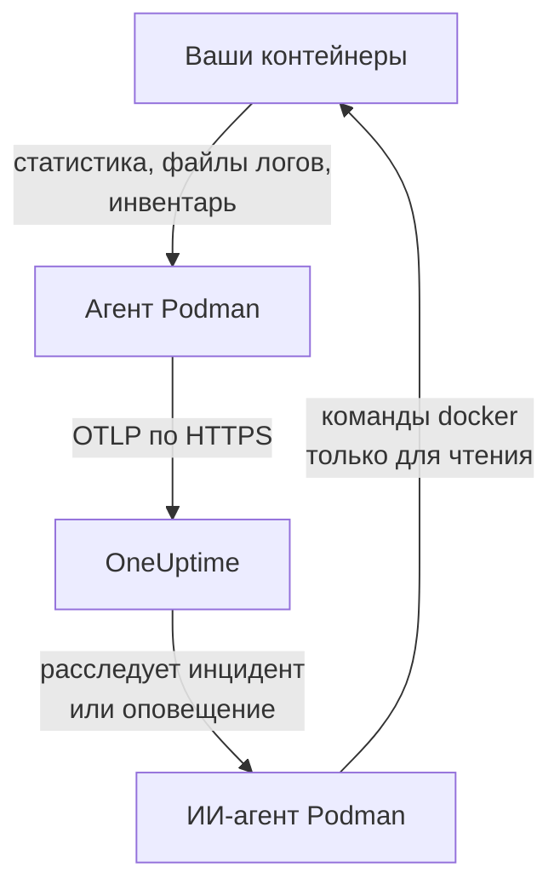

# Агент Podman

Агент Podman от OneUptime — это один контейнер, который запускается на Podman-хосте. Он читает статистику и файлы логов каждого контейнера на хосте и отправляет их в OneUptime, где хост появляется со своими контейнерами, метриками и логами. Второй контейнер, ИИ-агент Podman, позволяет OneUptime AI расследовать проблемы на хосте. [Мониторы Podman](/docs/monitor/podman-monitor) оповещают о том, что отправляет агент.

:::cards
- [Установка агента](#установка-агента): Два контейнера, через `podman run` или Podman Compose.
- [Что собирает агент](#что-собирает-агент): Метрики, логи и инвентарь каждого контейнера.
- [Для логов контейнеров нужен k8s-file](#для-логов-контейнеров-нужен-драйвер-логов-k8s-file): Podman пишет логи в journald, пока вы не переключите драйвер.
- [Устранение неполадок](#устранение-неполадок): Циклы перезапусков, отсутствующие метрики, отсутствующие логи.
:::

## Как это работает

Агент — это OpenTelemetry Collector со встроенной конфигурацией OneUptime. Через совместимый с Docker сокет API Podman он читает статистику каждого контейнера каждые 30 секунд и каждые 5 минут перечисляет все контейнеры, образы, сети и тома. Он следит за файлами логов контейнеров и отправляет всё на ваш URL OneUptime по OTLP с ключом приёма, который вы ему передаёте.



Хост регистрируется по своим первым данным под именем, которое вы задаёте в `PODMAN_HOST_NAME`. ИИ-агент необязателен: если его не устанавливать, коллектор работает так же.

## Перед началом

- Podman 4.0 или новее и доступ root на хосте.
- Сокет API Podman по адресу `/run/podman/podman.sock`. Включите его командой `sudo systemctl enable --now podman.socket`.
- Ключ приёма. Создайте его в разделе **Настройки проекта → Телеметрия и APM → Ключи приема** и скопируйте значение.
- Исходящий HTTPS с хоста на ваш URL OneUptime.
- Для логов контейнеров — контейнеры, которые используют драйвер логов `k8s-file`. Podman в режиме rootful по умолчанию пишет логи в `journald`, который агент читать не может. См. [Для логов контейнеров нужен драйвер логов k8s-file](#для-логов-контейнеров-нужен-драйвер-логов-k8s-file).

## Установка агента

:::steps
### Запустите агент

Замените `YOUR_ONEUPTIME_URL` своим URL OneUptime, `YOUR_TELEMETRY_INGESTION_TOKEN` — ключом приёма, а `my-podman-host` — именем этого хоста, например `prod-podman-01`. Под этим именем хост появится в OneUptime, поэтому не меняйте его: новое имя регистрирует новый хост.

:::tabs
@tab Podman CLI
```bash
podman run -d \
  --name oneuptime-podman-agent \
  --user 0:0 \
  --restart unless-stopped \
  -v /run/podman/podman.sock:/run/podman/podman.sock:ro \
  -v /var/lib/containers/storage:/var/lib/containers/storage:ro \
  -e ONEUPTIME_URL="YOUR_ONEUPTIME_URL" \
  -e ONEUPTIME_SERVICE_TOKEN="YOUR_TELEMETRY_INGESTION_TOKEN" \
  -e PODMAN_HOST_NAME="my-podman-host" \
  oneuptime/podman-agent:release
```

Затем рядом запустите [ИИ-агент](#ии-агент) с теми же значениями. **ИИ-расследования включены по умолчанию**: пока OneUptime AI расследует инцидент или оповещение на этом хосте, он выполняет через ИИ-агент команды `docker` только для чтения к совместимому с Docker API Podman и ничего не меняет, если вы не разрешите исправления. Чтобы установить без ИИ-расследований, пропустите эту команду.

```bash
podman run -d \
  --name oneuptime-podman-ai-agent \
  --user 0:0 \
  --restart unless-stopped \
  --read-only --tmpfs /tmp \
  -v /run/podman/podman.sock:/run/podman/podman.sock:ro \
  -e ONEUPTIME_URL="YOUR_ONEUPTIME_URL" \
  -e ONEUPTIME_SERVICE_TOKEN="YOUR_TELEMETRY_INGESTION_TOKEN" \
  -e ONEUPTIME_AI_AGENT_RESOURCE_TYPE=podman \
  -e PODMAN_HOST_NAME="my-podman-host" \
  oneuptime/resource-ai-agent:release
```
@tab Podman Compose
Сохраните это как `docker-compose.yml` в папке на хосте. Второй сервис — [ИИ-агент](#ии-агент): уберите его, чтобы запускать коллектор без ИИ-расследований.

```yaml title="docker-compose.yml"
services:
  oneuptime-podman-agent:
    image: oneuptime/podman-agent:release
    container_name: oneuptime-podman-agent
    user: "0:0"
    restart: unless-stopped
    volumes:
      - /run/podman/podman.sock:/run/podman/podman.sock:ro
      - /var/lib/containers/storage:/var/lib/containers/storage:ro
    environment:
      - ONEUPTIME_URL=YOUR_ONEUPTIME_URL
      - ONEUPTIME_SERVICE_TOKEN=YOUR_TELEMETRY_INGESTION_TOKEN
      - PODMAN_HOST_NAME=my-podman-host
    logging:
      driver: json-file
      options:
        max-size: "10m"
        max-file: "3"
  oneuptime-podman-ai-agent:
    image: oneuptime/resource-ai-agent:release
    container_name: oneuptime-podman-ai-agent
    user: "0:0"
    restart: unless-stopped
    read_only: true
    tmpfs:
      - /tmp
    volumes:
      - /run/podman/podman.sock:/run/podman/podman.sock:ro
    environment:
      - ONEUPTIME_URL=YOUR_ONEUPTIME_URL
      - ONEUPTIME_SERVICE_TOKEN=YOUR_TELEMETRY_INGESTION_TOKEN
      - ONEUPTIME_AI_AGENT_RESOURCE_TYPE=podman
      - PODMAN_HOST_NAME=my-podman-host
```

Запустите его в этой папке:

```bash
podman compose up -d
```
:::

### Убедитесь, что агент работает

```bash
podman ps --filter name=oneuptime-podman-agent
podman logs -f oneuptime-podman-agent
```

Когда коллектор запустится, в логах должна появиться такая строка:

```text
Everything is ready. Begin running and processing data.
```

### Найдите хост в OneUptime

Откройте **Продукты → Инфраструктура → Podman → Все хосты**. Хост появится под своим `PODMAN_HOST_NAME` примерно через минуту, со своими контейнерами, метриками и логами. ИИ-агент отображается как подключённый на странице хоста **ИИ-агент** и внизу его страницы **Обзор**.
:::

## Переменные окружения

| Переменная | Обязательна | Описание |
| --- | --- | --- |
| `ONEUPTIME_URL` | Да | Ваш URL OneUptime, например `https://oneuptime.com`, или ваш собственный экземпляр. Если экземпляр работает только по HTTP, используйте `http://` и его порт. |
| `ONEUPTIME_SERVICE_TOKEN` | Да | Ключ приёма из раздела **Настройки проекта → Телеметрия и APM → Ключи приема**. |
| `PODMAN_HOST_NAME` | Нет | Имя хоста в OneUptime. По умолчанию `podman-host`, поэтому дайте каждому хосту своё. |
| `DOCKER_API_VERSION` | Нет | Версия Docker API, на которой агент работает с сокетом Podman. По умолчанию `1.44`. Понизьте её, если сокет сообщает более старый максимум, или задайте пустое значение, чтобы согласовать её (см. [Устранение неполадок](#устранение-неполадок)). |

Чтобы изменить значение, удалите агент и снова выполните его команду (Podman CLI) или отредактируйте `docker-compose.yml` и выполните `podman compose up -d` (Podman Compose).

## Что собирает агент

| Данные | Что это |
| --- | --- |
| Метрики контейнеров | CPU (использование, процент, троттлинг), память (использование, лимит, процент), сетевой и блочный ввод-вывод, время работы, перезапуски и число процессов по каждому контейнеру каждые 30 секунд. |
| Логи контейнеров | stdout и stderr каждого контейнера из файла `ctr.log`, который пишет драйвер логов `k8s-file`. |
| Инвентарь | Все контейнеры в любом состоянии, а также все образы, сети и тома каждые 5 минут. |

Метрики и логи каждого контейнера хранятся под сервисом, названным по имени контейнера. Каждая строка лога получает важность по уровню, который в ней указан, например `[ERROR]`, `level=warn` или `{"level":"info"}`; строка без уровня получает важность своего потока: stderr — `ERROR`, stdout — `INFO`. Строки, начинающиеся с пробела или закрывающей скобки, присоединяются к предыдущей строке, поэтому трассировка стека приходит одной записью. Собственные логи агента не отправляются.

[Мониторинг Podman](/docs/monitor/podman-monitor#собираемые-метрики) перечисляет все метрики и объясняет их значение.

## Для логов контейнеров нужен драйвер логов k8s-file

Агент следит за `/var/lib/containers/storage/overlay-containers/*/userdata/ctr.log` — файлами, которые пишет драйвер логов Podman `k8s-file` (`json-file` в Podman — тот же драйвер). Драйвер по умолчанию у Podman в режиме rootful — `journald`, который не оставляет файла для чтения, как и удалённый драйвер вроде `syslog`. Метрики такого контейнера по-прежнему поступают, а логи — нет.

Проверьте драйвер логов контейнера и значение по умолчанию у Podman:

```bash
podman inspect <container> --format '{{.HostConfig.LogConfig.Type}}'
podman info --format '{{.Host.LogDriver}}'
```

Запустите контейнер с `k8s-file` или переведите на него сервис Compose:

```bash
podman run --log-driver k8s-file --log-opt max-size=100m ... <image>
```

```yaml
services:
  my-app:
    image: my-app:latest
    logging:
      driver: "k8s-file"
      options:
        max-size: "100m"
```

Или сделайте его значением по умолчанию для всех контейнеров, создаваемых после этого, в `containers.conf` (`/etc/containers/containers.conf` для rootful, `~/.config/containers/containers.conf` для rootless):

```toml title="containers.conf"
[containers]
log_driver = "k8s-file"
log_size_max = 104857600
```

Затем пересоздайте контейнеры. Контейнер сохраняет драйвер логов, с которым был создан, поэтому перезапуска недостаточно.

## Обновление агента

Когда агент старше вашего OneUptime, рядом с **Версия агента** на странице хоста **Обзор** появляется предупреждающий значок. Нажмите на него, чтобы увидеть эти команды.

:::tabs
@tab Podman CLI
```bash
podman pull oneuptime/podman-agent:release
podman pull oneuptime/resource-ai-agent:release
podman rm -f oneuptime-podman-agent oneuptime-podman-ai-agent
```

Затем снова выполните обе команды `podman run` из раздела [Запустите агент](#запустите-агент).
@tab Podman Compose
```bash
podman compose pull
podman compose up -d
```
:::

Тег `release` всегда указывает на новейший выпуск. Чтобы закрепить версию, используйте `oneuptime/podman-agent:<version>`, например `oneuptime/podman-agent:10.0.31`. Тот же образ есть в GitHub Container Registry как `ghcr.io/oneuptime/podman-agent:release`.

## Удаление агента

:::tabs
@tab Podman CLI
```bash
podman rm -f oneuptime-podman-agent
podman rm -f oneuptime-podman-ai-agent
```
@tab Podman Compose
```bash
podman compose down
```
:::

Хост остаётся в OneUptime с отправленными данными. Если он больше не нужен, удалите его через **Удалить хост** в его меню.

## ИИ-агент

Команды и файл Compose выше, `install.sh` агента Podman и `docker-compose.yml` в его [каталоге PodmanAgent](https://github.com/OneUptime/oneuptime/tree/master/agents/PodmanAgent) запускают **ИИ-агент Podman**: второй контейнер, `oneuptime-podman-ai-agent` (образ `oneuptime/resource-ai-agent:release`), который выполняет команды только для чтения, запрашиваемые OneUptime AI при расследовании инцидента или оповещения на этом хосте, — через совместимый с Docker API Podman, с помощью CLI `docker`: `docker ps -a`, `docker logs --tail 200 web`, `docker container inspect web` — и, только если вы это разрешите, применяет исправления, например перезапуск указанного контейнера. Он читает те же `ONEUPTIME_URL`, `ONEUPTIME_SERVICE_TOKEN` и `PODMAN_HOST_NAME`, что и коллектор, поэтому обслуживает ровно этот хост и появляется на странице хоста **ИИ-агент** в OneUptime.

- **ИИ-расследования включены по умолчанию.** Как только агент подключается, OneUptime AI расследует с его помощью инциденты и оповещения на этом хосте, а страница **Обзор** хоста показывает статус агента. Чтобы отключить это, задайте `ONEUPTIME_AI_INVESTIGATION=false` там, где работает агент (как это сделать, показывает **Изменить** в разделе **Что может делать ИИ** на странице ИИ-агента), или не устанавливайте агента.
- Он работает только для чтения, если вы не запустите его с `ONEUPTIME_AI_ALLOW_WRITES=true`; `ONEUPTIME_AI_WRITE_TARGETS` (например, `web-*,api-*`) ограничивает, какие контейнеры может затрагивать исправление. Запустите его также с `ONEUPTIME_AI_FIXES`, чтобы задать, как выполняются исправления, — `ask-for-approval` (каждое одобряет человек), `automatic` или `bypass-approval`, — а страница ИИ-агента покажет это только для чтения ([Что может делать ИИ, задаётся агентом](/docs/ai/infrastructure-ai-agents#what-ai-may-do-set-by-the-agent)).
- Ему нужен тот же сокет, что и коллектору, и он работает от root с этим смонтированным сокетом, потому что сокет принадлежит root, — а для Podman в режиме rootful тот, кто может пользоваться сокетом, является root на этом хосте, с `:ro` или без. Границу задаёт политика команд агента: он никогда не выполняет `exec`, `run`, `rm` или `prune` и никогда не изменяет себя, коллектор или что-либо из `ONEUPTIME_AI_PROTECTED_TARGETS` (glob-шаблоны имён контейнеров).
- `install.sh --no-ai-agent` не устанавливает его; `podman rm -f oneuptime-podman-ai-agent` удаляет его. Обновляйте его так же, как коллектор: `podman pull oneuptime/resource-ai-agent:release`, удалите и запустите снова.

Что он может запускать, как работают исправления и как устранять неполадки: [Infrastructure AI Agents](/docs/ai/infrastructure-ai-agents#docker-and-podman-hosts).

## Устранение неполадок

:::details Агент перезапускается с ошибкой "client version is too new"
Логи агента показывают:

```text
Error: cannot start pipelines: failed to start "docker_stats" receiver:
Error response from daemon: client version 1.44 is too new.
Maximum supported API version is 1.41
```

Сервер Docker API, который соблюдает максимальную версию клиента, отклоняет более новую, поэтому приёмник так и не запускается, а вместе с ним завершается и коллектор. Проверьте версию API, которую сообщает сокет Podman:

```bash
curl -s -o /dev/null -D - --unix-socket /run/podman/podman.sock http://localhost/_ping | grep -i '^api-version'
```

Затем добавьте `-e DOCKER_API_VERSION=1.41` (или полученное значение) в `podman run` или задайте `DOCKER_API_VERSION` в Compose. Новые серверы по-прежнему поддерживают старые версии API, поэтому настройка остаётся верной и после обновления.

Не хотите искать номер? Задайте `DOCKER_API_VERSION` пустой строкой. Тогда агент согласует версию с сокетом (один `HEAD /_ping`, затем максимум, который сообщает сокет), а не закрепляет её:

```bash
podman run -d ... -e DOCKER_API_VERSION= ...
```
:::

:::details Отказ в доступе к сокету Podman, или сокета нет
Чтобы читать `/run/podman/podman.sock`, агент должен работать от root. Проверьте, что в вашей команде `podman run` есть `--user 0:0` или в Compose — `user: "0:0"`, и что сокет включён: `sudo systemctl enable --now podman.socket`. У Podman в режиме rootless сокет находится по адресу `/run/user/<uid>/podman/podman.sock` (`systemctl --user enable --now podman.socket`): смонтируйте этот путь вместо `/run/podman/podman.sock`.
:::

:::details Хост отображается как отключённый
1. Проверьте, что агент работает: `podman ps --filter name=oneuptime-podman-agent`
2. Поищите ошибки в его логах: `podman logs oneuptime-podman-agent 2>&1 | grep -i error`
3. Проверьте `ONEUPTIME_URL` и `ONEUPTIME_SERVICE_TOKEN`: ключ должен быть действительным ключом приёма, который не отключён.
4. Проверьте, что хост может достучаться до вашего URL OneUptime по сети.
:::

:::details Метрики не появляются
1. Проверьте, что сокет Podman смонтирован в агент. В его образе нет оболочки, поэтому посмотрите из временного контейнера, который использует те же точки монтирования: `podman run --rm --volumes-from oneuptime-podman-agent alpine:3.19 ls -la /run/podman/podman.sock`
2. Поищите ошибки экспорта в его логах: `podman logs oneuptime-podman-agent 2>&1 | tail -100`
3. Проверьте, что ключ приёма действителен и не истёк.
:::

:::details Метрики поступают, но логов контейнеров нет
Скорее всего, ваши контейнеры используют `journald` — драйвер логов Podman по умолчанию. Проверьте, за какими файлами следит агент и какой драйвер использует контейнер:

```bash
podman logs oneuptime-podman-agent 2>&1 | grep -E "Started watching file|no files match"
podman inspect <container> --format '{{.HostConfig.LogConfig.Type}}'
```

Если агент сообщает `no files match the configured criteria`, переведите контейнеры на `k8s-file` и пересоздайте их, как показано в разделе [Для логов контейнеров нужен драйвер логов k8s-file](#для-логов-контейнеров-нужен-драйвер-логов-k8s-file).
:::

:::details Логи попадают на другой хост, или хост называется podman-host
Имя хоста берётся из `PODMAN_HOST_NAME`. Агент, запущенный без этой переменной, сообщает `podman-host`, поэтому все хосты, настроенные так, выглядят как один; если позже изменить имя, OneUptime зарегистрирует второй хост, и новые данные будут в нём. Задайте `PODMAN_HOST_NAME` своё имя на каждом хосте и пересоздайте агента. Чтобы проверить имя, которое сообщает агент:

```bash
podman inspect oneuptime-podman-agent --format '{{range .Config.Env}}{{println .}}{{end}}' | grep PODMAN_HOST_NAME
```
:::

## Дальнейшие шаги

:::cards
- [Мониторинг Podman](/docs/monitor/podman-monitor): Оповещения по CPU, памяти и перезапускам контейнеров.
- [Базы данных](/docs/telemetry/databases): Контейнеры баз данных на хосте обнаруживаются и получают собственные страницы.
- [Агент Kubernetes](/docs/telemetry/kubernetes-agent): Мониторинг кластера Kubernetes вместо этого.
- [OpenTelemetry-коллектор на хосте](/docs/telemetry/host-otel-collector): Мониторинг самой машины: CPU, диски, процессы и логи.
:::
