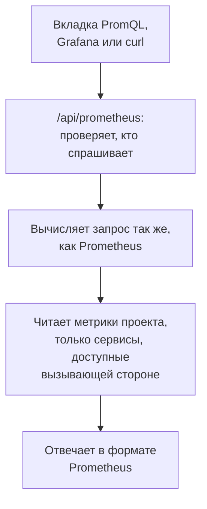

# Запросы метрик на PromQL

PromQL — язык запросов Prometheus, и именно его уже знает большинство тех, кто строит графики метрик. OneUptime читает на нём метрики вашего проекта: на вкладке **PromQL** в разделе «Метрики» и через Prometheus-совместимый API, к которому можно подключить Grafana или любой инструмент с источником данных Prometheus.

:::cards
- [Написать запрос](#написать-запрос): Выполните PromQL на странице «Метрики» и посмотрите график или таблицу.
- [Как называются метрики](#как-называются-метрики): Как имена и атрибуты OpenTelemetry читаются в PromQL.
- [Подключить Grafana](#подключить-grafana): Добавьте OneUptime как источник данных Prometheus.
- [Ограничения](#ограничения): Что может прочитать запрос и сколько времени на это есть.
:::

## Как это работает

Вкладка PromQL и Grafana обращаются к одному и тому же API. OneUptime проверяет, что вызывающей стороне разрешено читать метрики проекта, читает только те сервисы, которые ей разрешено читать, и вычисляет запрос так же, как это делает Prometheus.



## Перед началом

- **Поступающие метрики.** Отправляйте их через [OpenTelemetry](/docs/telemetry/open-telemetry) или от агента, например [OpenTelemetry Collector для хостов](/docs/telemetry/host-otel-collector).
- **Роль, которая читает метрики.** Project Owner, Project Admin, Project Member, Viewer, Telemetry Admin, Telemetry Member или Telemetry Viewer либо пользовательская роль с разрешением Read Metrics. Роль, ограниченная некоторыми сервисами, читает только их метрики.
- **Для Grafana или скрипта: API-ключ проекта** с одной из этих ролей или с разрешением Read Metrics. См. [Создайте API-ключ](/docs/api-reference/api-reference#создайте-api-ключ). В OneUptime Cloud API-ключам нужен план **Growth**.

## Написать запрос

:::steps
### Откройте PromQL

Откройте **Метрики** и нажмите на вкладку **PromQL**.

### Напишите запрос

Введите его в редакторе, выберите пример в разделе **Примеры** или начните с **Добавить имя метрики**, где метрики вашего проекта перечислены под теми именами, которые даёт им PromQL.

### Выполните его

Нажмите **Выполнить запрос** или клавиши Ctrl+Enter (⌘+Enter на Mac). **График** рисует запрос за диапазон времени; **Таблица** показывает значение каждого ряда на конец диапазона.
:::

Несколько запросов для начала:

```text title="PromQL"
# Requests per second, by service
sum by (job) (rate(http_requests_total[5m]))

# The 95th percentile of a latency histogram
histogram_quantile(0.95, sum by (le) (rate(http_server_request_duration_bucket[5m])))

# The five hosts using the most memory
topk(5, system_memory_usage)
```

Для запроса, который не выполняется, редактор показывает, что пошло не так и где: например, для `rate(http_requests_total)` он сообщает, что функции нужен диапазон, такой как `[5m]`.

## Как называются метрики

OneUptime хранит метрики так, как это принято в OpenTelemetry. PromQL читает их под теми именами, которые даёт им собственная поддержка OpenTelemetry в Prometheus, поэтому запрос, написанный для Prometheus, работает и здесь:

| В OneUptime | В PromQL |
| --- | --- |
| Gauge `system.cpu.utilization` | `system_cpu_utilization` |
| Счётчик `http.requests` | `http_requests` или `http_requests_total` |
| Гистограмма `http.server.request.duration` | `http_server_request_duration_bucket` (с `le`), `_count` и `_sum` |
| Summary `rpc.latency` | `rpc_latency` (с `quantile`), `_count` и `_sum` |
| Атрибут `http.route` | Метка `http_route` |
| Атрибут ресурса `service.name` | Метка `resource_service_name`, а также `job` |
| Атрибут ресурса `service.instance.id` | Метка `resource_service_instance_id`, а также `instance` |

- **Точки и дефисы становятся подчёркиваниями** в именах метрик и меток. Чтобы назвать метрику или метку точно так, как она хранится, заключите имя в кавычки, как это делает Prometheus 3: `{"http.server.request.duration", "http.route"="/checkout"}`.
- **Дельта-счётчики суммируются** с начала диапазона времени запроса, поэтому `rate()` и `increase()` читают их как любой другой счётчик.
- **Экспоненциальные гистограммы** содержат `_count` и `_sum`, но не содержат корзин.

## Подключить Grafana

:::steps
### Создайте API-ключ

В OneUptime откройте **Настройки проекта → Расширенный → Ключи API** и нажмите **Создать: API-ключ**. Дайте ключу роль, которая читает телеметрию, или разрешение Read Metrics.

### Добавьте источник данных Prometheus

В Grafana откройте **Connections → Data sources → Add data source** и выберите **Prometheus**.

### Укажите URL сервера

В поле **Prometheus server URL** укажите адрес вашего OneUptime, а за ним `/api/prometheus`. В OneUptime Cloud это `https://oneuptime.com/api/prometheus`. Вкладка **PromQL** показывает адрес вашего собственного сервера и кнопку, чтобы его скопировать.

### Отправьте API-ключ

В разделе **HTTP headers** добавьте заголовок `Authorization` со значением `Bearer`, за которым следуют пробел и ваш API-ключ. Базовая аутентификация тоже работает: любое имя пользователя и API-ключ в качестве пароля.

### Сохраните и проверьте

Нажмите **Save & test**. Grafana выполнит запрос и сообщит, что источник данных работает.
:::

Любой другой клиент Prometheus работает так же. С curl:

```bash title="Query OneUptime's Prometheus API"
curl -H "Authorization: Bearer $ONEUPTIME_API_KEY" \
  "https://oneuptime.com/api/prometheus/api/v1/query?query=up"
```

## API

API отвечает на маршруты HTTP API Prometheus, с методами `GET` или `POST`, по пути `/api/prometheus`:

| Маршрут | Что он возвращает |
| --- | --- |
| `/api/v1/query` | Запрос в один момент времени (`time`, по умолчанию — сейчас). |
| `/api/v1/query_range` | Запрос на каждом шаге `step` от `start` до `end`. |
| `/api/v1/series` | Ряды, которые выбирает `match[]`. |
| `/api/v1/labels` | Имена меток рядов, которые выбирает `match[]`, или всех метрик. |
| `/api/v1/label/<name>/values` | Значения одной метки. `__name__` перечисляет имена метрик. |
| `/api/v1/metadata` | Тип, справка и единица измерения каждой метрики. |

Время указывается в секундах Unix или в формате RFC 3339, длительности — в секундах или в виде длительности, например `15s`, а ответы приходят в формате Prometheus. `/api/v1/status/buildinfo` отвечает как сервер Prometheus 3; правила и оповещения пусты, потому что OneUptime оповещает с помощью [мониторов](/docs/monitor/metrics-monitor).

## Что поддерживается в PromQL

- **Селекторы** со всеми операторами сопоставления (`=`, `!=`, `=~`, `!~`), диапазоны, `offset`, `@` (с `start()` и `end()`) и подзапросы.
- **Операторы**: арифметические, сравнения (с `bool`), `and`, `or`, `unless` и сопоставление векторов с `on`, `ignoring`, `group_left` и `group_right`.
- **Агрегации**: `sum`, `avg`, `min`, `max`, `count`, `group`, `stddev`, `stdvar`, `topk`, `bottomk`, `quantile` и `count_values`, с `by` или `without`.
- **Функции**: `rate`, `irate`, `increase`, `delta`, `idelta`, `deriv`, `predict_linear`, `histogram_quantile`, все функции `*_over_time`, `changes`, `resets`, `absent`, `label_replace`, `label_join`, `sort`, `clamp`, `round`, математические функции и функции даты, а также другие.

Функции нативных гистограмм Prometheus, такие как `histogram_count()`, недоступны: OneUptime хранит гистограммы с корзинами, которые читают `histogram_quantile()` и ряды `_count` и `_sum`.

## Ограничения

Каждый запрос ограничен, чтобы дашборд из множества панелей не мог перегрузить OneUptime:

| Ограничение | Значение |
| --- | --- |
| Точки в одном ряду запроса по диапазону | 11 000 |
| Сэмплы, которые один запрос может прочитать и удерживать | 5 000 000 |
| Точки метрик, которые может прочитать один селектор | 1 000 000 |
| Время, которое может занять чтение | 30 секунд |
| Время, которое может занять вычисление | 30 секунд |
| Насколько далеко назад селектор ищет последний сэмпл ряда | 5 минут |
| Шаг подзапроса, если запрос его не указывает | 1 минута |

## Устранение неполадок

:::details Grafana сообщает, что источник данных не работает
Проверьте, что URL заканчивается на `/api/prometheus`, а заголовок `Authorization` содержит `Bearer`, пробел и API-ключ. Ключ без роли, которая читает метрики, отклоняется: дайте ему такую роль в **Настройки проекта → Расширенный → Ключи API**.
:::

:::details Метрика из обозревателя ничего не находит
В её имени в PromQL стоят подчёркивания там, где в сохранённом имени стоят точки, а гистограмма читается через `_bucket`, `_count` или `_sum`. **Добавить имя метрики** на вкладке PromQL перечисляет все имена так, как их пишет PromQL.
:::

:::details "The query reads more than 1,000,000 metric points"
Запрос просит больше, чем может удержать одно чтение. Добавьте сопоставители меток, сократите диапазон времени или используйте больший шаг.
:::

## Дальнейшие шаги

:::cards
- [Обозреватель метрик](/docs/telemetry/metrics-explorer): Стройте графики метрик, не написав ни одного запроса.
- [Мониторинг метрик](/docs/monitor/metrics-monitor): Получайте оповещения, когда метрика пересекает порог.
- [Внешние источники данных](/docs/dashboards/data-sources): Показывайте на дашбордах данные внешнего Prometheus.
:::
