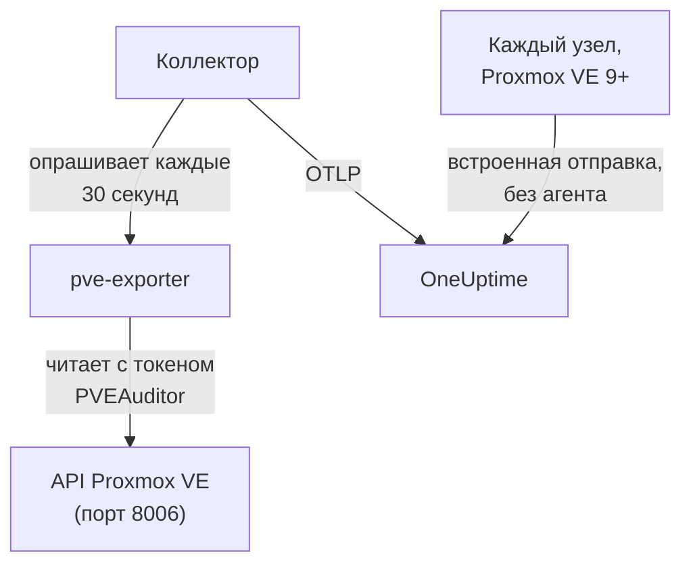

# Агент Proxmox

Агент Proxmox от OneUptime отслеживает кластер Proxmox VE: его узлы, виртуальные машины QEMU, контейнеры LXC, хранилища, состояние HA, покрытие резервным копированием и репликацию. Он читает кластер через API Proxmox VE с токеном только для чтения и отправляет найденное в OneUptime, где кластер появляется со своими узлами, гостями и хранилищами. В Proxmox VE 9 и новее узлы также могут сами отправлять свои метрики, без какой-либо установки. [Мониторы Proxmox](/docs/monitor/proxmox-monitor) оповещают о том, что поступает.

:::cards
- [Выбор способа подключения](#выбор-способа-подключения): Агент или встроенная отправка Proxmox VE 9.
- [Установка агента](#установка-агента): Токен API, затем скрипт установки или Docker Compose.
- [Встроенная отправка](#альтернатива-без-установки-встроенная-отправка-opentelemetry-в-proxmox-ve-9): Proxmox VE 9 сам отправляет свои метрики.
- [Устранение неполадок](#устранение-неполадок): Диагностический скрипт и типичные проблемы.
:::

## Как это работает

Агент — это набор контейнеров, которые запускаются через Docker Compose на одной машине: [prometheus-pve-exporter](https://github.com/prometheus-pve/prometheus-pve-exporter) читает API Proxmox VE на порту 8006, OpenTelemetry Collector опрашивает экспортёр каждые 30 секунд и помечает каждую метрику именем вашего кластера, а ИИ-агент Proxmox позволяет OneUptime AI читать кластер во время расследования. Встроенная отправка Proxmox VE 9 вместо этого передаёт метрики каждого узла прямо в OneUptime.



Кластер регистрируется по своим первым данным под именем, которое агент проставляет на каждую метрику как `proxmox.cluster.name`.

## Выбор способа подключения

| | Агент | Встроенная отправка |
| --- | --- | --- |
| Proxmox VE | Любая поддерживаемая версия | 9.0 или новее |
| Что установить | Docker Compose на одной машине | Ничего: сервер метрик в веб-интерфейсе Proxmox |
| Узлы, гости и хранилища | Да | Да |
| Состояние HA, автозапуск при загрузке, покрытие резервным копированием и репликация | Да | Нет |
| ИИ-агент Proxmox | Да | Нет |

Шаблонам **HA Resource in Error State**, **Guest Down**, **Guest Not Backed Up** и **Replication Failing** нужен агент. Используйте для кластера что-то одно: при использовании обоих каждый ресурс отчитывается дважды.

## Перед началом

- Docker Engine 20.10 или новее с плагином Docker Compose v2 на машине, которая может достучаться до API Proxmox VE на порту 8006.
- Оболочка root на любом узле Proxmox VE или веб-интерфейс Proxmox, чтобы создать токен API.
- Ключ приёма. Создайте его в разделе **Настройки проекта → Телеметрия и APM → Ключи приема** и скопируйте значение.
- Исходящий HTTPS с этой машины на ваш URL OneUptime.

### Где запускать агент

Агент обращается к API Proxmox VE по сети, поэтому ему не нужно находиться на узле кластера, и лучше, чтобы не находился: запускайте его на машине, которая переживёт отказ узла (небольшая ВМ для мониторинга на отдельном оборудовании, хост управления), или направьте `PVE_HOST` на виртуальный IP или DNS-имя с round-robin вместо адреса одного узла. Если целевой узел API агента — тот, который только что вышел из строя, ваш мониторинг выйдет из строя вместе с ним. Единственное исключение — необязательный пайплайн логов journald, который должен работать на узле Proxmox VE (см. [Отправка логов служб Proxmox](#необязательно-отправка-логов-служб-proxmox)).

## Установка агента

:::steps
### Создайте токен API только для чтения

Агент читает кластер с токеном API, у которого есть роль **PVEAuditor**, — она умеет читать, и ничего больше.

:::tabs
@tab Shell
От root на любом узле Proxmox VE:

```bash
pveum user add monitoring@pam
pveum acl modify / --roles PVEAuditor --users monitoring@pam
pveum user token add monitoring@pam oneuptime --privsep 1
pveum acl modify / --roles PVEAuditor --tokens 'monitoring@pam!oneuptime'
```

Первая команда завершается ошибкой, причём безвредно, только если `monitoring@pam` уже существует: у токенов API собственный секрет, поэтому пользователю не нужны ни пароль, ни системная учётная запись. `pveum user token add` выводит секрет токена один раз; идентификатор токена — `monitoring@pam!oneuptime`.
@tab Proxmox web UI
1. Перейдите в *Datacenter → Permissions → API Tokens* и нажмите **Add**.
2. Выберите (или создайте) пользователя, задайте токену идентификатор вроде `oneuptime` и оставьте отмеченным **Privilege Separation**.
3. Скопируйте идентификатор токена (`user@realm!tokenname`) и секрет: секрет показывается только один раз.
4. В *Datacenter → Permissions* добавьте роль **PVEAuditor** на путь `/` дважды: один раз как **API Token Permission** для токена и один раз как **User Permission** для его пользователя.
:::

Роль назначается не только токену, но и пользователю, потому что токен с разделением привилегий получает лишь те права, которые есть и у его пользователя. Она должна быть на корневом пути `/`, потому что экспортёр читает каждый объект узла, гостя и хранилища: более узкий путь скрывает остальной кластер и даёт ошибку `401`/`403 Permission check failed (/, Sys.Audit)`.

### Установите и запустите агент

:::tabs
@tab install.sh
Скачайте скрипт установки и запустите его на машине, где будет работать агент:

```bash
curl -sSL https://raw.githubusercontent.com/OneUptime/oneuptime/master/agents/ProxmoxAgent/install.sh -o install.sh
bash install.sh
```

Скрипт спрашивает ваш URL OneUptime, ключ приёма, имя кластера, хост API Proxmox VE, запускать ли встроенный экспортёр, а также идентификатор и секрет токена — и может ли [ИИ-агент](#ии-агент) применять исправления, а если да, то отдельный токен для этого и гостей, которых он никогда не должен менять. Он устанавливает агент в `/opt/oneuptime-proxmox-agent`, записывает файл `.env` с правами `0600` и запускает агент через Docker Compose. При повторном запуске скрипт использует всё из этого `.env`, а не спрашивает снова, — так и выполняется [обновление агента](#обновление-агента).
@tab Docker Compose
Скачайте `docker-compose.yml` и `otel-collector-config.yaml` из [каталога ProxmoxAgent](https://github.com/OneUptime/oneuptime/tree/master/agents/ProxmoxAgent) в новую папку:

```bash
mkdir oneuptime-proxmox-agent && cd oneuptime-proxmox-agent
curl -fsSLO https://raw.githubusercontent.com/OneUptime/oneuptime/master/agents/ProxmoxAgent/docker-compose.yml
curl -fsSLO https://raw.githubusercontent.com/OneUptime/oneuptime/master/agents/ProxmoxAgent/otel-collector-config.yaml
```

Создайте рядом с ними файл `.env`. В нём хранится секрет токена, поэтому закройте к нему доступ командой `chmod 600 .env`:

```bash title=".env"
ONEUPTIME_URL=YOUR_ONEUPTIME_URL
ONEUPTIME_TELEMETRY_INGESTION_KEY=YOUR_TELEMETRY_INGESTION_TOKEN
PROXMOX_CLUSTER_NAME=my-proxmox-cluster
PVE_HOST=192.168.1.10
PVE_API_TOKEN_ID=monitoring@pam!oneuptime
PVE_API_TOKEN_SECRET=your-token-secret
COMPOSE_PROFILES=pve-exporter
```

`COMPOSE_PROFILES=pve-exporter` также запускает встроенный экспортёр. Запустите агент:

```bash
docker compose up -d
```
:::

Уже используете prometheus-pve-exporter? Ответьте **n**, когда скрипт спросит, запускать ли встроенный, или уберите `COMPOSE_PROFILES` из `.env`, и направьте агента на свой (`host:port`, без схемы, адрес, доступный контейнеру агента: `localhost` — это сам контейнер). Оставьте `PVE_API_TOKEN_ID` и `PVE_API_TOKEN_SECRET`, если используете [ИИ-агент](#ии-агент), который обращается к API с этим токеном:

```bash
PVE_EXPORTER_URL=your-exporter-host:9221
```

### Убедитесь, что агент работает

```bash
docker compose ps
docker logs -f oneuptime-proxmox-agent
```

`docker compose ps` перечисляет коллектор (`oneuptime-proxmox-agent`), встроенный экспортёр (`oneuptime-pve-exporter`, если вы не используете свой) и ИИ-агент (`oneuptime-proxmox-ai-agent`). Когда коллектор запустится, в его логах должна появиться такая строка:

```text
Everything is ready. Begin running and processing data.
```

### Найдите кластер в OneUptime

Откройте **Продукты → Инфраструктура → Proxmox → Все кластеры**. Кластер появится под своим `PROXMOX_CLUSTER_NAME` примерно через минуту после первого опроса, со своими узлами, гостями и хранилищами.
:::

## Переменные окружения

Скрипт установки записывает их в `/opt/oneuptime-proxmox-agent/.env`; при установке через Docker Compose они читаются из `.env` рядом с `docker-compose.yml`. Изменив значение, выполните `docker compose up -d` в этой папке.

| Переменная | Обязательна | Описание |
| --- | --- | --- |
| `ONEUPTIME_URL` | Да | Ваш URL OneUptime, например `https://oneuptime.com`, или ваш собственный экземпляр. Если экземпляр работает только по HTTP, используйте `http://` и его порт. |
| `ONEUPTIME_TELEMETRY_INGESTION_KEY` | Да | Ключ приёма из раздела **Настройки проекта → Телеметрия и APM → Ключи приема**. |
| `PROXMOX_CLUSTER_NAME` | Да | Имя кластера в OneUptime, проставляемое на каждую метрику как атрибут ресурса `proxmox.cluster.name`. Не меняйте его: изменение позже регистрирует второй кластер. По умолчанию `proxmox-cluster`. |
| `PVE_HOST` | Да | Хост API Proxmox VE (любой узел кластера), к которому обращаются экспортёр и ИИ-агент, например `192.168.1.10`. |
| `PVE_EXPORTER_URL` | Нет | Адрес (`host:port`, без схемы) prometheus-pve-exporter. По умолчанию встроенный экспортёр, `pve-exporter:9221`. |
| `PVE_API_TOKEN_ID` | Встроенный экспортёр или ИИ-агент | Полный идентификатор токена API Proxmox, например `monitoring@pam!oneuptime`. ИИ-агент читает API с ним, если у него нет собственного токена (`ONEUPTIME_AI_PVE_API_TOKEN_ID` / `ONEUPTIME_AI_PVE_API_TOKEN_SECRET`). |
| `PVE_API_TOKEN_SECRET` | Встроенный экспортёр или ИИ-агент | Секрет токена API Proxmox. |
| `PVE_VERIFY_SSL` | Нет | Проверять TLS-сертификат API Proxmox (экспортёр и ИИ-агент). По умолчанию `false`, потому что Proxmox поставляется с самоподписанными сертификатами. |
| `COMPOSE_PROFILES` | Нет | Задайте `pve-exporter`, чтобы запустить контейнер встроенного экспортёра. |

## Что собирает агент

Коллектор опрашивает экспортёр каждые 30 секунд с включёнными сборщиками кластера и узлов, что также охватывает включённые по умолчанию сборщики экспортёра `backup-info` (уровень кластера) и `replication` (уровень узла). Каждый ряд несёт метку `id` с именем ресурса: `node/<name>`, `qemu/<vmid>`, `lxc/<vmid>` или `storage/<node>/<storage>`.

| Категория | Метрики |
| --- | --- |
| Доступность | `pve_up`, `pve_uptime_seconds` |
| Узел | `pve_node_info`, `pve_cpu_usage_ratio`, `pve_cpu_usage_limit`, `pve_memory_usage_bytes`, `pve_memory_size_bytes` |
| Гость (ВМ или LXC) | `pve_guest_info`, а также ряды CPU, памяти и сети с идентификаторами `qemu/*` и `lxc/*` (`pve_network_receive_bytes`, `pve_network_transmit_bytes`) |
| Хранилище | `pve_disk_usage_bytes`, `pve_disk_size_bytes`, `pve_storage_info` |
| HA | `pve_ha_state` |
| Покрытие резервным копированием | `pve_not_backed_up_total` (гости, которых не охватывает ни одно задание резервного копирования; один ряд уровня кластера, без метки `id`) и `pve_not_backed_up_info` (один ряд на каждого непокрытого гостя, с его `id`). Покрытие означает, что хотя бы одно задание выбирает гостя: выполнялось ли резервное копирование недавно и было ли успешным, экспортёр не сообщает. |
| Репликация | `pve_replication_failed_syncs`, `pve_replication_duration_seconds`, `pve_replication_last_sync_timestamp_seconds`, `pve_replication_last_try_timestamp_seconds`, `pve_replication_next_sync_timestamp_seconds`, `pve_replication_info` для каждого задания репликации хранилища. Их метка `id` — это идентификатор задания (например, `100-0`), а не ресурс. |

Критерии мониторов и фильтры атрибутов сравнивают на равенство, а не по префиксу, поэтому процессор коллектора `transform/pve-identity` также разбивает `id` на три атрибута. Встроенные шаблоны оповещений Proxmox фильтруют по ним, поэтому сохраните процессор, если меняете конфигурацию:

| Атрибут | Значения | Для `qemu/100` |
| --- | --- | --- |
| `pve.scope` | `node`, `guest`, `storage`, `cluster` (`qemu` и `lxc` — оба `guest`) | `guest` |
| `pve.type` | `node`, `qemu`, `lxc`, `storage` | `qemu` |
| `pve.id` | Всё после первого `/` в `id` (`pve1`, `100`, `pve1/local`) | `100` |

Исходная метка `id` сохраняется как есть.

## Необязательно — отправка логов служб Proxmox

По умолчанию агент отправляет только метрики, поэтому страница кластера **Журналы** остаётся пустой. Службы Proxmox VE пишут логи в журнал systemd под восемью юнитами: `pveproxy`, `pvedaemon`, `pve-firewall`, `pve-ha-crm`, `pve-ha-lrm`, `pvescheduler`, `pvestatd` и `qmeventd`. В поставляемом `otel-collector-config.yaml` есть закомментированный приёмник `journald` ровно для этих юнитов, подключённый к закомментированному пайплайну `logs`, который проставляет `proxmox.cluster.name`, чтобы логи попадали в ваш кластер.

:::steps
### Запустите агент на узле

Журнал у каждого хоста свой, поэтому удалённый агент не может его прочитать. Это единственная схема, которая противоречит разделу [Где запускать агент](#где-запускать-агент): чтобы агент метрик оставался вне кластера, запустите вместо этого на узле второй коллектор, только для логов (скопируйте конфигурацию, затем удалите приёмник `prometheus` и пайплайн `metrics`).

### Включите приёмник

Раскомментируйте приёмник `journald` и пайплайн `logs` в `otel-collector-config.yaml`, а также тома журнала в `docker-compose.yml`, чтобы контейнер мог читать журнал хоста:

```yaml
- /var/log/journal:/var/log/journal:ro
- /etc/machine-id:/etc/machine-id:ro
```

### Замените образ коллектора

Стандартный образ `otel/opentelemetry-collector-contrib` собран `FROM scratch`: в нём нет `journalctl`, который запускает приёмник journald, и он работает от пользователя, который не может читать журнал. Соберите эту обёртку и укажите её в `image:` в `docker-compose.yml`:

```dockerfile title="Dockerfile"
FROM otel/opentelemetry-collector-contrib:0.161.0 AS otelcol
FROM debian:stable-slim
RUN apt-get update \
    && apt-get install -y --no-install-recommends systemd \
    && rm -rf /var/lib/apt/lists/*
COPY --from=otelcol /otelcol-contrib /otelcol-contrib
ENTRYPOINT ["/otelcol-contrib"]
CMD ["--config", "/etc/otelcol-contrib/config.yaml"]
```

Пакет `systemd` нужен только ради `journalctl`, а этот образ работает от root, который может читать журнал. Или обойдитесь без Docker для логов и запустите `.deb` из выпуска `otelcol-contrib` прямо на узле, где `journalctl` уже есть.
:::

Каждый узел отправляет только свой журнал: чтобы получать логи служб со всех узлов, запустите коллектор только для логов на каждом узле.

### Запасной вариант без своего образа: filelog для /var/log/syslog

Чтобы оставить стандартный образ, следите вместо этого за syslog. Установите на узел rsyslog (`apt install rsyslog`; Debian 12 и Proxmox VE 8 и новее его больше не поставляют), смонтируйте в контейнер каталог `/var/log` (`- /var/log:/var/log:ro`; каталог, а не файл, чтобы ротация логов не оставила устаревший файл) и используйте приёмник `filelog` вместо приёмника journald:

```yaml
receivers:
  filelog:
    include:
      - /var/log/syslog
    start_at: end
```

Вы теряете фильтр по юнитам (в syslog попадает всё, а не только восемь служб), а пользователь стандартного образа должен иметь возможность читать этот файл. Подключите его к тому же закомментированному пайплайну `logs` (`receivers: [filelog]`).

## Альтернатива без установки: встроенная отправка OpenTelemetry в Proxmox VE 9+

Proxmox VE 9.0 и новее поставляется с сервером метрик OpenTelemetry, который отправляет метрики узлов, гостей и хранилищ на любую конечную точку OTLP/HTTP, без агента и экспортёра. В веб-интерфейсе Proxmox перейдите в *Datacenter → Metric Server → Add → OpenTelemetry* и заполните:

| Поле | Значение |
| --- | --- |
| Server | Ваш хост OneUptime, например `oneuptime.com`, или ваш собственный хост |
| Port | `443` |
| Protocol | `https` |
| Path | `/otlp/v1/metrics` |
| Headers | `{"x-oneuptime-token": "YOUR_TELEMETRY_INGESTION_TOKEN"}` |

Добавьте его один раз: каждый узел кластера отправляет свои метрики сам. OneUptime распознаёт эту отправку и преобразует её в те же ряды `pve_*`, что отправляет агент, поэтому:

- кластер регистрируется под именем вашего кластера Proxmox (отдельный узел — под именем узла), а `proxmox.cluster.name`, заданный в *Resource Attributes*, используется вместо него;
- страницы узлов, гостей и хранилищ, графики обзора, каталог метрик и шаблоны оповещений для CPU, памяти и хранилища работают так же, как с агентом;
- исходные ряды `proxmox_node_*`, `proxmox_vm_*` и `proxmox_storage_*` остаются в [Metrics Explorer](/docs/monitor/metrics-monitor) для всего остального, что сообщает Proxmox VE (load average, swap, pressure stall, трафик по сетевым картам).

### Когда узел перестаёт отправлять отчёты

Каждый узел отправляет только своё собственное состояние, поэтому вышедший из строя узел не может сообщить об этом сам. За него это сообщают узлы, которые ещё работают:

- Примерно через 2 минуты после его последнего отчёта узел отображается как **Не в сети** на странице узлов. **Последняя активность** на собственной странице узла сохраняет время его последнего собственного отчёта.
- Примерно через 5 минут для него срабатывает **Node Offline**. **Cluster Quorum at Risk** тоже считает его отключённым; поскольку этому шаблону нужно полное 5-минутное окно отчётов, он срабатывает примерно через 7–9 минут после того, как узел замолчал.
- Со следующим отчётом он снова **Online**, и его оповещение восстанавливается.

Не в сети здесь означает, что узел перестал отправлять отчёты, а не обязательно что он выключен. Узел, который работает, но у которого `pvestatd` завис или был завершён, файловая система кластера (`pmxcfs`) не работает или сеть до OneUptime оборвана, отображается так же.

Что это не может охватить:

- Отдельный хост или весь кластер, замолкший разом: сообщить об этом некому, поэтому оповещения по узлам не срабатывают. Вместо этого кластер переходит в состояние **Отключено**, как при остановке агента.
- Об узле, молчащем дольше 7 дней, больше не сообщается: его оповещение закрывается, и он исчезает со страницы узлов. В самостоятельно размещённом OneUptime эти 7 дней меняются через `PVE_SILENT_NODE_RETENTION_HOURS`.
- Узел, который вы выводите из кластера, выглядит так же, как вышедший из строя. Используйте **Remove Node** на его странице: он исчезнет, а его оповещение закроется. Иначе он остаётся Не в сети до 7 дней.
- Гости и хранилища узла: как Не в сети сохраняется только сам узел. Его ВМ, контейнеры и хранилища исчезают со своих страниц примерно через 15 минут после его последнего отчёта, а гости, которых HA перезапускает на другом узле, возвращаются уже под этим узлом.

После сбоя приёма в OneUptime о недавно замолчавшем узле сообщается только после того, как один из остальных снова отправляет данные в течение 2 минут, поэтому сам сбой никогда не поднимает тревогу по каждому узлу. Узел, который уже был Не в сети, остаётся Не в сети во время короткого сбоя и сохраняет своё оповещение; после сбоя длиннее 5 минут о нём снова сообщается, как только остальные отправляют данные в течение 2 минут.

В [Metrics Explorer](/docs/monitor/metrics-monitor) такие отчёты — это точки `pve_up` = 0 с меткой `oneuptime.proxmox.inferred` = `not-reporting`, поэтому их всегда можно отличить от того, что узел сообщил о себе сам.

### Что не умеет встроенная отправка

Встроенная отправка передаёт только то, что каждый узел знает о себе, поэтому для части данных, которые собирает агент, встроенного аналога нет:

| Нужен агент | Почему |
| --- | --- |
| Состояние HA | Не отправляется: шаблону **HA Resource in Error State** нужен агент. |
| Флаг автозапуска при загрузке | Не отправляется: **Guest Down**, который поднимает тревогу только для гостей с автозапуском при загрузке, нужен агент. |
| Покрытие резервным копированием и репликация | Не отправляются: **Guest Not Backed Up** и **Replication Failing** нужен агент. |

Если это нужно, запустите вместо этого агент и удалите сервер метрик: при использовании обоих каждый ресурс отчитывается дважды.

## Запуск как службы systemd

Чтобы агент запускался вместе с машиной и перезапускался при сбое, установите его юнит systemd. Он предполагает, что агент находится в `/opt/oneuptime-proxmox-agent`, куда его помещает скрипт установки:

```bash
sudo cp systemd/oneuptime-proxmox-agent.service /etc/systemd/system/
sudo systemctl daemon-reload
sudo systemctl enable --now oneuptime-proxmox-agent
```

## Обновление агента

Агент сообщает версию коллектора, закреплённую в его файлах, в поле **Версия агента**. Если она старше версии, которую закрепляет этот выпуск OneUptime, рядом с ней на странице кластера **Обзор** появляется предупреждающий значок. Нажмите на него, чтобы увидеть эти команды. Агент, установленный до того, как его файлы стали сообщать версию, не показывает её, пока не будет обновлён этим способом.

Образ коллектора закреплён в `docker-compose.yml`, а его конфигурация — это файл рядом, поэтому одно лишь скачивание образов не продвигает агента вперёд. Снова запустите `install.sh`: он использует все значения из вашего существующего `.env` (ничего не спрашивается повторно), обновляет `docker-compose.yml` и `otel-collector-config.yaml` (изменённый вами файл сохраняется как `<file>.bak.<timestamp>`), скачивает образы и пересоздаёт агента, чтобы коллектор прочитал новую конфигурацию.

```bash
curl -sSL https://raw.githubusercontent.com/OneUptime/oneuptime/master/agents/ProxmoxAgent/install.sh -o install.sh
bash install.sh
```

Устанавливали через Docker Compose? В папке агента снова скачайте оба файла (и повторите изменения, которые в них вносили), затем скачайте образы и пересоздайте агента:

```bash
curl -fsSLO https://raw.githubusercontent.com/OneUptime/oneuptime/master/agents/ProxmoxAgent/docker-compose.yml
curl -fsSLO https://raw.githubusercontent.com/OneUptime/oneuptime/master/agents/ProxmoxAgent/otel-collector-config.yaml
docker compose pull
docker compose up -d --force-recreate
```

## Удаление агента

```bash
cd /opt/oneuptime-proxmox-agent
docker compose down
```

Затем удалите токен API в *Datacenter → Permissions → API Tokens*, если он больше не нужен.

## ИИ-агент

`docker-compose.yml` агента также запускает **ИИ-агент Proxmox**, `oneuptime-proxmox-ai-agent` (образ `oneuptime/resource-ai-agent:release`). Пока OneUptime AI расследует инцидент или оповещение в этом кластере, он выполняет через него команды `pvesh` только для чтения — `pvesh get /cluster/status`, `pvesh get /nodes/pve1/qemu/101/status/current`, `pvesh get /nodes/pve1/tasks --errors 1 --limit 20` — и, только если вы это разрешите, применяет исправления, например запуск или перезагрузку гостя. Бинарного файла `pvesh` в нём нет: каждая команда превращается ровно в один вызов API Proxmox VE по адресу `PVE_HOST` с токеном из того же `.env`. Он регистрируется как кластер с именем `PROXMOX_CLUSTER_NAME`, как и коллектор, и появляется на странице кластера **ИИ-агент** в OneUptime.

- **ИИ-расследования включены по умолчанию.** Как только агент подключается, OneUptime AI расследует с его помощью инциденты и оповещения в этом кластере, а страница **Обзор** кластера показывает статус агента. Чтобы отключить это, задайте `ONEUPTIME_AI_INVESTIGATION=false` там, где работает агент (как это сделать, показывает **Изменить** в разделе **Что может делать ИИ** на странице ИИ-агента), или не устанавливайте агента.
- Жёсткую границу задаёт токен API. Расследования используют токен PVEAuditor коллектора (`PVE_API_TOKEN_ID` / `PVE_API_TOKEN_SECRET`), который умеет читать, и ничего больше; если вы используете свой экспортёр и в `.env` нет токена, добавьте его. Для исправлений ИИ-агенту нужен собственный токен, которому разрешено включать и выключать гостей (`VM.PowerMgmt`, например роль `PVEVMUser` на `/vms` или на одном пуле), заданный как `ONEUPTIME_AI_PVE_API_TOKEN_ID` / `ONEUPTIME_AI_PVE_API_TOKEN_SECRET`.
- Он работает только для чтения, если вы не задали `ONEUPTIME_AI_ALLOW_WRITES=true`; `ONEUPTIME_AI_WRITE_TARGETS` (VMID, например `100,101`, и `<node>/<service>` для служб узлов) ограничивает, что может затрагивать исправление. Если агент работает в госте этого кластера, укажите VMID этого гостя в `ONEUPTIME_AI_PROTECTED_TARGETS`. `ONEUPTIME_AI_FIXES` в том же `.env` задаёт, как выполняются исправления, — `ask-for-approval` (каждое одобряет человек), `automatic` или `bypass-approval`, — а страница ИИ-агента показывает это только для чтения ([Что может делать ИИ, задаётся агентом](/docs/ai/infrastructure-ai-agents#what-ai-may-do-set-by-the-agent)).
- Как и экспортёр, он не проверяет самоподписанный сертификат API, если вы не задали `PVE_VERIFY_SSL=true` или не указали в `PVE_CA_FILE` CA кластера (`/etc/pve/pve-root-ca.pem`, смонтированный в контейнер).
- Он работает от UID 1000 без capabilities и с корневой файловой системой только для чтения, никогда не читает `/access`, не открывает консоль и не меняет конфигурацию. Удалите сервис `oneuptime-proxmox-ai-agent` из `docker-compose.yml`, если не пользуетесь OneUptime AI.

Что он может запускать, как работают исправления и как устранять неполадки: [Infrastructure AI Agents](/docs/ai/infrastructure-ai-agents#proxmox-clusters). В README агента есть точные команды `pveum` для токена исправлений.

## Устранение неполадок

:::details Сначала запустите диагностический скрипт
Агент поставляется со скриптом [`troubleshoot.sh`](https://github.com/OneUptime/oneuptime/blob/master/agents/ProxmoxAgent/troubleshoot.sh), который проверяет всю цепочку: среду выполнения контейнеров, опрос экспортёра, имя кластера, проставленное на каждую метрику, формат токена, собственные метрики коллектора и то, принимает ли OneUptime ключ приёма. Последняя проверка важнее всего. OneUptime отклоняет неверный ключ с `401` (`422` для отключённого ключа или ключа браузера), и коллектор считает обе ошибки постоянными: он отбрасывает пакет и пишет одну ошибку `Exporting failed`, которую легко пропустить, пока контейнер остаётся исправным. Скрипт запрашивает `GET <url>/otlp/v1/validate` изнутри сети агента, чтобы получить прямой ответ `200` (действителен) или `401` (недействителен), а на старых серверах переходит на `POST /fluentd/v1/logs`.

```bash
curl -sSL https://raw.githubusercontent.com/OneUptime/oneuptime/master/agents/ProxmoxAgent/troubleshoot.sh -o troubleshoot.sh
bash troubleshoot.sh    # add -d <dir> if you installed outside /opt/oneuptime-proxmox-agent
```

В конце он выводит вердикт с наиболее вероятной причиной.
:::

:::details Кластер не появляется в OneUptime
1. Прочитайте логи коллектора: `docker logs oneuptime-proxmox-agent`. `401` при экспорте означает неверный ключ приёма; отказ в соединении означает неверный `ONEUPTIME_URL`.
2. Проверьте, что экспортёр отвечает. Встроенный экспортёр не публикует свой порт на хосте, поэтому обращайтесь к нему изнутри его сети: `docker run --rm --network container:oneuptime-pve-exporter curlimages/curl -s "http://localhost:9221/pve?target=YOUR_PVE_HOST" | head` должен вывести строки `pve_*`. К собственному экспортёру обращайтесь напрямую по его `host:9221`.
3. Проверьте, что `PROXMOX_CLUSTER_NAME` задан: кластер находится по своему атрибуту ресурса `proxmox.cluster.name`.
:::

:::details Экспортёр возвращает ошибки 401 или 595
Токен API неверен или у него нет нужных прав. Проверьте формат идентификатора токена (`user@realm!tokenname`), секрет и то, что роль **PVEAuditor** назначена на путь `/` и токену, и его пользователю. Собственные логи экспортёра показывают ответ API: `docker logs oneuptime-pve-exporter`.
:::

:::details Только метрики узлов, без метрик гостей
Ряды гостей (идентификаторы `qemu/*` и `lxc/*`) берутся из сборщика кластера экспортёра, который поставляемая конфигурация включает параметром опроса `cluster=1`. Если вы меняли `otel-collector-config.yaml`, верните параметр `cluster: ["1"]`.
:::

:::details Метрики попадают не в тот кластер
OneUptime регистрирует кластер Proxmox по его `proxmox.cluster.name`, которое агент берёт из `PROXMOX_CLUSTER_NAME`. Его изменение после первых данных создаёт второй кластер, а не переименовывает первый.
:::

:::details При встроенной отправке узел отображается как Не в сети
Он перестал отправлять отчёты: выключенный узел, зависший `pvestatd`, остановленный `pmxcfs` или оборванная сеть до OneUptime выглядят одинаково. Его следующий отчёт возвращает его. Если вы вывели узел из кластера, используйте **Remove Node** на его странице; иначе он остаётся Не в сети до 7 дней. См. [Когда узел перестаёт отправлять отчёты](#когда-узел-перестаёт-отправлять-отчёты).
:::

:::details При встроенной отправке оповещения Guest Down, HA или резервного копирования никогда не срабатывают
Встроенная отправка не передаёт состояние HA, автозапуск при загрузке, покрытие резервным копированием и репликацию. Для них [установите агент](#установка-агента) и удалите сервер метрик: при использовании обоих каждый ресурс отчитывается дважды.
:::

## Дальнейшие шаги

:::cards
- [Мониторинг Proxmox](/docs/monitor/proxmox-monitor): Оповещения по узлам, гостям, хранилищам, HA, резервным копиям и репликации.
- [Агент Ceph](/docs/telemetry/ceph): Мониторинг хранилища Ceph под вашим кластером Proxmox.
- [Infrastructure AI Agents](/docs/ai/infrastructure-ai-agents): Что может запускать ИИ-агент Proxmox и как работают исправления.
- [OpenTelemetry-коллектор на хосте](/docs/telemetry/host-otel-collector): Взгляд на каждый узел на уровне ОС.
:::
