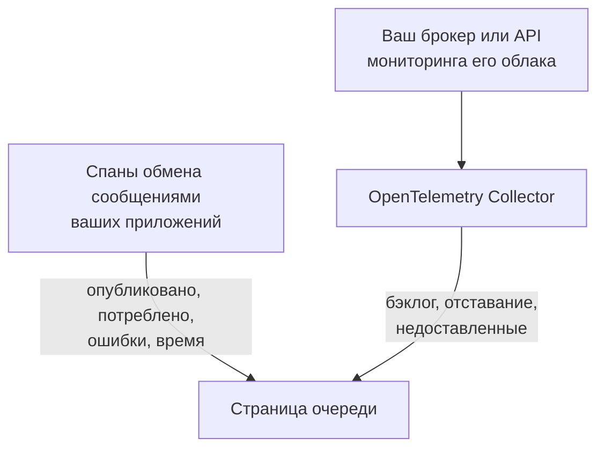

# Очереди

**Queues** даёт каждой очереди сообщений, топику и подписке, которые используют ваши приложения, собственную страницу: какие службы в неё публикуют и какие из неё потребляют, сколько сообщений через неё проходит, сколько завершается ошибкой и сколько длится обработка, её трассировки и метрики, а как только собственные метрики брокера доходят до OneUptime, ещё и её бэклог, отставание потребителей, недоставленные сообщения и троттлинг. У очередей есть метки, владельцы, правила меток и владельцев и архивирование, как у любого другого ресурса. Откройте их в **Продукты → Ресурсы → Очереди**.

:::cards
- [Инструментирование приложений](#инструментирование-приложений): Спаны обмена сообщениями, которые ваше инструментирование OpenTelemetry уже отправляет.
- [Метрики состояния брокера](#метрики-состояния-брокера): Бэклог, отставание и недоставленные сообщения из вашего брокера, система за системой.
- [Оповещения](#оповещения): Готовые шаблоны, а также запаздывающие метрики и счётчики.
- [Устранение неполадок](#устранение-неполадок): Очередь, которая не была создана, или состояние брокера, которое остаётся пустым.
:::

## Как это работает

Всё работает одинаково для любого брокера (Apache Kafka, RabbitMQ, Apache ActiveMQ и других JMS-брокеров, Amazon SQS и SNS, Google Cloud Pub/Sub, Azure Service Bus, Event Hubs и Event Grid, Apache Pulsar, Apache RocketMQ, NATS и BullMQ; см. [Поддерживаемые системы обмена сообщениями](#поддерживаемые-системы-обмена-сообщениями)) и для любого другого брокера, который ваши спаны называют в `messaging.system`. Большинство очередей появляются сами, из двух источников:

| Источник | Что от вас требуется | Что он добавляет на страницу очереди |
| --- | --- | --- |
| **Трассировки приложений** | Инструментированные приложения (OpenTelemetry); см. [Инструментирование приложений](#инструментирование-приложений) | Опубликованные и потреблённые сообщения, ошибки и время обработки, службы с каждой стороны и сами трассировки |
| **Метрики брокера** (OpenTelemetry Collector) | Приёмник коллектора или опрос для вашего брокера; см. [Метрики состояния брокера](#метрики-состояния-брокера) | **Состояние брокера**: бэклог, отставание потребителей, недоставленные сообщения, возраст самого старого сообщения, троттлинг и собственные скорости сообщений брокера |



Трассировки сообщают OneUptime, что очередь существует и как её используют приложения, но не то, насколько она заполнена. Это берётся от самого брокера или из API мониторинга его облачного провайдера, а для [BullMQ](#bullmq), который хранит свои задания в Redis и не имеет брокера, которого можно спросить, из gauge, который сообщает приложение.

Очередь можно добавить и вручную: **Queues → Создать: Queue**, указав её систему обмена сообщениями и имя назначения, а для Azure Service Bus и Event Hubs ещё и её пространство имён. Форма запрашивает их на первом шаге, **Система обмена сообщениями**, затем необязательные имя и описание, а метки находятся в **Дополнительные поля** (**Сведения об очереди**). Оставляйте пространство имён пустым только для очереди, к которой ваши приложения обращаются через эмулятор или собственное доменное имя: их спаны не называют пространство имён, и метрики Azure Monitor никогда не попадают в такую очередь (см. [Ограничения](#ограничения)).

## Начало работы

:::steps
### Отправьте трассировки ваших приложений

Инструментируйте приложения, которые публикуют и потребляют, и отправьте их трассировки в OneUptime (см. [Инструментирование приложений](#инструментирование-приложений)). Ничего специфичного для OneUptime не нужно: спаны обмена сообщениями, которые ваше инструментирование уже создаёт, называют очереди.

### Отправьте метрики вашего брокера

Найдите вашу систему обмена сообщениями в разделе [Метрики состояния брокера](#метрики-состояния-брокера) и запустите её конфигурацию коллектора с вашим ключом приёма. На вкладке **Документация** каждой очереди есть конфигурация для этой очереди, готовая к копированию.

### Откройте очередь

Откройте **Продукты → Ресурсы → Очереди**. Обнаружение выполняется каждые 10 минут: очередь появляется, как только за 15 минут пришли не менее 3 её спанов или её назвала метрика брокера.
:::

## Поддерживаемые системы обмена сообщениями

OneUptime знает перечисленные ниже системы обмена сообщениями по имени. Он приводит то, что инструментирование записывает в `messaging.system`, к значению во втором столбце (общеизвестному значению OpenTelemetry, если оно есть) без учёта регистра, поэтому `AmazonSQS`, `aws.sqs` и `aws_sqs` — одна система. `nats` и `bullmq` не являются общеизвестными значениями OpenTelemetry: `nats` сообщает инструментирование NATS в Java-агенте, а `bullmq` — это значение, которое нужно задать для BullMQ (см. [BullMQ](#bullmq)).

Система, которую OneUptime не знает, всё равно работает: корректное значение (`ibmmq`, `solace`, `mqtt`: строчные буквы, цифры, `.`, `_` и `-`, до 64 символов) сохраняется в том виде, в каком пришло, поэтому очереди этого брокера обнаруживаются и отображаются под этим именем; только собственным метрикам брокера нужна система из этой таблицы. `spring_integration` игнорируется: каналы Spring Integration — это вызовы методов внутри одного процесса, а не брокер.

Столбец **Метрики брокера** показывает, откуда берутся метрики состояния системы: приёмник collector-contrib, конечная точка Prometheus (`:port/path`, опрашиваемая приёмником `prometheus` коллектора), API мониторинга облачного провайдера или программа вне коллектора, которая отправляет их по OTLP. Каждая система ведёт ниже на свою настройку, а вкладка **Документация** каждой очереди превращает это в конфигурацию для этой очереди.

| Система | `messaging.system` | Также принимается | Метрики брокера |
| --- | --- | --- | --- |
| [Amazon SNS](#amazon-sns) | `aws.sns` | `aws_sns`, `amazonsns`, `sns` | приёмник `aws_cloudwatch` или `awsfirehose` (облачный мониторинг) |
| [Amazon SQS](#amazon-sqs) | `aws_sqs` | `aws.sqs`, `amazonsqs`, `sqs` | приёмник `aws_cloudwatch` или `awsfirehose` (облачный мониторинг) |
| [Apache ActiveMQ](#apache-activemq) | `activemq` | `artemis`, `activemq_artemis` | OpenTelemetry JMX Scraper (отправляет по OTLP) |
| [Apache Kafka](#apache-kafka) | `kafka` | — | приёмник `kafka_metrics` |
| [Apache Pulsar](#apache-pulsar) | `pulsar` | `apache_pulsar` | Prometheus (брокер Pulsar), `:8080/metrics/` |
| [Apache RocketMQ](#apache-rocketmq) | `rocketmq` | — | Prometheus (брокер RocketMQ), `:5557/metrics` |
| [Azure Event Grid](#azure-event-grid) | `eventgrid` | `azure_eventgrid`, `azure.eventgrid`, `microsoft.eventgrid` | приёмник `azure_monitor` (облачный мониторинг) |
| [Azure Event Hubs](#azure-event-hubs) | `eventhubs` | `azure_eventhubs`, `azure.eventhubs`, `microsoft.eventhub` | приёмник `azure_monitor` (облачный мониторинг) |
| [Azure Service Bus](#azure-service-bus) | `servicebus` | `azure_servicebus`, `azure.servicebus`, `microsoft.servicebus` | приёмник `azure_monitor` (облачный мониторинг) |
| [BullMQ](#bullmq) | `bullmq` | — | Встроенных нет |
| [Google Cloud Pub/Sub](#google-cloud-pubsub) | `gcp_pubsub` | `gcp.pubsub`, `pubsub`, `google_pubsub` | приёмник `googlecloudmonitoring` (облачный мониторинг) |
| [JMS](#jms) | `jms` | — | Встроенных нет |
| [NATS](#nats) | `nats` | `jetstream` | Prometheus (prometheus-nats-exporter), `:7777/metrics` |
| [RabbitMQ](#rabbitmq) | `rabbitmq` | — | приёмник `rabbitmq` |

Очередь — это одно назначение одной системы. Для **Azure Service Bus** и **Azure Event Hubs** в неё входит и пространство имён, поскольку в двух пространствах имён может быть по очереди с именем `orders`. **JMS** и **Apache ActiveMQ** делят свои очереди: Java-приложения обращаются к ActiveMQ через API JMS, спаны которого говорят `jms`, каким бы ни был брокер, а собственные метрики брокера могут сказать только `activemq`, поэтому и то и другое попадает в одну очередь (см. [Что делает два наблюдения одной очередью](#что-делает-два-наблюдения-одной-очередью)).

## Как обнаруживаются очереди

Каждая очередь запоминает, создали её трассировки, метрики брокера или человек. Всё, что позже называет ту же очередь, дополняет её, а не создаёт новую (см. [Что делает два наблюдения одной очередью](#что-делает-два-наблюдения-одной-очередью)).

### Из трассировок приложений

Каждые 10 минут OneUptime сводит спаны, которые ваши приложения отправили за последние 15 минут и которые несут любой из ключей `messaging.system`, `messaging.destination.name`, `messaging.destination`, `message_bus.destination`, `az.namespace`, `azure.resource_provider.namespace`, `aws.sqs.queue.url`, `aws.queue_url` или `aws.sns.topic.arn`. Учитывается любой спан, кроме спана SERVER: спаны PRODUCER, CONSUMER, CLIENT и INTERNAL, а также спаны, которым **Преобразователь вида спана** конвейера трассировок задал другой вид (например, Unspecified) или никакого; спан SERVER никогда не называет очередь.

Собственные спаны брокера тоже являются спанами SERVER. eBPF-трассировщик [Kubernetes-агента](/docs/telemetry/kubernetes-agent#как-выглядят-трассировки-ebpf) записывает сторону брокера Kafka, MQTT или NATS в каждом обмене (сообщение, которое он получает, сообщение, которое он доставляет) и отправляет большинство из них как PRODUCER или CONSUMER; OneUptime сохраняет их как SERVER, поэтому брокер не числится среди производителей или потребителей топиков, которые он передаёт. Брокер MQTT, передающий сообщение подписчику, пишет тот же PUBLISH, что и клиент, и трассировщик сообщает об обоих одинаково, поэтому для публикаций MQTT и NATS OneUptime ориентируется на порт другого конца соединения: начиная с порта 32768 (где операционные системы выбирают порт подключающегося клиента; стандартный диапазон Linux начинается там; Windows и macOS используют 49152–65535) это порт подписчика, и спан принадлежит брокеру. Поэтому приложение, публикующее в брокер MQTT или NATS, который сам слушает порт от 32768 и выше, например случайно опубликованный порт Docker, не числится производителем своих топиков, а топик, который используют только такие приложения, может вообще не обнаружиться по спанам трассировщика. Подписчик, который подключается к брокеру с порта ниже 32768 (суженный диапазон портов или порт, переписанный NAT), по-прежнему видит брокер в числе производителей топиков, доставляемых ему.

Все атрибуты обмена сообщениями в OpenTelemetry всё ещё помечены как находящиеся в разработке, поэтому приложения одного проекта сообщают одно и то же под именами до пяти поколений. OneUptime читает их все, начиная с самых новых, и никогда не разбирает имена спанов, формат которых изменился в семантических соглашениях 1.27 и которые поставщики выбирают свободно:

- **Система**: `messaging.system`, нормализованная, как в разделе [Поддерживаемые системы обмена сообщениями](#поддерживаемые-системы-обмена-сообщениями). Без неё — `az.namespace` или `azure.resource_provider.namespace` из SDK Azure (`Microsoft.ServiceBus`, `Microsoft.EventHub`), более старый ключ `component` из SDK Azure, спан SDK AWS (`rpc.system` = `aws-api`), вызывающий SQS или SNS (спаны SNS из Java-агента не несут `messaging.system`), или ключ с URL очереди SQS или ARN топика SNS.
- **Назначение**: первый из ключей `messaging.destination.template`, `messaging.destination.name`, `messaging.source.template`, `messaging.source.name`, `messaging.destination` и `message_bus.destination`, который есть у спана. Спан без любого из них берёт собственные ключи своей системы: URL очереди SQS (`aws.sqs.queue.url`, `aws.queue_url` или URL очереди в `messaging.url`, `server.address` или `net.peer.name`), ARN топика SNS (`aws.sns.topic.arn`), а для RabbitMQ — ключ маршрутизации (`messaging.rabbitmq.destination.routing_key` или `messaging.rabbitmq.routing_key`), который является именем очереди, когда сообщение проходит через обменник по умолчанию.
- **Направление**: сначала `messaging.operation.type`, затем вид спана (PRODUCER публикует, CONSUMER потребляет), затем более старый `messaging.operation`, затем `messaging.operation.name`, а для SQS и SNS — операция SDK AWS в `rpc.method` (`SendMessage`, `ReceiveMessage`, …). Вид важнее старых ключей, потому что некоторые инструментирования заполняли их неправильно: confluent-kafka для Python писал `receive` в своих спанах производителя.

Очередь **создаётся** по трассировкам, как только её спанов в 15-минутном окне, которое просматривает запуск, набирается не менее 3 (`MESSAGE_QUEUE_MIN_SPANS`), чтобы разовый скрипт её не создал, и только пока проект не превысил свой [бюджет автосоздания](#бюджет-автосоздания). Спаны, которые не создают очередь, всё равно учитываются для уже существующей.

Каждый спан обмена сообщениями при приёме также помечается своей очередью, поэтому вкладка **Трассировки** очереди показывает каждый спан, который её называет, включая спаны, отправленные до создания очереди.

### Из метрик брокера

Метрика брокера из списков в разделе [Метрики состояния брокера](#метрики-состояния-брокера) называет свою очередь в собственном атрибуте брокера (`topic` у Kafka, `rabbitmq.queue.name` у RabbitMQ, измерение `EntityName` в Azure Monitor, `QueueName` у CloudWatch), и OneUptime при приёме сопоставляет её с этой очередью. Метрики брокера не несут `messaging.system`: каждая распознаётся по своему имени (`kafka.consumer_group.lag_sum`), а там, где у двух систем одно имя (Azure Monitor называет метрики Service Bus и Event Hubs одинаково), по типу ресурса, который несёт точка данных.

Следующий запуск обнаружения создаёт очередь, если её ещё нет: достаточно одной метрики брокера, в пределах [бюджета автосоздания](#бюджет-автосоздания). Поэтому очередь, которой не касается ни одно инструментированное приложение, всё равно появляется, как только о ней сообщает её брокер.

Облачные API мониторинга (CloudWatch, Azure Monitor и Cloud Monitoring) публикуют каждое значение через несколько минут после момента, который оно измеряет, и оно сохраняется с этим моментом. Поэтому каждый запуск читает их метрики за последний час, а не за последние 15 минут, за которые он читает спаны и другие метрики: точка данных, пришедшая с опозданием, всё равно отмечает свою очередь или создаёт её.

### Из метрик клиентов обмена сообщениями

Инструментированные клиенты тоже могут сообщать метрики: метрики клиентов обмена сообщениями OpenTelemetry `messaging.client.sent.messages`, `messaging.client.consumed.messages`, `messaging.client.operation.duration` и `messaging.process.duration`, их старые имена `messaging.publish.duration`, `messaging.receive.duration`, `messaging.publish.messages`, `messaging.receive.messages`, `messaging.process.messages` и `messaging.client.published.messages`, а также метрики Azure SDK для Java `messaging.servicebus.messages.sent`, `messaging.servicebus.receiver.lag`, `messaging.servicebus.settlement.request.duration` и `messaging.servicebus.settlement.sequence_number`. Каждая точка данных называет свою систему и своё назначение так же, как спан (метрики Service Bus из Azure SDK не называют систему, поэтому её заменяет их имя), и при приёме сопоставляется с этой очередью, поэтому отображается на вкладке **Метрики** очереди. То же относится к любой вашей собственной метрике, которая несёт `messaging.system` и `messaging.destination.name` в каждой точке данных (а не в ресурсе, где они не читаются), например к gauge глубины очереди (см. [BullMQ](#bullmq)).

Метрики клиентов обмена сообщениями никогда не создают очередь: это делают трассировки, метрики брокера или человек. Клиентская метрика, которая называет существующую очередь, поддерживает её **Последнее появление** в актуальном состоянии, как это делают её спаны. Ваша собственная метрика не делает ни того ни другого: она только отображается на вкладке **Метрики** очереди.

### Что делает два наблюдения одной очередью

Идентичность очереди — это её **система** и её **назначение**, сравниваемые без учёта регистра: `Orders` и `orders` — одна очередь, отображаемая под тем именем, под которым её увидели первым. Для Azure Service Bus и Event Hubs в идентичность входит и **пространство имён**:

- в спане — первая DNS-метка хоста, к которому подключился SDK, из `server.address`, `net.peer.name`, `peer.address` или `network.peer.address` в этом порядке, если этот хост является хостом пространства имён: `<namespace>.servicebus.windows.net` или `.servicebus.usgovcloudapi.net`, `.servicebus.chinacloudapi.cn` либо `.servicebus.cloudapi.de` суверенного облака. Event Hubs использует тот же домен, что и Service Bus;
- в метрике Azure Monitor — `name` пространства имён, о котором она сообщает.

Больше ничего в неё не входит, поэтому ничто из перечисленного никогда не разделяет очередь: адрес брокера (клиенты Kafka редко его сообщают, а пространство имён Azure отвечает на многих адресах), группа потребителей или подписка (потребители топика не являются отдельными очередями), раздел и подочередь недоставленных сообщений. Из этого очередь сохраняет только адрес брокера, для отображения.

**JMS и ActiveMQ — одно семейство.** Каждый спан JMS говорит `jms`, какой бы брокер за ним ни стоял, а собственные метрики брокера ([OpenTelemetry JMX Scraper](#apache-activemq)) могут сказать только `activemq`, поэтому OneUptime идентифицирует очередь ActiveMQ по её семейству JMS: спаны и метрики брокера для `orders` попадают в одну очередь. Она отображается как JMS, пока не придут метрики брокера, и как Apache ActiveMQ после этого, но никогда наоборот. Очередь, которую вы создаёте вручную как Apache ActiveMQ, — это та же очередь.

### Как читаются имена назначений

Инструментирования называют одну очередь по-разному, и OneUptime сводит то, что они сообщают, к собственному имени очереди:

| Система | Сообщается как | Очередь |
| --- | --- | --- |
| Amazon SQS | `https://sqs.us-east-1.amazonaws.com/123456789012/orders`, URL очереди (`otelaws` для Go помещает его в `server.address`) | `orders` |
| Amazon SNS | `arn:aws:sns:us-east-1:123456789012:order-events`, ARN топика | `order-events` |
| Google Cloud Pub/Sub | `projects/shop/topics/orders`, имя ресурса | `orders` |
| Azure Service Bus | `orders/Subscriptions/billing`, путь сущности подписки `billing` топика | `orders` |
| Azure Service Bus | `orders/$DeadLetterQueue`, путь сущности подочереди недоставленных сообщений очереди | `orders` |
| Azure Event Hubs | `telemetry/ConsumerGroups/$Default/Partitions/3`, путь сущности получателя, для группы потребителей `$Default` | `telemetry` |
| Apache Pulsar | `orders-partition-3`, раздел топика с коротким именем | `persistent://public/default/orders` |
| Apache Pulsar | `acme/shop/orders`, топик без своего домена | `persistent://acme/shop/orders` |
| JMS | `queue://orders`, с префиксом типа назначения | `orders` |
| RabbitMQ | `shop:new-order:orders`, обменник, ключ маршрутизации и очередь у потребителя (семантические соглашения 1.30 и новее) | `orders` |
| RabbitMQ | `amq.default`, обменник по умолчанию, с ключом маршрутизации `orders` | `orders` |
| RabbitMQ | `,orders`, `{exchange},{routing key}` из aio-pika через обменник по умолчанию | `orders` |
| RabbitMQ | `shop,new-order`, `{exchange},{routing key}` из aio-pika | `shop` |

Раздел Pulsar сворачивается в свой топик, а имя без домена дополняется так, как его дополняет сам Pulsar (короткое имя — в пространство имён `public/default`), поэтому имена из Java-агента совпадают с полностью квалифицированными метками метрик брокеров. Спан RabbitMQ обычно называет обменник, через который прошло сообщение, и на стороне публикации, и на стороне потребления; обменник по умолчанию (`amq.default`, `<default>` или пустое имя) обозначает свой ключ маршрутизации, который является именем очереди. Семантические соглашения 1.30 соединяют обменник, ключ маршрутизации и очередь через `:` (имена Java-агента, включаемые по выбору), и OneUptime берёт очередь из соединённого имени потребителя, а обменник — из имени публикатора. aio-pika соединяет обменник и ключ маршрутизации запятой на стороне публикации, и OneUptime разделяет их так же.

### Что игнорируется

OneUptime предпочитает ошибаться в сторону отсутствия очереди: иначе имя, придуманное для каждого запроса или потребителя, создавало бы для каждого сообщения очередь, которая никому не принадлежит. Эти никогда не становятся очередями:

- **Спаны SERVER**, а также спаны, у которых `messaging.system` равен `spring_integration`.
- **Назначения, помеченные как временные или анонимные**: `messaging.destination.temporary`, `messaging.destination.anonymous`, `messaging.source.temporary` или `messaging.source.anonymous` со значением `true`. Более старому `messaging.temp_destination` не доверяют: инструментирования pika и aio-pika для Python устанавливают его при каждой публикации.
- **Заполнители, которые инструментирования сообщают вместо имени**: `(temporary)`, `(anonymous)`, `<generated>`, `unknown` (пакет Kafka из нескольких топиков), `aws:sqs` (события Lambda SQS из Java-агента), `-NamespaceOnlyMetric-` из Azure Monitor и значение, которое собственная очистка данных OneUptime заменила целиком (`[REDACTED]`).
- **Сгенерированные назначения и назначения для ответов**: очереди RabbitMQ с именами, выданными сервером, в стиле `amq.gen-JzTY20BRgKO-HjmUJj0wLg`, очереди Spring `spring.gen-…` и очереди Spring Cloud Stream `<destination>.anonymous.<id>` для потребителей без группы, а также direct reply-to (`amq.rabbitmq.reply-to…`); временные назначения JMS (`temp-queue://…`, `temp-topic://…`) и `$TMP$…` от TIBCO; advisory-топики ActiveMQ (`ActiveMQ.Advisory.…`); входящие ящики NATS (`_INBOX.…`) и subject-ы подтверждений JetStream (`$JS.ACK.…`); системные топики Pulsar (`__change_events`, `__transaction_…` и всё, что ниже сегмента `/__`); и назначение, которое представляет собой только UUID.
- **SMS и мобильные push-уведомления SNS**: номер телефона (`+15555550123` или `phone_number:**` из botocore) или ARN конечной точки платформы (`arn:aws:sns:us-east-1:123456789012:endpoint/GCM/shop-app/1234`) — это устройство, а не топик.
- **Имена, которые не могут быть одной очередью**: список назначений из пакета (`["orders","payments"]`), имя с управляющим символом и имя длиннее 255 символов.

**UUID превращаются в шаблон.** Каждый UUID внутри назначения заменяется на `{uuid}`, поэтому имена для отдельных запросов, такие как `reply-7f1c2a9e-4b1d-4c3e-9f1a-2b3c4d5e6f70`, становятся одной очередью, `reply-{uuid}`, а не отдельной очередью каждое.

### Бюджет автосоздания

Трассировки и метрики брокера создают очереди сами, только пока в проекте меньше 500 активных неархивированных обнаруженных очередей (`MESSAGE_QUEUE_AUTO_CREATE_BUDGET`, см. [Настройка для самостоятельного размещения](#настройка-для-самостоятельного-размещения)). Очереди, созданные вручную, никогда не учитываются и никогда не блокируются; архивированные очереди не учитываются, поэтому [автоматическое архивирование](#жизненный-цикл-и-архивирование) освобождает бюджет; а уже существующие очереди продолжают сопоставляться и обновляться.

### Жизненный цикл и архивирование

- **Последнее появление** — это время, когда обнаружение в последний раз видело очередь: в трассировках, метриках клиентов обмена сообщениями или метриках брокера.
- **Архивируйте, чтобы убрать.** Удаление обнаруженной очереди убирает её только до тех пор, пока её снова не увидят: следующее наблюдение вернёт её как новую очередь. Чтобы убрать очередь навсегда, **заархивируйте** её. Архивированная очередь сохраняет свою идентичность, поэтому всё, что её называет, остаётся привязанным к архивированной очереди, а не создаёт новую.
- **Автоматическое архивирование.** Обнаруженная очередь, которую не видели 7 дней (`MESSAGE_QUEUE_AUTO_ARCHIVE_DAYS`), архивируется автоматически, если только человек не переименовал её, не описал, не добавил ей метки и не назначил владельцев. Метки и владельцы, которые сами привязали правила меток или владельцев, не учитываются.
- **Восстановление.** Автоматически архивированная очередь автоматически восстанавливается, когда её снова видят. Очереди, которые вы создали вручную, и очереди, которые заархивировал человек, обнаружение никогда не архивирует и не восстанавливает. Очередь, которую восстановил человек, остаётся восстановленной 30 дней (или в течение окна архивирования, если оно длиннее), даже если её ничто не видит; с её следующего наблюдения снова действует правило 7 дней.

## Инструментирование приложений

Очереди берутся из спанов обмена сообщениями, которые ваше инструментирование OpenTelemetry уже создаёт; ничего специфичного для OneUptime не нужно. Отправьте трассировки в OneUptime, как описано в разделе [OpenTelemetry](/docs/telemetry/open-telemetry), затем посмотрите список для вашего языка.

:::tabs
@tab Java
Java-агент OpenTelemetry трассирует клиенты Kafka, RabbitMQ, JMS (ActiveMQ, Artemis, IBM MQ и любого другого JMS-брокера), Amazon SQS и SNS, Pulsar, RocketMQ и NATS без изменений кода. OneUptime читает как имена атрибутов, которые агент отправляет по умолчанию, так и более новые, которые он отправляет с `OTEL_SEMCONV_STABILITY_OPT_IN=messaging` (агент 2.31.0 и новее). Спаны JMS говорят `jms`, какой бы брокер за ними ни стоял (см. [JMS](#jms)).

- **Azure Service Bus и Event Hubs**: Azure SDK для Java трассирует себя сам, а Java-агент связывает эту трассировку с OpenTelemetry.
- **Google Cloud Pub/Sub**: клиент трассирует себя сам, как только его билдеры `Publisher` и `Subscriber` получают экземпляр OpenTelemetry и переключатель трассировки: `setOpenTelemetry(GlobalOpenTelemetry.get())` и `setEnableOpenTelemetryTracing(true)`. Любой из этих вызовов по отдельности ничего не трассирует.
@tab .NET
- **Azure Service Bus и Event Hubs** (`Azure.Messaging.ServiceBus`, `Azure.Messaging.EventHubs`): их спаны OpenTelemetry в Azure SDK экспериментальные. Включите их переменной окружения `AZURE_EXPERIMENTAL_ENABLE_ACTIVITY_SOURCE=true` (или переключателем `Azure.Experimental.EnableActivitySource` ниже) и подпишитесь на источники `Azure.*`.
- **RabbitMQ.Client** 7 трассирует себя сам: подпишитесь на `RabbitMQ.Client.*`.
- **MassTransit** трассирует себя сам: подпишитесь на `MassTransit` (что упускают его спаны, см. в разделе [Ограничения](#ограничения)).
- **Confluent.Kafka**: пакет `OpenTelemetry.Instrumentation.ConfluentKafka`.
- **Amazon SQS и SNS**: пакет `OpenTelemetry.Instrumentation.AWS` с `.AddAWSInstrumentation(opt => opt.SemanticConventionVersion = SemanticConventionVersion.Latest)`. Его набор атрибутов по умолчанию (`V1_28_0`) называет очередь SQS только по её URL (`aws.queue_url`, который OneUptime читает), а топик SNS не называет вовсе.

```csharp
// Before any Azure client is created; or set AZURE_EXPERIMENTAL_ENABLE_ACTIVITY_SOURCE=true.
AppContext.SetSwitch("Azure.Experimental.EnableActivitySource", true);

builder.Services.AddOpenTelemetry()
    .WithTracing(tracing => tracing
        .AddSource("Azure.*")
        .AddSource("RabbitMQ.Client.*")
        .AddSource("MassTransit")
        .AddOtlpExporter());
```
@tab Node.js
- `@opentelemetry/auto-instrumentations-node` трассирует `amqplib` (RabbitMQ), `kafkajs` и AWS SDK (SQS и SNS).
- **Azure Service Bus и Event Hubs**: зарегистрируйте `createAzureSdkInstrumentation()` из `@azure/opentelemetry-instrumentation-azure-sdk`.
- **Google Cloud Pub/Sub**: `new PubSub({ enableOpenTelemetryTracing: true })`.
- **BullMQ**: см. [BullMQ](#bullmq); его собственной телеметрии нужны два добавленных атрибута.
@tab Python
- Kafka: `opentelemetry-instrumentation-kafka-python`, `opentelemetry-instrumentation-confluent-kafka` или `opentelemetry-instrumentation-aiokafka`. RabbitMQ: `opentelemetry-instrumentation-pika` или `opentelemetry-instrumentation-aio-pika`. SQS и SNS: `opentelemetry-instrumentation-botocore` или `opentelemetry-instrumentation-boto3sqs` для SQS. `opentelemetry-bootstrap -a install` выбирает те, которые нужны вашим установленным библиотекам.
- **Azure Service Bus и Event Hubs**: установите `azure-core-tracing-opentelemetry` и задайте `settings.tracing_implementation = "opentelemetry"` (из `azure.core.settings`).
- **Google Cloud Pub/Sub**: `PublisherOptions(enable_open_telemetry_tracing=True)` и `SubscriberOptions(enable_open_telemetry_tracing=True)`.
- Спаны Celery не несут `messaging.system` и не называют брокер, поэтому не создают очередей.
@tab Go
- **Amazon SQS и SNS**: `otelaws` (`go.opentelemetry.io/contrib/instrumentation/github.com/aws/aws-sdk-go-v2/otelaws`), подключаемый через `otelaws.AppendMiddlewares(&cfg.APIOptions)`. Его спаны SQS несут URL очереди в `server.address`, который OneUptime читает как очередь.
- **Google Cloud Pub/Sub**: `pubsub.ClientConfig{EnableOpenTelemetryTracing: true}`.
- **Kafka** с `segmentio/kafka-go`: автоматическое инструментирование OpenTelemetry для Go (`go.opentelemetry.io/auto`, eBPF, в Linux) трассирует его производителей и потребителей без изменений кода.
- В contrib-библиотеках OpenTelemetry для Go нет инструментирования Kafka, RabbitMQ или NATS. Для других клиентов используйте собственную поддержку OpenTelemetry в клиентской библиотеке или задайте `messaging.system`, `messaging.destination.name` и вид спана на спанах вокруг ваших отправок и обработчиков.
:::

## Метрики состояния брокера

Брокер знает то, чего не видит ни одно приложение: сколько сообщений ждут, насколько отстаёт каждая группа потребителей, что попало в очередь недоставленных сообщений. В каждом разделе ниже есть конфигурация коллектора для одной системы: полная конфигурация OpenTelemetry Collector, которая заканчивается экспортёром OTLP, отправляющим данные в OneUptime. Укажите ключ приёма телеметрии (**Настройки проекта → Телеметрия и APM → Ключи приема**) в `x-oneuptime-token`, замените `https://oneuptime.com` на собственный хост, если вы размещаете OneUptime сами, и запустите конфигурацию с `otel/opentelemetry-collector-contrib` 0.161.0 или новее (каждая конфигурация здесь проверена на 0.161.0). Новые коллекторы пишут в журнал, что `otlphttp` устарел в пользу `otlp_http`; оба имени обозначают один и тот же экспортёр. Чтобы собирать данные нескольких систем, объедините их приёмники в одном коллекторе.

Раздел **Состояние брокера** каждой очереди показывает на графиках метрики, перечисленные для её системы (gauge — как значение, количество за период — суммой за интервал, счётчик — как скорость в секунду), и объединяет серии очереди так, как требует каждая метрика (готовые и неподтверждённые сообщения очереди RabbitMQ складываются; отставанием считается отставание самой отстающей группы потребителей). Всё, что отправляет коллектор, есть и в обозревателе **Метрики**. Пока для очереди не пришла ни одна из перечисленных метрик, раздел показывает, откуда берутся метрики этой системы, со ссылкой на её раздел здесь.

### Amazon SNS

Читайте метрики топиков из CloudWatch приёмником `aws_cloudwatch` коллектора или передавайте их потоком через CloudWatch Metric Stream и Amazon Data Firehose в его приёмник `awsfirehose`.

Приёмник `aws_cloudwatch` опрашивает API `GetMetricData` в CloudWatch, по одному пространству имён на приёмник, поэтому SNS получает собственный экземпляр рядом с экземпляром для [Amazon SQS](#amazon-sqs). Он использует учётные данные AWS SDK по умолчанию (окружение, общий профиль или роль экземпляра), которым нужны `cloudwatch:ListMetrics` и `cloudwatch:GetMetricData`:

```yaml
receivers:
  aws_cloudwatch/sns:
    region: us-east-1
    metrics:
      collection_interval: 5m
      period: 1m
      delay: 10m
      discovery:
        filters:
          namespace: AWS/SNS
        limit: 500

processors:
  batch: {}

exporters:
  otlphttp:
    endpoint: https://oneuptime.com/otlp
    headers:
      x-oneuptime-token: YOUR_TELEMETRY_INGESTION_TOKEN

service:
  pipelines:
    metrics:
      receivers: [aws_cloudwatch/sns]
      processors: [batch]
      exporters: [otlphttp]
```

Оставьте `stats` незаданным, как в [Amazon SQS](#amazon-sqs). Metric Stream передаёт SNS и SQS вместе: добавьте `AWS/SNS` в пространства имён потока при настройке [Amazon SQS](#amazon-sqs).

Топик называется одинаково с обеих сторон: спаны сообщают его ARN или его имя, а OneUptime сохраняет имя после последнего `:` в ARN.

| Метрика | Отображается как | Тип |
| --- | --- | --- |
| `amazonaws.com/aws/sns/numberofmessagespublished` (поток JSON: `numberofmessagespublished`) | Messages published | Количество за период |
| `amazonaws.com/aws/sns/numberofnotificationsdelivered` (поток JSON: `numberofnotificationsdelivered`) | Notifications delivered | Количество за период |
| `amazonaws.com/aws/sns/numberofnotificationsfailed` (поток JSON: `numberofnotificationsfailed`) | Notifications failed | Количество за период |
| `amazonaws.com/aws/sns/numberofnotificationsredriventodlq` (поток JSON: `numberofnotificationsredriventodlq`) | Redriven to dead-letter queue | Количество за период |

### Amazon SQS

Читайте метрики очередей из CloudWatch приёмником `aws_cloudwatch` коллектора или передавайте их потоком через CloudWatch Metric Stream и Amazon Data Firehose в его приёмник `awsfirehose`.

**Опросу CloudWatch** на стороне AWS не нужно ничего, кроме учётных данных. Приёмник использует учётные данные AWS SDK по умолчанию (окружение, общий профиль или роль экземпляра), которым нужны `cloudwatch:ListMetrics` и `cloudwatch:GetMetricData`:

```yaml
receivers:
  aws_cloudwatch/sqs:
    region: us-east-1
    metrics:
      collection_interval: 5m
      period: 1m
      delay: 10m
      discovery:
        filters:
          namespace: AWS/SQS
        # Metrics per scrape: about nine per queue. Must be set.
        limit: 500

processors:
  batch: {}

exporters:
  otlphttp:
    endpoint: https://oneuptime.com/otlp
    headers:
      x-oneuptime-token: YOUR_TELEMETRY_INGESTION_TOKEN

service:
  pipelines:
    metrics:
      receivers: [aws_cloudwatch/sqs]
      processors: [batch]
      exporters: [otlphttp]
```

- **Оставьте `stats` незаданным.** Без него каждая метрика приходит как одна сводка за период, и именно её читает OneUptime; с ним каждая статистика становится отдельной серией, и графики их смешивают.
- `discovery.limit` обязателен и ограничивает число метрик, читаемых за один опрос: примерно девять на очередь. Каждая стоит четыре подзапроса `GetMetricData` за опрос, и за них AWS выставляет счёт.
- `delay` ждёт, пока CloudWatch опубликует период (это занимает несколько минут), поэтому с этой конфигурацией метрики брокера для очереди приходят с опозданием от 11 до 17 минут: монитору по ним нужно более длинное окно (см. **Запаздывающие метрики** в разделе [Оповещения](#оповещения)).
- Один приёмник читает один регион и одно пространство имён: добавьте по экземпляру на каждый регион.

**Потоковая передача** отправляет метрики по мере того, как CloudWatch их публикует. Создайте CloudWatch Metric Stream для пространств имён `AWS/SQS` (и `AWS/SNS`) с форматом вывода **OpenTelemetry 1.0**, который доставляет данные в поток Amazon Data Firehose с конечной точкой HTTP в качестве назначения: вашим коллектором с ключом доступа. Firehose доставляет только на `https://` на порт 443, поэтому коллектору нужны сертификат и публичный порт 443 (например, за балансировщиком нагрузки):

```yaml
extensions:
  awscloudwatchmetricstreams_encoding:
    format: opentelemetry1.0

receivers:
  awsfirehose:
    # Firehose delivers to HTTPS on port 443 only: expose this port as 443,
    # for example behind a load balancer.
    endpoint: 0.0.0.0:4433
    encoding: awscloudwatchmetricstreams_encoding
    access_key: ${env:FIREHOSE_ACCESS_KEY}
    tls:
      cert_file: /etc/otelcol/tls/server.crt
      key_file: /etc/otelcol/tls/server.key

processors:
  batch: {}

exporters:
  otlphttp:
    endpoint: https://oneuptime.com/otlp
    headers:
      x-oneuptime-token: YOUR_TELEMETRY_INGESTION_TOKEN

service:
  extensions: [awscloudwatchmetricstreams_encoding]
  pipelines:
    metrics:
      receivers: [awsfirehose]
      processors: [batch]
      exporters: [otlphttp]
```

Поток в формате вывода **JSON** (`format: json`) тоже работает: он отправляет каждую метрику под её голым именем, а OneUptime отличает метрики SQS от метрик SNS по `service.name`, который проставляет поток (`SQS`, `SNS`).

Очередь недоставленных сообщений — обычная очередь SQS с собственными метриками, поэтому в OneUptime это отдельная очередь. Очереди называются только по имени, а не по аккаунту или региону (см. [Ограничения](#ограничения)).

| Метрика | Отображается как | Тип |
| --- | --- | --- |
| `amazonaws.com/aws/sqs/approximatenumberofmessagesvisible` (поток JSON: `approximatenumberofmessagesvisible`) | Messages visible | Gauge |
| `amazonaws.com/aws/sqs/approximateageofoldestmessage` (поток JSON: `approximateageofoldestmessage`) | Oldest message age | Gauge |
| `amazonaws.com/aws/sqs/approximatenumberofmessagesnotvisible` (поток JSON: `approximatenumberofmessagesnotvisible`) | Messages in flight | Gauge |
| `amazonaws.com/aws/sqs/numberofmessagessent` (поток JSON: `numberofmessagessent`) | Messages sent | Количество за период |
| `amazonaws.com/aws/sqs/numberofmessagesreceived` (поток JSON: `numberofmessagesreceived`) | Messages received | Количество за период |
| `amazonaws.com/aws/sqs/numberofmessagesdeleted` (поток JSON: `numberofmessagesdeleted`) | Messages deleted | Количество за период |

### Apache ActiveMQ

У коллектора нет приёмника JMX, поэтому запустите OpenTelemetry JMX Scraper с `OTEL_JMX_TARGET_SYSTEM=activemq` рядом с брокером ActiveMQ Classic; он отправляет метрики назначений брокера по OTLP.

1. Разрешите брокеру принимать подключения JMX. С образом `apache/activemq-classic` или скриптом `bin/activemq` задайте `ACTIVEMQ_SUNJMX_START` перед его запуском. В этом примере аутентификация отключена: держите порт в частной сети или включите `jmxremote.authenticate` с файлом паролей и передайте скрейперу `OTEL_JMX_USERNAME` и `OTEL_JMX_PASSWORD`.

```bash
ACTIVEMQ_SUNJMX_START="-Dcom.sun.management.jmxremote.port=1099 -Dcom.sun.management.jmxremote.rmi.port=1099 -Dcom.sun.management.jmxremote.authenticate=false -Dcom.sun.management.jmxremote.ssl=false -Djava.rmi.server.hostname=activemq"
```

2. Запустите скрейпер там, откуда он может достучаться до этого порта, со средой выполнения Java. Он отправляет данные прямо в OneUptime; чтобы направить их через собственный коллектор, укажите в `OTEL_EXPORTER_OTLP_ENDPOINT` приёмник OTLP этого коллектора.

```bash
curl -fsSLo opentelemetry-jmx-scraper.jar https://github.com/open-telemetry/opentelemetry-java-contrib/releases/latest/download/opentelemetry-jmx-scraper.jar

export OTEL_JMX_SERVICE_URL=service:jmx:rmi:///jndi/rmi://activemq:1099/jmxrmi
export OTEL_JMX_TARGET_SYSTEM=activemq
export OTEL_JMX_TARGET_SOURCE=instrumentation
export OTEL_METRIC_EXPORT_INTERVAL=30000
export OTEL_SERVICE_NAME=activemq-prod
export OTEL_EXPORTER_OTLP_PROTOCOL=http/protobuf
export OTEL_EXPORTER_OTLP_ENDPOINT=https://oneuptime.com/otlp
export OTEL_EXPORTER_OTLP_HEADERS=x-oneuptime-token=YOUR_TELEMETRY_INGESTION_TOKEN
java -jar opentelemetry-jmx-scraper.jar
```

`OTEL_JMX_TARGET_SOURCE=instrumentation` сохраняет имена метрик, которые скрейпер использует начиная с 1.53.0-alpha (`activemq.message.queue.size`, с назначением в `messaging.destination.name`). OneUptime также читает имена более старых скрейперов и `OTEL_JMX_TARGET_SOURCE=legacy` (`activemq.message.current`, с назначением в `destination`).

Метрики брокера присоединяются к очереди, которую создали спаны его JMS-клиентов, и с этого момента очередь отображается как Apache ActiveMQ (см. [Что делает два наблюдения одной очередью](#что-делает-два-наблюдения-одной-очередью)). Скрейпер сообщает о каждом назначении: OneUptime игнорирует advisory-топики, а очереди недоставленных сообщений (`ActiveMQ.DLQ` или `DLQ.<destination>` при индивидуальной стратегии недоставленных сообщений) являются отдельными очередями. У ActiveMQ Artemis другие MBean, которые эти правила не читают: очереди Artemis по-прежнему берутся из их спанов JMS, без состояния брокера.

| Метрика | Отображается как | Тип |
| --- | --- | --- |
| `activemq.message.queue.size` | Queue size | Gauge |
| `activemq.message.current` | Queue size (legacy names) | Gauge |
| `activemq.message.enqueued` | Enqueued | Счётчик, отображается в секунду |
| `activemq.message.dequeued` | Dequeued | Счётчик, отображается в секунду |
| `activemq.message.expired` | Expired | Счётчик, отображается в секунду |
| `activemq.consumer.count` | Consumers | Gauge |
| `activemq.message.enqueue.average_duration` | Average time in queue | Gauge |
| `activemq.message.wait_time.avg` | Average time in queue (legacy names) | Gauge |

### Apache Kafka

Приёмник `kafka_metrics` коллектора читает отставание групп потребителей и смещения разделов у брокеров; включите его скрейперы `topics` и `consumers`.

```yaml
receivers:
  kafka_metrics:
    brokers: ["kafka-1:9092", "kafka-2:9092"]
    # topics: each partition's log-end offset; consumers: each group's
    # committed offsets and lag. brokers: the broker count.
    scrapers: [brokers, topics, consumers]
    collection_interval: 30s
    # auth:
    #   sasl:
    #     mechanism: SCRAM-SHA-512
    #     username: ${env:KAFKA_USERNAME}
    #     password: ${env:KAFKA_PASSWORD}
    # tls:
    #   ca_file: /etc/kafka/ca.pem

processors:
  batch: {}

exporters:
  otlphttp:
    endpoint: https://oneuptime.com/otlp
    headers:
      x-oneuptime-token: YOUR_TELEMETRY_INGESTION_TOKEN

service:
  pipelines:
    metrics:
      receivers: [kafka_metrics]
      processors: [batch]
      exporters: [otlphttp]
```

Для кластера с SASL или TLS раскомментируйте `auth` и `tls`. Приёмник называет каждый топик в `topic`, и именно так метрики находят очередь топика. Он сообщает отставание и зафиксированные смещения группы потребителей только для топиков, в которые группа зафиксировала смещение, и пропускает топики, имена которых начинаются с `_`, то есть внутренние топики Kafka (`topic_match` по умолчанию равен `^[^_].*$`).

| Метрика | Отображается как | Тип |
| --- | --- | --- |
| `kafka.consumer_group.lag_sum` | Consumer lag | Gauge |
| `kafka.consumer_group.lag` | Partition lag | Gauge |
| `kafka.consumer_group.offset_sum` | Consumed | Счётчик, отображается в секунду |
| `kafka.partition.current_offset` | Produced | Счётчик, отображается в секунду |

### Apache Pulsar

Каждый брокер отдаёт метрики своих топиков и подписок на порту своей веб-службы; опрашивайте каждый брокер, потому что брокер сообщает только о топиках, которыми он сейчас владеет.

```yaml
receivers:
  prometheus:
    config:
      scrape_configs:
        - job_name: pulsar-broker
          scrape_interval: 30s
          metrics_path: /metrics/
          # Every broker: each one reports only the topics it owns.
          static_configs:
            - targets: ["pulsar-broker-0:8080", "pulsar-broker-1:8080"]
          # Keeps the families the queue page charts; remove it to keep all.
          metric_relabel_configs:
            - source_labels: [__name__]
              regex: "pulsar_(msg_backlog|subscription_back_log|storage_backlog_age_seconds|in_messages_total|out_messages_total)"
              action: keep

processors:
  batch: {}

exporters:
  otlphttp:
    endpoint: https://oneuptime.com/otlp
    headers:
      x-oneuptime-token: YOUR_TELEMETRY_INGESTION_TOKEN

service:
  pipelines:
    metrics:
      receivers: [prometheus]
      processors: [batch]
      exporters: [otlphttp]
```

- Сериям топиков и подписок нужен `exposeTopicLevelMetricsInPrometheus=true` в `broker.conf`, и это значение по умолчанию.
- Pulsar помечает каждую серию полным именем топика (`persistent://public/default/orders`), а серии раздела — именем раздела (`persistent://public/default/orders-partition-3`): разделы суммируются в свой топик.
- Бэклог считается в записях, и Pulsar считает пакет сообщений одной записью.
- Pulsar повторяет `pulsar_out_messages_total` для каждого потребителя, когда `exposeConsumerLevelMetricsInPrometheus=true`; эти серии по потребителям не попадают на графики, поэтому ни одно сообщение не считается дважды.
- `pulsar_storage_backlog_age_seconds` показывает `-1`, пока брокер не может это определить.
- Собственные метрики OpenTelemetry в Pulsar 3.3 и новее (экспериментальные, по умолчанию выключены) используют другие имена, которые на графиках не показываются.

| Метрика | Отображается как | Тип |
| --- | --- | --- |
| `pulsar_msg_backlog` | Backlog | Gauge |
| `pulsar_subscription_back_log` | Subscription backlog | Gauge |
| `pulsar_storage_backlog_age_seconds` | Backlog age | Gauge |
| `pulsar_in_messages_total` | Messages in | Счётчик, отображается в секунду |
| `pulsar_out_messages_total` | Messages out | Счётчик, отображается в секунду |

### Apache RocketMQ

Задайте `metricsExporterType=PROM` в `broker.conf` брокера, чтобы брокер отдавал свои метрики отставания и пропускной способности.

```text
metricsExporterType=PROM
metricsPromExporterPort=5557
metricsPromExporterHost=0.0.0.0
```

Затем опрашивайте каждый брокер:

```yaml
receivers:
  prometheus:
    config:
      scrape_configs:
        - job_name: rocketmq-broker
          scrape_interval: 30s
          metrics_path: /metrics
          static_configs:
            - targets: ["rocketmq-broker-a:5557", "rocketmq-broker-b:5557"]

processors:
  batch: {}

exporters:
  otlphttp:
    endpoint: https://oneuptime.com/otlp
    headers:
      x-oneuptime-token: YOUR_TELEMETRY_INGESTION_TOKEN

service:
  pipelines:
    metrics:
      receivers: [prometheus]
      processors: [batch]
      exporters: [otlphttp]
```

Это встроенный экспортёр RocketMQ 5. В RocketMQ 4 его нет; отдельный `rocketmq-exporter`, который там используется, сообщает другие имена метрик, которые на графиках не показываются. Топик недоставленных сообщений группы потребителей (`%DLQ%<group>`) является отдельной очередью.

| Метрика | Отображается как | Тип |
| --- | --- | --- |
| `rocketmq_consumer_lag_messages` | Consumer lag | Gauge |
| `rocketmq_consumer_ready_messages` | Ready messages | Gauge |
| `rocketmq_send_to_dlq_messages_total` | Sent to dead-letter queue | Счётчик, отображается в секунду |
| `rocketmq_messages_in_total` | Messages in | Счётчик, отображается в секунду |

### Azure Event Grid

В Azure Monitor есть метрики доставки и недоставленных сообщений топиков, которые читает приёмник `azure_monitor` коллектора; на странице очереди они пока не показываются, поэтому изучайте их в разделе «Метрики».

Приёмник выполняет вход через расширение `azure_auth`. Дайте субъекту-службе роль **Monitoring Reader** в подписке:

```yaml
extensions:
  azure_auth:
    service_principal:
      tenant_id: ${env:AZURE_TENANT_ID}
      client_id: ${env:AZURE_CLIENT_ID}
      client_secret: ${env:AZURE_CLIENT_SECRET}

receivers:
  azure_monitor/eventgrid:
    subscription_ids: ["${env:AZURE_SUBSCRIPTION_ID}"]
    auth:
      authenticator: azure_auth
    collection_interval: 60s
    services:
      - Microsoft.EventGrid/topics
      - Microsoft.EventGrid/systemTopics
      - Microsoft.EventGrid/domains
    maximum_number_of_records_per_resource: 1000

processors:
  batch: {}

exporters:
  otlphttp:
    endpoint: https://oneuptime.com/otlp
    headers:
      x-oneuptime-token: YOUR_TELEMETRY_INGESTION_TOKEN

service:
  extensions: [azure_auth]
  pipelines:
    metrics:
      receivers: [azure_monitor/eventgrid]
      processors: [batch]
      exporters: [otlphttp]
```

OneUptime не показывает метрики Event Grid на странице очереди: Azure Monitor сообщает их по ресурсу Event Grid и подписке на события, а не в форме, которая называет одну из ваших очередей. Они попадают в обозреватель **Метрики**: `azure_publishsuccesscount_total`, `azure_deliverysuccesscount_total`, `azure_deadletteredcount_total` и остальные. Для пространств имён Event Grid добавьте `Microsoft.EventGrid/namespaces` в `services`.

### Azure Event Hubs

Читайте метрики пространства имён из Azure Monitor приёмником `azure_monitor` коллектора, который разделяет их по концентраторам событий по измерению EntityName.

Приёмник выполняет вход через расширение `azure_auth`. Дайте субъекту-службе роль **Monitoring Reader** в подписке:

```yaml
extensions:
  azure_auth:
    service_principal:
      tenant_id: ${env:AZURE_TENANT_ID}
      client_id: ${env:AZURE_CLIENT_ID}
      client_secret: ${env:AZURE_CLIENT_SECRET}

receivers:
  azure_monitor/eventhubs:
    subscription_ids: ["${env:AZURE_SUBSCRIPTION_ID}"]
    auth:
      authenticator: azure_auth
    collection_interval: 60s
    services: [Microsoft.EventHub/namespaces]
    maximum_number_of_records_per_resource: 1000
    metrics:
      "Microsoft.EventHub/namespaces":
        IncomingMessages: [Total]
        OutgoingMessages: [Total]
        ServerErrors: [Total]
        UserErrors: [Total]
        QuotaExceededErrors: [Total]
        ThrottledRequests: [Total]

processors:
  batch: {}

exporters:
  otlphttp:
    endpoint: https://oneuptime.com/otlp
    headers:
      x-oneuptime-token: YOUR_TELEMETRY_INGESTION_TOKEN

service:
  extensions: [azure_auth]
  pipelines:
    metrics:
      receivers: [azure_monitor/eventhubs]
      processors: [batch]
      exporters: [otlphttp]
```

Метрики находят свой концентратор событий по пространству имён (`name`) и концентратору событий (`EntityName`); это то пространство имён, которое спаны сообщают как `<namespace>.servicebus.windows.net`. `maximum_number_of_records_per_resource` — это число серий, которые Azure возвращает на метрику и пространство имён, 10, если вы его не увеличите: держите его выше числа ваших концентраторов событий, иначе об остальных данных не будет. Оставьте `use_batch_api` выключенным, как по умолчанию: пакетный API не работает для пространств имён Event Hubs начиная с коллектора 0.155.0.

В Azure Monitor нет метрики отставания потребителей для Event Hubs: его `ConsumerLag` есть только в журналах метрик приложений уровней Premium и Dedicated, которые этот приёмник не читает.

| Метрика | Отображается как | Тип |
| --- | --- | --- |
| `azure_incomingmessages_total` | Incoming messages | Количество за период |
| `azure_outgoingmessages_total` | Outgoing messages | Количество за период |
| `azure_servererrors_total` | Server errors | Количество за период |
| `azure_usererrors_total` | User errors | Количество за период |
| `azure_quotaexceedederrors_total` | Quota exceeded errors | Количество за период |
| `azure_throttledrequests_total` | Throttled requests | Количество за период |

### Azure Service Bus

Читайте метрики пространства имён из Azure Monitor приёмником `azure_monitor` коллектора, который разделяет их по очередям и топикам по измерению EntityName.

Приёмник выполняет вход через расширение `azure_auth`. Дайте субъекту-службе роль **Monitoring Reader** в подписке:

```yaml
extensions:
  azure_auth:
    service_principal:
      tenant_id: ${env:AZURE_TENANT_ID}
      client_id: ${env:AZURE_CLIENT_ID}
      client_secret: ${env:AZURE_CLIENT_SECRET}

receivers:
  azure_monitor/servicebus:
    subscription_ids: ["${env:AZURE_SUBSCRIPTION_ID}"]
    auth:
      authenticator: azure_auth
    collection_interval: 60s
    services: [Microsoft.ServiceBus/namespaces]
    # Series Azure returns per metric and namespace (default 10): keep it
    # above your number of queues and topics.
    maximum_number_of_records_per_resource: 1000
    metrics:
      "Microsoft.ServiceBus/namespaces":
        ActiveMessages: [Average]
        DeadletteredMessages: [Average]
        IncomingMessages: [Total]
        OutgoingMessages: [Total]
        CompleteMessage: [Total]
        AbandonMessage: [Total]
        ServerErrors: [Total]
        UserErrors: [Total]
        ThrottledRequests: [Total]

processors:
  batch: {}

exporters:
  otlphttp:
    endpoint: https://oneuptime.com/otlp
    headers:
      x-oneuptime-token: YOUR_TELEMETRY_INGESTION_TOKEN

service:
  extensions: [azure_auth]
  pipelines:
    metrics:
      receivers: [azure_monitor/servicebus]
      processors: [batch]
      exporters: [otlphttp]
```

- Метрики находят свою очередь или свой топик по пространству имён (`name`) и сущности (`EntityName`); спаны SDK называют то же пространство имён как `<namespace>.servicebus.windows.net`. Спан на `orders/Subscriptions/billing` или `orders/$DeadLetterQueue` относится к `orders`, как и метрики.
- `maximum_number_of_records_per_resource` — это число серий, которые Azure возвращает на метрику и пространство имён, 10, если вы его не увеличите: держите его выше числа ваших очередей и топиков (метрики ошибок дополнительно делят каждую сущность по результату), иначе об остальных данных не будет.
- Azure Monitor не разделяет данные по подпискам топика: счётчики топика охватывают все его подписки.
- Список `metrics` собирает ровно то, что показывает страница очереди, каждую метрику с той единственной агрегацией, которую она показывает; добавьте метрику (`ScheduledMessages`, `Size`, …), чтобы собирать и её.
- Приёмник получает список ваших пространств имён раз в сутки, поэтому новое пространство имён может появиться с задержкой до 24 часов.

| Метрика | Отображается как | Тип |
| --- | --- | --- |
| `azure_activemessages_average` | Active messages | Gauge |
| `azure_deadletteredmessages_average` | Dead-lettered messages | Gauge |
| `azure_incomingmessages_total` | Incoming messages | Количество за период |
| `azure_outgoingmessages_total` | Outgoing messages | Количество за период |
| `azure_completemessage_total` | Completed messages | Количество за период |
| `azure_abandonmessage_total` | Abandoned messages | Количество за период |
| `azure_servererrors_total` | Server errors | Количество за период |
| `azure_usererrors_total` | User errors | Количество за период |
| `azure_throttledrequests_total` | Throttled requests | Количество за период |

### BullMQ

BullMQ хранит свои задания в Redis, и у него нет брокера, который можно опрашивать; сообщайте глубину очереди из приложения как метрику, несущую `messaging.system` и `messaging.destination.name`, как это делают собственные воркеры OneUptime с `queue.size`.

С помощью [eBPF-трассировщика Kubernetes-агента](/docs/telemetry/kubernetes-agent#как-выглядят-трассировки-ebpf) OneUptime также читает очереди BullMQ (BullMQ 5 и новее) по командам Redis, которые отправляет BullMQ, без изменений в вашем приложении: добавление задания показывает сервис как производителя его очереди, а завершение задания — как потребителя. Агент по умолчанию отбрасывает вызовы баз данных, сделанные вне запроса (`ebpf.dropUnlinkedDatabaseCalls`), а воркер, обрабатывающий задание, находится вне запроса, поэтому из коробки найденная таким образом очередь показывает в основном своих производителей; задайте `ebpf.dropUnlinkedDatabaseCalls=false`, чтобы видеть и её потребителей.

Собственная телеметрия BullMQ (его опция `telemetry`, которую реализует пакет `bullmq-otel`) называет очередь в `bullmq.queue.name` и не задаёт `messaging.system`, поэтому сама по себе очередь не создаёт. Процессор `transform` в коллекторе, в который отправляют данные ваши приложения, добавляет два ключа, которые читает OneUptime, к спанам, которые добавляют и обрабатывают задания, и к собственным метрикам BullMQ:

```yaml
receivers:
  otlp:
    protocols:
      grpc:
        endpoint: 0.0.0.0:4317
      http:
        endpoint: 0.0.0.0:4318

processors:
  # BullMQ names the queue in bullmq.queue.name and sets no
  # messaging.system: copy it into the keys OneUptime reads, on the spans
  # that publish (add) and process jobs, and on BullMQ's own metrics.
  transform/bullmq:
    error_mode: ignore
    trace_statements:
      - set(span.attributes["messaging.system"], "bullmq") where span.attributes["bullmq.queue.name"] != nil and span.attributes["messaging.system"] == nil and (span.kind == SPAN_KIND_PRODUCER or span.kind == SPAN_KIND_CONSUMER)
      - set(span.attributes["messaging.destination.name"], span.attributes["bullmq.queue.name"]) where span.attributes["messaging.system"] == "bullmq" and span.attributes["messaging.destination.name"] == nil
    metric_statements:
      - set(datapoint.attributes["messaging.system"], "bullmq") where datapoint.attributes["bullmq.queue.name"] != nil and datapoint.attributes["messaging.system"] == nil
      - set(datapoint.attributes["messaging.destination.name"], datapoint.attributes["bullmq.queue.name"]) where datapoint.attributes["messaging.system"] == "bullmq" and datapoint.attributes["messaging.destination.name"] == nil
  batch: {}

exporters:
  otlphttp:
    endpoint: https://oneuptime.com/otlp
    headers:
      x-oneuptime-token: YOUR_TELEMETRY_INGESTION_TOKEN

service:
  pipelines:
    traces:
      receivers: [otlp]
      processors: [transform/bullmq, batch]
      exporters: [otlphttp]
    metrics:
      receivers: [otlp]
      processors: [transform/bullmq, batch]
      exporters: [otlphttp]
```

Помечаются только спаны PRODUCER, которые добавляют задания, и спаны CONSUMER, которые их обрабатывают: внутренние спаны BullMQ (получение следующего задания, продление блокировок) тоже называют очередь, но сообщениями не являются. Для глубины очереди наблюдайте за количеством заданий в приложении; gauge, который сам несёт оба ключа, в преобразовании не нуждается:

```ts
import { metrics } from "@opentelemetry/api";
import { Queue } from "bullmq";

const queue = new Queue("orders", { connection: { host: "redis" } });

metrics
  .getMeter("bullmq-queues")
  .createObservableGauge("queue.size", { unit: "{job}" })
  .addCallback(async (result) => {
    const counts = await queue.getJobCounts("waiting", "active", "delayed", "failed");
    for (const [state, count] of Object.entries(counts)) {
      result.observe(count, {
        "messaging.system": "bullmq",
        "messaging.destination.name": queue.name,
        state,
      });
    }
  });
```

Он отображается на вкладке **Метрики** очереди. У OneUptime нет собственных метрик BullMQ, которые можно было бы показать в разделе **Состояние брокера**.

### Google Cloud Pub/Sub

Читайте метрики топиков и подписок из Cloud Monitoring приёмником `googlecloudmonitoring` коллектора, перечисляя каждый тип метрики в `metrics_list`.

Приёмник выполняет вход с Application Default Credentials (`GOOGLE_APPLICATION_CREDENTIALS` или сервисный аккаунт, от имени которого работает коллектор), которым нужна роль **Monitoring Viewer** в проекте:

```yaml
receivers:
  googlecloudmonitoring:
    project_id: my-gcp-project
    collection_interval: 2m
    # Only the metric types listed here are read.
    metrics_list:
      - metric_name: pubsub.googleapis.com/subscription/num_undelivered_messages
      - metric_name: pubsub.googleapis.com/subscription/oldest_unacked_message_age
      - metric_name: pubsub.googleapis.com/subscription/dead_letter_message_count
      - metric_name: pubsub.googleapis.com/subscription/ack_message_count
      - metric_name: pubsub.googleapis.com/topic/send_request_count

processors:
  batch: {}

exporters:
  otlphttp:
    endpoint: https://oneuptime.com/otlp
    headers:
      x-oneuptime-token: YOUR_TELEMETRY_INGESTION_TOKEN

service:
  pipelines:
    metrics:
      receivers: [googlecloudmonitoring]
      processors: [batch]
      exporters: [otlphttp]
```

- Тип метрики, которого нет в `metrics_list`, никогда не читается, а сам список читается при запуске коллектора: перезапустите коллектор после изменения.
- `collection_interval` — не меньше одной минуты. Cloud Monitoring публикует метрики Pub/Sub с опозданием от двух до четырёх минут.
- Метрики подписки присоединяются к очереди подписки (`subscription_id`), метрики топика — к очереди топика (`topic_id`); так же их называют и спаны клиентских библиотек (см. [Ограничения](#ограничения)).

| Метрика | Отображается как | Тип |
| --- | --- | --- |
| `pubsub.googleapis.com/subscription/num_undelivered_messages` | Undelivered messages | Gauge |
| `pubsub.googleapis.com/subscription/oldest_unacked_message_age` | Oldest unacked message age | Gauge |
| `pubsub.googleapis.com/subscription/dead_letter_message_count` | Dead-lettered messages | Количество за период |
| `pubsub.googleapis.com/subscription/ack_message_count` | Acknowledged messages | Количество за период |
| `pubsub.googleapis.com/topic/send_request_count` | Publish requests | Количество за период |

### JMS

JMS — это API, и его спаны не называют брокер, который стоит за ним; когда брокер — Apache ActiveMQ, запустите для него OpenTelemetry JMX Scraper, и его метрики присоединятся к той же очереди, которая затем отображается как очередь ActiveMQ, а у других JMS-брокеров, таких как IBM MQ, готового пути для метрик нет.

Очереди JMS-приложений появляются из их спанов, каким бы ни был брокер: скрейпер описан в разделе [Apache ActiveMQ](#apache-activemq). Для любого другого брокера отправляйте его метрики с `messaging.system`, равным `jms`, и `messaging.destination.name`, равным имени очереди, в каждой точке данных: тогда они присоединяются к той же очереди, что и спаны, и отображаются на её вкладке **Метрики**.

### NATS

Запустите prometheus-nats-exporter с `-jsz=all`, направив его на порт мониторинга сервера. Его метрики JetStream относятся к потокам и потребителям, а не к subject-ам, поэтому не присоединяются к очередям уровня subject.

Включите порт мониторинга сервера через `-m 8222` (или `http_port: 8222` в его конфигурации), затем запустите экспортёр:

```bash
prometheus-nats-exporter -varz -jsz=all http://nats:8222
```

И опрашивайте его:

```yaml
receivers:
  prometheus:
    config:
      scrape_configs:
        - job_name: nats
          scrape_interval: 30s
          metrics_path: /metrics
          static_configs:
            - targets: ["nats-exporter:7777"]

processors:
  batch: {}

exporters:
  otlphttp:
    endpoint: https://oneuptime.com/otlp
    headers:
      x-oneuptime-token: YOUR_TELEMETRY_INGESTION_TOKEN

service:
  pipelines:
    metrics:
      receivers: [prometheus]
      processors: [batch]
      exporters: [otlphttp]
```

Очереди NATS — это subject-ы (`orders.created`), которые называют спаны Java-агента, а потоки и потребители JetStream не соответствуют одному subject, поэтому OneUptime не показывает ничего из этого на странице очереди. Они попадают в обозреватель **Метрики**: `jetstream_consumer_num_pending`, `jetstream_consumer_num_ack_pending`, `jetstream_stream_total_messages` и остальные.

### RabbitMQ

Приёмник `rabbitmq` коллектора читает глубину, потребителей и скорости сообщений каждой очереди из HTTP API плагина управления от имени пользователя с тегом `monitoring` и доступом к каждому виртуальному хосту.

Включите плагин управления и создайте этого пользователя. Один только тег `monitoring` не показывает ему ни одной очереди: API управления показывает пользователю только очереди тех виртуальных хостов, к которым у него есть доступ, поэтому дайте ему доступ к каждому виртуальному хосту, который нужно отслеживать. Пустые шаблоны дают этот доступ без права настраивать, публиковать или потреблять:

```bash
rabbitmq-plugins enable rabbitmq_management
rabbitmqctl add_user otel 'a-strong-password'
rabbitmqctl set_user_tags otel monitoring
# Once per virtual host to monitor; "/" is the default one.
rabbitmqctl set_permissions -p / otel "" "" ""
```

```yaml
receivers:
  rabbitmq:
    endpoint: http://rabbitmq:15672
    username: ${env:RABBITMQ_USERNAME}
    password: ${env:RABBITMQ_PASSWORD}
    collection_interval: 30s

processors:
  batch: {}

exporters:
  otlphttp:
    endpoint: https://oneuptime.com/otlp
    headers:
      x-oneuptime-token: YOUR_TELEMETRY_INGESTION_TOKEN

service:
  pipelines:
    metrics:
      receivers: [rabbitmq]
      processors: [batch]
      exporters: [otlphttp]
```

- Приёмник сообщает о каждой очереди под её именем в RabbitMQ. Спаны большинства инструментирований вместо этого называют обменник, и у публикаторов, и у потребителей, поэтому в OneUptime они попадают в отдельную очередь. Спаны называют саму очередь для сообщений, отправленных через обменник по умолчанию, и у потребителей, которых трассирует Java-агент с `OTEL_SEMCONV_STABILITY_OPT_IN=messaging` (см. [Ограничения](#ограничения)).
- Без доступа к виртуальному хосту приёмник не видит ни одной из его очередей: он ничего для них не отправляет и не пишет ошибку в журнал.
- Счётчики опубликованных, доставленных, подтверждённых и отброшенных сообщений появляются только после того, как в очереди была такая активность: до этого приёмник ничего не отправляет, даже 0.

| Метрика | Отображается как | Тип |
| --- | --- | --- |
| `rabbitmq.message.current` | Queue depth | Gauge |
| `rabbitmq.message.published` | Published | Счётчик, отображается в секунду |
| `rabbitmq.message.delivered` | Delivered | Счётчик, отображается в секунду |
| `rabbitmq.message.acknowledged` | Acknowledged | Счётчик, отображается в секунду |
| `rabbitmq.message.dropped` | Dropped | Счётчик, отображается в секунду |
| `rabbitmq.consumer.count` | Consumers | Gauge |

## Оповещения

Очереди отслеживаются мониторами типа **Метрики** по метрикам их брокера (см. [Мониторинг метрик](/docs/monitor/metrics-monitor)).

**Со страницы очереди.** У каждого gauge и каждого количества за период в разделе **Состояние брокера** есть **Create monitor**: кнопка открывает новый монитор метрик по этой метрике, отфильтрованный по точным значениям атрибутов, которые называют в ней эту очередь, с начальным порогом там, где метрика измеряет что-то с очевидно плохим направлением: бэклог, недоставленные сообщения, отставание потребителей, возраст самого старого сообщения, троттлинг или ошибки. Четыре из них начинаются без порога, потому что фиксированный порог для них вводит в заблуждение: отставание разделов Kafka (`kafka.consumer_group.lag`), которое уже покрывает отставание его группы потребителей; среднее время в очереди ActiveMQ (`activemq.message.enqueue.average_duration`, `activemq.message.wait_time.avg`), среднее с момента запуска брокера, которое остаётся высоким ещё долго после зависания; и возраст бэклога Pulsar (`pulsar_storage_backlog_age_seconds`), который показывает `-1`, пока брокер не может это определить. Счётчики монитора не получают: их график показывает скорость, а у монитора нет функции скорости.

**Счётчики.** Счётчики RabbitMQ, Apache ActiveMQ и Apache RocketMQ приходят в коллектор как накопительные суммы, которые процессор `cumulative_to_delta` (`cumulativetodelta` в старых коллекторах) превращает в дельты, по которым монитор может оповещать. Преобразуйте копию под собственным именем, но никогда не сам счётчик: страница очереди читает каждый из этих счётчиков как нарастающий итог и показывает на графике, как быстро он растёт, поэтому счётчик, превращённый в дельты, показывает бессмыслицу в разделе **Состояние брокера** и на вкладке **Метрики**: ровный трафик выглядит как 0 сообщений в секунду. Смещения Apache Kafka (`kafka.consumer_group.offset_sum`, `kafka.partition.current_offset`), а также `pulsar_in_messages_total` и `pulsar_out_messages_total` Apache Pulsar приходят как gauge, которые `cumulative_to_delta` не трогает: для этих систем оповещайте по gauge отставания и бэклога.

Конфигурация [RabbitMQ](#rabbitmq) с копией `rabbitmq.message.published` для оповещений:

```yaml
receivers:
  rabbitmq:
    endpoint: http://rabbitmq:15672
    username: ${env:RABBITMQ_USERNAME}
    password: ${env:RABBITMQ_PASSWORD}
    collection_interval: 30s

processors:
  # A copy of each counter to alert on, under a name of its own: the queue
  # page keeps charting the original.
  transform/alerting:
    error_mode: ignore
    metric_statements:
      - copy_metric(name="rabbitmq.message.published.delta") where metric.name == "rabbitmq.message.published"
  # Turns only the copies into deltas. `drop` keeps back each copy's first
  # point after a start, which would otherwise be the counter's whole total.
  cumulative_to_delta/alerting:
    initial_value: drop
    include:
      metrics:
        - rabbitmq.message.published.delta
      match_type: strict
  batch: {}

exporters:
  otlphttp:
    endpoint: https://oneuptime.com/otlp
    headers:
      x-oneuptime-token: YOUR_TELEMETRY_INGESTION_TOKEN

service:
  pipelines:
    metrics:
      receivers: [rabbitmq]
      processors: [transform/alerting, cumulative_to_delta/alerting, batch]
      exporters: [otlphttp]
```

Каждая точка `rabbitmq.message.published.delta` — это число сообщений, опубликованных с предыдущего опроса, поэтому монитор метрик по ней, отфильтрованный по `resource.rabbitmq.queue.name` и просуммированный по своему окну, считает то, что было опубликовано в этом окне: меньше 1 за 15 минут означает, что никто не публикует. После каждого запуска коллектора у процессора нет более раннего значения, которое можно вычесть из первой точки очереди, и по умолчанию он отправляет эту точку как есть: весь нарастающий итог счётчика, как будто каждое сообщение, когда-либо побывавшее в очереди, было опубликовано за один опрос. `initial_value: drop` придерживает эту точку, поэтому копия для очереди начинается со второго опроса, который сообщает её счётчик. Копируйте другой счётчик так же, с отдельным оператором `copy_metric` и отдельной записью `include` для каждого. Тогда JMX Scraper для ActiveMQ должен отправлять данные через такой коллектор, в приёмник `otlp` вместо `rabbitmq`; счётчикам RocketMQ нужны те же два процессора в конвейере его приёмника `prometheus`.

**Вручную** фильтруйте по атрибуту, который называет очередь в этой метрике; он одинаков для всех очередей одной системы:

| Оповещать, когда | Метрика | Фильтр | Агрегация |
| --- | --- | --- | --- |
| Группа потребителей Kafka отстаёт | `kafka.consumer_group.lag_sum` | `topic` = `orders` | Max |
| Самое старое сообщение очереди SQS стареет | `amazonaws.com/aws/sqs/approximateageofoldestmessage` | `Dimensions.QueueName` = `orders` | Max |
| Сообщения попадают в очередь недоставленных сообщений Service Bus | `azure_deadletteredmessages_average` | `name` = `shop-prod`, `metadata_entityname` = `orders` | Max |
| Бэклог подписки Pub/Sub растёт | `pubsub.googleapis.com/subscription/num_undelivered_messages` | `resource.subscription_id` = `orders-billing` | Max |
| Очередь RabbitMQ никто не потребляет | `rabbitmq.consumer.count` | `resource.rabbitmq.queue.name` = `orders` | Min |

Чтобы отслеживать все очереди системы одним монитором, группируйте по этому атрибуту, а не фильтруйте по нему: тогда каждая очередь оповещает сама по себе (см. [Оповещения по сериям](/docs/monitor/metrics-monitor#оповещения-по-сериям-group-by)). Глубина очереди RabbitMQ (`rabbitmq.message.current`) приходит двумя сериями, `state` = `ready` и `state` = `unacknowledged`. Монитор, который строит **Create monitor**, складывает их так же, как страница очереди: по запросу на состояние, `a_ready` и `a_unacknowledged`, и формула `a_ready + a_unacknowledged`, к псевдониму `a` которой применяется его начальный порог. Монитор, созданный вручную, должен делать то же самое, с критериями по формуле.

**Запаздывающие метрики.** API облачного мониторинга публикуют свои значения через несколько минут после события: самой новой точке приёмника `aws_cloudwatch` от 11 до 17 минут при конфигурации на этой странице и до 25 минут с пятиминутным `period` приёмника по умолчанию; у приёмника `googlecloudmonitoring` — до 9. Поэтому монитору по метрикам SQS, SNS или Pub/Sub нужно окно длиннее этого, иначе он не видит данных и никогда не срабатывает; **Create monitor** создаёт такие мониторы с окном 30 и 15 минут.

## Ограничения

- **Одноимённые назначения в двух кластерах или аккаунтах — одна очередь.** Топик Kafka, очередь RabbitMQ или очередь SQS идентифицируется только по имени: спаны редко называют свой кластер (Java-агент, kafkajs и .NET-клиент Confluent не сообщают адрес брокера), поэтому кластер в идентичности, наоборот, разделял бы каждый топик по инструментированию. Два кластера с топиком `orders` или два аккаунта либо региона AWS с очередью `orders` делят одну очередь в проекте. Исключение — Azure Service Bus и Event Hubs: их пространство имён входит в идентичность.
- **Клиенты Kafka в Event Hubs — это Kafka.** Клиент Kafka, подключённый к конечной точке Kafka в Event Hubs, сообщает `kafka`, поэтому его топик — очередь Kafka, отдельная от собственной очереди Azure Event Hubs этого концентратора событий и её метрик Azure Monitor.
- **Спаны Service Bus без хоста пространства имён идентифицируются отдельно.** Пространство имён берётся из хоста, к которому подключился SDK. Спаны, отправленные в эмулятор Service Bus или через собственное доменное имя, не называют пространство имён, поэтому их очередь отличается от той, к которой присоединяются метрики Azure Monitor.
- **Спаны RabbitMQ обычно называют обменники; метрики брокера называют очереди.** Большинство инструментирований (Java-агент по умолчанию, amqplib для Node.js, pika и aio-pika для Python, RabbitMQ.Client для .NET) называют обменник, через который прошло сообщение, и на стороне публикации, и на стороне потребления. Их спаны попадают в очередь, названную по обменнику, а метрики приёмника `rabbitmq` — в саму очередь. Они встречаются для сообщений, отправленных через обменник по умолчанию, ключ маршрутизации которого является именем очереди, и для потребителей, которых трассирует Java-агент 2.31.0 или новее с `OTEL_SEMCONV_STABILITY_OPT_IN=messaging`: их спаны называют обменник, ключ маршрутизации и очередь (`shop:new-order:orders`), откуда OneUptime и берёт очередь. MassTransit называет по обменнику на каждый тип сообщения (`Namespace:Type`), и такое имя сохраняется целиком, а его спаны получения не задают `messaging.system`, поэтому не создают очередь и не отображаются как её потребители.
- **Публикаторы Pub/Sub называют топики; подписчики называют подписки.** Каждая клиентская библиотека Google сообщает топик на стороне публикации и подписку на стороне потребления, поэтому топик и каждая из его подписок — отдельные очереди: спаны публикации и метрики топика в одной, спаны потребления и метрики подписок в других.
- **Серии Pulsar по потребителям не попадают на графики**, поэтому сообщения, доставленные в подписку, не считаются дважды.
- **У Azure Storage Queues нет метрик по очередям.** Azure Monitor сообщает только число сообщений всего аккаунта хранения, раз в час, поэтому у них нет состояния брокера.
- **Топики повторов и системные топики RocketMQ не отфильтровываются из метрик брокера.** Серии, которые RocketMQ помечает `is_retry` или `is_system`, учитываются как любые другие.

## Настройка для самостоятельного размещения

Если вы размещаете OneUptime сами, обнаружение можно настроить этими переменными окружения в приложении OneUptime:

| Переменная | По умолчанию | Что она определяет |
| --- | --- | --- |
| `MESSAGE_QUEUE_MIN_SPANS` | `3` | Спаны, которые нужны назначению в 15-минутном окне, просматриваемом каждым 10-минутным запуском, прежде чем трассировки создадут для него очередь |
| `MESSAGE_QUEUE_AUTO_CREATE_BUDGET` | `500` | Активные неархивированные обнаруженные очереди, которые может иметь проект, прежде чем трассировки и метрики брокера перестанут создавать новые. Очереди, созданные вручную, не учитываются; `0` выключает автоматическое создание |
| `MESSAGE_QUEUE_AUTO_ARCHIVE_DAYS` | `7` | Дни без наблюдений, после которых нетронутая обнаруженная очередь архивируется (минимум 1) |

## Устранение неполадок

### Очередь, которую используют мои приложения, не была создана

- Её спаны не называют систему обмена сообщениями, которую OneUptime может распознать: спаны Celery, собственная телеметрия BullMQ (см. [BullMQ](#bullmq)) или самописный клиент. Добавьте `messaging.system` и `messaging.destination.name` и задайте спанам вид PRODUCER или CONSUMER.
- Её имя — одно из тех, которые OneUptime игнорирует (см. [Что игнорируется](#что-игнорируется)), или её называют только спаны SERVER.
- За последние 15 минут пришло меньше 3 её спанов, или проект достиг своего [бюджета автосоздания](#бюджет-автосоздания).

Если её спаны всё же её называют, создайте её вручную с той же системой и тем же назначением (**Queues → Создать: Queue**): её вкладка **Трассировки** заполнится из уже сохранённых спанов.

### Состояние брокера остаётся пустым

- Проверьте журнал коллектора. OneUptime отклоняет неверный ключ приёма с `401` (`422` для отключённого ключа или ключа браузера), а коллектор пишет `Exporting failed` для каждого отброшенного пакета.
- Метрика называет очередь не так, как спаны. Спаны RabbitMQ обычно называют обменник, тогда как метрики брокера описывают очереди; у топика Pub/Sub метрики топика, а у его подписок метрики подписок; спаны Service Bus и Event Hubs без хоста пространства имён находятся в другой очереди, чем метрики Azure Monitor (см. [Ограничения](#ограничения)).
- Приёмник о ней не сообщает. Kafka сообщает отставание группы потребителей только после того, как группа зафиксирует смещение; RabbitMQ сообщает только об очередях виртуальных хостов, к которым у его пользователя есть доступ, и не пишет ошибку для остальных (см. [RabbitMQ](#rabbitmq)); счётчики RabbitMQ появляются с первой активностью; Azure Monitor возвращает 10 очередей на метрику и пространство имён, если не увеличить `maximum_number_of_records_per_resource`; Cloud Monitoring читает только типы из `metrics_list`.
- Она запаздывает. `aws_cloudwatch` ждёт `delay` (10 минут), пока CloudWatch опубликует данные, поэтому его точки приходят с опозданием от 11 до 17 минут, а метрики Pub/Sub — с опозданием в несколько минут.
- У системы нет метрик для графиков: Azure Event Grid, NATS, JMS-брокеры, кроме ActiveMQ, и BullMQ (см. их разделы). Их метрики есть в обозревателе **Метрики**.

### Две очереди для одного назначения

- Его называют две системы: клиент Kafka на конечной точке Kafka в Event Hubs сообщает `kafka`, а SDK Event Hubs — `eventhubs`.
- У одного наблюдения Service Bus или Event Hubs нет пространства имён: эмулятор или собственный домен.
- Спаны RabbitMQ обычно называют обменник, а метрики брокера — очередь: в OneUptime это две очереди, если только обменник и очередь не называются одинаково (см. [Ограничения](#ограничения)).

Заархивируйте ненужную: архивированная очередь остаётся архивированной, и то, что её называет, больше не создаёт новую.

### Новая очередь для каждого запроса

Назначение, названное по запросу или по потребителю, которое OneUptime не распознаёт (числовой суффикс, хеш), создаёт по очереди на каждое имя. UUID уже сворачиваются (см. [Что игнорируется](#что-игнорируется)). Пометьте такие назначения `messaging.destination.temporary=true` в своём инструментировании или дайте им стабильное имя, затем заархивируйте уже созданные очереди.

## Дальнейшие шаги

:::cards
- [Мониторинг метрик](/docs/monitor/metrics-monitor): Оповещения о бэклоге, отставании или недоставленных сообщениях очереди.
- [OpenTelemetry](/docs/telemetry/open-telemetry): Отправляйте трассировки ваших приложений, чтобы их очереди появились.
- [Serverless-функции](/docs/telemetry/serverless-functions#azure-functions): Azure Functions, запускаемые Service Bus или Event Hubs.
:::
