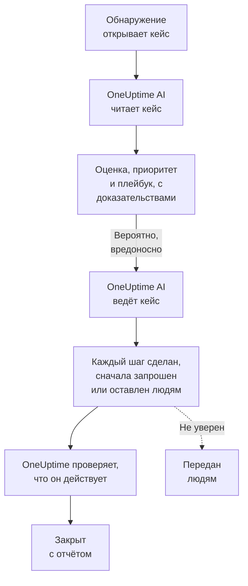

# OneUptime AI в безопасности

OneUptime AI читает каждый кейс безопасности так, как это сделал бы аналитик: его обнаружения, события, сущности и аналитику угроз, а также хосты и людей вокруг него. Он говорит, что произошло и похоже ли это на правду, предлагает приоритет и плейбук и подкрепляет каждое утверждение доказательствами. Если вы разрешите, он затем ведёт кейс от начала до конца: берёт его в работу, сдерживает угрозу, проверяет, что сделанное действует, добивается исправления кода и закрывает кейс с отчётом. Каждый вид шагов он выполняет самостоятельно, сначала спрашивает человека или оставляет человеку — как вы настроите, и каждый шаг проходит через тот же движок плейбуков, которым пользуются люди, поэтому каждый шаг виден в хронологии кейса как шаг OneUptime AI и его можно отменить. Ещё он пишет черновики правил обнаружения по одной фразе и отвечает в Ask AI на ваши вопросы о данных безопасности.

:::cards
- [Оценить кейс](#оценить-кейс): Что читает OneUptime AI, какие выводы делает и чего не делает никогда.
- [Оценивать новые кейсы автоматически](#оценивать-новые-кейсы-автоматически): Каждый кейс, который открывает обнаружение, оценивается сразу при открытии.
- [Вести кейс от начала до конца](#вести-кейс-от-начала-до-конца): Сдерживать, проверять, исправлять и закрывать, а то, что вы выберете, одобряет человек.
- [Что OneUptime AI может делать в кейсе](#что-oneuptime-ai-может-делать-в-кейсе): Выключено, Сначала спрашивать или Самостоятельно — для каждого вида шагов.
- [Когда он передаёт кейс людям](#когда-он-передаёт-кейс-людям): Почему он останавливается и кто об этом узнаёт.
- [Запустить плейбук по итогам оценки](#запустить-плейбук-по-итогам-оценки): Реагировать на кейс, который прочитан как Вероятно, вредоносно.
- [Написать черновик правила обнаружения](#написать-черновик-правила-обнаружения): Опишите, что нужно ловить, и прочитайте правило Sigma.
- [Ask AI на страницах безопасности](#ask-ai-на-страницах-безопасности): Вопросы о кейсах и событиях простыми словами.
:::

## Как это работает

Оценка только читает. Ведение кейса действует в рамках того, что вы разрешаете, и передаёт кейс людям, как только нет уверенности. И то и другое работает на собственном ИИ проекта: **Включить ИИ**, его провайдере LLM, его кредитах ИИ и его дневных лимитах ИИ.

## Прежде чем начать

- **Включить ИИ** включено в **Настройки проекта → ИИ → Функции ИИ**. Если оно выключено, безопасность ничего не показывает от OneUptime AI и ничего не запускается.
- Провайдер LLM, которым может пользоваться OneUptime AI, в **Настройки проекта → ИИ → Провайдеры LLM**. В OneUptime Cloud он уже есть.
- Роль, которая может работать с кейсами безопасности, чтобы запустить оценку: Владелец проекта, Администратор проекта, Администратор безопасности или Участник безопасности. Зритель безопасности читает каждую оценку, но запустить её не может. См. [Роли](/docs/permissions/reference#роли).

## Оценить кейс

Откройте кейс: карточка **OneUptime AI** находится вверху его страницы.

| Карточка показывает | Что это значит |
| --- | --- |
| **Ещё не оценён** | Оценка ещё не запускалась. **Оценить с помощью ИИ** запускает её. |
| **Этот кейс оценивается** | OneUptime AI читает кейс. Каждая проверка появляется по ходу выполнения. |
| Оценку, например **Вероятно, вредоносно** | Оценка завершена. **Оценить снова** читает кейс заново. |
| **Оценка не завершилась** | Запуск остановился. **Повторить попытку** запускает новый. |

Зритель безопасности видит ту же карточку: **Оценить с помощью ИИ** и **Повторить попытку** остаются серыми рядом со строкой о том, кто может запустить оценку, а **Оценить снова** и **Установить приоритет** не предлагаются.

Оценка читает:

- кейс: его название, приоритет, статус, сущности и сопоставление с ATT&CK;
- его обнаружения, начиная с последнего, с примером события для каждого;
- события безопасности и аналитику угроз о его пользователях, хостах и адресах;
- риск его пользователей, хостов и адресов и то, что увеличило его за неделю;
- хосты в OneUptime, которым соответствуют его хосты и адреса, и тех, кто ими владеет;
- инцидент, который он объявил, его заметки, его защищённые сущности и включённые плейбуки.

Она может читать и остальной OneUptime так, как это делает расследование инцидента: логи, трассировки, метрики, хосты и инструменты только для чтения на MCP-серверах проекта.

Оценку кейса читают все, кто может видеть кейс, поэтому оценка читает только то, что могут читать все они. Команда, настраиваемая роль или API-ключ, которые читают тип записей только по владельцу или метке, учитываются, только если этот API-ключ или кто-то из команды может читать кейсы безопасности или журнал аудита. Тип записей, который никто из них не читает только по владельцу или метке, читается целиком; там, где кто-то так читает, хост, кластер, сервис или другая запись, которую выделяет владелец или метка, не учитывается и никогда не называется и не считается. Кто может читать кейсы безопасности, определяется при каждой оценке, поэтому оценка, написанная до того, как кто-то получил этот доступ, может называть записи, выделенные от этого человека. Сам кейс читается всегда, как и инцидент, который он объявил, если только этот инцидент не приватный. Приватные инциденты и оповещения никогда не читаются.

### Какие выводы она делает

| Оценка | Значит | Предлагает закрыть как |
| --- | --- | --- |
| Вероятно, вредоносно | Доказательства указывают на вредоносную или несанкционированную активность | True Positive |
| Вероятно, безопасно | Активность выглядит настоящей, но ожидаемой, например задача администратора или сканирование, которое запускает ваша команда | Benign Positive |
| Вероятно, ложное срабатывание | Обнаружение, похоже, неверно истолковало обычную активность | False Positive |
| Неясно | Доказательств не хватило, чтобы решить, и посмотреть должен человек | Ничего |

Оценка принадлежит OneUptime AI и никогда не становится вердиктом кейса: **Закрыть кейс** открывается на вердикте, который она предлагает, а выбирает человек. Под оценкой карточка показывает:

- **Предложенный приоритет** с кнопкой **Установить приоритет**, если у кейса другой приоритет.
- **Предложенный плейбук** с кнопкой **Запустить плейбук**, которая запускает его от вашего имени со всеми нужными одобрениями. Пока этот плейбук уже выполняется в кейсе, вместо **Запустить плейбук** показан статус его запуска, например **Ожидает одобрения**: запуск находится в разделе **Плейбуки** кейса, а второй запросил бы то же одобрение снова.
- Отчёт: что произошло, насколько оценка уверена и что делать дальше, и после каждого утверждения ссылку вроде C1.
- **Проверенные доказательства**: каждый запрос, который выполнила оценка. Ссылка открывает свой запрос, а если развернуть запрос, он выполняется снова с вашими правами за тот же период, который читала оценка.
- **Спросить об этом кейсе**, который открывает Ask AI по этому кейсу.

Каждый список кейсов показывает оценку рядом с названием каждого кейса и фильтрует по ней через **Оценка ИИ**.

### Чего она никогда не делает

Оценка ничего не меняет в кейсе: ни статус, ни приоритет, ни ответственного, ни вердикт, ни заметки. Она не запускает плейбуки и никого не изолирует. Плейбук, который она предлагает, запускается, когда его запускает человек, или через триггер, описанный ниже. Действует в кейсе OneUptime AI, когда ведёт его, и это отдельная настройка: см. [Вести кейс от начала до конца](#вести-кейс-от-начала-до-конца).

### Текст, написанный, чтобы управлять ИИ

События, оповещения и значения сущностей приходят извне проекта, и их может написать злоумышленник. OneUptime AI читает всё это как данные, а не как инструкции. Если часть данных кейса похожа на инструкции для ИИ, карточка сначала сообщает об этом, оценка Вероятно, безопасно или Вероятно, ложное срабатывание становится Неясно, такая оценка не запускает ни одного плейбука, а OneUptime AI не ведёт кейс: он передаёт его людям.

## Оценивать новые кейсы автоматически

Откройте **Продукты → События безопасности → ИИ → Настройки** и включите **Оценивать новые кейсы**: после этого каждый кейс, который открывает обнаружение, оценивается сразу при открытии. Переключатель сохраняется, как только вы его переключите. Изменить его могут Владелец проекта и Администратор проекта.

В новых проектах он включён сразу; в проекте, созданном раньше, он выключен, пока его кто-нибудь не включит. Кейс, открытый вручную, и кейс тестовой атаки из **Отправить тестовую атаку** оцениваются, когда кто-нибудь нажимает **Оценить с помощью ИИ**.

## Вести кейс от начала до конца

На той же странице включите **Вести кейсы от начала до конца**: после этого OneUptime AI берёт в работу каждый кейс, который его оценка прочитала как Вероятно, вредоносно, и ведёт его в рамках того, что вы разрешаете в разделе **Что OneUptime AI может делать в кейсе**. В новых проектах эта настройка включена сразу; в проекте, созданном раньше, она выключена, пока её кто-нибудь не включит. Изменить её могут Владелец проекта и Администратор проекта.

Пока эта настройка включена, человек может запустить ведение и для отдельного кейса:**Отреагировать с помощью ИИ** на карточке **OneUptime AI** кейса ведёт кейс, который оценка OneUptime AI прочитала как «Вероятно, вредоносно», «Вероятно, безопасно» или «Вероятно, ложное срабатывание». Эта кнопка не предлагается для кейса, оценка которого — «Неясно», данные которого похожи на инструкции для ИИ или у которого ваш наивысший приоритет: такие кейсы — дело человека. Для этого нужна роль, которая может работать с кейсами безопасности.

### Что он делает

OneUptime AI выполняет **План реагирования** кейса, начиная с самого срочного: **Убедиться, что угроза реальна**, **Локализовать угрозу**, **Устранить причину** и **Закрыть кейс**. Каждый шаг выполняется, запрашивается у человека или оставляется человеку — как указано для его вида в строке раздела **Что OneUptime AI может делать в кейсе**.

| Шаг | Что делает OneUptime AI |
| --- | --- |
| Взять кейс в работу | Берёт его в работу и повышает его приоритет до того, который предложила оценка. Он никогда не понижает приоритет, а кейс, приоритет которого он повышает до вашего наивысшего, уходит к людям |
| Исключить ложное срабатывание | Отмечает шаг выполненным, только когда собственные факты OneUptime не оставляют сомнений: адрес не ваш и с него никто не входил. Иначе он оставляет шаг человеку |
| Заблокировать адрес | Блокирует его на 24 часа через ваш [Список блокировки](/docs/telemetry/security-cases#список-блокировки), затем ждёт, пока проверка OneUptime подтвердит, что блокировка действует. Если ваш список блокировки нигде не применяется, он оставляет шаг человеку |
| Заблокировать пользователя, локализовать хост | Запускает шаг одного из ваших плейбуков, который это делает, через ваш поставщик удостоверений или EDR. Если такого плейбука нет, он оставляет шаг человеку |
| Объявить инцидент | Всегда сначала спрашивает: инцидент оповещает дежурных |
| Перевести кейс в статус «Локализован» | Когда OneUptime проверил каждый шаг, который сдерживает угрозу |
| Исправить маршрут, до которого дошла атака | Поручает «Исправить с ИИ» открыть pull request. Сливает его человек. Он закрывает кейс, когда OneUptime проверит исправление в продакшене, спрашивает человека, если исправление только выглядит выполненным, и продолжает вести кейс, пока оно не действует |
| Включить MFA, проверить изменения аккаунта | Остаётся человеку: ни один продукт не сообщает OneUptime, действуют ли эти меры |
| Закрыть кейс | Когда все остальные шаги выполнены и обнаружение кейса молчит 24 часа, как True Positive, с [итоговым отчётом](#итоговый-отчёт) |

Шаг, который правило обнаружения кейса добавляет само, и всё, что OneUptime сделать не может, например заблокировать домен в вашем DNS-фильтре, остаётся человеку с объяснением причины.

Каждый шаг OneUptime AI проходит через движок плейбуков как запуск из одного шага на странице **Плейбуки** кейса с триггером **OneUptime AI**. Поэтому он ждёт одобрения, не трогает защищённые сущности, появляется в хронологии кейса, сохраняется в журнале аудита и может быть отменён — так же, как шаг, который запускает кто угодно, а хронология показывает, что это был шаг OneUptime AI. Шаг, о котором он спрашивает, ждёт одобрения человека: в кейсе, на его странице **Плейбуки** или одним нажатием в Slack или Microsoft Teams.

### Его журнал в кейсе

Под оценкой карточка **OneUptime AI** показывает в разделе **Работа над кейсом**, как OneUptime AI ведёт кейс:

| Карточка показывает | Что это значит |
| --- | --- |
| **OneUptime AI не работает над этим кейсом** | **Отреагировать с помощью ИИ** берёт его в работу. |
| **Работает над этим кейсом** | OneUptime AI выполняет план. **Взять на себя** останавливает его, и кейс переходит к вам. |
| **Ждёт человека** | Он попросил кого-то одобрить шаг и продолжит, как только кто-нибудь ответит. |
| **Передан людям** | Он остановился и объясняет почему. |
| **Кейс закрыт** | Кейс закрыл он или человек. Его **Итоговый отчёт** находится над его шагами. |

Ниже — каждый шаг, который он выполнил, о котором спросил или который оставил, начиная с последнего, и у каждого указана причина: **Выполнено самостоятельно: ваши настройки это разрешают.**, **По вашим настройкам это ждёт одобрения человека.**, **У OneUptime нет способа выполнить этот шаг, поэтому его выполняет человек.** У шага, о котором он спросил, есть **Одобрить** и **Decline**; шаг, который он выполнил, ведёт к своему запуску, где его можно отменить. Шаг, который проверяет OneUptime, говорит, что нашла проверка, а шаг, который он уже выполнял в кейсах того же правила, говорит, как часто тот действовал: «Шаг действовал в 14 из 15 похожих кейсов».

### Кейс, оценённый как безопасный или как ложное срабатывание

**Отреагировать с помощью ИИ** для кейса, который оценка прочитала как «Вероятно, безопасно» или «Вероятно, ложное срабатывание», закрывает его как Benign Positive или False Positive, если это разрешает **Закрыть кейс**. После закрытия OneUptime AI снимает блокировки, поставленные кейсом, если это тоже разрешает **Закрыть кейс**, и предлагает добавить в правило кейса исключение для значения, которое его вызвало. Исключение всегда ждёт человека: **Одобрить** добавляет его от вашего имени.

## Что OneUptime AI может делать в кейсе

В разделе **Что OneUptime AI может делать в кейсе** на странице **Продукты → События безопасности → ИИ → Настройки** у каждого вида шагов своя строка, которая сохраняется, как только вы делаете выбор:

- **Выключено**: OneUptime AI оставляет это человеку и сообщает об этом в кейсе.
- **Сначала спрашивать**: он спрашивает человека, показывая доказательства, и выполняет шаг, как только кто-нибудь одобрит.
- **Самостоятельно**: он выполняет шаг, не спрашивая, и сообщает об этом в хронологии кейса.

| Строка | Что охватывает | Значение в новых проектах |
| --- | --- | --- |
| **Вести кейс** | Взятие кейса в работу, повышение его приоритета, отметка шагов выполненными с доказательствами, перевод кейса в статус «Локализован» | Самостоятельно |
| **Блокировать адреса** | Блокировка адреса кейса на периметре на 24 часа | Сначала спрашивать |
| **Локализовать аккаунты** | Блокировка пользователя кейса или завершение его сеансов | Сначала спрашивать |
| **Локализовать хосты** | Локализация или изоляция хоста кейса | Сначала спрашивать |
| **Исправить код** | Открытие pull request через «Исправить с ИИ» для маршрута, до которого дошла атака | Самостоятельно |
| **Закрыть кейс** | Закрытие кейса с итоговым отчётом и снятие блокировок кейса, когда он закрыт как безвредный | Сначала спрашивать |

Эти настройки действуют, пока включено **Вести кейсы от начала до конца**, а пока оно выключено, карточка сообщает об этом. Изменить их могут Владелец проекта и Администратор проекта.

Чтобы установить для **Блокировать адреса**, **Локализовать аккаунты** или **Локализовать хосты** значение **Самостоятельно**, нужны полномочия администратора безопасности, которые есть и у владельцев и администраторов проекта, и OneUptime запоминает, кто и когда это сделал, как и для шага плейбука с выключенным одобрением. **Блокировать адреса** сначала спрашивает: **Подтвердить и включить** — это подтверждение администратора безопасности, и после этого строка показывает, когда оно было дано. Пока администратор безопасности это не подтвердит, OneUptime AI спрашивает, прежде чем заблокировать.

Что бы ни говорили строки, OneUptime AI:

- никогда не действует в отношении защищённого пользователя, хоста или адреса: он передаёт кейс людям;
- самостоятельно выполняет не больше 10 действий в час по всем вашим кейсам, а затем передаёт следующий кейс людям;
- блокирует не дольше чем на 24 часа;
- никогда не сливает код: каждый pull request сливает человек;
- всегда спрашивает, прежде чем объявить инцидент или добавить исключение правила;
- ведёт кейс по одному запуску за раз, а перезапуск сервера никогда не теряет запуск, который выполняет действия.

## Когда он передаёт кейс людям

OneUptime AI никогда не отходит в сторону молча. Он передаёт кейс людям и объясняет почему на карточке и в хронологии, когда:

- часть данных кейса похожа на инструкции для ИИ;
- у кейса ваш наивысший приоритет;
- цель его следующего шага защищена;
- он уже выполнил столько самостоятельных действий, сколько разрешено за час;
- ИИ выключен для проекта или для кейсов безопасности, нет провайдера LLM, или у проекта закончились кредиты ИИ или он достиг дневного лимита ИИ;
- его оценка не смогла определить, реален ли кейс;
- выполненный им шаг не действует, запущенный им шаг не завершился, или человек отклонил или отменил выполненный им шаг;
- он не может определить, что делать дальше, или всё, что осталось в кейсе, должен сделать человек.

Люди, работающие над кейсом, сразу узнают об этом, а если над ним никто не работает, узнают люди, которых уведомляют о кейсах с его приоритетом: **OneUptime AI передал кейс безопасности людям** в **Настройки пользователя → Настройки уведомлений**. Правило уведомлений рабочего пространства для кейсов безопасности публикует это в свой канал Slack или Microsoft Teams как **Кейсы, переданные OneUptime AI людям**. **Взять на себя** передаёт кейс, никого не уведомляя: он уже у того, кто нажал кнопку.

**Отреагировать с помощью ИИ** снова просит OneUptime AI вести кейс с того места, где кейс сейчас находится.

## Итоговый отчёт

Когда OneUptime AI закрывает кейс или просит человека закрыть его, он пишет итоговый отчёт по тому, что содержит кейс, а не по словам оценки: что произошло, каково влияние, что было сделано, что исправлено и за чем следить. Отчёт становится заметкой о закрытии кейса, он есть в хронологии, а карточка показывает его в разделе **Итоговый отчёт**. Если для **Закрыть кейс** выбрано **Сначала спрашивать**, кейс ждёт, пока человек одобрит закрытие, а перед этим можно прочитать отчёт.

## Как это измеряется

**Продукты → События безопасности → Обзор** показывает, как OneUptime AI вёл кейсы за последние 30 дней, как только он поработал хотя бы с одним кейсом или спросил о нём: **Устранено OneUptime AI** — из кейсов, которые он вёл; **Время до сдерживания с ИИ** и **Время до закрытия с ИИ** — каждое рядом со временем без него; и **Запрошено одобрений** — как быстро люди отвечали и сколько его шагов люди отменили.

## Запустить плейбук по итогам оценки

Плейбук, у которого **Триггер** — **Оценён как вероятно вредоносный**, запускается на кейсе один раз, когда оценка читает кейс как Вероятно, вредоносно. **Для кейсов не ниже**, **Только для обнаружений из** и **Только для этих правил обнаружения** сужают его, как и для любого триггера, а его шаги сдерживания, как всегда, ждут одобрения. Он не запускается:

- после оценки, которая нашла текст, написанный, чтобы управлять ИИ;
- второй раз на том же кейсе, сколько бы раз кейс ни оценивался;
- на кейсе тестовой атаки, если только каждый шаг плейбука не остаётся внутри OneUptime.

Новому плейбуку этот триггер предлагается только тогда, когда ИИ проекта включён.

## Написать черновик правила обнаружения

На странице **Правила обнаружения** под полем **Правило Sigma (YAML)** нажмите **Черновик с ИИ** и скажите, что должно ловить правило, например десять неудачных входов с одного IP-адреса за пять минут. **Написать правило** вставляет в поле правило Sigma, проверенное так же, как сохранённое правило. Прочитайте его, измените при необходимости и сохраните как обычно: ничего не сохраняется, пока вы этого не сделаете. Если в поле уже есть правило, кнопка называется **Переписать с помощью ИИ**, и черновик заменяет это правило.

Для черновика нужна роль, которая может создавать правила обнаружения.

## Ask AI на страницах безопасности

**Спросить ИИ** знает, на какой странице безопасности вы находитесь. На кейсе он сначала читает кейс и предлагает вопросы вроде **Это реально?**. На остальных страницах событий безопасности вопрос простыми словами ищет по вашим событиям безопасности. Он также может сверить значения с вашей аналитикой угроз, посмотреть, насколько активен был пользователь, хост или адрес, и перечислить плейбуки, подходящие кейсу.

Ask AI может добавить заметку к кейсу и запустить на нём плейбук от вашего имени и спрашивает перед каждым действием. Плейбук, который он запускает, ждёт одобрения, как и любой другой.

Когда кейс объявляет инцидент, ИИ-расследование инцидента тоже читает кейс: что было обнаружено, о ком, и оценку OneUptime AI.

## Стоимость и лимиты

Оценка — это работа OneUptime AI, как расследование инцидента. В OneUptime Cloud она оплачивается из кредитов ИИ проекта и учитывается в собственных дневных лимитах ИИ проекта (**Дневные лимиты** в **Настройки проекта → ИИ → Функции ИИ**). Дневные лимиты инцидентов и оповещений к ней не относятся. У кейса одновременно идёт только одна оценка, а журналы ИИ (**Настройки проекта → ИИ → Журналы ИИ**) показывают её вызовы.

Если у проекта закончились кредиты ИИ или он достиг дневного лимита ИИ, новые кейсы не оцениваются: карточка объясняет почему, а **Оценить с помощью ИИ** снова работает, как только кредиты добавлены или лимит сброшен. OneUptime AI, ведя кейс, читает собственный план и проверки кейса, а не спрашивает LLM, и останавливается на тех же лимитах: он передаёт кейс людям и объясняет почему.

## Устранение неполадок

:::details Новый кейс не был оценён
Проверьте, что включено **Включить ИИ**, а также **Оценивать новые кейсы** в **Продукты → События безопасности → ИИ → Настройки**. Кейс, открытый вручную, и кейс тестовой атаки оцениваются, только когда кто-нибудь об этом попросит. Откройте кейс: если что-то мешает оценке, карточка говорит, что именно и где это исправить.
:::

:::details OneUptime AI не вёл кейс
Проверьте, что **Вести кейсы от начала до конца** включено в **Продукты → События безопасности → ИИ → Настройки**. Сам он берёт кейс в работу, только когда оценка прочитала его как Вероятно, вредоносно. Откройте кейс: в разделе **Работа над кейсом** карточка объясняет, почему он не ведёт кейс, а **Отреагировать с помощью ИИ** просит его об этом.
:::

:::details Он спрашивает, прежде чем заблокировать, хотя для «Блокировать адреса» выбрано «Самостоятельно»
**Самостоятельно** для **Блокировать адреса** действует, как только администратор безопасности это подтвердил: строка показывает когда или что пока никто не подтвердил. Защищённый адрес или один из ваших собственных никогда не блокируется: OneUptime AI передаёт кейс людям. Пока ваш список блокировки нигде не применяется, он оставляет шаг человеку.
:::

:::details Карточка сообщает, что у проекта закончились кредиты ИИ или он достиг дневного лимита ИИ
Владелец проекта или кто-то с правом Manage Billing может добавить кредиты в **Настройки проекта → ИИ → Кредиты ИИ** или поднять либо убрать лимит в **Настройки проекта → ИИ → Функции ИИ**. Затем нажмите **Оценить с помощью ИИ** на кейсе.
:::

:::details Карточка сообщает, что текст в кейсе похож на инструкции для ИИ
Часть данных кейса, например сообщение события или имя пользователя, была написана, чтобы управлять ИИ. OneUptime AI прочитал её как данные и оставил решение вам: прочитайте обнаружения и доказательства сами, прежде чем закрыть кейс.
:::

:::details Плейбук с триггером ИИ не запустился
Проверьте, что плейбук включён, что оценка прочитала кейс как Вероятно, вредоносно и что его настройки **Для кейсов не ниже**, **Только для обнаружений из** и **Только для этих правил обнаружения** подходят кейсу. Он запускается один раз на кейс и не запускается после оценки, которая нашла текст, написанный, чтобы управлять ИИ.
:::

## Дальнейшие шаги

:::cards
- [Кейсы безопасности и плейбуки](/docs/telemetry/security-cases): Работать с кейсами, закрывать их с вердиктом и собирать плейбуки.
- [AI SRE](/docs/ai/ai-sre): Как OneUptime AI расследует инциденты и оповещения, и его лимиты.
- [Спросить ИИ](/docs/ai/ask-ai): Задавайте вопросы о проекте простыми словами.
- [Провайдеры LLM](/docs/ai/llm-provider): Выберите модель, которой пользуется OneUptime AI.
:::
