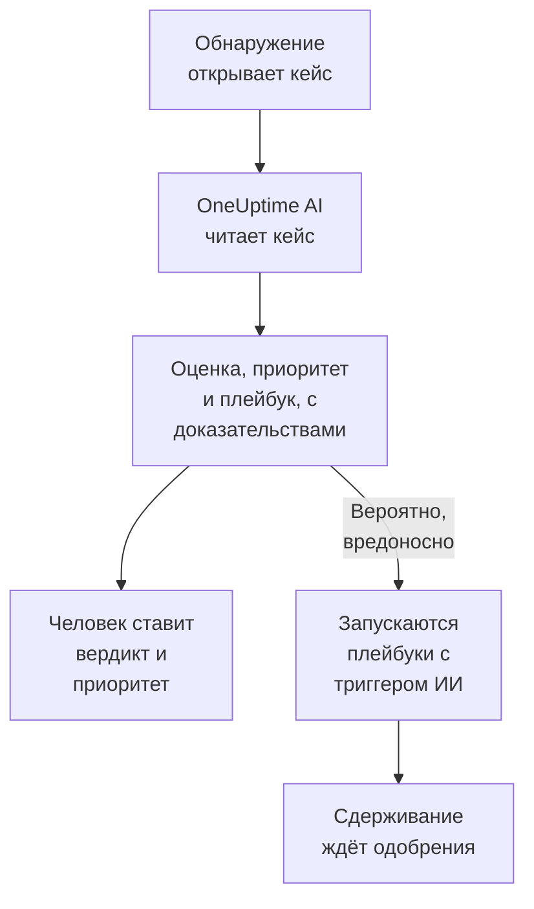

# OneUptime AI в безопасности

OneUptime AI читает каждый кейс безопасности так, как это сделал бы аналитик: его обнаружения, события, сущности и аналитику угроз, а также хосты и людей вокруг него. Он говорит, что произошло и похоже ли это на правду, предлагает приоритет и плейбук и подкрепляет каждое утверждение доказательствами. Сам он ничего не меняет: вердикт и приоритет устанавливает человек, и плейбук запускает тоже человек. Ещё он пишет черновики правил обнаружения по одной фразе и отвечает в Ask AI на ваши вопросы о данных безопасности.

:::cards
- [Оценить кейс](#оценить-кейс): Что читает OneUptime AI, какие выводы делает и чего не делает никогда.
- [Оценивать новые кейсы автоматически](#оценивать-новые-кейсы-автоматически): Каждый кейс, который открывает обнаружение, оценивается сразу при открытии.
- [Запустить плейбук по итогам оценки](#запустить-плейбук-по-итогам-оценки): Реагировать на кейс, который прочитан как Вероятно, вредоносно.
- [Написать черновик правила обнаружения](#написать-черновик-правила-обнаружения): Опишите, что нужно ловить, и прочитайте правило Sigma.
- [Ask AI на страницах безопасности](#ask-ai-на-страницах-безопасности): Вопросы о кейсах и событиях простыми словами.
:::

## Как это работает

Оценка только читает. Она работает на собственном ИИ проекта: **Включить ИИ**, его провайдере LLM, его кредитах ИИ и его дневных лимитах ИИ.

## Прежде чем начать

- **Включить ИИ** включено в **Настройки проекта → ИИ → AI Features**. Если оно выключено, безопасность ничего не показывает от OneUptime AI и ничего не запускается.
- Провайдер LLM, которым может пользоваться OneUptime AI, в **Настройки проекта → ИИ → Провайдеры LLM**. В OneUptime Cloud он уже есть.
- Роль, которая может работать с кейсами безопасности, чтобы запустить оценку: Project Owner, Project Admin, Security Admin или Security Member. Security Viewer читает каждую оценку, но запустить её не может. См. [Роли](/docs/permissions/reference#роли).

## Оценить кейс

Откройте кейс: карточка **OneUptime AI** находится вверху его страницы.

| Карточка показывает | Что это значит |
| --- | --- |
| **Ещё не оценён** | Оценка ещё не запускалась. **Оценить с помощью ИИ** запускает её. |
| **Этот кейс оценивается** | OneUptime AI читает кейс. Каждая проверка появляется по ходу выполнения. |
| Оценку, например **Вероятно, вредоносно** | Оценка завершена. **Оценить снова** читает кейс заново. |
| **Оценка не завершилась** | Запуск остановился. **Повторить попытку** запускает новый. |

Security Viewer видит ту же карточку: **Оценить с помощью ИИ** и **Повторить попытку** остаются серыми рядом со строкой о том, кто может запустить оценку, а **Оценить снова** и **Установить приоритет** не предлагаются.

Оценка читает:

- кейс: его название, приоритет, статус, сущности и сопоставление с ATT&CK;
- его обнаружения, начиная с последнего, с примером события для каждого;
- события безопасности и аналитику угроз о его пользователях, хостах и адресах;
- риск его пользователей, хостов и адресов и то, что увеличило его за неделю;
- хосты в OneUptime, которым соответствуют его хосты и адреса, и тех, кто ими владеет;
- инцидент, который он объявил, его заметки, его защищённые сущности и включённые плейбуки.

Она может читать и остальной OneUptime так, как это делает расследование инцидента: логи, трассировки, метрики, хосты и инструменты только для чтения на MCP-серверах проекта.

### Какие выводы она делает

| Оценка | Значит | Предлагает закрыть как |
| --- | --- | --- |
| Вероятно, вредоносно | Доказательства указывают на вредоносную или несанкционированную активность | True Positive |
| Вероятно, безопасно | Активность выглядит настоящей, но ожидаемой, например задача администратора или сканирование, которое запускает ваша команда | Benign Positive |
| Вероятно, ложное срабатывание | Обнаружение, похоже, неверно истолковало обычную активность | False Positive |
| Неясно | Доказательств не хватило, чтобы решить, и посмотреть должен человек | Ничего |

Оценка принадлежит OneUptime AI и никогда не становится вердиктом кейса: **Close Case** открывается на вердикте, который она предлагает, а выбирает человек. Под оценкой карточка показывает:

- **Предложенный приоритет** с кнопкой **Установить приоритет**, если у кейса другой приоритет.
- **Предложенный плейбук** с кнопкой **Запустить плейбук**, которая запускает его от вашего имени со всеми нужными одобрениями. Пока этот плейбук уже выполняется в кейсе, вместо **Запустить плейбук** показан статус его запуска, например **Ожидает одобрения**: запуск находится в разделе **Запуски плейбуков** кейса, а второй запросил бы то же одобрение снова.
- Отчёт: что произошло, насколько оценка уверена и что делать дальше, и после каждого утверждения ссылку вроде C1.
- **Evidence checked**: каждый запрос, который выполнила оценка. Ссылка открывает свой запрос, а если развернуть запрос, он выполняется снова с вашими правами за тот же период, который читала оценка.
- **Спросить об этом кейсе**, который открывает Ask AI по этому кейсу.

Каждый список кейсов показывает оценку рядом с названием каждого кейса и фильтрует по ней через **Оценка ИИ**.

### Чего она никогда не делает

Оценка ничего не меняет в кейсе: ни статус, ни приоритет, ни ответственного, ни вердикт, ни заметки. Она не запускает плейбуки и никого не изолирует. Плейбук, который она предлагает, запускается, когда его запускает человек, или через триггер, описанный ниже.

### Текст, написанный, чтобы управлять ИИ

События, оповещения и значения сущностей приходят извне проекта, и их может написать злоумышленник. OneUptime AI читает всё это как данные, а не как инструкции. Если часть данных кейса похожа на инструкции для ИИ, карточка сначала сообщает об этом, оценка Вероятно, безопасно или Вероятно, ложное срабатывание становится Неясно, и такая оценка не запускает ни одного плейбука.

## Оценивать новые кейсы автоматически

Откройте **Продукты → Security Events → ИИ → Настройки** и включите **Оценивать новые кейсы**: после этого каждый кейс, который открывает обнаружение, оценивается сразу при открытии. Переключатель сохраняется, как только вы его переключите. Изменить его могут Project Owner и Project Admin.

В новых проектах он включён сразу; в проекте, созданном раньше, он выключен, пока его кто-нибудь не включит. Кейс, открытый вручную, и кейс тестовой атаки из **Отправить тестовую атаку** оцениваются, когда кто-нибудь нажимает **Оценить с помощью ИИ**.

## Запустить плейбук по итогам оценки

Плейбук, у которого **Триггер** — **Оценён как вероятно вредоносный**, запускается на кейсе один раз, когда оценка читает кейс как Вероятно, вредоносно. **For Cases At Least**, **Only For Detections From** и **Only For These Detection Rules** сужают его, как и для любого триггера, а его шаги сдерживания, как всегда, ждут одобрения. Он не запускается:

- после оценки, которая нашла текст, написанный, чтобы управлять ИИ;
- второй раз на том же кейсе, сколько бы раз кейс ни оценивался;
- на кейсе тестовой атаки, если только каждый шаг плейбука не остаётся внутри OneUptime.

Новому плейбуку этот триггер предлагается только тогда, когда ИИ проекта включён.

## Написать черновик правила обнаружения

На странице **Detection Rules** под полем **Sigma Rule (YAML)** нажмите **Draft with AI** и скажите, что должно ловить правило, например десять неудачных входов с одного IP-адреса за пять минут. **Написать правило** вставляет в поле правило Sigma, проверенное так же, как сохранённое правило. Прочитайте его, измените при необходимости и сохраните как обычно: ничего не сохраняется, пока вы этого не сделаете. Если в поле уже есть правило, кнопка называется **Переписать с помощью ИИ**, и черновик заменяет это правило.

Для черновика нужна роль, которая может создавать правила обнаружения.

## Ask AI на страницах безопасности

**Ask AI** знает, на какой странице безопасности вы находитесь. На кейсе он сначала читает кейс и предлагает вопросы вроде **Это реально?**. На остальных страницах событий безопасности вопрос простыми словами ищет по вашим событиям безопасности. Он также может сверить значения с вашей аналитикой угроз, посмотреть, насколько активен был пользователь, хост или адрес, и перечислить плейбуки, подходящие кейсу.

Ask AI может добавить заметку к кейсу и запустить на нём плейбук от вашего имени и спрашивает перед каждым действием. Плейбук, который он запускает, ждёт одобрения, как и любой другой.

Когда кейс объявляет инцидент, ИИ-расследование инцидента тоже читает кейс: что было обнаружено, о ком, и оценку OneUptime AI.

## Стоимость и лимиты

Оценка — это работа OneUptime AI, как расследование инцидента. В OneUptime Cloud она оплачивается из кредитов ИИ проекта и учитывается в собственных дневных лимитах ИИ проекта (**Дневные лимиты** в **Настройки проекта → ИИ → AI Features**). Дневные лимиты инцидентов и оповещений к ней не относятся. У кейса одновременно идёт только одна оценка, а журналы ИИ (**Настройки проекта → ИИ → Журналы ИИ**) показывают её вызовы.

Если у проекта закончились кредиты ИИ или он достиг дневного лимита ИИ, новые кейсы не оцениваются: карточка объясняет почему, а **Оценить с помощью ИИ** снова работает, как только кредиты добавлены или лимит сброшен.

## Устранение неполадок

:::details Новый кейс не был оценён
Проверьте, что включено **Включить ИИ**, а также **Оценивать новые кейсы** в **Продукты → Security Events → ИИ → Настройки**. Кейс, открытый вручную, и кейс тестовой атаки оцениваются, только когда кто-нибудь об этом попросит. Откройте кейс: если что-то мешает оценке, карточка говорит, что именно и где это исправить.
:::

:::details Карточка сообщает, что у проекта закончились кредиты ИИ или он достиг дневного лимита ИИ
Владелец проекта или кто-то с правом Manage Billing может добавить кредиты в **Настройки проекта → ИИ → Кредиты ИИ** или поднять либо убрать лимит в **Настройки проекта → ИИ → AI Features**. Затем нажмите **Оценить с помощью ИИ** на кейсе.
:::

:::details Карточка сообщает, что текст в кейсе похож на инструкции для ИИ
Часть данных кейса, например сообщение события или имя пользователя, была написана, чтобы управлять ИИ. OneUptime AI прочитал её как данные и оставил решение вам: прочитайте обнаружения и доказательства сами, прежде чем закрыть кейс.
:::

:::details Плейбук с триггером ИИ не запустился
Проверьте, что плейбук включён, что оценка прочитала кейс как Вероятно, вредоносно и что его настройки **For Cases At Least**, **Only For Detections From** и **Only For These Detection Rules** подходят кейсу. Он запускается один раз на кейс и не запускается после оценки, которая нашла текст, написанный, чтобы управлять ИИ.
:::

## Дальнейшие шаги

:::cards
- [Кейсы безопасности и плейбуки](/docs/telemetry/security-cases): Работать с кейсами, закрывать их с вердиктом и собирать плейбуки.
- [AI SRE](/docs/ai/ai-sre): Как OneUptime AI расследует инциденты и оповещения, и его лимиты.
- [Спросить ИИ](/docs/ai/ask-ai): Задавайте вопросы о проекте простыми словами.
- [Провайдеры LLM](/docs/ai/llm-provider): Выберите модель, которой пользуется OneUptime AI.
:::
