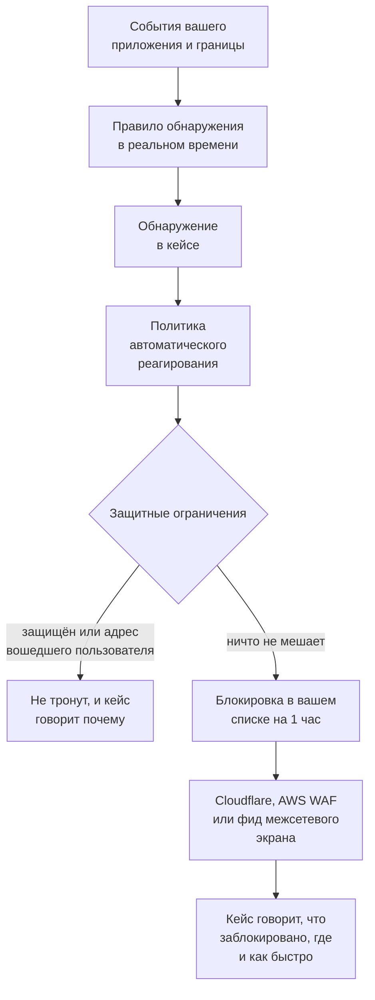

# Автоматическое реагирование

Политики автоматического реагирования назначают проверку или блокируют атакующий адрес в момент обнаружения, ещё до того, как кто-то разберёт кейс: сканеры, прощупывающие ваше приложение, и боты, перебирающие пароль за паролем, отсекаются через пару минут после первого запроса. В каждом проекте есть три готовые политики, каждая выключена, пока вы её не включите, и каждая начинается с недели пробного запуска, который только записывает, что она сделала бы. Защитные ограничения позволяют оставить политику включённой без опаски: она никогда не трогает ваши собственные адреса или адрес, которым пользуются ваши вошедшие в систему пользователи, и она останавливается и вызывает человека, когда атака больше, чем ей стоит разбирать в одиночку.

:::cards
- [Включение политики](#включение-политики): Сначала неделя пробного запуска, потом один щелчок.
- [Защитные ограничения](#защитные-ограничения): Чего политика никогда не делает и когда она останавливается.
- [Время до блокировки](#время-до-блокировки): Как быстро блокирует каждая политика, на её карточке и в кейсе.
- [Своя политика](#своя-политика): Реагируйте на выбранные вами техники, правила или разведку угроз.
:::

## Как это работает

Политика реагирует на обнаружение, как только оно записано в его кейсе, через несколько секунд после срабатывания правила. Её блокировка попадает в ваш [список блокировки](/docs/telemetry/security-cases#список-блокировки) так же, как шаг плейбука **Заблокировать адрес**, с названием политики в качестве автора: назначения, применяющие ваш список блокировки, удерживают её, она видна в хронологии кейса и в журнале аудита и истекает сама. Ей не нужно ничьё одобрение: тот, кто включил политику, одобрил её блокировки.

## Перед началом

- Назначение, которое применяет ваш список блокировки: Cloudflare, AWS WAF или межсетевой экран или прокси, читающий [фид списка блокировки](/docs/telemetry/blocklist-feeds). Пока его ничто не применяет, страница так и говорит, и блокировки политики нигде не действуют.
- События, которые читают правила политики: журналы доступа или трассировки вашего приложения или события вашей границы, например события межсетевого экрана Cloudflare, и ваши входы в систему. См. [События безопасности](/docs/telemetry/security-events).
- Роль, которой можно включать политику: Администратор безопасности, Администратор проекта или Владелец проекта. Участник безопасности и Зритель безопасности видят политики и то, что они сделали. См. [Роли](/docs/permissions/reference#роли).

## Готовые политики

| Политика | Реагирует на | Делает | Первая блокировка |
| --- | --- | --- | --- |
| **Сканеры** | Веб-сканирование и попытки эксплуатации (ATT&CK T1595, T1190): попытки SQL-инъекций, обхода путей и Log4Shell, сканирование в поисках конфиденциальных файлов, например `/.env`, `/.git/config` и `/wp-admin`, и множество срабатываний управляемых правил Cloudflare с одного адреса, пока все запросы с адреса отклонялись | Проверка | 1 час |
| **Подбор паролей** | Перебор и распыление паролей (ATT&CK T1110): неудачные входы с одного адреса и неудачные входы, за которыми следует успешный, с того же адреса | Заблокировать | 1 час |
| **Известные вредоносные адреса** | Любое обнаружение, касающееся адреса из вашей [разведки угроз](/docs/telemetry/threat-intelligence) | Заблокировать | 24 часа |

Люди проходят проверку, а скрипты и боты — нет. Сканеры назначают проверку адресу, только пока ни один его запрос не дошёл до вашего приложения: адрес, чьи запросы прошли, — это кейс для человека.

Сканирование в поисках конфиденциальных файлов учитывает только запросы, которые ваш сайт отклонил или которые обращаются к тому, чего на нём нет, и только если один адрес за пять минут запрашивает три и более разных файлов или страниц администрирования. Страница, которую ваш сайт отдаёт, никогда не учитывается, поэтому администраторы самого сайта на WordPress могут открывать `/wp-admin` и `/wp-login.php` сколько угодно. Запрос к файлу с секретами, например `/.env`, на который одностраничное приложение ответило своей страницей, — это запрос к тому, чего на сайте нет, и он учитывается. Файл, который ваш сайт отдал, — это утечка, а не сканирование: правило **Sensitive file served** из библиотеки правил открывает критический кейс для человека, и ни одна политика на него не реагирует.

Когда вы включаете Сканеры или Подбор паролей, в пробный запуск или полностью, правила из **Библиотека правил**, на которые реагирует политика, запускаются в реальном времени, а недостающие добавляются в ваш проект: правило в реальном времени срабатывает через секунды после прихода событий, а правило по расписанию читает с отставанием в минуты. Правило, которое кто-то выключил, остаётся выключенным. Проект запускает в реальном времени не больше 50 правил: сверх этого правило остаётся на своём расписании, а карточка политики показывает рядом **По расписанию**.

## Включение политики

:::steps
### Откройте Автоматическое реагирование

Откройте **Продукты → События безопасности → Плейбуки → Автоматическое реагирование**. У каждой политики своя карточка: что она делает, метка **Выключено**, **Пробный запуск**, **Пробный запуск завершён** или **Включено** и её переключатель.

### Запустите пробный запуск

Переведите переключатель политики. 7 дней она записывает, что сделала бы, и не трогает трафик: кейс говорит "Trial run: the Scanners policy would have challenged 35.205.11.131 for 1 hour." Карточка считает адреса на текущий момент и то, что не тронули её защитные ограничения.

### Включите её

Когда неделя закончится, карточка скажет, что сделала бы политика, например "За 7 дней она назначила бы проверку адресам: 1 283. Ни у одного не было вошедших в систему пользователей, и ни один не был вашим. Включить?", а ваши ответственные за безопасность получат то же по электронной почте. Нажмите **Включить**: с этого момента политика действует.
:::

Чтобы включить политику без недели пробного запуска, откройте **Дополнительные настройки** на её карточке и нажмите **Включить без пробного запуска**. Её защитные ограничения по-прежнему действуют. Переведите переключатель ещё раз, чтобы выключить политику; включённая снова после полной недели пробного запуска, она сразу начинает действовать.

## Защитные ограничения

- **Никогда ваши собственные или защищённые адреса.** Записи в **Защищённые сущности** и всё, что OneUptime защищает сам: ваши хосты, облачные ресурсы и зонды, диапазоны, которых нет в интернете, и граница перед вашим приложением. См. [Список блокировки](/docs/telemetry/security-cases#список-блокировки).
- **Никогда адрес, которым пользовался вошедший в систему пользователь за последние 30 дней.** Сеть офиса, прокси клиента или дом человека: OneUptime ищет адрес во входах в систему у вашего поставщика удостоверений и в запросах, которые ваше приложение обслужило для вошедшего в систему пользователя, тех, у которых в трассировках или журналах есть ID пользователя. Адрес, который он не может проверить, потому что эти события не удалось прочитать или ваши правила очистки скрывают адреса так, что их нельзя сопоставить, оставляется человеку.
- **Более долгие блокировки для адреса, который возвращается.** Первая блокировка длится 1 час, затем 24 часа, затем 7 дней для адреса, заблокированного снова в течение 30 дней. Известные вредоносные адреса начинается с 24 часов.
- **Не больше 50 автоматических блокировок в час или заданного вами лимита.** Сверх этого ваши политики прекращают блокировать и вызывают ваших ответственных за безопасность: атаке такого размера нужен человек. Страница говорит об этом, пока это длится. Администратор безопасности, Администратор проекта или Владелец проекта может задать лимит от 1 до 500 в разделе **Дополнительные настройки** внизу страницы: **Часовой лимит**. Новый лимит действует начиная со следующего обнаружения.
- **Отмена при сомнении.** Когда с адреса, который заблокировала политика, замечен вошедший в систему пользователь, политика снимает блокировку и сообщает вашим ответственным за безопасность.

Ваши ответственные за безопасность — это Администраторы безопасности вашего проекта или, если их нет, Владельцы проекта. Каждый адрес, который не тронуло защитное ограничение, указан в его кейсе вместе с причиной.

## Где назначение не может назначить проверку

Cloudflare и AWS WAF назначают проверку. Межсетевой экран, читающий фид списка блокировки, не может, поэтому там проверка политики — это блокировка на то же время, и карточка политики и кейс говорят об этом, например "FortiGate feed cannot challenge, so it blocks the address there for the same time." Проверка, которую вы назначаете сами, никогда не превращается в блокировку.

## Время до блокировки

Время до блокировки идёт от первого запроса адреса, самого раннего события его обнаружения, до срабатывания блокировки на вашей границе. Карточка каждой политики показывает её 50-й и 95-й процентили по дням за последние 30 дней. Кейс, который заблокировало автоматическое реагирование, говорит об этом под **Время до локализации** на его **Обзор**, например "Заблокирован автоматически через 41 с после первого запроса", а его хронология говорит, что заблокировано, где и как быстро: "OneUptime challenged 35.205.11.131 at Cloudflare for 1 hour (Scanners policy), 41 seconds after its first request." Шаг адреса в **План реагирования** кейса выполнен, рядом — **Снять**.

## Своя политика

Нажмите **Создать политику** под готовыми политиками. Собственной политике нужно **Имя** и то, на что она реагирует:

| Поле | Что оно делает |
| --- | --- |
| **Техники ATT&CK** | Техники, которые должны быть у обнаружения, через запятую, например `T1110, T1190`. Техника включает свои подтехники. |
| **Действие** | В **Дополнительные поля**: **Заблокировать** или **Проверка**. |
| **Первая блокировка длится** | В **Дополнительные поля**: 1 час, 24 часа или 7 дней. Адрес, который возвращается, блокируется дольше. |
| **Правила обнаружения** | В **Дополнительные поля**: или обнаружение одного из этих правил. |
| **Только адреса из вашей разведки угроз** | В **Дополнительные поля**: реагирует только на адреса из вашей разведки угроз. Само по себе реагирует на любое обнаружение, касающееся такого адреса. |
| **Только пока все запросы отклонялись** | В **Дополнительные поля**: реагирует, только пока ни один запрос с адреса не дошёл до вашего приложения. |

Собственная политика начинается выключенной, неделю проходит пробный запуск, как готовая, и имеет те же защитные ограничения. **Изменить политику** и **Удалить политику** находятся на её карточке; если удалить её, её блокировки остаются в вашем списке блокировки, пока не истекут.

## Устранение неполадок

:::details Политика включена, но не заблокировала адрес
Посмотрите хронологию кейса: политика, которая не тронула адрес, говорит почему, например потому что им пользовался вошедший в систему пользователь. Проверьте, что ваш список блокировки применяет какое-то назначение и что правила политики показывают на её карточке **В реальном времени**.
:::

:::details Страница говорит, что автоматические блокировки этого часа исчерпаны
Ваши политики достигли вашего часового лимита автоматических блокировок (50, если его никто не менял) и вызвали ваших ответственных за безопасность. Они продолжат, когда блокировки этого часа устареют. Посмотрите кейсы атаки и заблокируйте диапазон в **Список блокировки**, если она идёт из одной сети. Если на ваш проект часто приходится столько сканеров, нажмите **Изменить лимит** рядом с уведомлением и увеличьте лимит.
:::

## Дальнейшие шаги

:::cards
- [Кейсы безопасности и плейбуки](/docs/telemetry/security-cases): Работайте с кейсами, на которые реагируют ваши политики, и блокируйте вручную.
- [Фиды списка блокировки](/docs/telemetry/blocklist-feeds): Применяйте ваш список блокировки на межсетевом экране или прокси.
- [Разведка угроз](/docs/telemetry/threat-intelligence): Фиды, на которые реагирует политика Известные вредоносные адреса.
:::
