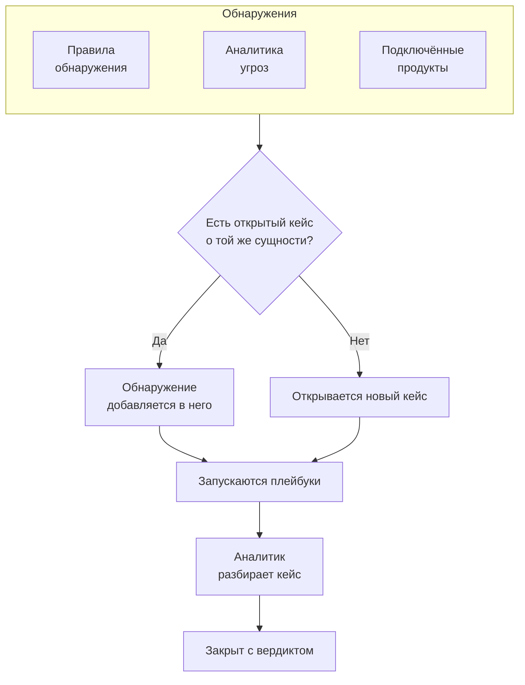

# Кейсы безопасности и плейбуки (SOAR)

Security Events превращает то, что находят ваши правила обнаружения, аналитика угроз и подключённые продукты безопасности, в кейсы: по одному кейсу на всё, в чём стоит разобраться, и каждое обнаружение, касающееся того же пользователя, хоста или адреса, собирается в нём. Аналитики разбирают кейсы в очереди, а плейбуки реагируют на них — сами или по одному нажатию.

:::cards
- [Откуда берутся кейсы](#откуда-берутся-кейсы): Правила обнаружения, аналитика угроз, подключённые продукты и люди.
- [Работа с кейсом](#работа-с-кейсом): Назначьте его, изучите его сущности и закройте с вердиктом.
- [Плейбуки](#плейбуки): Шаги, которые выполняются для кейса, с одобрением там, где это важно.
- [Обзор](#обзор): Что требует внимания прямо сейчас и как быстро обрабатываются кейсы.
:::

## Как это работает

Откройте **Продукты → Security Events → Security Cases**. Очередь открывается на открытых кейсах; другие представления — **Assigned to Me**, **Unassigned**, **Закрыто** и **Все**.

## Перед началом

Кейсы и плейбуки подчиняются трём ролям Security. Project Owner и Project Admin могут всё.

| Роль | Что она может |
| --- | --- |
| Security Admin | Всё, включая удаление кейсов и настройку плейбуков |
| Security Member | Открывать, назначать, изменять и закрывать кейсы, писать заметки, запускать плейбуки, а также одобрять или отклонять их шаги |
| Security Viewer | Читать кейсы, обнаружения, заметки, плейбуки и их запуски |

Каждое из этих разрешений можно выдать и по отдельности — от создания кейса до одобрения шагов плейбука; см. [Справочник разрешений](/docs/permissions/reference).

## Откуда берутся кейсы

| Источник | Открывает кейс, когда | Как отключить |
| --- | --- | --- |
| Правила обнаружения | Срабатывает правило | **Open a Case on Match** на шаге **При совпадении** правила |
| Аналитика угроз | Событие упоминает известный индикатор | **Open a Case on Match** на шаге **При совпадении** фида |
| Подключённые продукты | Собственное оповещение продукта импортируется с уровнем не ниже порога подключения | **Open Cases From** со значением **Никогда** на шаге **Polling** подключения |
| Люди | Кто-то открывает кейс в разделе **Security Cases** или кнопкой **Open Case** на панели события | Никак |

По умолчанию все источники включены. Подключение открывает кейсы для **High and above**, если вы не выберете другой уровень; оповещения ниже этого уровня всё равно импортируются как события.

### Как группируются обнаружения

Обнаружение относится к сущности: к значению, по которому группирует его правило, например к IP-адресу в правиле против перебора паролей или к индикатору, который называет совпадение с аналитикой угроз. Обнаружение без сущности стоит особняком.

- Если открытый кейс уже относится к этой сущности, обнаружение добавляется в него. Сущности кейса и его сопоставление с ATT&CK пополняются, а приоритет поднимается до приоритета обнаружения и никогда не понижается.
- Если такого открытого кейса нет, открывается новый кейс с названием обнаружения и с его приоритетом.
- Повторно сработавшее обнаружение увеличивает счётчик в своей строке, а не добавляет новую строку.

Приоритет кейса определяется серьёзностью обнаружения:

| Серьёзность | Приоритет |
| --- | --- |
| Critical или Fatal | Critical |
| High | High |
| Medium, Unknown или Other | Medium |
| Low | Low |
| Informational | Informational |

## Работа с кейсом

Кейс проходит через четыре статуса. Какой-то из них он может пропустить — например, ложное срабатывание закрывают прямо из New, — и его можно открыть повторно.

| Статус | Означает |
| --- | --- |
| New | Его ещё никто не смотрел |
| Investigating | Кто-то выясняет, что произошло |
| Contained | Угроза больше не может навредить, но последствия ещё предстоит устранить |
| Closed | Готово, с вердиктом о том, что это было |

На странице кейса есть всё, что нужно для работы с ним:

- Вверху: **Assign to Me**, **Run Playbook**, **Объявить инцидент** и **Close Case**, шаги статуса и приоритет в меню рядом с ними.
- **Detections**: что сработало и открыло кейс или добавилось в него, как часто и последнее совпавшее событие.
- **Сущности**: пользователи, хосты и адреса, к которым относится кейс, с их активностью во всех ваших событиях безопасности за последние 7 дней. Каждая открывается в **Коррелировать**.
- **MITRE ATT&CK**: тактики и техники, с которыми сопоставлены его обнаружения, каждая со ссылкой на свою страницу на attack.mitre.org.
- **Playbook Runs**: что каждый плейбук сделал с кейсом, шаг за шагом, и шаги, ожидающие одобрения.
- **Заметки** и **Хронология**: что написала команда и всё, что происходило, с указанием, кто это сделал.

Чтобы работать с несколькими кейсами сразу, выберите их в очереди и используйте **Assign to Me**, **Change Status** или **Change Priority**.

### Закрытие кейса

**Close Case** запрашивает вердикт и необязательную заключительную заметку:

| Вердикт | Означает |
| --- | --- |
| True Positive | Вредоносная или несанкционированная активность действительно была |
| Benign Positive | Активность была реальной, но ожидаемой, например тест на проникновение или задача администратора |
| False Positive | Обнаружение ошибочно: правило или данные неверно истолковали обычную активность |
| Undetermined | Информации не хватило, чтобы сделать вывод |

Вердикты подсчитываются на обзоре. Правило, кейсы которого раз за разом закрываются как False Positive, нуждается в настройке.

### Объявление инцидента

**Объявить инцидент** открывает для кейса инцидент OneUptime с выбранной вами серьёзностью и связывает их в обе стороны: описание инцидента называет кейс, а заголовок кейса ссылается на инцидент. Дальше в дело вступают дежурства, страницы статуса и постмортем. Для этого нужна роль, которая может и работать с кейсами, и создавать инциденты.

## Плейбуки

Плейбук — это список шагов, которые выполняются для кейса. Создайте его в **Продукты → Security Events → Playbooks** из шаблона или с нуля и добавьте шаги на его странице.

### Когда запускается плейбук

| Запуск | Когда |
| --- | --- |
| Case Opened | Один раз, при открытии кейса |
| Detection Added | Каждый раз, когда в открытый кейс добавляется новое обнаружение |
| Manual | Только когда кто-то запускает его из кейса |

Любой включённый плейбук можно также запустить вручную кнопкой **Run Playbook** в кейсе. Плейбук, который запускается сам, можно ограничить:

- **For Cases At Least**: только кейсы с этим или более высоким приоритетом.
- **Only For Detections From**: только если обнаружение, стоящее за кейсом, пришло из этого источника.
- **Only For These Detection Rules**: только если оно пришло от одного из этих правил.

Отключённый плейбук не запускается ни сам, ни вручную.

### Шаги

| Категория | Шаг | Что делает |
| --- | --- | --- |
| Кейс | Assign the case | Назначает кейс человеку, команде или обоим |
| Кейс | Set the priority | Повышает или понижает приоритет кейса |
| Кейс | Set the status | Переводит кейс в статус Investigating, Contained или Closed с выбранным вами вердиктом |
| Кейс | Add a note | Пишет заметку в кейсе, например чек-лист для аналитика |
| Кейс | Add labels | Помечает кейс метками |
| Расследование | Check entities against threat intel | Ищет каждую сущность в вашей аналитике угроз и при совпадении может повысить приоритет |
| Расследование | Look up entity activity | Подсчитывает события безопасности каждой сущности за недавний период и отмечает результат в кейсе |
| Уведомление | Email people | Отправляет пользователям и командам письмо со сводкой по кейсу и ссылкой на него |
| Уведомление | Post to Slack | Публикует сводку по кейсу в канал Slack |
| Уведомление | Post to Microsoft Teams | Публикует сводку по кейсу в канал Microsoft Teams |
| Эскалация | Page on-call | Запускает политику дежурств |
| Эскалация | Declare an incident | Открывает инцидент OneUptime, связанный с кейсом |
| Сдерживание | Suspend the user in Okta | Блокирует в Okta каждого пользователя кейса |
| Сдерживание | End the user's Okta sessions | Завершает сеансы Okta каждого пользователя кейса и отзывает его токены |
| Сдерживание | Contain the host in CrowdStrike | Изолирует от сети каждый хост кейса с помощью CrowdStrike Falcon |
| Сдерживание | Isolate the device in Microsoft Defender | Изолирует каждый хост кейса с помощью Microsoft Defender for Endpoint |
| Автоматизация | Send a webhook | Отправляет кейс в виде JSON на URL |
| Автоматизация | Run a workflow | Запускает рабочий процесс OneUptime с кейсом в качестве входных данных |

В плейбуке не больше 25 шагов. Они выполняются по порядку, каждый — после завершения предыдущего. У каждого шага есть также такие настройки:

- **Needs Approval**: останавливает запуск перед шагом, пока кто-нибудь не одобрит его в кейсе. По умолчанию она включена для четырёх шагов сдерживания, которые действуют за пределами OneUptime.
- **Only If Threat Intel Matched**: пропускает шаг, если более ранний шаг **Check entities against threat intel** в этом запуске не нашёл известного индикатора.
- **Carry On If It Fails**: выполняет следующий шаг, даже если этот завершился ошибкой. Когда настройка выключена, ошибка шага останавливает запуск.

### Сдерживание

Шаги сдерживания действуют через [подключение событий безопасности](/docs/telemetry/security-events#подключение-продукта-безопасности) к продукту, и ему нужен не только доступ на чтение:

| Шаг | Подключение | Что нужно |
| --- | --- | --- |
| Suspend the user in Okta, End the user's Okta sessions | Okta System Log | API-токен с правом управлять пользователями |
| Contain the host in CrowdStrike | CrowdStrike Falcon | API-клиент с правом записи в области Hosts |
| Isolate the device in Microsoft Defender | Microsoft Defender XDR | Приложение с разрешением Machine.Isolate |

Шаг сдерживания действует не более чем на 10 пользователей или хостов кейса. Он находит каждого из них в продукте по имени и сообщает в кейсе, что сделал с каждым: изолирован, уже изолирован, не найден или отказано.

### Сообщения

Заметка, письмо, публикация в Slack и публикация в Teams могут использовать значения кейса:

| Заполнитель | Превращается в |
| --- | --- |
| `{{case.number}}` | Номер кейса, например CASE-42 |
| `{{case.title}}` | Заголовок кейса |
| `{{case.priority}}` | Critical, High, Medium, Low или Informational |
| `{{case.status}}` | New, Investigating, Contained или Closed |
| `{{case.assignee}}` | Кому назначен кейс |
| `{{case.url}}` | Ссылка на кейс в OneUptime |
| `{{case.entities}}` | Пользователи, хосты и адреса, к которым относится кейс |
| `{{case.detections}}` | Сколько обнаружений в кейсе |

Письмо или публикация без собственного сообщения отправляют сводку по кейсу.

### Запуски и одобрения

Каждый запуск отображается шаг за шагом в своём кейсе и в **Продукты → Security Events → Playbook Runs**:

| Статус запуска | Означает |
| --- | --- |
| Queued | Ожидает воркера |
| Running | Выполняет свои шаги |
| Waiting for Approval | Остановлен перед шагом, которому нужно одобрение |
| Succeeded | Каждый шаг выполнен или пропущен |
| Failed | Шаг завершился ошибкой, и запуск остановился |
| Cancelled | Кто-то отменил его или отклонил шаг |

Шаг, ожидающий одобрения, показывает в запуске кнопки **Approve** и **Reject** с необязательным комментарием. Одобрение продолжает запуск с этого шага; отклонение завершает его. Решение, его автор и комментарий сохраняются в шаге и в хронологии кейса. **Playbook Runs** открывается на запусках, ожидающих одобрения, а пункт меню показывает их число.

Запуск, от воркера которого перестали приходить сигналы, например после перезапуска, подхватывается снова: запуск в очереди ставится в очередь повторно через 2 минуты, а запуск, молчащий 30 минут, считается неудавшимся.

## Обзор

Продукт открывается на странице **Продукты → Security Events → Обзор**:

- Открытые кейсы, назначенные вам, открытые кейсы, которые никто не взял, и шаги плейбуков, ожидающие одобрения.
- **Mean Time to Acknowledge**, **Mean Time to Contain** и **Mean Time to Close** по кейсам, открытым за последние 30 дней: от открытия кейса до того, как кто-то возьмёт его в работу (назначит человека или выведет из New), до Contained и до Closed. Кейс, который ещё ждёт, в среднее значение не входит.
- Кейсы, открытые за каждый из последних 30 дней, по приоритету, и обнаружения, созданные за каждый из последних 14 дней, по источнику.
- Открытые кейсы по приоритету и по статусу, вердикты за последние 30 дней, тактики ATT&CK, стоящие за кейсами, чаще всего срабатывавшие обнаружения и сущности, которые упоминаются в наибольшем числе находок.

Проект, в котором ещё нет ни кейсов, ни обнаружений, показывает над всем этим три шага для его настройки.

## Поиск угроз

- **Сущности** ранжирует пользователей, хосты, адреса и хеши, которые чаще всего упоминаются в ваших находках, за последний день, неделю или месяц, и ищет любое значение в событиях за 30 дней.
- **Rule Library** содержит готовые правила обнаружения для угроз в области идентификации, конечных точек, облака, сети, веба и Kubernetes. Каждое из них — правило Sigma, написанное для полей, к которым нормализуется каждый подключённый источник. **Добавить правило** создаёт его как ваше собственное правило обнаружения — включённым и открывающим кейсы, а не оповещения; изменяйте его в **Detection Rules**, как любое другое.
- **ATT&CK Coverage** рисует матрицу MITRE ATT&CK, подсвечивая техники, которые покрывают ваши включённые правила, и обводит те, которые покрыло бы правило из библиотеки.

## Автоматизация

- **Рабочие процессы**: кейс или заметка могут запускать рабочий процесс при создании, изменении или удалении. Шаг **Run a workflow** запускает рабочий процесс, триггером которого служит вебхук.
- **API**: у кейсов, заметок, обнаружений, плейбуков и запусков тот же REST API, что и у остального OneUptime, по путям `/security-case`, `/security-case-note`, `/security-detection`, `/security-playbook` и `/security-playbook-run`. См. [Справочник API](/docs/api-reference/api-reference).
- ИИ-агенты: у MCP-сервера есть инструменты для кейсов, заметок, обнаружений и плейбуков. См. [Сервер MCP](/docs/ai/mcp-server).

## Устранение неполадок

:::details Правило срабатывает, но кейс не открывается
Проверьте **Open a Case on Match** на шаге **При совпадении** правила. Обнаружение о сущности, у которой уже есть открытый кейс, добавляется в этот кейс, а не открывает новый: ищите его в **Detections** открытого кейса.
:::

:::details Плейбук не запустился
Проверьте, что он включён, что его настройка **Триггер** подходит (Case Opened запускается один раз, при открытии кейса) и что кейс соответствует его настройкам **For Cases At Least**, **Only For Detections From** и **Only For These Detection Rules**. У кейса, открытого вручную, нет обнаружения, поэтому плейбук, ограниченный источником или правилами, для него не запускается.
:::

:::details Шаг сдерживания завершился ошибкой
Откройте запуск в кейсе: шаг сообщает для каждого пользователя или хоста, отказал ли продукт, не нашёл ли его или оказался недоступен. Проверьте, что учётные данные подключения позволяют внести это изменение, и используйте **Проверить подключение** в его строке.
:::

## Дальнейшие шаги

:::cards
- [События безопасности](/docs/telemetry/security-events): Отправляйте события, пишите правила обнаружения и подключайте продукты безопасности.
- [Аналитика угроз](/docs/telemetry/threat-intelligence): Сверяйте свои события с фидами STIX/TAXII.
- [Справочник разрешений](/docs/permissions/reference): Роли Security и возможности каждой из них.
:::
