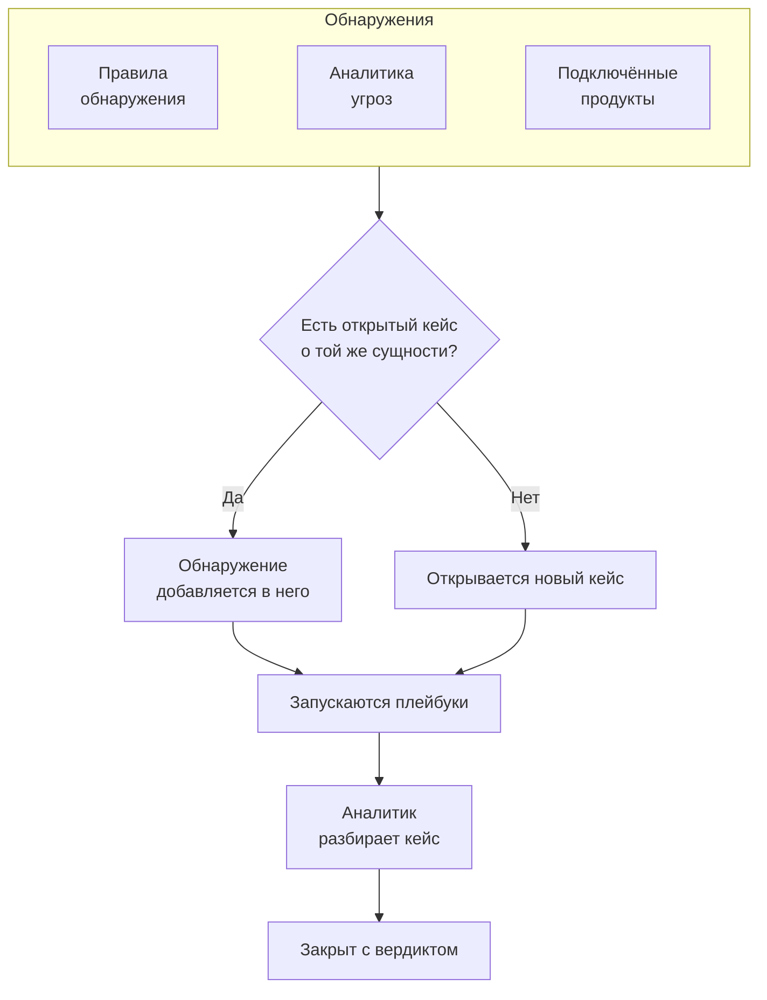

# Кейсы безопасности и плейбуки (SOAR)

Security Events превращает то, что находят ваши правила обнаружения, аналитика угроз и подключённые продукты безопасности, в кейсы: по одному кейсу на всё, в чём стоит разобраться, и каждое обнаружение, касающееся того же пользователя, хоста или адреса, собирается в нём. Аналитики разбирают кейсы в очереди, а плейбуки реагируют на них — сами или по одному нажатию.

:::cards
- [Откуда берутся кейсы](#откуда-берутся-кейсы): Правила обнаружения, аналитика угроз, подключённые продукты, риск сущностей и люди.
- [Работа с кейсом](#работа-с-кейсом): Назначьте его, изучите его сущности и закройте с вердиктом.
- [Приоритеты и статусы кейсов](#приоритеты-и-статусы-кейсов): Переименуйте их, поменяйте цвет и порядок, добавьте свои.
- [Цели реагирования](#цели-реагирования): Как быстро кейс каждого приоритета нужно взять в работу и локализовать.
- [Уведомления](#уведомления): Кому сообщается о новом кейсе, о назначении, о цели реагирования, о задаче и о шаге, ожидающем одобрения.
- [Плейбуки](#плейбуки): Шаги, которые выполняются для кейса, с одобрением там, где это важно.
- [Обзор](#обзор): Что требует внимания прямо сейчас и как быстро обрабатываются кейсы.
:::

## Как это работает

Откройте **Продукты → Security Events → Кейсы безопасности → Открытые кейсы**, чтобы увидеть очередь. **Назначены мне**, **Не назначено**, **Закрытые кейсы** и **Все кейсы** — отдельные страницы рядом, и на каждой те кейсы, о которых говорит её название.

## Перед началом

Кейсы и плейбуки подчиняются трём ролям Security. Project Owner и Project Admin могут всё.

| Роль | Что она может |
| --- | --- |
| Security Admin | Всё, включая удаление кейсов, удаление доказательств и настройку плейбуков |
| Security Member | Открывать, назначать, изменять и закрывать кейсы, писать заметки, работать с задачами, добавлять доказательства, запускать плейбуки, а также одобрять или отклонять их шаги |
| Security Viewer | Читать кейсы, обнаружения, заметки, задачи, доказательства, плейбуки и их запуски |

Каждое из этих разрешений можно выдать и по отдельности — от создания кейса до одобрения шагов плейбука; см. [Справочник разрешений](/docs/permissions/reference).

## Откуда берутся кейсы

| Источник | Открывает кейс, когда | Как отключить |
| --- | --- | --- |
| Правила обнаружения | Срабатывает правило | **Открывать кейс при совпадении** на шаге **При совпадении** правила |
| Аналитика угроз | Событие упоминает известный индикатор | **Открывать кейс при совпадении** на шаге **При совпадении** фида |
| Подключённые продукты | Собственное оповещение продукта импортируется с уровнем не ниже порога подключения | **Open Cases From** со значением **Никогда** на шаге **Опрос** подключения |
| Риск сущностей | Риск пользователя, хоста или адреса достигает порога проекта | **Кейсы по риску** в **Настройки → Оценка риска** |
| Люди | Кто-то открывает кейс в разделе **Кейсы безопасности** или кнопкой **Открыть кейс** на панели события | Никак |

Все источники по умолчанию открывают кейсы, кроме риска сущностей в проектах, созданных до его появления: там сначала включите **Кейсы по риску** ([Риск сущностей](/docs/telemetry/security-entity-risk)). Подключение открывает кейсы для **Высокий и выше**, если вы не выберете другой уровень; оповещения ниже этого уровня всё равно импортируются как события.

### Как группируются обнаружения

Обнаружение относится к сущности: к значению, по которому группирует его правило, например к IP-адресу в правиле против перебора паролей или к индикатору, который называет совпадение с аналитикой угроз. Обнаружение без сущности стоит особняком.

- Если открытый кейс уже относится к этой сущности, обнаружение добавляется в него. Сущности кейса и его сопоставление с ATT&CK пополняются, а приоритет поднимается до приоритета обнаружения и никогда не понижается.
- Если такого открытого кейса нет, открывается новый кейс с названием обнаружения и с его приоритетом.
- Повторно сработавшее обнаружение увеличивает счётчик в своей строке, а не добавляет новую строку.

Приоритет кейса определяется серьёзностью обнаружения — это встроенный приоритет проекта для этого уровня, как бы вы его ни назвали:

| Серьёзность | Приоритет |
| --- | --- |
| Critical или Fatal | Critical |
| High | High |
| Medium, Unknown или Other | Medium |
| Low | Low |
| Informational | Informational |

## Работа с кейсом

Кейсы нового проекта проходят через четыре статуса, которые можно переименовать и дополнить своими (см. [Приоритеты и статусы кейсов](#приоритеты-и-статусы-кейсов)). Какой-то из них кейс может пропустить — например, ложное срабатывание закрывают прямо из New, — и его можно открыть повторно.

| Статус | Означает |
| --- | --- |
| New | Его ещё никто не смотрел |
| Investigating | Кто-то выясняет, что произошло |
| Contained | Угроза больше не может навредить, но последствия ещё предстоит устранить |
| Closed | Готово, с вердиктом о том, что это было |

У кейса есть собственное боковое меню, как у инцидента, и у каждой части кейса своя страница:

| Раздел бокового меню | Страницы |
| --- | --- |
| **Обзор** | **Обзор**, **Хронология** |
| **Расследование** | **Ход событий**, **Обнаружения**, **Сущности**, **Связанные сигналы**, **Доказательства**, **Задачи**, **Плейбуки** |
| **Заметки** | **Приватные заметки** |
| **Расширенный** | **Журналы аудита**, **Удалить кейс**, свёрнуты, пока вы не нажмёте **Расширенный** |

Каждая страница сохраняет вверху шапку кейса: номер, приоритет, статус и название, **Назначить мне**, **Запустить плейбук**, **Объявить инцидент** и **Закрыть кейс**, а в меню ⋯ рядом с ними есть **Установить приоритет**, **Назначить другому**, **Изменить статус**, **Редактировать кейс** и **Удалить кейс**. Поэтому с кейсом можно работать с любой его страницы, а ссылка на кейс по-прежнему открывает его **Обзор**. Если у приоритета кейса есть цели реагирования, заголовок также показывает, когда наступает срок следующей ([Цели реагирования](#цели-реагирования)).

- **Обзор**: описание, метки и шаги статуса кейса, кто им занимается и что его открыло, а также его показатели: сколько в нём обнаружений, как долго он открыт и сколько времени ушло на подтверждение и на сдерживание. Под показателями **Время до подтверждения** и **Время до локализации** видно, как кейс выглядит относительно своих целей реагирования.
- **OneUptime AI**, на странице **Обзор**: что OneUptime AI понял из кейса, приоритет и плейбук, которые он предлагает, и доказательства за ними. См. [OneUptime AI в безопасности](/docs/telemetry/security-ai).
- **Последствия**, на странице **Обзор**: что ставит под угрозу кейс: видел ли OneUptime, что к его записям обращались из интернета, кто ими владеет и что в них менялось в последний раз. Разверните, чтобы увидеть, что вызывает каждая запись и кто вызывает её, какие мониторы и страницы статуса за ней следят и с какими машинами общались адреса кейса.
- **MITRE ATT&CK**, на странице **Обзор**: тактики и техники, с которыми сопоставлены его обнаружения, каждая со ссылкой на свою страницу на attack.mitre.org.
- **Хронология**: всё, что происходило с кейсом, с указанием, кто это сделал.
- **Ход событий**: что произошло, по порядку, во всём OneUptime: каждое обнаружение и стоящие за ним события безопасности, как далеко прошли их запросы, какие исключения они вызвали, изменения в записях, которые называет кейс, инциденты и оповещения на них и что сделала команда. Множество проб одного сканера — это одна строка, и каждая строка открывает то, что называет, например трассировку запроса или исключение.
- **Обнаружения**: что сработало и открыло кейс или добавилось в него, как часто и последнее совпавшее событие.
- **Сущности**: пользователи, хосты и адреса, к которым относится кейс, с их активностью во всех ваших событиях безопасности за последние 7 дней. Каждая открывается в **Коррелировать**.
- **Связанные сигналы**: хосты, кластеры, службы и участники, которых называет кейс, такими, какими их знает OneUptime, и что происходило на каждом из них во время его обнаружений: их журналы, трассировки и метрики, что на них открыто и что менялось. См. [Связанные сигналы](/docs/telemetry/security-connected-signals).
- **Доказательства**: файлы и ссылки, хранящиеся в кейсе, у каждого указано, кто и когда его добавил. Кнопка **Добавить файл** загружает файл размером до 10 МБ и записывает SHA-256 загруженного, чтобы тот, кто скачает его позже, мог проверить, что это сохранённое; кнопка **Добавить ссылку** указывает на доказательства, хранящиеся в другом месте. Удалить доказательство может только Security Admin, а **Хронология** кейса показывает, что было добавлено и удалено.
- **Задачи**: что нужно сделать по кейсу, кто этим занимается и сделано ли это. Добавьте задачу одной строкой, передайте её кому-нибудь и отметьте, когда она выполнена. Тому, кому передана задача, приходит уведомление, если только он не взял её сам, а меню показывает рядом с пунктом **Задачи**, сколько задач открыто.
- **Плейбуки**: что каждый плейбук сделал с кейсом, шаг за шагом, и шаги, ожидающие одобрения. Пока запуски ждут, меню показывает их число рядом с **Плейбуки**.
- **Приватные заметки**: что команда написала о кейсе.
- **Журналы аудита**: каждое изменение кейса и кто его внёс. См. [Журналы аудита](/docs/configuration/audit-logs).
- **Удалить кейс**: удаляет кейс навсегда вместе с его обнаружениями, заметками, хронологией и запусками плейбуков. Чтобы сохранить запись, лучше закройте его с вердиктом.

### Работа с кейсами из очереди

Чтобы работать с кейсом, открывать его не обязательно. В списках очереди меню ⋯ в строке кейса содержит **Назначить мне**, **Назначить другому**, **Изменить статус** и **Изменить приоритет**. Чтобы работать с несколькими кейсами сразу, выберите их и используйте те же действия в меню **Массовые действия**: там видно, какие кейсы изменены, какие оставлены как были и почему.

- Чтобы передать кейс другому, используйте **Назначить другому** и выберите одного человека или команду. Кейс команды ждёт в разделе **Не назначено**, пока кто-то из команды его не возьмёт.
- Статус, который закрывает кейс, запрашивает вердикт и заключительную заметку, как и **Закрыть кейс**.
- Закрытый кейс никому не назначается. Чтобы снова работать с ним, откройте его заново через **Изменить статус**.

### Закрытие кейса

**Закрыть кейс** запрашивает вердикт и необязательную заключительную заметку:

| Вердикт | Означает |
| --- | --- |
| True Positive | Вредоносная или несанкционированная активность действительно была |
| Benign Positive | Активность была реальной, но ожидаемой, например тест на проникновение или задача администратора |
| False Positive | Обнаружение ошибочно: правило или данные неверно истолковали обычную активность |
| Undetermined | Информации не хватило, чтобы сделать вывод |

Вердикты подсчитываются на обзоре. Правило, кейсы которого раз за разом закрываются как False Positive, нуждается в настройке.

Пока в кейсе остаются открытые задачи, окно **Закрыть кейс** показывает, сколько их.

Кейс, открытый из оповещений Google SecOps, закрывает их и в Google SecOps, с вердиктом и заметкой о закрытии, когда у его подключения включено **Закрывать оповещения, когда закрывается их кейс**: см. [Google SecOps](/docs/integrations/google-secops#закрывать-оповещения-когда-закрывается-их-кейс).

### Объявление инцидента

**Объявить инцидент** открывает для кейса инцидент OneUptime с выбранной вами серьёзностью и связывает их в обе стороны: описание инцидента называет кейс, а заголовок кейса ссылается на инцидент. Дальше в дело вступают дежурства, страницы статуса и постмортем. Для этого нужна роль, которая может и работать с кейсами, и создавать инциденты.

## Приоритеты и статусы кейсов

У каждого проекта свои приоритеты и статусы кейсов: **Продукты → Security Events → Настройки → Приоритеты кейсов** и **Статусы кейсов**. Переименовывайте их, меняйте цвет, перетаскивайте в другой порядок и добавляйте свои, например статус «Triage» или приоритет «Emergency» выше приоритета **Критический**. Новое имя сразу видно везде: в очереди, на страницах кейсов и в обзоре, в уведомлениях, в Slack и Microsoft Teams и в сообщениях плейбуков.

Некоторые из них встроенные: OneUptime читает, что они значат. Их можно переименовать и перекрасить, но нельзя удалить или архивировать, и их порядок сохраняется:

| Встроенный | Что с ним делает OneUptime |
| --- | --- |
| Статус нового кейса | В нём начинаются новые кейсы |
| Статус принятого кейса | Когда кейс доходит до него, записывается время принятия, а **Открыть снова** возвращает в него закрытый кейс |
| Статус сдержанного кейса | Когда кейс доходит до него, записывается время сдерживания |
| Статус закрытого кейса | **Закрыть кейс** переводит в него кейс с вердиктом |
| Приоритеты Critical, High, Medium, Low и Informational | Обнаружение открывает свой кейс с приоритетом своей серьёзности, а кейс, открытый человеком, начинается с Medium |

- Место статуса определяет, чем считается кейс в нём, — это показывает столбец **Считается**: от статуса принятого кейса и ниже — принятым, от статуса сдержанного и ниже — сдержанным, от статуса закрытого и ниже — закрытым. Добавленный вами статус встаёт сразу над статусом закрытого кейса, а при переводе кейса в статус, который его закрывает, сначала спрашивается вердикт.
- Место приоритета — это его срочность, самый срочный первым: **Для кейсов не ниже**, варианты уведомлений и правила Slack и Microsoft Teams читают этот порядок. Добавленный вами приоритет встаёт в конец, а столбец **Серьёзность обнаружения** показывает, какие обнаружения открывают свои кейсы с каким встроенным приоритетом.

Чтобы перестать пользоваться своим статусом или приоритетом, нажмите **Архивировать** в его строке. Выбрать его больше нельзя, API, Terraform и MCP его отклоняют, но кейсы, у которых он есть, его сохраняют, и по нему по-прежнему можно фильтровать. Архивные значения перечислены в свёрнутом разделе **Статусы кейсов в архиве** или **Приоритеты кейсов в архиве** под таблицей, где **Извлечь из архива** возвращает значение. **Удалить** не сработает, пока у кейсов есть это значение или плейбук запускается от этого приоритета.

## Цели реагирования

Цель реагирования задаёт, как быстро нужно работать с кейсом: **Подтвердить в течение** — сколько новый кейс может ждать, пока его кто-то возьмёт в работу, и **Локализовать в течение** — сколько времени может уйти на его локализацию или закрытие. У каждого приоритета кейсов свои цели, в **Продукты → Security Events → Настройки → Цели реагирования**: кнопка **Редактировать** в строке приоритета задаёт обе его цели в минутах, часах или днях, до года, а пустая цель означает, что цели нет. Приоритеты нового проекта начинают с таких:

| Приоритет | Подтвердить в течение | Локализовать в течение |
| --- | --- | --- |
| Critical | 15 минут | 4 часа |
| High | 1 час | 1 день |
| Medium | 12 часов | 3 дня |
| Low | 1 день | 7 дней |
| Informational | Без цели | Без цели |

У проекта, созданного до появления целей реагирования, их нет, пока кто-нибудь их не задаст.

- Сроки кейса задаются при его открытии по целям его приоритета. Цель, изменённая позже, действует для кейсов, открытых после этого.
- Кейс подтверждён, как только кто-то берёт его в работу: его назначают человеку или переводят в статус, который считается подтверждённым. Он локализован, как только достигает статуса, который считается локализованным, или закрывается.
- Когда приоритет кейса меняется, цель, которую он уже выполнил или нарушил, остаётся как была. Более высокий приоритет приближает срок: новая цель отсчитывается от изменения, если только прежний срок не наступает раньше. Более низкий приоритет отодвигает его, но никогда не приближает: новая цель отсчитывается от открытия кейса. Приоритет без цели сохраняет срок повышенного кейса и снимает срок пониженного.
- Закрытый кейс, который снова открыли, прежде чем он хоть раз был локализован, получает новый срок локализации, отсчитанный от повторного открытия.
- В последней пятой части цели кейс вот-вот её нарушит: те, кто над ним работает, получают уведомление, а когда цель нарушена, ещё одно. См. [Уведомления](#уведомления).

Где видны цели:

- Заголовок кейса называет следующую цель и сколько осталось времени или насколько она просрочена: серым, пока время есть, янтарным в последней пятой части, красным после нарушения.
- На странице **Обзор** кейса, под показателями **Время до подтверждения** и **Время до локализации**: как кейс выглядит относительно каждой цели или насколько он её превысил.
- В списках очереди: строка под приоритетом каждого кейса и столбец **Срок**, который можно включить и сортировать по нему. Списки показывают их, только когда у какого-либо приоритета проекта есть цель.

## Уведомления

OneUptime сообщает людям о пяти событиях в кейсе. Ничего настраивать не нужно: проект, в котором только нажали **Включить рекомендуемое**, узнаёт о своих кейсах с приоритетом High и Critical по почте и через push.

| Уведомление | Кому сообщается | По умолчанию |
| --- | --- | --- |
| Новый кейс безопасности | Всем, кто может видеть кейсы проекта, когда кейс открывается с выбранным ими приоритетом или выше либо повышается до него | Почта и push, для кейсов с приоритетом High и Critical |
| Кейс безопасности, назначенный мне | Человеку, которому назначен кейс, и участникам команды, которой он назначен | Почта и push |
| Шаг плейбука ждёт моего одобрения | Людям в кейсе, которые могут одобрить шаг: человеку, которому он назначен, и участникам его команды. Если никто из них не может одобрить — всем в проекте, кто может | Почта и push |
| Цель реагирования по кейсу безопасности | Тем, кто работает над кейсом: человеку, которому он назначен, и участникам его команды. Если над кейсом никто не работает, тем, кто получает уведомления о новых кейсах с его приоритетом | Почта и push |
| Назначенная мне задача кейса безопасности | Человеку, которому передана задача кейса, если только он не взял её сам | Почта и push |

- О кейсе сообщают только тем, кто может его видеть: Project Owner, Project Admin и ролям Security Admin, Security Member и Security Viewer. Тем, чья роль ограничена некоторыми метками, сообщают только о кейсах с этими метками.
- Никому не сообщают о его собственных действиях: тот, кто открывает кейс вручную, назначает его или запускает плейбук, уведомления об этом не получает.
- Каждый узнаёт о кейсе один раз. Кейс, который открылся с приоритетом Medium, а потом поднялся до Critical, при повышении доходит до тех, кто выбрал High или Critical, и не доходит повторно до тех, кто выбрал Medium: они узнали о нём при открытии.
- Тестовая атака, отправленная кнопкой **Отправить тестовую атаку**, открывает кейс, о котором никому не сообщается.
- Кейс с приоритетом Critical и шаг, ожидающий одобрения, отправляются сразу и никогда не задерживаются в [сводке писем](/docs/emails/notification-rollup). Как и цель реагирования, которая вот-вот будет нарушена или уже нарушена.
- **Хронология** кейса показывает, кому и когда сообщили.

### Выбор уведомлений

Каждый выбирает сам, в **Настройки пользователя → Настройки уведомлений → Безопасность**: каналы для каждого уведомления (почта, SMS, звонок, push, Telegram, Slack, Microsoft Teams или вебхук), а для события **Новый кейс безопасности** — приоритет, начиная с которого ему приходят уведомления:

| Выбор | Уведомляет о кейсах с приоритетом |
| --- | --- |
| Только Критический | Critical |
| Высокий и выше | Critical и High (по умолчанию) |
| Средний и выше | Critical, High и Medium |
| Низкий и выше | Любой, кроме Informational |
| Все кейсы | Любой |

Варианты повторяют приоритеты кейсов проекта, под их собственными именами: здесь — варианты нового проекта.

Сообщения WhatsApp для кейсов безопасности не отправляются. Push-уведомление открывает кейс в приложении OneUptime On-Call (1.7.0 или новее), где можно одобрить или отклонить ожидающий шаг плейбука, взять кейс на себя и закрыть его. Ссылка в нём открывает кейс в браузере.

### Публикация в каналах Slack и Microsoft Teams

Чтобы публиковать сообщения в канале, добавьте правило в **Продукты → Security Events → Рабочее пространство → Slack** (или **Microsoft Teams**). Если ни один из них не подключён, единственный пункт этого раздела — **Подключить Slack или Teams**. Правило указывает каналы для публикации (а в Microsoft Teams — и чаты) и, если нужно, кейсы, к которым оно относится:

| Условие | Совпадает по |
| --- | --- |
| Приоритет кейса безопасности | Один из приоритетов кейсов проекта, например Critical или High |
| Заголовок кейса безопасности, Описание кейса безопасности | Тексту, который заголовок или описание кейса содержит, которым начинается или заканчивается |
| Статус кейса безопасности | Один из статусов кейсов проекта, например New или Closed |
| Источник кейса безопасности | Detection Rule, Threat Intel, Connected Product, Риск сущностей или Manual |
| Метки кейса безопасности | Меткам кейса |

Каждое уведомление, кроме уведомления о задаче, публикуется в каналы всех правил, которым кейс соответствует в этот момент. Правило, в котором **Приоритет кейса безопасности** содержит любой из **Критический** и **Высокий**, публикует кейсы High и Critical при открытии, а кейс Medium — когда он повышается до High. У кейса безопасности никогда не бывает собственного канала.

## Плейбуки

Плейбук — это список шагов, которые выполняются для кейса. Создайте его в **Продукты → Security Events → Плейбуки** из шаблона или с нуля и добавьте шаги на его странице. Проект без плейбуков видит шаблоны вместо пустого списка; когда плейбуки есть, **Создать из шаблона** у списка открывает их, с отметкой **Добавлено** у тех, что в проекте уже есть.

### Когда запускается плейбук

| Запуск | Когда |
| --- | --- |
| Case Opened | Один раз, при открытии кейса |
| Detection Added | Каждый раз, когда в открытый кейс добавляется новое обнаружение |
| Оценён как вероятно вредоносный | Один раз, когда оценка OneUptime AI читает кейс как «Вероятно, вредоносно» |
| Manual | Только когда кто-то запускает его из кейса |

Любой включённый плейбук можно также запустить вручную кнопкой **Запустить плейбук** в кейсе. Плейбук, который запускается сам, можно ограничить:

- **Для кейсов не ниже**: только кейсы с этим или более высоким приоритетом.
- **Только для обнаружений из**: только если обнаружение, стоящее за кейсом, пришло из этого источника.
- **Только для этих правил обнаружения**: только если оно пришло от одного из этих правил.

Отключённый плейбук не запускается ни сам, ни вручную.

### Шаги

| Категория | Шаг | Что делает |
| --- | --- | --- |
| Кейс | Assign the case | Назначает кейс человеку, команде или обоим |
| Кейс | Set the priority | Повышает или понижает приоритет кейса |
| Кейс | Set the status | Переводит кейс в другой статус проекта с выбранным вами вердиктом, если этот статус его закрывает |
| Кейс | Add a note | Пишет заметку в кейсе, например чек-лист для аналитика |
| Кейс | Add labels | Помечает кейс метками |
| Расследование | Check entities against threat intel | Ищет каждую сущность в вашей аналитике угроз и при совпадении может повысить приоритет |
| Расследование | Look up entity activity | Подсчитывает события безопасности каждой сущности за недавний период и отмечает результат в кейсе |
| Расследование | Preserve the evidence | Сохраняет записи сеансов для запросов, стоящих за кейсом, и отмечает в кейсе их трассировки и исключения |
| Уведомление | Email people | Отправляет пользователям и командам письмо со сводкой по кейсу и ссылкой на него |
| Уведомление | Post to Slack | Публикует сводку по кейсу в канал Slack |
| Уведомление | Post to Microsoft Teams | Публикует сводку по кейсу в канал Microsoft Teams |
| Уведомление | Post a status page announcement | Публикует написанное вами объявление на выбранных страницах статуса |
| Эскалация | Page on-call | Запускает политику дежурств |
| Эскалация | Declare an incident | Открывает инцидент OneUptime, связанный с кейсом |
| Сдерживание | Suspend the user in Okta | Блокирует в Okta пользователя, к которому относится кейс |
| Сдерживание | End the user's Okta sessions | Завершает сеансы Okta пользователя, к которому относится кейс, и отзывает его токены |
| Сдерживание | Contain the host in CrowdStrike | Изолирует от сети хост, к которому относится кейс, с помощью CrowdStrike Falcon |
| Сдерживание | Isolate the device in Microsoft Defender | Изолирует хост, к которому относится кейс, с помощью Microsoft Defender for Endpoint |
| Сдерживание | Unsuspend the user in Okta | Разблокирует в Okta пользователя, к которому относится кейс |
| Сдерживание | Lift containment in CrowdStrike | Снимает сетевую изоляцию CrowdStrike Falcon с хоста, к которому относится кейс |
| Сдерживание | Release the device in Microsoft Defender | Выводит хост, к которому относится кейс, из изоляции в Microsoft Defender for Endpoint |
| Автоматизация | Send a webhook | Отправляет кейс в виде JSON на URL |
| Автоматизация | Run a workflow | Запускает рабочий процесс OneUptime с кейсом в качестве входных данных |
| Автоматизация | Run a runbook | Запускает один из ваших ранбуков OneUptime с кейсом в качестве входных данных |
| Автоматизация | Fix the code with AI | Просит OneUptime AI подготовить pull request, исправляющий исключения, которые вызвали запросы кейса |

В плейбуке не больше 25 шагов. Они выполняются по порядку, каждый — после завершения предыдущего. У каждого шага есть также такие настройки:

- **Нужно одобрение**: останавливает запуск перед шагом, пока кто-нибудь не одобрит его в кейсе. Для четырёх шагов, которые лишают кого-то доступа, она включена всегда, если только Security Admin её не выключит. **Run a runbook** и **Post a status page announcement** начинают с включённым одобрением: первый запускает команды в ваших системах, а второй обращается к вашим клиентам; тот, кто добавляет шаг, может её выключить.
- **Только при совпадении в разведке угроз**: пропускает шаг, если более ранний шаг **Проверить сущности по разведке угроз** в этом запуске не нашёл известного индикатора.
- **Продолжать при сбое**: выполняет следующий шаг, даже если этот завершился ошибкой. Когда настройка выключена, ошибка шага останавливает запуск.

### Реагирование через OneUptime

Четыре шага действуют через остальной OneUptime, а не через подключённый продукт:

- **Run a runbook** запускает один из ваших [ранбуков](/docs/runbooks/index) с кейсом в качестве входных данных, которые шаг Bash читает как переменные окружения (см. [Вызов webhook](/docs/runbooks/triggers#вызов-webhook)). `ONEUPTIME_INPUT_IP`, `ONEUPTIME_INPUT_USER` и `ONEUPTIME_INPUT_HOST` — это адрес, пользователь и хост, к которым относится кейс, выбранные по тому же правилу, что и для шага сдерживания; они пусты, если кейс ни к одному из них не относится. `ONEUPTIME_INPUT_IPS`, `ONEUPTIME_INPUT_USERS` и `ONEUPTIME_INPUT_HOSTS` перечисляют в виде JSON всех, кого называет кейс, а `ONEUPTIME_INPUT_CASE_NUMBER`, `ONEUPTIME_INPUT_CASE_TITLE` и `ONEUPTIME_INPUT_CASE_URL` указывают, о каком кейсе речь. Защищённого пользователя или хоста среди них никогда нет. В запуске ранбука указано, что его начал **Security playbook** для этого кейса.
- **Preserve the evidence** сохраняет записи сеансов для запросов, стоящих за кейсом, дольше срока их хранения и пишет в кейсе заметку со ссылками на трассировку каждого запроса, каждую запись и каждое исключение. Логи и трассировки нельзя хранить дольше, чем проект хранит телеметрию, поэтому заранее экспортируйте то, что вам нужно.
- **Post a status page announcement** публикует написанное вами в том виде, в каком вы его написали, на выбранных страницах статуса. Ничего из кейса к нему не добавляется. Их подписчики получают уведомление, только если включено **Уведомить подписчиков**.
- **Fix the code with AI** просит OneUptime AI подготовить для каждого исключения, которое вызвали запросы кейса, но не больше трёх, pull request, который его исправляет. Шагу нужны включённый OneUptime AI, репозиторий с кодом, подключённый через GitHub App, и раннер. Без них шаг пропускается и сообщает, чего не хватает.

### Сдерживание

Шаги сдерживания действуют через [подключение событий безопасности](/docs/telemetry/security-events#подключение-продукта-безопасности) к продукту, и ему нужен не только доступ на чтение:

| Шаг | Подключение | Что нужно |
| --- | --- | --- |
| Suspend the user in Okta, End the user's Okta sessions, Unsuspend the user in Okta | Okta System Log | API-токен с правом управлять пользователями |
| Contain the host in CrowdStrike, Lift containment in CrowdStrike | CrowdStrike Falcon | API-клиент с правом записи в области Hosts |
| Isolate the device in Microsoft Defender, Release the device in Microsoft Defender | Microsoft Defender XDR | Приложение с разрешением Machine.Isolate |

Шаг сдерживания действует только на пользователей или хосты, к которым относится кейс, и никогда — на всех, кто в нём упомянут:

- Значение, по которому сгруппировано обнаружение кейса, например учётная запись, по которой группирует правило невозможных перемещений, или хост, названный в оповещении подключённого продукта.
- Пользователь или хост кейса, который известен вашей аналитике угроз как индикатор.

Кейс, сгруппированный по адресу, например перебор паролей к вашему VPN, не относится ни к тому, ни к другому: его шаги сдерживания пропускаются, а учётная запись, к которой подбирали пароль, и шлюз, который атаковали, остаются нетронутыми. Шаг действует не более чем на 10 пользователей или хостов. Он находит каждого из них в продукте по имени и сообщает в запуске, что сделал с каждым: выполнено, уже выполнено, не найден, отказано или защищён.

#### Защищённые сущности

**Защищённые сущности** в разделе **Плейбуки** меню перечисляет пользователей и хосты, к которым ни один плейбук не применяет сдерживание, например учётные записи для аварийного доступа, контроллеры домена и VPN-шлюзы. Значение совпадает независимо от регистра, а `*` обозначает любую последовательность символов: `svc-*` защищает все служебные учётные записи. О защищённом пользователе или хосте шаг сообщает как о защищённом и не трогает его. Список ведут пользователи с ролью Security Admin.

#### Одобрение

Четыре шага, которые лишают кого-то доступа, ждут одобрения. Выключить для одного из них **Нужно одобрение** может только Security Admin, и OneUptime записывает, кто это сделал. При одобрении пользователи или хосты, на которые подействует шаг, перечислены в **Применить к**, и все они отмечены: снимите отметку с тех, кого шаг должен оставить в покое. Защищённые там не предлагаются. Тот, кто начал запуск, не может одобрить его шаги: это делает кто-то другой, но отклонить шаг он всё же может.

#### Отмена

Шаги отмены, как и шаги, которые они отменяют, действуют на пользователей или хосты, к которым относится кейс. После остановки запуска у пользователя или хоста, к которому применено сдерживание, на его шаге есть и собственная кнопка: **Снять блокировку**, **Снять локализацию** или **Освободить**. Завершённый сеанс Okta отменить нельзя. Каждая отмена сохраняется в хронологии кейса и в журнале аудита проекта.

### Сообщения

Заметка, письмо, публикация в Slack и публикация в Teams могут использовать значения кейса:

| Заполнитель | Превращается в |
| --- | --- |
| `{{case.number}}` | Номер кейса, например CASE-42 |
| `{{case.title}}` | Заголовок кейса |
| `{{case.priority}}` | Приоритет кейса, как его называет ваш проект, например High |
| `{{case.status}}` | Статус кейса, как его называет ваш проект, например Investigating |
| `{{case.assignee}}` | Кому назначен кейс |
| `{{case.url}}` | Ссылка на кейс в OneUptime |
| `{{case.entities}}` | Пользователи, хосты и адреса, к которым относится кейс |
| `{{case.detections}}` | Сколько обнаружений в кейсе |

Письмо или публикация без собственного сообщения отправляют сводку по кейсу.

### Запуски и одобрения

Каждый запуск отображается шаг за шагом в своём кейсе и в **Продукты → Security Events → Плейбуки → Запуски плейбуков**:

| Статус запуска | Означает |
| --- | --- |
| Queued | Ожидает воркера |
| Running | Выполняет свои шаги |
| Waiting for Approval | Остановлен перед шагом, которому нужно одобрение |
| Succeeded | Каждый шаг выполнен или пропущен |
| Failed | Шаг завершился ошибкой, и запуск остановился |
| Cancelled | Кто-то отменил его или отклонил шаг |

Шаг, ожидающий одобрения, показывает в запуске кнопки **Одобрить** и **Отклонить** с необязательным комментарием. Одобрение продолжает запуск с этого шага; отклонение завершает его. Решение, его автор и комментарий сохраняются в шаге, в хронологии кейса и в журнале аудита проекта. Страница **Одобрения** в разделе **Плейбуки** меню показывает запуски, ждущие решения, и их число; **Запуски плейбуков** показывает все запуски. На странице **Запуски плейбуков**, на странице плейбука и в разделе **Плейбуки** кейса каждый запуск — одна строка: докуда он дошёл или на каком шаге остановился; **Показать шаги** раскрывает его шаги. Запуск, ожидающий одобрения, раскрывается сам, как и самый новый запуск кейса.

Запуск, от воркера которого перестали приходить сигналы, например после перезапуска, подхватывается снова: запуск в очереди ставится в очередь повторно через 2 минуты, а запуск, молчащий 30 минут, считается неудавшимся.

## Обзор

Продукт открывается на странице **Продукты → Security Events → Обзор**:

- Открытые кейсы, назначенные вам, открытые кейсы, которые никто не взял, и шаги плейбуков, ожидающие одобрения; каждое число открывает страницу, где они перечислены.
- **Среднее время до принятия**, **Среднее время до сдерживания** и **Среднее время до закрытия** по кейсам, открытым за последние 30 дней: от открытия кейса до того, как кто-то возьмёт его в работу (назначит человека или переведёт в статус, который считается принятым), до статуса, который считается сдержанным, и до статуса, который считается закрытым. Кейс, который ещё ждёт, в среднее значение не входит.
- Кейсы, открытые за каждый из последних 30 дней, по приоритету, и обнаружения, созданные за каждый из последних 14 дней, по источнику.
- Открытые кейсы по приоритету и по статусу, самые рискованные сущности по оценке риска, чаще всего срабатывавшие обнаружения, тактики ATT&CK, стоящие за кейсами, и вердикты за последние 30 дней.

Над ними полоса показывает, как настроена безопасность: её источники, обнаружения, кейсы и плейбуки, каждый со своими цифрами. Проект, который её ещё не настроил, видит там **Включить рекомендуемое** и **Отправить тестовую атаку**; см. [Начало работы с безопасностью](/docs/telemetry/security-getting-started). Когда ничего не требует внимания, страница показывает **Всё спокойно**, а графики появляются, как только есть что показать.

## Поиск угроз

- **Риск сущностей** ранжирует пользователей, хосты и адреса по оценке риска, самые рискованные первыми, а **Самые рискованные сущности** в обзоре показывает верх этого же списка. Выберите сущность, чтобы увидеть, почему она рискованна. Под списком **Найти сущность** ищет любое значение в событиях за 30 дней, в том числе домен или хеш файла, и открывает его в разделе **Коррелировать**.
- **Библиотека правил** содержит готовые правила обнаружения для угроз в области идентификации, конечных точек, облака, сети, веба и Kubernetes. Каждое из них — правило Sigma, написанное для полей, к которым нормализуется каждый подключённый источник. Его строка показывает, что оно находит, тактики и техники MITRE ATT&CK, которыми оно помечено, события, которые оно читает, и поступали ли они за последние 7 дней (**Поступают** или **Не поступают**), а также его серьёзность. Сужайте список по категории, по данным, которые читают правила, и по тому, добавлены ли они, или ищите в нём по названию, технике ATT&CK или серьёзности; адрес страницы сохраняет фильтры. Выберите правило, чтобы увидеть подробности: как начать отправлять события, которые оно читает, как оно выполняется и его правило Sigma. **Добавить** создаёт его как ваше собственное правило обнаружения — включённым и открывающим кейсы, а не оповещения; изменяйте его в **Правила обнаружения**, как любое другое. Правила с отметкой **Рекомендуемые** находят угрозы в данных, которые у OneUptime уже есть, а одна кнопка добавляет те, которых у вас ещё нет.
- **Покрытие ATT&CK** перечисляет тактики MITRE ATT&CK, для каждой — сколько её техник покрывают ваши включённые правила и для скольких ещё в **Библиотека правил** есть правила. Откройте тактику, чтобы увидеть её техники, или переключитесь на вид **Матрица**, чтобы увидеть всю матрицу. Выберите технику, чтобы увидеть правила из библиотеки, которые её покрывают, и открыть **Библиотека правил** на них.

## Автоматизация

- **Рабочие процессы**: кейс или заметка могут запускать рабочий процесс при создании, изменении или удалении. Шаг **Запустить рабочий процесс** запускает рабочий процесс, триггером которого служит вебхук.
- **API**: у кейсов, заметок, задач, доказательств, обнаружений, плейбуков, запусков, защищённых сущностей, а также приоритетов и статусов кейсов тот же REST API, что и у остального OneUptime, по путям `/security-case`, `/security-case-note`, `/security-case-task`, `/security-case-evidence`, `/security-detection`, `/security-playbook`, `/security-playbook-run`, `/security-protected-entity`, `/security-case-priority` и `/security-case-status`. См. [Справочник API](/docs/api-reference/api-reference).
- ИИ-агенты: у MCP-сервера есть инструменты для кейсов, заметок, задач, доказательств, обнаружений, плейбуков, а также приоритетов и статусов кейсов. См. [Сервер MCP](/docs/ai/mcp-server).
- Terraform: ресурсы `oneuptime_security_case_priority` и `oneuptime_security_case_status` хранят приоритеты и статусы проекта в виде кода.

## Устранение неполадок

:::details Правило срабатывает, но кейс не открывается
Проверьте **Открывать кейс при совпадении** на шаге **При совпадении** правила. Обнаружение о сущности, у которой уже есть открытый кейс, добавляется в этот кейс, а не открывает новый: ищите его в **Обнаружения** открытого кейса.
:::

:::details Никому не сообщили о кейсе
Посмотрите раздел **Хронология** кейса: там видно, кого уведомили. Уведомление **Новый кейс безопасности** уходит тем, чьего выбранного приоритета достигает кейс, поэтому кейс Medium не уведомляет никого, кто оставил значение по умолчанию, **Высокий и выше**. Проверьте, что люди, которые должны узнать о кейсе, могут видеть кейсы безопасности (роль Security, Project Owner или Project Admin) и что уведомление у них включено в **Настройки пользователя → Настройки уведомлений → Безопасность**.
:::

:::details У кейса не видно срока
У его приоритета нет цели реагирования, или она появилась уже после открытия кейса: сроки кейса задаются при его открытии. У кейса тестовой атаки сроков нет. См. [Цели реагирования](#цели-реагирования).
:::

:::details Плейбук не запустился
Проверьте, что он включён, что его настройка **Триггер** подходит (Case Opened запускается один раз, при открытии кейса) и что кейс соответствует его настройкам **Для кейсов не ниже**, **Только для обнаружений из** и **Только для этих правил обнаружения**. У кейса, открытого вручную, нет обнаружения, поэтому плейбук, ограниченный источником или правилами, для него не запускается.
:::

:::details Шаг сдерживания завершился ошибкой
Откройте запуск в кейсе: шаг сообщает для каждого пользователя или хоста, отказал ли продукт, не нашёл ли его или оказался недоступен. Проверьте, что учётные данные подключения позволяют внести это изменение, и используйте **Проверить подключение** в его строке.
:::

:::details Шаг сдерживания пропущен
Кейс не относится ни к одному пользователю или хосту, а, например, только к адресу, или все пользователи и хосты, к которым он относится, защищены. Откройте запуск в кейсе: шаг сообщает, в чём причина.
:::

:::details Статус или приоритет нельзя удалить или архивировать
Встроенный можно переименовать и перекрасить, но никогда нельзя удалить или архивировать: его **Архивировать** заблокировано, с причиной. Свой нельзя удалить, пока он есть у кейсов или от него запускается плейбук: сначала переведите кейсы в другой, или архивируйте его.
:::

## Дальнейшие шаги

:::cards
- [События безопасности](/docs/telemetry/security-events): Отправляйте события, пишите правила обнаружения и подключайте продукты безопасности.
- [Аналитика угроз](/docs/telemetry/threat-intelligence): Сверяйте свои события с фидами STIX/TAXII.
- [OneUptime AI в безопасности](/docs/telemetry/security-ai): Оценивать кейсы, писать черновики правил обнаружения и спрашивать о безопасности с помощью ИИ.
- [Справочник разрешений](/docs/permissions/reference): Роли Security и возможности каждой из них.
:::
