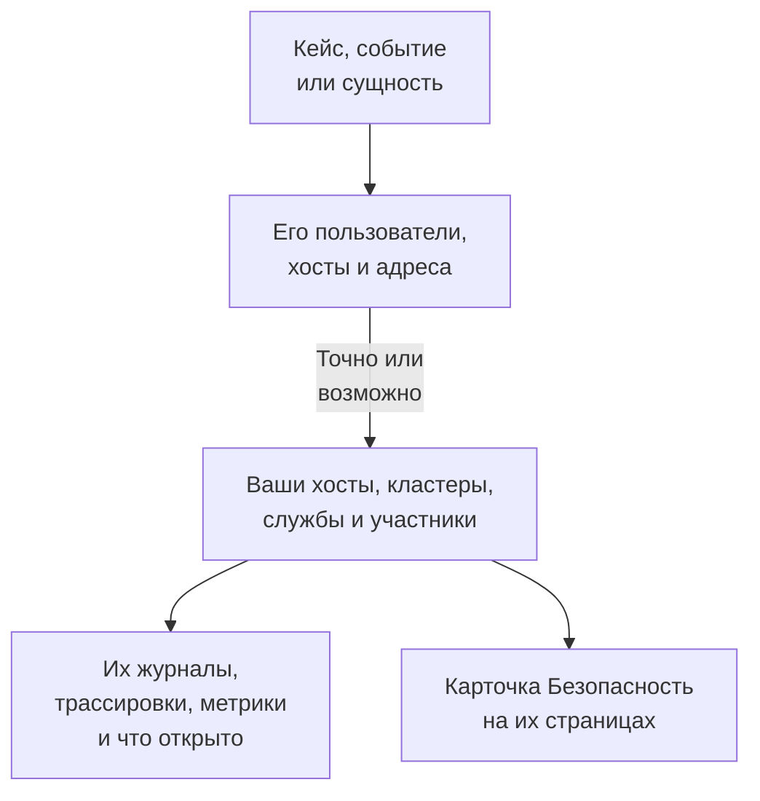

# Связанные сигналы

Кейс безопасности говорит, о каких пользователях, хостах и адресах он. Связанные сигналы говорят, какие из них OneUptime уже знает - ваши хосты, хосты контейнеров, кластеры Kubernetes, сетевые устройства, облачные ресурсы, serverless-функции, службы, мониторы, которые их проверяют, и участники - и что происходило на каждом из них во время кейса: его журналы, трассировки и метрики, открытые на нём инциденты и оповещения, мониторы, которые за ним следят, и что на нём менялось. Он также ищет их в самих ваших журналах и трассировках: адрес атакующего в журнале доступа веб-сервера, утёкший адрес почты в ошибке приложения. И наоборот: страница хоста, кластера, облачного ресурса, службы, монитора или участника говорит, что Security Events нашёл о нём.

:::cards
- [Где это видно](#где-это-видно): Страница кейса, вкладка события, страница сущности и страницы того, что они называют.
- [Как сопоставляется значение](#как-сопоставляется-значение): Что считается той же записью, а что лишь, возможно, ею.
- [Что показывает каждая запись](#что-показывает-каждая-запись): Её сигналы во время кейса и то, что на ней открыто.
- [В ваших журналах и трассировках](#в-ваших-журналах-и-трассировках): Где адрес, домен или адрес почты, который он называет, встречается в строках журналов и спанах.
- [Кто что видит](#кто-что-видит): Каждая запись читается с ролью того, кто её читает.
:::

## Как это работает

OneUptime ищет каждое значение среди записей проекта, говорит, насколько точно каждое совпадение, и показывает, что происходило на каждой записи во время кейса.

## Прежде чем начать

- Поступающие события безопасности и хосты, кластеры Kubernetes, облачные ресурсы, службы, мониторы или участники проекта, которых они могут называть. См. [Начало работы с безопасностью](/docs/telemetry/security-getting-started).
- Роль, которая может читать события безопасности, и типы записей, которые вы хотите видеть.

## Где это видно

- **Связанные сигналы**, страница каждого кейса безопасности: откройте кейс в разделе **Продукты → События безопасности → Кейсы безопасности → Открытые кейсы**, затем **Связанные сигналы** после **Сущности** в его меню.
- **Подключено**, вкладка каждого события безопасности: откройте событие в разделе **Продукты → События безопасности → События**. Она показывает, что называет событие, в течение часа вокруг него.
- Страница сущности в разделе **Продукты → События безопасности → Риск сущностей**: где OneUptime знает пользователя, хост или адрес, вокруг его последнего события безопасности.
- Карточка **Безопасность** на странице каждого хоста, хоста Docker, хоста Podman, кластера Kubernetes, сетевого устройства, облачного ресурса, serverless-функции, службы, монитора, участника и элемента инвентаря: открытые кейсы безопасности, которые его называют, сколько событий безопасности и находок называли его за последние 7 дней, самое серьёзное из них и его риск. **Открыть в Security Events** открывает его там. Карточка монитора говорит о хостах и адресах, которые он проверяет.
- Карточка **Безопасность** на странице инцидента, когда кейс безопасности объявил инцидент (**Объявлен из**) или открытые кейсы называют хост или кластер, который он затрагивает (**Открытые кейсы, называющие то, что он затрагивает**).

## Как сопоставляется значение

Каждый пользователь, хост и адрес, которые называет кейс или событие, ищется среди записей проекта:

| Что называет кейс или событие | Сопоставлено с | Насколько точно |
| --- | --- | --- |
| Имя хоста или домена, совпадающее с именем, которое сообщает хост, хост контейнеров, кластер или сетевое устройство, или имя, на котором отвечает облачный ресурс | Этой записью | Точно |
| То же имя, указанное без пометки, что это хост | Этой записью | Возможно |
| Краткая или полная форма имени записи, например `web-1` и `web-1.acme.internal` | Этой записью | Возможно |
| Публичный IP-адрес, который есть только у одного хоста или сетевого устройства или на котором отвечает только один облачный ресурс | Этой записью | Точно |
| Частный IP-адрес или адрес, который есть у нескольких записей | Каждой записью, у которой он есть | Возможно |
| Собственный ID облачного ресурса: AWS ARN, ID ресурса Azure или имя ресурса Google Cloud | Этим облачным ресурсом | Точно |
| Хост, публичный IP-адрес или хост URL, которые проверяет монитор | Этим монитором | Точно |
| Частный IP-адрес, который проверяет монитор | Этим монитором | Возможно |
| Электронная почта участника | Этим участником | Точно |
| Запись, под которой была отправлена строка журнала, для событий, прочитанных из ваших журналов | Этим хостом, кластером, облачным ресурсом, serverless-функцией или службой | Точно |
| Просто имя пользователя, хеш файла или процесс | Ничем: ни одна запись не определяется по ним | - |

- Возможное совпадение показывает **Возможное совпадение** рядом с именем и объясняет почему. Оно никогда не учитывается на странице записи, и инцидент, который объявляет кейс, никогда с ним не связывается.
- То, что искалось и не является записью проекта, перечислено в разделе **Нет подходящей записи**. Значение никогда не попадает туда, если не удалось прочитать тип записи, которым оно может быть.
- Для кейса показывается не больше 10 записей, сначала точные.

## Что показывает каждая запись

- Её сигналы, каждый открывается на записи и периоде кейса: **Журналы**, **Трассировки** и **Метрики**, **Исключения** службы, **События Kubernetes** кластера, **Топология** записи и её элемент в **Инвентарь**, если в инвентаре он есть.
- Открытые на ней сейчас инциденты и оповещения и мониторы, которые за ней следят, каждый со своей страницей. Монитор показывает свой статус рядом с именем, а его **Журналы** - это то, что он видел при каждой проверке.
- Расписания дежурств участника, с отметкой **Сейчас на дежурстве** у тех, по которым он дежурит сейчас, и команды, в которых он состоит.
- Что на ней менялось за период: развёртывания службы, выкатки кластера и исправления хоста.

| Где | Период |
| --- | --- |
| Кейс | От 30 минут до его первого обнаружения до 30 минут после последнего, не больше его последних 24 часов |
| Событие | 30 минут до и после него |
| Страница сущности | 30 минут до и после её последнего события безопасности |
| Карточка **Безопасность** записи | Последние 7 дней |

## В ваших журналах и трассировках

Под записями Связанные сигналы ищут в ваших журналах и трассировках, за то же окно, значения, которые он называет и которые могут значить только одно: IP-адрес (кроме `127.0.0.1` и других, которые есть у любой машины), полное имя хоста или домена, адрес почты, URL, ID облачного ресурса и хеш файла. Имя хоста без домена, имя пользователя без почты и процесс никогда не ищутся: строка журнала может содержать их по любой причине. Ищется не больше 10 значений.

| Где | Он называет значение, когда |
| --- | --- |
| Сообщение строки журнала | Оно содержит значение целиком, в любом регистре: `10.0.0.1` в `from 10.0.0.1:52144`, но никогда в `10.0.0.12` или `110.0.0.1` |
| Атрибут строки журнала или спана | Его значение в точности равно значению: как написано, в нижнем или верхнем регистре, или IPv6-адрес в краткой форме |

- Для каждого найденного значения видно, сколько строк журнала и спанов его называют, где в них оно было - **В сообщении** или атрибут по своему ключу, - каждое из них открывает **Журналы** или **Трассировки** на этих строках или спанах и окне, и записи, которые их отправили, сначала те, что отправили больше.
- Атрибут ресурса, например `resource.host.name`, говорит только о том, какая запись отправила строку, и никогда не считается.
- Значения, которые искались и которых не называет ни то, ни другое, перечислены в разделе **Нет в ваших журналах и трассировках**.
- Поиск идёт с вашей собственной ролью: журналы или трассировки, которые ваша роль не может читать, называются и не ищутся; те, в которых сейчас не удалось выполнить поиск, сообщают об этом, с кнопкой **Повторить попытку**. Поиск, который длится дольше 15 секунд, останавливается и сообщает об этом.

## Кто что видит

- Связанные сигналы и карточка **Безопасность** записи требуют роли, которая может читать события безопасности: Security Admin, Security Member, Security Viewer, Project Owner или Project Admin. Остальные не видят данных безопасности ни на одной странице. См. [Роли](/docs/permissions/reference#роли).
- Карточка **Безопасность** инцидента требует роли, которая может читать кейсы безопасности.
- Каждая запись читается с вашей собственной ролью, как и то, что в ней: роли, которая не может читать расписания дежурств, расписания участника не показываются. Тип записи, который ваша роль не может читать, пропускается, и страница об этом говорит; тип, который не удалось прочитать прямо сейчас, тоже говорит об этом, с кнопкой **Повторить попытку**.
- Страница записи показывает свою карточку **Безопасность** только в проекте, который использует Security Events: в том, который получил событие безопасности за последние 7 дней.

## Инциденты, которые объявляет кейс

**Объявить инцидент** на кейсе или шаг плейбука, который объявляет инцидент, связывает инцидент с хостами, хостами Docker и Podman, кластерами Kubernetes, сетевыми устройствами, облачными ресурсами и службами, с которыми кейс связан точно. Шаг плейбука, который вызывает дежурных, так же связывает оповещение, которое он открывает; каждое оповещение и каждый инцидент, которые открывает правило обнаружения или совпадение по данным об угрозах, связываются с тем, что совпадение называет точно, а те, что открывает Data Security, — с хранилищем данных, о котором идёт речь. Инцидент появляется на их страницах, к нему применяются правила их владельцев, а его лента называет кейс и то, с чем он был связан. Возможное совпадение никогда не связывается, как и монитор: инцидент на мониторе может изменить его статус и появиться на его страницах состояния.

## OneUptime AI

Сортировка кейса в OneUptime AI читает его связанные сигналы: что открыто и что менялось на хостах, службах, мониторах и участниках, которых называет кейс, расписания дежурств и команды участника, а также то, где его значения встречаются в ваших журналах и трассировках. Расследование инцидента читает кейс безопасности, который его объявил, и открытые кейсы, называющие то, что он затрагивает. См. [OneUptime AI в безопасности](/docs/telemetry/security-ai).

## Устранение неполадок

:::details Хост, который называет кейс, не показан
Проверьте, что кейс называет хост так, как хост называет себя сам, или называет публичный адрес, который есть только у этого хоста. Краткое имя, например `web-1` для `web-1.acme.internal`, показывается как возможное совпадение, а просто имя пользователя, хеш файла или процесс вообще не ищутся. URL ищется только среди мониторов, которые проверяют его хост.
:::

:::details Адреса, который называет кейс, нет в его журналах и трассировках
Поиск идёт только в окне кейса и только в журналах и трассировках, которые может читать ваша роль. Сообщение называет адрес, только если содержит его целиком: `10.0.0.12` - это другой адрес, хотя поиск по сообщениям в обозревателе журналов находит и его. Атрибут называет адрес, только когда его значение в точности равно адресу, а атрибут ресурса - никогда.
:::

:::details Нужный хост показан как возможное совпадение
Возможное совпадение никогда не учитывается и не связывается, чтобы имя, которое есть у двух машин, никогда не говорило вам ничего о неправильной. Пусть ваши журналы и обнаружения называют хост тем именем, которое он сообщает.
:::

:::details На странице хоста нет карточки Безопасность
Карточка показывается роли, которая может читать события безопасности, в проекте, получившем событие безопасности за последние 7 дней. Хост, которого за это время ничто не называло, показывает одну строку об этом.
:::

:::details На странице монитора нет карточки Безопасность
Карточка показывается для монитора, который проверяет хост, адрес или URL: монитора веб-сайта, API, ping, порта, SSL-сертификата, DNS или домена. Heartbeat, скрипт или монитор вашей телеметрии не проверяет ни один хост, поэтому карточки у него нет.
:::

:::details Страница говорит, что ваша роль не может видеть тип записи
Каждая запись читается с вашей собственной ролью. Попросите Project Owner или Project Admin выдать роль, которая может читать этот тип записи.
:::

## Дальнейшие шаги

:::cards
- [Кейсы безопасности и плейбуки](/docs/telemetry/security-cases): Работать с кейсом и объявить из него инцидент.
- [События безопасности (SIEM)](/docs/telemetry/security-events): События, стоящие за кейсом, и журналы, из которых они прочитаны.
- [Риск сущностей (оповещения на основе риска)](/docs/telemetry/security-entity-risk): Страница сущности, её риск и то, где OneUptime её знает.
- [OneUptime AI в безопасности](/docs/telemetry/security-ai): Как сортировка читает то, что называет кейс.
:::
