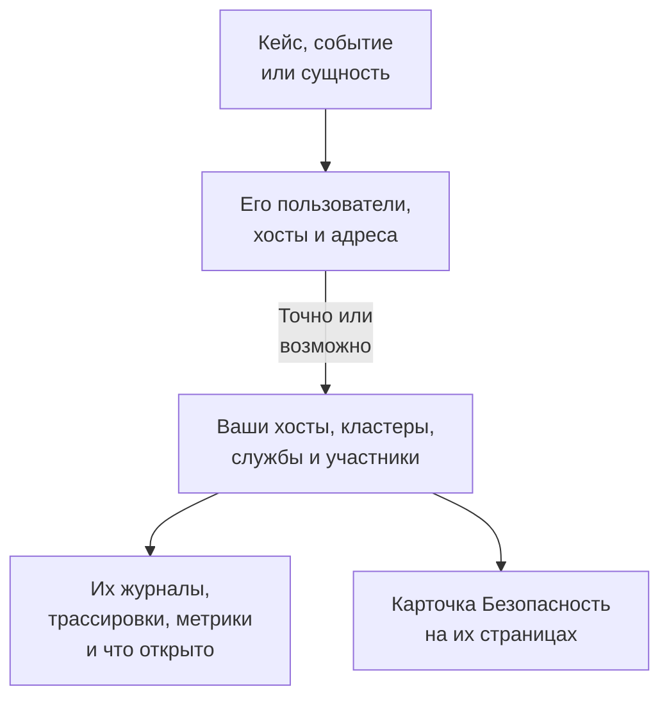

# Связанные сигналы

Кейс безопасности говорит, о каких пользователях, хостах и адресах он. Связанные сигналы говорят, какие из них OneUptime уже знает - ваши хосты, хосты контейнеров, кластеры Kubernetes, сетевые устройства, службы и участники - и что происходило на каждом из них во время кейса: его журналы, трассировки и метрики, открытые на нём инциденты и оповещения, мониторы, которые за ним следят, и что на нём менялось. И наоборот: страница хоста, кластера, службы или участника говорит, что Security Events нашёл о нём.

:::cards
- [Где это видно](#где-это-видно): Страница кейса, вкладка события, страница сущности и страницы того, что они называют.
- [Как сопоставляется значение](#как-сопоставляется-значение): Что считается той же записью, а что лишь, возможно, ею.
- [Что показывает каждая запись](#что-показывает-каждая-запись): Её сигналы во время кейса и то, что на ней открыто.
- [Кто что видит](#кто-что-видит): Каждая запись читается с ролью того, кто её читает.
:::

## Как это работает

OneUptime ищет каждое значение среди записей проекта, говорит, насколько точно каждое совпадение, и показывает, что происходило на каждой записи во время кейса.

## Прежде чем начать

- Поступающие события безопасности и хосты, кластеры Kubernetes, службы или участники проекта, которых они могут называть. См. [Начало работы с безопасностью](/docs/telemetry/security-getting-started).
- Роль, которая может читать события безопасности, и типы записей, которые вы хотите видеть.

## Где это видно

- **Связанные сигналы**, страница каждого кейса безопасности: откройте кейс в разделе **Продукты → Security Events → Кейсы безопасности → Открытые кейсы**, затем **Связанные сигналы** после **Сущности** в его меню.
- **Подключено**, вкладка каждого события безопасности: откройте событие в разделе **Продукты → Security Events → События**. Она показывает, что называет событие, в течение часа вокруг него.
- Страница сущности в разделе **Продукты → Security Events → Риск сущностей**: где OneUptime знает пользователя, хост или адрес, вокруг его последнего события безопасности.
- Карточка **Безопасность** на странице каждого хоста, хоста Docker, хоста Podman, кластера Kubernetes, сетевого устройства, службы, участника и элемента инвентаря: открытые кейсы безопасности, которые его называют, сколько событий безопасности и находок называли его за последние 7 дней, самое серьёзное из них и его риск. **Открыть в Security Events** открывает его там.
- Карточка **Безопасность** на странице инцидента, когда кейс безопасности объявил инцидент (**Объявлен из**) или открытые кейсы называют хост или кластер, который он затрагивает (**Открытые кейсы, называющие то, что он затрагивает**).

## Как сопоставляется значение

Каждый пользователь, хост и адрес, которые называет кейс или событие, ищется среди записей проекта:

| Что называет кейс или событие | Сопоставлено с | Насколько точно |
| --- | --- | --- |
| Имя хоста или домена, совпадающее с именем, которое сообщает хост, хост контейнеров, кластер или сетевое устройство | Этой записью | Точно |
| То же имя, указанное без пометки, что это хост | Этой записью | Возможно |
| Краткая или полная форма имени записи, например `web-1` и `web-1.acme.internal` | Этой записью | Возможно |
| Публичный IP-адрес, который есть только у одной записи | Этой записью | Точно |
| Частный IP-адрес или адрес, который есть у нескольких записей | Каждой записью, у которой он есть | Возможно |
| Электронная почта участника | Этим участником | Точно |
| Запись, под которой была отправлена строка журнала, для событий, прочитанных из ваших журналов | Этим хостом, кластером или службой | Точно |
| Просто имя пользователя, URL, хеш файла или процесс | Ничем: ни одна запись не определяется по ним | - |

- Возможное совпадение показывает **Возможное совпадение** рядом с именем и объясняет почему. Оно никогда не учитывается на странице записи, и инцидент, который объявляет кейс, никогда с ним не связывается.
- То, что искалось и не является записью проекта, перечислено в разделе **Нет в OneUptime**. Значение никогда не попадает туда, если не удалось прочитать тип записи, которым оно может быть.
- Для кейса показывается не больше 10 записей, сначала точные.

## Что показывает каждая запись

- Её сигналы, каждый открывается на записи и периоде кейса: **Журналы**, **Трассировки** и **Метрики**, **Исключения** службы, **События Kubernetes** кластера, **Топология** записи и её элемент в **Инвентарь**, если в инвентаре он есть.
- Открытые на ней сейчас инциденты и оповещения и мониторы, которые за ней следят, каждый со своей страницей.
- Что на ней менялось за период: развёртывания службы, выкатки кластера и исправления хоста.

| Где | Период |
| --- | --- |
| Кейс | От 30 минут до его первого обнаружения до 30 минут после последнего, не больше его последних 24 часов |
| Событие | 30 минут до и после него |
| Страница сущности | 30 минут до и после её последнего события безопасности |
| Карточка **Безопасность** записи | Последние 7 дней |

## Кто что видит

- Связанные сигналы и карточка **Безопасность** записи требуют роли, которая может читать события безопасности: Security Admin, Security Member, Security Viewer, Project Owner или Project Admin. Остальные не видят данных безопасности ни на одной странице. См. [Роли](/docs/permissions/reference#роли).
- Карточка **Безопасность** инцидента требует роли, которая может читать кейсы безопасности.
- Каждая запись читается с вашей собственной ролью. Тип записи, который ваша роль не может читать, пропускается, и страница об этом говорит; тип, который не удалось прочитать прямо сейчас, тоже говорит об этом, с кнопкой **Повторить попытку**.
- Страница записи показывает свою карточку **Безопасность** только в проекте, который использует Security Events: в том, который получил событие безопасности за последние 7 дней.

## Инциденты, которые объявляет кейс

**Объявить инцидент** на кейсе или шаг плейбука, который объявляет инцидент, связывает инцидент с хостами, хостами Docker и Podman, кластерами Kubernetes и службами, с которыми кейс связан точно. Инцидент появляется на их страницах, к нему применяются правила их владельцев, а его лента называет кейс и то, с чем он был связан. Возможное совпадение никогда не связывается.

## OneUptime AI

Сортировка кейса в OneUptime AI читает его связанные сигналы: что открыто и что менялось на хостах, службах и участниках, которых называет кейс. Расследование инцидента читает кейс безопасности, который его объявил, и открытые кейсы, называющие то, что он затрагивает. См. [OneUptime AI в безопасности](/docs/telemetry/security-ai).

## Устранение неполадок

:::details Хост, который называет кейс, не показан
Проверьте, что кейс называет хост так, как хост называет себя сам, или называет публичный адрес, который есть только у этого хоста. Краткое имя, например `web-1` для `web-1.acme.internal`, показывается как возможное совпадение, а просто имя пользователя, URL, хеш файла или процесс вообще не ищутся.
:::

:::details Нужный хост показан как возможное совпадение
Возможное совпадение никогда не учитывается и не связывается, чтобы имя, которое есть у двух машин, никогда не говорило вам ничего о неправильной. Пусть ваши журналы и обнаружения называют хост тем именем, которое он сообщает.
:::

:::details На странице хоста нет карточки Безопасность
Карточка показывается роли, которая может читать события безопасности, в проекте, получившем событие безопасности за последние 7 дней. Хост, которого за это время ничто не называло, показывает одну строку об этом.
:::

:::details Страница говорит, что ваша роль не может видеть тип записи
Каждая запись читается с вашей собственной ролью. Попросите Project Owner или Project Admin выдать роль, которая может читать этот тип записи.
:::

## Дальнейшие шаги

:::cards
- [Кейсы безопасности и плейбуки](/docs/telemetry/security-cases): Работать с кейсом и объявить из него инцидент.
- [События безопасности (SIEM)](/docs/telemetry/security-events): События, стоящие за кейсом, и журналы, из которых они прочитаны.
- [Риск сущностей (оповещения на основе риска)](/docs/telemetry/security-entity-risk): Страница сущности, её риск и то, где OneUptime её знает.
- [OneUptime AI в безопасности](/docs/telemetry/security-ai): Как сортировка читает то, что называет кейс.
:::
