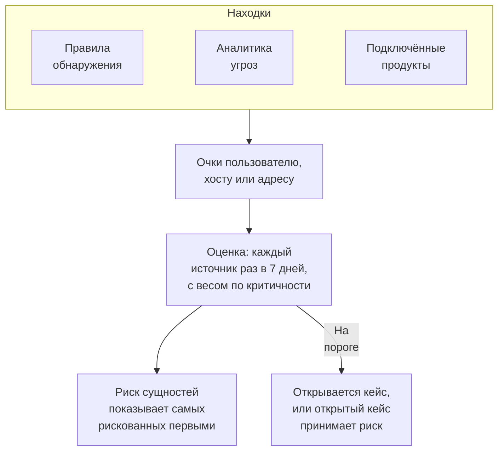

# Риск сущностей (оповещения на основе риска)

Отдельная находка редко говорит о многом. Серия неудачных входов, первый sudo на хосте и вход из новой страны — каждое стоит беглого взгляда; одна и та же учётная запись во всех трёх за неделю стоит кейса. Риск сущностей складывает то, что ваши правила обнаружения, аналитика угроз и подключённые продукты находят о каждом пользователе, хосте и IP-адресе, показывает самых рискованных первыми и открывает кейс о той сущности, чей риск достигает порога проекта.

:::cards
- [Как считается оценка](#как-считается-оценка): Очки по серьёзности, и каждый источник раз в неделю.
- [Уровни риска и кейсы](#уровни-риска-и-кейсы): Как читается оценка, и когда открывается кейс.
- [Критичность сущностей](#критичность-сущностей): Считать больше то, что важнее, и меньше то, что менее важно.
- [Страница сущности](#страница-сущности): Почему она рискованна, её месяц и кейсы о ней.
- [Очки риска в правиле обнаружения](#очки-риска-в-правиле-обнаружения): Собственный вес правила в оценке.
:::

## Как это работает

Откройте **Продукты → Security Events → Риск сущностей**: каждый пользователь, хост и IP-адрес с текущим риском, самые рискованные первыми, с уровнем, важностью, тем, что его нашло, и временем. Каждый открывается на собственной странице.

## Прежде чем начать

- Поступающие события безопасности, а также правила обнаружения, аналитика угроз или подключённые продукты, которые что-то в них находят. См. [Начало работы с безопасностью](/docs/telemetry/security-getting-started).
- Правила обнаружения, которые группируют по полю, называющему кого-то: **Group By Field**, например `principalUser`, `principalHost` или `principalIp`, или поля, по которым группирует корреляция. Правило, которое ни по чему не группирует, не добавляет риска.
- Чтобы изменить **Оценка риска**: Project Owner или Project Admin для переключателя и порога, и роль, которая может создавать правила обнаружения, для списка сущностей. Security Viewer читает всё это. См. [Роли](/docs/permissions/reference#роли).

## Как считается оценка

Каждая находка добавляет очки риска пользователю, хосту или IP-адресу, к которому относится:

| Находка с серьёзностью | Добавляет |
| --- | --- |
| Низкая | 10 очков |
| Средняя | 25 очков |
| Высокая | 50 очков |
| Критическая | 75 очков |

- Информационная находка ничего не добавляет, а находка с неизвестной серьёзностью считается средней.
- Очки правила обнаружения идут значению, по которому оно группирует. Совпадение в аналитике угроз добавляет к IP-адресу, который называет индикатор. Оповещение подключённого продукта добавляет к пользователю и хосту, которых оно называет, а иначе — к его IP-адресу.
- Каждый источник засчитывается один раз. Правило обнаружения, фид аналитики угроз или правило подключённого продукта засчитывается один раз за 7 дней, по наибольшему вкладу, сколько бы раз оно ни сработало: одно шумное правило никогда не сделает сущность хуже, чем три разных.
- Источник, который ничего не находил 7 дней, перестаёт учитываться, и оценка снижается. Оценки проверяются каждые 15 минут, поэтому оценка снижается вовремя и без новой находки.

Оценка сущности — это сумма её источников с весом по её критичности. Тестовая атака из **Отправить тестовую атаку** и кейс, открытый вручную, не добавляют риска.

## Уровни риска и кейсы

Каждая оценка читается как уровень относительно порога проекта, 100, если вы его не меняли:

| Оценка риска | Читается как | Что происходит |
| --- | --- | --- |
| От 1 до 49 | Низкий | Показывается в разделе «Риск сущностей» |
| От 50 до 99 | Средний | Показывается в разделе «Риск сущностей» |
| От 100 до 199 | Высокий | Открывается кейс с уровнем Высокий |
| 200 и больше | Критический | Открывается кейс с уровнем Критический |

Когда риск сущности достигает порога, о ней создаётся обнаружение с источником «Риск сущностей». Оно присоединяется к открытому кейсу о сущности или открывает кейс с её именем, например `High risk — k.morgan@acme-commerce.example`, и перечисляет источники, добавившие больше всего риска, до 10, с их очками, числом срабатываний каждого и временем последнего.

После того как о риске сущности открыт кейс, то, что стояло за ним, больше не учитывается: следующий кейс откроется, только когда источники, новые с того момента, снова в сумме достигнут порога. Кейс, закрытый как обработанный, те же находки не откроют снова.

Измените порог в **Продукты → Security Events → Настройки → Оценка риска → Порог риска**: целое число от 10 до 10000. Средний начинается с половины порога, Критический — с удвоенного, на всех страницах.

### Включить или выключить кейсы по риску

**Кейсы по риску** в **Настройки → Оценка риска** решает, открывает ли риск кейсы, и сохраняется при переключении. Новые проекты начинают с включённым переключателем. Проект, созданный до появления риска сущностей, держит его выключенным, пока кто-нибудь его не включит, и **Риск сущностей** сообщает об этом над своим списком. Риск в любом случае оценивается и показывается.

## Критичность сущностей

Одни сущности важнее других: контроллер домена, учётная запись руководителя, платёжный сервер. Другие менее важны, например сканер уязвимостей, чьи сканирования ожидаемы. Перечислите их в **Настройки → Оценка риска → Критичность сущностей** кнопкой **Добавить: Сущность**:

| Критичность | Считает её риск |
| --- | --- |
| Низкая | ×0.5 |
| Не указана | ×1 |
| Высокая | ×1.5 |
| Предельная | ×2 |

Запись — это значение или шаблон с `*`, без учёта регистра: `dc-*` означает каждый контроллер домена, а `*@contractors.example` — каждого подрядчика. **Тип** ограничивает запись пользователями, хостами или IP-адресами; пустое поле подходит для всех. Если сущность называют несколько записей, учитывается самая точная: значение целиком важнее шаблона, а более длинный шаблон важнее короткого. Изменение доходит до оценки каждой сущности за несколько минут.

## Страница сущности

Нажмите **Просмотр** в строке раздела **Риск сущностей** или на риск рядом с сущностью на странице **Сущности** кейса:

| Часть | Что показывает |
| --- | --- |
| Заголовок | Её тип и критичность, оценку и уровень, и как получена оценка |
| **Активность** | Её события безопасности и находки за последние 7 дней |
| **Что увеличивает её риск** | Каждый источник, его серьёзность, добавленные очки, число срабатываний и время последнего |
| **Риск за последние 30 дней** | Её оценка на конец каждого дня с цветом по уровню |
| **Кейсы о ней** | Кейсы безопасности, открытые о ней, сначала новые |

**Открыть в «Коррелировать»** рисует граф её событий, а **Искать её события** открывает **События** на её неделе. **Сбросить риск** очищает её оценку и источники, например после запланированного теста: найденное дальше считается с нуля, а её кейсы не меняются. Для сброса нужна роль, которая может удалять данные безопасности, и [журнал аудита](/docs/configuration/audit-logs) записывает его.

OneUptime AI читает риск сущностей кейса, когда оценивает кейс. См. [OneUptime AI в безопасности](/docs/telemetry/security-ai).

## Очки риска в правиле обнаружения

Правило обнаружения добавляет очки своего уровня, взятого из его `level` в Sigma. Чтобы дать ему собственный вес, откройте форму правила, перейдите к **При совпадении**, откройте **Дополнительные поля** и задайте **Очки риска**, от 0, что не добавляет риска, до 100. Оставьте поле пустым для очков его уровня.

## Устранение неполадок

:::details Сущности нет в разделе «Риск сущностей»
Проверьте, что правило обнаружения, фид аналитики угроз или подключённый продукт что-то нашли о ней за последние 7 дней, и что правило группирует по полю, которое её называет. Информационные находки ничего не добавляют, а источник, который ничего не находил 7 дней, перестаёт учитываться.
:::

:::details Риск сущности достиг порога, но кейс не открылся
Проверьте, что **Кейсы по риску** включён в **Настройки → Оценка риска**. Если кейс о риске сущности уже открывался, для следующего учитываются только источники, новые с того момента.
:::

:::details Правило срабатывает снова и снова, а оценка сущности не растёт
Так она и считается: источник засчитывается один раз за 7 дней, по наибольшему вкладу. Снизьте **Очки риска** шумного правила или задайте низкую критичность сущности, чьи находки ожидаемы.
:::

:::details Оценка не равна сумме её источников
Её взвешивает критичность. Страница сущности показывает сумму её источников и вес, например 100 от источников × 2 = 200.
:::

## Дальнейшие шаги

:::cards
- [Кейсы безопасности и плейбуки](/docs/telemetry/security-cases): Работать с кейсами, которые открывает риск, и закрывать их с вердиктом.
- [События безопасности (SIEM)](/docs/telemetry/security-events): Правила обнаружения, Коррелировать и события за каждой находкой.
- [Аналитика угроз (STIX/TAXII)](/docs/telemetry/threat-intelligence): Совпадения, которые добавляют риск адресу.
- [OneUptime AI в безопасности](/docs/telemetry/security-ai): Как оценка читает риск сущностей кейса.
:::
