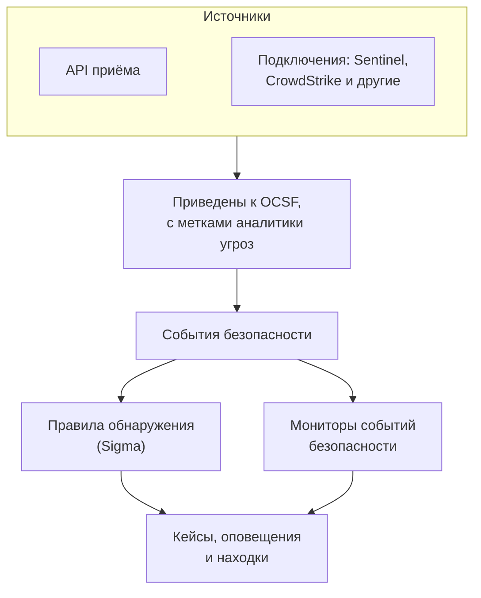

# События безопасности (SIEM)

OneUptime хранит события безопасности рядом с вашими логами, трассировками и метриками и приводит их все к одной форме, [OCSF](https://schema.ocsf.io/) (Open Cybersecurity Schema Framework), в каком бы формате они ни пришли. Отправляйте события из любого источника, ищите по ним и находите важные с помощью правил обнаружения Sigma, аналитики угроз и мониторов. Найденное ими становится [кейсами](/docs/telemetry/security-cases), которые нужно разобрать, а плейбуки реагируют на них.

:::cards
- [Отправка событий](#отправка-событий-безопасности): HTTPS-запрос POST, вывод Fluent Bit или подключение к продукту безопасности.
- [Поиск и корреляция](#обзор-событий-безопасности): Обозреватель событий и граф корреляции.
- [Поиск угроз](#поиск-угроз): Сохранённые запросы, которые запускаются по расписанию и уведомляют людей, когда что-то находят.
- [Правила обнаружения](#правила-обнаружения): Правила Sigma, которые открывают кейсы и оповещения.
- [Мониторы](#мониторы-событий-безопасности): Подсчёты в скользящем окне со статусом, который восстанавливается.
:::

## Как это работает



Откройте **Продукты → Security Events** в разделе **Наблюдаемость**. В его меню есть раздел для каждой части безопасности и отдельная страница для всего, что в ней есть:

| Страница | Раздел | Для чего она |
| --- | --- | --- |
| **Обзор** | Обзор | Как настроена безопасность, что требует внимания прямо сейчас и как быстро обрабатываются кейсы |
| **Открытые кейсы** | Кейсы безопасности | Очередь: все ещё не закрытые кейсы, сгруппированные по тому, к чему они относятся |
| **Назначены мне** | Кейсы безопасности | Открытые кейсы, назначенные вам |
| **Не назначено** | Кейсы безопасности | Открытые кейсы, которые никто не взял |
| **Закрытые кейсы** | Кейсы безопасности | Кейсы, закрытые с вердиктом, сначала последние |
| **Все кейсы** | Кейсы безопасности | Все кейсы, открытые и закрытые |
| **События** | События | Поиск и фильтрация всех событий; откройте событие, чтобы увидеть все его поля |
| **Поиск угроз** | События | Запросы, сохранённые со страницы «События»: открываются снова одним щелчком или запускаются по расписанию, которое уведомляет людей, когда они что-то находят |
| **Campaigns** | События | Каждый адрес, отправлявший атакующие запросы, и прошёл ли хоть один из его запросов |
| **Риск сущностей** | События | Каждый пользователь, хост и адрес с оценкой по тому, что о нём найдено за неделю, самые рискованные первыми |
| **Коррелировать** | События | Граф событий с общим хостом, пользователем или IP-адресом |
| **Правила обнаружения** | Detections | Правила Sigma, которые выполняются по расписанию и открывают кейсы |
| **Исключения правил** | Detections | Что ваши правила пропускают намеренно, например сканер или плановый тест, и для каждого исключения — кто его добавил и зачем |
| **Списки отслеживания** | Detections | Списки, с которыми сверяются ваши правила: VIP-пользователи, критичные хосты, известные вредоносные хеши файлов и адреса, с которых могут входить администраторы |
| **Библиотека правил** | Detections | Готовые правила обнаружения для добавления, у каждого — события, которые оно читает, и поступают ли они, рекомендуемые отмечены |
| **Разведка угроз** | Detections | Фиды STIX/TAXII с известными вредоносными индикаторами |
| **Покрытие ATT&CK** | Detections | Техники MITRE ATT&CK, которые покрывают ваши правила |
| **Плейбуки** | Playbooks | Шаги, которые выполняются для кейсов сами или вручную |
| **Одобрения** | Playbooks | Шаги плейбуков, которые ждут, пока кто-то их одобрит или отклонит |
| **Запуски плейбуков** | Playbooks | Что сделал каждый плейбук, шаг за шагом |
| **Защищённые сущности** | Playbooks | Пользователи и хосты, к которым ни один плейбук не применяет сдерживание |
| **Настройки** | ИИ | Оценивает ли OneUptime AI каждый новый кейс |
| **Подключения** | Connections | Ваши логи, продукты безопасности, которые опрашивает OneUptime, и SIEM, в которые он отправляет |
| **Руководство по настройке** | Connections | Фрагменты кода для отправки событий с уже подставленным ключом приёма |
| **Приоритеты кейсов** | Настройки | Насколько срочен кейс: собственные приоритеты проекта, самый срочный первым |
| **Цели реагирования** | Настройки | Как быстро кейс каждого приоритета нужно взять в работу и локализовать |
| **Статусы кейсов** | Настройки | Этапы, через которые проходит кейс, и чем считается кейс на каждом |
| **Оценка риска** | Настройки | Открывает ли риск сущности кейс, при каком риске и насколько важна каждая сущность |

**Обнаружения**, **ИИ**, **Подключения** и **Настройки**, которые настраивают один раз, остаются свёрнутыми, пока вы их не откроете. Впервые работаете с безопасностью? [Начало работы с безопасностью](/docs/telemetry/security-getting-started) настраивает её в два клика.

## Перед началом

Данные безопасности могут читать только роли Project Owner и Project Admin и три роли Security; остальные роли ничего не видят в Security Events. См. [Роли](/docs/permissions/reference#роли).

| Роль | Что она может |
| --- | --- |
| Security Admin | Всё: события, кейсы, плейбуки, правила обнаружения, фиды аналитики угроз и подключения |
| Security Member | Читать события и аналитику угроз, работать с кейсами, запускать плейбуки и одобрять их шаги, а также создавать, изменять и удалять правила обнаружения и фиды. Она не может настраивать плейбуки или подключения и удалять данные безопасности. |
| Security Viewer | Читать события, кейсы, плейбуки, правила, фиды, индикаторы и подключения |

## Отправка событий безопасности

:::steps
### Создайте ключ приёма

Откройте **Настройки проекта → Телеметрия и APM → Ключи приема** и нажмите **Создать ключ приёма**. События безопасности используют те же ключи, что и остальная телеметрия.

### Отправьте события

Отправьте JSON на `/security-events/v1/ingest` с ключом в `x-oneuptime-token`:

:::tabs
@tab OCSF
```bash
curl -X POST "https://oneuptime.com/security-events/v1/ingest?format=ocsf" \
  -H "Content-Type: application/json" \
  -H "x-oneuptime-token: YOUR_INGESTION_TOKEN" \
  -H "x-oneuptime-service-name: my-security-source" \
  -d '{ "events": [ { "class_uid": 3002, "severity_id": 4, "status": "Failure", "message": "Failed logon for alice", "actor": { "user": { "name": "alice" } }, "src_endpoint": { "ip": "203.0.113.7", "hostname": "laptop-alice" } } ] }'
```
@tab Google UDM
```bash
curl -X POST "https://oneuptime.com/security-events/v1/ingest?format=udm" \
  -H "Content-Type: application/json" \
  -H "x-oneuptime-token: YOUR_INGESTION_TOKEN" \
  -d '{ "events": [ { "metadata": { "event_type": "USER_LOGIN" }, "principal": { "hostname": "laptop-alice", "user": { "userid": "alice" }, "ip": ["203.0.113.7"] }, "security_result": [{ "severity": "HIGH", "action": ["BLOCK"] }] } ] }'
```
@tab Generic JSON
```bash
curl -X POST "https://oneuptime.com/security-events/v1/ingest" \
  -H "Content-Type: application/json" \
  -H "x-oneuptime-token: YOUR_INGESTION_TOKEN" \
  -d '{ "events": [ { "severity": "high", "event_type": "ssh_brute_force", "message": "12 failed SSH logins in 60s", "username": "root", "hostname": "web-01", "src_ip": "203.0.113.7" } ] }'
```
:::

Эндпоинт отвечает `200`, как только события поставлены в очередь. Событие без времени, как эти, помещается в момент своего поступления.

### Найдите их в разделе События

Откройте **Продукты → Security Events → События**. События появятся в течение нескольких секунд, с заполненными серьёзностью, классом, пользователем, хостом и IP-адресами.
:::

### Форматы

| `format` | Что читает | Также принимается |
| --- | --- | --- |
| `ocsf` | JSON событий OCSF (`class_uid`, `severity_id` и так далее) | Нет |
| `udm` | События UDM из Google SecOps (Chronicle) (`metadata.event_type` и так далее) | `chronicle`, `google-secops` |
| `google-secops-alert` | Обнаружения и оповещения Google SecOps: вебхуки SOAR и поток обнаружений | `secops-alert`, `detection` |
| `generic` | Любой другой JSON, читаемый по распространённым именам полей | Нет |

Укажите формат через `?format=`, через заголовок `x-oneuptime-security-event-format` или через поле `"format"` верхнего уровня. Если его не указать, формат каждого события определяется отдельно, так что один вебхук может смешивать обнаружения с необработанными событиями.

- Тело может быть одним событием, массивом событий или `{ "events": [...] }`.
- Заголовок `x-oneuptime-service-name` задаёт сервис телеметрии, к которому относятся события. Без него они относятся к сервису, названному по продукту или поставщику первого события, или к `Security Events`.
- Ничего не отбрасывается из-за того, что не удалось сопоставить: каждое поле источника попадает в атрибуты события.

### Поля обычного JSON

Обычное событие читается по распространённым именам полей:

| Поле события | Берётся из первого найденного |
| --- | --- |
| `message` | `message`, `msg`, `summary`, `description`, `title` |
| `severityName` | `severity`, `severity_name`, `level`, `priority`, `risk_level` |
| `time` | `timestamp`, `time`, `@timestamp`, `event_time`, `created_at` |
| `principalUser` | `user`, `username`, `user_name`, `account`, `actor` |
| `principalHost` | `host`, `hostname`, `computer`, `device`, `machine` |
| `principalIp` | `source_ip`, `src_ip`, `client_ip`, `ip` |
| `targetIp` | `destination_ip`, `dest_ip`, `dst_ip`, `target_ip` |
| `className` | `event_type`, `category`, `type`, `action` |
| `ruleName` | `rule`, `rule_name`, `signature`, `detection` |
| `productName` | `product`, `product_name`, `source`, `log_source` |
| `processName` | `process_name`, `process.name`, `proc.name`, `comm` |
| `processPath` | `process_path`, `Image`, `NewProcessName`, `exe`, `process.executable` |
| `processCommandLine` | `command_line`, `CommandLine`, `cmdline`, `process.command_line`, `proc.cmdline`, `process` |
| `parentProcessName` | `parent_process_name`, `process.parent.name`, `proc.pname` |
| `parentProcessPath` | `parent_process_path`, `ParentImage`, `ParentProcessName`, `process.parent.executable` |
| `parentProcessCommandLine` | `parent_command_line`, `ParentCommandLine`, `process.parent.command_line`, `proc.pcmdline` |

Слово серьёзности становится уровнем OCSF: `info` читается как Informational, `warning` как Low, `error` как Medium, `alert` как Critical, а `emergency` как Fatal.

### Пересылка через Fluent Bit

Чтобы отправлять журналы безопасности, которые вы уже собираете, например auditd, syslog или Falco, добавьте в Fluent Bit вывод `http`:

```ini title="fluent-bit.conf"
[OUTPUT]
    Name             http
    Match            security.*
    Host             oneuptime.com
    Port             443
    tls              On
    URI              /security-events/v1/ingest
    Format           json
    Json_date_key    timestamp
    Json_date_format iso8601
    Header           x-oneuptime-token YOUR_INGESTION_TOKEN
    Header           x-oneuptime-service-name my-security-source
    Retry_Limit      5
```

На странице **Руководство по настройке** в разделе **Подключения** есть эти фрагменты с вашими хостом и ключом.

### Поиск событий безопасности в ваших логах

Карточка **Ваши логи** вверху страницы **Подключения** делает источником логи, которые вы уже отправляете в OneUptime. Когда **Искать события безопасности в логах** включён, новые логи проекта читаются каждую минуту, и каждый вход по SSH, команда sudo, запись аудита Kubernetes, изменение в AWS CloudTrail и веб-атака в них сохраняются как событие безопасности. Что охватывает каждый вид, см. в [Начало работы с безопасностью](/docs/telemetry/security-getting-started#поиск-событий-безопасности-в-ваших-логах).

### Подключение продукта безопасности

**Подключения** опрашивает продукт безопасности за вас и импортирует его новые записи как события безопасности. Подключение хранит настройки продукта и зашифрованные учётные данные; воркер опрашивает его с заданным вами интервалом и пропускает уже импортированные записи.

| Продукт | Что импортирует | Руководство по настройке |
| --- | --- | --- |
| Google SecOps (Chronicle) | Обнаружения правил, курируемые обнаружения и оповещения, как Detection Findings | [Google SecOps](/docs/integrations/google-secops) |
| Microsoft Sentinel | Инциденты, как Incident Findings | [Microsoft Sentinel](/docs/integrations/microsoft-sentinel) |
| Microsoft Defender XDR | Оповещения, как Detection Findings | [Microsoft Defender XDR](/docs/integrations/microsoft-defender-xdr) |
| CrowdStrike Falcon | Оповещения, как Detection Findings | [CrowdStrike Falcon](/docs/integrations/crowdstrike-falcon) |
| Splunk Enterprise Security | Notable events или любой поиск, как Detection Findings | [Splunk Enterprise Security](/docs/integrations/splunk) |
| Elastic Security | Оповещения об обнаружениях, как Detection Findings | [Elastic Security](/docs/integrations/elastic-security) |
| AWS Security Hub | Findings, как Detection и Compliance Findings | [AWS Security Hub](/docs/integrations/aws-security-hub) |
| Okta System Log | События входа, MFA, учётных записей и политик | [Okta System Log](/docs/integrations/okta) |

- Собственные оповещения продукта с уровнем не ниже **Open Cases From** (**Высокий и выше**, если вы не выберете другой уровень или **Никогда**) открывают [кейсы](/docs/telemetry/security-cases), сгруппированные по пользователю, хосту или адресу, к которым они относятся.
- Подключение читает записи по времени, когда продукт их создал, а не по времени описываемой ими активности. Правило SIEM, которое выполняется раз в час, создаёт обнаружения намного позже совпавших событий, и они всё равно импортируются.
- Первый опрос заглядывает на 24 часа назад, поэтому новое подключение сразу показывает недавние записи.
- **Проверить подключение** в строке подключения проверяет доступ к продукту и работу собственных воркеров OneUptime и ничего не импортирует. **Запустить сейчас** выполняет опрос немедленно.

## Что содержит событие

Каждое событие хранится с типизированными полями и исходными данными источника:

| Группа | Поля |
| --- | --- |
| Классификация | `categoryName`, `className`, `activityName`, `statusName` с их ID в OCSF (`categoryUid`, `classUid`) |
| Серьёзность | `severityName`, одно из значений Unknown, Informational, Low, Medium, High, Critical, Fatal или Other, и `severityId` |
| Кто это сделал | `principalUser`, `principalHost`, `principalIp`, `principalProcess` |
| Что было затронуто | `targetUser`, `targetHost`, `targetIp`, `targetPort`, `targetResource` |
| Процесс | `processName`, `processPath` и `processCommandLine`: в активности процесса — процесс, который запустили, открыли, в который внедрились или который завершили, иначе — процесс, который действовал. `parentProcessName`, `parentProcessPath` и `parentProcessCommandLine`: процесс, который его запустил |
| Источник | `productName`, `vendorName`, `ruleId`, `ruleName`, `eventUid` |
| Содержимое | `message`, `mitreTactics`, `mitreTechniques` и `observables`: каждый пользователь, хост, IP-адрес, домен и хеш, извлечённые из события |
| Атрибуты | Все исходные данные источника, развёрнутые в ключи с точками |

События, сохранённые до OneUptime 14.0.84, оставляют поля процесса пустыми и называют свой процесс только как `principalProcess` — процесс, который действовал. Позже они не дополняются: они хранят то, с чем были сохранены, пока не закончится их срок хранения.

## Обзор событий безопасности

**События** — обозреватель телеметрии, как обозреватели логов и трассировок: график событий окна по серьёзности, боковая панель фасетов, список и панель со всеми полями и атрибутами открытого события. Окно, фильтры и поиск хранятся в URL, поэтому отфильтрованным представлением можно поделиться, и оно переживает обновление страницы.

### Поиск

Строка поиска понимает тот же язык, что и другие обозреватели телеметрии (см. [Синтаксис поиска](/docs/telemetry/search-syntax)):

| Синтаксис | Означает | Пример |
| --- | --- | --- |
| свободный текст | Сообщение содержит его | `failed logon` |
| `"quoted phrase"` | Слова идут вместе | `"brute force"` |
| `<field>:<value>` | Типизированное поле | `severity:Critical` |
| `@<attribute>:<value>` | Атрибут источника | `@threat.matched:true` |
| `-<filter>` | Исключить | `-severity:Informational` |
| `<field>:(a OR b)` | Любое из этих значений | `severity:(High OR Critical)` |
| `<field>:a*` | `*` — любой текст, `?` — один символ | `host:web-*` |
| `@<attribute>:*` | Атрибут присутствует | `@threat.indicator_id:*` |
| `@<attribute>:~text` | Атрибут содержит текст | `@finding_info.title:~ransom` |

Поле — это либо краткое имя (`severity`, `class`, `category`, `activity`, `status`, `vendor`, `product`, `rule`, `user`, `host`, `ip`, `targetuser`, `targethost`, `targetip`, `processname`, `commandline`, `parentprocessname`, `observable`, `tactic`, `technique`, `requestoutcome`, `trace`, `session`), либо собственное имя поля, например `severityName` или `principalHost`. Любое другое имя читается как атрибут источника. `observable:<value>` находит каждое событие, где упоминается значение, на какой бы стороне активности оно ни было.

### Фасеты

Боковая панель подсчитывает события окна по полям **Источник**, **Серьёзность**, **Request Outcome**, **Класс событий**, **Категория**, **Активность**, **Статус**, **Поставщик**, **Продукт**, **Правило обнаружения**, **Пользователь-источник**, **Хост-источник**, **Процесс** и **Родительский процесс**. Нажмите на значение, чтобы оставить только его события, или на минус рядом, чтобы исключить их. Нажмите ещё раз, чтобы отменить. График и каждый подсчёт описывают ровно события из списка.

### Что было дальше

Событие, прочитанное из строки лога, записанной внутри трассируемого запроса, прослеживается в этот запрос. Его панель показывает, как далеко зашёл запрос (**Отклонено**, **Reached App**, **Errored** или **Reached Database**), кто его отправил, и ведёт к его трассировке, исключению, записи сеанса и самой строке лога. Строка лога, трассировка и исключение, которые являются частью атаки, тоже сообщают об этом на своих страницах.

### Campaigns

**Campaigns** показывает каждый адрес, отправлявший атакующие запросы, одной строкой: виды атак, инструменты и отправленные запросы, а также сколько из них прошло. Первыми идут адреса, чьи запросы достигли вашего приложения.

### Корреляция

**Коррелировать** рисует события вокруг хоста, пользователя или IP-адреса: их классы событий вокруг искомого значения, отмеченные худшей серьёзностью, и другие значения из тех же событий на внешнем кольце. Нажмите на класс, чтобы вывести список его событий, или на значение, чтобы затем коррелировать по нему. Каждый observable на панели события в разделе **События** открывает по нему **Коррелировать**.

## Поиск угроз

Поиск угроз — это запрос по вашим событиям безопасности, сохранённый под именем: текст строки поиска, фильтры боковой панели и то, насколько далеко в прошлое он смотрит. Открывайте его снова одним щелчком, запускайте по расписанию, которое уведомляет людей, когда он что-то находит, и сохраняйте найденные им события в кейсе.

### Сохранение запроса как поиска угроз

На странице **События** ищите и фильтруйте, пока список не покажет то, что вам нужно, затем откройте **Поиск угроз** на панели инструментов и выберите **Сохранить как поиск угроз**. Дайте ему имя, выберите, запускается ли он по расписанию, и откроется его страница. **События → Поиск угроз** показывает поиски угроз проекта, у каждого — его запрос, как часто он запускается, кого уведомляет и что нашёл последний запуск; **Создать: Поиск угроз** там принимает запрос так, как вы ввели бы его на странице **События**. В проекте может быть до 200 поисков угроз.

Страница поиска угроз — это его запрос, открытый в обозревателе событий. Измените там запрос или фильтры, и заголовок поиска угроз предложит **Сохранить изменения** и **Отменить изменения**. **Редактировать** меняет его имя, запрос, то, насколько далеко в прошлое он смотрит, расписание и тех, кого он уведомляет, а **Удалить поиск угроз** находится в его меню. Сохранять, менять и удалять поиски угроз может роль Security Member и выше, а Security Viewer может их открывать.

### Запуск поиска угроз по расписанию

| Расписание | Запускается |
| --- | --- |
| **Не запланирован** | Только когда вы его открываете |
| **Каждый час**, **Каждые 6 часов**, **Каждый день**, **Каждую неделю** | Сам, с этой частотой |

Запланированный поиск угроз уведомляет людей и команды, которых вы выбираете в поле **Уведомить**: хотя бы одного, и не более 50 всего. Каждый запуск:

- читает события, время которых позже предыдущего запуска, вплоть до двух минут назад, поэтому каждое событие просматривается один раз. Первый запуск читает с момента, когда было задано расписание или в последний раз изменён запрос, а после сбоя запуск наверстывает не более чем на день больше своего интервала.
- считает события, которые его запрос там находит, ровно так, как их показала бы страница **События**, читая только то, что может читать пользователь, от имени которого он запускается.
- когда находит события, уведомляет людей, указанных в поиске угроз, и участников указанных в нём команд, которые могут читать поиски угроз и события безопасности.

Запуск не открывает кейс и не создаёт оповещение: то, что должно открывать кейсы, пишите как [правило обнаружения](#правила-обнаружения). Запуск, запрос которого выполняется слишком долго или который не может прочитать события, сообщает причину в поиске угроз и повторяется в течение часа с того места, где остановился.

Запланированный поиск угроз запускается от имени пользователя, который последним задал его расписание, изменил его запрос или сохранил его через **Редактировать**. Ключ API не может задать расписание. Когда этот пользователь покидает проект или больше не может читать события безопасности, поиск угроз сообщает об этом: откройте **Редактировать** и сохраните его, чтобы он запускался от вашего имени.

### Кого уведомляют

Уведомление **Поиск угроз нашёл события безопасности** называет поиск угроз и его запрос, сколько событий нашёл запуск и какое окно он прочитал, и ведёт на страницу поиска угроз с этими событиями; слов самих событий в нём нет. Все получают его по электронной почте и push и выбирают его каналы в разделе **Настройки пользователя → Настройки уведомлений**. Как и другие рутинные письма, его можно задержать в [сводке писем](/docs/emails/notification-rollup).

### Сохранение событий в кейсе

Выберите события на странице **События** или на странице поиска угроз и выберите **Массовые действия → Добавить в кейс** или откройте одно событие и выберите **Добавить в кейс**. Выберите открытый кейс по номеру или названию. За раз можно добавить до 100 событий.

OneUptime заново читает каждое событие от вашего имени и сохраняет его таким, каким оно было, на странице **Доказательства** кейса, поэтому кейс показывает его и после окончания срока хранения события. Событие, которое вы не можете читать, не сохраняется, а событие, которое кейс уже хранит, остаётся как есть. Событие, найденное поиском угроз, называет этот поиск, а **Просмотр события** открывает его таким, каким оно было сохранено.

У поисков угроз тот же REST API, что и у остального OneUptime, — `/security-hunt`, а `POST /security-case-evidence/add-events` сохраняет события в кейсе. См. [Справочник по API](/docs/api-reference/api-reference).

## Правила обнаружения

Правило обнаружения — это правило [Sigma](https://sigmahq.io/), открытый формат YAML для описания подозрительной активности, которое OneUptime по расписанию выполняет над вашими событиями. При совпадении оно открывает [кейс](/docs/telemetry/security-cases) или добавляет совпадение в уже открытый, открывает оповещение, при желании инцидент, и записывает Detection Finding обратно в события. В **Библиотека правил** есть готовые правила, с которых можно начать.


### Создайте правило

:::steps
1. Откройте **Продукты → Security Events → Обнаружения → Правила обнаружения** и нажмите **Создать: Правило обнаружения**.
2. В разделе **Правило Sigma** вставьте YAML правила в **Правило Sigma (YAML)**. Он разбирается при сохранении, поэтому ошибка видна прямо в форме.
3. **Имя** заполняется из `title` правила: впишите своё, чтобы назвать правило иначе. Новое правило работает сразу; **Включено** есть в его форме редактирования.
4. В разделе **При совпадении** оставьте **Открывать кейс при совпадении** включённым, чтобы группировать совпадения правила в кейсы по значению, по которому группирует правило.
5. В **Оповещения и инциденты** выберите, что ещё вызывает совпадение: **Создать оповещение** (по умолчанию), **Объявить инцидент**, **Оба** или **Ничего**, с необязательными **Серьёзность оповещения** или **Серьёзность инцидента**.
6. В **Дополнительные поля** — **Описание**, **Записывать Detection Finding при совпадении** (включено) и то, как считаются совпадения; см. [Настройки оценки](#настройки-оценки).
:::

Первое правило, которое срабатывает на неудачные входы не из `10.x.x.x`:

```yaml title="failed-logon-burst.yml"
title: Failed logon burst
description: Repeated authentication failures from one source.
level: high
tags:
  - attack.t1110
  - attack.ta0006
detection:
  selection:
    className: Authentication
    statusName: Failure
  filter_internal:
    principalIp|startswith: '10.'
  condition: selection and not filter_internal
```

### Что может выразить правило

OneUptime выполняет булево ядро Sigma:

- Выборки — это наборы полей (должно совпасть каждое поле; список значений совпадает с любым из них) или списки ключевых слов, которые совпадают в любом месте сообщения.
- Условия объединяют выборки через `and`, `or`, `not` и скобки или через `1 of selection_*`, `all of selection_*`, `any of them` и `all of them`.
- Модификаторы полей: `contains`, `startswith`, `endswith`, `all`, `re`, `cased`, `gt`, `gte`, `lt`, `lte`, `cidr`, `exists`, `windash` и `expand`, который читает [список отслеживания](#списки-отслеживания). Текст сравнивается без учёта регистра, если вы не добавите `cased`.
- Поле — это типизированное поле (`principalUser`), распространённое написание такого поля в Sigma (`CommandLine`, `src_ip`, `Hostname`) или любой ключ атрибута в том виде, в каком он записан в событии (`threat.matched`).
- `Image` и `CommandLine` читают процесс, о котором событие: при запуске процесса — запущенный процесс (`processPath`, `processCommandLine`), а `ParentImage` и `ParentCommandLine` — процесс, который его запустил (`parentProcessPath`, `parentProcessCommandLine`). `principalProcess` — это процесс, который действовал, то есть при запуске — родительский.
- `level` задаёт серьёзность: `informational`, `low`, `medium`, `high` или `critical`, а при отсутствии — `medium`. ID ATT&CK в `tags` (`attack.t1110`, `attack.ta0006`) заполняют поля MITRE находки.

Агрегации вроде `| count() by principalIp > 5` отклоняются при сохранении: используйте вместо них [правило корреляции](#правила-корреляции) или **Поле группировки** и **Порог числа совпадений**. `logsource` носит только информационный характер и ничего не сужает: поместите такой фильтр в выборку, например `className: Authentication`. `timeframe` игнорируется, потому что окно задаёт интервал правила.

### Правила корреляции

[Корреляция Sigma](https://sigmahq.io/docs/meta/correlations.html) срабатывает на несколько событий вместе, а не на одно. Вставьте её в **Правило Sigma (YAML)** вместе с правилами, которые она читает, как YAML-документы, разделённые `---`, или назовите правила, которые в проекте уже есть, по их `name` или `id` в Sigma. В **Библиотека правил** есть готовые, например неудачные входы, за которыми следует успешный.

| Тип | Срабатывает, когда | Показывается как |
| --- | --- | --- |
| `event_count` | Одна группа достигает числа событий в пределах `timespan` | Число событий |
| `value_count` | Одна группа показывает число разных значений поля в пределах `timespan` | Разные значения |
| `temporal` | Каждое правило совпадает для одной и той же группы в пределах `timespan`, в любом порядке | События вместе |
| `temporal_ordered` | Правила совпадают в своём порядке для одной и той же группы в пределах `timespan` | Sequence |
| `new_value` | Группа показывает значение поля, которого не показывала в пределах `timespan` | First seen |

```yaml title="failed-then-success.yml"
title: Failed sign-ins, then a success from the same address
level: high
correlation:
  type: temporal_ordered
  rules:
    - failed_sign_ins
    - successful_sign_in
  group-by:
    - principalIp
  timespan: 10m
---
title: Five failed sign-ins
name: failed_sign_ins
correlation:
  type: event_count
  rules:
    - failed_sign_in
  group-by:
    - principalIp
  timespan: 10m
  condition:
    gte: 5
---
title: Failed sign-in
name: failed_sign_in
detection:
  selection:
    className: Authentication
    statusName: Failure
  condition: selection
---
title: Successful sign-in
name: successful_sign_in
detection:
  selection:
    className: Authentication
    statusName: Success
  condition: selection
```

- Группа — это значение полей `group-by`, например один адрес. Подсчёт скользящий: всплеск, который поделили два запуска, всё равно считается целиком в пределах своего `timespan`, а он не больше 24 часов.
- `new_value` — собственный тип OneUptime, потому что в Sigma нет корреляции «впервые замечено»: он сравнивает с историей до 30 дней. `value_sum`, `value_avg`, `value_percentile` и `value_median` отклоняются при сохранении.
- Столбец **Тип** в **Правила обнаружения** называет вид каждого правила, а форма одним предложением говорит, что ищет правило.

### Настройки оценки

| Поле | Что делает |
| --- | --- |
| **Интервал оценки (минуты)** | Как часто выполняется правило: целые минуты, от 1 до 1440. Форма нового правила начинается с 5. |
| **Поле группировки** | Необязательное. Совпадения с одинаковым значением этого поля, например `principalHost`, подсчитываются, оповещаются и дедуплицируются вместе: одно оповещение на хост вместо сотен. |
| **Поле подсчёта уникальных значений** | Необязательное. Считать различные значения этого поля, а не совпавшие события. Пустые значения не учитываются. |
| **Порог числа совпадений** | Группа срабатывает, только когда её подсчёт достигает этого числа за один запуск: от 1 до 1000000, и 1 срабатывает на любое совпадение. |

Group By и Distinct Count принимают те же имена полей, что и правило. С ними порог означает «столько-то от одного и того же за один запуск», без монитора поверх:

| Цель | Group By Field | Distinct Count Field | Порог |
| --- | --- | --- | --- |
| Оповещать о любом совпадении | Пусто | Пусто | 1 |
| Одно оповещение на хост | `principalHost` | Пусто | 1 |
| Перебор паролей: 5 неудачных входов с одного IP | `principalIp` | Пусто | 5 |
| Распыление паролей: один IP с ошибками входа в 5 разных учётных записей | `principalIp` | `principalUser` | 5 |
| Сканирование портов: один IP обращается к 20 разным портам | `principalIp` | `targetPort` | 20 |

### Когда выполняется правило

Каждую минуту OneUptime ищет включённые правила, у которых с последнего запуска прошёл интервал. Каждый запуск читает события, время которых лежит между предыдущим запуском и моментом двухминутной давности, а затем идёт дальше. Эти две минуты оставляют время событиям, которые ещё в пути, например строке лога, прочитанной через минуту после записи:

- Окна идут встык и не скользят. При интервале 10 минут ошибки в 09:58 и 10:01 могут попасть в разные запуски и считаться отдельно, поэтому оставляйте запас при выборе порога.
- После перерыва, например сбоя воркера или повторного включения правила, следующий запуск покрывает весь перерыв, но не больше последних 24 часов.
- Событие, пришедшее с опозданием больше чем на две минуты, когда запуск уже охватил его время, сохраняется и доступно для поиска, но это правило его никогда не прочитает.
- Каждая группа, достигшая порога, становится Detection Finding, до 10 000 за запуск. Оповещения, инциденты и кейсы открываются для 100 групп с наибольшими подсчётами; остальные делят один кейс о правиле, а **Последняя ошибка** правила говорит, сколько групп совпало.

### Серьёзность

`level` правила — это серьёзность его находок: `informational`, `low`, `medium`, `high` и `critical` становятся Informational, Low, Medium, High и Critical. Его оповещения и инциденты получают одну из серьёзностей вашего проекта в таком порядке:

1. **Серьёзность оповещения** (или **Серьёзность инцидента**) правила, если она задана.
2. Ваша серьёзность, названная по уровню, например High, без учёта регистра.
3. По рангу: правила `critical` и `high` получают вашу самую высокую серьёзность, остальные — самую низкую.

> [!TIP]
> Назовите серьёзности оповещений по уровням Sigma (Critical, High, Medium, Low, Informational), и каждое правило будет попадать на нужную без отдельной настройки.

### Оповещения и находки

Каждая сработавшая группа открывает оповещение с заголовком `[Detection] <rule name> — <group value>` или `[Detection] <rule name>` для правила без Group By Field. Пока оно открыто, новые совпадения для этой группы не открывают нового. Правило видит только совпадения и не может понять, что атака прекратилась, поэтому его оповещения остаются открытыми, пока кто-нибудь их не закроет.

Detection Finding — это событие безопасности класса `Detection Finding` (класс OCSF 2004) от продукта `OneUptime Detections`, с тегами MITRE правила, значением группы первым в `observables` и такими атрибутами:

| Атрибут | Значение |
| --- | --- |
| `oneuptime.detection.rule_id` | ID сработавшего правила |
| `oneuptime.detection.rule_name` | Имя правила |
| `oneuptime.detection.match_count` | Сколько событий стоит за находкой |
| `oneuptime.detection.distinct_count` | Сколько различных значений стоит за ней, для правила с Distinct Count Field |
| `oneuptime.detection.group_value` | Значение группы, для правила с Group By Field |
| `oneuptime.detection.sigma_id` | Собственный `id` правила Sigma |

Находки — обычные события: ищите их в **События** и переходите от них к связанным данным в **Коррелировать**. Чтобы опробовать новое правило без лишнего шума, отключите все действия, кроме находки, пока не убедитесь в нём.

### Исключения

Исключение — это то, что правило пропускает, потому что вы этого ждёте: сканер уязвимостей, ночное задание резервного копирования или плановый тест на проникновение. Оно заглушает правило только для этого, не выключая его, и остальные совпадения правила по-прежнему срабатывают. Все исключения перечислены в разделе **Продукты → Security Events → Обнаружения → Исключения правил**: добавьте исключение там кнопкой **Добавить: Исключение правила**, действием **Добавить исключение** в строке правила или действием **Добавить исключение** в строке обнаружения в кейсе — тогда форма начинается с правила этого обнаружения и того, на что оно сработало.

| Что правило пропускает | С чем это совпадает |
| --- | --- |
| **Сущность** | Пользователь, хост или IP-адрес, где бы событие его ни называло: как того, кто действовал (`principalUser`, `principalHost`, `principalIp`), как того, на кого действовали (`targetUser`, `targetHost`, `targetIp`), или среди его `observables` |
| **Значение** | Значение одного поля, названного так, как его называет правило: `processName`, `principalUser` или ключ атрибута, например `http.user_agent` |
| **Временное окно** | Каждое событие от **Начинается** до **Заканчивается**, не больше 30 дней между ними |

- Значения совпадают без учёта регистра, а `*` означает любую последовательность символов: `svc-*` пропускает каждую служебную учётную запись, а `*.lab.example.com` — каждый хост домена. IP-адрес может быть диапазоном, например `10.20.0.0/16`. Значение из одной `*` отклоняется: чтобы остановить правило, выключите его.
- Каждое исключение объясняет, почему оно нужно, в поле **Причина**, которое видит каждый, кто читает список, и хранит, кто и когда его добавил. Для сущности или значения можно задать **Истекает в**, после чего правило снова их видит; временное окно заканчивается само.
- Поле **Статус** показывает, в каком состоянии каждое исключение: **Активно**, **Запланировано** для окна, которое ещё не началось, **Истёк** или **Закончено**. Под названием правила в **Правила обнаружения** строка считает его активные исключения, а **Просмотреть исключения** в строке правила открывает список, отфильтрованный по нему.
- Пропущенные события отбрасываются до того, как правило что-либо посчитает, поэтому они никогда не идут в зачёт его **Порог числа совпадений** и не открывают ни кейса, ни оповещения, ни инцидента, ни находки. Исключения действуют при каждом запуске правила, включая корреляции, и для **Запустить на прошлых событиях**, но никогда для тестовой атаки, которая проверяет, что события доходят.
- У правила не больше 100 исключений. Тот, кто может редактировать правила обнаружения, добавляет, меняет и удаляет их, любая роль Security может их читать, и каждое изменение сохраняется в журнале аудита проекта.

### Списки отслеживания

Список отслеживания — это список, который команда ведёт один раз и который может читать любое правило: VIP-пользователи, критичные хосты, известные вредоносные хеши файлов или адреса, с которых могут входить администраторы. Все списки находятся в **Продукты → Security Events → Обнаружения → Списки отслеживания**: создайте там список кнопкой **Создать: Список отслеживания**, которая спрашивает его имя и что он содержит, или добавьте типовой из **Начните с типового списка**. Страница списка показывает его значения, а **Использование в правиле** даёт выборку, которая читает список, чтобы скопировать её в правило.

Правило читает список с помощью `expand` и имени списка между знаками `%`. Это правило срабатывает, когда администратор входит с адреса, которого нет в списке разрешённых:

```yaml title="admin-sign-in-from-outside.yml"
title: Admin sign-in from outside the allowed addresses
detection:
  admin_sign_in:
    className: Authentication
    principalUser|expand: '%admins%'
  allowed:
    principalIp|expand: '%admin_addresses%'
  condition: admin_sign_in and not allowed
level: high
```

- Список содержит пользователей, хосты, IP-адреса, хеши файлов, домены, URL, процессы или другие значения — это выбирается при создании. Значение совпадает без учёта регистра, а `*` означает любую последовательность символов: `svc-*` совпадает с каждой служебной учётной записью. Список IP-адресов принимает и диапазоны, например `10.20.0.0/16`, а список хешей файлов — хеши MD5, SHA-1, SHA-256 и SHA-512.
- Добавляйте значения по одному кнопкой **Добавить: Значение** или сразу много кнопкой **Импортировать значения**: вставьте их или выберите файл `.txt` или `.csv`, по одному значению в строке, с необязательной заметкой после запятой. **Добавить в список** сохраняет уже имеющиеся значения, а **Заменить список** удаляет те, которых нет в импорте.
- Вместо того чтобы вести значения, список IP-адресов, хешей файлов, доменов или URL может следовать за фидом разведки угроз: тогда его значения — активные индикаторы фида того же типа, что и список, и они обновляются при каждом чтении фида.
- `expand` используется отдельно, так как значения списка задают, как сравнивать. Поле с несколькими значениями, например `observables`, совпадает, когда любое из них есть в списке. **Читается правилами** называет правила, которые читают каждый список, а под YAML правила его форма называет списки, которые читает правило.
- Правило называет список без учёта регистра. Правило, которое называет список, которого нет в проекте, отклоняется при сохранении, а список, который читают правила, нельзя переименовать или удалить, пока его читает хоть одно правило.
- Изменение списка доходит до каждого правила, которое его читает, при следующем запуске правила. Правила корреляции и **Запустить на прошлых событиях** тоже читают списки.
- В списке не больше 5 000 значений, из них не больше 100 со `*` и 100 диапазонов, а в проекте не больше 200 списков: для более длинного списка используйте фид разведки угроз. Тот, кто может создавать, редактировать или удалять правила обнаружения, может делать то же со списками, а тот, кто может редактировать правила обнаружения, добавляет, меняет и удаляет их значения. Любая роль Security может их читать, и каждое изменение сохраняется в журнале аудита проекта.

### Запуск на прошлых событиях

**Запустить на прошлых событиях** показывает, что нашло бы правило, если бы оно работало, ничего не открывая, не отправляя и не записывая. Это действие есть в строке правила — для правила в сохранённом виде — и под полем **Правило Sigma (YAML)** в форме правила — для правила в том виде, в каком оно там сейчас, до сохранения. Выберите **Последние 24 часа**, **Последние 7 дней** или **Последние 30 дней**.

- Правило считается так же, как его считают его запуски: окнами длиной в его **Интервал оценки (минуты)**, и группа срабатывает в окне, когда её счёт там достигает **Порог числа совпадений**. Корреляция читается за весь период и перечисляет группы, с которыми она совпала бы, для каждой — что произошло.
- Ответ говорит, сколько раз сработало бы правило, сколько раз в день, для скольких пользователей, хостов или адресов и сколько событий совпало. Перечисляются 50 групп, срабатывавших чаще всего, для каждой — её события и когда она сработала в последний раз.
- Исключения сохранённого правила действуют, и ответ говорит, сколько событий они пропустили и скольких срабатываний не допустили. Правило, которое не сработало бы, говорит, насколько близко оно подошло: сколько событий совпало и какой порог ни одна группа не достигла в одном окне.
- Правило, которое срабатывало бы больше 20 раз в день, срабатывает чаще, чем человек успевает разобрать, и ответ так и говорит, с подсказками, как сделать его тише.
- Оно читает только те источники, которые вы можете читать. Запуск дольше 45 секунд останавливается и сообщает об этом: выберите период короче.

## Мониторы событий безопасности

Монитор событий безопасности подсчитывает события, подходящие под его фильтры, в скользящем окне и применяет к подсчёту обычные критерии мониторов: меняет статус монитора, открывает оповещения или инциденты и вызывает дежурных. Создайте его в **Мониторы → Создать монитор** с типом **События безопасности**; он отображается там вместе с другими вашими мониторами.

Его форма показывает **Monitor events that include this text**, **Monitor Security Events for (time)**, **Event Severity** и **Класс событий**. **Фильтровать по сервису телеметрии** и **Фильтровать по атрибутам** находятся в разделе **Дополнительные поля**, заголовок которого показывает, какие из них использует монитор. Его критерии проверяют **Security Event Count**.

| | Правило обнаружения | Монитор событий безопасности |
| --- | --- | --- |
| Совпадает с | Правилом Sigma | Фильтрами по серьёзности, классу, сообщению, сервису и атрибутам |
| Окно | Встык, одно на запуск | Скользящее: от последних 5 секунд до 24 часов |
| Подсчёт по группам | Да, с **Поле группировки** | Нет: один подсчёт для всего совпавшего |
| Открывает | Оповещения, инциденты и находки | Статус, оповещения и инциденты |
| Восстанавливается | Нет: оповещения остаются открытыми до закрытия | Да: статус возвращается, когда возвращается подсчёт |

Само обнаружение пишите как правило с его порогом. Используйте монитор, когда нужны скользящее окно, статус, который восстанавливается сам, страница статуса или разные политики дежурств для разных критериев.

### Следите за своими обнаружениями

Находки — это события, поэтому монитор может следить за самими правилами:

- Шквалы: монитор по классу `Detection Finding`, считающий каждую находку. Двадцать разных правил, сработавших за час, — сигнал, который не увидит ни одно правило по отдельности.
- Изменения частоты: фильтр по `oneuptime.detection.rule_id` одного правила. Правило, которое срабатывает раз в неделю, а теперь срабатывает пятьдесят раз в час, требует другой реакции.
- Тишина: если находок, которых обычно несколько, становится ноль, чаще всего это значит, что источник перестал отправлять данные. Используйте критерий, который проверяет, что подсчёт ниже заданного числа.

Действие **Создать монитор** в строке правила открывает новый монитор, уже настроенный таким образом: класс `Detection Finding`, ID правила (никогда не его имя, которое изменилось бы при переименовании) и последний час. Такой монитор считает находки, по одной на группу за запуск, а не события за ними. Чтобы требовать определённое число событий до срабатывания, используйте **Порог числа совпадений** правила.

## Аналитика угроз

**Разведка угроз** подписывается на фиды STIX/TAXII с известными вредоносными IP-адресами, доменами, URL, адресами электронной почты и хешами файлов. События, где упоминается одно из этих значений, при поступлении помечаются атрибутами `threat.*`, по которым могут фильтровать правила и мониторы, а каждую минуту недавние события сверяются с фидами и открывают оповещения и находки так же, как правило. См. [Аналитика угроз](/docs/telemetry/threat-intelligence).

## Хранение и оплата

События безопасности оплачиваются за каждый принятый ГБ, как и остальная телеметрия, и хранятся в течение срока хранения телеметрии: **Срок хранения по умолчанию (дни)** проекта в **Настройки проекта → Телеметрия и APM → Хранение данных** или срок хранения, заданный для сервиса телеметрии, к которому они относятся. Когда срок хранения события истекает, оно удаляется.

## Устранение неполадок

:::details События не появляются
Проверьте ключ в `x-oneuptime-token` и путь `/security-events/v1/ingest`. Затем проверьте окно в **События**: по умолчанию это последние сутки. Событие размещается по собственному времени, поэтому событие с более старой меткой времени оказывается за пределами окна.
:::

:::details Правило никогда не срабатывает
Проверьте его **Статус**: при **Отключено** правило не запускается, а при **Запуск не удался** кнопка **Просмотреть ошибку** в его строке покажет причину. Откройте событие, которое должно было совпасть, и сравните его с правилом поле за полем: простое значение должно совпадать со всем полем, поэтому для части значения используйте `contains` или `*`. Атрибут называется так же, как в событии (`threat.matched`, а не `attributes.threat.matched`). При пороге больше 1 совпадения должны попасть в один запуск.
:::

:::details Правило сработало, но оповещение не открылось
В **Оповещения и инциденты** выбрано **Объявить инцидент** или **Ничего**, или оповещение для того же правила и значения группы ещё открыто, и более поздние совпадения добавляются в него. Чтобы правила могли открывать оповещения, в проекте должна быть хотя бы одна серьёзность оповещений.
:::

:::details Правило открывает слишком много оповещений
Каждое значение **Поле группировки** получает собственное оповещение: группируйте по чему-то более крупному, поднимите порог или добавьте Distinct Count Field. Если вас интересует частота, а не каждое совпадение, выберите **Ничего** в **Оповещения и инциденты** и поставьте монитор на находки правила.
:::

:::details Правило срабатывает на то, чего вы ждёте
Добавьте для этого исключение вместо того, чтобы выключать правило: **Добавить исключение** в строке обнаружения в его кейсе начинается с правила и того, на что оно сработало. Чтобы изменить само правило, **Запустить на прошлых событиях** под его YAML показывает, что нашло бы изменение, ещё до сохранения.
:::

:::details Исключение не пропускает то, что должно
Проверьте его **Статус** в **Исключения правил**: исключение в состоянии **Истёк** ничего не пропускает, а временное окно пропускает только события между двумя своими моментами. Сущность ищется как тот, кто действовал, как тот, на кого действовали, и среди `observables` события; чтобы пропустить значение другого поля, добавьте исключение **Значение**, которое называет это поле. Без `*` значение должно совпадать со всем полем: `svc-*` пропускает `svc-backup`, а `svc-` — нет.
:::

:::details Правило, которое читает список отслеживания, не совпадает
Откройте список и проверьте его значения: значение без `*` должно совпадать со всем полем без учёта регистра, а список, который следует за фидом разведки угроз, содержит только активные индикаторы фида своего типа. Проверьте, что правило читает поле, которое заполняют ваши события: **Использование в правиле** начинается с поля, в котором обычно бывает список такого типа. Изменение списка доходит до правила при его следующем запуске.
:::

:::details Список отслеживания нельзя переименовать или удалить
Правила всё ещё читают его по имени, и сообщение их называет. Измените имя в этих правилах или уберите из них список, а затем переименуйте или удалите его.
:::

:::details Запуск правила на прошлых событиях ничего не находит
Он читает только выбранный период и источники, которые вы можете читать. Когда события совпали, но ни одна группа не достигла **Порог числа совпадений** в одном окне, ответ говорит, сколько совпало: снизьте порог или считайте за более длинный **Интервал оценки (минуты)**.
:::

## Дальнейшие шаги

:::cards
- [Аналитика угроз](/docs/telemetry/threat-intelligence): Сверяйте свои события с фидами STIX/TAXII.
- [Кейсы безопасности и плейбуки](/docs/telemetry/security-cases): Разбирайте то, что находят ваши правила, и реагируйте с помощью плейбуков.
- [Google SecOps](/docs/integrations/google-secops): Получайте обнаружения и события из Chronicle.
- [Синтаксис поиска](/docs/telemetry/search-syntax): Всё, что понимает строка поиска.
- [Справочник разрешений](/docs/permissions/reference): Роли Security и возможности каждой из них.
:::
