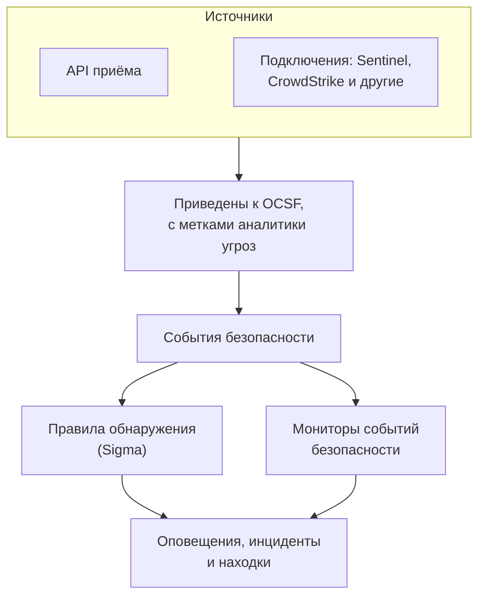
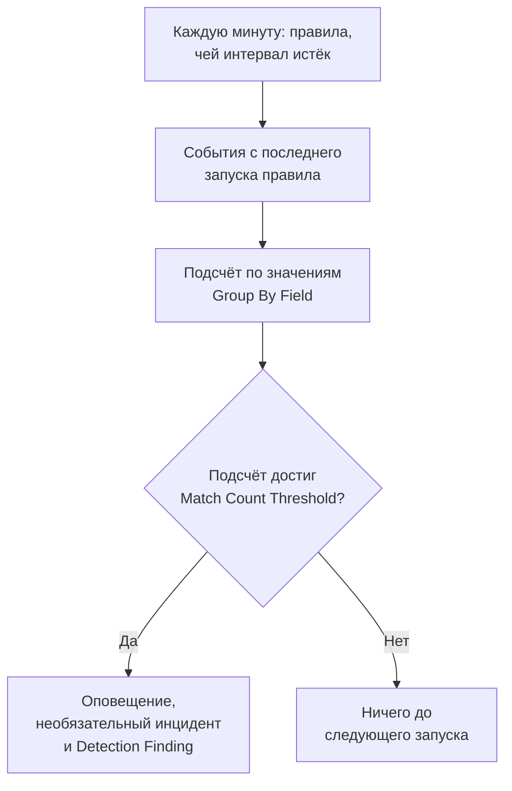

# События безопасности (SIEM)

OneUptime хранит события безопасности рядом с вашими логами, трассировками и метриками и приводит их все к одной форме, [OCSF](https://schema.ocsf.io/) (Open Cybersecurity Schema Framework), в каком бы формате они ни пришли. Отправляйте события из любого источника, ищите по ним и превращайте важные в оповещения с помощью правил обнаружения Sigma, аналитики угроз и мониторов.

:::cards
- [Отправка событий](#отправка-событий-безопасности): HTTPS-запрос POST, вывод Fluent Bit или подключение к продукту безопасности.
- [Поиск и корреляция](#обзор-событий-безопасности): Обозреватель событий и граф корреляции.
- [Правила обнаружения](#правила-обнаружения): Правила Sigma, которые открывают оповещения.
- [Мониторы](#мониторы-событий-безопасности): Подсчёты в скользящем окне со статусом, который восстанавливается.
:::

## Как это работает



Откройте **Продукты → Security Events** в разделе **Наблюдаемость**. Его вкладки:

| Вкладка | Для чего она |
| --- | --- |
| **События** | Поиск и фильтрация всех событий; откройте событие, чтобы увидеть все его поля |
| **Коррелировать** | Граф событий с общим хостом, пользователем или IP-адресом |
| **Detection Rules** | Правила Sigma, которые выполняются по расписанию и открывают оповещения |
| **Threat Intel** | Фиды STIX/TAXII с известными вредоносными индикаторами |
| **Мониторы** | Мониторы событий безопасности проекта |
| **Connections** | Продукты безопасности, которые OneUptime опрашивает на предмет новых записей |
| **Руководство по настройке** | Фрагменты кода для отправки событий с уже подставленным ключом приёма |

## Перед началом

Данные безопасности могут читать только роли Project Owner и Project Admin и три роли Security; остальные роли ничего не видят в Security Events. См. [Роли](/docs/permissions/reference#роли).

| Роль | Что она может |
| --- | --- |
| Security Admin | Всё: события, правила обнаружения, фиды аналитики угроз и подключения |
| Security Member | Читать события и аналитику угроз, а также создавать, изменять и удалять правила обнаружения и фиды. Она не может настраивать подключения или удалять данные безопасности. |
| Security Viewer | Читать события, правила, фиды, индикаторы и подключения |

## Отправка событий безопасности

:::steps
### Создайте ключ приёма

Откройте **Настройки проекта → Телеметрия и APM → Ключи приема** и нажмите **Создать ключ приёма**. События безопасности используют те же ключи, что и остальная телеметрия.

### Отправьте события

Отправьте JSON на `/security-events/v1/ingest` с ключом в `x-oneuptime-token`:

:::tabs
@tab OCSF
```bash
curl -X POST "https://oneuptime.com/security-events/v1/ingest?format=ocsf" \
  -H "Content-Type: application/json" \
  -H "x-oneuptime-token: YOUR_INGESTION_TOKEN" \
  -H "x-oneuptime-service-name: my-security-source" \
  -d '{ "events": [ { "class_uid": 3002, "severity_id": 4, "time": 1755770400000, "status": "Failure", "message": "Failed logon for alice", "actor": { "user": { "name": "alice" } }, "src_endpoint": { "ip": "203.0.113.7" } } ] }'
```
@tab Google UDM
```bash
curl -X POST "https://oneuptime.com/security-events/v1/ingest?format=udm" \
  -H "Content-Type: application/json" \
  -H "x-oneuptime-token: YOUR_INGESTION_TOKEN" \
  -d '{ "events": [ { "metadata": { "event_type": "USER_LOGIN", "event_timestamp": "2026-08-21T10:00:00Z" }, "principal": { "user": { "userid": "alice" }, "ip": ["203.0.113.7"] }, "security_result": [{ "severity": "HIGH", "action": ["BLOCK"] }] } ] }'
```
@tab Generic JSON
```bash
curl -X POST "https://oneuptime.com/security-events/v1/ingest" \
  -H "Content-Type: application/json" \
  -H "x-oneuptime-token: YOUR_INGESTION_TOKEN" \
  -d '{ "events": [ { "timestamp": "2026-08-21T10:00:00Z", "severity": "high", "event_type": "ssh_brute_force", "message": "12 failed SSH logins in 60s", "username": "root", "hostname": "web-01", "src_ip": "203.0.113.7" } ] }'
```
:::

Эндпоинт отвечает `200`, как только события поставлены в очередь.

### Найдите их в разделе События

Откройте **Продукты → Security Events → События**. События появятся в течение нескольких секунд, с заполненными серьёзностью, классом, пользователем, хостом и IP-адресами.
:::

### Форматы

| `format` | Что читает | Также принимается |
| --- | --- | --- |
| `ocsf` | JSON событий OCSF (`class_uid`, `severity_id` и так далее) | Нет |
| `udm` | События UDM из Google SecOps (Chronicle) (`metadata.event_type` и так далее) | `chronicle`, `google-secops` |
| `google-secops-alert` | Обнаружения и оповещения Google SecOps: вебхуки SOAR и поток обнаружений | `secops-alert`, `detection` |
| `generic` | Любой другой JSON, читаемый по распространённым именам полей | Нет |

Укажите формат через `?format=`, через заголовок `x-oneuptime-security-event-format` или через поле `"format"` верхнего уровня. Если его не указать, формат каждого события определяется отдельно, так что один вебхук может смешивать обнаружения с необработанными событиями.

- Тело может быть одним событием, массивом событий или `{ "events": [...] }`.
- Заголовок `x-oneuptime-service-name` задаёт сервис телеметрии, к которому относятся события. Без него они относятся к сервису, названному по продукту или поставщику первого события, или к `Security Events`.
- Ничего не отбрасывается из-за того, что не удалось сопоставить: каждое поле источника попадает в атрибуты события.

### Поля обычного JSON

Обычное событие читается по распространённым именам полей:

| Поле события | Берётся из первого найденного |
| --- | --- |
| `message` | `message`, `msg`, `summary`, `description`, `title` |
| `severityName` | `severity`, `severity_name`, `level`, `priority`, `risk_level` |
| `time` | `timestamp`, `time`, `@timestamp`, `event_time`, `created_at` |
| `principalUser` | `user`, `username`, `user_name`, `account`, `actor` |
| `principalHost` | `host`, `hostname`, `computer`, `device`, `machine` |
| `principalIp` | `source_ip`, `src_ip`, `client_ip`, `ip` |
| `targetIp` | `destination_ip`, `dest_ip`, `dst_ip`, `target_ip` |
| `className` | `event_type`, `category`, `type`, `action` |
| `ruleName` | `rule`, `rule_name`, `signature`, `detection` |
| `productName` | `product`, `product_name`, `source`, `log_source` |

Слово серьёзности становится уровнем OCSF: `info` читается как Informational, `warning` как Low, `error` как Medium, `alert` как Critical, а `emergency` как Fatal.

### Пересылка через Fluent Bit

Чтобы отправлять журналы безопасности, которые вы уже собираете, например auditd, syslog или Falco, добавьте в Fluent Bit вывод `http`:

```ini title="fluent-bit.conf"
[OUTPUT]
    Name             http
    Match            security.*
    Host             oneuptime.com
    Port             443
    tls              On
    URI              /security-events/v1/ingest
    Format           json
    Json_date_key    timestamp
    Json_date_format iso8601
    Header           x-oneuptime-token YOUR_INGESTION_TOKEN
    Header           x-oneuptime-service-name my-security-source
    Retry_Limit      5
```

На вкладке **Руководство по настройке** есть эти фрагменты с вашими хостом и ключом.

### Подключение продукта безопасности

**Connections** опрашивает продукт безопасности за вас и импортирует его новые записи как события безопасности. Подключение хранит настройки продукта и зашифрованные учётные данные; воркер опрашивает его с заданным вами интервалом и пропускает уже импортированные записи.

| Продукт | Что импортирует | Руководство по настройке |
| --- | --- | --- |
| Google SecOps (Chronicle) | Обнаружения правил, курируемые обнаружения и оповещения, как Detection Findings | [Google SecOps](/docs/integrations/google-secops) |
| Microsoft Sentinel | Инциденты, как Incident Findings | [Microsoft Sentinel](/docs/integrations/microsoft-sentinel) |
| Microsoft Defender XDR | Оповещения, как Detection Findings | [Microsoft Defender XDR](/docs/integrations/microsoft-defender-xdr) |
| CrowdStrike Falcon | Оповещения, как Detection Findings | [CrowdStrike Falcon](/docs/integrations/crowdstrike-falcon) |
| Splunk Enterprise Security | Notable events или любой поиск, как Detection Findings | [Splunk Enterprise Security](/docs/integrations/splunk) |
| Elastic Security | Оповещения об обнаружениях, как Detection Findings | [Elastic Security](/docs/integrations/elastic-security) |
| AWS Security Hub | Findings, как Detection и Compliance Findings | [AWS Security Hub](/docs/integrations/aws-security-hub) |
| Okta System Log | События входа, MFA, учётных записей и политик | [Okta System Log](/docs/integrations/okta) |

- Подключение читает записи по времени, когда продукт их создал, а не по времени описываемой ими активности. Правило SIEM, которое выполняется раз в час, создаёт обнаружения намного позже совпавших событий, и они всё равно импортируются.
- Первый опрос заглядывает на 24 часа назад, поэтому новое подключение сразу показывает недавние записи.
- **Проверить подключение** в строке подключения проверяет доступ к продукту и работу собственных воркеров OneUptime и ничего не импортирует. **Run now** выполняет опрос немедленно.

## Что содержит событие

Каждое событие хранится с типизированными полями и исходными данными источника:

| Группа | Поля |
| --- | --- |
| Классификация | `categoryName`, `className`, `activityName`, `statusName` с их ID в OCSF (`categoryUid`, `classUid`) |
| Серьёзность | `severityName`, одно из значений Unknown, Informational, Low, Medium, High, Critical, Fatal или Other, и `severityId` |
| Кто это сделал | `principalUser`, `principalHost`, `principalIp`, `principalProcess` |
| Что было затронуто | `targetUser`, `targetHost`, `targetIp`, `targetPort`, `targetResource` |
| Источник | `productName`, `vendorName`, `ruleId`, `ruleName`, `eventUid` |
| Содержимое | `message`, `mitreTactics`, `mitreTechniques` и `observables`: каждый пользователь, хост, IP-адрес, домен и хеш, извлечённые из события |
| Атрибуты | Все исходные данные источника, развёрнутые в ключи с точками |

## Обзор событий безопасности

**События** — обозреватель телеметрии, как обозреватели логов и трассировок: график событий окна по серьёзности, боковая панель фасетов, список и панель со всеми полями и атрибутами открытого события. Окно, фильтры и поиск хранятся в URL, поэтому отфильтрованным представлением можно поделиться, и оно переживает обновление страницы.

### Поиск

Строка поиска понимает тот же язык, что и другие обозреватели телеметрии (см. [Синтаксис поиска](/docs/telemetry/search-syntax)):

| Синтаксис | Означает | Пример |
| --- | --- | --- |
| свободный текст | Сообщение содержит его | `failed logon` |
| `"quoted phrase"` | Слова идут вместе | `"brute force"` |
| `<field>:<value>` | Типизированное поле | `severity:Critical` |
| `@<attribute>:<value>` | Атрибут источника | `@threat.matched:true` |
| `-<filter>` | Исключить | `-severity:Informational` |
| `<field>:(a OR b)` | Любое из этих значений | `severity:(High OR Critical)` |
| `<field>:a*` | `*` — любой текст, `?` — один символ | `host:web-*` |
| `@<attribute>:*` | Атрибут присутствует | `@threat.indicator_id:*` |
| `@<attribute>:~text` | Атрибут содержит текст | `@finding_info.title:~ransom` |

Поле — это либо краткое имя (`severity`, `class`, `category`, `activity`, `status`, `vendor`, `product`, `rule`, `user`, `host`, `ip`, `targetuser`, `targethost`, `targetip`, `observable`, `tactic`, `technique`), либо собственное имя поля, например `severityName` или `principalHost`. Любое другое имя читается как атрибут источника. `observable:<value>` находит каждое событие, где упоминается значение, на какой бы стороне активности оно ни было.

### Фасеты

Боковая панель подсчитывает события окна по полям **Источник**, **Серьёзность**, **Класс событий**, **Category**, **Активность**, **Статус**, **Поставщик**, **Продукт**, **Detection Rule**, **Пользователь-источник** и **Хост-источник**. Нажмите на значение, чтобы оставить только его события, или на минус рядом, чтобы исключить их. График и каждый подсчёт описывают ровно события из списка.

### Корреляция

**Коррелировать** рисует события вокруг хоста, пользователя или IP-адреса: их классы событий вокруг искомого значения, отмеченные худшей серьёзностью, и другие значения из тех же событий на внешнем кольце. Нажмите на класс, чтобы вывести список его событий, или на значение, чтобы затем коррелировать по нему. Каждый observable на панели события в разделе **События** открывает по нему **Коррелировать**.

## Правила обнаружения

Правило обнаружения — это правило [Sigma](https://sigmahq.io/), открытый формат YAML для описания подозрительной активности, которое OneUptime по расписанию выполняет над вашими событиями. При совпадении оно открывает оповещение, при желании инцидент, и записывает Detection Finding обратно в события.



### Создайте правило

:::steps
1. Откройте **Продукты → Security Events → Detection Rules** и нажмите **Создать: Detection Rule**.
2. В разделе **Основная информация** задайте **Имя** и оставьте **Включено** включённым.
3. В разделе **Sigma Rule** вставьте YAML правила в **Sigma Rule (YAML)**. Он разбирается при сохранении, поэтому ошибка видна прямо в форме.
4. В разделе **Оценка** задайте, как часто правило выполняется и сколько совпадений ему нужно; см. [Настройки оценки](#настройки-оценки).
5. В разделе **При совпадении** выберите, что делает совпадение: **Create Alert on Match** (включено), **Create Incident on Match** (выключено) и **Write Detection Finding on Match** (включено), с необязательными **Серьёзность оповещения** и **Серьёзность инцидента**.
:::

Первое правило, которое срабатывает на неудачные входы не из `10.x.x.x`:

```yaml title="failed-logon-burst.yml"
title: Failed logon burst
description: Repeated authentication failures from one source.
level: high
tags:
  - attack.t1110
  - attack.ta0006
detection:
  selection:
    className: Authentication
    statusName: Failure
  filter_internal:
    principalIp|startswith: '10.'
  condition: selection and not filter_internal
```

### Что может выразить правило

OneUptime выполняет булево ядро Sigma:

- Выборки — это наборы полей (должно совпасть каждое поле; список значений совпадает с любым из них) или списки ключевых слов, которые совпадают в любом месте сообщения.
- Условия объединяют выборки через `and`, `or`, `not` и скобки или через `1 of selection_*`, `all of selection_*`, `any of them` и `all of them`.
- Модификаторы полей: `contains`, `startswith`, `endswith`, `all`, `re`, `cased`, `gt`, `gte`, `lt`, `lte`, `cidr`, `exists` и `windash`. Текст сравнивается без учёта регистра, если вы не добавите `cased`.
- Поле — это типизированное поле (`principalUser`), распространённое написание такого поля в Sigma (`CommandLine`, `src_ip`, `Hostname`) или любой ключ атрибута в том виде, в каком он записан в событии (`threat.matched`).
- `level` задаёт серьёзность: `informational`, `low`, `medium`, `high` или `critical`, а при отсутствии — `medium`. ID ATT&CK в `tags` (`attack.t1110`, `attack.ta0006`) заполняют поля MITRE находки.

Агрегации вроде `| count() by principalIp > 5` отклоняются при сохранении: используйте вместо них **Group By Field** и **Match Count Threshold**. `logsource` носит только информационный характер и ничего не сужает: поместите такой фильтр в выборку, например `className: Authentication`. `timeframe` игнорируется, потому что окно задаёт интервал правила.

### Настройки оценки

| Поле | Что делает |
| --- | --- |
| **Evaluation Interval (Minutes)** | Как часто выполняется правило: целые минуты, от 1 до 1440. Форма нового правила начинается с 5. |
| **Group By Field** | Необязательное. Совпадения с одинаковым значением этого поля, например `principalHost`, подсчитываются, оповещаются и дедуплицируются вместе: одно оповещение на хост вместо сотен. |
| **Distinct Count Field** | Необязательное. Считать различные значения этого поля, а не совпавшие события. Пустые значения не учитываются. |
| **Match Count Threshold** | Группа срабатывает, только когда её подсчёт достигает этого числа за один запуск: от 1 до 1000000, и 1 срабатывает на любое совпадение. |

Group By и Distinct Count принимают те же имена полей, что и правило. С ними порог означает «столько-то от одного и того же за один запуск», без монитора поверх:

| Цель | Group By Field | Distinct Count Field | Порог |
| --- | --- | --- | --- |
| Оповещать о любом совпадении | Пусто | Пусто | 1 |
| Одно оповещение на хост | `principalHost` | Пусто | 1 |
| Перебор паролей: 5 неудачных входов с одного IP | `principalIp` | Пусто | 5 |
| Распыление паролей: один IP с ошибками входа в 5 разных учётных записей | `principalIp` | `principalUser` | 5 |
| Сканирование портов: один IP обращается к 20 разным портам | `principalIp` | `targetPort` | 20 |

### Когда выполняется правило

Каждую минуту OneUptime ищет включённые правила, у которых с последнего запуска прошёл интервал. Каждый запуск читает события, время которых лежит между предыдущим запуском и текущим моментом, а затем идёт дальше:

- Окна идут встык и не скользят. При интервале 10 минут ошибки в 09:58 и 10:01 могут попасть в разные запуски и считаться отдельно, поэтому оставляйте запас при выборе порога.
- После перерыва, например сбоя воркера или повторного включения правила, следующий запуск покрывает весь перерыв, но не больше последних 24 часов.
- Событие, пришедшее с опозданием, со временем раньше последнего запуска правила, сохраняется и доступно для поиска, но это правило его никогда не прочитает.
- За один запуск срабатывает не более 100 групп: с наибольшими подсчётами.

### Серьёзность

`level` правила — это серьёзность его находок: `informational`, `low`, `medium`, `high` и `critical` становятся Informational, Low, Medium, High и Critical. Его оповещения и инциденты получают одну из серьёзностей вашего проекта в таком порядке:

1. **Серьёзность оповещения** (или **Серьёзность инцидента**) правила, если она задана.
2. Ваша серьёзность, названная по уровню, например High, без учёта регистра.
3. По рангу: правила `critical` и `high` получают вашу самую высокую серьёзность, остальные — самую низкую.

> [!TIP]
> Назовите серьёзности оповещений по уровням Sigma (Critical, High, Medium, Low, Informational), и каждое правило будет попадать на нужную без отдельной настройки.

### Оповещения и находки

Каждая сработавшая группа открывает оповещение с заголовком `[Detection] <rule name> — <group value>` или `[Detection] <rule name>` для правила без Group By Field. Пока оно открыто, новые совпадения для этой группы не открывают нового. Правило видит только совпадения и не может понять, что атака прекратилась, поэтому его оповещения остаются открытыми, пока кто-нибудь их не закроет.

Detection Finding — это событие безопасности класса `Detection Finding` (класс OCSF 2004) от продукта `OneUptime Detections`, с тегами MITRE правила, значением группы первым в `observables` и такими атрибутами:

| Атрибут | Значение |
| --- | --- |
| `oneuptime.detection.rule_id` | ID сработавшего правила |
| `oneuptime.detection.rule_name` | Имя правила |
| `oneuptime.detection.match_count` | Сколько событий стоит за находкой |
| `oneuptime.detection.distinct_count` | Сколько различных значений стоит за ней, для правила с Distinct Count Field |
| `oneuptime.detection.group_value` | Значение группы, для правила с Group By Field |
| `oneuptime.detection.sigma_id` | Собственный `id` правила Sigma |

Находки — обычные события: ищите их в **События** и переходите от них к связанным данным в **Коррелировать**. Чтобы опробовать новое правило без лишнего шума, отключите все действия, кроме находки, пока не убедитесь в нём.

## Мониторы событий безопасности

Монитор событий безопасности подсчитывает события, подходящие под его фильтры, в скользящем окне и применяет к подсчёту обычные критерии мониторов: меняет статус монитора, открывает оповещения или инциденты и вызывает дежурных. Создайте его в **Мониторы → Создать монитор** с типом **Security Events**; **Security Events → Мониторы** показывает их все.

Его форма показывает **Monitor events that include this text**, **Monitor Security Events for (time)**, **Event Severity** и **Класс событий**. **Фильтровать по сервису телеметрии** и **Фильтровать по атрибутам** находятся в разделе **Дополнительные поля**, заголовок которого показывает, какие из них использует монитор. Его критерии проверяют **Security Event Count**.

| | Правило обнаружения | Монитор событий безопасности |
| --- | --- | --- |
| Совпадает с | Правилом Sigma | Фильтрами по серьёзности, классу, сообщению, сервису и атрибутам |
| Окно | Встык, одно на запуск | Скользящее: от последних 5 секунд до 24 часов |
| Подсчёт по группам | Да, с **Group By Field** | Нет: один подсчёт для всего совпавшего |
| Открывает | Оповещения, инциденты и находки | Статус, оповещения и инциденты |
| Восстанавливается | Нет: оповещения остаются открытыми до закрытия | Да: статус возвращается, когда возвращается подсчёт |

Само обнаружение пишите как правило с его порогом. Используйте монитор, когда нужны скользящее окно, статус, который восстанавливается сам, страница статуса или разные политики дежурств для разных критериев.

### Следите за своими обнаружениями

Находки — это события, поэтому монитор может следить за самими правилами:

- Шквалы: монитор по классу `Detection Finding`, считающий каждую находку. Двадцать разных правил, сработавших за час, — сигнал, который не увидит ни одно правило по отдельности.
- Изменения частоты: фильтр по `oneuptime.detection.rule_id` одного правила. Правило, которое срабатывает раз в неделю, а теперь срабатывает пятьдесят раз в час, требует другой реакции.
- Тишина: если находок, которых обычно несколько, становится ноль, чаще всего это значит, что источник перестал отправлять данные. Используйте критерий, который проверяет, что подсчёт ниже заданного числа.

Действие **Создать монитор** в строке правила открывает новый монитор, уже настроенный таким образом: класс `Detection Finding`, ID правила (никогда не его имя, которое изменилось бы при переименовании) и последний час. Такой монитор считает находки, по одной на группу за запуск, а не события за ними. Чтобы требовать определённое число событий до срабатывания, используйте **Match Count Threshold** правила.

## Аналитика угроз

**Threat Intel** подписывается на фиды STIX/TAXII с известными вредоносными IP-адресами, доменами, URL, адресами электронной почты и хешами файлов. События, где упоминается одно из этих значений, при поступлении помечаются атрибутами `threat.*`, по которым могут фильтровать правила и мониторы, а каждую минуту недавние события сверяются с фидами и открывают оповещения и находки так же, как правило. См. [Аналитика угроз](/docs/telemetry/threat-intelligence).

## Хранение и оплата

События безопасности оплачиваются за каждый принятый ГБ, как и остальная телеметрия, и хранятся в течение срока хранения телеметрии: **Срок хранения по умолчанию (дни)** проекта в **Настройки проекта → Телеметрия и APM → Хранение данных** или срок хранения, заданный для сервиса телеметрии, к которому они относятся. Когда срок хранения события истекает, оно удаляется.

## Устранение неполадок

:::details События не появляются
Проверьте ключ в `x-oneuptime-token` и путь `/security-events/v1/ingest`. Затем проверьте окно в **События**: по умолчанию это последние сутки. Событие размещается по собственному времени, поэтому событие с более старой меткой времени оказывается за пределами окна.
:::

:::details Правило никогда не срабатывает
Проверьте, что оно **Включено**, и посмотрите **Last Evaluated** и **Last Error** в его строке. Откройте событие, которое должно было совпасть, и сравните его с правилом поле за полем: простое значение должно совпадать со всем полем, поэтому для части значения используйте `contains` или `*`. Атрибут называется так же, как в событии (`threat.matched`, а не `attributes.threat.matched`). При пороге больше 1 совпадения должны попасть в один запуск.
:::

:::details Правило сработало, но оповещение не открылось
**Create Alert on Match** выключено, или оповещение для того же правила и значения группы ещё открыто, и более поздние совпадения добавляются в него. Чтобы правила могли открывать оповещения, в проекте должна быть хотя бы одна серьёзность оповещений.
:::

:::details Правило открывает слишком много оповещений
Каждое значение **Group By Field** получает собственное оповещение: группируйте по чему-то более крупному, поднимите порог или добавьте Distinct Count Field. Если вас интересует частота, а не каждое совпадение, выключите **Create Alert on Match** и поставьте монитор на находки правила.
:::

## Дальнейшие шаги

:::cards
- [Аналитика угроз](/docs/telemetry/threat-intelligence): Сверяйте свои события с фидами STIX/TAXII.
- [Google SecOps](/docs/integrations/google-secops): Получайте обнаружения и события из Chronicle.
- [Синтаксис поиска](/docs/telemetry/search-syntax): Всё, что понимает строка поиска.
- [Справочник разрешений](/docs/permissions/reference): Роли Security и возможности каждой из них.
:::
