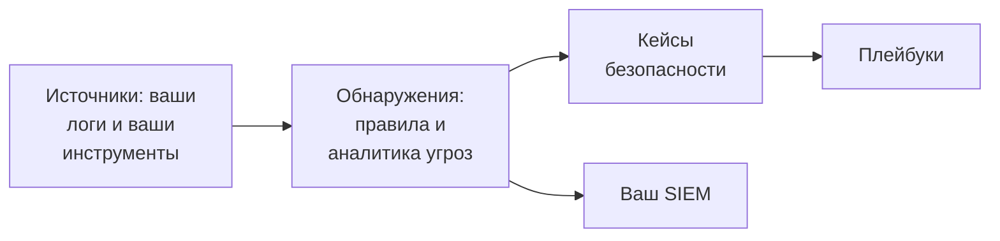

# Начало работы с безопасностью

OneUptime находит угрозы в данных, которые у вас уже есть - в ваших логах, в инструментах безопасности, которыми вы пользуетесь, и во всём, что вы ему отправляете, - объединяет найденное в кейсы и реагирует на них с помощью плейбуков. Настройка занимает два клика, и ничего не нужно устанавливать.

:::cards
- [Настройка](#настройка): Включите то, что нужно большинству команд, и посмотрите, как тестовая атака открывает кейс.
- [Как это работает](#как-это-работает): Источники, обнаружения, кейсы и плейбуки и то, что делает каждый из них.
- [Ваши логи](#поиск-событий-безопасности-в-ваших-логах): События безопасности, которые уже есть в логах, отправляемых вами в OneUptime.
- [Ваш SIEM](#отправка-найденного-oneuptime-в-ваш-siem): Отправляйте найденное OneUptime в Google SecOps.
:::

## Перед началом

Для настройки безопасности нужна роль Project Owner, Project Admin или Security Admin. Роли Security Member и Security Viewer читают найденное; см. [Роли](/docs/permissions/reference#роли).

## Настройка

:::steps
### Включите то, что нужно большинству команд

Откройте **Продукты → Security Events**. На странице **Обзор** нажмите **Включить рекомендуемое**. Сразу включаются три вещи: **Искать события безопасности в логах**, рекомендуемые правила обнаружения и **Enrich New Cases** - плейбук, который сверяет каждый новый кейс с аналитикой угроз и оставляет в нём чек-лист для разбора.

### Отправьте тестовую атаку

Нажмите **Отправить тестовую атаку**. Дюжина неудачных входов с одного адреса из документации проходит через настоящую обработку: они сохраняются, правило перебора паролей срабатывает на них, и открывается кейс. Никого не вызывают, и ни один SIEM их не получает.

### Откройте кейс

Нажмите **Открыть кейс**. Так выглядит настоящая находка: события, на которых она основана, адрес, которого она касается, и то, что нашёл **Enrich New Cases**. Закройте его как тестовый, когда закончите.
:::

С этого момента страница **Обзор** открывается на том, что ждёт человека, под заголовком **Требует внимания**: ваши открытые кейсы, кейсы, которые никто не взял, и шаги плейбуков, ожидающие одобрения. Если ничего такого нет, на ней написано **Всё спокойно**.

## Как это работает

| Часть | Где | Что она делает |
| --- | --- | --- |
| **Источники** | **Connections** | Ваши логи, продукты безопасности, которые опрашивает OneUptime, и всё, что вы отправляете |
| **Detections** | **Detections** | Правила Sigma и фиды аналитики угроз, которые ищут угрозы в каждом событии |
| **Кейсы безопасности** | **Кейсы безопасности** | Найденное, сгруппированное по пользователю, хосту или адресу, которых оно касается |
| **Playbooks** | **Playbooks** | Шаги, которые выполняются для новых кейсов: обогащают их, уведомляют, открывают инцидент или изолируют |

Вверху страницы **Обзор**, под тем, что ждёт человека, каждая часть показывает свои цифры: источники и их события за последние 24 часа, включённые правила, открытые кейсы и плейбуки, которые реагируют. Часть, которая не настроена, говорит об этом и открывает страницу, где её настроить.

## Поиск событий безопасности в ваших логах

Карточка **Ваши логи** вверху страницы **Connections** не требует установки. Когда **Искать события безопасности в логах** включён, OneUptime каждую минуту читает новые логи проекта и превращает распознанные строки в события безопасности:

| Логи | Что становится событием безопасности |
| --- | --- |
| Входы по SSH | Неудачные и успешные входы по SSH из журнала аутентификации, journal или syslog сервера |
| sudo | Команды, выполненные от имени другого пользователя, неверные пароли sudo и люди, которым нельзя пользоваться sudo |
| Журналы аудита Kubernetes | Изменения кластера, оболочки, открытые в подах, прочитанные секреты и отклонённые запросы |
| AWS CloudTrail | Входы в консоль, изменения в ваших аккаунтах AWS и вызовы, которые AWS отклонил |
| Веб-атаки | Запросы в журнале доступа веб-сервера, пытающиеся выполнить SQL-инъекцию, обход каталогов или Log4Shell |

Ваши логи остаются как есть. Событиями становятся только строки, важные для безопасности: никогда не каждая страница, отданная веб-сервером, и не каждое чтение API.

## Отправка найденного OneUptime в ваш SIEM

Если ваша команда уже работает в SIEM, OneUptime отправляет найденное и туда. В разделе **Connections → Отправка в вашу SIEM** нажмите **Добавить получателя**, укажите регион, экземпляр и ключ сервисного аккаунта вашего Google SecOps и перед сохранением нажмите **Отправить тестовое событие**. См. [Отправка событий безопасности в Google SecOps](/docs/integrations/google-secops#отправка-событий-безопасности-в-google-secops).

## Устранение неполадок

:::details Кнопка Turn on recommended неактивна
Ваша роль не может добавлять правила обнаружения, плейбуки или источник логов. Обратитесь к Project Owner, Project Admin или Security Admin или попросите их выдать вам роль Security Admin.
:::

:::details Кнопка Turn on recommended включила не всё
Карточка называет всё, что не удалось включить, и почему: ваша роль, ваш тариф или ошибка на стороне OneUptime. Всё остальное включено. Исправьте то, что она называет, и нажмите **Повторить попытку**: включится только то, чего ещё не хватает, и ничего не добавится дважды.
:::

:::details Тестовая атака не открыла кейс
Обычно кейс открывается раньше, чем отвечает кнопка; если правило ещё догоняет, она об этом сообщает, и кейс открывается в течение минуты. Снова загляните в **Кейсы безопасности** и проверьте в **Detections**, что правило перебора паролей включено.
:::

:::details Из моих логов не приходит ни одного события безопасности
Проверьте, что **Искать события безопасности в логах** включён и что карточка **Ваши логи** показывает, когда была последняя проверка. Событиями становятся только строки тех видов, что перечислены в таблице выше: серверу, который не отправляет журналы SSH, sudo, аудита, CloudTrail или доступа, нечего находить.
:::

:::details Обзор сообщает, что последнее событие безопасности пришло несколько дней назад
С тех пор в Security ничего не приходило. Откройте **Connections** и проверьте, что **Ваши логи** и каждое подключение по-прежнему включены, и когда каждый из них проверял в последний раз.
:::

:::details Карточка, которая включает Security, исчезла
Кто-то убрал её кнопкой **Скрыть**. Пока ничто не отслеживается на угрозы, страница **Обзор** предлагает **Настроить Security**, и карточка возвращается.
:::

## Дальнейшие шаги

:::cards
- [События безопасности (SIEM)](/docs/telemetry/security-events): Отправляйте события, ищите по ним и пишите правила обнаружения.
- [Кейсы безопасности и плейбуки (SOAR)](/docs/telemetry/security-cases): Разбирайте кейсы и реагируйте с помощью плейбуков.
- [Аналитика угроз (STIX/TAXII)](/docs/telemetry/threat-intelligence): Сверяйте свои события с известными вредоносными индикаторами.
- [Google SecOps](/docs/integrations/google-secops): Загружайте обнаружения из Google SecOps и отправляйте туда найденное OneUptime.
:::
