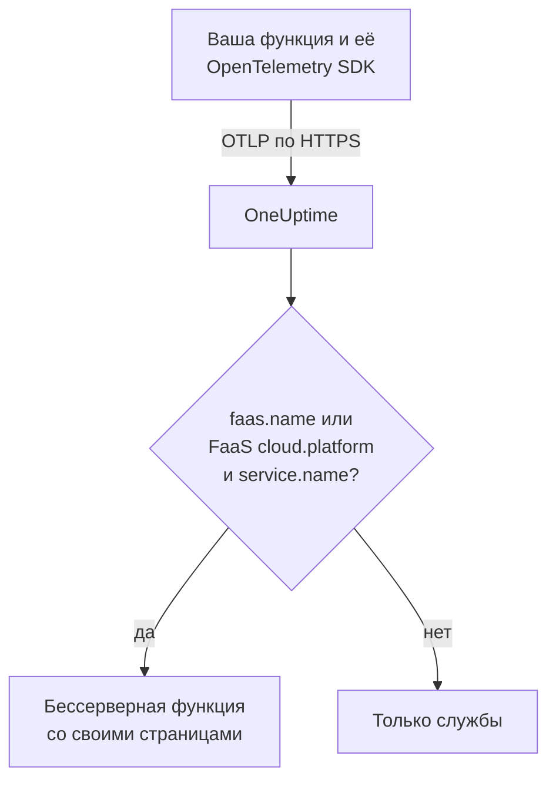

# Serverless-функции

OneUptime распознаёт бессерверную функцию в тот момент, когда получает от неё данные OpenTelemetry, и показывает её в разделе **Serverless-функции** с её трассировками, журналами и метриками. Это работает для AWS Lambda, Google Cloud Functions, Azure Functions, Cloudflare Workers и любой другой среды выполнения FaaS, которая умеет отправлять OpenTelemetry. Вручную создавать ничего не нужно: инструментируйте функцию с помощью OpenTelemetry SDK для её среды выполнения и направьте её OTLP-экспортёр на OneUptime.

:::cards
- [Как OneUptime определяет функцию](#как-oneuptime-определяет-функцию): `faas.name` или FaaS-платформа в `cloud.platform` вместе с `service.name`.
- [Отправка телеметрии функции](#отправка-телеметрии-функции): Настройки экспортёра и слой Lambda.
- [Azure Functions](#azure-functions): Одна функция на Function App, от хоста Functions.
- [Устранение неполадок](#устранение-неполадок): Функция, которая не появляется или страницы которой пусты.
:::

## Как это работает

OneUptime читает атрибуты ресурса каждого пакета по мере его поступления. Ресурс с `faas.name` или с FaaS-платформой в `cloud.platform`, например `aws_lambda` или `azure_functions`, вместе с `service.name` — это бессерверная функция: OneUptime создаёт её по первым данным и относит к ней телеметрию.



## Перед началом

- Ключ приёма. Создайте его в разделе **Настройки проекта → Телеметрия и APM → Ключи приема** и скопируйте значение.
- OpenTelemetry SDK или слой автоинструментирования для языка вашей функции.

## Как OneUptime определяет функцию

OneUptime определяет каждую функцию по атрибуту ресурса `faas.name`. Детекторы ресурсов некоторых платформ никогда его не задают ([Azure Functions](#azure-functions) — обычный случай), поэтому, когда у ресурса нет `faas.name`, но его `cloud.platform` — платформа FaaS, OneUptime использует вместо этого его `service.name` как идентификатор функции и записывает это значение как `faas.name` в каждый сохраняемый спан, журнал, метрику и профиль, чтобы страницы функции находили всю её телеметрию:

| Атрибут | Обязателен | Назначение |
| --- | --- | --- |
| `faas.name` | **да**, если не заданы два следующих | Идентификатор функции (например, `checkout-handler`) |
| `cloud.platform` | вместе с `service.name`, когда нет `faas.name` | `aws_lambda`, `gcp_cloud_functions`, `azure_functions`, `tencent_cloud_scf` или `alibaba_cloud_fc` |
| `service.name` | на FaaS-платформе в `cloud.platform` без `faas.name` | Идентификатор функции, записываемый в телеметрию как `faas.name` |
| `faas.version` | нет | Показывается в обзоре |
| `faas.instance` | нет | Отслеживается по экземплярам на странице **Экземпляры** |
| `cloud.provider` / `cloud.region` / `cloud.account.id` | нет | Показывается в обзоре |
| `process.runtime.name` / `process.runtime.version` | нет | Показывается в обзоре как среда выполнения |

Заданный вами `faas.name` никогда не заменяется. Значение `cloud.platform` должно быть написано так, как в списке (вариант с точкой `azure.functions`, который отправляют некоторые детекторы Azure, тоже принимается), а `service.name` должен быть атрибутом ресурса: заголовок `x-oneuptime-service-name` задаёт имя службы, а не функции.

> [!NOTE]
> Функция, которая также задаёт `service.name`, по-прежнему появляется и в разделе **Службы**. **Serverless-функции** — это представление, созданное для функций и ограниченное по `faas.name`.

## Отправка телеметрии функции

:::steps
### Задайте переменные окружения OTLP-экспортёра

Большинство автоинструментирований для разных языков читают стандартные переменные окружения OpenTelemetry:

```bash
OTEL_EXPORTER_OTLP_ENDPOINT="https://oneuptime.com/otlp"
OTEL_EXPORTER_OTLP_HEADERS="x-oneuptime-token=YOUR_TELEMETRY_INGESTION_TOKEN"
OTEL_RESOURCE_ATTRIBUTES="faas.name=checkout-handler,faas.version=1.4.2"
```

Если вы размещаете OneUptime самостоятельно, замените эндпоинт на `https://YOUR-ONEUPTIME-HOST/otlp`. В Azure Functions не включайте `faas.name` в `OTEL_RESOURCE_ATTRIBUTES` — см. [Azure Functions](#azure-functions).

> [!WARNING]
> Ключ приёма — это секрет. Используйте ключ приёма типа **Сервер**, заданный как переменная окружения функции. Ключ, попавший в браузер, может прочитать любой, кто посмотрит исходный код страницы.

### Добавьте слой OpenTelemetry Lambda (AWS Lambda)

В AWS Lambda проще всего использовать [слой OpenTelemetry Lambda](https://opentelemetry.io/docs/faas/lambda-auto/). Подключите слой для среды выполнения вашей функции и задайте:

```bash
AWS_LAMBDA_EXEC_WRAPPER=/opt/otel-handler
OTEL_EXPORTER_OTLP_ENDPOINT=https://oneuptime.com/otlp
OTEL_EXPORTER_OTLP_HEADERS=x-oneuptime-token=YOUR_TELEMETRY_INGESTION_TOKEN
```

Слой задаёт `faas.name` по имени функции, а его детектор ресурсов заполняет `cloud.platform`, `cloud.region` и `cloud.account.id`. На другой платформе пропустите этот шаг.

### Вызовите функцию и проверьте, что данные поступают

Проверьте, что OneUptime принимает ключ:

```bash
curl -i https://oneuptime.com/otlp/v1/validate \
  -H "x-oneuptime-token: YOUR_TELEMETRY_INGESTION_TOKEN"
```

`200` с `"valid": true` означает, что OneUptime принимает ключ; `401` означает, что ключ неизвестен, отозван, отключён или истёк. Затем вызовите функцию. Как только она отправит спан, журнал или метрику, она появится в **Продукты → Инфраструктура → Serverless → Все функции**.
:::

## Azure Functions

Хост Azure Functions умеет сам отправлять OpenTelemetry, поэтому Function App сообщает о своих вызовах (трассировки, журналы и метрики) без изменения кода, на каком бы языке она ни была написана. Руководство Microsoft — [Use OpenTelemetry with Azure Functions](https://learn.microsoft.com/en-us/azure/azure-functions/opentelemetry-howto).

### Как отображается Function App

Детекторы ресурсов Azure (собственный детектор хоста Functions, детектор изолированного рабочего процесса .NET в `Microsoft.Azure.Functions.Worker.OpenTelemetry` и детектор Node.js в `@opentelemetry/resource-detector-azure`) описывают **Function App**, а не отдельную функцию, и ни один из них не задаёт `faas.name`:

| Атрибут | Значение |
| --- | --- |
| `service.name` | Имя Function App из `WEBSITE_SITE_NAME` |
| `cloud.provider` | `azure` |
| `cloud.platform` | `azure_functions`; детектор Node.js пишет `azure.functions`, и OneUptime его переписывает |
| `cloud.region` | Регион приложения из `REGION_NAME` |
| `cloud.resource_id` | `/subscriptions/<subscription>/resourceGroups/<group>/providers/Microsoft.Web/sites/<app>` |
| `faas.instance` | Экземпляр из `WEBSITE_INSTANCE_ID`: только детектор Node.js |

Поэтому OneUptime определяет функцию по `service.name`, записывает в `faas.name` имя Function App и показывает **одну бессерверную функцию на Function App**. Ресурс описывает приложение, а не одну из его функций: каждый экземпляр сообщает одни и те же атрибуты уровня приложения, какую бы функцию приложения он ни выполнял, а в плане Flex Consumption некоторые функции даже масштабируются на собственных экземплярах. Отдельные функции видны в самой телеметрии:

- Хост начинает спан для каждого вызова, названный по функции, которую он выполнил: ищите это имя на странице **Трассировки** функции.
- Хост записывает `faas.invoke_duration` — гистограмму в секундах — с именем функции в атрибуте точки данных `faas.name`: сгруппируйте метрику по нему на странице **Метрики** или на дашборде, чтобы увидеть задержку каждой функции.

Не добавляйте `faas.name` в `OTEL_RESOURCE_ATTRIBUTES` в Function App, как это делает общий пример на [первом шаге](#задайте-переменные-окружения-otlp-экспортёра). Параметры приложения доходят до каждого процесса приложения, поэтому телеметрия всех его функций несла бы это одно имя, а OneUptime никогда не заменяет полученный `faas.name`. Руководство Microsoft говорит то же самое: не помещайте в ресурс значения, относящиеся к отдельной функции. Оставьте его незаданным, и функция получит имя приложения.

Хост и изолированный рабочий процесс .NET используют `OTEL_SERVICE_NAME` вместо имени приложения, когда он задан. Держите все процессы одного приложения на одном `service.name`: хост и языковой рабочий процесс оба отправляют телеметрию, и рабочий процесс, сообщающий второе имя, создаёт вторую бессерверную функцию. Рабочий процесс, у ресурса которого нет FaaS-платформы в `cloud.platform`, вообще не попадает ни в одну бессерверную функцию — см. [Инструментируйте код функции](#инструментируйте-код-функции-необязательно).

:::steps
### Включите OpenTelemetry в хосте Functions

Добавьте `"telemetryMode": "OpenTelemetry"` в корень файла `host.json` приложения:

```json title="host.json"
{
  "version": "2.0",
  "telemetryMode": "OpenTelemetry"
}
```

После этого хост, на каком бы языке ни было приложение, отправляет собственные трассировки (спан на каждый вызов, а также спаны процессоров Service Bus и Event Hubs за функциями с триггерами), свои журналы и метрики, включая `faas.invoke_duration`.

### Направьте хост на OneUptime

Задайте экспортёр в параметрах приложения:

```bash
az functionapp config appsettings set \
  --name my-function-app \
  --resource-group my-rg \
  --settings \
    OTEL_EXPORTER_OTLP_ENDPOINT=https://oneuptime.com/otlp \
    OTEL_EXPORTER_OTLP_PROTOCOL=http/protobuf \
    "OTEL_EXPORTER_OTLP_HEADERS=x-oneuptime-token=YOUR_TELEMETRY_INGESTION_TOKEN"
```

Если вы размещаете OneUptime самостоятельно, замените эндпоинт на `https://YOUR-ONEUPTIME-HOST/otlp`. `OTEL_EXPORTER_OTLP_PROTOCOL=http/protobuf` важен: .NET-экспортёр хоста по умолчанию использует gRPC, а с `http/protobuf` он отправляет данные на `/otlp/v1/traces`, `/otlp/v1/metrics` и `/otlp/v1/logs` под эндпоинтом. Хост отправляет OTLP, только пока задан `OTEL_EXPORTER_OTLP_ENDPOINT`.

> [!WARNING]
> Этот токен — секрет: используйте ключ приёма типа **Сервер**. Параметры приложения шифруются при хранении; чтобы вместо этого держать токен в Key Vault, задайте в `OTEL_EXPORTER_OTLP_HEADERS` ссылку на Key Vault, например `@Microsoft.KeyVault(SecretUri=https://my-vault.vault.azure.net/secrets/oneuptime-otlp-headers/)`, и выдайте управляемому удостоверению приложения роль **Key Vault Secrets User** в хранилище. Ссылка разрешается в значение секрета в том виде, в каком оно сохранено, поэтому сохраните весь заголовок, `x-oneuptime-token=YOUR_TELEMETRY_INGESTION_TOKEN`, а не только токен.

Оставьте `APPLICATIONINSIGHTS_CONNECTION_STRING`, если вам по-прежнему нужен Application Insights: когда заданы оба, хост отправляет одни и те же данные OpenTelemetry и в Application Insights, и в OneUptime. Удалите его, чтобы отправлять только в OneUptime.

### Инструментируйте код функции (необязательно)

Хост уже трассирует каждый вызов. Чтобы добавить спаны и журналы из собственного кода, связанные со спанами хоста, включите OpenTelemetry и в языковом рабочем процессе. Он отправляет данные с теми же параметрами `OTEL_EXPORTER_OTLP_*`:

- **C# (isolated worker)**: добавьте NuGet-пакеты `Microsoft.Azure.Functions.Worker.OpenTelemetry`, `OpenTelemetry.Extensions.Hosting` и `OpenTelemetry.Exporter.OpenTelemetryProtocol`, затем в `Program.cs`: `builder.Services.AddOpenTelemetry().UseFunctionsWorkerDefaults().UseOtlpExporter();`
- **JavaScript / TypeScript**: `npm install @azure/functions-opentelemetry-instrumentation` вместе с OpenTelemetry SDK для Node.js и его OTLP-экспортёрами, и зарегистрируйте `AzureFunctionsInstrumentation` в файле, который подключает поле `main` в `package.json`.
- **Java**: добавьте зависимость Maven `com.microsoft.azure.functions:azure-functions-java-opentelemetry`.
- **Python**: задайте параметр приложения `PYTHON_ENABLE_OPENTELEMETRY=true`, добавьте пакеты OpenTelemetry, которые перечисляет Microsoft (среди них `opentelemetry-sdk` и `opentelemetry-exporter-otlp`), в `requirements.txt` и настройте экспортёры в `function_app.py`.
- **PowerShell**: задайте параметр приложения `OTEL_FUNCTIONS_WORKER_ENABLED=True` и загрузите модуль `AzureFunctions.PowerShell.OpenTelemetry.SDK` из `profile.ps1`.

В руководстве Microsoft есть полный код для каждого языка. Рабочий процесс .NET (через `UseFunctionsWorkerDefaults()`) и рабочий процесс Python (через `PYTHON_ENABLE_OPENTELEMETRY`) просят хост оставить их журналы им, поэтому эти журналы не отправляются дважды.

Спаны и журналы рабочего процесса попадают на страницы функции, только если его ресурс описывает приложение так же, как ресурс хоста: тот же `service.name` и FaaS-платформа в `cloud.platform`. Изолированный рабочий процесс .NET (через `UseFunctionsWorkerDefaults()`) и пример Microsoft для Node.js (через детекторы Azure, которые включает `getResourceDetectors()`) сообщают и то и другое. Пример Microsoft для Python строит ресурс без детектора Azure, поэтому по умолчанию не сообщает ни того, ни другого, и его телеметрия никогда не попадает в функцию. Для Python или любого рабочего процесса, настроенного без детектора ресурсов Azure Functions, добавьте ещё два параметра приложения. Их читают все процессы приложения, включая хост, поэтому все сообщают один и тот же идентификатор:

```bash
az functionapp config appsettings set \
  --name my-function-app \
  --resource-group my-rg \
  --settings \
    OTEL_SERVICE_NAME=my-function-app \
    "OTEL_RESOURCE_ATTRIBUTES=cloud.provider=azure,cloud.platform=azure_functions"
```

Задайте в `OTEL_SERVICE_NAME` собственное имя Function App. Это имя, которое хост и детектор Node.js сообщают без этого параметра, поэтому функция сохраняет уже имеющийся идентификатор.
:::

### Ограничения

- **Приложения C# с внутрипроцессной моделью** не могут использовать OpenTelemetry: сначала переведите их на модель изолированного рабочего процесса.
- **Потоковая передача журналов** на портале Azure не работает, пока хост находится в режиме OpenTelemetry, а списку _Recent function invocations_ на портале нужна телеметрия в Application Insights. Вместо этого используйте страницы **Журналы** и **Трассировки** функции в OneUptime.
- Раздел `logging.applicationInsights` файла `host.json` больше не действует, как только `telemetryMode` равен `OpenTelemetry`.
- На странице **Экземпляры** перечислены значения `faas.instance`. Из детекторов выше его задаёт только детектор Node.js, поэтому для телеметрии от хоста и рабочего процесса .NET страница остаётся пустой.

## Что вы получаете

Как только функция отправит спан, журнал или метрику, она появится в разделе **Serverless-функции**. Её страница **Обзор** показывает:

- **Вызовы**, **частоту ошибок** и **длительность p95**, вычисленные по вашим трассировкам за выбранный вами период, с графиками трендов.
- **Экземпляры**: живой список значений `faas.instance`, которые сообщает функция.
- Полные страницы **Журналы**, **Трассировки** и **Метрики**, ограниченные этой функцией.

## Метки функций и назначение владельцев

Атрибут ресурса, начинающийся с `oneuptime.label.`, становится меткой проекта на функции: `oneuptime.label.team=payments` добавляет метку `team:payments`. Добавьте атрибуты в `OTEL_RESOURCE_ATTRIBUTES`:

```bash
OTEL_RESOURCE_ATTRIBUTES="faas.name=checkout-handler,oneuptime.label.team=payments,oneuptime.label.env=production"
```

Чтобы вместо этого ставить метки функциям или назначать владельцев по их именам, откройте **Продукты → Инфраструктура → Serverless** и используйте **Правила меток** и **Правила владельца** в боковом меню. Правила срабатывают при создании функции, в том числе обнаруженной автоматически. Чтобы применить правило к уже имеющимся функциям, используйте его кнопку **Run Now** (см. [Применение правил к существующим ресурсам](/docs/configuration/run-rules-now)).

## Устранение неполадок

:::details Функция не появляется в разделе Serverless-функции
Проверьте по порядку:

1. Функцию вызывали после того, как вы задали переменные: она отправляет телеметрию только во время работы.
2. В AWS Lambda слой подключён для среды выполнения функции, а `AWS_LAMBDA_EXEC_WRAPPER` равен `/opt/otel-handler`: без обёртки инструментирование слоя так и не запускается.
3. В других средах код функции загружает OpenTelemetry SDK или автоинструментирование: одни переменные ничего не отправляют.
4. Ресурс содержит `faas.name` или FaaS-платформу в `cloud.platform` и `service.name`. Без них телеметрия попадает вместо этого в раздел **Службы**, как служба.
5. Функция может достучаться до вашего URL OneUptime. Функции в частной сети нужен маршрут наружу к нему, например через NAT-шлюз.
:::

:::details Функция есть в списке, но её страницы пусты
Страницы **Обзор**, **Журналы**, **Трассировки** и **Метрики** функции показывают телеметрию, у которой `faas.name` в точности совпадает с именем функции, с учётом регистра. Функции, названной по FaaS-платформе в `cloud.platform` и своему `service.name`, не нужен собственный `faas.name`: OneUptime записывает `service.name` в телеметрию как `faas.name` по мере поступления. Телеметрия, сохранённая до того, как OneUptime начал заполнять `faas.name`, не обновляется и не попадает на страницы: вызовите функцию, чтобы отправить новую телеметрию. Проверьте также период вверху страницы.
:::

:::details Функция показана как отключённая
Функция становится отключённой, когда OneUptime ничего не получал от неё 15 минут; OneUptime проверяет это каждые 5 минут, и время, когда он сам не получал данные, не учитывается. Функция, которая работает лишь время от времени, между запусками отключена: со следующей телеметрией она снова становится подключённой.
:::

## Дальнейшие шаги

:::cards
- [OpenTelemetry](/docs/telemetry/open-telemetry): Отправляйте трассировки, журналы и метрики из любого приложения.
- [Очереди](/docs/telemetry/queues): Очереди и топики, в которые ваши функции публикуют сообщения и из которых их читают.
- [Мониторинг трассировок](/docs/monitor/traces-monitor): Оповещения о неудачных или медленных вызовах функции.
:::
