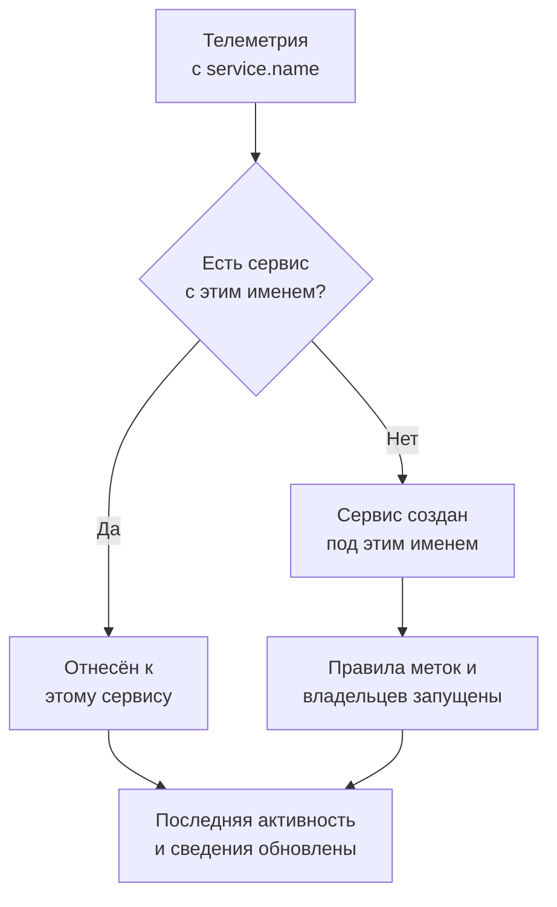

# Каталог служб

Каталог служб перечисляет приложения и микросервисы, которые вы запускаете. OneUptime добавляет сервис, как только приходит его первая телеметрия, а затем собирает его логи, трассировки, метрики, исключения, инциденты и владельцев на одной странице, чтобы любой мог узнать, что делает сервис, кто им владеет и как у него дела.

:::cards
- [Как сервис попадает в каталог](#как-сервис-попадает-в-каталог): Его `service.name`, с первой телеметрией.
- [Найти сервис](#найти-сервис): Список, его фильтры и столбцы.
- [Страницы сервиса](#страницы-сервиса): Всё об одном сервисе.
- [Архивировать или удалить сервис](#архивировать-или-удалить-сервис): Сохранить историю или убрать его.
:::

## Как сервис попадает в каталог

Создавать сервисы не нужно. Каждый пакет телеметрии называет отправивший его сервис в атрибуте ресурса `service.name`. OneUptime относит пакет к сервису с этим именем и создаёт сервис, если в проекте такого ещё нет.

- **Имя определяет сервис.** Оно сравнивается без учёта регистра, поэтому `Checkout-API` и `checkout-api` — один сервис. Новое `service.name` создаёт новый сервис.
- **Контейнеры называют себя сами.** Телеметрия от агентов Docker и Podman называет сервис по его контейнеру, если в ней нет `service.name`.
- **Ключ приема может задать сервис.** Данные OpenTelemetry, отправленные с ключом, у которого задано **Pinned Service Name**, относятся к сервису с этим именем, что бы ни было в их `service.name`. См. [Ключи приема](/docs/telemetry/ingestion-keys#защитить-браузерный-ключ).
- **Браузеры и телефоны — не сервисы.** Телеметрия из браузера или мобильного приложения относится к [приложению RUM](/docs/rum/applications).
- **Метки могут прийти вместе с телеметрией.** Атрибут ресурса с именем `oneuptime.label.<name>` добавляет сервису метку `<name>:<value>`, например `oneuptime.label.team=payments` даёт `team:payments`.

Каждый раз, когда приходит телеметрия, **Последняя активность** сервиса сдвигается вперёд, а его сведения обновляются из пришедших с ней атрибутов ресурса:

| Сведения | Из атрибута |
| --- | --- |
| Версия сервиса | `service.version` |
| Среда развёртывания | `deployment.environment.name` или `deployment.environment` |
| Пространство имён сервиса | `service.namespace` |
| Среда выполнения | `process.runtime.name` и `process.runtime.version` |
| Технология | `telemetry.sdk.language` или среда выполнения |
| Облако | `cloud.provider`, `cloud.platform`, `cloud.region` и `cloud.account.id` |

## Перед началом

- **Поступающая телеметрия** с `service.name`. См. [OpenTelemetry](/docs/telemetry/open-telemetry): его задаёт `OTEL_SERVICE_NAME`.
- **Роль, которая читает сервисы.** Project Owner, Project Admin, Project Member, Viewer, Settings Admin, Settings Member или Settings Viewer либо пользовательская роль с разрешением Read Service. Для создания, изменения и удаления сервисов нужны Project Owner, Project Admin, Project Member, Settings Admin или Settings Member либо соответствующие разрешения на сервисы.

## Найти сервис

Перейдите в **Продукты → Ресурсы → Сервисы**. **Все службы** показывает каждый сервис с полями **Имя**, **Описание**, **Technology**, **Последняя активность**, **Метки** и **Владельцы**.

- Ищите по имени или описанию и фильтруйте по владельцу или метке с помощью панели над списком.
- Выберите несколько сервисов, чтобы сразу добавить им всем метки или владельцев либо архивировать их.
- Нажмите на сервис, чтобы открыть его страницы.

Чтобы добавить сервис до того, как придёт его телеметрия, например чтобы сначала назначить владельцев, нажмите **Создать: Сервис** и введите в поле **Имя** ровно то, что будет в его `service.name`. Правила меток и владельцев применяются к нему так же, как к обнаруженному сервису. После сохранения открывается руководство по настройке OpenTelemetry с этим именем в каждом фрагменте кода, и его последний шаг, **Дождитесь подключения**, сообщает, когда поступят первые данные сервиса.

## Страницы сервиса

Боковое меню сервиса состоит из пяти разделов:

| Раздел | Страницы |
| --- | --- |
| **Базовый** | **Обзор**: запросы, доля ошибок и задержка p95 по его спанам, графики и его сведения. **Recommendations**: готовые мониторы для сервиса, подобранные под его язык. **Владельцы**: люди и команды, которые за него отвечают. **Feed**: всё, что с ним происходило, от создания до каждого изменения после него. |
| **Телеметрия** | Его **Журналы**, **Трассировки**, **Метрики**, **Профили производительности**, **Исключения** и **Source Maps**, уже отфильтрованные по этому сервису. |
| **Активность** | **Инциденты**, **Оповещения** и события из **Плановое обслуживание**, которые его затрагивают. |
| **Для разработчиков** | **Terraform**, **API** и **ИИ-ассистенты**: управление сервисом из кода. Раздел изначально свёрнут. |
| **Расширенный** | **Настройки**, **Журналы аудита** и **Удалить службу**. **Расширенный** изначально свёрнут: сначала разверните его. |

Владельцы важны не только на этой странице: роль с областью Owned («Свои») читает телеметрию сервисов, которыми владеете вы или ваши команды. См. [Телеметрия](/docs/permissions/index#телеметрия).

## Изменить сервис

:::steps
### Откройте его настройки

Откройте сервис, разверните **Расширенный** в его боковом меню и нажмите **Настройки**.

### Переименуйте его или опишите

На карточке **Сведения о сервисе** нажмите **Изменить сведения**, чтобы изменить его **Имя**, **Описание** или **Метки**. Имя должно по-прежнему совпадать с `service.name`, которое сообщает его телеметрия: измените его и в настройке OpenTelemetry, иначе следующая телеметрия создаст новый сервис.

### Выберите цвет и технологический стек

На карточке **Настройки сервиса** нажмите **Изменить настройки**. **Цвет сервиса** отмечает сервис на графиках и в списках; новый сервис получает собственный цвет. **Технологический стек** необязателен: оставьте его пустым, чтобы показывать язык, определённый по телеметрии.
:::

На той же странице задаётся срок хранения данных сервиса. Карточки **Срок хранения данных телеметрии** и **Хранение по типу телеметрии** хранят его телеметрию дольше или меньше срока хранения проекта по умолчанию. Они входят в [Enterprise Edition](/docs/self-hosted/enterprise), а в OneUptime Cloud — в тариф Scale; без них страница показывает, что они дают, а сервис хранит данные столько же, сколько проект.

## Метки и владельцы автоматически

Правила дают новым сервисам метки и владельцев при создании, в том числе обнаруженным сервисам. Они находятся в **Сервисы → Настройки → Правила владельца** и **Сервисы → Настройки → Правила меток**; раздел **Настройки** в боковом меню изначально свёрнут. См. [Правила меток и владельцев](/docs/configuration/label-and-owner-rules).

## Архивировать или удалить сервис

Архивируйте сервис, за которым вы больше не следите, но историю которого хотите сохранить. Архивированный сервис скрыт из **Все службы**, но продолжает собирать телеметрию. Архивируйте его на странице **Настройки** или выберите несколько сервисов в списке. Чтобы вернуть сервис, откройте **Сервисы → Расширенный → Архивировано**.

> [!WARNING]
> При удалении сервиса удаляются и его карты исходного кода, а также заданные для него правила пайплайнов метрик и бюджеты затрат на LLM. Если OneUptime всё ещё получает его телеметрию, сервис добавляется снова, но без меток, владельцев и настроек, которые вы ему дали. Чтобы убрать его из списка и сохранить всё, архивируйте его.

## Устранение неполадок

:::details Сервис появился дважды
В OneUptime пришли два значения `service.name`, например из двух версий вашей настройки или после переименования только на одной стороне. Телеметрия сопоставляется по имени: сделайте так, чтобы каждый экземпляр сообщал одно и то же `service.name`, а затем архивируйте или удалите ненужный сервис.
:::

:::details Моего сервиса нет в каталоге
Проверьте, что его телеметрия содержит `service.name`. Телеметрия из браузера или мобильного приложения попадает в Real User Monitoring, а хост или кластер без имени сервиса учитывается под этим хостом или кластером.
:::

:::details Последняя активность отстаёт
**Последняя активность** обновляется примерно раз в минуту, а не с каждым пакетом, поэтому может отставать от живой телеметрии на минуту или около того.
:::

## Дальнейшие шаги

:::cards
- [Обозреватель журналов](/docs/telemetry/logs-explorer): Ищите в логах сервиса.
- [Обозреватель трассировок](/docs/telemetry/traces-explorer): Следите за его запросами.
- [Отслеживание исключений](/docs/telemetry/exceptions): Разбирайте ошибки, которые он выбрасывает.
- [Правила меток и владельцев](/docs/configuration/label-and-owner-rules): Давайте новым сервисам метки и владельцев.
:::
