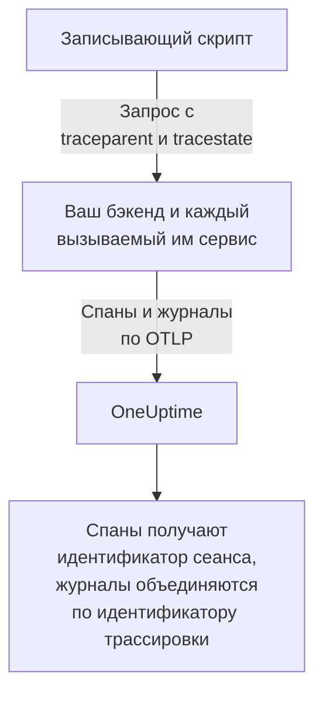
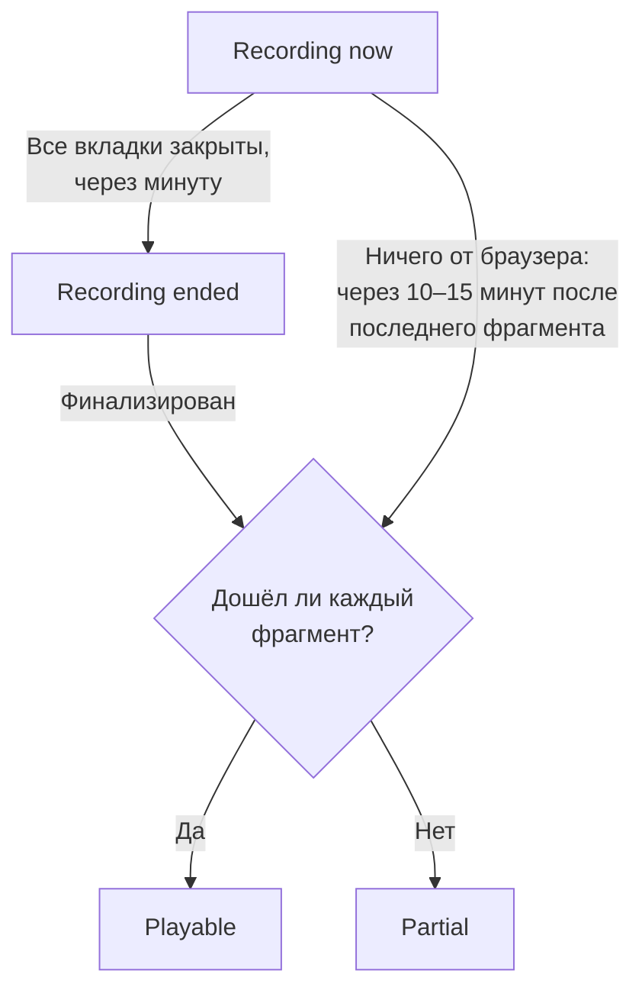
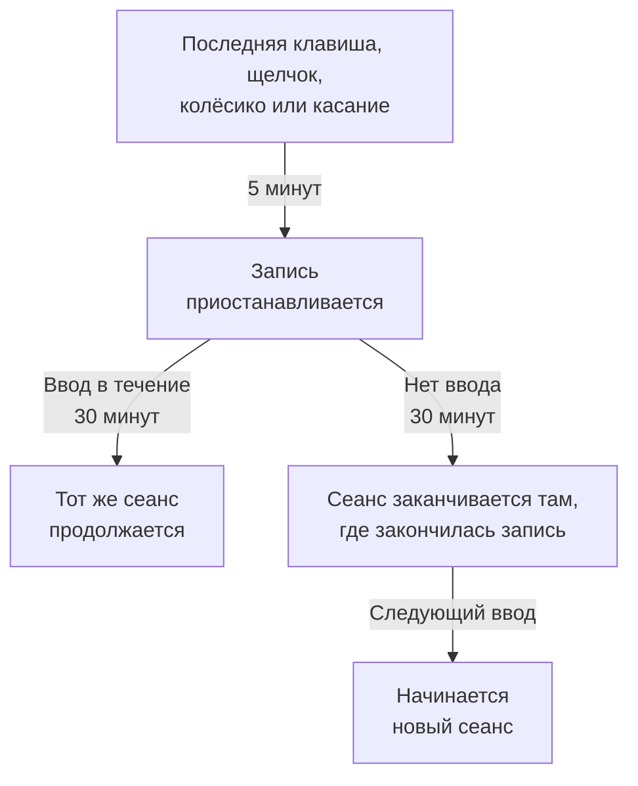

# Воспроизведение сеансов

Воспроизведение сеансов записывает то, что видели реальные пользователи в вашем веб-приложении или приложении React Native, и воспроизводит это рядом с ошибками, трассировками и журналами того же сеанса. Вы добавляете тег script, выбираете, что маскировать, и смотрите любой сеанс из его приложения RUM.

:::cards
- [Как это работает](#как-это-работает): Загрузчик, политика и записывающий скрипт, который отправляет данные по ходу работы.
- [Установка](#установка): Тег script на каждой странице или SDK для React Native.
- [Конфиденциальность](#конфиденциальность): Что маскируется, согласие и кто может отправлять записи.
- [Связь с остальной телеметрией](#связь-с-остальной-телеметрией): Трассировки, журналы и ошибки бэкенда, связанные без кода.
- [Просмотр сеанса](#просмотр-сеанса): Список сеансов, страница пользователей, пользовательские потоки и проигрыватель.
- [Состояние записи](#состояние-записи): Почему ничего не поступает, и оповещения до того, как будет исчерпан бюджет.
:::

## Как это работает

Скрипт на вашей странице — небольшой загрузчик. Он проверяет сигналы конфиденциальности браузера, получает политику приложения от OneUptime и только после этого загружает записывающий скрипт, который маскирует страницу по ходу записи и отправляет её фрагментами, пока пользователь активен.

```mermaid title="От загрузки страницы до записи, которую можно посмотреть"
flowchart TB
    page["Ваша страница загружает<br/>тег script"] --> dnt{"Сигнал Do Not Track<br/>или GPC?"}
    dnt -->|"Да"| none["Ничего<br/>не записывается"]
    dnt -->|"Нет"| policy["Загрузчик получает<br/>политику"]
    policy --> recorder["Записывающий скрипт<br/>маскирует и записывает<br/>страницу"]
    recorder -->|"Фрагменты, пока<br/>пользователь активен"| ingest["OneUptime"]
    ingest --> player["Список сеансов<br/>и проигрыватель"]
```

По умолчанию записывается и отправляется по ходу каждый сеанс, а не только те, в которых что-то пошло не так. Именно в сеансах, где ничего не сломалось, вы находите оформление заказа, которое никто не завершил, форму, которую все бросили, и страницу, которая, по словам клиента, «выглядела странно».

Чтобы хранить меньше, в политике приложения работают вместе две настройки:

| Настройка | По умолчанию | Что она меняет |
| --- | --- | --- |
| **Процент выборки** | 100 | Сколько сеансов может быть записано. Уменьшите её вдвое — и вдвое уменьшатся и хранимые байты, и хранимые данные конечных пользователей. Решение принимается один раз на сеанс по хешу идентификатора сеанса, поэтому сеанс никогда не записывается наполовину. |
| **Когда выгружать запись** | _Always_ | С _On error or frustration_ записывающий скрипт держит в памяти кольцевой буфер и отправляет данные, только когда что-то идёт не так. Тогда запись есть почти у каждого неудачного сеанса, а обходится это примерно в 15 раз дешевле, чем записывать всех, но посмотреть сеанс, который прошёл без сбоев, нельзя. |

## Прежде чем начать

- Приложение RUM. Создайте его в **Продукты → Ресурсы → Мониторинг реальных пользователей** или позвольте вашей телеметрии создать его: см. [Управление приложениями](/docs/rum/applications).
- Ключ приёма **Браузер** из **Настройки проекта → Телеметрия и APM → Ключи приема**. Ключ Browser работает только с источников, которые вы в нём укажете: см. [Задайте разрешённые источники в рабочей среде](#задайте-разрешённые-источники-в-рабочей-среде).

Воспроизведение сеансов включено по умолчанию. Его настройки находятся в трёх местах:

| Где | Что там |
| --- | --- |
| Страница приложения **Replay Policy** | Политика (запись, маскирование, согласие, трассировка и лимиты), сводка **Состояние записи**, карточка **Что содержит запись**, панель **Test your installation** и **Record a specific user's next session**. |
| Страница приложения **Состояние** | Поступают ли записи, а если нет — почему. См. [Состояние записи](#состояние-записи). |
| **Мониторинг реальных пользователей → Настройки → Воспроизведение сеансов** | Общий для проекта переключатель, который останавливает все приложения сразу, и список политик всех приложений только для чтения. |

## Установка

Добавьте тег script на каждую страницу, которую хотите записывать.

:::steps
### Создайте ключ Browser

В **Настройки проекта → Телеметрия и APM → Ключи приема** нажмите **Создать ключ приёма**, выберите **Браузер** в поле **Тип ключа** и укажите источник вашего сайта в **Разрешённые источники**. Затем скопируйте **Секретный ключ** этого ключа. В разделе [Настройка для браузера](/docs/rum/browser-setup#настройка) показан каждый экран.

### Добавьте тег script

Разместите тег на каждой странице, указав свой ключ и идентификатор приложения:

```html
<script
  src="https://oneuptime.com/telemetry/session-replay/v1/recorder.js"
  data-oneuptime-token="YOUR_TELEMETRY_INGESTION_KEY"
  data-oneuptime-app-identifier="storefront-web"
  crossorigin="anonymous"
  async
></script>
```

`data-oneuptime-app-identifier` должен совпадать с идентификатором приложения RUM — тем же значением, что вы используете для `service.name`. Страница приложения **Документация** в разделе **Воспроизведение сеансов** его бокового меню показывает этот фрагмент кода с уже подставленными значениями, а также его варианты для Next.js / React и Google Tag Manager.

### Убедитесь, что записи поступают

Откройте одну из своих страниц и пощёлкайте по ней несколько секунд. Примерно через минуту сеанс появится на странице приложения **Воспроизведение сеансов** с отметкой **Идёт запись**. Если этого не произошло, страница приложения **Состояние** скажет почему: см. [Состояние записи](#состояние-записи).
:::

Скрипт по адресу `/v1/recorder.js` — небольшой загрузчик. Он проверяет Do Not Track, получает политику вашего приложения и только потом загружает `/latest/recorder.js`. Политика и записывающий скрипт отдаются с `no-store`, поэтому изменение любого из них доходит до следующей загрузки страницы, не дожидаясь истечения кэша браузера.

### Атрибуты тега script

| Атрибут | Обязателен | Что делает |
| --- | --- | --- |
| `data-oneuptime-token` | Да | Ваш токен приёма телеметрии. |
| `data-oneuptime-app-identifier` | Да | Идентификатор приложения RUM. |
| `data-oneuptime-host` | Нет | Источник OneUptime. Если не указан, выводится из собственного `src` скрипта, поэтому нужен, только если вы отдаёте скрипт через свой домен. |
| `data-oneuptime-user-ref` | Нет | Ссылка на конечного пользователя, известная при загрузке страницы (идентификатор пользователя, а не адрес электронной почты, который вы не хотите хранить). То же, что позже задаёт `identify()`; это единственная форма, которая работает для [записи следующего сеанса конкретного пользователя](#запись-следующего-сеанса-конкретного-пользователя). |
| `data-oneuptime-respect-do-not-track` | Нет | По умолчанию соблюдает Do Not Track и Global Privacy Control. Задайте `"false"`, чтобы записывать независимо от сигнала; см. [Do Not Track](#do-not-track). |
| `data-oneuptime-debug` | Нет | `"true"` выводит решения записывающего скрипта в консоль. См. [Устранение неполадок воспроизведения сеансов](/docs/rum/session-replay-troubleshooting). |
| `data-oneuptime-offline-storage` | Нет | Задайте `"false"`, чтобы фрагменты, записанные, пока посетитель без сети, хранились только в памяти, а не сохранялись ещё и в IndexedDB браузера. См. [Автономный режим](#автономный-режим). |

Те же параметры можно передать в глобальном объекте вместо тега — так делают менеджеры тегов и установки через сборщик:

```js
window.__ONEUPTIME_SESSION_REPLAY__ = {
  host: "https://oneuptime.com",
  token: "YOUR_TELEMETRY_INGESTION_KEY",
  appIdentifier: "storefront-web",
  userRef: "user-123", // optional
  respectDoNotTrack: true, // optional
  debug: false, // optional
  offlineStorage: true, // optional; false keeps offline chunks in memory only
};
```

### Как выглядит исправная установка

Откройте DevTools → Network и отфильтруйте по `session-replay`. Работающая страница даёт:

1. **Один `GET .../session-replay/v1/config`** на загрузку страницы — получение политики.
2. **`POST .../session-replay/v1/chunk` примерно каждые 15 секунд, пока пользователь что-то делает**, или раньше, когда накопится 256 КБ событий. Неактивная вкладка не создаёт событий и, значит, не делает POST-запросов: подвигайте мышью или щёлкните, прежде чем судить об установке по вкладке Network.
3. Когда вкладка скрывается и ещё раз, когда страница исчезает, — `POST`, отправленный с `keepalive`. Уход со страницы — вкладка закрыта, перезагружена или переведена на другую страницу либо страница помещена в кэш «назад/вперёд» браузера (любой `pagehide`) — помечает его как последний, что сообщает OneUptime о завершении записи вкладки; страница, которую пользователь возвращает из кэша «назад/вперёд», продолжает запись как новая вкладка в том же сеансе. Вкладка, которая просто скрыта, остаётся открытой, поэтому запись продолжается, когда пользователь к ней возвращается. Всё тело этого запроса остаётся меньше 56 КБ — доли записывающего скрипта в квоте keepalive браузера в 64 КБ на источник — и может нести несколько фрагментов как кадры одного запроса: последний фрагмент, части, на которые был разделён большой последний фрагмент (не более 48 КБ событий каждая, чтобы ещё поместился заголовок кадра), и каждый фрагмент, который ещё ждал повторной отправки. Фрагмент, уже превышающий этот бюджет, когда вкладка просто скрывается, вместо этого уходит обычным путём, пока страница ещё жива и может его отправить.

С триггером _On error or frustration_ шаг 2 не происходит, пока не сработает триггер, — см. [Устранение неполадок](#устранение-неполадок).

## Установка в React Native

SDK для React Native записывает иерархию нативных представлений как синтетические события, совместимые с rrweb, поэтому мобильные записи открываются в том же списке сеансов и том же проигрывателе, что и веб-записи. Снимков экрана он не делает. Проигрыватель помечает каждую такую запись как приложение React Native, а его вкладка **Fidelity** объясняет, какие нативные поверхности не удалось воспроизвести.

:::steps
### Установите SDK

SDK поддерживает приложения React Native для iOS и Android. Установите его вместе с peer-зависимостью для постоянной исходящей очереди:

```bash
npm install @oneuptime/react-native-replay @react-native-async-storage/async-storage
```

В проекте iOS без Expo после добавления пакетов выполните обычную установку CocoaPods; актуальные версии React Native связывают Android автоматически, без ручной регистрации. Помимо Async Storage, у записывающего модуля есть собственный нативный модуль для дерева представлений, поэтому проекты Expo должны использовать пользовательскую сборку для разработки или продакшена (например, EAS Build или prebuild). Expo Go не может запускать этот SDK, потому что ни один из двух нативных модулей нельзя добавить в фиксированный бинарный файл Expo Go.

### Запустите запись и оберните приложение

Запустите синглтон один раз и разместите провайдер над той частью приложения, которую хотите записывать:

```tsx
import {
  OneUptimeReplay,
  OneUptimeReplayProvider,
} from "@oneuptime/react-native-replay";

OneUptimeReplay.start({
  host: "https://oneuptime.com",
  token: "YOUR_TELEMETRY_INGESTION_KEY",
  appIdentifier: "storefront-mobile",
  mobileAppIdentifier: "com.example.storefront",
  appName: "Storefront", // optional, shown in session details
  appVersion: "4.2.0", // optional, shown in session details
});

export default function App() {
  return (
    <OneUptimeReplayProvider>
      <Navigation />
    </OneUptimeReplayProvider>
  );
}
```

`appIdentifier` — идентификатор приложения RUM. `mobileAppIdentifier` — идентификатор приложения Android или идентификатор пакета iOS, который поставляется в бинарном файле, а не отображаемое имя. Используйте то же значение в [списках разрешённых источников с `app://`](#задайте-разрешённые-источники-в-рабочей-среде). SDK получает политику воспроизведения приложения с `host`; сэмплированием, триггерами, согласием, хранением и бюджетами отправки по-прежнему управляет сервер.
:::

Провайдер содержит нативный корень, который нельзя свернуть, и записывает своё дерево представлений, а также события начала, движения и окончания касаний. Если вы уже сами создаёте экземпляры записывающего модуля, передайте нужный через `<OneUptimeReplayProvider recorder={recorder}>`. `MobileReplayRecorder` тоже экспортируется — для изолированных интеграций или интеграций с несколькими клиентами; большинству приложений следует использовать синглтон.

### API для React Native

Импортируйте `OneUptimeReplay` напрямую или вызовите `useOneUptimeReplay()` внутри провайдера. Синглтон предоставляет:

| Метод | Что делает |
| --- | --- |
| `start(options)` | Получает политику и начинает запись. Обязательные параметры — `host`, `token`, `appIdentifier` и `mobileAppIdentifier`; `appName` и `appVersion` — необязательные метаданные для отображения, а `connectivity` — необязательный источник состояния сети для [автономного режима](#автономный-режим). |
| `stop()` | Сбрасывает то, что можно отправить, останавливает запись и отключает обработчики жизненного цикла. |
| `identify(userRef, traits?)` | Привязывает вошедшего пользователя и необязательные признаки — в зависимости от **Записывать личность конечного пользователя**. |
| `setTags(tags)` / `addTag(key, value)` | Заменяет все теги сеанса, доступные для поиска, или добавляет один тег, не заменяя остальные. |
| `track(name, properties?)` | Помещает событие приложения на шкалу времени воспроизведения. |
| `setRoute(route)` | Записывает очищенный логический экран или маршрут после навигации. Вызывайте его из обратного вызова смены маршрута вашего навигатора. |
| `captureSession(reason?)` | В режиме _On error or frustration_ отправляет кольцевой буфер по причине, которую определяет приложение, например когда пользователь нажимает «Сообщить о проблеме». |
| `captureError(error)` | Записывает обработанную ошибку JavaScript и запускает запись по ошибке. |
| `grantConsent()` / `revokeConsent()` | Разрешает отправку или немедленно очищает буфер в памяти, сохранённую исходящую очередь, сеанс и идентификатор посетителя. Последующее согласие начинается с новых идентификаторов. |
| `getSessionId()` / `onSessionChange(listener)` | Читает идентификатор текущего сеанса воспроизведения при наличии согласия или подписывается на него, чтобы связывать трассировки и журналы. Слушатель также получает `null`, когда запись или согласие прекращаются. |
| `getDiagnostics()` | Возвращает состояние записывающего модуля и его последние решения, не возвращая содержимое записанных представлений. |

SDK слушает `AppState` React Native: переход в фон закрывает и сбрасывает события, на которые есть согласие, а запись, сделанная до согласия, остаётся только в памяти. Перед возобновлением записи на переднем плане SDK обновляет политику, не используя кэшированный ответ. Он также периодически обновляет политику, пока активен, чтобы отключение, согласие, сэмплирование, нацеливание и смена личности вступали в силу в приложении, которое долго остаётся открытым. Вызывайте `stop()`, когда ваша интеграция размонтируется навсегда; обычная навигация между экранами должна использовать `setRoute()`, а не останавливать и перезапускать запись.

**Когда мобильный сеанс завершается из-за бездействия.** Пять минут без ввода уже приостанавливают запись (см. [Время бездействия](#время-бездействия)). Тридцать минут без касаний и без записанных вызовов SDK (`track()`, `setTags()`, `identify()` и подобных, сделанных во время записи) завершают сеанс. Он заканчивается на последней активности, а для приостановленного сеанса — на паузе, там, где закончилась его запись, а не тогда, когда приложение возвращается или записывающий модуль это замечает, поэтому время в фоне или на паузе никогда не добавляется к концу сеанса. Приложение, открытое на переднем плане, не начинает новый сеанс каждые полчаса. Следующий сеанс начинается, когда пользователь возвращается: первое касание, появление или скрытие экранной клавиатуры, возврат приложения на передний план или вызов `captureSession()`. Он открывается с новым снимком экрана. До тех пор `getSessionId()` возвращает `null`, а `onSessionChange()` вызывается с `null`. Ошибки, навигация и вызовы `track()` в этом промежутке не записываются.

Чтобы связать мобильную телеметрию с воспроизведением, подпишитесь через `onSessionChange()` и задавайте возвращаемое значение как атрибут `session.id` в вашей инструментации OpenTelemetry. Заменяйте этот атрибут при каждом вызове обратного вызова и очищайте его, когда значение равно `null`. SDK воспроизведения не изменяет нативную сеть и сам не меняет провайдер OpenTelemetry.

### Конфиденциальность и маскирование в React Native

Мобильная запись намеренно строже веб-режимов маскирования. Нативный текст интерфейса, значения специальных возможностей, значения полей ввода и пиксели изображений никогда не сериализуются; сервер получает каркасную структуру, даже если веб-режим маскирования приложения разрешил бы читаемый текст. Метаданные, которые передаёт вызывающая сторона, — ссылки на пользователей, имена событий, маршруты и теги для поиска — следуют контракту API, поэтому не помещайте в эти поля секреты. Оберните особо чувствительное поддерево в `<ReplayMask>`, чтобы заменить эту область заполнителем конфиденциальности и сохранить макет вокруг неё.

Согласие не выводится из разрешения операционной системы или из вашего баннера согласия. В режиме _Require explicit_ вызывайте `grantConsent()` только тогда, когда у вашего приложения есть необходимое согласие. Вызов `revokeConsent()` удаляет и неотправленные данные в очереди, и сохранённые данные, и идентификаторы, которые могли бы связать последующий сеанс с отозванным.

Мобильный записывающий модуль захватывает границы и типы представлений, положения касаний, логические маршруты, пользовательские события и ошибки JavaScript. Эти ограничения всегда указываются на вкладке проигрывателя Fidelity:

- Пиксели нативного `Image` непрозрачны; воспроизводится только рамка.
- Содержимое `WebView` находится вне дерева React Native. Установите веб-записывающий скрипт на размещённую там страницу, если ей нужна отдельная запись.
- Canvas, Skia, OpenGL, карты, предпросмотр камеры, видео и другие поверхности со специальной отрисовкой непрозрачны.
- Траектории касаний внутри `ReplayMask` или непрозрачной поверхности не записываются. Нативный мост проверяет фактическую цель касания и её предков и подавляет жест, если эту проверку конфиденциальности не удаётся завершить.
- Анимации Reanimated, native-driver и потока UI сэмплируются по снимкам дерева представлений, а не воспроизводятся кадр за кадром.
- Нативные сбои, завершающие JavaScript до того, как он успеет сбросить данные, требуют нативного SDK для сбоев; `captureError()` охватывает обработанные ошибки JavaScript, а не дампы сбоев на уровне процесса.

## Идентификация пользователей

Каждый сеанс анонимен, пока ваша страница не скажет, кому он принадлежит. Без этого список всё равно может группировать сеансы одного браузера под анонимным идентификатором посетителя (см. [Анонимные посетители](#анонимные-посетители) ниже), но ничто не называет человека и не связывает его другие браузеры с первым. Вызовите `identify()`, как только вы это узнаете, или поставьте вызов в очередь до загрузки скрипта — в обоих случаях он применяется до отправки первого фрагмента, поэтому сеанс можно найти по пользователю с момента его появления:

```js
// After the script has loaded:
OneUptimeReplay.identify("user-123", { plan: "pro", tenant: "acme" });

// Or at any time, whether or not the script has loaded yet:
(window.OneUptimeReplayQueue = window.OneUptimeReplayQueue || []).push([
  "identify",
  "user-123",
  { plan: "pro", tenant: "acme" },
]);
```

- Ссылка — это то, что показывает список сеансов и с чем сопоставляется поиск `user:`. Признаки отображаются в заголовке проигрывателя и в панели сведений сеанса.
- **Личность принадлежит сеансу, а не только странице.** Сеанс охватывает каждую загрузку страницы и каждую вкладку визита, и как только любая из его страниц вызывает `identify()`, весь сеанс принадлежит этому пользователю — включая страницы до входа, потому что это тот же визит. Каждая последующая страница и вкладка сеанса тоже называет пользователя, даже если сама не вызывает `identify()`: целевая страница перенаправления после входа, ссылка, открытая в новой вкладке. Пока включён **Записывать личность конечного пользователя**, записывающий скрипт помнит, кому принадлежит текущий сеанс, в `localStorage` под ключом `oneuptime.replay.user` — идентификатор сеанса и ссылку, ничего больше, а при согласии _Require explicit_ — только после того, как согласие дано, — и только для этого сеанса: следующий сеанс (после 30 минут бездействия или лимита в 4 часа) начинается анонимным, пока какая-нибудь страница его не идентифицирует, если только страница, которая его начала, сама не идентифицировала пользователя. Поэтому вызывайте `identify()` при каждой загрузке страницы, где ваше приложение знает пользователя, а не только сразу после входа.
- **Другой пользователь получает собственный сеанс.** Когда `identify()` называет не того пользователя, которому уже принадлежит сеанс, — один человек вышел, а другой вошёл в том же браузере, в этой вкладке или в другой, — текущий сеанс завершается, оставаясь записанным за первым пользователем, и для второго начинается новый сеанс. Слушатели `onSessionChange` получают уведомление, а проигрыватель показывает смену как конец одной записи и начало следующей. Повторная идентификация того же пользователя ничего не меняет; ссылки сравниваются после удаления пробелов по краям и с учётом регистра, точно так же, как их сравнивает сервер.
- То, что `identify()` передаёт записывающему скрипту, отправляется вместе с записью, только пока для приложения включён **Записывать личность конечного пользователя** (по умолчанию). Если он выключен, записывающий скрипт исключает ссылку и признаки из фрагмента, и сервер **вообще ничего** не хранит о человеке — ни ссылки, ни её ключевого хеша, ни признаков. Такие сеансы действительно псевдонимны, а цена этого в том, что их нельзя удалить _по пользователю_: запросу на стирание не с чем сопоставляться, поэтому используйте вместо него `BySessionId`, `ByDateRange` или `ByRumApplication` (см. [Удаление сеансов](#удаление-сеансов)). Если для вас важнее выполнять запросы на стирание по пользователю, чем не хранить никакой идентификатор, оставьте переключатель включённым: хранимый ключ — это односторонний ключевой хеш, который можно сравнивать, но нельзя прочитать, а саму ссылку несёт только отдельная метка.
- Одна ссылка покидает браузер независимо от этого переключателя — намеренно: ссылка, которую ваша страница передаёт **при загрузке** через `data-oneuptime-user-ref` или `userRef` в глобальном объекте init, передаётся как заголовок запроса при получении политики на каждой загрузке страницы, потому что именно так [Запись следующего сеанса конкретного пользователя](#запись-следующего-сеанса-конкретного-пользователя) узнаёт посетителя ещё до появления записывающего скрипта. Сервер сравнивает её с активированной целью и отбрасывает; в сеанс она не записывается, если только не включена запись личности и записывающий скрипт не отправит её снова вместе с записью. Ссылка, переданная в `identify()`, так никогда не отправляется.
- Признаки ограничены 20 ключами, 40 символами на ключ и 200 на значение, приводятся к строкам и проходят через режим маскирования приложения: в режиме _Mask all text_ они маскируются до отправки.
- Чтобы прочитать личность в панели управления, нужно то же разрешение, что и для просмотра записи (см. [Кто может смотреть запись](#кто-может-смотреть-запись)); другие роли видят «Identity hidden».

### Анонимные посетители

Странице, которая никогда не вызывает `identify()`, всё равно нужно, чтобы её сеансы можно было группировать, иначе список из сорока строк _Anonymous_ не скажет, получил ли один человек одну и ту же ошибку сорок раз или сорок человек получили её по разу. Поэтому записывающий скрипт создаёт случайный идентификатор посетителя для каждого профиля браузера и каждого источника — 32 шестнадцатеричных символа в нижнем регистре, хранящиеся в `localStorage` под ключом `oneuptime.replay.visitor` рядом с записью сеанса, так что сайт, который отдаётся с двух имён хостов или портов, выглядит как два посетителя, и объединяет их только `identify()`, — и отправляет его как `meta.visitorId` в каждом фрагменте, который несёт метаданные: в первом фрагменте, в последнем фрагменте и во фрагменте после вызова `identify()` или `setTags()`. Сервер проверяет его формат и хранит в сеансе с теми же правилами доступа, что и остальной заголовок сеанса. Он намеренно переживает идентификатор сеанса: смена после 30 минут бездействия и лимита в 4 часа начинает новый сеанс, и новый сеанс несёт тот же идентификатор посетителя, поэтому два визита из одного браузера с разницей в неделю отображаются вместе на [странице пользователей](#страница-пользователей) и в меню других сеансов проигрывателя (см. [Проигрыватель](#проигрыватель)).

Чётко о том, чем он не является:

- **Это не личность.** Он случайный, создаётся в браузере и не выводится ни из чего, что передала ваша страница, ни из чего на устройстве. Два браузера на одном ноутбуке или один человек на телефоне и компьютере — это два посетителя; объединяет их только `identify()`. Приватное окно получает новый идентификатор, который исчезает вместе с окном, а там, где в хранилище ничего нельзя записать (приватный режим Safari, заблокированные данные сайтов), идентификатор живёт одну загрузку страницы.
- **Он не зависит от Capture end-user identity.** Этот переключатель решает, покидают ли браузер ссылка и признаки; идентификатор посетителя отправляется в любом случае, потому что никого не называет. Если вы не хотите, чтобы какой-либо идентификатор создавался, ответ — никакого записывающего скрипта: выключите воспроизведение сеансов для приложения или позвольте соблюдать [Do Not Track](#do-not-track).
- **Он подчиняется тем же правилам согласия, что и идентификатор сеанса.** `revokeConsent()` удаляет его из хранилища вместе с сеансом, пока согласие отозвано, ничего не записывается, а последующий `grantConsent()` создаёт новый — поэтому пользователь, который отозвал согласие и вернулся, не связывается заново с сеансами, о которых он просил вас забыть. При Do Not Track или Global Privacy Control записывающий скрипт не запускается, поэтому идентификатор не создаётся.
- **Он никогда не передаётся с вашими собственными запросами.** Контекст трассировки, который записывающий скрипт добавляет к запросам вашей страницы к её собственному источнику, называет сеанс, но никогда не посетителя (см. [Что несут ваши собственные запросы](#что-несут-ваши-собственные-запросы)); идентификатор посетителя уходит только в OneUptime, вместе с записью.
- **Он не может быть целью запроса на стирание.** Типы запросов не изменились (см. [Удаление сеансов](#удаление-сеансов)); поиск `visitor:` сужает список до сеансов одного браузера, и оттуда вы берёте идентификаторы сеансов для удаления.

`OneUptimeReplay.getVisitorId()` возвращает текущий идентификатор или пустую строку до запуска записывающего скрипта, после `stop()` и между `revokeConsent()` и следующим `grantConsent()`. Записывающие скрипты, собранные до появления этой функции, ничего не отправляли, поэтому у записанных ими сеансов пустой `visitorId`: список показывает их как _Anonymous_, а страница пользователей относит их к **Unlinked sessions**. Записывающий скрипт, который создаёт идентификатор, указывает `visitor-id` среди своих `capabilities` в `getDiagnostics()` и на странице **Состояние**.

## API для JavaScript

Записывающий скрипт публикует `window.OneUptimeReplay`. Поскольку он загружается асинхронно, всё, что ваша страница вызывает до его появления, должно идти через очередь команд — `window.OneUptimeReplayQueue` — это обычный массив записей `[command, ...arguments]`, который записывающий скрипт опустошает сразу после запуска, и она принимает любую команду ниже по имени:

```js
(window.OneUptimeReplayQueue = window.OneUptimeReplayQueue || []).push(
  ["grantConsent"],
  ["identify", "user-123", { plan: "pro" }],
  ["setTags", { build: "1.4.2" }],
  ["onSessionChange", (sessionId, tabId) => console.log(sessionId)],
);
```

`grantConsent`, `revokeConsent`, `stop`, `identify`, `setTags` и `addTag` применяются до запуска записывающего скрипта, поэтому решение о согласии в очереди определяет, будет ли что-то отправлено, а личность в очереди уходит уже с первым фрагментом. `track`, `captureSession` и `onSessionChange` выполняются сразу после запуска.

| Метод | Что делает |
| --- | --- |
| `identify(userRef, traits?)` | Привязывает конечного пользователя к сеансу — к каждой его странице и вкладке, с самого начала (см. [Идентификация пользователей](#идентификация-пользователей)). `traits` — объект со строковыми, числовыми или логическими значениями (≤ 20 ключей, ключ ≤ 40 символов, значение ≤ 200 символов), маскируется в режиме _Mask all text_ и отправляется, только когда включён **Записывать личность конечного пользователя**. Повторный вызов для того же пользователя снова отправляет личность (и новые признаки, если они есть) со следующим фрагментом; если назван другой пользователь, сеанс завершается и для него начинается новый. |
| `track(name, properties?)` | Записывает бизнес-событие (`"checkout_failed"`) на шкалу времени. `name` ≤ 64 символов, ≤ 20 ключей свойств с теми же ограничениями значений, что у признаков. До 50 на 15-секундный фрагмент; сверх этого фрагмент несёт один маркер «events dropped» с их количеством. |
| `setTags(tags)` / `addTag(key, value)` | Теги на уровне сеанса (`{ build: "1.4.2", experiment: "new-checkout" }`), ≤ 20 тегов, ключ ≤ 32 символов, значение ≤ 128. Доступны для поиска в списке сеансов через `tag:key=value` и показываются в сведениях сеанса. `setTags` **заменяет** всё сопоставление, поэтому второй `setTags({ experiment })` удаляет тег `build`, заданный первым; `addTag` задаёт один ключ и сохраняет остальные. Собирайте сопоставление одним вызовом `setTags` или используйте `addTag` по мере того, как узнаёте каждое значение. |
| `captureSession(reason?)` | В режиме _On error or frustration_ заставляет этот сеанс отправить данные начиная с кольцевого буфера; в режиме _Always_ на отправку не влияет, но `reason` (≤ 80 символов) всё равно отмечается на шкале времени. Используйте его из собственной кнопки «сообщить о проблеме». |
| `onSessionChange(listener)` | `listener(sessionId, tabId)` вызывается сразу, если сеанс существует, и снова при каждой смене идентификатора — когда пользователь возвращается после 30 минут бездействия, при лимите в 4 часа, когда `identify()` называет другого пользователя или когда другая вкладка того же посетителя первой сменила сеанс. Возвращает функцию отписки. **Необязательно**: запросы к вашему собственному источнику связывают спаны, журналы и исключения вашего бэкенда с записью и без него (см. [Связь с остальной телеметрией](#связь-с-остальной-телеметрией)). Используйте его, чтобы задавать `session.id` для телеметрии, которую создаёт сама страница, например спанов из SDK OpenTelemetry для браузера; см. [Собственная браузерная телеметрия страницы](#собственная-браузерная-телеметрия-страницы). |
| `grantConsent()` | Разрешает отправку в режиме согласия _Require explicit_. До этого ничего не отправляется. |
| `revokeConsent()` | Отбрасывает всё, что в буфере, и останавливает отправку. Записывающий скрипт продолжает работать только в памяти, поэтому последующий `grantConsent()` продолжает с новым идентификатором сеанса. |
| `getSessionId()` | Текущий идентификатор сеанса или `null`, когда ничего не записывается. Предпочитайте `onSessionChange()`, который отслеживает и смену сеанса. |
| `getVisitorId()` | [Анонимный идентификатор посетителя](#анонимные-посетители) — 32 шестнадцатеричных символа, один на профиль браузера, неизменный при смене сеансов — или `""` до запуска записывающего скрипта, после `stop()` и пока согласие отозвано. Случайный и не является личностью; не зависит от **Записывать личность конечного пользователя**. |
| `stop()` | Отправляет последний фрагмент, запечатывает сеанс и останавливается до конца жизни страницы. |
| `setDebug(enabled)` | С этого момента выводит решения записывающего скрипта в консоль. |
| `getDiagnostics()` | Всё, что решил записывающий скрипт, независимо от того, была ли включена диагностика. См. ниже. |

### `getDiagnostics()`

Первое, что стоит вставить в обращение в поддержку. По своему устройству не содержит содержимого страницы (см. [Чего диагностика никогда не содержит](/docs/rum/session-replay-troubleshooting#чего-диагностика-никогда-не-содержит)).

```js
copy(JSON.stringify(OneUptimeReplay.getDiagnostics(), null, 2));
```

| Поле | Значение |
| --- | --- |
| `state` | `none` (записывающий скрипт не был создан), `not-started`, `recording` (только в памяти), `uploading`, `paused` (никто не касался страницы пять минут, поэтому ничего не захватывается до следующего ввода — см. [Время бездействия](#время-бездействия)), `not-sampled` или `stopped`. |
| `stopReason` | Почему он остановился, если остановился: `api` (ваш `stop()`), `server-directive`, `transport-failure` или `chunk-cap`. |
| `bootstrapDecision` | Почему артефакт создал записывающий скрипт или нет: `started`, `privacy-signal`, `directive-stop`, `already-started`, `cancelled-before-start` (`revokeConsent`/`stop` в очереди) или `not-started`. |
| `decisions` | Ответ каждого шлюза: `isSampled`, `captureTrigger`, `consentMode`, `consentState`, `uploadsAllowed`, `uploadBlockedBy` (`consent`, `transport` или `null`), `lastDirective` и его причина, а также `startDecision` (`recording-and-uploading`, `recording-into-memory`, `not-sampled`, `not-started`). |
| `capabilities` | Что захватывает эта сборка записывающего скрипта: `click-events`, `web-vitals`, `custom-events`, `traits`, `tags`, `visibility`, `visitor-id`. Страница **Состояние** панели управления показывает тот же список для последнего сеанса, поэтому запись со старой, давно открытой страницы легко заметить. |
| `tags`, `hasTraits`, `triggerReason`, `isRecording`, `isUploading`, `sessionId`, `tabId`, `visitorId`, `version` | Текущее состояние сеанса. `isRecording` равен true, только пока записывающий скрипт действительно записывает. `visitorId` равен `null`, пока нет записывающего скрипта, и `""`, пока согласие отозвано. |
| `records` | Последние 250 решений со стабильными кодами — включая решения загрузчика, сделанные до появления артефакта. Каждый код объяснён в разделе [Устранение неполадок воспроизведения сеансов](/docs/rum/session-replay-troubleshooting#коды). |

## Конфиденциальность

**Маскирование происходит при записи, на устройстве конечного пользователя, до какой-либо отправки.** Сервер никогда не получает то, что было замаскировано, поэтому решение о маскировании нельзя ни отменить задним числом, ни применить ретроспективно. В вебе то, что маскируется, зависит от режима; React Native всегда отправляет более строгую каркасную структуру, описанную в разделе [Конфиденциальность и маскирование в React Native](#конфиденциальность-и-маскирование-в-react-native). Карточка **Что содержит запись** на странице приложения **Replay Policy** пересказывает эти решения простыми фразами для того, что вы настроили.

Настройки конфиденциальности политики под теми именами, которые даёт им **Изменить политику**:

| Настройка | По умолчанию | Что делает |
| --- | --- | --- |
| **Записывать сеансы этого приложения** | Вкл. | Собственный переключатель приложения. Выключите, чтобы перестать записывать это приложение. |
| **Режим маскирования** | _Mask sensitive inputs only_ | Маскируются пароли, поля карт и поля одноразовых кодов. Остальная страница, её статический текст и обычные значения полей записываются так, как выглядели. См. [Выбирайте режим маскирования обдуманно](#выбирайте-режим-маскирования-обдуманно). |
| **Согласие** | _Not required_ | Отправка начинается сразу. Выберите _Require explicit_, если для каждого сеанса нужен обмен согласием, что потребуется большинству развёртываний в ЕС. |
| **Когда выгружать запись** | _Always_ | Каждый сеанс из выборки отправляется с первого события. Выберите _On error or frustration_, чтобы отправлять, только когда что-то идёт не так. |
| **Процент выборки** | 100 % | Доля сеансов, которые могут быть записаны, и регулятор стоимости. 0 % вместе с _Always_ не записывает вообще ничего, и страница политики предупреждает, когда вы это задаёте. |
| **Разрешённые источники** | Пусто: все источники | Перечислите свои домены, чтобы ограничить, кто может отправлять записи. См. [Задайте разрешённые источники в рабочей среде](#задайте-разрешённые-источники-в-рабочей-среде). |
| **Записывать личность конечного пользователя** | Вкл. | Ссылка и признаки конечного пользователя, которые передаёт ваша страница, сохраняются, чтобы вы могли найти сеанс названного клиента. Выключите, чтобы записи оставались псевдонимными: в выключенном состоянии о человеке ничего не хранится, даже ключ, с которым должен был бы сопоставляться запрос на стирание по пользователю ([Идентификация пользователей](#идентификация-пользователей)). Не влияет на [анонимный идентификатор посетителя](#анонимные-посетители), который случаен, никого не называет и отправляется в любом случае. |
| **Передача трассировки в пределах источника** | Вкл. | Пока сеанс отправляет данные, запросы вашей страницы к её собственному источнику несут W3C `traceparent` и `tracestate`, называющий сеанс, поэтому телеметрия вашего бэкенда связывается с записью без кода. OpenTelemetry вашего бэкенда передаёт оба заголовка в каждый вызываемый сервис. См. [Что несут ваши собственные запросы](#что-несут-ваши-собственные-запросы). |
| **Записывать страну** | Вкл. | Только страна, никогда не IP-адрес. |
| **Записывать содержимое canvas** | Выкл. | Canvas и WebGL не записываются. |
| **Хранение** | 7 дней | Короче, чем для остальной телеметрии, — намеренно. Доступны также 1, 14, 30 и 90 дней. |
| **Месячный бюджет (ГБ)** | Пусто | Необязательный лимит отправленных байтов за календарный месяц для этого приложения. Пусто или 0 означает отсутствие лимита. |

### Выбирайте режим маскирования обдуманно

> [!WARNING]
> Значение по умолчанию записывает читаемую страницу, потому что каркаса редко хватает для отладки. Всё, что показывает ваша страница, попадает в запись: номер заказа, адрес электронной почты в шапке, баннер ошибки, цитирующий пользовательские данные. А также всё, что вводится в поле, которое ваша разметка не объявляет конфиденциальным. Маскирование происходит в браузере до отправки, поэтому более строгий режим, выбранный позже, не очищает уже сделанные записи.

Три режима, от наименее до наиболее закрытого:

| Режим | Статический текст страницы | Обычные значения полей | Поля паролей, карт и OTP |
| --- | --- | --- | --- |
| Mask sensitive inputs only *(по умолчанию)* | записывается | записываются | маскируются |
| Mask inputs only | записывается | маскируются | маскируются |
| Mask all text | маскируется | маскируются | маскируются |

В режиме _Mask all text_ воспроизведение — это каркас: текстовые узлы, метки, которые записывающий скрипт прикрепляет к щелчкам, признаки из `identify()` и свойства из `track()` маскируются до отправки, а проигрыватель не загружает ни изображения страницы, ни её веб-шрифты по их адресам. Запись всё же сохраняет эти адреса, и сеанс, записанный в этом режиме, воспроизводится без них, с одним исключением: изображение, которое страница хранила как URL `data:`, входит в саму запись и по-прежнему видно. Блокируйте элементы, которые могут так показать личное изображение, например предпросмотр документа, загружаемого пользователем. Таблицы стилей по-прежнему загружаются, поэтому макет сохраняет форму (см. [Изображения, стили и шрифты при воспроизведении](#изображения-стили-и-шрифты-при-воспроизведении)).

Если ваши страницы показывают персональные данные, повысьте режим или добавьте селекторы маскирования или блокировки для конкретных элементов: см. [Пометка собственного содержимого](#пометка-собственного-содержимого). Селекторы — правильный инструмент, когда конфиденциальны лишь несколько областей; более строгий режим — правильный инструмент, когда их нельзя перечислить.

### Задайте разрешённые источники в рабочей среде

Воспроизведение сеансов работает сразу с пустым списком разрешённых источников, который принимает записи с любого источника. Это удобно для начала и неправильно для рабочей среды.

Ваш токен приёма передаётся клиенту — в JavaScript страницы или в бинарном файле мобильного приложения, — поэтому есть два шлюза, и они складываются:

- **На ключе.** Создайте ключ приёма с типом **Браузер** в поле **Тип ключа**. Для веба задайте его **Разрешённые источники** (`https://app.example.com` или `https://*.example.com` для одного уровня поддоменов). Для React Native добавьте точную идентичность приложения вида `app://com.example.storefront`. Также задайте для ключа поле **Истекает в**: тогда скопированный токен перестанет работать в выбранную вами дату, а не никогда.
- **На приложении.** **Replay Policy → Разрешённые источники** ограничивает, кто может записывать записи в это приложение, какой бы ключ ни был предъявлен. Добавьте сюда те же веб-источники и точные мобильные идентичности `app://`.

Запись `app://` — это буквальный префикс плюс нормализованный идентификатор приложения Android или идентификатор пакета iOS, переданный как `mobileAppIdentifier`. Сравнение не учитывает регистр — после удаления пробелов и приведения корректного идентификатора в формате обратного DNS к нижнему регистру. Мобильные идентичности **не** принимают подстановочные знаки: `app://*.example.com` недопустимо. Мобильный SDK не отправляет браузерный `Origin`; он отправляет тип записывающего модуля и идентичность приложения в собственных заголовках. Если запрос несёт настоящий `Origin`, всегда побеждает этот источник — мобильные заголовки никогда нельзя использовать для обхода проверки источника браузером.

Мобильная идентичность — это самозаявленные HTTP-метаданные, а не аттестация платформы от Apple/Google и не доказательство того, что запрос пришёл из вашего подписанного бинарного файла. Тот, кто извлечёт токен из клиента, может отправить небраузерный запрос с тем же заголовком идентичности приложения. Точные записи `app://` всё равно предотвращают случайное использование между приложениями и разделяют мобильные идентичности, которые вы хотите принимать, но не называйте их границей подлинности. Задайте срок действия, меняйте раскрытые ключи и оставьте включёнными бюджеты частоты и байтов, чтобы ограничить злоупотребления; никогда не встраивайте в приложение серверный секрет в качестве защиты, потому что его можно извлечь.

Запрос должен пройти оба списка разрешённых источников. Для веб-запросов проверка `Origin`, которую контролирует браузер, не даёт одному сайту повторно использовать ключ другого сайта; для нативных запросов проверки выше ограничивают и разделяют самозаявленную идентичность. Задайте оба списка, прежде чем направлять реальный трафик на любой из записывающих модулей; отклонённые отправки отображаются на странице **Состояние** как `origin-not-allowed`.

### Всегда маскируется

Маскируется всегда, независимо от режима, и не настраивается:

- **Пароли**, даже после кнопки «показать пароль». Поле, которое однажды было полем пароля, остаётся замаскированным, а само изменение типа подавляется.
- **Поля карт**, распознаваемые по `autocomplete` (`cc-number`, `cc-csc`, `cc-exp`), потому что поля ввода карт имеют `type="text"` и иначе были бы невидимы для маскирования по типу.
- **Одноразовые коды** (`autocomplete="one-time-code"`).
- **Значения полей выбора файлов** — браузер раскрывает настоящее имя файла, а имена файлов часто бывают личными.
- **Строки запроса и фрагменты**: удаляются из URL страниц, которые сохраняет запись, и из URL каждого сетевого запроса, а сегменты пути, похожие на идентификаторы (UUID, адреса электронной почты, длинные последовательности цифр, длинные непрозрачные токены), заменяются. Это единственный канал, который не покрывает маскирование текста: иначе ссылка для сброса пароля попала бы в список сеансов. Адреса внутри страницы — другое дело. Цель ссылки очищается так только в режиме _Mask all text_; в двух других режимах она записывается как остальная страница. Адреса изображений, таблиц стилей и шрифтов во всех режимах сохраняются так, как их написала страница, включая строку запроса, потому что воспроизведение загружает их оттуда (в режиме _Mask all text_ — только таблицы стилей; см. [Изображения, стили и шрифты при воспроизведении](#изображения-стили-и-шрифты-при-воспроизведении)). Блокируйте элемент, адрес изображения которого несёт что-то конфиденциальное, например подписанный токен.
- **События буфера обмена**: никогда не записываются.
- **Ритм нажатий клавиш** квантуется, потому что интервалы между нажатиями раскрывают введённое содержимое, даже когда значение замаскировано.
- **Тела и заголовки запросов и ответов**: никогда не записываются. Сетевая строка в проигрывателе несёт метод, URL, статус, тайминги, число байтов и идентификатор трассировки — больше ничего. (Записывающий скрипт _добавляет_ контекст трассировки к запросам к вашему собственному источнику; см. [Что несут ваши собственные запросы](#что-несут-ваши-собственные-запросы).)
- **Метки щелчков**: берутся из `aria-label` или видимого текста элемента, никогда из значения элемента формы, и полностью опускаются внутри замаскированных областей.

Замаскированные значения не сохраняют длину. Замаскированное поле — заполнитель фиксированной ширины, поэтому по нему нельзя вывести длину пароля или номера карты.

### Пометка собственного содержимого

```html
<!-- Not recorded at all: the element and its subtree are omitted. -->
<div class="oneuptime-block">...</div>

<!-- Recorded, but all text inside is masked. -->
<div class="oneuptime-mask">...</div>

<!-- Recorded, but input events inside are dropped. -->
<div class="oneuptime-ignore">...</div>
```

Вы также можете добавить **Дополнительные селекторы маскирования** и **Селекторы блокировки** на странице приложения **Replay Policy**, не меняя разметку. В режиме маскирования по умолчанию это главный инструмент для защиты содержимого, которое ваша разметка не объявляет конфиденциальным.

### Что несут ваши собственные запросы

Записывающий скрипт никогда не записывает заголовки или тело запроса, но он **добавляет** контекст трассировки к некоторым запросам вашей собственной страницы, и это уходит к вашему бэкенду, а не в OneUptime. Именно это связывает бэкенд-телеметрию с записью (см. [Связь с остальной телеметрией](#связь-с-остальной-телеметрией)):

```text
traceparent: 00-<32 hex trace id>-<16 hex parent id>-01
tracestate:  oneuptime=sid:<32 hex session id>;p:<16 hex parent id>
```

- **Какие запросы.** Вызовы `fetch` и `XMLHttpRequest` к **собственному источнику** страницы, сделанные, пока сеанс **отправляет данные**, кроме собственных экспортов OpenTelemetry страницы (запросов `POST` на пути, оканчивающиеся на `/v1/traces`, `/v1/logs` или `/v1/metrics`). Ничего не добавляется до согласия в режиме _Require explicit_, после `revokeConsent()`, в режиме _On error or frustration_ до срабатывания триггера, в сеансе, не попавшем в выборку, пока запись [приостановлена, потому что на странице никого нет](#время-бездействия), или после `stop()`. `traceparent` или `tracestate`, которые запрос уже несёт, никогда не заменяются: запрос сохраняет свои, а записывающий скрипт добавляет только недостающее. `;p:` появляется, только когда `traceparent` создал сам записывающий скрипт. Запросы к другим источникам ничего не получают, если вы не перечислите источник в **Источники для передачи трассировки**, и тогда только `traceparent`, который не несёт идентификатора сеанса.
- **Что такое идентификатор сеанса.** Тот же случайный идентификатор из 32 шестнадцатеричных символов, под которым хранится запись. Он ничего не говорит о человеке и остаётся неизменным на протяжении визита, пока 30 минут бездействия или лимит в 4 часа не завершат сеанс, `identify()` не назовёт другого пользователя или `revokeConsent()`, за которым следует `grantConsent()`, не создаст новый. Сеанс, завершённый из-за бездействия, не отправляет идентификатор, пока пользователь не вернётся, что начинает следующий сеанс. [Анонимный идентификатор посетителя](#анонимные-посетители), ссылка на пользователя и признаки так никогда не передаются.
- **Куда он попадает.** OpenTelemetry вашего бэкенда хранит `tracestate` вместе с трассировкой и передаёт его в каждом своём вызове — другим вашим сервисам и любому стороннему API, который он вызывает с контекстом трассировки, — точно так же, как идентификатор трассировки. OneUptime считывает этот член в каждом спане при приёме, сохраняет идентификатор сеанса в столбце идентификатора сеанса спана и удаляет член из хранимого trace state.
- **Что он связывает.** Спан, журнал или исключение бэкенда, называющие пользователя (атрибут `enduser.id`, адрес электронной почты в строке журнала), оказываются в одном щелчке от записи, даже если **Записывать личность конечного пользователя** выключен: этот переключатель решает, что сохраняет запись, а не что пишет в журнал ваш бэкенд. Если записи не должны связываться с тем, кем был пользователь, выключите также **Передача трассировки в пределах источника**.
- **Кто может это заявить.** Как и любой контекст трассировки, член пишет клиент. Тот, кто знает идентификатор сеанса, мог бы отправить его в ваш API и получить спаны своих запросов, записанные под этим сеансом. Идентификаторы сеансов — случайные 128-битные значения, поэтому сначала ему понадобился бы идентификатор. То же относится к трассировке, которую называет клиент: запрос, отправляющий `traceparent` известной ему трассировки вместе с членом своего сеанса, втягивает строки бэкенда этой трассировки в панель своего сеанса и в область удаления этого сеанса. Удаление стирает трассировку целиком, только если она принадлежит исключительно удаляемым сеансам; из трассировки, общей с другими сеансами, оно удаляет только строки, помеченные удаляемыми идентификаторами (см. [Удаление сеансов](#удаление-сеансов)).

Отключите это для отдельного приложения с помощью **Передача трассировки в пределах источника** на странице **Replay Policy**; см. [Отключение автоматической связи](#отключение-автоматической-связи).

### Согласие

```js
// After the user accepts. Nothing is uploaded before this.
window.OneUptimeReplay.grantConsent();

// Drops everything buffered and stops uploading. A later grantConsent()
// continues on a fresh session.
window.OneUptimeReplay.revokeConsent();
```

Ваш баннер обычно принимает решение до загрузки скрипта записи, поэтому ставьте решение в очередь, а не ждите глобального объекта:

```js
(window.OneUptimeReplayQueue = window.OneUptimeReplayQueue || []).push(["grantConsent"]);
```

В режиме _Require explicit_ записывающий скрипт записывает в память с первого события и отправляет весь буфер, как только приходит согласие, поэтому секунды до принятия баннера не теряются. Пока согласия нет, страница **Состояние** показывает «waiting for consent» — это ответ политики, а не ошибка.

`revokeConsent()` забывает три вещи, и последующий `grantConsent()` воссоздаёт первые две:

- Идентификатор сеанса, чтобы пользователь, который отозвал согласие и вернулся, не связывался с тем же сеансом снова.
- [Анонимный идентификатор посетителя](#анонимные-посетители), который удаляется из хранилища вместе с сеансом. Пока согласие отозвано, ничего не записывается, а `getVisitorId()` отвечает `""` до следующего согласия — поэтому сеансы, записанные после повторного согласия, группируются друг с другом, но никогда с теми, о которых пользователь просил вас забыть.
- Кому принадлежал сеанс (`oneuptime.replay.user`), что удаляется из хранилища вместе с сеансом. Страница, которая вызывала `identify()`, хранит ссылку в памяти, и сеанс, который начинает последующее согласие, снова принадлежит этому пользователю; от пользователя отозванного сеанса не остаётся ничего, что могла бы подхватить последующая страница.

Тот же шлюз управляет [контекстом трассировки, который записывающий скрипт добавляет к вашим собственным запросам](#что-несут-ваши-собственные-запросы): идентификатор сеанса не отправляется до `grantConsent()` или после `revokeConsent()`, а после повторного согласия запросы несут идентификатор нового сеанса, никогда — отозванного.

### Do Not Track

`navigator.doNotTrack` и `navigator.globalPrivacyControl` соблюдаются ещё до запроса конфигурации: страница, которая ничего не указывает в своём теге script, отказывается от записи для пользователя, отправляющего любой из этих сигналов, и не делает о нём никакого запроса только для того, чтобы узнать, записывали бы его. Загрузчик записывает в журнал `privacy-signal`, и больше ничего не происходит.

У правила одно исключение. Задайте `data-oneuptime-respect-do-not-track="false"` (или `respectDoNotTrack: false` в глобальном объекте init), чтобы записывать независимо от сигнала, если ваше правовое основание действительно от него не зависит. Сказать это может только собственная разметка страницы: ничто в политике панели управления это не ослабляет, а страница, которая ничего не указывает, соблюдает сигнал.

## Content Security Policy

> [!IMPORTANT]
> Если ваш сайт отправляет Content Security Policy, записывающий скрипт тихо не работает, пока вы его не разрешите. Ни одна ошибка не доходит до OneUptime из браузеров ваших пользователей, поэтому это первое, что стоит проверить, когда записи не появляются.

Добавьте источник OneUptime к уже имеющимся директивам. Не заменяйте их, иначе вы заблокируете на своей странице собственные скрипты:

```text
script-src  'self' https://oneuptime.com;
connect-src 'self' https://oneuptime.com;
```

Если вы размещаете OneUptime сами, используйте вместо этого свой хост.

Ещё одно, связанное с CSP, и касается оно таблиц стилей, а не вашей политики: записывающий скрипт может сохранить только ту таблицу стилей, которую может прочитать. Таблицу стилей с другого источника можно прочитать, только когда её сервер отправляет заголовок `Access-Control-Allow-Origin`, разрешающий ваш сайт, **и** ваш `<link>` несёт `crossorigin="anonymous"`. Иначе запись сохраняет только адрес, и воспроизведение загружает таблицу оттуда в браузере того, кто смотрит; см. [Изображения, стили и шрифты при воспроизведении](#изображения-стили-и-шрифты-при-воспроизведении). Добавляйте атрибут, только когда заголовок уже на месте: `crossorigin` без заголовка заставляет вашу собственную страницу отклонить таблицу стилей.

Используйте панель **Test your installation** на странице приложения **Replay Policy**, чтобы проверить со стороны сервера токен, переключатели политики и списки разрешённых источников. Проверить вашу CSP она не может: CSP — это заголовок, который ваш собственный сайт отправляет вашим собственным посетителям, и ничто на стороне сервера его никогда не видит. Блокировка CSP проявляется там лишь косвенно: `script-src` блокирует записывающий скрипт, поэтому строка панели _Recorder loaded on your site_ продолжает ждать; `connect-src` блокирует отправку, поэтому эта строка проходит, а строка полученной записи под ней продолжает ждать. В обоих случаях консоль браузера на заблокированной странице записывает отказ, и это единственное прямое доказательство.

## Связь с остальной телеметрией

Чтобы связать запись с трассировками, журналами и исключениями вашего бэкенда, достаточно установить записывающий скрипт. Добавлять код на страницу или в сервисы не нужно.



Пока сеанс отправляет данные, каждый `fetch` и `XMLHttpRequest`, который ваша страница делает **к своему собственному источнику**, несёт контекст трассировки W3C этого сеанса:

- `traceparent`, созданный записывающим скриптом, если только у запроса его уже нет или другой агент трассировки на странице не настроен трассировать этот запрос, — тогда записывающий скрипт уступает его агенту;
- член `tracestate`, `oneuptime=sid:<session id>`, если только запрос уже не несёт `tracestate`.

Записывающий скрипт уступает `traceparent` другому агенту, только когда этот агент настроен трассировать запрос: инструментация fetch или XMLHttpRequest в SDK OpenTelemetry для браузера; Datadog RUM, когда он запущен и отслеживает сеанс, а первая запись в его `allowedTracingUrls`, совпадающая с URL запроса, использует пропагатор `tracecontext` (запись без `propagatorTypes` его использует); активный агент Elastic APM RUM с включённой распределённой трассировкой и стандартным именем заголовка `traceparent` (`distributedTracingHeaderName`); или New Relic с включённой распределённой трассировкой. Свой член `tracestate` он всё равно добавляет. С первыми тремя запрос связывается, только если этот агент действительно отправляет с ним W3C `traceparent`, а Datadog отправляет его только в отслеживаемом сеансе Datadog, попавшем в выборку трассировок. New Relic отправляет собственный `tracestate` вместе со своим `traceparent`, и он занимает место члена, поэтому запросы New Relic никогда не помечаются сеансом и связываются только по идентификатору трассировки (см. [Что не связывается автоматически](#что-не-связывается-автоматически)). Агент, который просто загружен, не мешает записывающему скрипту создать заголовок: Datadog RUM без записи в `allowedTracingUrls` для вашего источника, до запуска или до выдачи `trackingConsent` либо в сеансе, который он не отслеживает.

Запросы к тому же источнику не делают предварительного запроса CORS, поэтому эти заголовки не задействуют правила CORS вашего API; единственное исключение — [перенаправление на другой источник](#перенаправления-на-другой-источник).

SDK OpenTelemetry вашего бэкенда извлекает оба заголовка, каждый спан, который он записывает для запроса, наследует trace state, а каждый вызов другого сервиса передаёт их дальше. Поэтому при приёме OneUptime помечает идентификатором сеанса спаны **каждого сервиса, продолжающего контекст трассировки W3C**, и исключения, записанные в этих спанах. Записи журналов OTLP не несут trace state, поэтому журналы бэкенда и исключения, о которых сообщается через журналы, объединяются с записью **по идентификатору трассировки**, когда вы её открываете. Когда `traceparent` создал записывающий скрипт, член несёт ещё и идентификатор родителя (`;p:<parent id>`): этот браузерный спан никогда не экспортируется, и приём использует идентификатор, чтобы оставить входной спан бэкенда корневым, а не спаном без родителя. Спан, несущий и член, и атрибут `session.id`, записывается под идентификатором из члена, потому что `session.id` также служит ключом разговора в нескольких SDK для LLM.

Вкладки проигрывателя **Журналы**, **Трассировки** и **Ошибки** затем показывают эти строки на часах записи, а строка каждого запроса на вкладке **Сеть** ссылается на трассировку бэкенда. Что эти заголовки значат для конфиденциальности, описано в разделе [Что несут ваши собственные запросы](#что-несут-ваши-собственные-запросы).

### API на другом источнике

Запрос к другому источнику по умолчанию ничего не получает: добавление любого заголовка превращает простой межсайтовый запрос в запрос с предварительной проверкой, и API, который не разрешает этот заголовок, начал бы отказывать из-за того, что вы установили записывающий скрипт. Чтобы связать такой API, добавьте его источник в **Источники для передачи трассировки** на странице **Replay Policy**, на шаге **Производительность и трассировка** в **Изменить политику**. Указывайте только источник, API которого разрешает `traceparent` в `Access-Control-Allow-Headers`; именно поэтому это явный список.

Запросы к источнику из списка получают только `traceparent` — без `tracestate` и потому без идентификатора сеанса, — а их бэкенд-телеметрия сопоставляется с записью **по идентификатору трассировки**, через идентификаторы трассировок, которые наблюдала запись. Запросы, которые уже несут `traceparent`, и вызовы `fetch` с объектом `Request` вместо URL на этом пути не затрагиваются.

### Сэмплирование трассировок, начатых в браузере

Записывающий скрипт создаёт свой `traceparent` с установленным флагом сэмплирования (`-01`), потому что иначе бэкенд, следующий решению своего родителя, отбрасывал бы каждый спан запроса. Обратная сторона: стандартные сэмплеры `ParentBased` сохраняют каждую трассировку, которую начинает записывающий скрипт, даже если ваш бэкенд сэмплирует собственные корневые трассировки, скажем, на 10 %: запросы к тому же источнику в каждом сеансе, отправляющем данные, и запросы к источникам из **Источники для передачи трассировки** в каждом сеансе, где работает записывающий скрипт, записывается он или нет. Объём трассировок и стоимость приёма могут вырасти, когда на ваших страницах работает записывающий скрипт. `OTEL_TRACES_SAMPLER=parentbased_traceidratio` ведёт себя так же: доля применяется только к корневым спанам.

Чтобы сохранить сэмплирование по доле для трассировок, начатых в браузере, задайте сэмплер по доле для сэмплированных удалённых родителей **только тому сервису или сервисам, которые ваши страницы вызывают напрямую**. Оставьте стандартный сэмплер `ParentBased` на каждом сервисе, который они вызывают, чтобы те следовали решению первого звена:

:::tabs
@tab Node.js
```js
import {
  ParentBasedSampler,
  TraceIdRatioBasedSampler,
} from "@opentelemetry/sdk-trace-base";

const sampler = new ParentBasedSampler({
  root: new TraceIdRatioBasedSampler(0.1),
  remoteParentSampled: new TraceIdRatioBasedSampler(0.1),
});
```
@tab Java
```java
Sampler sampler = Sampler.parentBasedBuilder(Sampler.traceIdRatioBased(0.1))
    .setRemoteParentSampled(Sampler.traceIdRatioBased(0.1))
    .build();
```
@tab Python
```python
from opentelemetry.sdk.trace.sampling import ParentBased, TraceIdRatioBased

sampler = ParentBased(
    root=TraceIdRatioBased(0.1),
    remote_parent_sampled=TraceIdRatioBased(0.1),
)
```
@tab Go
```go
sampler := sdktrace.ParentBased(
    sdktrace.TraceIDRatioBased(0.1),
    sdktrace.WithRemoteParentSampled(sdktrace.TraceIDRatioBased(0.1)),
)
```
:::

Не задавайте этот делегат сервисам дальше по цепочке. `TraceIdRatioBased` по-разному хеширует идентификатор трассировки в SDK каждого языка: JavaScript выполняет XOR своих 32-битных слов, Go и Python используют младшие 64 бита, а Java — абсолютное значение младших 64 бит со знаком. Сервис дальше по цепочке на другом языке отбрасывал бы спаны трассировок, которые сохранило первое звено, и заново сэмплировал бы трассировки, начинающиеся в вашем бэкенде. Спецификация OpenTelemetry рекомендует этот сэмплер только для корневых спанов. Для одинаковой частоты сэмплирования во всех сервисах используйте вместо этого tail sampling в OpenTelemetry Collector.

Трассировка, которую затем отбрасывает ваш бэкенд, никогда не доходит до OneUptime, поэтому и не связывается. Либо выключите [автоматическую связь](#отключение-автоматической-связи). `traceparent`, который задаёт собственная инструментация страницы, несёт решение этой инструментации, а не записывающего скрипта.

### Отключение автоматической связи

**Передача трассировки в пределах источника** на странице **Replay Policy** рядом с **Источники для передачи трассировки** по умолчанию включён для каждого приложения. Если его выключить, записывающий скрипт со следующей загрузки страницы ничего не добавляет к запросам к тому же источнику, а **Источники для передачи трассировки** продолжает работать как прежде для каждого источника в списке. Поэтому если вы добавили туда собственный источник (прежние версии этой страницы советовали так сделать), удалите и его, иначе ваши собственные запросы продолжат получать `traceparent`. При включённой диагностике записывающий скрипт при запуске сообщает, что действует: `same-origin-propagation` с `enabled` и `reason` (см. [Устранение неполадок воспроизведения сеансов](/docs/rum/session-replay-troubleshooting#коды)).

### Перенаправления на другой источник

Запрос к тому же источнику, который ваш сервер перенаправляет на другой источник (загрузка, отправленная на предварительно подписанный URL в S3, GCS или Azure Blob, аватар, отдаваемый с CDN), несёт с собой добавленные заголовки, и тогда браузер должен сначала спросить у этого источника разрешение предварительным запросом CORS. Если этот источник не разрешает `traceparent` и `tracestate`, запрос завершается сбоем.

Записывающий скрипт это замечает. Когда запрос, к которому он добавил заголовки, завершается сбоем на сетевом уровне, он перестаёт добавлять их до конца загрузки страницы и записывает в журнал `same-origin-propagation-tripped`. `fetch` `GET` или `HEAD` без тела повторяется один раз в точности так, как его сделала ваша страница, и ваша страница получает результат повтора. Ничто другое не повторяется: `XMLHttpRequest` повторить нельзя, как и `fetch` с другим методом или с телом, поэтому такой запрос завершается сбоем. Чтобы исправить это навсегда, разрешите `traceparent` и `tracestate` в конфигурации CORS другого источника (в S3 — `AllowedHeaders` бакета) или выключите **Передача трассировки в пределах источника** и удалите собственный источник из **Источники для передачи трассировки**, если вы его туда добавили.

### Что не связывается автоматически

- **Запросы, которых не видит записывающий скрипт:** навигация документа и отправка форм, серверный рендеринг страницы, WebSocket и server-sent events, `navigator.sendBeacon` и запросы из Web Workers или Service Workers.
- **Запросы, сделанные до запуска записывающего скрипта** при каждой загрузке страницы. Записывающий скрипт загружается асинхронно, часто после того, как первые запросы страницы уже ушли.
- **Запросы, сделанные, пока сеанс не отправляет данные:** до согласия в режиме _Require explicit_, после `revokeConsent()`, до срабатывания триггера в режиме _On error or frustration_ (буферизованные секунды до триггера связываются только через `traceparent`, который задала ваша собственная страница) и в сеансе, не попавшем в выборку.
- **Запросы, которые уже несут `tracestate`**, от Datadog RUM, Elastic RUM или вашей собственной инструментации, и каждый запрос, который трассирует New Relic. Записывающий скрипт не пишет в заголовок другого поставщика. Эти запросы всё равно связываются по идентификатору трассировки, когда запись наблюдала их `traceparent`. New Relic с включённой распределённой трассировкой отправляет собственный `tracestate` с каждым добавленным им `traceparent` вместо члена, поэтому ни один из его запросов не помечается сеансом. Его вызовы `XMLHttpRequest` и вызовы `fetch` с объектом `Request` всё равно связываются по идентификатору трассировки. `fetch`, вызванный с URL, вообще не связывается, когда New Relic загружается первым (фрагмент кода стоит в `<head>` страницы), потому что тогда New Relic добавляет свои заголовки в копию параметров запроса, которую записывающий скрипт никогда не видит.
- **Запросы без `traceparent`.** Trace state передаётся только вместе с трассировкой, поэтому запрос, который ваша собственная инструментация намеренно оставляет без трассировки (URL в её `ignoreUrls`), не связывается.
- **Запросы, которые должен был трассировать другой агент трассировки, но отправил без W3C `traceparent`.** Когда Datadog RUM отслеживает сеанс и URL есть в его `allowedTracingUrls` или активен агент Elastic APM RUM с включённой распределённой трассировкой, записывающий скрипт уступает `traceparent` этому агенту и добавляет только свой член `tracestate`. Если агент затем не отправляет `traceparent`, ваш бэкенд отбрасывает одинокий `tracestate`, и ничего не связывается. Datadog отправляет его только в сеансах, которые включает в выборку трассировок: при `traceSampleRate` меньше 100 и значении по умолчанию `traceContextInjection: "sampled"` запросы в остальных его сеансах не связываются. `traceSampleRate: 100` связывает каждый сеанс, который отслеживает Datadog. `traceContextInjection: "all"` заставляет Datadog отправлять `traceparent` и в остальных сеансах, но с пометкой «не в выборке», поэтому они связываются, только если ваш бэкенд сохраняет эти трассировки (стандартный сэмплер `ParentBased` их отбрасывает). При включённой диагностике `same-origin-propagation` с `reason: "agent-stand-down"` называет агента в первый раз, когда записывающий скрипт уступает за загрузку страницы. Если агент пропустил запрос по другой причине (в Elastic — `fetch` или `xmlhttprequest` в его `disableInstrumentations`), настройте его так, чтобы он отправлял W3C `traceparent` на ваш собственный источник.
- **Собственные экспорты OpenTelemetry страницы.** `POST` к тому же источнику, путь которого оканчивается на `/v1/traces`, `/v1/logs` или `/v1/metrics` (браузерный экспортёр, отправляющий через прокси на вашем собственном источнике), ничего не получает на пути записывающего скрипта для того же источника, поэтому экспорт вашей браузерной телеметрии не добавляет в запись по одной бэкенд-трассировке на пакет. Другие запросы к таким путям, например `GET /api/v1/logs` к вашему собственному API, связываются как обычно. Если ваш собственный источник также есть в **Источники для передачи трассировки** (прежние версии этой страницы советовали его туда добавить), эти экспорты всё равно получают `traceparent` этого списка, поэтому удалите свой источник из списка.
- **Бэкенды, которые не продолжают контекст трассировки W3C:** сервис, пропагаторы которого не включают W3C `tracecontext` (SDK OpenTelemetry для Go ничего не передаёт, пока вы не вызовете `otel.SetTextMapPropagator(propagation.TraceContext{})`; конфигурации только с B3 или только с X-Ray), а также прокси или CDN, которые удаляют `traceparent` и `tracestate` до того, как их увидит ваш бэкенд.
- **API на другом источнике**, который вы не указали в [Trace propagation origins](#api-на-другом-источнике).
- **Страницы без настоящего собственного источника:** изолированные iframe, `about:blank`, `srcdoc` и страницы `file:`.
- **React Native.** SDK не инструментирует сеть, поэтому связывайте мобильную телеметрию сами с помощью `onSessionChange()` (см. [API для React Native](#api-для-react-native)).

### Собственная браузерная телеметрия страницы

Бэкенд-телеметрии ничего из этого не нужно. Если на странице также работает [SDK OpenTelemetry для браузера](/docs/rum/browser-setup), его собственные спаны (загрузки документа, смены маршрутов, ошибки, о которых вы сообщаете) — отдельная телеметрия, которой заголовки не касаются. Чтобы записывать под записью и их, помечайте каждый спан атрибутом `session.id` при его запуске с помощью `onSessionChange`, который срабатывает сразу, если сеанс существует, и снова при каждой смене сеанса:

```js
let replaySessionId = null;

(window.OneUptimeReplayQueue = window.OneUptimeReplayQueue || []).push([
  "onSessionChange",
  (sessionId) => {
    replaySessionId = sessionId;
  },
]);

// Add to the spanProcessors of your WebTracerProvider.
const replaySessionSpanProcessor = {
  onStart: (span) => {
    if (replaySessionId) {
      span.setAttribute("session.id", replaySessionId);
    }
  },
  onEnd: () => {},
  forceFlush: () => Promise.resolve(),
  shutdown: () => Promise.resolve(),
};
```

Обработчик спанов помечает каждый спан идентификатором, который действовал при его запуске. Если вместо этого записывать идентификатор в `resource.attributes`, то при смене сеанса были бы перемаркированы спаны, ещё ожидающие в пакете экспорта. В отличие от автоматических заголовков, слушатель получает идентификатор сразу после запуска записывающего скрипта, до согласия или триггера, поэтому, если это важно, ставьте пометку в зависимость от собственного состояния согласия. Раздел [Настройка для браузера](/docs/rum/browser-setup#связь-трассировок-с-воспроизведением-сеансов) показывает, где это находится в полной настройке.

### Где находятся ссылки

Исключение в панели управления показывает карточку **Watch what the user saw**, когда есть запись сеанса, в котором произошла эта ошибка, и открывает проигрыватель за десять секунд до исключения с выбранной вкладкой «Ошибки». Сведения о спане предлагают **Watch session at this span**; сведения о строке журнала предлагают **View session replay** на моменте этой строки, когда журнал сам несёт идентификатор сеанса, а журнал, связанный по идентификатору трассировки, доходит до записи через свою трассировку. В обратную сторону каждая строка сети, журнала, трассировки и ошибки в проигрывателе ведёт к представлению трассировки, к обозревателю журналов, ограниченному сеансом в этот момент, или к группе исключений.

## Просмотр сеанса

### Список сеансов

Страница приложения **Воспроизведение сеансов** показывает сеансы за выбранный период (по умолчанию за последние 24 часа), от новых к старым. Поступают ли записи прямо сейчас, а если нет — почему, показывает страница приложения **Состояние** (см. [Состояние записи](#состояние-записи)); когда список пуст, пустое состояние называет ту же причину.

Каждая строка показывает:

| Столбец | Что показывает |
| --- | --- |
| **Сеанс** | Входной путь, а под ним до трёх страниц, открытых после него («→ /cart → /checkout → /pay +2»), затем время начала сеанса и, если хватает места, его короткий идентификатор. Пульсирующая точка отмечает сеанс, который ещё записывается. |
| **User & device** | Аватар и имя: ссылка идентифицированного пользователя; _Visitor a1b2c3_ (первые шесть символов [анонимного идентификатора посетителя](#анонимные-посетители)) для неидентифицированного сеанса от актуального записывающего скрипта; _Anonymous_, когда сеанс не несёт ни того ни другого; или _Hidden_, когда ваша роль не может читать личность. Затем браузер, операционная система, тип устройства и страна. Щёлкните имя, чтобы сузить список до этого человека: токен `user:` для идентифицированного пользователя (показывается в поле поиска), токен `visitor:` для посетителя и фильтр по псевдонимному ключу, когда метка от вас скрыта. |
| **Длительность** | Длительность, страницы, щелчки и доля бездействия («idle 40%»). Числа появляются, только когда измерены; сеанс, который ещё не финализирован, показывает «counting». |
| **Сигналы** | Ошибки, щелчки ярости, мёртвые и ошибочные щелчки, перезагрузки ярости, трассировки, группы исключений и _Slow_ (превышен бюджет производительности). Каждый значок открывает проигрыватель на соответствующей вкладке панели событий. Финализированный сеанс, о котором нечего сообщить, показывает _Clean_; ещё не финализированный — _Not counted yet_. |
| **Запись** | Значок, честно показывающий, есть ли запись для просмотра, плюс причина триггера («Always-on», «Sampled (25%)», «Error», «Frustration», «Slow page», «Manual»). |
| **Действия** | **Watch** — кнопка строки. В меню строки **⋯** есть **Показать ID** с полным ID сеанса для копирования, а если в сеансе была ошибка, то и **Watch from first error**, которое открывает проигрыватель на первой ошибке с выбранной вкладкой «Ошибки». **Watch** предлагается, только если есть запись; иначе строка показывает _Signals only_. Щёлкните в любом месте строки, чтобы открыть её; Cmd/Ctrl-щелчок открывает новую вкладку. |

Состояния значка записи:

| Значок | Значение |
| --- | --- |
| **Идёт запись** | Сеанс, возможно, ещё записывается; запись воспроизводится по мере поступления, а проигрыватель обновляется каждые 30 секунд. Переходит в _Recording ended_ примерно через минуту после того, как закрыта каждая вкладка сеанса. Длительность, страницы и сигналы подсчитываются при финализации сеанса (см. ниже). |
| **Запись завершена** — finalizing | Все вкладки сеанса закрыты, поэтому больше ничего не записывается. Запись уже можно воспроизвести; длительность, страницы и сигналы подсчитываются чуть позже, когда сеанс финализируется и строка переходит в _Playable_ или _Partial_. |
| **Воспроизводимые** — expires in 6d | Запись сохранена, с датой, когда истечёт её срок хранения. |
| **Частично** — about 45s missing | Некоторые фрагменты так и не дошли. Проигрыватель перескакивает через дыры и отмечает их на шкале времени. |
| **Только метаданные** | Остались только метаданные сеанса — сигналы, устройство и список страниц, — а запись больше не хранится. |
| **Запись потеряна** | Сеанс был открыт, но запись так и не дошла или истекла до того, как её успели обработать. Сигналы и числа по-прежнему верны; воспроизводить нечего. |



**Когда сеанс завершается из-за бездействия.** Тридцать минут без нажатий клавиш, щелчков, движений мыши, прокрутки колёсиком или касаний ни в одной из вкладок сеанса завершают его — там, где закончилась запись, а не тогда, когда это заметил записывающий скрипт, — поэтому страница, оставленная открытой на компьютере, отображается в списке со временем, которое ей действительно уделили, а длительность совпадает с записью, которую можно воспроизвести. Запись к тому моменту уже была [приостановлена](#время-бездействия) на 25 из этих минут, поэтому из них ничего не было захвачено и сохранено. После этого вкладка ничего не записывает, пока пользователь не вернётся; первый щелчок, прокрутка или нажатие клавиши начинает новый сеанс с нового снимка с тем же идентификатором посетителя. Поэтому вкладка, открытая всю ночь, даёт один сеанс, а не по одному каждые полчаса.

**Когда сеанс финализируется.** Длительность, страницы и сигналы сеанса подсчитываются, а значок принимает вид _Playable_ или _Partial_, как только для сеанса больше ничего не поступает. Вкладка закрыта, когда страница исчезла — закрыта, перезагружена, покинута ради другой страницы или помещена в кэш «назад/вперёд», — или когда она достигла лимита фрагментов (480 фрагментов, около двух часов непрерывной записи), после которого OneUptime больше ничего от неё не принимает. Когда закрыта каждая вкладка сеанса, OneUptime ждёт около минуты на случай, если сеанс подхватит следующая страница того же приложения; если этого не происходит, строка показывает **Запись завершена**, и сеанс обычно финализируется ещё примерно через минуту. Когда браузер так и не сообщает о закрытии вкладки — смахнутый мобильный браузер, браузер, который упал или выгрузил вкладку в фоне, — сеанс вместо этого финализируется через 10–15 минут после последнего фрагмента и до тех пор показывает **Идёт запись**. То же относится к странице, на которой всё ещё работает более старый записывающий скрипт, чем тот, что публикует эта версия OneUptime, когда она уходит в кэш «назад/вперёд»: старые записывающие скрипты не считали это закрытием.

Пока открытая вами страница списка показывает нефинализированный сеанс, список сам обновляется каждые 30 секунд, сохраняя ваши фильтры и страницу, — только пока вкладка браузера видима и не дольше 10 минут после того, как вы в последний раз загрузили список или вернулись на вкладку; после этого **Обновить** в меню **⋯** перечитывает его и заново запускает эти 10 минут. Обновление ждёт, пока указатель находится над списком или строка в фокусе, чтобы строка, которую вы собираетесь открыть, не сдвинулась у вас из-под руки.

Ряд чипов над списком сужает его, каждый чип — по одному полю. **Сигнал** оставляет один вид сеансов: Errors, Frustration, Identified (страница вызвала `identify()`), Playable, Slow (триггер производительности), Live (ещё не финализирован: ещё записывается или закрыт и ещё подсчитывается) или Traced (несёт хотя бы один идентификатор бэкенд-трассировки). **Браузер**, **ОС**, **Устройство**, **Страна**, **Триггер** и **Длительность** оставляют по одному значению; **Очистить всё** в конце ряда очищает их все. Раздел **Сортировка** меню **⋯** рядом с полем поиска упорядочивает список: Сначала новые, Самая долгая, Больше всего ошибок или Больше всего фрустрации. Размер страницы — 20, 50 или 100.

**Поиск.** Поле поиска — это поле **Поиск…** в заголовке списка; `/` открывает его из любого места страницы, а пока оно пустое, в нём перечислены токены, которые оно принимает. Оно принимает свободный текст и токены, которые сочетаются:

| Токен | Совпадает с |
| --- | --- |
| `user:jane@acme.com` | Ссылкой идентифицированного пользователя. Никогда не записывается в URL. |
| `visitor:<id>` | Каждым сеансом одного браузера, по полному [анонимному идентификатору посетителя](#анонимные-посетители). Щелчок по имени _Visitor_ или по **Сеансы** в строке страницы пользователей задаёт его за вас; в URL он записывается как `visitor`. |
| `url:/checkout` или `page:/checkout` | Сеансами, у которых входной URL или посещённый маршрут начинается с этого пути (полный URL `https://` тоже работает). |
| `tag:build=1.4.2` | Тегом, заданным через `setTags()` / `addTag()`. Повторите токен для нескольких тегов. |
| `browser:Chrome` `os:macOS` `device:mobile` `country:DE` | Сведениями об устройстве. `device:` — это `desktop`, `mobile` или `tablet`. |
| `trigger:error` | Причиной триггера: `error`, `frustration` (или `rage`), `slow` (или `performance`), `sampled` (или `always`), `manual`. |
| `min:2m` | Минимальной длительностью: `90`, `90s`, `2m`, `1h30m` или `1:30`. |
| `id:<sessionId>` | Сужает список до идентификаторов с этим префиксом; нажатие `Enter` сразу открывает сеанс. |

Текст без токена распознаётся по форме: то, что начинается с `/` или `http`, — префикс URL, то, что содержит `@`, — ссылка на пользователя, а всё остальное — полнотекстовый поиск по префиксу идентификатора сеанса, входным и выходным URL, посещённым маршрутам, точным идентификаторам трассировок и — когда ваша роль может её читать — метке пользователя. Свободный текст ограничен 200 символами и окном в 30 дней; на более широкий период приходит ответ «narrow the range», а не пустой список. Заключайте в кавычки значение, содержащее пробелы. Поле хранит то, что вы ищете, а чипы показывают остальное: токен `browser:`, `os:`, `device:`, `country:`, `trigger:` или `min:` сужает список уже при вводе, а `Enter` переносит его в свой чип. **Фильтр** в меню **⋯** открывает те же поля в виде формы, плюс фильтр по точному маршруту, которого нет в поле.

URL списка несёт всё состояние — `signal`, `browser`, `os`, `device`, `country`, `route`, `urlPrefix`, `tag` (может повторяться), `minDuration`, `trigger`, `sort`, `q`, `visitor`, `userKey`, `range` или абсолютную пару `startTime`/`endTime`, а также `page`, — поэтому на отфильтрованное представление можно сослаться из инцидента. Ссылка пользователя — единственный фильтр, который никогда не записывается в URL. Два записываемых фильтра по людям сами по себе никого не называют: `visitor` — случайный идентификатор записывающего скрипта, а `userKey` — псевдонимный ключ, под которым сервер хранит идентифицированного пользователя, — фильтр, который список использует, когда вы щёлкаете имя, которое ваша роль видит как _Hidden_. Сам ключ никогда не показывается; метка фильтра говорит «pseudonymous key».

Если ваша роль не может читать личность конечного пользователя, сервер отбрасывает фильтр `user:`, а список показывает сообщение **User filter ignored**, а не молча отвечает для всех. У фильтров по `visitor:` и по псевдонимному ключу такого шлюза нет, потому что ни один из этих токенов не говорит, кто этот человек.

**Когда каждый сеанс анонимен.** Если каждая строка на странице не идентифицирована, ненавязчивое примечание над списком говорит об этом — _No session here is linked to a signed-in user_ — и объясняет, что вызов `OneUptimeReplay.identify()`, когда ваша страница знает, кто вошёл, группирует сеансы по людям здесь и в проигрывателе, а до тех пор сеансы одного браузера группируются по идентификатору посетителя. Оно ссылается на руководство по настройке и на страницу пользователей, а если его закрыть, оно замолкает для этой вкладки. Для его появления нужно не меньше трёх строк, и оно не появляется, когда личность какой-то строки просто скрыта от вашей роли, ведь эта строка вполне может быть идентифицированным человеком.

### Страница пользователей

Страница пользователей — отдельная страница рядом со списком сеансов: **Replay Users** в разделе **Воспроизведение сеансов** бокового меню приложения, по адресу `.../session-replay-users`; на неё можно перейти из баннера про `identify()` над списком сеансов. Она показывает тот же период, сгруппированный по людям. Если список сеансов отвечает на вопрос «что произошло», то страница пользователей — на вопрос «у кого были проблемы и как часто»: одна строка на каждого идентифицированного пользователя, одна на каждого [анонимного посетителя](#анонимные-посетители) и не больше одной строки **Unlinked sessions** для записей от записывающего скрипта, который не отправлял идентификатор посетителя. Строки упорядочены по времени последней активности человека. На странице нет элементов поиска, сортировки или фильтрации, потому что группировка их не поддерживает; действует только период, и это единственное, что объединяет две страницы, — URL несёт его в тех же ключах `range` или `startTime`/`endTime`, поэтому ссылка на одну страницу открывает другую на том же окне.

Строка посетителя считает только сеансы, в которых никто не был идентифицирован; если открыть её сеансы, будет показан каждый сеанс этого браузера, включая записанные после входа человека, поэтому в списке может быть больше строк, чем в счётчике.

| Столбец | Что показывает |
| --- | --- |
| **Пользователь** | Аватар и имя по тем же правилам, что и в списке сеансов, — ссылка, _Visitor a1b2c3_ или _Hidden_, — с браузером, операционной системой и страной из последнего сеанса человека и, для идентифицированного пользователя, количеством переданных признаков. |
| **Сеансы** | Сколько сеансов в периоде и сколько из них ещё записывается («2 live») или, если таких нет, когда человек был замечен впервые. |
| **Последнее появление** | Когда начался их последний сеанс. |
| **Время** | Записанное время, суммированное по их сеансам, и общее число страниц. |
| **Сигналы** | Итоги по ошибкам и разочарованию во всех их сеансах (значок ошибок говорит, в скольких сеансах они случались); _Clean_, если их нет. |
| **Действия** | **Сеансы** открывает список сеансов, отфильтрованный по этому человеку, с тем же периодом — для идентифицированного пользователя список показывает `user:<reference>` в поле поиска, для посетителя — `visitor:`, а псевдонимный ключ — когда метка от вас скрыта. Сама ссылка никогда не передаётся в URL: ссылка несёт только псевдонимный ключ, а список находит имя по вашей собственной вкладке браузера. **Watch latest** открывает их последний сеанс в проигрывателе — из меню строки **⋯**, когда предлагается **Сеансы**, или как собственная ссылка строки, когда не предлагается. |

Идентифицированные пользователи группируются по псевдонимному ключу, под которым сервер хранит ссылку, поэтому группировка работает для ролей, которые не могут читать личность; метка и признаки отправляются только ролям, которым это разрешено, а иначе строка показывает _Hidden_. Посетители группируются по идентификатору посетителя. В этом и честное ограничение страницы: человек, который просматривал сайт анонимно, а затем вошёл в том же браузере, учитывается в своей строке посетителя для сеансов до `identify()` и в строке пользователя после него. Меню других сеансов проигрывателя объединяет обе части; группировка — нет. Строка **Unlinked sessions** не предлагает фильтр **Сеансы** — ничто в этих сеансах не позволяет выбрать их как группу, — хотя **Watch latest** по-прежнему открывает последний из них.

Группировка вычисляется на сервере (`POST /telemetry/rum/session-replay/users`, с теми же разрешениями, что и список), а не группировкой списка сеансов в браузере, потому что список разбит на страницы по ключам: страница из 20 сеансов сказала бы «3 sessions» о человеке, у которого их 30, а остальные 27 оказались бы на страницах, которые вы не загружали. Сервер группирует весь период и разбивает на страницы уже людей.

### Пользовательские потоки

**User Flows** находится в разделе **Воспроизведение сеансов** бокового меню приложения, по адресу `.../user-flows`. Он показывает, как люди переходят по вашему приложению со страницы на страницу, по записям за выбранный период (по умолчанию — неделя): куда они попадают сначала, на какую страницу переходят дальше, где уходят и где ходят по кругу.

На карте потоков по одному столбцу на шаг. Страница — это блок, высота которого равна числу сеансов на этом шаге, а лента между двумя блоками тем толще, чем больше сеансов совершили этот переход. Красный обрубок, отходящий от блока, — это сеансы, которые там покинули приложение; серое затухание означает, что путь продолжается за последним столбцом. Лента янтарного цвета — та, где большинство сеансов вернулось на страницу, которую уже видели. Красная точка на блоке означает, что у сеансов была ошибка на этой странице. Наведите указатель на блок или ленту, чтобы проследить трафик по карте; щёлкните, чтобы открыть панель сведений.

| Элемент управления | Что делает |
| --- | --- |
| **From session start** | Шаг 1 — входная страница каждого сеанса. |
| **After a page** | Привязывает карту к одной странице и следует за сеансами с момента, когда они впервые её достигли, — «куда люди идут после `/pricing`?» |
| **Before a page** | Следует за сеансами назад от момента, когда они впервые достигли страницы, — «как люди попадают на `/checkout`?» Опорная страница рисуется справа. |
| **Шаги** / **Pages per step** | Сколько столбцов рисуется и сколько страниц называет столбец, прежде чем остальные собираются в **Other pages** (щёлкните, чтобы увидеть, что там). |
| **Сеансы** | Все сеансы, только сеансы с ошибками или только сеансы с сигналами разочарования (щелчки ярости, мёртвые щелчки, ошибочные щелчки, перезагрузки ярости). |
| **Устройство** | Только сеансы с компьютеров, мобильных устройств или планшетов. |
| **Group IDs in URLs** | Включено по умолчанию: `/orders/1042` и `/orders/1043` — одна страница, `/orders/:id`. Числа, шестнадцатеричные идентификаторы и длинные токены из букв и цифр группируются так же, как каждый сегмент, который записывающий скрипт уже заменил на `[redacted]`. |
| **Hide this page** | В панели сведений страницы. Убирает страницу из каждого пути, чтобы промежуточная страница входа или согласия перестала делить пути надвое; скрытые страницы перечислены над картой, и их можно показать снова. |

Панель сведений страницы показывает, сколько сеансов дошло до неё на этом шаге, сколько покинуло её там, у скольких там была ошибка, откуда пришли посетители и куда они пошли дальше за весь период, до пяти сеансов для просмотра и ссылку на список сеансов, отфильтрованный по каждому сеансу, посетившему страницу. Для ленты она показывает долю каждой страницы и сеансы, совершившие именно этот переход.

Над картой несколько находок называют страницы, на которые стоит посмотреть в первую очередь: страницу, где у наибольшей доли посетителей была ошибка, страницу, где обрывается больше всего путей, которые куда-то вели (страницы, после которых почти никто не продолжает, например подтверждение заказа, считаются естественным концом и никогда не называются), страницу с наибольшим разочарованием и пару страниц, между которыми люди ходят туда и обратно (A → B → A). Каждой находке нужно не меньше трёх сеансов. Щёлкните находку, чтобы навести карту на эту страницу. Под картой **Top paths** показывает целые пути по числу сеансов, прошедших по ним, **Pages** содержит для каждой страницы входы, выходы, долю выходов, ошибки и разочарование, а **Back and forth** показывает петли.

Каждый элемент управления сохраняется в URL, поэтому карта — это ссылка, которой можно поделиться.

Из чего построена карта: каждый фрагмент записи несёт по порядку страницы, посещённые, пока он был открыт, а фрагменты упорядочиваются по времени во всех вкладках (записывающий скрипт начинает новую вкладку при каждой полной загрузке страницы). Страница, повторившаяся подряд, — перезагрузка или два фрагмента на одной странице — считается один раз, и два посещения одной страницы внутри одного фрагмента тоже считаются один раз, поэтому карта показывает пути, а не точное число просмотров страниц. Ошибки и разочарование приписываются странице, с которой был сброшен фрагмент. Страница читает 5000 последних записанных сеансов периода и сообщает, если в периоде их было больше; показываются только записанные сеансы, поэтому сэмплирование и триггеры записи формируют её так же, как список сеансов. Страницу обслуживает `POST /telemetry/rum/session-replay/user-flow` с теми же разрешениями и той же подпиской, что и список сеансов.

### Проигрыватель

Проигрыватель по умолчанию открывается в широком режиме — боковое меню RUM убирается, чтобы сцене и панели событий досталась ширина; нажмите `W` или используйте **Wide** в заголовке, чтобы вернуть его. Заголовок — компактная строка, а не карточка сводки, потому что каждая строка, которую он не занимает, достаётся записи. Первая строка несёт **All recordings** (назад к списку с сохранёнными фильтрами), пользователя (или _Visitor a1b2c3_ для анонимного сеанса с [идентификатором посетителя](#анонимные-посетители), _Anonymous_, когда его нет, _Identity hidden_, когда ваша роль не может читать личность), другие сеансы этого человека и кнопки **Скопировать ссылку**, **Сведения о сеансе**, **Wide** и **Theater**. Вторая строка несёт браузер, операционную систему, область просмотра и страну, время записи сеанса, короткий идентификатор сеанса и указатель воспроизведения — как смещение и как реальное время, — чтобы можно было с одного взгляда сверять панели.

При ширине от 1280px проигрыватель подстраивается под окно: сцена занимает каждый пиксель, который не занимают заголовок, шкала времени и элементы управления, поэтому запись рисуется настолько крупно, насколько позволяет экран, а не в фиксированной рамке. Она никогда не бывает ниже 720px, поэтому в невысоком окне ноутбука страница немного прокручивается, а не втискивает запись в полоску, оставшуюся после рамки, — если скрыть сигнальные дорожки шкалы времени из меню элементов управления, изображению вернётся около 90px. При меньшей ширине страница возвращается к обычному потоку — сцена сохраняет пропорции записи, не выше 70 % высоты окна, а панель событий перемещается под неё.

**Другие сеансы этого человека.** Рядом с личностью заголовок показывает, сколько всего сеансов, например _3 sessions_: каждый сеанс того же человека за 30 дней до этого сеанса и до текущего момента — сопоставленные по псевдонимному ключу пользователя для идентифицированного пользователя, иначе по идентификатору посетителя, а по обоим, когда сеанс несёт оба, поэтому сюда входят и сеансы, записанные до того, как пользователь вошёл в том же браузере. Тридцать дней — фиксированное окно, которое делает поиск дешёвым; срок хранения может достигать 90 дней, и более старые сеансы по-прежнему доступны через фильтры списка `user:` и `visitor:`. Число открывает выпадающее меню, которое перечисляет их от новых к старым — время, входная страница, браузер и устройство, длительность, число ошибок, красная точка у того, который ещё записывается, и _Watching_ у того, что на экране, — а кнопки **Older** / **Newer** рядом перебирают их; `{` и `}` делают то же с клавиатуры и указаны в справке по сочетаниям клавиш `?`. Сеанс без других сеансов в окне показывает _Only session in 30 days_. Сеанс, у которого нет ни ключа пользователя, ни идентификатора посетителя, — записанный старым записывающим скриптом для страницы, которая никого не идентифицировала, — показывает _Not linked to other sessions_, потому что искать другие сеансы не по чему. Когда запись доиграла до конца, а у того же человека есть более новый сеанс, финальная карточка над сценой предлагает **Next session by this user** рядом с **Watch again**, что открывает ту же запись, которую открыла бы клавиша `}`.

Над сценой строка URL показывает страницу, на которой был пользователь в позиции указателя воспроизведения, с кнопками копирования и открытия, а метка показывает записанную область просмотра и масштаб, в котором она рисуется. Рядом у вписывания сцены три варианта: **Fit** масштабирует всю страницу под сцену, **По ширине** заполняет ширину сцены и прокручивает запись по вертикали — так высокую страницу читают в деталях, а не как миниатюру, — а **1:1** рисует её в записанных пикселях с прокруткой в обе стороны (там метка опускает процент, поскольку 1:1 по определению — 100 %). `Z` переключает три варианта, и выбор сохраняется для следующей открытой записи. Мобильные записи рисуются в рамке в форме телефона.

Используйте **Select text** в этой строке, чтобы приостановить воспроизведение и скопировать видимый текст с записанной страницы в отчёт об ошибке, поисковый запрос или терминал. Страница остаётся доступной только для чтения: ссылки не переходят, элементы управления и медиа не работают, а редактирование, вставка, вырезание, перетаскивание и отправка форм заблокированы. Вся прокрутка при осмотре восстанавливается при выходе; запуск воспроизведения, переход по времени или смена записанной вкладки сначала выходят из режима выделения. Копирование не может раскрыть содержимое, которое было замаскировано или заблокировано при записи; записи в режиме _Mask all text_ по-прежнему содержат заполнители вместо исходных слов.

Пока воспроизведение на паузе, панель снимков в правом нижнем углу сцены предлагает **Copy image** и **Скачать**. Обе снимают изображение сцены в PNG — в размере записанной области просмотра или до двукратного на экране с высокой плотностью, с указателем там, где его рисует сцена, — а миниатюра подтверждает, что было снято. **Copy image** помещает его в буфер обмена, готовым для вставки в задачу или чат; **Скачать** сохраняет его как `session-replay-<session>-<offset>.png`, называя по сеансу и указателю воспроизведения (и вкладке, если у сеанса их больше одной). Изображение перерисовывается в вашем браузере из самого воспроизведения, и для его создания ничего не загружается, поэтому оно может быть проще сцены: большинство изображений, которые сцена загрузила с других сайтов, рисуются серыми прямоугольниками того же размера, потому что браузер не позволяет странице читать их пиксели; фоновые изображения CSS и веб-шрифты опускаются, поэтому текст рисуется резервным шрифтом; а правила таблицы стилей с другого сайта, которую браузер не даёт странице прочитать, опускаются, за исключением того, что скрытое ею с помощью `display: none` или `visibility` остаётся скрытым. Поэтому текст, предназначенный только для программ чтения с экрана, и всё прочее, что эта таблица стилей обрезает, трансформирует или выносит за экран, может появиться на изображении, хотя сцена этого не показывает. Изображение, которое сцена не смогла загрузить, рисуется битым; ещё загружающееся остаётся пустым, в том числе то, чей адрес только что изменился, пока сцена ещё показывает предыдущее изображение; а содержимое, замаскированное или заблокированное при записи, остаётся замаскированным. Браузеры позволяют копировать изображения только защищённой странице (`https`); на установке с обычным http **Copy image** сообщает об этом и предлагает вместо этого **Скачать**. Панель снимков сдвигается, пока включён **Select text**.

Элементы управления под сценой стоят в один ряд: воспроизведение/пауза, текущее время и длительность, −10s / +10s, меню скорости (от 0,25× до 8×), **Skip idle**, предыдущая / следующая ошибка, следующее разочарование, кнопка **?**, которая показывает все сочетания клавиш, и меню для следа мыши, следования панели, сигнальных дорожек шкалы времени и того, продолжается ли воспроизведение между вкладками.

**Шкала времени** показывает, какая запись существует и что в ней происходило:

- Сама шкала окрашена по тому, что уже загружено и что ещё находится на сервере. **Gaps** — отрезки, которые записывающий скрипт так и не доставил, — заштрихованы янтарным и подписаны («18s missing»); воспроизведение перескакивает через них с двухсекундным сообщением, а не воспроизводит мутации поверх дыры. Отрезки **Бездействие** (пять секунд и больше без мыши, прокрутки, ввода или щелчков) заштрихованы серым и подписаны; **Skip idle** перескакивает через них, а метка над сценой предлагает тот же переход, когда указатель воспроизведения находится в таком отрезке. Отрезок, когда вкладка была в фоне (пользователь переключился на другую вкладку), рисуется точками. Отрезок **Recording paused**, когда записывающий скрипт остановился, потому что никто не касался страницы (см. [Время бездействия](#время-бездействия)), рисуется вертикальными штрихами с пунктирной границей. Воспроизведение всегда перескакивает через него с сообщением вроде _Skipped 23m: recording paused while the page was idle_, потому что там ничего не записано, а панель событий отмечает, где запись приостановилась и где продолжилась.
- Дорожка активности показывает, сколько всего происходило в каждом сегменте. Три дорожки маркеров показывают Errors (ошибки клиента, исключения сервера и журналы ошибок), Network / Traces (запросы 4xx, 5xx и неудачные, медленные запросы, спаны с ошибками) и Navigation / Frustration (смены маршрутов, щелчки ярости, мёртвые и ошибочные щелчки, перезагрузки ярости). Перекрывающиеся маркеры собираются в плашку с числом. Маркеры, нарисованные полыми, приблизительны — сегмент, к которому они относятся, ещё не декодирован, — и заполняются, когда он загружается. **Hide signal lanes** в меню элементов управления убирает три дорожки и легенду и отдаёт эту высоту записи; шкала сохраняет цвета и маркеры, предупреждающие, что отрезок нельзя воспроизвести, и выбор запоминается.
- Наведите указатель, чтобы увидеть предпросмотр времени, ближайшего маршрута и сигналов в пределах двух секунд; щёлкните маркер, чтобы перейти на секунду раньше него и выбрать его в панели событий; перетаскивайте, чтобы перемотать; прокручивайте колёсико, чтобы двигаться по секунде.

**Вкладки.** У сеанса по одной записи на вкладку, а записывающий скрипт начинает новый идентификатор вкладки при каждой загрузке страницы — поэтому посетитель, прошедший четыре страницы, приходит как четыре «вкладки» в одном сеансе, а посетитель с двумя открытыми окнами добавляет ещё. Переключатель в заголовке сначала показывает ещё открытые вкладки, каждую с зелёной точкой, означающей, что она ещё записывается, а затем закрытые; каждая плашка называет страницу, на которой была вкладка, и сколько она длилась («Tab 3 · /checkout · 30s»), а строка над ними их пересчитывает («3 tabs · 1 open · 2 closed»). Переключение вкладок оставляет указатель воспроизведения на месте на часах сеанса. Плашки переносятся на дополнительные строки, а не прокручиваются по горизонтали, а вкладка без сохранённой записи неактивна и сообщает об этом.

Больше шести вкладок полоса не растёт: она показывает открытые вкладки и ту, что вы смотрите, а _All 11 tabs_ открывает выбор, в котором перечислены все. Выбор группирует их на открытые, закрытые и без записи, с числом у каждого заголовка, фильтрует по мере ввода страницы или номера вкладки и даёт каждой строке страницу, время открытия вкладки, её длительность, ошибки и сигналы разочарования, линию, которая помещает вкладку на часы сеанса, чтобы «ту, что была открыта, когда всё сломалось» можно было найти по положению, и **Watching** у вкладки на экране. Когда сеанс закончился, ничего уже не открыто, поэтому заголовки сворачиваются в один список.

**Воспроизведение визита целиком.** Поскольку каждая загрузка страницы — это другая вкладка, иначе воспроизведение останавливалось бы на каждой странице визита. Но этого не происходит: когда вкладка, которую вы смотрите, заканчивается, а у другой есть более поздняя запись, проигрыватель переходит на эту вкладку и продолжает воспроизведение, сообщая, на какую перешёл. Так визит на четыре страницы воспроизводится от начала до конца одним нажатием Play. Проход идёт по часам сеанса, заходит в каждую вкладку не больше одного раза и останавливается, когда дальше ничего нет, — там финальная карточка предлагает **Watch again** и, если у того же человека есть такой, **Next session by this user**.

Проигрыватель никогда не навязывает это. Вкладка, которую вы поставили на паузу в конце, остаётся на паузе, а самостоятельный выбор вкладки в переключателе возвращает вам управление проходом на этом отрезке. Чтобы смотреть по одной загрузке страницы, выключите это с помощью **Stop at the end of each tab** в выпадающем меню элементов управления; выбор запоминается, и тогда способом двигаться дальше служит метка _Continue in Tab 2_ в заголовке и на финальной карточке — один щелчок переключает вкладку и продолжает. Эту же метку вы получаете там, где проход отказывается вас перемещать, — после паузы, как сказано выше, и для вкладки, в которую он уже однажды заходил. Страница, на которую пользователь вернулся через кэш «назад/вперёд» браузера, отображается как отдельная вкладка.

**Сеансы в реальном времени.** Пока сеанс ещё записывается, заголовок показывает красную плашку **В реальном времени**, а проигрыватель каждые 30 секунд получает новую запись, не создавая дополнительных записей в журнале доступа. Плашка гаснет примерно через минуту после закрытия каждой вкладки сеанса; проигрыватель продолжает проверять каждые 30 секунд, пока сеанс не будет финализирован, поэтому числа появляются без перезагрузки.

**Театральный режим и ссылки.** `F` или **Theater** переходит в полноэкранный режим с панелью событий сбоку; `Esc` выходит. **Скопировать ссылку** (или `C`) копирует URL текущего момента, включая выбранную строку и вкладку панели событий, чтобы коллега открыл именно то, что видите вы. Параметры URL — `t` (секунды от начала), `at` (абсолютное время в миллисекундах Unix — его используют ссылки из журналов и исключений; имеет приоритет над `t`), `tab`, `rail`, `signal` и `q` (поиск в панели событий).

**Сведения о сеансе** (`I`) открывает боковую панель с тремя вкладками: **Сеанс** (сведения, наблюдавшиеся идентификаторы трассировок и группы исключений, теги и признаки сеанса), **Конфиденциальность** (режим маскирования, состояние согласия и версия записывающего скрипта, которым был записан сеанс) и **Fidelity** (каждое уведомление о том, что запись не смогла захватить, — таблица стилей с другого источника, canvas, iframe, снимок, слишком большой для хранения, ошибки записывающего скрипта, — с тем, что каждое из них значит для воспроизведения, а в **Missing assets** — изображения и таблицы стилей, которые не загрузились в вашем браузере во время просмотра).

### Панель событий

Рядом со сценой панель показывает всё, что происходило, на часах записи, с фиксированным разделителем «now», который следует за указателем воспроизведения. Щёлкните строку, чтобы перейти на секунду раньше неё; разверните её, чтобы увидеть подробности. Каждая вкладка показывает число, как только оно получено, — никогда не предполагаемый ноль. `R` скрывает и снова показывает панель при любой ширине; скрытая, она оставляет у края узкую полосу **События**, которая снова её открывает. (Кнопка сворачивания в собственном заголовке панели — вариант для компьютера, поэтому на узком экране используйте `R`.)

| Вкладка | Что показывает |
| --- | --- |
| **Все** | Всё перечисленное ниже вместе. |
| **Консоль** | Вывод `console.error` и `console.warn` с поверхностно сериализованными и замаскированными аргументами. |
| **Сеть** | Каждый `fetch` и XHR: метод, URL, статус, длительность, байты запроса и ответа, инициатор. Когда для запроса есть бэкенд-трассировка, строка показывает её прямо на месте: корневой спан, сервис, длительность, статус, число спанов и журналы ошибок из этой трассировки, если они есть. Записывающий скрипт захватывает не больше 500 запросов на сеанс. |
| **Навиг.** | Смены маршрутов, полные загрузки страниц и восстановления из кэша «назад/вперёд», с LCP страницы, когда он был измерен. |
| **Действия** | Щелчки с селектором и меткой элемента, а также щелчки ярости, мёртвые и ошибочные щелчки и перезагрузки ярости. Записи, сделанные до появления меток щелчков, показывают только координаты. |
| **Произв.** | Web vitals (LCP, CLS, INP, FCP, TTFB с их оценками) и события превышения бюджетов производительности. |
| **Ошибки** | Ошибки записи на стороне клиента вместе с исключениями на стороне сервера, связанными с сеансом, — помеченными его идентификатором или найденными в одной из его трассировок; ошибка клиента и исключение сервера с одинаковым сообщением в пределах двух секунд друг от друга связываются, но никогда не объединяются. |
| **Журналы** | Журналы бэкенда в трассировках этого сеанса, объединённые по идентификатору трассировки, плюс любой журнал, который сам несёт идентификатор сеанса, из обозревателя журналов. См. [Связь с остальной телеметрией](#связь-с-остальной-телеметрией). |
| **Трассировки** | Бэкенд-трассировки, связанные с этим сеансом: спаны, помеченные его идентификатором при приёме, и трассировки, которые несли его запросы. По одной строке на трассировку с небольшой каскадной диаграммой в подробностях. |

Вкладки «Журналы» и «Трассировки» и серверная половина вкладки «Ошибки» читаются с теми же разрешениями, что и страницы журналов, трассировок и исключений; роль без них видит заблокированную вкладку, которая называет разрешение. Строки, помеченные сервером, размещаются на часах записи привязкой к трассировкам, которые наблюдала сама запись; панель сообщает, удалась ли привязка («server times anchored via 6 traces»), или время строки приблизительно.

Поле поиска панели (`/`) принимает свободный текст и токены: `status:500`, `status:>=400`, `status:5xx`, `status:failed`, `level:error`, `kind:network`, `trace:<id>`, `method:post`, `url:/api/orders`, `service:payment`. Переключатель области сужает любую вкладку до ±30 секунд вокруг указателя воспроизведения. Панель следует за указателем воспроизведения, пока вы её не прокрутите; метка **Resume following** (или `M`) снова включает следование.

### Сочетания клавиш

Нажмите `?` в проигрывателе, чтобы увидеть этот список. Сочетания клавиш никогда не срабатывают, пока вы вводите текст в поле.

| Клавиши | Действие |
| --- | --- |
| `Space`, `K` | Воспроизведение или пауза |
| `J` / `L` | 10 секунд назад / вперёд |
| `ArrowLeft` / `ArrowRight` | 5 секунд назад / вперёд |
| `Shift + ArrowLeft` / `Shift + ArrowRight` | 30 секунд назад / вперёд |
| `,` / `.` | 1 секунда назад / вперёд |
| `0` … `9` | Перейти к 0 %–90 % сеанса |
| `Home` / `End` | Перейти к началу / концу |
| `<` / `>` | Медленнее / быстрее |
| `S` | Пропустить текущий отрезок бездействия |
| `Shift + S` | Включить или выключить пропуск времени бездействия |
| `E` / `Shift + E` | Следующая / предыдущая ошибка |
| `N` | Следующее разочарование |
| `[` / `]` | Предыдущая / следующая строка в текущей вкладке панели |
| `{` / `}` | Предыдущий / более новый сеанс этого пользователя |
| `J` / `K` (панель в фокусе) | Следующая / предыдущая строка в панели |
| `Enter` (панель в фокусе) | Перейти к выбранной строке панели |
| `Escape` | Снять выделение или закрыть модальное окно |
| `F` | Театральный режим |
| `W` | Широкая раскладка |
| `M` | Следовать за указателем воспроизведения в панели |
| `R` | Показать или скрыть панель событий |
| `Z` | Переключить вписывание сцены (Fit, Width, 1:1) |
| `/` | Поиск в панели |
| `C` | Скопировать ссылку на этот момент |
| `I` | Сведения о сеансе |
| `?` | Справка по сочетаниям клавиш |

## Состояние записи

Страница приложения **Состояние** в разделе **Воспроизведение сеансов** бокового меню отвечает со стороны сервера на вопрос «записывается ли что-нибудь, а если нет, то почему?», а страница **Replay Policy** повторяет диагноз одной строкой над политикой. Диагноз называет одну причину, приводит для неё число и предлагает одно действие; он никогда не говорит «disconnected» без объяснения. Состояния в том порядке, в котором они проверяются:

| Состояние | Что значит | Что делать |
| --- | --- | --- |
| `disabled-project` | Общий для проекта главный переключатель выключен. | Включите его в **Мониторинг реальных пользователей → Настройки → Воспроизведение сеансов**. |
| `disabled-app` | Воспроизведение сеансов выключено для этого приложения. | Включите его в **Replay Policy**. |
| `budget-paused` | Месячный бюджет приложения или дневной лимит байтов развёртывания исчерпан; активным записывающим скриптам велено остановиться. | Увеличьте бюджет или дождитесь следующего дня / месяца. Настройте [оповещения о бюджете хранения](#оповещения-о-бюджете-хранения), чтобы узнавать об этом заранее. |
| `refusing` | Отправки поступают и отклоняются — диагноз называет главную причину и число за последние 24 часа, например `origin-not-allowed` (212 отправок с источника, которого нет среди ваших разрешённых источников) или `not-sampled`. | Действуйте по причине: измените разрешённые источники, увеличьте процент сэмплирования и так далее. |
| `never-loaded` | Ни один браузер ни разу не получил политику этого приложения. Тега script нет на странице, или идентификатор не совпадает. | Руководство по настройке на странице приложения **Документация** в разделе **Воспроизведение сеансов** проведёт вас через это. |
| `loaded-never-uploaded` | Записывающий скрипт недавно получил свою политику, но ни один фрагмент так и не дошёл. Подробности объясняют это по политике: сэмплирование на 0 %, режим согласия _Require explicit_, а страница его не дала, триггер _On error or frustration_ и ничего не сработало — или, при исправной политике, CSP или блокировщик рекламы отклоняют URL приёма. | Действие соответствует причине. |
| `stale` | Записывающие скрипты продолжают получать политику, но ни один фрагмент не приходил больше шести часов. | Те же причины, что и выше, на странице, которая раньше работала: проверьте, что изменилось. |
| `healthy-quiet` | Ни одного фрагмента больше шести часов, **и** ни одна страница не получала политику за последние 24 часа, при этом ничего не выключено, бюджет не превышен и ничего не отклоняется. Сейчас в этом приложении не работает ни один записывающий скрипт — приложение с малым трафиком или тестовое приложение, либо фрагмент кода, которого больше нет на странице. Страница приводит числа для обоих видов тишины. | Если ваши страницы работают, проверьте, что тег script всё ещё на них есть; иначе ничего. |
| `healthy` | Фрагменты поступают: диагноз показывает возраст последнего фрагмента, сеансы за сегодня и процент сэмплирования. | Ничего. |
| `unknown` | Конечную точку статуса не удалось прочитать. | Повторите попытку; проверьте ошибку разрешений, которую показывает страница. |

Под диагнозом страница делит запись на четыре этапа — **Recorder loaded**, **Recording allowed**, **Chunks received** и **Sessions in 24h**, — каждый помечен зелёным, янтарным или красным по тому, что о нём знает сервер, поэтому первый этап в янтарном или красном — то место, где записи останавливаются. Ниже она показывает по причинам отправки, отклонённые на шлюзе, и фрагменты, отброшенные после приёма, байты, израсходованные сегодня и в этом месяце, в сравнении с лимитами, политику в том виде, в каком её получает записывающий скрипт, метку опубликованного артефакта записывающего скрипта и возможности последнего записывающего скрипта, который о себе сообщил. Счётчики, которые берутся из Valkey, показывают **неизвестно** — никогда 0, — когда Valkey недоступен. В самом низу **Ask the browser** принимает вывод `getDiagnostics()` и объясняет каждый код в нём.

### Оповещения о бюджете хранения

Два бюджета хранения — дневной лимит отправки проекта и необязательный **Месячный бюджет (ГБ)** приложения — применяются молча: как только один из них исчерпан, записывающим скриптам велят остановиться, и записи просто перестают поступать. Чтобы кто-то об этом узнал, лучше заранее, OneUptime каждые 5 минут записывает в виде метрик, сколько израсходовано каждого бюджета, а обычные [мониторы метрик](/docs/monitor/metrics-monitor) оповещают по ним.

**Настройка.** Четыре готовых оповещения следят за этими бюджетами на вкладке приложения **Рекомендации** в разделе **Воспроизведение сеансов**:

| Рекомендация | Важность | Оповещает, когда |
| --- | --- | --- |
| **Session Replay Daily Budget Nearly Spent** | Предупреждение | Проект израсходовал 80 % сегодняшнего лимита. |
| **Session Replay Daily Budget Spent** | Критично | Дневной лимит проекта исчерпан: каждому записывающему скрипту проекта велено остановиться до 00:00 UTC. |
| **Session Replay Monthly Budget Nearly Spent** | Предупреждение | Приложение израсходовало 80 % своего месячного бюджета. |
| **Session Replay Monthly Budget Spent** | Критично | Месячный бюджет приложения исчерпан: записывающим скриптам велено остановиться до 1-го числа следующего месяца (UTC) или до увеличения бюджета. |

Пока воспроизведение сеансов включено для приложения, дневная пара предлагается, как только приложение записало воспроизведение, а месячная — как только у него есть ещё и **Месячный бюджет (ГБ)** на странице **Replay Policy**; если какой-то из них нет в приложении, где вы используете воспроизведение сеансов, вкладка объясняет почему. Как только предлагается дневная пара, **Настроить оповещения** на панели **Storage budget** страницы **Состояние** открывает вкладку, отфильтрованную по бюджетным оповещениям, включая уже созданные вами. Каждое созданное вами оповещение — обычный монитор метрик в приложении, а инцидент и оповещение, которые он открывает, говорят, что делать. Чтобы бюджета хватало дольше, уменьшите **Процент выборки**, отправляйте только _On error or frustration_ или сузьте **Разрешённые источники** на **Replay Policy** — каждый из этих способов останавливает отправку до того, как она будет учтена, — либо увеличьте **Месячный бюджет (ГБ)**. Дневной лимит нельзя увеличить из панели управления; при собственной установке это `SESSION_REPLAY_MAX_BYTES_PER_PROJECT_PER_DAY` (см. [Заметки о собственном размещении](#заметки-о-собственном-размещении)).

**Один дневной монитор покрывает весь проект.** Дневной лимит принадлежит проекту, а не приложению: все приложения расходуют его вместе, и каждое записывающее приложение несёт число проекта, поэтому дневная пара предлагается в каждом из них, а дневной монитор в любом из них покрывает все. Создайте дневную пару в одном приложении, в котором воспроизведение сеансов остаётся включённым (его монитор видит только точки, записанные для этого приложения), и отклоните дневные карточки в остальных; иначе один исчерпанный день даст по оповещению на каждое приложение. Месячная пара принадлежит каждому приложению: создавайте её везде, где задаёте бюджет.

**Метрики.**

| Метрика | Единица | Агрегация | Что содержит |
| --- | --- | --- | --- |
| `oneuptime.rum.session.replay.budget.project.daily.used.bytes` | `By` | Max | Байты отправок воспроизведения сеансов, учтённые в дневном лимите проекта с 00:00 UTC, по всем приложениям вместе, в том виде, в каком их отправили записывающие скрипты (обычно сжатые). |
| `oneuptime.rum.session.replay.budget.project.daily.used.percent` | `%` | Max | То же самое в процентах от дневного лимита. При 100 и выше каждому записывающему скрипту проекта велят остановиться до 00:00 UTC. |
| `oneuptime.rum.session.replay.budget.application.monthly.used.bytes` | `By` | Max | Байты отправок воспроизведения сеансов, учтённые в месячном бюджете приложения с 1-го числа месяца (UTC). |
| `oneuptime.rum.session.replay.budget.application.monthly.used.percent` | `%` | Max | То же самое в процентах от его **Месячный бюджет (ГБ)**. При 100 и выше записывающим скриптам велят остановиться до 1-го числа следующего месяца (UTC) или до увеличения бюджета. |

Проценты округляются вниз до 0,01, поэтому 100 и выше означает ровно то, что шлюз отправки считает исчерпанием. Верхнего предела у них нет: отправка, которая пересекает лимит, отклоняется, но остаётся учтённой, поэтому исчерпанный бюджет может показывать чуть больше 100, а месячный бюджет, сниженный ниже уже израсходованного, — намного больше.

Каждая точка записывается под приложением RUM, для которого она создана, — именно так монитор, созданный из рекомендации, следит только за своим приложением. Поэтому дневное число проекта записывается один раз для каждого записывающего приложения, с одинаковым значением в каждом: агрегируйте его через Max и никогда не суммируйте.

| Атрибут | Где | Значение |
| --- | --- | --- |
| `projectId` | Во всех четырёх | Идентификатор проекта. |
| `rumApplicationId` | В месячной паре | Идентификатор приложения. Фильтруйте по нему: он никогда не меняется. |
| `rumApplicationName` | В месячной паре | Имя приложения на момент записи точки; опускается, если пусто. |

Дневная пара несёт только `projectId`: число принадлежит проекту, и ничто в дневной точке не говорит, какое приложение его израсходовало.

**Когда точки не записываются.** Отсутствующая точка — это дыра на графике, а не 0:

- Сегодня, или в этом месяце для месячной пары, ещё не учтено ни одной отправки — например, между 00:00 UTC и первой отправкой дня.
- Счётчики использования не удаётся прочитать из Valkey. Неизвестное число никогда не записывается как 0, точно так же как страница Health показывает **неизвестно** вместо 0. Открытые оповещения разрешаются, как только в их окне не остаётся ни одной точки, и открываются снова, с новым уведомлением, когда счётчики снова читаются, а бюджет всё ещё выше порога.
- Воспроизведение сеансов выключено для приложения (**Replay Policy**) или для всего проекта (**Мониторинг реальных пользователей → Настройки → Воспроизведение сеансов**).
- Приложение ни разу не записало воспроизведение.
- У приложения нет месячного бюджета: ничто не учитывается в незаданном бюджете, поэтому месячной пары нет вовсе. Удаление бюджета заставляет месячные мониторы замолчать, а месячное число учитывает только отправки, сделанные, пока бюджет задан: бюджет, впервые заданный в середине месяца, считает с этого момента, а не с 1-го числа, а бюджет, удалённый и заданный снова в том же месяце, продолжает прежний месячный счёт.

**Создайте собственный монитор.** [Монитору метрик](/docs/monitor/metrics-monitor), который вы создаёте сами, нужны те же настройки, что используют рекомендации:

- Найдите метрики в обозревателе метрик проекта (**Метрики** в главной навигации) и в выборе метрик монитора, когда записана их первая точка. На собственной вкладке приложения **Метрики** их нет.
- Задайте [скользящее временное окно](/docs/monitor/metrics-monitor#скользящее-окно-времени) в 15 минут или больше. Точка приходит каждые 5 минут, поэтому более короткое окно может содержать одну точку или ни одной, а пустое окно разрешает оповещение: одного запоздавшего запуска хватило бы, чтобы оно начало мигать.
- Задайте агрегацию запроса **Макс.**, а агрегацию критерия — **Maximum Value**. **Сумма** складывает показания — копии дневного числа, по одной на записывающее приложение, а в критерии каждое показание в окне, — а **Количество** считает показания вместо того, чтобы использовать их значения.
- Фильтруйте месячную пару по `rumApplicationId`, чтобы следить за одним приложением, или [группируйте по нему](/docs/monitor/metrics-monitor#оповещения-по-сериям-group-by), чтобы получать по оповещению на приложение. Дневной паре фильтр не нужен: один монитор покрывает проект.
- Оставьте **Если нет данных** (в **Дополнительные поля** критерия) на **Ignore**. Дыры здесь нормальны — ничего не записывается до первой отправки дня или месяца или пока счётчики не читаются, — а **Триггер** оповещал бы о каждой из них.
- Оповещайте по проценту, а не по байтам. Лимиты считаются в двоичных единицах — «GB» на странице Health — это 1024³ байт, — а графики масштабируют байты в десятичных единицах, поэтому день, который исчерпал стандартный лимит в 1 GB, на графике выглядит примерно как 1,07 GB.

**Когда оповещения открываются и разрешаются.** Превышение записывается при следующем пятиминутном запуске, поэтому оповещение открывается примерно в течение 6 минут. Оно разрешается через 10–15 минут после того, как значение снова опустилось ниже порога, когда последнее показание на пороге или выше покинуло 15-минутное окно: дневные оповещения — сами собой около 00:10–00:15 UTC, месячные — в то же время 1-го числа месяца, или через 10–15 минут после увеличения бюджета. Дневной лимит, исчерпанный в последние минуты перед 00:00 UTC, может вообще не вызвать оповещения: день заканчивается раньше, чем следующий запуск успевает его записать.

**Хранение и учёт.** Эти ряды хранятся столько же, сколько метрики мониторов: **30 дней** по умолчанию, а при собственной установке — столько, сколько задано в **Срок хранения метрик монитора (дни)** в настройках **Хранение данных** панели администратора. В использование телеметрии они не засчитываются. Имена метрик, начинающиеся с `oneuptime.rum.session.replay.`, без учёта регистра, зарезервированы для них: метрики, которые ваши собственные приложения отправляют под таким именем или которым правило конвейера метрик даёт такое имя, отбрасываются при приёме, а правило записи нельзя сохранить с таким именем на выходе.

## Триггеры записи по производительности

С триггером по умолчанию _Always_ отправляется каждый сеанс из выборки, поэтому эти бюджеты не меняют того, что записывается, — они лишь отмечают события, которые их превысили, на шкале времени и на вкладке **Произв.**. Когда триггер — _On error or frustration_, они расширяют триггеры на сеансы, которые были просто *медленными*. Задайте их на странице **Replay Policy**, на шаге **Производительность и трассировка** в **Изменить политику**:

| Бюджет | Срабатывает, когда | Рекомендуемое начальное значение |
| --- | --- | --- |
| **Бюджет Largest Contentful Paint (мс)** | LCP страницы превышает бюджет | 4000 — порог «poor» для LCP |
| **Бюджет длинных задач (мс)** | Одна задача основного потока блокирует его не меньше бюджета | 200+ — браузеры сообщают только о задачах длиннее 50 ms |
| **Бюджет медленных запросов (мс)** | `fetch`/XHR завершается успешно, но занимает не меньше бюджета | Ожидаемый тайм-аут API |

Каждый бюджет выключен при `0` (по умолчанию). Сеансы, захваченные таким образом, показываются с причиной триггера `performance` (_Slow_ в списке). Неудачные и прерванные запросы здесь не учитываются — 5xx или сетевая ошибка и так срабатывают через путь ошибок.

Независимо от бюджетов записывающий скрипт сообщает Core Web Vitals каждой страницы — LCP, CLS, INP, FCP и TTFB с оценкой good / needs-improvement / poor — в виде строк **Произв.**. Сами по себе показатели никогда не запускают отправку. CLS и INP охватывают всё время жизни страницы: если один из них вырос после того, как посетитель вернулся на вкладку, он сообщается снова — новой строкой, и подробности этих двух строк ссылаются друг на друга.

Записывающий скрипт измеряет каждый показатель так же, как библиотека Google `web-vitals`, поэтому запись даёт те же числа, что и ваша собственная телеметрия web-vitals для того же визита. Три вида загрузки страницы измеряются иначе, чем обычная:

- Страница, которую браузер предварительно отрисовал до того, как посетитель её открыл (так Chrome поступает со страницей, которую, как он ожидает, откроют из адресной строки), измеряется с момента открытия: её FCP, LCP и TTFB не включают время, когда она ждала невидимой, как и бюджет LCP. Подробности каждого её показателя говорят об этом.
- Страница, открытая в фоновой вкладке, не сообщает ни FCP, ни LCP, ни CLS. Браузер отрисовывает скрытую страницу только тогда, когда её показывают, поэтому эти числа измеряли бы вкладку, а не страницу.
- Страница, восстановленная из кэша «назад/вперёд», сообщает собственный набор: TTFB 0, FCP и LCP до её первого кадра снова на экране, затем CLS и INP для этого визита. Подробности каждого из них говорят об этом.

INP сообщается для каждого представления, а не для каждой загрузки страницы. В одностраничном приложении каждая смена маршрута (`pushState`, `replaceState`, назад/вперёд или хеш-маршрут `#/`) закрывает текущее представление и начинает новое, поэтому визит через пять маршрутов получает до пяти строк INP, каждая с пометкой своего маршрута. Взаимодействие принадлежит представлению, в котором оно началось: щелчок, переведший с `/products` на `/cart`, засчитывается `/products` — странице, которая медленно отвечала. Каждая строка INP также говорит, каким было медленное взаимодействие, — указатель или клавиатура, элемент (структурный селектор вроде `div#checkout > button.pay`, построенный как для щелчка и никогда не содержащий текста или значений атрибутов) и как время распределилось между задержкой ввода, обработкой и отрисовкой. Представление сообщается примерно через секунду после того, как пользователь его покидает, или когда вкладка скрывается.

Ошибки могут быть слишком шумным триггером: сторонний скрипт, который выбрасывает ошибку на каждой странице, отправлял бы каждый сеанс. Перечислите их сообщения в **Шаблоны игнорируемых ошибок**, на шаге **Запись** в **Изменить политику**, где оно показано только при _On error or frustration_ — единственном триггере, на который оно влияет: массив JSON из не более чем 20 регулярных выражений длиной до 200 символов каждое, которые сравниваются с сообщением и URL источника необработанной ошибки, например `["ResizeObserver loop"]`. Совпавшая ошибка всё равно записывается в сеансе; она лишь больше не запускает отправку. Шум `Script error.` без стека с других источников игнорируется автоматически.

## Запись следующего сеанса конкретного пользователя

Когда названный клиент сообщает о проблеме, которую вы не можете воспроизвести, активируйте одноразовую цель, а не ждите ошибки.

:::steps
### Откройте политику

Откройте страницу приложения **Replay Policy** и найдите **Record a specific user's next session**.

### Активируйте цель

Введите ту же ссылку на конечного пользователя, которую передаёт ваша страница, и нажмите **Record next session**.

### Дождитесь визита

Следующий визит этого пользователя записывается с первого события, с причиной триггера `manual`.
:::

Ограничения, чтобы «активировано» не читалось как «гарантировано»:

- Ваша страница должна передавать ссылку **при загрузке** — атрибут `data-oneuptime-user-ref` или `userRef` в глобальном объекте init, — потому что цель сравнивается при получении политики, до появления артефакта записывающего скрипта. Ссылка, заданная позже через `identify()`, приходит слишком поздно для этой загрузки страницы, хотя по-прежнему делает сеанс доступным для поиска через `user:`.
- Согласие по-прежнему действует. Целевой сеанс в режиме _Require explicit_ ничего не отправляет, пока ваша страница не даст согласие.
- Цель истекает через 24 часа, расходуется первой подходящей загрузкой страницы, а на сервере хранится только ключевой хеш ссылки.

## Время бездействия

Вкладка, которой никто не пользуется, перестаёт что-либо стоить через пять минут.



- **Что считается присутствием.** Нажатие клавиши, кнопка мыши, движение мыши, колёсико прокрутки или касание страницы. То, что страница делает сама, не считается, как бы сильно это её ни меняло: панель, которая перерисовывается после каждого запроса, тикающие часы, карусель, которая прокручивается сама, фреймворк, который пишет в поле, анимация, воспроизводящееся видео.
- **Первые пять минут записываются как обычно.** Никто не может знать, что пользователь ушёл, пока его не было какое-то время, поэтому до тех пор страница записывается, как любой другой момент. Страница, которая не меняется, за это время ничего не отправляет, потому что записывающий скрипт отправляет только изменения; страница, которая меняется сама, отправляет эти изменения.
- **Через пять минут без ввода запись приостанавливается.** Записывающий скрипт ставит маркер _Recording paused_ в конце записи, отправляет то, что у него было, и перестаёт наблюдать за страницей: никаких изменений DOM, никаких снимков, никакого захвата консоли, сети или ошибок, никаких отправок, ничего не хранится и никакой работы на вашей странице. Запросы, которые ваша страница делает к своему собственному источнику, во время паузы не несут идентификатор сеанса. Ошибка или ответ 5xx в фоне не учитываются в сеансе и не запускают отправку в режиме _On error or frustration_, а вызов `track()` отбрасывается. Перед паузой записывающий скрипт сообщает web vitals страницы так же, как сделал бы при скрытии вкладки, поэтому у вкладки, которую позже закроет ушедший человек, они всё равно есть.
- **Следующий ввод возобновляет тот же сеанс.** В течение 30 минут после последнего ввода следующая клавиша, щелчок, прокрутка или касание пользователя возобновляют запись в том же сеансе и той же вкладке с нового снимка страницы в её текущем виде, за которым следует маркер _Recording resumed_. После 30 минут сеанс завершён, в конце записи, и этот ввод начинает новый сеанс под тем же идентификатором посетителя. В обоих случаях первый снимок после паузы показывает страницу такой, какой пользователь застал её, вернувшись. То, что изменилось, пока никого не было, не записывается.
- **Длительность учитывает запись, а не отсутствие.** Сеанс, завершившийся во время паузы, заканчивается на маркере _Recording paused_ — закрыта ли вкладка, вызван ли `stop()` или истекли 30 минут, — поэтому вкладка, оставленная открытой на время обеда, не отображается в списке длиной в час. Сеанс, который продолжился, показывается от первой записи до последней с отрезком паузы внутри, а доля бездействия в списке учитывает этот отрезок как бездействие.
- **Воспроизведение перескакивает через отрезок паузы.** Проигрыватель рисует его на шкале времени как _Recording paused_ и сам перескакивает через него с сообщением, как бы ни был настроен **Skip idle**, потому что смотреть там нечего. Обычные отрезки бездействия — запись, в которой ничего не происходило, — как и прежде, подчиняются **Skip idle**.
- **Хранение и стоимость.** Во время паузы ничего не отправляется, поэтому время бездействия сверх первых пяти минут ничего не добавляет ни к хранимым байтам, ни к вашим дневным и месячным бюджетам, ни к данным, которые отправляют браузеры ваших пользователей. Срок хранения отсчитывается от начала сеанса и от времени бездействия не зависит.
- **Это не настройка.** Пять минут и 30 минут фиксированы. Пять минут — заметно больше, чем кто-либо читает один экран, не прокручивая и не двигая мышью, а то, что страница делает после этого, когда на неё никто не смотрит, — не то, для чего нужно воспроизведение. Чтобы записать момент, когда у страницы никого нет, вызовите `OneUptimeReplay.captureSession()`. Он сразу возобновляет запись, и запись снова приостанавливается при следующей проверке, если никого по-прежнему нет.
- **React Native** приостанавливается так же. Через пять минут без касаний сэмплирование дерева представлений останавливается (`getDiagnostics().status` показывает `paused`), пока следующее касание, появление или скрытие экранной клавиатуры или возврат приложения на передний план не возобновят его в том же сеансе. Пока экранная клавиатура открыта, пауза не наступает, потому что набор текста на ней не доходит ни до одного представления, которое может видеть SDK.

Страницы начинают так работать при следующей загрузке. Вкладка, открытая ещё до обновления OneUptime, продолжает записывать время бездействия, пока её не перезагрузят.

## Автономный режим

Оба записывающих модуля продолжают запись, когда устройство теряет подключение, и отправляют всё записанное, по порядку и в том же сеансе, когда подключение возвращается. Настраивать ничего не нужно.

- **Обрыв — не сбой.** Запрос, который так и не дошёл до OneUptime, не засчитывается ни в предохранитель записывающего скрипта, ни во фрагмент, сколько бы ни длился обрыв. Ограничения со стороны сервера пережидаются так же. (Браузерный записывающий скрипт всё же считает сбой до своей самой первой успешной отправки, потому что так же выглядит и блокировщик рекламы, отклоняющий URL отправки.)
- **Он отправляет, как только может.** Браузерный записывающий скрипт ничего не отправляет, пока браузер сообщает об отсутствии сети, и выгружает накопленное по событию браузера `online`; SDK для React Native повторяет попытки с мягкой задержкой, снова — когда приложение возвращается на передний план, и сразу, если вы дадите ему источник `connectivity`, например NetInfo: `connectivity: { subscribe: (listener) => NetInfo.addEventListener((state) => listener(state.isConnected)) }`.
- **Закрытая вкладка или завершённое приложение ничего не теряют.** Браузерный записывающий скрипт также пишет свою очередь в IndexedDB браузера (база данных `oneuptime-session-replay`), включая последние секунды вкладки, закрытой без сети, и следующая страница вашего приложения, загруженная при наличии подключения, её отправляет. SDK для React Native хранит свою очередь в AsyncStorage в сжатом виде и отправляет её при следующем запуске. Приложение, запущенное без подключения, записывает по последней полученной политике (не старше трёх дней) и получает новую, когда может.
- **Записи сохраняют своё реальное время.** Сеанс, записанный во время полёта и отправленный после посадки, отображается в списке сеансов на момент, когда он произошёл, а не когда поступил.
- **Ограниченно и конфиденциально.** Очередь браузера вмещает до 240 фрагментов или 4 МБ, исходящая очередь мобильного SDK — 240 фрагментов или 3 МБ в сжатом виде; сверх этого самые старые фрагменты отбрасываются, и проигрыватель показывает пропуск. Хранится то же замаскированное содержимое, которое было бы отправлено; оно удаляется через три дня, если так и не было отправлено, и сразу удаляется вызовом `revokeConsent()`. Страница, которой не дали согласие, ничего не отправляет из того, что сохранила предыдущая страница. Задайте `data-oneuptime-offline-storage="false"`, чтобы фрагменты в очереди хранились только в памяти.

Веб-страница, которая _загружается_ без сети, не записывается: записывающий скрипт должен получить политику приложения от OneUptime, прежде чем запуститься.

## Что не записывается

О большинстве из этого сообщает вкладка проигрывателя **Fidelity**, а не оставляет пустое место без предупреждения, а список **Missing assets** на той же вкладке называет изображения и таблицы стилей, которые не загрузились во время просмотра:

| Не захватывается | Почему |
| --- | --- |
| Canvas / WebGL | Выключено по умолчанию. Можно включить для отдельного приложения; это дорого и может захватить нарисованные пользовательские данные. |
| Iframe с других источников | Платёжные iframe остаются чёрными прямоугольниками. Так задумано. |
| Закрытые shadow root | Их нельзя обойти, поэтому они не записываются, а не записываются без маскирования. |
| Изображения | Хранятся как адреса, а не как файлы, и загружаются с исходного сайта во время просмотра — но никогда в режиме _Mask all text_. Изображение, встроенное как URL `data:`, входит в запись и показывается в любом режиме. См. [Изображения, стили и шрифты при воспроизведении](#изображения-стили-и-шрифты-при-воспроизведении). |
| Веб-шрифты | Слишком велики для записи. Воспроизведение загружает их по исходным адресам, когда сервер шрифта это разрешает, — но никогда в режиме _Mask all text_, — а если нет, использует системный шрифт. См. [Изображения, стили и шрифты при воспроизведении](#изображения-стили-и-шрифты-при-воспроизведении). |
| `<video>` / `<audio>` | Они не воспроизводятся при воспроизведении: их источники часто — подписанные URL с истекающим сроком, а позицию воспроизведения невозможно синхронизировать. Постер показывается там, где страница его задала (не в режиме _Mask all text_); адрес постера, который страница указала относительно, сначала разрешается относительно адреса записанной страницы, поэтому он загружается с вашего сайта, а не с OneUptime. |
| Таблицы стилей с других источников | Не записываются, если они не отдаются с `Access-Control-Allow-Origin` и не подключены с `crossorigin`. Вместо этого воспроизведение загружает их по исходным адресам, и об этом сообщает уведомление. См. [Запись таблицы стилей с другого источника](#запись-таблицы-стилей-с-другого-источника). |
| Очень большой снимок DOM | Снимок, который записывающий скрипт не смог сохранить, отмечается, и воспроизведение начинается со следующего. |
| Сигналы сверх лимита | Вывод консоли, сетевые запросы и щелчки ограничены на сеанс или на фрагмент; панель событий отмечает, где захват остановился. |
| Предварительно отрисованная страница до её открытия | Chrome может загрузить и выполнить страницу, которую, как он ожидает, откроют следующей, ещё до того, как её кто-то откроет; так же могут поступать speculation rules сайта. Запись начинается, когда посетитель открывает страницу, с того, что он в этот момент видит, а страница, которую так и не открыли, ничего не записывает. |
| Пиксели изображений в React Native | Рамка изображения сохраняется как непрозрачный заполнитель; изображения пользователей и загруженные пиксели не копируются. |
| WebView в React Native | Вне нативного дерева представлений. При необходимости записывайте размещённую страницу отдельно веб-записывающим скриптом. |
| Canvas и собственная отрисовка в React Native | Skia, OpenGL, карты, предпросмотр камеры/видео и подобные поверхности — непрозрачные заполнители. |
| Кадры анимации в React Native | Нативное движение и движение в потоке UI сэмплируются по снимкам, а не воспроизводятся кадр за кадром. |

## Изображения, стили и шрифты при воспроизведении

Запись сохраняет структуру, текст и стили страницы, но не файлы, которые страница загрузила. Для изображения она сохраняет адрес — `src`, `srcset`, `poster` видео, `url()` в CSS страницы, — но никогда само изображение. Таблица стилей, которую записывающий скрипт может прочитать, копируется в запись целиком; та, которую он прочитать не может, — таблица стилей с другого источника, не открытая вашей странице через CORS, — сохраняется только как адрес. Веб-шрифты сохраняются как адреса, которые называют их правила `@font-face`. Записывающий скрипт никогда не скачивает изображение или шрифт, чтобы их сохранить (изображение, которое ваша страница встраивает как URL `data:`, — часть разметки и записывается вместе с ней).

**Воспроизведение загружает эти файлы по исходным адресам, в вашем браузере, во время просмотра.** Изображения (включая кандидатов `srcset`, постеры видео и фоновые изображения CSS), таблицы стилей, которые записывающий скрипт не смог прочитать, и веб-шрифты загружаются с сайтов, с которых их загрузила ваша страница, так же, как их загрузил браузер пользователя, только запрос идёт из вашего браузера и с источника OneUptime. Постер видео, адрес которого ваша страница указала относительно (`poster="/media/hero.jpg"`), так и записывается, поэтому перед воспроизведением проигрыватель разрешает его относительно адреса записанной страницы в том виде, в каком его хранит запись (источник и путь): он тоже идёт на ваш сайт, а не в OneUptime, а там, где у проигрывателя нет адреса страницы для разрешения, постер опускается. Это работает для уже имеющихся записей, включая сделанные до того, как OneUptime стал загружать эти файлы при воспроизведении: в записи ничего менять не нужно, потому что их загружает проигрыватель.

Всё остальное внутри воспроизведения остаётся заблокированным: скрипты, соединения `fetch`, XHR и WebSocket, загрузка страницы во фрейм, `<object>` и `<embed>`, видео и аудио, а также отправка форм. Записанная страница не может выполнить код, открыть соединение, встроить другую страницу или отправить форму, пока вы её смотрите.

В режиме _Mask all text_ проигрыватель не загружает по их адресам ни изображения, ни веб-шрифты. Запись сохраняет эти адреса, но воспроизведение остаётся каркасом, который обещает этот режим, а заметка о записи под проигрывателем говорит _Images and web fonts are not loaded_. Таблицы стилей по-прежнему загружаются, чтобы макет сохранял форму, и ваш браузер по-прежнему обращается к сайтам, с которых они берутся (см. [Что раскрывает просмотр воспроизведения](#что-раскрывает-просмотр-воспроизведения)). Исключение — изображение, которое ваша страница хранила как URL `data:`: оно входит в запись, а не является адресом, поэтому показывается и в этом режиме, как и в остальных. Блокируйте элемент, который может так показать личное изображение, например предпросмотр документа, загружаемого пользователем (см. [Пометка собственного содержимого](#пометка-собственного-содержимого)).

Сеанс, режим маскирования которого не был сообщён или не входит в число распознаваемых этой панелью управления, тоже воспроизводится без изображений и веб-шрифтов — на всякий случай; текст воспроизводится так, как был записан. Проигрыватель исходит из режима маскирования, о котором сообщает сеанс, — это режим последней загрузки страницы: сеанс, политику которого ослабили во время записи, воспроизводится в ослабленном режиме и загружает свои изображения.

### Что нужно файлу, чтобы появиться в воспроизведении

Поскольку запрос идёт из вашего браузера, а не из браузера пользователя, и с источника OneUptime, а не вашего сайта, файл показывается, только если:

- **Он не требует входа.** У вашего браузера нет ничего из сеанса пользователя, поэтому файл, который может получить только вошедший пользователь, — личный аватар, вложение, изображение за входом, — не загружается.
- **Он не требует `Referer` с вашего сайта.** Запросы изображений и таблиц стилей из воспроизведения не несут `Referer`, а запросы из CSS страницы (фоновые изображения, шрифты) несут ваш источник OneUptime в Chrome и Edge, поэтому защита от хотлинков, принимающая только адрес вашего собственного сайта, их отклоняет. Настройте её так, чтобы она принимала запросы без `Referer` и запросы, у которых `Referer` — ваш источник OneUptime.
- **Сервер разрешает использовать его другим сайтам.** `Cross-Origin-Resource-Policy: same-origin` или `same-site` отклоняет любой другой сайт, включая воспроизведение; отправляйте `cross-origin` для статических файлов или не отправляйте такой заголовок вовсе. Веб-шрифтам и изображениям, которые ваша страница загружает с атрибутом `crossorigin`, нужен также `Access-Control-Allow-Origin` со значением `*` или вашим источником OneUptime.
- **Он всё ещё существует.** Воспроизведение запрашивает файл таким, какой он сейчас. Развёртывание, давшее хешированным файлам новые имена, удалённое изображение или просроченная подписанная ссылка оставляют дыру там, где пользователь видел файл. Этого не случится, если держать файлы предыдущего развёртывания доступными, пока вы храните записи.
- **Ваш браузер может до него достучаться.** Файлы в интрасети, за VPN или за списком разрешённых IP-адресов загружаются только из сети, из которой они доступны.
- **Он отдаётся по `https`, когда по нему работает панель управления.** На панели управления по `https` браузер блокирует таблицы стилей, шрифты, кандидатов `srcset` и изображения внутри `<picture>` по `http://` как смешанное содержимое, а другие изображения по `http://` (обычный ``, постер видео, фон CSS) повышает до `https://`, что не срабатывает, если хост не отвечает по `https`.
- **Ничто в вашем собственном браузере его не отклоняет.** Блокировщик рекламы или трекеров либо другое расширение отклоняет файлы с хостов из своих списков в воспроизведении так же, как и везде, даже если пользователь их видел.

Значки, которые рисуются из файла SVG-спрайта (`<use href="/icons.svg#close">`), никогда не отображаются. Браузеры позволяют `<use>` ссылаться только на файл на собственном источнике страницы, а источник воспроизведения — источник OneUptime, поэтому спрайт на вашем собственном домене тоже недоступен. Спрайт, встроенный в страницу (`<use href="#close">`), работает.

**Собственное размещение:** если обратный прокси перед OneUptime добавляет к панели управления заголовок `Content-Security-Policy`, эта политика действует и внутри воспроизведения. Её `img-src`, `style-src` и `font-src` должны разрешать сайты, с которых ваши записанные страницы загружают файлы (`https:` покрывает их все), иначе эти файлы не показываются.

### Запись таблицы стилей с другого источника

Таблица стилей, которую записывающий скрипт смог прочитать, входит в запись, поэтому её правила воспроизводятся независимо от того, до чего может достучаться браузер зрителя (изображения и шрифты, которые она называет, по-прежнему загружаются по своим адресам). Чтобы записывалась таблица с другого источника, отдавайте её с заголовком `Access-Control-Allow-Origin`, разрешающим ваш сайт (`*` или источник сайта), **и** добавьте `crossorigin="anonymous"` к своему `<link>`:

```html
<link rel="stylesheet" href="https://cdn.example.com/app.css" crossorigin="anonymous" />
```

Сначала настройте заголовок и никогда не добавляйте атрибут сам по себе: с `crossorigin` и без заголовка ваша собственная страница отклоняет таблицу стилей — и у ваших пользователей, и в воспроизведении.

### Что раскрывает просмотр воспроизведения

Загрузка этих файлов заставляет ваш браузер обращаться к сайтам, которые использовала записанная страница:

- Эти сайты видят ваш IP-адрес, ваш user agent и время просмотра.
- Запросы изображений и таблиц стилей не несут `Referer`. Проигрыватель также удаляет из записи перед воспроизведением собственные настройки referrer записанной страницы — атрибут `referrerpolicy`, тег `<meta name="referrer">`, — чтобы ничто на странице не могло его вернуть. Запросы из CSS записанной страницы — фоновые изображения и шрифты — несут ваш источник OneUptime (`https://oneuptime.com/` или ваш собственный хост) в Chrome и Edge, а запросы, которые делает таблица стилей, загруженная по собственному адресу, несут не больше чем адрес этой таблицы стилей, как и на вашем сайте. Ни один запрос к другому сайту не несёт URL воспроизведения или идентификатор сеанса. Исключение — запрос, который CSS страницы делает обратно к самому хосту OneUptime: Chrome и Edge отправляют его с полным адресом проигрывателя.
- ``, у которого атрибуты `width` и `height` оба равны 1 или меньше, как обычно бывает у пикселей отслеживания и конверсий, при воспроизведении никогда не загружается. Любое другое изображение, которое ваша страница использует как трекер (например, масштабированное или скрытое с помощью CSS), заново загружается из вашего браузера при каждом просмотре воспроизведения и может засчитать новый просмотр страницы, конверсию или продажу в этом сервисе, отправленные с файлами cookie, которые ваш браузер хранит для него. Держите такие элементы вне записи с помощью **Селекторы блокировки** или `.oneuptime-block`.
- Адреса загружаются так, как их написала страница, включая строку запроса, поэтому подписанная ссылка, которая ещё действительна, работает. Чтобы полностью исключить адреса элемента из записи, заблокируйте его с помощью `.oneuptime-block` или записи в **Селекторы блокировки** (см. [Пометка собственного содержимого](#пометка-собственного-содержимого)): заблокированный элемент вообще не записывается. Блокировка не достаёт адрес, записанный в таблице стилей: он часть таблицы стилей, а не элемента.

### Когда файл не загружается

Проигрыватель об этом сообщает. Когда изображения или таблицы стилей не загружаются в вашем браузере, первая заметка о записи под проигрывателем говорит об этом — _2 images didn't load in this replay_, — называя сайты, с которых они были, и что может остановить файл, от входа пользователя до блокировщика рекламы или трекеров в вашем собственном браузере, — а **Сведения о сеансе** (`I`) → **Fidelity** → **Missing assets** перечисляет каждый адрес. И заметка, и список охватывают каждую вкладку, которую проигрыватель воспроизвёл с момента открытия сеанса, а не только страницу на сцене. Список хранит первые 200 адресов: сверх этого заметка говорит об этом, например _At least 200 images didn't load in this replay_, а список заканчивается строкой _More failed than this; only the first 200 are listed._ И заметка, и список ссылаются на раздел [В воспроизведении нет изображений, значков или стилей](/docs/rum/session-replay-troubleshooting#в-воспроизведении-нет-изображений-значков-или-стилей), где разобраны причины и что нужно изменить. Список охватывает изображения `` и таблицы стилей `<link>`. Незагрузившиеся фоновое изображение CSS или шрифт в нём не показываются, как и что-либо внутри shadow root или фрейма, поэтому ищите их в инструментах разработчика браузера. Изображение, которое ваша страница создала в браузере (адрес `blob:`, как это часто бывает у предпросмотров загрузок и изображений, полученных с токеном), никогда не загружается в воспроизведении, потому что адрес имеет смысл только внутри вкладки пользователя, и в списке оно тоже не показывается.

## Хранение и удаление

Записи по умолчанию хранятся 7 дней; для каждого приложения доступны также 1, 14, 30 и 90 дней. Срок истечения отсчитывается от начала сеанса, а не от поступления каждого фрагмента, поэтому сеанс истекает целиком, а не теряет сначала последние минуты. Список сеансов показывает срок истечения в каждой строке («expires in 6d»).

Учтите, что строка сеанса истекает вместе с записью: число ошибок, сигналы разочарования, сведения об устройстве и остальные метаданные разделяют срок хранения записи и исчезают вместе с ней. Спаны и исключения, помеченные идентификатором сеанса, напротив, подчиняются сроку хранения телеметрии приложения и по-прежнему находятся по идентификатору сеанса в своих обозревателях; журналы бэкенда, связанные по идентификатору трассировки, по-прежнему находятся по этому идентификатору трассировки. Удаление выполняется в фоне, поэтому вскоре после истечения сеанс ещё может оставаться в списке, а проигрыватель — объяснять, что запись истекла; когда строка исчезнет, сохранённая ссылка ответит «expired on ⟨date⟩ under the application's N-day retention».

### Удаление сеансов

Чтобы выполнить запрос на стирание, отправьте запрос на стирание через API OneUptime — ресурс `/rum-session-erasure-request`; формы для этого в панели управления пока нет. Запросу нужно `CreateRumSessionErasureRequest` (или владелец / администратор проекта), и он принимает:

| Поле | Значения |
| --- | --- |
| `requestType` | `BySessionId`, `ByIdentifiedUserKey`, `ByDateRange` или `ByRumApplication`. |
| `targetValue` | Идентификатор сеанса, ключ конечного пользователя в том виде, в каком он хранится в сеансе (односторонняя производная от ссылки — сама ссылка намеренно никогда не принимается), или идентификатор приложения. Для диапазона дат не используется. |
| `startDate` / `endDate` | Окно для `ByDateRange`. |
| `rumApplicationId` | Приложение, к которому относится запрос. |

Два честных ограничения `ByIdentifiedUserKey`. Ключ нигде не показывается в панели управления: он возвращается как `identifiedUserKey` в каждой строке API списка сеансов (`POST /telemetry/rum/session-replay/list`), поэтому сейчас удаление по пользователю начинается с поиска `user:` там и копирования этого поля. А у сеанса, записанного при выключенном **Записывать личность конечного пользователя**, ключа нет вовсе — о человеке ничего не сохранялось, — поэтому до него можно добраться только по идентификатору сеанса, диапазону дат или приложению.

Каждый запрос фиксирует свой `status` (`Pending`, `InProgress`, `Completed`, `Failed`), числа `sessionsDeleted` и `chunksDeleted` и `failureReason`, если он есть; `ReadRumSessionErasureRequest` позволяет их просматривать. Удаление стирает запись и телеметрию, связанную с этими сеансами, а любая запись, которая ещё находится в пути, когда запрос завершается, отбрасывается, а не записывается. Ссылка на удалённый сеанс отвечает «erased», а не «not found». Связанная телеметрия — это:

- каждый спан и каждое исключение, помеченные идентификатором сеанса, включая спаны бэкенда, помеченные [автоматически](#связь-с-остальной-телеметрией) в каждом сервисе, который передавал контекст трассировки, и любой журнал, который сам несёт этот идентификатор;
- журналы, исключения и спаны каждой трассировки, принадлежащей только удаляемым сеансам: каждый помеченный спан в трассировке несёт один из их идентификаторов, и ничто в трассировке не началось больше чем за десять минут до первого из этих спанов или после последнего. Это охватывает журналы бэкенда от запросов, которые ваши страницы делали к своему собственному источнику и которые разделяют идентификатор трассировки с помеченными спанами.

Дальше идентификатора трассировки удаление не идёт, поэтому оставляет:

- телеметрию, которую проигрыватель сопоставил с записью только по идентификатору трассировки, наблюдавшемуся записью, потому что ничто в такой трассировке не несёт идентификатор сеанса: запросы к API на другом источнике, указанным в [Trace propagation origins](#api-на-другом-источнике), запросы, которые уже несли `tracestate`, и другие идентификаторы трассировок, которые ваша страница задавала для запросов без идентификатора сеанса;
- остальную часть трассировки, общей с другими сеансами, или трассировки, которая началась больше чем за десять минут до своего первого помеченного спана или продолжалась больше десяти минут после последнего (идентификатор трассировки, который ваша страница повторно использует для разных посетителей, долгоживущая трассировка, к которой присоединился запрос): удаляются только строки, помеченные удаляемым идентификатором, потому что остальные могут принадлежать другим людям;
- остальную часть трассировки, общей только для удаляемых сеансов, которые удаление обрабатывает в разных пакетах. Удаление оценивает принадлежность в пакетах до 1000 сеансов, поэтому при удалении, охватывающем больше сеансов (обычно по приложению или по диапазону дат), трассировка, общая для двух из них, может считаться общей в каждом пакете, и удаляются только строки, помеченные удаляемым идентификатором.

Удалите такую телеметрию сами по идентификатору трассировки или дайте сроку хранения телеметрии убрать её. Удаление стирает строки только в этом проекте. И вкладка, которая ещё открыта, когда удаляется её сеанс, продолжает отправлять удалённый идентификатор в своих запросах, пока этот сеанс не завершится (30 минут бездействия или лимит в 4 часа), поэтому спаны бэкенда, помеченные после удаления, не удаляются; их уберёт срок хранения телеметрии.

Поскольку пометка доходит до каждого сервиса, через который прошёл браузерный запрос, удаление по приложению или по диапазону дат стирает также спаны, журналы и исключения бэкенда от этого браузерного трафика в пределах описанных выше ограничений, а на нагруженном приложении это очень много строк. Удаление по ключу пользователя, диапазону дат или приложению находит свои сеансы через список сеансов, который истекает вместе с записью (см. выше); после истечения записи удаляйте телеметрию с помощью `BySessionId`, поскольку идентификатор есть на помеченных спанах, или дайте сроку хранения телеметрии убрать её.

## Кто может смотреть запись

Смотреть запись — отдельное разрешение от просмотра списка сеансов, и ни одно из них не даётся общепроектной ролью Viewer. У владельцев и администраторов проекта есть все.

| Разрешение | Открывает |
| --- | --- |
| `ReadRumSessionReplay` (_List Session Replays_) | Список сеансов, страницу пользователей и метаданные каждого сеанса: числа, сигналы, устройство, идентификатор посетителя — но не запись и не то, кем был пользователь. Сотрудник поддержки может разобрать, в каких сеансах были ошибки, не воспроизводя ничей экран. |
| `ReadRumSessionReplayPayload` (_Watch Session Replays_) | Воспроизведение записи и чтение ссылки и признаков идентифицированного пользователя в списке, проигрывателе и фильтре `user:`. |
| `ReadRumSessionReplayAudit` (_Read Session Replay Audit_) | **Журнал доступа к записям** — кто что смотрел. |
| `DeleteRumSessionReplay` (_Delete Session Replays_) | Удаление записей. |
| `CreateRumSessionErasureRequest` / `ReadRumSessionErasureRequest` | Подачу и просмотр запросов на стирание. |

Действует доступ на основе меток: участник, ограниченный набором меток, может обращаться только к приложениям с одной из них, и шлюз личности соблюдает ту же область. Участник, чьё право ограничено областью **Owned**, обращается к приложениям, которыми владеет он сам или одна из его команд, а блокировка с метками для одного из этих разрешений лишает его приложений с этими метками, что бы ещё у него ни было. См. [Телеметрия](/docs/permissions/index) в разделе «Пользователи, команды и разрешения».

Каждое воспроизведение фиксируется в журнале аудита на странице приложения **Журнал доступа к записям**: кто смотрел какой сеанс, когда, с какого IP-адреса и user agent, как долго (учитывается блоками по 15 секунд, пока проигрыватель действительно воспроизводит, поэтому «< 15s» означает, что его открыли и закрыли) и причина — инцидент или исключение, откуда пришёл зритель, если оно было. Обновление сеанса в реальном времени не добавляет записей; каждое открытие проигрывателя добавляет одну.

## Устранение неполадок

С триггером по умолчанию _Always_ работающая страница отправляет фрагмент примерно каждые 15 секунд, пока пользователь что-то делает; неактивная страница ничего не отправляет, поэтому повзаимодействуйте с ней, прежде чем решать, что установка сломана. В режиме _On error or frustration_ исправная страница делает ровно один запрос к OneUptime за загрузку страницы — получение конфигурации — и больше ничего не отправляет, пока не произойдёт ошибка, ответ 5xx, сигнал разочарования или превышение бюджета производительности. На вкладке Network это выглядит в точности как неработающая установка.

Две вещи подскажут, что перед вами:

- **Со стороны сервера** — страница приложения **Состояние** (см. [Состояние записи](#состояние-записи)) и панель **Test your installation** на **Replay Policy**.
- **Со стороны браузера** — собственная диагностика записывающего скрипта. Включите её и перезагрузите страницу:

  ```js
  localStorage.setItem("oneuptime.sessionReplay.debug", "true");
  // then reload the page
  ```

  Тогда каждое решение записывающего скрипта выводится со стабильным кодом, а `OneUptimeReplay.getDiagnostics()` возвращает последние 250 решений вместе с `state`, `decisions` и `capabilities` записывающего скрипта, независимо от того, была ли включена диагностика, когда они принимались. Вывод не несёт содержимого страницы, поэтому его можно безопасно вставить в обращение в поддержку, а на странице **Состояние** есть поле, которое объяснит его за вас.

Раздел [Устранение неполадок воспроизведения сеансов](/docs/rum/session-replay-troubleshooting) объясняет каждый код и что с ним делать. Если записи поступают и воспроизводятся, но в них нет изображений, значков или стилей, см. [В воспроизведении нет изображений, значков или стилей](/docs/rum/session-replay-troubleshooting#в-воспроизведении-нет-изображений-значков-или-стилей).

## Заметки о собственном размещении

- Воспроизведение сеансов по умолчанию включено на уровне развёртывания. Задайте `SESSION_REPLAY_ENABLED_BY_DEFAULT=false`, чтобы выключить его для всего экземпляра, — записывающие скрипты, уже работающие на страницах клиентов, тогда перестают записывать, а не только отправлять.
- Задайте `SESSION_REPLAY_MAX_BYTES_PER_PROJECT_PER_DAY`, чтобы ограничить использование диска. Воспроизведение — самая большая таблица в системе, и неограниченная конфигурация может довести ClickHouse до вытеснения по ёмкости. Когда лимит исчерпан, страница **Состояние** показывает «Uploads paused for today». Приложение применяет лимит, а фоновый обработчик вычисляет проценты для [оповещений о бюджете хранения](#оповещения-о-бюджете-хранения) по собственной копии переменной, поэтому обоим нужно одно и то же значение. С Docker Compose задайте её в `config.env`: один контейнер `app` запускает оба. С Helm задайте её в общем `extraEnv` чарта, а также в `app.extraEnv` или `worker.extraEnv`, если вы задаёте любой из них, потому что компонент, задающий собственный `extraEnv`, заменяет общий список чарта, а не дополняет его. Счётчики использования хранятся в Valkey, который по умолчанию работает без сохранения на диск, поэтому перезапуск Valkey их обнуляет: использование за сегодня и месяц каждого приложения начинаются заново с 0.
- Записи хранятся в ClickHouse. Объектное хранилище не нужно.
- Заголовок `Content-Security-Policy`, который обратный прокси добавляет к панели управления OneUptime, действует и внутри воспроизведения, поэтому его `img-src`, `style-src` и `font-src` должны разрешать сайты, с которых ваши записанные страницы загружают изображения, таблицы стилей и шрифты. См. [Изображения, стили и шрифты при воспроизведении](#изображения-стили-и-шрифты-при-воспроизведении).
- `SESSION_REPLAY_DEBUG=true` заставляет каждый записывающий скрипт, который отдаёт это развёртывание, выводить свои решения в консоль браузера. Это единственный переключатель диагностики, которому не нужен никто у браузера, где возникает сбой, поэтому он полезен, когда клиент сообщает, что «ничего не происходит», на странице, где вы не можете открыть консоль. Он не меняет никакую политику — ни сэмплирование, ни маскирование, ни согласие, — но пишет журнал на каждой странице, где работает любой записывающий скрипт, поэтому включите его, соберите одну свежую загрузку и выключите снова.

## Дальнейшие шаги

:::cards
- [Устранение неполадок воспроизведения сеансов](/docs/rum/session-replay-troubleshooting): Каждый код записывающего скрипта и что с ним делать.
- [Настройка для браузера](/docs/rum/browser-setup): Добавьте трассировки, журналы OpenTelemetry и Core Web Vitals на те же страницы.
- [Управление приложениями](/docs/rum/applications): Хранение, метки и кто может смотреть записи.
- [Мониторинг метрик](/docs/monitor/metrics-monitor): Оповещайте по метрикам бюджета хранения или по чему угодно ещё, что отправляет ваше приложение.
:::
