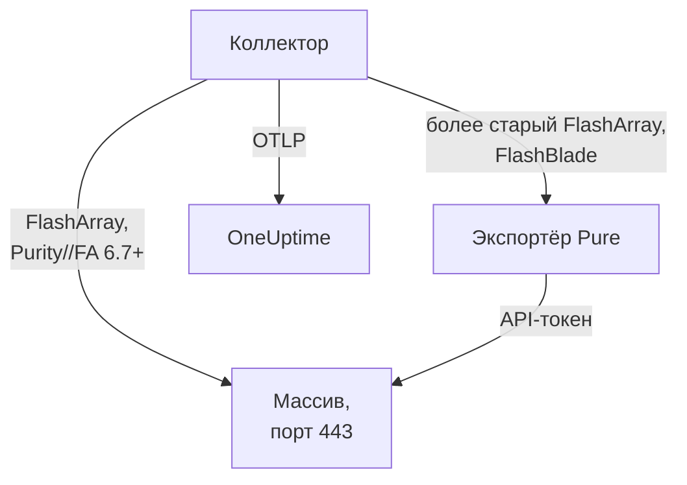

# Агент для систем хранения данных

Агент Storage Array от OneUptime отслеживает системы хранения данных: ёмкость и сокращение данных, задержку, IOPS и пропускную способность, тома, хосты, поды и репликацию, состояние оборудования, файловые системы и бакеты. Это стандартный OpenTelemetry Collector, который опрашивает эндпоинты OpenMetrics массива с API-токеном пользователя только для чтения, проставляет на каждую метрику идентификацию вашего массива и отправляет её в OneUptime. [Мониторы систем хранения](/docs/monitor/storage-array-monitor) оповещают о том, что поступает.

:::cards
- [Установка агента](#установка-агента): Пользователь только для чтения, затем скрипт установки или Docker Compose.
- [Что собирает агент](#что-собирает-агент): Каждый эндпоинт и страницы, построенные на его основе.
- [Мониторинг нескольких массивов](#мониторинг-нескольких-массивов): Один агент на массив, на одной машине.
- [Устранение неполадок](#устранение-неполадок): Диагностический скрипт и типичные проблемы.
:::

## Как это работает

Storage Arrays — это продукт, который работает одинаково для любого производителя. Он поддерживает:

| Массив | Как агент его читает | Конфигурация коллектора |
| --- | --- | --- |
| **Pure Storage FlashArray**, Purity//FA 6.7 и новее | Собственный эндпоинт OpenMetrics массива (`https://<array>/metrics/...?namespace=purefa`): рядом с коллектором ничего не работает | `otel-collector-config.yaml` (по умолчанию) |
| **Pure Storage FlashArray**, более старый Purity//FA | Экспортёр OpenMetrics для FlashArray от Pure, который тот же файл Compose запускает как сервис `pure-fa-exporter` | `otel-collector-config.flasharray-exporter.yaml` |
| **Pure Storage FlashBlade** | Экспортёр OpenMetrics для FlashBlade от Pure, который тот же файл Compose запускает как сервис `pure-fb-exporter` | `otel-collector-config.flashblade.yaml` |

В феврале 2026 года Pure Storage сменила название на **Everpure**. FlashArray, FlashBlade и Purity сохранили свои названия, как и метрики `purefa_*` и `purefb_*`, поэтому всё на этой странице относится к массивам, продаваемым под любым из двух названий.



Один агент отслеживает один массив: запускайте по одному агенту на массив (см. [Мониторинг нескольких массивов](#мониторинг-нескольких-массивов)). Массив регистрируется по своим первым данным под именем, которое агент проставляет на каждую метрику как `storage.array.name`.

## Перед началом

- Docker Engine 20.10 или новее с плагином Docker Compose v2 на машине, которая может достучаться до интерфейса управления массива по HTTPS (TCP 443).
- Учётная запись администратора на массиве, чтобы создать пользователя со встроенной ролью **readonly** и API-токен для него.
- Ключ приёма. Создайте его в разделе **Настройки проекта → Телеметрия и APM → Ключи приема** и скопируйте значение.

### Где запускать агент

Агент общается с интерфейсом управления массива по HTTPS, поэтому может работать на любой машине с Docker и маршрутом в сеть управления по TCP 443: на хосте мониторинга или небольшой управляющей ВМ. Лучше выбрать машину, собственное хранилище которой не находится на отслеживаемом массиве: если массив упадёт, мониторинг не должен упасть вместе с ним. Необязательному приёмнику syslog также нужно, чтобы массив достигал агента по порту syslog (см. [Отправка syslog массива](#необязательно-отправка-syslog-массива)).

## Установка агента

:::steps
### Создайте пользователя только для чтения и API-токен

Агент только читает. Выдайте ему собственного пользователя со встроенной ролью **readonly**, а не администратора, и API-токен для этого пользователя. Создавайте токен **без срока действия**, иначе агент остановится в тот день, когда истечёт срок токена.

:::tabs
@tab Purity CLI
Подключитесь к FlashArray по SSH как администратор. Первая команда запрашивает пароль нового пользователя; вторая выводит его API-токен — UUID:

```bash
pureadmin create --role readonly oneuptime
pureadmin create --api-token oneuptime
```
@tab FlashArray GUI
1. Откройте _Settings → Users and Policies_ (_Settings → Access_ в более старых выпусках).
2. В меню ⋮ панели **Users** выберите **Create User…**, назовите пользователя `oneuptime` и выдайте ему роль readonly.
3. В меню ⋮ нового пользователя выберите **Create API Token…**, оставьте **Expires In** пустым и скопируйте токен.
@tab FlashBlade
Так же создайте пользователя с ролью **readonly** и API-токен для него: в настройках пользователей GUI FlashBlade или с помощью `pureadmin` в CLI Purity//FB. В выпуске без локальных пользователей используйте учётную запись службы каталогов (LDAP или Active Directory), группа которой сопоставлена с ролью readonly. API-токены FlashBlade начинаются с `T-`.
:::

### Проверьте, отдаёт ли FlashArray собственные метрики

Pure документирует нативный эндпоинт OpenMetrics для **Purity//FA 6.7.0 и новее** (в уведомлении об устаревании экспортёра FlashArray от Pure указано 6.6.11 и новее). Быстрее всего узнать это, спросив массив с той машины, на которой будет работать агент:

```bash
curl -k 'https://<array>/metrics/array?namespace=purefa' --header 'Authorization: Bearer <api-token>' | grep purefa_info
```

Строка `purefa_info{...} 1` означает, что массив отдаёт метрики нативно: используйте конфигурацию по умолчанию. `404` означает, что нет: используйте конфигурацию с экспортёром, которая запускает экспортёр Pure рядом с коллектором. Pure объявила этот экспортёр устаревшим, поэтому переходите на нативную конфигурацию, как только массив будет обновлён. FlashBlade всегда работает через экспортёр FlashBlade от Pure, поэтому для него пропустите этот шаг.

### Установите и запустите агент

:::tabs
@tab install.sh
Скачайте скрипт установки и запустите его на машине, где будет работать агент:

```bash
curl -sSL https://raw.githubusercontent.com/OneUptime/oneuptime/master/agents/StorageArrayAgent/install.sh -o install.sh
bash install.sh
```

Скрипт спрашивает, какой это массив (FlashArray с нативными метриками, FlashArray с более старым Purity//FA или FlashBlade), затем URL вашего OneUptime, ключ приёма, имя массива, адрес управления массива и API-токен пользователя только для чтения (считывается без отображения). Он устанавливает агента в `/opt/oneuptime-storage-array-agent`, скачивает файл Compose и все три конфигурации коллектора, записывает файл с правами `0600` под именем `.env` с подходящей конфигурацией и профилем Compose и запускает агента через Docker Compose. Он заключает каждое значение в кавычки для Docker Compose так, как вы его ввели. Повторный запуск использует всё, что есть в существующем `.env`, и ничего не спрашивает снова, а изменённый вами файл сохраняет как `<file>.bak.<timestamp>`, прежде чем заменить его.
@tab Docker Compose
Скачайте `docker-compose.yml` и три файла `otel-collector-config*.yaml` из [каталога StorageArrayAgent](https://github.com/OneUptime/oneuptime/tree/master/agents/StorageArrayAgent) в новую папку:

```bash
curl -fsSLO https://raw.githubusercontent.com/OneUptime/oneuptime/master/agents/StorageArrayAgent/docker-compose.yml
curl -fsSLO https://raw.githubusercontent.com/OneUptime/oneuptime/master/agents/StorageArrayAgent/otel-collector-config.yaml
curl -fsSLO https://raw.githubusercontent.com/OneUptime/oneuptime/master/agents/StorageArrayAgent/otel-collector-config.flasharray-exporter.yaml
curl -fsSLO https://raw.githubusercontent.com/OneUptime/oneuptime/master/agents/StorageArrayAgent/otel-collector-config.flashblade.yaml
```

Создайте рядом с ними файл `.env`. В нём хранится API-токен, поэтому закройте к нему доступ командой `chmod 600 .env`. Для FlashArray с нативными метриками:

```bash title=".env"
ONEUPTIME_URL=YOUR_ONEUPTIME_URL
ONEUPTIME_TELEMETRY_INGESTION_KEY=YOUR_TELEMETRY_INGESTION_TOKEN
STORAGE_ARRAY_NAME=my-storage-array
STORAGE_SYSTEM=purestorage.flasharray
STORAGE_ARRAY_COLLECTOR_CONFIG=otel-collector-config.yaml
COMPOSE_PROFILES=
PURE_FA_ENDPOINT=fa-prod-01.example.com
PURE_FA_API_TOKEN=YOUR_READ_ONLY_API_TOKEN
PURE_FB_ENDPOINT=
PURE_FB_API_TOKEN=
STORAGE_ARRAY_INSECURE_SKIP_VERIFY=true
```

Для FlashArray с более старым Purity//FA задайте `STORAGE_ARRAY_COLLECTOR_CONFIG=otel-collector-config.flasharray-exporter.yaml` и `COMPOSE_PROFILES=flasharray-exporter`. Для FlashBlade задайте `STORAGE_SYSTEM=purestorage.flashblade`, `STORAGE_ARRAY_COLLECTOR_CONFIG=otel-collector-config.flashblade.yaml` и `COMPOSE_PROFILES=flashblade` и заполните `PURE_FB_ENDPOINT` и `PURE_FB_API_TOKEN` вместо пары `PURE_FA_*`. Запустите агента:

```bash
docker compose up -d
```
:::

### Убедитесь, что агент работает

```bash
docker compose ps
docker logs -f oneuptime-storage-array-agent
```

`docker compose ps` показывает коллектор (`oneuptime-storage-array-agent`) и, при конфигурации с экспортёром, сам экспортёр (`pure-fa-exporter` или `pure-fb-exporter`). После запуска коллектора в его логах должна появиться эта строка:

```text
Everything is ready. Begin running and processing data.
```

### Найдите массив в OneUptime

Откройте **Продукты → Инфраструктура → Storage Arrays → All Storage Arrays**. После первого опроса (примерно через минуту) массив появляется со своей ёмкостью, производительностью, открытыми оповещениями и оборудованием. Тома, хосты и поды появляются в течение 2 минут, файловые системы и бакеты FlashBlade — в течение 5, а каталоги FlashArray — в течение 30.
:::

## Переменные окружения

Скрипт установки записывает их в `/opt/oneuptime-storage-array-agent/.env`; при установке через Docker Compose они читаются из `.env` рядом с `docker-compose.yml`. Изменив значение, выполните `docker compose up -d` в этой папке.

| Переменная | Обязательна | Описание |
| --- | --- | --- |
| `ONEUPTIME_URL` | Да | Ваш URL OneUptime, например `https://oneuptime.com`, или ваш собственный экземпляр. Если экземпляр работает только по HTTP, используйте `http://` и его порт. |
| `ONEUPTIME_TELEMETRY_INGESTION_KEY` | Да | Ключ приёма из раздела **Настройки проекта → Телеметрия и APM → Ключи приема**. |
| `STORAGE_ARRAY_NAME` | Да | Имя, под которым массив регистрируется в OneUptime, проставляемое на каждую метрику как атрибут ресурса `storage.array.name`. Не меняйте его: изменение позже регистрирует второй массив. Без него коллектор не запускается. |
| `STORAGE_SYSTEM` | Нет | Платформа, проставляемая как атрибут ресурса `storage.system`: `purestorage.flasharray` или `purestorage.flashblade`. По умолчанию `purestorage.flasharray`. |
| `STORAGE_ARRAY_COLLECTOR_CONFIG` | Нет | Какая из поставляемых конфигураций коллектора запускается: `otel-collector-config.yaml` (FlashArray, нативная: по умолчанию), `otel-collector-config.flasharray-exporter.yaml` (более старый FlashArray) или `otel-collector-config.flashblade.yaml` (FlashBlade). |
| `COMPOSE_PROFILES` | Нет | Запускает экспортёр, который опрашивает выбранная конфигурация: пусто для нативной конфигурации FlashArray, `flasharray-exporter` или `flashblade` для двух других. |
| `PURE_FA_ENDPOINT` | FlashArray | Адрес управления FlashArray: имя хоста или IP, без `https://`. |
| `PURE_FA_API_TOKEN` | FlashArray | API-токен пользователя FlashArray с ролью readonly. |
| `PURE_FB_ENDPOINT` | FlashBlade | Адрес управления FlashBlade: имя хоста или IP, без `https://`. |
| `PURE_FB_API_TOKEN` | FlashBlade | API-токен пользователя FlashBlade с ролью readonly. |
| `STORAGE_ARRAY_INSECURE_SKIP_VERIFY` | Нет | `true` принимает самоподписанный сертификат массива на нативном эндпоинте; `false` проверяет его. По умолчанию `true`. Экспортёры Pure никогда не проверяют сертификат массива, поэтому к ним это не относится. |

## Как агент опрашивает кластер

- **Одно задание опроса на эндпоинт, каждый читается так часто, как это оправдано.** FlashArray: `/metrics/array` каждые 60 секунд; `/metrics/volumes`, `/metrics/hosts` и `/metrics/pods` каждые 2 минуты; `/metrics/directories` каждые 30 минут — так советует сама Pure, поскольку массиву дорого вычислять занятое каталогами место. FlashBlade: `/metrics/array` каждые 60 секунд; `/metrics/filesystems` и `/metrics/objectstore` каждые 5 минут — снова по совету Pure читать эндпоинты файловых систем и объектного хранилища реже, чем массив.
- **Каждое задание помечает свои серии меткой `scrape_endpoint: <endpoint>`.** Каждый эндпоинт также экспортирует `purefa_info` или `purefb_info`, поэтому OneUptime знает, для каких семейств пакет — полный список: так удалённый том, хост, под, файловая система или бакет уходит из инвентаря, а не остаётся в нём. Сохраняйте метки как в поставке.
- **Задержка по томам и хостам сохраняет три измерения.** Каждый том и хост экспортирует свою задержку с разбивкой до шестнадцати значений `dimension`. Правило `metric_relabel_configs` сохраняет `usec_per_read_op`, `usec_per_write_op` и `usec_per_mirrored_write_op` и отбрасывает разбивку по ограничению скорости QoS, очереди, SAN и времени обслуживания, которая умножает число серий большого массива. Разбивка по всему массиву в `purefa_array_performance_latency_usec` сохраняется. Удалите правило, чтобы сохранить и разбивку по томам.
- **API-токен — это Bearer-токен.** Нативная конфигурация отправляет его самому массиву; конфигурации с экспортёром отправляют его экспортёру только по сети Compose, а порты экспортёров никогда не публикуются.
- **Без `send_batch_max_size`.** OneUptime перестраивает инвентарь по одному целому опросу на запрос, поэтому поставляемый процессор `batch` никогда не делит опрос между экспортами. Сохраняйте настройки batch как в поставке.

## Что собирает агент

Семантические соглашения Pure общие для нативного эндпоинта FlashArray и обоих экспортёров. Каждое значение — это gauge, который массив вычисляет сам (задержки в микросекундах на операцию, пропускная способность в секунду), поэтому скорости вычислять не нужно, а объекты называются **метками точек данных**: `name` для томов, подов, каталогов, файловых систем и бакетов, `host` для хостов, `component_name` для оборудования FlashArray. Агент добавляет атрибуты ресурса `storage.array.name` и `storage.system`, поэтому OneUptime относит всё к вашему массиву:

| Эндпоинт | Семейства метрик | Что OneUptime строит на их основе |
| --- | --- | --- |
| FlashArray `/metrics/array` | `purefa_info`, `purefa_alerts_open`, `purefa_array_space_*`, `purefa_array_performance_*`, `purefa_hw_component_status`, `purefa_hw_component_temperature_celsius`, `purefa_hw_controller_info`, `purefa_drive_capacity_bytes`, `purefa_network_interface_*` | Имя массива, версия Purity и ID системы; ёмкость, занятое место и сокращение данных; число открытых оповещений; состояние массива; страница **Hardware** (компоненты, накопители, контроллеры, сетевые интерфейсы) |
| FlashArray `/metrics/volumes` | `purefa_volume_performance_*`, `purefa_volume_space_*`, `purefa_volume_qos_*` | Страница **Тома**: выделенный и физический размер, сокращение данных, задержка чтения и записи, IOPS и пропускная способность по томам |
| FlashArray `/metrics/hosts` | `purefa_host_connectivity_info`, `purefa_host_connections_info`, `purefa_host_performance_*`, `purefa_host_space_*` | Страница **Хосты**: связность (резервные пути или нет), подключённые тома, задержка, IOPS и пропускная способность по хостам |
| FlashArray `/metrics/pods` | `purefa_pod_performance_*`, `purefa_pod_space_*`, `purefa_pod_replica_links_*`, `purefa_pod_mediator_status` | Страница **Replication**: поды ActiveCluster и ActiveDR, статус и отставание связей реплик |
| FlashArray `/metrics/directories` | `purefa_directory_performance_*`, `purefa_directory_space_*` | Страница **Directories** (FlashArray File Services) |
| FlashBlade `/metrics/array` | `purefb_info`, `purefb_alerts_open`, `purefb_array_space_*`, `purefb_array_performance_*`, `purefb_hardware_health` | Имя FlashBlade, версия Purity и ID системы; ёмкость и сокращение данных; число открытых оповещений; состояние массива; страница **Hardware** |
| FlashBlade `/metrics/filesystems` | `purefb_file_systems_space_*`, `purefb_file_systems_performance_*` | Страница **File Systems**: выделенное и занятое место, сокращение данных, задержка, IOPS и пропускная способность по файловым системам |
| FlashBlade `/metrics/objectstore` | `purefb_buckets_space_*`, `purefb_buckets_quota_space_bytes`, `purefb_buckets_object_count`, `purefb_buckets_performance_*`, `purefb_object_store_accounts_*` | Страница **Buckets**: место, квота, число объектов и производительность по бакетам, сгруппированные по учётным записям |

Состояние массива на его странице **Обзор** — **Критический**, пока он сообщает об открытом критическом оповещении или о компоненте оборудования, накопителе или контроллере в критическом, неисправном, отсутствующем или нездоровом состоянии; **Warning**, пока он сообщает об открытом предупреждении или о деградировавшем либо неизвестном компоненте; иначе **OK**. В критериях мониторов атрибуты массива получают префикс `resource.` (`resource.storage.array.name`, `resource.storage.system`), а метки точек данных остаются без префикса (`name`, `host`, `dimension`, `space`).

## Необязательно — отправка syslog массива

По умолчанию агент отправляет только метрики, поэтому страница **Журналы** массива остаётся пустой. Массивы пересылают свои оповещения и события аудита как syslog, а в каждой поставляемой конфигурации коллектора есть закомментированная пара приёмников `syslog` (TCP и UDP на порту 5514, RFC 3164), подключённая к закомментированному конвейеру `logs`, который проставляет `storage.array.name`, чтобы журналы попадали в ваш массив.

:::steps
### Включите приёмники

Раскомментируйте два приёмника `syslog/*` и конвейер `logs` в используемой вами конфигурации коллектора. Временные метки RFC 3164 не содержат часового пояса: задайте в `location` часовой пояс массива, если только его часы не идут по UTC.

### Откройте порт

Раскомментируйте блок `ports:` в `docker-compose.yml`, чтобы машина публиковала `5514/tcp` и `5514/udp`, затем выполните `docker compose up -d`. Откройте порт в брандмауэре машины для сети управления массивом.

### Направьте массив на агента

Делайте это как администратор, а не как пользователь мониторинга только для чтения. На FlashArray откройте _Settings → System → Syslog Servers_, добавьте `udp://<agent-host>:5514` (или `tcp://<agent-host>:5514`) и отправьте тестовое сообщение. На FlashBlade добавьте сервер syslog с тем же URI в его настройках syslog. Оба массива принимают форму `PROTOCOL://HOST:PORT`, в том числе через свои REST API (`syslog-servers`).
:::

Приёмник syslog слушает только один транспорт, поэтому TCP и UDP — это два приёмника: оставьте один закомментированным, если вам нужен только другой. Стандартный образ коллектора читает syslog как есть: собственный образ не нужен.

## Пометка массива метками проекта

Атрибут ресурса, начинающийся с `oneuptime.label.`, становится меткой проекта на массиве хранения: `oneuptime.label.<dimension>=<value>` — это метка `<dimension>:<value>`. Добавьте атрибуты в процессор `resource` в используемой вами конфигурации коллектора рядом с `storage.array.name`:

```yaml
processors:
  resource:
    attributes:
      # ...existing attributes...
      - key: oneuptime.label.team
        value: storage
        action: upsert
      - key: oneuptime.label.env
        value: production
        action: upsert
```

Коллектор читает конфигурацию только при запуске: выполните `docker compose restart oneuptime-storage-array-agent`. После этого массив показывает метки `team:storage` и `env:production`. Метки сравниваются без учёта регистра, поэтому существующая метка `Production` используется повторно, а не дублируется, и агент никогда не удаляет метку, добавленную кем-то в OneUptime.

## Мониторинг нескольких массивов

Один агент читает один массив. Чтобы отслеживать несколько с одной машины, установите каждый в свою папку со своим `.env`, например `INSTALL_DIR=/opt/oneuptime-storage-array-agent-fa02 bash install.sh`, и задайте каждому собственный `container_name` в его `docker-compose.yml` (например, `oneuptime-storage-array-agent-fa02`): два контейнера не могут иметь одно имя. Передайте папку диагностическому скрипту с помощью `-d`.

## Запуск как службы systemd

Чтобы агент запускался вместе с машиной и перезапускался при сбое, установите его юнит systemd. Он предполагает, что агент находится в `/opt/oneuptime-storage-array-agent`, куда его помещает скрипт установки:

```bash
sudo curl -fsSL https://raw.githubusercontent.com/OneUptime/oneuptime/master/agents/StorageArrayAgent/systemd/oneuptime-storage-array-agent.service -o /etc/systemd/system/oneuptime-storage-array-agent.service
sudo systemctl daemon-reload
sudo systemctl enable --now oneuptime-storage-array-agent
```

## Обновление агента

Агент сообщает версию коллектора, закреплённую в его файлах, как свою **Версия агента**. Если она старше версии, закреплённой в этом выпуске OneUptime, рядом с ней на странице **Обзор** массива появляется предупреждающий значок. Выберите его, чтобы увидеть эти команды. Агент, установленный до того, как его файлы стали сообщать версию, не показывает её, пока не будет обновлён таким способом.

Образ коллектора закреплён в `docker-compose.yml`, а его конфигурации — это файлы рядом, поэтому одно лишь скачивание образов не продвигает агента вперёд. Снова запустите `install.sh`: он использует все значения из вашего существующего `.env` (ничего не спрашивается повторно), обновляет `docker-compose.yml` и три конфигурации коллектора (изменённый вами файл сохраняется как `<file>.bak.<timestamp>`) и пересоздаёт агента, чтобы коллектор прочитал новую конфигурацию. Агенту, установленному вне `/opt/oneuptime-storage-array-agent`, нужна его папка: `INSTALL_DIR=<folder> bash install.sh`.

```bash
curl -sSL https://raw.githubusercontent.com/OneUptime/oneuptime/master/agents/StorageArrayAgent/install.sh -o install.sh
bash install.sh
```

Устанавливали через Docker Compose? В папке агента снова скачайте файл Compose и три конфигурации коллектора (и повторите изменения, которые в них вносили), затем скачайте образы и пересоздайте агента:

```bash
curl -fsSLO https://raw.githubusercontent.com/OneUptime/oneuptime/master/agents/StorageArrayAgent/docker-compose.yml
curl -fsSLO https://raw.githubusercontent.com/OneUptime/oneuptime/master/agents/StorageArrayAgent/otel-collector-config.yaml
curl -fsSLO https://raw.githubusercontent.com/OneUptime/oneuptime/master/agents/StorageArrayAgent/otel-collector-config.flasharray-exporter.yaml
curl -fsSLO https://raw.githubusercontent.com/OneUptime/oneuptime/master/agents/StorageArrayAgent/otel-collector-config.flashblade.yaml
docker compose pull
docker compose up -d --force-recreate
```

## Удаление агента

```bash
cd /opt/oneuptime-storage-array-agent
docker compose down
```

Затем удалите на массиве пользователя только для чтения и его API-токен, если они больше не нужны.

## Устранение неполадок

:::details Сначала запустите диагностический скрипт
Агент поставляется со скриптом [`troubleshoot.sh`](https://github.com/OneUptime/oneuptime/blob/master/agents/StorageArrayAgent/troubleshoot.sh), который проверяет всю цепочку: среду выполнения контейнеров; эндпоинт массива ровно так, как его достигает коллектор (нативный эндпоинт или экспортёр Pure: DNS, TLS, есть ли у FlashArray нативный эндпоинт вообще и принимает ли массив API-токен, который скрипт передаёт curl через stdin); имя массива, проставленное на каждую метрику; формат токена; собственные метрики коллектора; и то, принимает ли OneUptime ключ приёма. Последняя проверка важнее всего. OneUptime отклоняет неверный ключ с `401` (`422` для отключённого ключа или ключа браузера), и коллектор считает обе ошибки постоянными: он отбрасывает пакет и пишет одну ошибку `Exporting failed`, которую легко пропустить, пока контейнер остаётся исправным. Скрипт запрашивает `GET <url>/otlp/v1/validate` изнутри сети агента, чтобы получить прямой ответ `200` (действителен) или `401` (недействителен), а на старых серверах переходит на `POST /fluentd/v1/logs`.

```bash
curl -sSL https://raw.githubusercontent.com/OneUptime/oneuptime/master/agents/StorageArrayAgent/troubleshoot.sh -o troubleshoot.sh
bash troubleshoot.sh    # add -d <dir> if you installed outside /opt/oneuptime-storage-array-agent
```

В конце он выводит вердикт с наиболее вероятной причиной.
:::

:::details В OneUptime не появляется массив
1. Прочитайте логи коллектора: `docker logs oneuptime-storage-array-agent`. `server returned HTTP status 401` означает, что массив отклонил API-токен, `404` — что у FlashArray нет нативного эндпоинта, `x509` — что проверка TLS включена при самоподписанном сертификате массива, `no such host` или `connection refused` — неверный `PURE_FA_ENDPOINT` или `PURE_FB_ENDPOINT`, а `401` при экспорте — неверный ключ приёма.
2. Спросите массив из сети агента. В образе коллектора нет ни оболочки, ни curl, поэтому выполните запрос из контейнера в его сети: `docker run --rm --network container:oneuptime-storage-array-agent curlimages/curl -sk -H 'Authorization: Bearer <api-token>' 'https://<array>/metrics/array?namespace=purefa'` должна вывести строки `purefa_*`.
3. Проверьте, что задана `STORAGE_ARRAY_NAME`: массив находится по его атрибуту ресурса `storage.array.name`, и без неё коллектор не запускается.
:::

:::details Массив показан как отключённый
Массив становится отключённым, когда OneUptime ничего не получал от него 15 минут; OneUptime проверяет это каждые 5 минут, и время, когда он сам не получал данные, не учитывается. Проверьте, что коллектор работает (`docker compose ps`), что в его логах нет ошибок опроса или экспорта и что машина по-прежнему достигает массива и вашего URL OneUptime. Со следующими данными массив снова становится подключённым.
:::

:::details FlashArray отвечает 404
В его Purity//FA нет нативного эндпоинта OpenMetrics. Снова запустите `install.sh` и выберите вариант для более старого Purity или задайте `STORAGE_ARRAY_COLLECTOR_CONFIG=otel-collector-config.flasharray-exporter.yaml` и `COMPOSE_PROFILES=flasharray-exporter` в `.env` и выполните `docker compose up -d`. После обновления массива до Purity//FA 6.7 или новее вернитесь к нативной конфигурации и уберите профиль.
:::

:::details Массив отклоняет API-токен
Проверьте, что вы вставили API-токен, а не пароль пользователя, что пользователь всё ещё существует и имеет роль readonly и что срок токена не истёк. Создайте новый токен (`pureadmin create --api-token oneuptime` на FlashArray), поместите его в `.env` и выполните `docker compose up -d`. При работе через экспортёры Pure отклонённый токен виден в логе коллектора как HTTP `400` от экспортёра с телом `failed to login`.
:::

:::details Ошибки x509 или TLS
Массивы по умолчанию предъявляют самоподписанный сертификат, которому не доверяет ни один образ Docker. Либо задайте `STORAGE_ARRAY_INSECURE_SKIP_VERIFY=true` (практичный выбор в частной сети управления), либо установите на массив сертификат от УЦ, которому доверяет образ коллектора.
:::

:::details pure-fa-exporter или pure-fb-exporter не разрешается
Экспортёр не запущен: `COMPOSE_PROFILES` должна соответствовать `STORAGE_ARRAY_COLLECTOR_CONFIG` (`flasharray-exporter` для конфигурации с экспортёром FlashArray, `flashblade` для конфигурации FlashBlade). Исправьте `.env` и выполните `docker compose up -d`; после этого `docker compose ps` покажет экспортёр.
:::

:::details Удалённые тома или хосты остаются в инвентаре
OneUptime удаляет объект, когда полный опрос его эндпоинта его больше не содержит, и распознаёт это по метке `scrape_endpoint`. Если вы заменили поставляемую конфигурацию коллектора своей, сохраните метки `scrape_endpoint` в её заданиях опроса; иначе объекты уходят из инвентаря только тогда, когда устаревают.
:::

:::details Метрики попадают не в тот массив
OneUptime регистрирует массив хранения по его `storage.array.name`, которое агент берёт из `STORAGE_ARRAY_NAME`. Изменение после первых данных создаёт второй массив, а не переименовывает первый.
:::

:::details Отправка метрик без агента
Агент — это одна стандартная конфигурация коллектора, поэтому уже работающие у вас коллекторы могут выполнять ту же работу: скопируйте задания опроса и процессор `resource` из поставляемой конфигурации в свою. Атрибут ресурса `storage.array.name` — это то, что регистрирует массив в OneUptime, а удаление `service.name` / `service.instance.id` не даёт отнести данные к сервису: сохраните и то и другое, а также метки `scrape_endpoint`.
:::

## Дальнейшие шаги

:::cards
- [Мониторинг систем хранения данных](/docs/monitor/storage-array-monitor): Оповещения об оповещениях массива, ёмкости, задержке, оборудовании, путях хостов, репликации и файловых системах.
- [Агент VMware](/docs/telemetry/vmware): VMware работает на этом массиве? Посмотрите и его хранилища данных, и ВМ.
- [OpenTelemetry-коллектор на хосте](/docs/telemetry/host-otel-collector): Вид на уровне операционной системы для машин, которые используют массив.
:::
