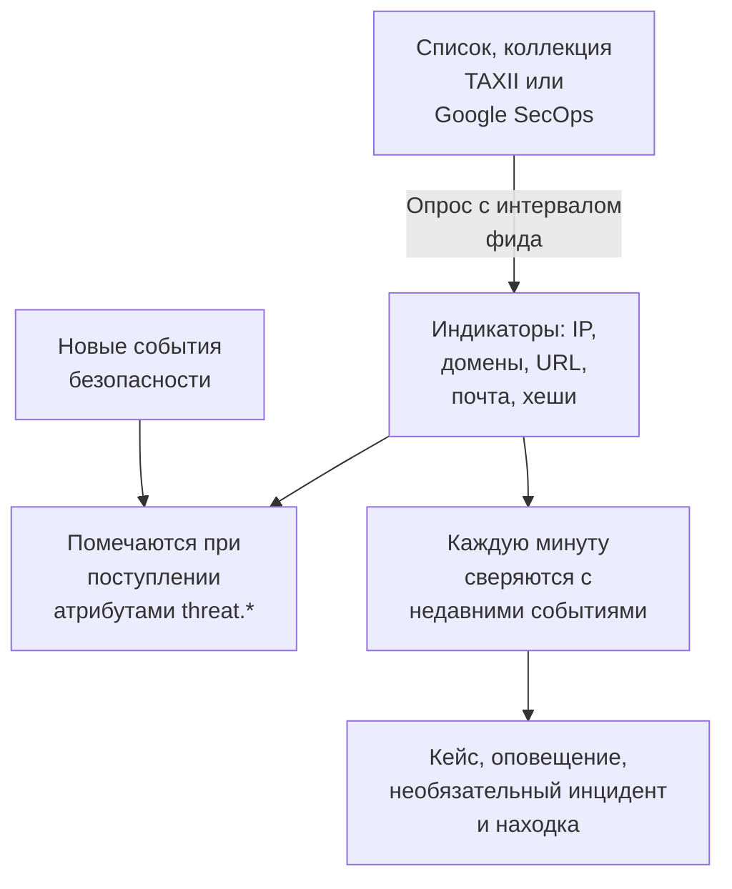

# Аналитика угроз (STIX/TAXII)

Фид аналитики угроз приносит в OneUptime известные вредоносные IP-адреса, домены, URL, адреса электронной почты и хеши файлов и сообщает, когда ваши [события безопасности](/docs/telemetry/security-events) упоминают одно из этих значений. Фид читает один источник: список индикаторов по адресу https, например бесплатные списки, которые OneUptime добавляет в один клик, коллекцию TAXII 2.1 с индикаторами STIX 2.1 с вашего собственного сервера MISP, OpenCTI или OpenTAXII или от поставщика, либо индикаторы, которые Google SecOps нашёл в ваших событиях.

:::cards
- [Добавьте бесплатный список](#добавьте-бесплатный-список): Feodo Tracker, Emerging Threats и выходные узлы Tor в один клик.
- [Подпишитесь на фид](#подпишитесь-на-фид): Адрес списка, коллекция TAXII или подключение Google SecOps.
- [Что принимается](#что-принимается): Шаблоны индикаторов, которые хранит OneUptime, и как долго.
- [Как находятся совпадения](#как-находятся-совпадения): Пометка при поступлении событий и сверка каждую минуту.
- [Уровни угрозы](#уровни-угрозы): Как confidence индикатора превращается в серьёзность.
:::

## Как это работает



## Перед началом

- Для списка — адрес `https`, по которому скачивается текстовый файл с одним индикатором в строке.
- Для фида TAXII — сервер TAXII 2.1, публикующий объекты STIX 2.1 типа `indicator`, и ID коллекции для опроса. Фид TAXII входит анонимно, с bearer-токеном или с базовой аутентификацией HTTP.
- Для фида Google SecOps — [подключение Google SecOps](/docs/integrations/google-secops#настройка-управляемого-коннектора), сервисный аккаунт которого может искать совпадения индикаторов: роль `roles/chronicle.viewer` это позволяет.
- Серверы, которые требуют клиентский сертификат TLS (mutual TLS), например CISA AIS, не поддерживаются. Публичный сервер ATT&CK от MITRE публикует техники и группы, а не индикаторы, поэтому направленный на него фид остаётся пустым.
- Роль, которая может создавать фиды: Project Owner, Project Admin, Security Admin или Security Member. Security Viewer может читать фиды и индикаторы. См. [Роли](/docs/permissions/reference#роли).

## Добавьте бесплатный список

Карточка **Бесплатные списки** на странице **Разведка угроз** добавляет бесплатный блок-лист в один клик: нажмите **Добавить список** у списка, и OneUptime создаст фид, который скачивает его по расписанию списка. У списка, который проект уже читает, написано **Добавлено**.

| Список | Издатель | Чтение | Достоверность | Совпадение открывает |
| --- | --- | --- | --- | --- |
| Серверы C2 ботнетов от Feodo Tracker | abuse.ch | Каждый час | 90, Critical | Кейс и оповещение |
| Скомпрометированные хосты от Emerging Threats | Proofpoint Emerging Threats | Каждый день | 70, High | Кейс и оповещение |
| Выходные узлы Tor | The Tor Project | Каждый час | 30, Low | Кейс |

Плитка списка ссылается на его условия: Feodo Tracker свободен для любого использования (CC0), а список Emerging Threats распространяется по лицензии BSD. Фид, добавленный из списка, редактируется и удаляется как любой другой.

## Подпишитесь на фид

:::steps
### Перейдите в Threat Intel

Откройте **Продукты → Security Events → Обнаружения → Разведка угроз**.

### Создайте фид

Нажмите **Создать: Фид разведки угроз** и выберите **Источник**: **Список индикаторов**, **Коллекция TAXII** или **Google SecOps**. Следующий шаг спрашивает только об этом источнике: для списка — **URL списка**, для коллекции — **Сервер TAXII** и **Вход**, или **Подключение Google SecOps**. **При совпадении** идёт последним. Поля описаны в таблице ниже.

### Проверьте первый опрос

Через минуту-другую в строке фида появится **Последний опрос**, а **Итоги последнего опроса** покажет, что получил опрос. Индикаторы появятся в таблице **Индикаторы** под фидами.
:::

| Поле | Что указать |
| --- | --- |
| **Источник** | Откуда приходят индикаторы. Задаётся при создании фида: фид из другого источника — это новый фид. |
| **URL списка** | Для списка: адрес `https` текстового файла с одним IP-адресом, доменом, URL или хешем файла в строке. |
| **Достоверность** | Для списка: насколько список уверен, от 1 до 100. Это значение получает каждый индикатор списка, и оно задаёт [уровень угрозы](#уровни-угрозы); пустое значение — Medium. |
| **Подключение Google SecOps** | Для Google SecOps: подключение, ключ которого читает индикаторы, найденные Google SecOps. **Подключить Google SecOps** открывает **Подключения**, если подключений нет. |
| **Корневой URL API TAXII** | Корень API TAXII 2.1 на сервере, например `https://taxii.example.com/api1/`. Коллекции адресуются относительно него. |
| **ID коллекции** | Коллекция, которая публикует индикаторы. |
| **Интервал опроса (минуты)** | Как часто читать источник: от 1 до 1440 минут, по умолчанию 60. Список читается не чаще чем раз в 15 минут. |
| **Минимальная достоверность** | Для коллекции TAXII или Google SecOps: индикаторы с меньшей достоверностью пропускаются, от 0 до 100, и 0 оставляет всё. Индикаторы без confidence проходят всегда. |
| **Вход** | Как входит OneUptime: **Без входа** для публичной коллекции, **Bearer-токен** для токена от оператора сервера или **Имя пользователя и пароль** для базовой аутентификации HTTP. |
| **API-токен**, **Имя пользователя Basic Auth** и **Пароль Basic Auth** | Запрашиваются только для выбранного способа входа. |
| **Открывать кейс при совпадении** | По умолчанию включено: каждое событие, упоминающее индикатор, открывает [кейс](/docs/telemetry/security-cases) о нём или добавляется в уже открытый кейс о нём. |
| **Оповещения и инциденты** | По умолчанию **Создать оповещение**: каждый совпавший индикатор открывает оповещение. |
| **Серьёзность оповещения** | Серьёзность каждого оповещения, которое открывает этот фид. Оставьте пустым, чтобы брать уровень угрозы каждого индикатора. |
| **Объявить инцидент** или **Оба** | В **Оповещения и инциденты**. Инциденты запускают эскалацию дежурств, SLA и страницы статуса, а для совпадений с индикаторами обычно достаточно оповещений. |
| **Серьёзность инцидента** | Как **Серьёзность оповещения**, но для инцидентов. |
| **Записывать Detection Finding при совпадении** | По умолчанию включено: каждое совпадение записывает находку в поток событий. |

Токены и пароли фида TAXII шифруются и после сохранения больше не показываются. Чтобы изменить их, выберите **Обновить учётные данные** в строке фида и затем **Bearer-токен**, **Имя пользователя и пароль** или **Без входа**, который стирает сохранённое: ваш выбор заменяет способ входа фида, поэтому сохранение токена стирает сохранённый пароль, и наоборот.

### Как опрашивается фид

Каждый опрос запрашивает объекты, добавленные после предыдущего, через курсор TAXII `added_after` и читает до 10 страниц по 500 объектов. Поэтому большая коллекция синхронизируется за несколько опросов: **Итоги последнего опроса** сообщает, когда остались ещё страницы. Чтобы быстрее завершить большую первую синхронизацию, уменьшите **Интервал опроса (минуты)**, вплоть до 1, пока она не догонит.

Опросы представляются агентом пользователя `OneUptime/<version> (+https://oneuptime.com)`. Если межсетевой экран поставщика отвечает `403`, попросите поставщика разрешить его: многие межсетевые экраны блокируют запросы, похожие на безымянный скрипт.

Отключённый фид не опрашивается и не сверяется. Уже полученные им индикаторы продолжают помечать новые события, пока не истекут.

### Как читается список

- Каждый опрос скачивает весь список и читает его построчно: первое значение в строке, до пробела, табуляции, запятой или точки с запятой. Строки, начинающиеся с `#`, `;` или `//`, — это комментарии, порт после адреса или домена отбрасывается, а диапазон адресов вроде `198.51.100.0/24` пропускается.
- Значение остаётся активным индикатором 2 дня после опроса, который прочитал его последним, а значение, которое список убрал, перестаёт совпадать со следующего опроса. Список, который не изменился, перезаписывается раз в день.
- Список содержит не более 50 000 индикаторов. **Итоги последнего опроса** показывает, сколько прочитано, сколько строк пропущено и сколько не вошло.
- Адрес должен использовать `https` и подчиняется тем же правилам исходящих запросов, что и подключение: в OneUptime Cloud частный адрес отклоняется.

### Как читается Google SecOps

- Каждый опрос читает совпадения индикаторов, которые Google SecOps записал с предыдущего опроса, с атрибутами Mandiant: совпавший домен, адрес или хеш файла, его достоверность, категорию, а также кампании и злоумышленников, с которыми он связан. Первый опрос читает последние 7 дней.
- Индикатор остаётся активным 30 дней после того, как Google SecOps видел его в последний раз, или пока его источник не скажет, что он больше не активен, а индикатор, заглушённый аналитиком в Google SecOps, перестаёт совпадать и здесь.
- Совпадение, которое Google SecOps помечает как активный взлом, получает уровень Critical, а совпадение с высоким приоритетом — не ниже High.

## Что принимается

Из коллекции TAXII OneUptime хранит объекты STIX типа `indicator`, шаблон которых — простое равенство для одного из этих типов. Список и Google SecOps дают те же типы:

| Тип | Пример шаблона |
| --- | --- |
| Адрес IPv4 (`ipv4-addr`) | `[ipv4-addr:value = '198.51.100.7']` |
| Адрес IPv6 (`ipv6-addr`) | `[ipv6-addr:value = '2001:db8::7']` |
| Доменное имя (`domain-name`) | `[domain-name:value = 'evil.example']` |
| URL (`url`) | `[url:value = 'http://evil.example/payload']` |
| Адрес электронной почты (`email-addr`) | `[email-addr:value = 'billing@evil.example']` |
| Хеш файла, SHA-256 (`file-hash-sha256`) | `[file:hashes.'SHA-256' = 'e3b0…b855']` |
| Хеш файла, SHA-1 (`file-hash-sha1`) | `[file:hashes.'SHA-1' = 'da39…0709']` |
| Хеш файла, MD5 (`file-hash-md5`) | `[file:hashes.MD5 = 'd41d…427e']` |

Сравнения, объединённые через `OR` внутри одного `[...]` или между несколькими, допустимы, и каждое значение становится отдельным индикатором:

```text
[domain-name:value = 'evil.example' OR domain-name:value = 'evil2.example']
[ipv4-addr:value = '198.51.100.7'] OR [url:value = 'http://evil.example/x']
```

Любой другой шаблон, с `AND`, `FOLLOWEDBY`, `NOT`, `LIKE`, `MATCHES`, временным уточнением вроде `WITHIN` или другим типом объекта, пропускается целиком и учитывается как неподдерживаемый в **Итоги последнего опроса**. Перевод только части шаблона с `AND` совпадал бы гораздо шире, чем задумал автор фида.

### Как долго индикатор остаётся активным

- Индикатор совпадает с момента `valid_from` до `valid_until`. Без `valid_until` он остаётся активным 365 дней с `valid_from`, и повторный опрос этот срок не продлевает.
- Отозванный индикатор или индикатор, обновлённый с `valid_until` в прошлом, перестаёт совпадать, как только обновление получено. То же касается значения, которое поставщик убрал из обновлённого шаблона.
- Значения хранятся в нижнем регистре и совпадают без учёта регистра.

Таблица **Индикаторы** показывает индикаторы в том виде, в каком они хранятся, со значением **Активно**, **Истёк** или **Отозван** в столбце **Статус**. Повторно полученный индикатор некоторое время может отображаться дважды, а истёкшая или отозванная строка остаётся в списке, пока её не удалит очистка хранилища, примерно до месяца после истечения. При сверке всегда проверяются срок действия и отзыв, поэтому такая строка никогда не совпадает.

## Как находятся совпадения

### Пометка при поступлении событий

Каждое входящее событие безопасности, из API приёма или из подключения, перед сохранением проверяется по вашим активным индикаторам. Когда один из его observables (IP-адреса, хосты, домены, хеши и пользователи, извлечённые из события) совпадает со значением индикатора, событие получает такие атрибуты:

| Атрибут | Значение |
| --- | --- |
| `threat.matched` | Всегда `"true"` у помеченного события |
| `threat.indicator_id` | ID индикатора STIX или `list` либо `google-secops` для этих источников |
| `threat.indicator_type` | Тип индикатора, например `ipv4-addr` или `file-hash-sha256` |
| `threat.indicator_value` | Совпавшее значение в нижнем регистре |
| `threat.feed` / `threat.feed_id` | Фид, из которого пришёл индикатор |
| `threat.confidence` | Confidence индикатора в STIX |
| `threat.match_count` | Сколько observables события совпало с индикатором |

Когда с одним событием совпадает несколько индикаторов, эти значения заполняет индикатор с наибольшим confidence. Это обычные атрибуты, поэтому по ним можно искать в **События**, фильтровать мониторы событий безопасности и использовать их в правилах обнаружения:

```yaml title="threat-intel-logon.yml"
title: High-confidence indicator in a successful logon
level: critical
detection:
  selection:
    threat.matched: 'true'
    threat.confidence|gte: 80
    className: Authentication
    statusName: Success
  condition: selection
```

Пометка знает только индикаторы, которые существуют в момент поступления события: позже события никогда не помечаются заново.

### Сверка каждую минуту

Каждую минуту активные индикаторы каждого включённого фида сверяются с событиями, время которых приходится на период после предыдущей проверки фида. Так находятся данные аналитики, которые пришли уже после пометки события.

- Первая проверка охватывает последние 15 минут. После сбоя следующая проверка наверстывает не более последних 24 часов.
- Каждое окно проверяется один раз. Данные аналитики, пришедшие после проверки своего окна, применяются только к более поздним событиям.
- Событие, пришедшее с опозданием, со временем раньше предыдущей проверки, всё равно помечается при поступлении, но не сверяется.
- Каждая проверка записывает каждое совпавшее значение индикатора как Detection Finding, до 10 000 на фид. Оповещения, инциденты и кейсы открываются для 100 значений, встречающихся в наибольшем числе событий; остальные делят один кейс о фиде, а **Последняя ошибка сопоставления** фида говорит, сколько совпало.

### Что делает совпадение

- Оповещение с заголовком `[Threat Intel] <feed name> — <indicator value>`, одно на фид и значение, пока оно открыто. Когда оно закрыто, следующее совпадение открывает новое. Оповещения не закрываются автоматически.
- Инцидент, только с **Объявить инцидент** или **Оба** в **Оповещения и инциденты**, с такой же дедупликацией.
- Находка Threat Intel, с **Записывать Detection Finding при совпадении**: событие `Detection Finding` (класс OCSF 2004) от продукта `OneUptime Threat Intel`, с уровнем угрозы индикатора в качестве серьёзности и такими атрибутами:

| Атрибут | Значение |
| --- | --- |
| `oneuptime.threat.feed_id` / `oneuptime.threat.feed_name` | Фид |
| `oneuptime.threat.indicator_id` | ID индикатора STIX или `list` либо `google-secops` для этих источников |
| `oneuptime.threat.indicator_type` / `oneuptime.threat.indicator_value` | Что совпало |
| `oneuptime.threat.confidence` | Confidence индикатора |
| `oneuptime.threat.match_count` | Сколько событий стоит за этой находкой |

Сами находки никогда не сверяются, поэтому одно совпадение не может вызвать другое.

## Уровни угрозы

У индикаторов нет уровня Sigma: вместо него уровень угрозы задаёт их STIX `confidence`.

| Confidence индикатора | Уровень угрозы |
| --- | --- |
| От 90 до 100 | Critical |
| От 70 до 89 | High |
| От 40 до 69 | Medium |
| От 1 до 39 | Low |
| Без оценки (0 или отсутствует) | Medium |

Индикатор без оценки считается Medium: кто-то всё же решил включить его в фид. Уровень угрозы — это серьёзность находки, и он выбирает серьёзность оповещения среди серьёзностей вашего проекта в таком порядке:

1. **Серьёзность оповещения** (или **Серьёзность инцидента**) фида, если она задана: она применяется к каждому совпадению из фида.
2. Ваша серьёзность, названная по уровню угрозы, например High, без учёта регистра.
3. По рангу: Critical и High получают вашу самую высокую серьёзность, Medium и Low — самую низкую.

Уровень угрозы принадлежит каждому индикатору, а не фиду, поэтому один фид может в одну и ту же минуту открыть оповещение Critical и оповещение Low. **Минимальная достоверность** фильтрует по тому же числу: минимум 70 оставляет только индикаторы High и Critical, а также индикаторы без оценки, которые проходят всегда.

## Следите за совпадениями фида

Действие **Создать монитор** в строке фида открывает новый монитор событий безопасности, который считает находки фида: класс событий `Detection Finding`, фильтр по ID фида в `oneuptime.threat.feed_id` (никогда не по имени, которое изменилось бы при переименовании), за последний час. Используйте его, чтобы заметить внезапный всплеск совпадений или затихший активный фид.

## Хранение и оплата

Индикаторы — это конфигурация, а не телеметрия, и не оплачиваются как принятые данные. Находки, которые записывает совпадение, — обычные события безопасности и оплачиваются и хранятся так же, как остальные: см. [События безопасности](/docs/telemetry/security-events#хранение-и-оплата).

## Устранение неполадок

:::details После опроса заполнено Last Error
`401` или `403`: учётные данные неверны или отсутствуют; замените их через **Обновить учётные данные**. `403` может означать и то, что межсетевой экран поставщика блокирует агент пользователя. `404`: проверьте **Корневой URL API TAXII**, который обычно оканчивается путём вроде `/api1/`, и **ID коллекции**. Ошибка исчезает при следующем успешном опросе.
:::

:::details Фид опрашивается, но индикаторы не появляются
Прочитайте **Итоги последнего опроса**. Объекты не получены: коллекция пуста или не публикует индикаторы. Неподдерживаемые шаблоны: поставщик использует возможности шаблонов, которые на этой странице перечислены как пропускаемые. Ниже минимального confidence: уменьшите **Минимальная достоверность**. Уже неактивны: поставщик прислал индикаторы, которые уже были отозваны или истекли.
:::

:::details Индикаторы есть, но ничего не совпадает
При сверке значение индикатора сравнивается с observables события, а не с каждым полем: откройте в **События** событие, которое должно было совпасть, и проверьте, что его observables содержат это значение. Совпадают только индикаторы со статусом **Активно**. Если поле **Статус** фида показывает **Сопоставление не удалось**, кнопка **Просмотреть ошибку** в его строке покажет причину.
:::

:::details Последняя ошибка фида-списка говорит, что адрес ответил веб-страницей
**URL списка** открывает страницу, например страницу входа или ошибки, а не список: откройте его в браузере и скопируйте адрес самого файла. Список, в тексте которого нет ни одного IP-адреса, домена, URL или хеша файла, отклоняется так же, а индикаторы фида остаются прежними.
:::

:::details Последняя ошибка фида Google SecOps говорит HTTP 403
Сервисный аккаунт подключения не может искать совпадения индикаторов: выдайте ему `roles/chronicle.viewer`. Если подключение удалено, фид сообщает об этом: отредактируйте его и выберите другое **Подключение Google SecOps**.
:::

:::details Совпадение не открыло оповещение
В **Оповещения и инциденты** выбрано **Объявить инцидент** или **Ничего**, или оповещение для того же фида и значения ещё открыто, и более поздние совпадения добавляются в него. Чтобы фид мог открывать оповещения, в проекте должна быть хотя бы одна серьёзность оповещений.
:::

## Дальнейшие шаги

:::cards
- [События безопасности](/docs/telemetry/security-events): Отправляйте события, ищите по ним и пишите правила обнаружения.
- [Google SecOps](/docs/integrations/google-secops): Получайте обнаружения и события из Chronicle.
- [Справочник разрешений](/docs/permissions/reference): Роли Security и возможности каждой из них.
:::
