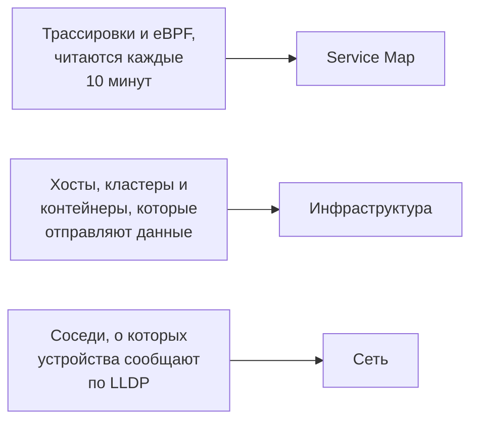

# Топология

Топология рисует, как связаны ваши системы: какие сервисы вызывают какие, что где работает и как соединены ваши сетевые устройства. OneUptime строит ее по телеметрии, которую вы уже отправляете, так что рисовать вручную ничего не нужно, и с первого взгляда видно, где находятся ошибки и инциденты.

:::cards
- [Открыть топологию](#открыть-топологию): Три представления одной страницы.
- [Читать карту сервисов](#читать-карту-сервисов): Кто кого вызывает и насколько здоровы вызовы.
- [Исследовать инфраструктуру](#исследовать-инфраструктуру): Где работает каждый сервис.
- [Открыть карту отдельного ресурса](#открыть-карту-отдельного-ресурса): Один vCenter, кластер или хост во всех подробностях.
- [Посмотреть сеть](#посмотреть-сеть): Устройства и их связи в реальном времени.
:::

## Как строится карта

Каждое представление топологии строится из своего вида телеметрии:

- **Рисуется только то, что было активно.** Представление показывает сервисы и ресурсы, которые отправляли данные в выбранном интервале времени, и связи, замеченные в нем. Включите **Показать неактивные**, чтобы нарисовать и молчавшие.
- **Вызовы считаются за недавнее окно.** OneUptime ищет вызовы между сервисами каждые 10 минут, а показатели трафика охватывают последние 15 минут, а не весь интервал времени.
- **Сетевое представление работает в реальном времени.** Оно показывает устройства так, как они соединены сейчас, поэтому у него нет интервала времени.

## Перед началом

- **Поступающая телеметрия.** Карте сервисов нужны трассировки: см. [OpenTelemetry](/docs/telemetry/open-telemetry). Представлению инфраструктуры нужен хост или кластер, отправляющий данные: см. [агент Kubernetes](/docs/telemetry/kubernetes-agent). Сетевому представлению нужны сетевые устройства: см. [Мониторинг сетевых устройств](/docs/monitor/network-device-monitor).
- **Роль, которая читает телеметрию.** Project Owner, Project Admin, Project Member, Viewer, Telemetry Admin, Telemetry Member или Telemetry Viewer либо пользовательская роль с разрешением Read Telemetry Service.

## Открыть топологию

Перейдите в **Продукты → Наблюдаемость → Топология**. **Инвентарь → Topology Map** открывает ту же страницу. Она открывается на **Service Map** за период **Последний день**.

| Представление | На какой вопрос отвечает |
| --- | --- |
| **Service Map** | Какие сервисы зависят друг от друга? |
| **Инфраструктура** | Что где работает в вашей инфраструктуре? |
| **Сеть** | Как соединены ваши сетевые устройства? |

Рядом с выбором времени **Показать неактивные** добавляет то, что не отправляло данные в интервале, а кнопка обновления заново загружает представление. **Что показано · Об этих данных** объясняет, что рисует представление и как часто оно рассчитывается. Адресная строка запоминает текущее представление, поэтому ссылка, которой вы делитесь, открывает то же представление.

## Читать карту сервисов

**Service Map** рисует каждый сервис, который отправлял данные, а также базы данных, API и брокеры сообщений, которые они вызывают, даже если те сами не отправляют телеметрию. Стрелки идут от вызывающего к вызываемому, а более толстые линии несут больше запросов. Счетчики над картой показывают, сколько сервисов, зависимостей и связей она рисует и сколько из них требуют внимания.

Каждый сервис показывает свой статус, рассчитанный по вызовам, которые он получил за последние 15 минут:

| Статус | Когда |
| --- | --- |
| **Исправно** | Завершились ошибкой не более 1% полученных вызовов. |
| **Some errors** | Ошибкой завершились больше 1% и меньше 5%. |
| **High error rate** | Ошибкой завершились 5% или больше. |
| **Entry point** | Он не получал вызовов, но делал их: веб-фронтенд или запланированная задача. |
| **No calls observed** | Он не делал и не получал ни одного вызова. |

Сервис с активным инцидентом или оповещением вместо этого показывает их число и, как сервис с **Some errors** или **High error rate**, считается требующим внимания.

:::steps
### Найти сервисы, которые требуют внимания

Нажмите **Требует внимания**, чтобы оставить только эти сервисы и их прямые связи, или найдите сервис по имени в поле над картой.

### Открыть сервис

Нажмите на сервис, чтобы увидеть его запросы, ошибки и среднюю задержку за последние 15 минут, его **Активные инциденты** и **Активные оповещения**, а также ссылки на **Трассировки этого сервиса** и его **Сведения из инвентаря**.

### Открыть связь

Нажмите на стрелку, чтобы увидеть ее частоту запросов, частоту ошибок и среднюю задержку. Между двумя инструментированными сервисами у нее также есть **History** вызовов, ошибок и задержки.
:::

**Подписи связей** пишет значение на каждой стрелке: **Частота запросов**, **Частота ошибок** или **Средняя задержка**, либо ничего, пока вы не наведете указатель. **Таблица** перечисляет те же сервисы с их **Запросы**, **Частота ошибок**, **Ср. задержка** и **Подключения**, а **Показать на карте** рисует один из них.

## Исследовать инфраструктуру

**Инфраструктура** показывает, где работают ваши сервисы: кластеры, хосты, поды, контейнеры и другие ресурсы, которые отправляют данные. Реплики одной рабочей нагрузки сгруппированы в одну запись, и вы можете открыть что угодно, чтобы заглянуть внутрь.

- **Просматривайте так, как вам удобно.** Покажите ее как **Список** или **Карта**, от всей инфраструктуры до одного пода. Счетчики над ней показывают, сколько ресурсов и рабочих нагрузок она рисует, сколько сервисов может разместить и сколько молчащих ресурсов не показывает.
- **Найдите ресурс.** Найдите его по имени и нажмите **Просмотреть подробности**, чтобы открыть его страницу.
- **Переходите между представлениями.** Сервис, указанный на ресурсе, открывается на **Service Map**, а ресурсы, на которых работает сервис, открываются в представлении **Инфраструктура**.

## Открыть карту отдельного ресурса

У vCenter, кластера Kubernetes, хоста, хоста Docker или Podman, кластера Docker Swarm, Proxmox или Ceph и массива хранения есть собственная страница **Топология**. Она подробно рисует этот ресурс по его собственному инвентарю: что внутри чего, каждую часть в цвете её состояния и каждый открытый инцидент и оповещение на той части, которой они касаются.

- **Читайте как дерево.** Ресурс находится вверху, а части каждой части нарисованы справа от неё и соединены с ней линией, которая становится красной или оранжевой там, где что-то требует внимания. Части с проблемами внутри открываются сами, круглая кнопка на части открывает или закрывает её, а клавиши со стрелками перемещают по карте.
- **Найдите то, что требует внимания.** **Требует внимания** оставляет только проблемные части и путь к каждой из них, а поиск находит часть в любом месте ресурса.
- **Посмотрите поближе.** Нажмите на часть, чтобы увидеть, что это, и ссылку на её собственную страницу, и на **Сосредоточиться на этом**, чтобы нарисовать только эту часть, её содержимое и то, с чем она связана.
- **В обе стороны.** **Открыть в топологии** открывает ресурс в представлении **Инфраструктура**, а его кнопка **Открыть топологию vCenter**, **Открыть топологию кластера**, **Открыть топологию хоста** или **Открыть топологию массива хранения** ведёт обратно.

## Посмотреть сеть

**Сеть** — это карта ваших сетевых устройств в реальном времени, построенная по соседям, о которых они сообщают по LLDP, а на устройствах Cisco — по CDP. У нее нет выбора времени: связи обновляются сами.

Если вы группируете устройства по площадкам, представление открывается на ваших площадках: выберите одну или переключитесь на **All devices**. **Map options** упорядочивает карту и выбирает, что на ней показывать, а **Экспорт в PDF** сохраняет карту, которую вы видите. Страницы сетевых устройств рисуют ту же карту: см. [Топология сети](/docs/monitor/network-device-monitor#топология-сети).

## Устранение неполадок

:::details Карта сервисов показывает сервисы, но не связи
OneUptime ищет вызовы между сервисами в ваших трассировках каждые 10 минут. Он видит вызов, когда запрос несет контекст трассировки, заголовок `traceparent`, от одного инструментированного сервиса к следующему, как это делают инструментации HTTP и gRPC в OpenTelemetry; когда сервис сообщает клиентские спаны для баз данных и API, которые он вызывает; или когда агент Kubernetes работает с eBPF.
:::

:::details Сервис, который я удалил, все еще на карте
Он отправлял данные в пределах интервала времени. Выберите интервал короче или подождите, пока его последняя телеметрия не выйдет за пределы интервала. С включенным **Показать неактивные** карта рисует и то, что перестало отправлять данные.
:::

:::details Карта сообщает, что показана только ее часть
Очень большой проект упирается в лимиты карты, и уведомление сообщает, сколько ресурсов или связей она показывает. Найдите сервис или используйте **Показать на карте** в таблице, чтобы нарисовать читаемую часть.
:::

## Дальнейшие шаги

:::cards
- [Каталог служб](/docs/telemetry/services): Все об одном сервисе.
- [Обозреватель трассировок](/docs/telemetry/traces-explorer): Запросы за каждой стрелкой.
- [Обзор инвентаря](/docs/inventory/overview): Каждый ресурс, который рисует карта.
- [Мониторинг сетевых устройств](/docs/monitor/network-device-monitor): Поместите вашу сеть на карту.
:::
