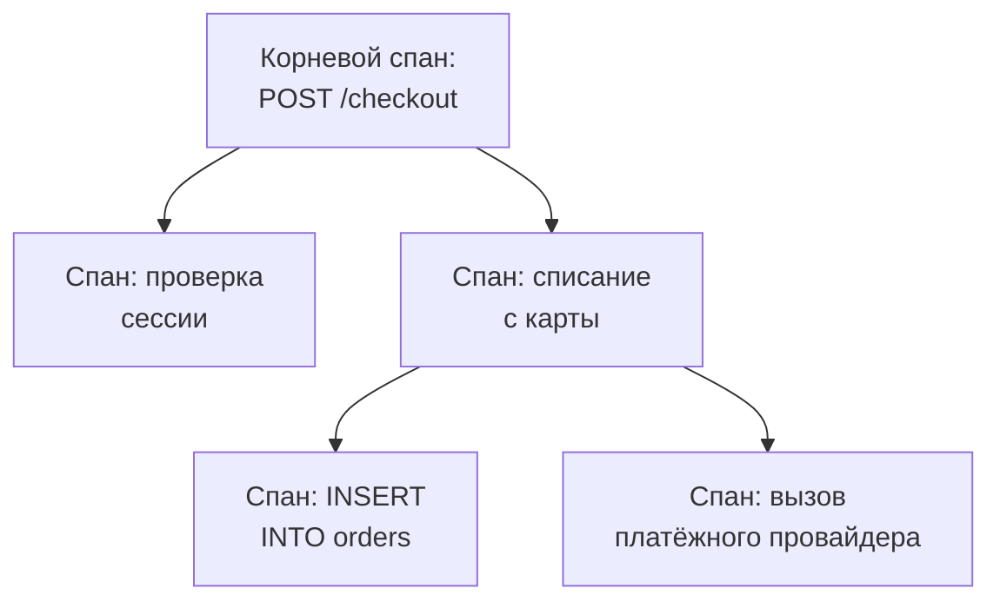

# Обозреватель трассировок

Обозреватель трассировок находит запросы, которые прошли через ваши сервисы: медленные, неудачные, затронувшие аккаунт одного клиента. Ищите и фильтруйте спаны, которые отправляют ваши сервисы, а затем откройте трассировку, чтобы увидеть каждый шаг запроса в виде водопада, flame-графа или карты сервисов.

:::cards
- [Найти запрос](#найти-запрос): Ищите спаны, затем фильтруйте по сервису, статусу или виду.
- [Прочитать трассировку](#прочитать-трассировку): Куда ушло время и какой шаг завершился ошибкой.
- [Графики по спанам](#графики-по-спанам): Число запросов и время ответа, сгруппированные как вам нужно.
- [Аналитика трассировок](#аналитика-трассировок): Доля ошибок, задержка и самые медленные запросы.
- [Поиск и исправление медленных и сбойных операций с ИИ](#поиск-и-исправление-медленных-и-сбойных-операций-с-ии): Пул-реквесты, которые их исправляют и добавляют недостающую трассировку.
:::

## Трассировки и спаны

Трассировка — это один запрос на его пути через вашу систему. Каждый его шаг, например HTTP-обработчик, запрос к базе данных или вызов другого сервиса, — это спан, и спаны вложены в спаны, которые их запустили. Первый спан трассировки, без родителя, — её корневой спан: точка входа запроса.

Каждая строка обозревателя — это спан. По умолчанию список показывает **Entry spans** — спаны, в которых запрос или сообщение входит в сервис, поэтому запрос появляется один раз для каждого сервиса, до которого он доходит, а запросы к базе данных и внутренние вызовы в список не попадают. Чтобы видеть по одной строке на запрос, выберите **Root spans** в разделе **Категория span** на боковой панели; чтобы видеть каждую операцию, выберите **All spans**.

У обозревателя пять вкладок:

| Вкладка | Для чего она |
| --- | --- |
| **Зритель** | Поиск и фильтрация спанов и открытие их трассировок. Открывается на последнем часе, сначала новые, по 50 спанов на страницу. |
| **Аналитика** | Частота запросов, доля ошибок и задержка по каждому сервису, а также запросы, на которые стоит взглянуть. |
| **ИИ** | Медленные и сбойные операции и недостающая трассировка, которые OneUptime находит в ваших трассировках, и что с ними сделал OneUptime AI. См. [Поиск и исправление медленных и сбойных операций с ИИ](#поиск-и-исправление-медленных-и-сбойных-операций-с-ии). |
| **Руководство по настройке** | Как отправлять трассировки через OpenTelemetry с одним из ваших [ключей приёма](/docs/telemetry/ingestion-keys). |
| **Настройки** | Что происходит со спанами при поступлении: **Пайплайны**, **Фильтры отбрасывания**, **Правила очистки** и **Правила записи**. |

## Перед началом

- **Поступающие трассировки.** Инструментируйте свои сервисы с помощью [OpenTelemetry](/docs/telemetry/open-telemetry). Вкладка **Руководство по настройке** показывает код для вашего языка.
- **Роль, которая читает телеметрию.** Project Owner, Project Admin, Project Member, Viewer, Telemetry Admin, Telemetry Member или Telemetry Viewer либо пользовательская роль с разрешением Read Telemetry Service Traces. Её область определяет, чьи спаны вы видите: см. [Телеметрия](/docs/permissions/index#телеметрия).

## Найти запрос

:::steps
### Откройте Зритель

Перейдите в **Продукты → Наблюдаемость → Трассировка**. **Зритель** показывает спаны за последний час, сначала новые, каждый со статусом, сервисом, именем и длительностью.

### Выберите диапазон времени

Выберите диапазон в селекторе времени или выделите участок на графике над списком, чтобы приблизить всплеск. Дважды щёлкните по графику, чтобы отдалить его. См. [Масштабирование до диапазона времени](/docs/telemetry/charts-and-time-ranges).

### Ищите

Введите запрос и нажмите Enter, например `service:checkout status:error duration:>500`. Отдельные слова ищутся в именах спанов, а `@key:value` ищет по атрибуту, например `@http.route:/orders`. См. [Синтаксис поиска](/docs/telemetry/search-syntax#трассировки).

### Сузьте результаты фильтрами

Нажмите на значение на боковой панели **Фильтры**, чтобы добавить его как чип. Боковая панель фильтрует по полям **Сервис**, по хосту, кластеру или другому ресурсу, отправившему спан, а также по **Статус**, **Категория span**, **Есть исключение**, **Тип span**, **Имя span**, **Экземпляр сервиса** и **Имя хоста**.

### Откройте спан

Нажмите на строку, чтобы развернуть её: её атрибуты, а также записанные ею логи и исключения. Нажмите **See full trace**, чтобы открыть всю трассировку.
:::

Ваш поиск, ваши чипы и диапазон времени хранятся в адресе страницы, поэтому обновление, закладка или ссылка, которой вы поделились, открывают те же спаны.

## Прочитать трассировку

Страница трассировки начинается с показателей запроса:

| Показатель | Что это |
| --- | --- |
| Длительность | Сколько длился весь запрос. |
| Спаны | Сколько спанов в трассировке. |
| Сервисы | Через сколько сервисов прошёл запрос. |
| Ошибки | Сколько спанов завершились со статусом ошибки. Нажмите, чтобы показать только их. |
| Глубина | Самая длинная цепочка вложенных спанов. |

Под ними выберите одно из четырёх представлений:

| Представление | Что оно показывает |
| --- | --- |
| **Водопад** | Каждый спан на временной шкале, вложенный в спан, который его запустил. Включите **Критический путь**, чтобы выделить цепочку спанов, определившую длительность запроса. |
| **Flame-граф** | То же дерево в виде сложенных полос, где самые широкие полосы заняли больше всего времени. |
| **Карта сервисов** | Сервисы, через которые прошёл запрос, и вызовы между ними. |
| **Операции** | Одна строка на сервис и имя спана с вызовами, ошибками, собственным и общим временем. Операция, вызванная 10 и более раз из одного родительского спана, помечается: часто это запрос N+1 или цикл, который можно объединить в пакет. |

Нажмите на спан в любом представлении, чтобы открыть его панель с вкладками атрибутов, событий, логов, исключений и ссылок, а также его профиля или вызова LLM, если они есть. Ищите спаны трассировки по имени, ID или сервису в поле поиска рядом с представлениями (нажмите `/`) и включите **Только ошибки**, чтобы оставить только спаны с ошибками.

Большая трассировка загружает по 500 спанов за раз. Нажмите кнопку внизу трассировки, чтобы загрузить ещё или все.

> [!TIP]
> **Ускорить с помощью ИИ** появляется только у трассировки, которую стоит исправить: с запросом N+1, с вызовами один за другим, которые можно было бы выполнять параллельно, или с одним вызовом, занимающим большую часть запроса, когда это стоит реального времени (100 мс или больше на все вызовы вместе, 500 мс или больше на один вызов и не меньше десятой части запроса). Кнопка называет найденное, например «Повторов одного и того же запроса к базе данных в ReportService.build: 40», и запускает задачу ИИ, которая открывает pull request с исправлением. Если подключено несколько репозиториев и ни один не совпадает с сервисом или кодом трассировки, сначала он спрашивает, в каком репозитории этот код. Если исправление для трассировки уже сделало свою работу, трассировка ведёт к его задаче, а не предлагает второе. Если ИИ мешает что-то другое, например тариф, израсходованные кредиты ИИ или Runner, который не в сети, трассировка говорит, что именно, со ссылкой, которая это исправляет. См. [Код](/docs/ai/ai-agent).

## Графики по спанам

График над списком показывает число спанов во времени с разбивкой по статусу. Выберите другую меру в заголовке графика, чтобы вместо этого показать их среднее, медианное (P50) или P95 время ответа.

Для большего переключите список со **Спаны** на **Analytics**. Выберите временной ряд, топ-список или таблицу; измеряйте число запросов, число ошибок или время ответа (среднее, P50, P90, P95, P99, минимум или максимум); группируйте по имени спана, сервису, статусу, виду спана или любому атрибуту, а затем по второму полю. Топ-список или таблица показывают от 5 до 100 первых групп.

## Следить, сохранять и делиться

- Нажмите **Приостановлено** над списком, чтобы включить обновление в реальном времени. Кнопка сменится на **В реальном времени**, и список будет проверять новые спаны каждые 10 секунд. Нажмите ещё раз, чтобы приостановить.
- **Сохранённые представления** хранит поиск, его фильтры и диапазон времени под именем для всех участников проекта. Сохранённые представления работают так же, как в [Обозреватель журналов](/docs/telemetry/logs-explorer#сохранить-представление).
- Кнопки **Журналы** и **Метрики** открывают эти обозреватели для того же окна времени, перенося столько ваших фильтров, сколько они могут использовать. Наведите указатель на кнопку, чтобы увидеть, что она не может перенести.

## Аналитика трассировок

Вкладка **Аналитика** подводит итоги запросов за диапазон времени:

- число запросов, доля ошибок и задержка P50, P95 и P99;
- таблица состояния ваших сервисов, отсортированная по доле ошибок, чтобы сервисы, требующие внимания, шли первыми;
- последние неудачные запросы и самые медленные.

Ограничьте её некоторыми сервисами с помощью списка рядом с селектором времени.

## Поиск и исправление медленных и сбойных операций с ИИ

Каждый час OneUptime ищет в трассировках каждого сервиса за последний час операции, которые работают медленно, завершаются ошибкой или чьи трассировки не объясняют почему, и регистрирует найденное как выводы ИИ вместе с доказательствами. Затем OneUptime AI изучает каждый вывод и открывает пул-реквест, который его исправляет. Ничего не сливается автоматически: каждый пул-реквест проверяет ваша команда.

Операция — это спаны сервиса с одним именем, например `GET /orders`. OneUptime читает сервис, как только тот отправил не менее 100 спанов за последний час, и регистрирует находки трёх видов:

| Находка | Когда OneUptime её регистрирует | Пул-реквест |
| --- | --- | --- |
| **Медленная операция** | P99 операции составляет 1 секунду или больше как минимум на 20 спанах, а её самый медленный запрос повторяет шаблон, который стоит реального времени: один и тот же вызов снова и снова, вызовы друг за другом, которые могли бы выполняться параллельно, или один вызов, занимающий большую часть запроса. | Ускоряет операцию. |
| **Сбойная операция** | Не менее 20 спанов операции завершились ошибкой, 5 % или больше из них, и последние сбои объясняют почему, исключением или сообщением об ошибке. | Устраняет причину сбоев. |
| **Недостающая трассировка** | Трассировки не объясняют почему: каждый из 500 или более спанов сервиса был корнем своей трассировки, без спанов сервиса под ним, медленный запрос провёл 60 % или больше своего времени (и 500 мс или больше) в одном спане, под которым ничего не трассируется, или сбои операции не записали ни сообщения об ошибке, ни исключения. | Добавляет недостающую трассировку. |

OneUptime AI сам открывает пул-реквест для сбойной операции, только когда находит виновный код. Сбой, который приходит откуда-то ещё, например от недоступной зависимости, не получает пул-реквеста, если только кто-нибудь не запросит его через **Исправить с ИИ**.

### Включение

В **Трассировка → ИИ → Настройки** находится переключатель **Находить и исправлять медленные и сбойные операции**, включённый для новых проектов. Когда **Включить ИИ** выключено, медленные и сбойные операции по-прежнему находятся, но OneUptime AI ничего с ними не делает. Чтобы открывать пул-реквесты, OneUptime AI нужен репозиторий, подключённый в разделе [Код](/docs/ai/ai-agent): страница сначала говорит, чего не хватает. Код каждого репозитория меняется на том Runner, который выбран для репозитория в разделе «Код».

OneUptime AI сам открывает не более 5 пул-реквестов в день (UTC), по одному на каждую находку, и никогда больше, чем допускает лимит репозитория на открытые пул-реквесты ИИ.

### Правила ИИ

Без правил OneUptime AI сразу изучает каждую проблему, найденную в ваших трассировках, и открывает пул-реквест для каждой, которую может исправить. **Правила ИИ** в **Дополнительные настройки** сужают это в три шага:

| Шаг | Что он решает |
| --- | --- |
| **Совпадение** | Какие сервисы: выбранные, с определёнными метками или те, чьё имя соответствует шаблону. |
| **Расследовать** | **Сразу** или **Только если всё ещё находится после ожидания**: проблема, которая исчезает во время ожидания, не изучается. |
| **Исправление** | **Не исправлять**, **Спрашивать перед исправлением** или **Исправлять, не спрашивая**. Если сначала нужно спросить, пул-реквест остаётся за человеком: находка предлагает **Исправить с ИИ**. |

В **Дополнительные поля** правило выбирает репозитории кода, MCP-серверы и поставщика LLM, которых OneUptime AI может для него использовать. Если ничего не выбрано, он может использовать любые, а также поставщика LLM проекта по умолчанию.

### Что он сделал

- **Трассировка → ИИ → Аналитика** показывает, что нашёл OneUptime, каждую находку с доказательствами и **Открыть в трассировках**, которая открывает спаны, о которых идёт речь, за час, когда она была найдена, на вкладке **Зритель**. Для сбойной операции **Создать монитор** настраивает монитор трассировок по её спанам с ошибкой.
- **Трассировка → ИИ → Журналы** показывает каждое расследование и каждый пул-реквест, сначала новые, с состоянием каждого и тем, что нашло каждое расследование.
- В разделе «Код» задача сообщает, что её запустил OneUptime, со ссылкой на находку, а пул-реквест объясняет, почему он открыт.

## Что происходит со спанами при поступлении

Вкладка **Настройки** содержит правила, которые OneUptime применяет к спанам при поступлении, так же как к логам. Они действуют на спаны, поступающие после этого, а не на уже сохранённые. Срок хранения каждого спана тоже определяется при его поступлении: см. [Хранение данных](/docs/telemetry/data-retention).

| Правило | Что оно делает |
| --- | --- |
| **Фильтры отбрасывания** | Отбрасывают спаны, которые вы не хотите хранить, или сохраняют их выборку. См. [Отбрасывать записи или делать выборку](/docs/telemetry/drop-filters-and-scrub-rules#отбрасывать-записи-или-делать-выборку). |
| **Правила очистки** | Маскируют конфиденциальные данные в атрибутах спанов. См. [Очищать конфиденциальные данные](/docs/telemetry/drop-filters-and-scrub-rules#очищать-конфиденциальные-данные). |
| **Пайплайны** | Изменяют и дополняют спаны: каждый пайплайн отбирает спаны фильтром, а затем по порядку запускает свои обработчики. |
| **Правила записи** | Каждую минуту превращают число спанов, число ошибок и длительности в новые метрики. См. [Правила записи для логов](/docs/telemetry/log-recording-rules). |

## Устранение неполадок

:::details Трассировка сообщает, что спаны не найдены
Спаны обычно приходят в течение минуты после завершения запроса. Нажмите **Обновить** на странице трассировки, чтобы проверить снова.
:::

:::details Некоторые спаны стоят на верхнем уровне водопада
Они ссылаются на родительский спан, которого OneUptime не получил, часто потому, что сервис, записавший родителя, ещё не отправляет трассировки в OneUptime. Инструментируйте и этот сервис.
:::

:::details В списке гораздо больше строк, чем запросов
Каждая строка — это спан, а не запрос: при **Entry spans**, значении по умолчанию, запрос появляется один раз для каждого сервиса, до которого он доходит, а при **All spans** — один раз для каждой операции. Выберите **Root spans** в разделе **Категория span** на боковой панели, чтобы видеть по одной строке на запрос.
:::

## Дальнейшие шаги

:::cards
- [Синтаксис поиска](/docs/telemetry/search-syntax): Все фильтры, которые понимает поле поиска.
- [Мониторинг трассировок](/docs/monitor/traces-monitor): Получайте оповещения о неудачных или медленных запросах.
- [Отслеживание исключений](/docs/telemetry/exceptions): Разбирайте ошибки, которые записывают ваши спаны.
- [Обозреватель журналов](/docs/telemetry/logs-explorer): Читайте строки логов, которые записал запрос.
:::
