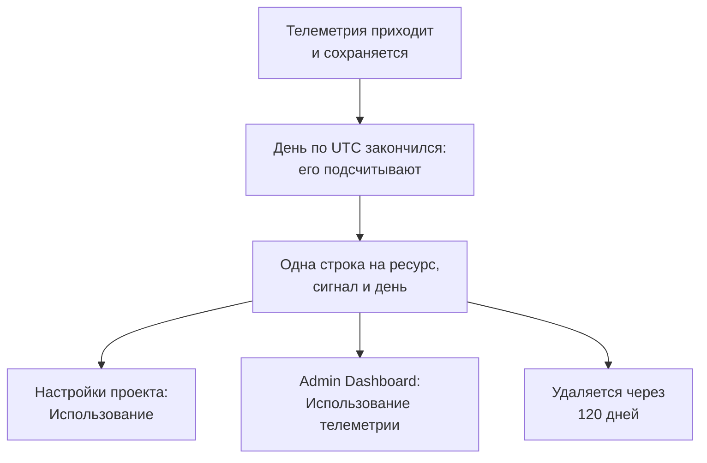

# Использование телеметрии

Узнайте, сколько телеметрии отправляет каждый проект, а также каждый сервис или ресурс в нём: логи, метрики, трассировки, исключения, профили, записи сеансов и события безопасности. Использование учитывается в каждой установке OneUptime, с биллингом и без него, поэтому вы можете найти то, что заполняет хранилище, не выполняя запросов к ClickHouse.

:::cards
- [Как учитывается использование](#как-учитывается-использование): Раз в день, для каждого ресурса и сигнала.
- [Посмотреть использование проекта](#посмотреть-использование-проекта): Настройки проекта → Телеметрия и APM → Использование.
- [Посмотреть использование всех проектов](#посмотреть-использование-всех-проектов): Admin Dashboard, для администратора экземпляра.
- [Как долго хранятся данные об использовании](#как-долго-хранятся-данные-об-использовании): 120 дней, если вы это не измените.
:::

## Как учитывается использование

Раз в день, после окончания дня по UTC, OneUptime подсчитывает, что каждый ресурс каждого проекта отправил за этот день по каждому сигналу, и сохраняет результат в виде одной строки на ресурс, сигнал и день.



- **День учитывается, когда он закончился.** Каждый день подсчитывается примерно к 08:00 UTC следующего дня, поэтому сегодняшнее использование появится завтра. Если день не удалось подсчитать, попытки повторяются в течение недели.
- **Размер — это размер при хранении.** Каждый сигнал учитывается как размер строк, в которых он хранится, до сжатия. Записи сеансов учитываются как байты, которые загрузили записывающие скрипты.
- **Исключения показываются отдельно.** У исключений, записанных из спанов и логов, есть свой итог, свой столбец и своя часть диаграммы, а **Трассировки** учитывают спаны. Отдельной строки у них нет: в каждой строке трассировок указано, какая её часть приходится на исключения. Если день был подсчитан до того, как исключения стали показываться отдельно, они, как и раньше, входят в **Трассировки**.
- **Профили включают свои сэмплы.**
- **Собственная телеметрия OneUptime не учитывается.** Показания мониторов, оповещений, инцидентов и SLO, показания Наблюдаемости данных и метрики бюджета записей сеансов записывает сам OneUptime.
- **В OneUptime Cloud телеметрия оплачивается именно по этим строкам.** В установке без биллинга использование учитывается бесплатно, и за него ничего не списывается, даже если биллинг включат позже.
- **Исключения оплачиваются в составе трассировок.** В OneUptime Cloud спаны и исключения трассировок, как и всегда, оплачиваются вместе, по цене трассировок. Отдельный показ исключений ничего не меняет в ваших счетах, и дважды за них ничего не списывается.
- **Бюджет учитывается отдельно от использования.** [Бюджет приема](/docs/telemetry/ingestion-budgets) учитывает телеметрию по мере поступления, в распакованном виде, поэтому может остановить телеметрию за день в тот же день. Пока бюджет задан, эта страница начинается с сегодняшних бюджетов. Собственного бюджета у исключений нет: они учитываются в бюджете тех трассировок или логов, в составе которых приходят.

## Перед началом

- **Роль, которая читает телеметрию проекта.** Владелец проекта, Администратор проекта, Участник проекта, Зритель, Администратор телеметрии, Участник телеметрии или Зритель телеметрии либо одна из ролей биллинга. Роль должна охватывать весь проект: роль, ограниченная некоторыми метками, не показывает использование.
- **Телеметрия в проекте.** Использование учитывается для телеметрии, которую отправляют [ключи приема](/docs/telemetry/ingestion-keys) проекта.

## Посмотреть использование проекта

:::steps
### Открыть Использование

Перейдите в **Настройки проекта → Телеметрия и APM → Использование**. **Телеметрия и APM** сначала свернут в боковом меню: нажмите на него, чтобы открыть.

### Выбрать период

Страница открывается с периодом **Последние 30 дн.** Выберите **Последние 7 дн.** или **Последние 90 дн.** в поле в правом верхнем углу карточки **Использование телеметрии**. Период заканчивается вчерашним днём — последним днём, который уже подсчитан.

### Найти то, что выросло

Карточка **Использование по ресурсам** перечисляет все сервисы и ресурсы, которые что-либо отправили за период, по убыванию объёма. Нажмите на заголовок столбца, чтобы отсортировать по нему, или на имя ресурса, чтобы открыть его страницу.
:::

На странице три карточки:

| Карточка | Что показывает |
| --- | --- |
| **Использование телеметрии** | **Всего** за период, итог по каждому сигналу и диаграмма по дням, в которой сигналы сложены друг на друга. |
| **Использование по ресурсам** | Каждый **Ресурс** с его типом, столбец для каждого сигнала, **Всего** и **Хранение** — срок, в течение которого хранится его телеметрия. |
| **История использования телеметрии** | Одна строка на продукт, ресурс и день, с фильтрами **Продукт**, **День** и **Сервис**. Строка **Трассировки** содержит спаны и исключения вместе, так же как оплачиваются трассировки, и в столбце **Принято данных (в GB)** указывает, сколько из этого объёма приходится на исключения. |

Телеметрия, в которой не указан сервис, отображается как **Неизвестный сервис**. Ресурс, который с тех пор был удалён или тип которого ваша роль не читает, отображается по своему типу и началу своего ID.

## Кто что видит

| Роль | Что видит |
| --- | --- |
| Владелец проекта, Администратор проекта, Администратор биллинга, Участник биллинга, Зритель биллинга, Manage Billing | Сколько отправил каждый ресурс и как долго это хранится, а в OneUptime Cloud — сколько это стоило |
| Участник проекта, Зритель, Администратор телеметрии, Участник телеметрии, Зритель телеметрии | Сколько отправил каждый ресурс и как долго это хранится |

Стоимость использования показывается только в OneUptime Cloud: установка без биллинга ничего за него не берёт. Цены см. в разделе [Биллинг и использование](/docs/configuration/billing#история-использования).

## Посмотреть использование всех проектов

В самостоятельно размещённой установке администратор экземпляра видит использование всех проектов в Admin Dashboard:

:::steps
### Открыть Использование телеметрии

В Admin Dashboard откройте меню и нажмите **Использование телеметрии**. Список показывает каждый проект, который что-либо отправил за период, по убыванию объёма, со столбцом для каждого сигнала и столбцом **Всего**.

### Найти самые крупные проекты

Выберите период в правом верхнем углу карточки и нажмите на заголовок столбца, чтобы отсортировать по нему: **Всего**, сигнал или **Проект** для сортировки по имени.

### Открыть проект

Нажмите на имя проекта. Его страница **Использование телеметрии** в разделе **Проекты** Admin Dashboard показывает его использование по дням, сигналам и ресурсам — так, как его видят участники проекта.
:::

## Как долго хранятся данные об использовании

Данные об использовании хранятся 120 дней, если вы это не измените, при включённом или выключенном биллинге. Это срок хранения подсчётов использования, а не самой телеметрии: о ней см. [Хранение данных](/docs/telemetry/data-retention).

:::steps
### Открыть Хранение данных

В Admin Dashboard перейдите в **Настройки → Хранение данных**.

### Задать число дней

На карточке **Хранение данных об использовании телеметрии** нажмите **Изменить хранение данных об использовании телеметрии**, введите **Срок хранения данных об использовании телеметрии (дни)** от 30 до 1095 и нажмите **Сохранить изменения**. Оставьте поле пустым, чтобы хранить 120 дней.
:::

Более старые данные об использовании удаляются раз в день. Срок хранения никогда не бывает меньше 30 дней: уже подсчитанный день не может быть удалён и подсчитан заново.

## Получить использование через API

`GET /api/telemetry-usage/project` возвращает использование одного проекта за диапазон дней по UTC — так, как его показывает страница. Вызывайте его с [ключом API](/docs/permissions/index#ключи-api), у которого есть одна из ролей выше:

```bash
curl 'https://oneuptime.com/api/telemetry-usage/project?startDay=2026-10-01&endDay=2026-10-31' \
  -H "ApiKey: $ONEUPTIME_API_KEY"
```

`startDay` и `endDay` — дни в формате `YYYY-MM-DD`, оба включительно, а диапазон может быть длиной до 1095 дней. Ответ содержит итоги, каждый день по сигналам и каждый ресурс по сигналам, в GB, а стоимость — только там, где включён биллинг и ключ читает биллинг. Исключения находятся в `Exceptions`, отдельно от `Traces`, а в днях, подсчитанных до того, как исключения стали показываться отдельно, они входят в `Traces`.

## Устранение неполадок

:::details На странице Использование написано «Использования телеметрии пока нет»
День учитывается, когда он закончился по UTC, — примерно к 08:00 UTC следующего дня: проект, который начал отправлять телеметрию сегодня, покажет свой первый день завтра. Проверьте в обозревателях, что проект получает телеметрию.
:::

:::details Числа больше, чем занимает ClickHouse на моём диске
Использование — это размер строк до сжатия. ClickHouse сжимает то, что хранит, поэтому на диске данные занимают в несколько раз меньше места.
:::

:::details Ресурс отображается по типу и ID
Ресурс был удалён после того, как отправил телеметрию, или ваша роль не читает такой тип ресурсов. Его использование всё равно учитывается.
:::

:::details Трассировки уменьшились в день, когда появились Исключения
Раньше исключения входили в **Трассировки**. Начиная с первого дня, когда исключения подсчитывались отдельно, **Трассировки** учитывают спаны, а **Исключения** — исключения. Вместе они составляют то, чем раньше были **Трассировки**, и то, за что оплачиваются трассировки.
:::

## Дальнейшие шаги

:::cards
- [Фильтры отбрасывания и правила очистки](/docs/telemetry/drop-filters-and-scrub-rules): Перестаньте хранить телеметрию, которая вам не нужна.
- [Хранение данных](/docs/telemetry/data-retention): Храните телеметрию столько, сколько нужно, и не дольше.
- [Биллинг и использование](/docs/configuration/billing): Сколько стоит телеметрия в OneUptime Cloud.
- [Ключи приема](/docs/telemetry/ingestion-keys): Отправляйте телеметрию в свой проект.
- [Бюджеты приема](/docs/telemetry/ingestion-budgets): Ограничьте, сколько каждого сигнала проект отправляет за день.
:::
