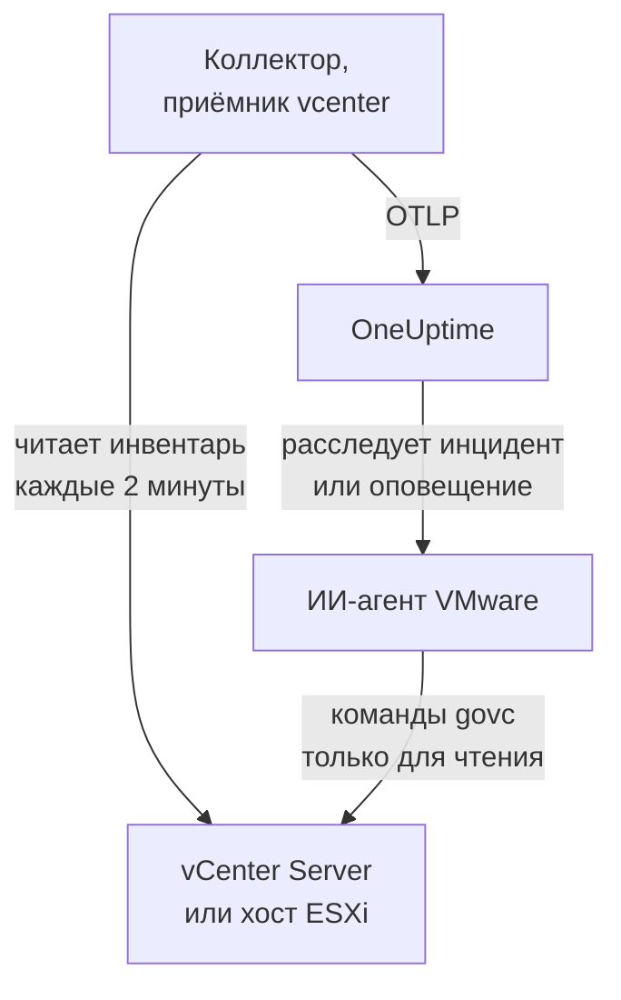

# Агент VMware

Агент VMware от OneUptime отслеживает VMware vSphere: vCenter Server, хосты ESXi, виртуальные машины, хранилища данных (datastores), кластеры, пулы ресурсов и vSAN. Это стандартный OpenTelemetry Collector, чей [приёмник `vcenter`](https://github.com/open-telemetry/opentelemetry-collector-contrib/tree/main/receiver/vcenterreceiver) читает API vSphere от имени пользователя только для чтения, проставляет на каждую метрику имя вашего vCenter и отправляет её в OneUptime: никаких плагинов на vCenter и ничего внутри ВМ. [Мониторы VMware](/docs/monitor/vmware-monitor) оповещают о том, что поступает.

:::cards
- [Установка агента](#установка-агента): Пользователь только для чтения, затем скрипт установки, Docker Compose или systemd.
- [Что собирает агент](#что-собирает-агент): Каждый объект vSphere, его идентификация и его метрики.
- [ИИ-агент](#ии-агент): Позвольте OneUptime AI читать vCenter во время расследования.
- [Устранение неполадок](#устранение-неполадок): Диагностический скрипт и типичные проблемы.
:::

## Как это работает

Один агент отслеживает одну конечную точку vSphere: **vCenter Server**, который охватывает каждый датацентр, кластер и хост под своим управлением, или **отдельный хост ESXi**, которым не управляет ни один vCenter. Запускайте один агент на каждый vCenter. Коллектор обходит весь инвентарь один раз за сбор (по умолчанию каждые 2 минуты) и отправляет по одному ресурсу на объект. Тот же файл Compose запускает рядом ИИ-агента VMware для OneUptime AI. Не хотите запускать Docker? Тот же коллектор с той же конфигурацией работает и как сервис systemd на любой машине с Linux.



vCenter регистрируется по своим первым данным под именем, которое агент проставляет на каждую метрику как `vmware.vcenter.name`. Чтобы отслеживать vCenter вообще без агента, см. [VMware без агента](/docs/telemetry/vmware-agentless): одна из ваших проб собирает те же данные с учётной записью только для чтения.

## Перед началом

- Docker Engine 20.10 или новее с плагином Docker Compose v2 либо, для установки без Docker, машина с Linux (x86_64 или arm64) и systemd 235 или новее. В любом случае машина должна достигать vCenter по HTTPS (TCP 443).
- vCenter Server или ESXi 7.0 или новее: приёмник поддерживает vSphere 7 и 8.
- Учётная запись, которая может создать пользователя vSphere и выдать ему роль на объекте vCenter верхнего уровня.
- Ключ приёма. Создайте его в разделе **Настройки проекта → Телеметрия и APM → Ключи приема** и скопируйте значение.

### Где запускать агент

Агент общается с vCenter по HTTPS, поэтому ему не нужно работать рядом с ним, и в идеале он не должен работать ни на vCenter Server Appliance, ни в ВМ на кластере, который он отслеживает: если этот кластер упадёт, ваш мониторинг упадёт вместе с ним. Подходящее место — небольшая управляющая ВМ на отдельном оборудовании, хост мониторинга или любая машина с Docker (или, без Docker, любая машина с Linux и systemd), которая достигает vCenter по TCP 443. Необязательному приёмнику syslog также нужно, чтобы хосты ESXi достигали агента по порту syslog (см. [Отправка syslog ESXi](#необязательно-отправка-syslog-esxi)).

## Установка агента

:::steps
### Создайте пользователя vSphere только для чтения

Агент только читает: инвентарь, счётчики производительности и статистику vSAN. Выдайте ему собственную учётную запись со встроенной ролью **Read-Only**, а не администратора.

:::tabs
@tab vSphere Client
1. Создайте учётную запись: откройте _Menu → Administration → Single Sign On → Users and Groups_, выберите домен `vsphere.local` (или ваш источник идентификации), нажмите **Add**, назовите пользователя `oneuptime` и задайте пароль. Тогда пользователь — `oneuptime@vsphere.local`.
2. Выдайте роль: выберите объект **vCenter Server** верхнего уровня в инвентаре _Hosts and Clusters_, откройте вкладку **Permissions**, нажмите **Add**, выберите пользователя, установите роль **Read-Only** и отметьте **Propagate to children**.
@tab govc
С машины с учётными данными администратора:

```bash
govc sso.user.create -p 'a-strong-password' -R ReadOnly oneuptime
govc permissions.set -principal oneuptime@vsphere.local -role ReadOnly -propagate=true /
```
@tab PowerCLI
Из сеанса, подключённого к vCenter от имени администратора:

```powershell
New-SsoPersonUser -UserName oneuptime -Password 'a-strong-password'
New-VIPermission -Entity (Get-Folder -NoRecursion) -Principal 'VSPHERE.LOCAL\oneuptime' -Role ReadOnly -Propagate:$true
```
@tab ESXi Host Client
Для отдельного хоста ESXi (без vCenter) создайте пользователя в _Host → Manage → Security & Users → Users_ и выдайте ему роль Read-Only в _Host → Manage → Security & Users → Permissions_. Или в оболочке хоста выполните `esxcli system account add`, а затем `esxcli system permission set --id oneuptime --role ReadOnly`.
:::

> [!IMPORTANT]
> Распространение прав — это то, что упускают. Приёмник обходит датацентры, кластеры, хосты, ВМ, хранилища данных и пулы ресурсов, и каждый объект, который пользователь не видит, молча пропускается. Роль Read-Only, выданная на объекте vCenter _без_ распространения, даёт пустой инвентарь и дашборд, полный нулей.

### Установите и запустите агент

:::tabs
@tab install.sh
Скачайте скрипт установки и запустите его на машине, где будет работать агент:

```bash
curl -sSL https://raw.githubusercontent.com/OneUptime/oneuptime/master/agents/VMwareAgent/install.sh -o install.sh
bash install.sh
```

Скрипт спрашивает URL вашего OneUptime, ключ приёма, имя vCenter, конечную точку vCenter и учётные данные только для чтения (пароль он читает без отображения), а также может ли ИИ-агент применять исправления (если да — собственного пользователя vSphere для него и ВМ, которые он никогда не должен менять). Он устанавливает агента в `/opt/oneuptime-vmware-agent`, записывает файл с правами `0600` под именем `.env` и запускает агента через Docker Compose. Он заключает каждое значение в кавычки для Docker Compose так, как вы его ввели, поэтому пароль с `$`, `#`, пробелами или кавычками работает так, как введён. Повторный запуск скрипта использует всё, что есть в существующем `.env`, и ничего не спрашивает снова — так вы [обновляете агента](#обновление-агента).
@tab Docker Compose
Скачайте `docker-compose.yml` и `otel-collector-config.yaml` из [каталога VMwareAgent](https://github.com/OneUptime/oneuptime/tree/master/agents/VMwareAgent) в новую папку, затем создайте рядом с ними файл `.env`. В нём хранится пароль, поэтому закройте к нему доступ командой `chmod 600 .env`:

```bash title=".env"
ONEUPTIME_URL=YOUR_ONEUPTIME_URL
ONEUPTIME_TELEMETRY_INGESTION_KEY=YOUR_TELEMETRY_INGESTION_TOKEN
VMWARE_VCENTER_NAME=my-vcenter
VCENTER_ENDPOINT=https://vcsa.example.com
VCENTER_USERNAME=oneuptime@vsphere.local
VCENTER_PASSWORD=a-strong-password
VCENTER_INSECURE_SKIP_VERIFY=true
VCENTER_COLLECTION_INTERVAL=2m
```

Пароль с `$`, `#`, пробелами или кавычками заключается в одинарные кавычки (см. [vCenter отклоняет вход](#устранение-неполадок)). Запустите агента:

```bash
docker compose up -d
```
@tab systemd
Агенту не нужен Docker: это один бинарный файл OpenTelemetry Collector и один файл конфигурации. На машине с Linux (x86_64 или arm64) и systemd 235 или новее (Ubuntu 18.04, Debian 10, RHEL 8 или новее) запустите выпуск `otelcol-contrib`, закреплённый агентом, с тем же `otel-collector-config.yaml` как сервис systemd. Юнит, который агент поставляет для этого, [`oneuptime-vmware-agent-native.service`](https://github.com/OneUptime/oneuptime/blob/master/agents/VMwareAgent/systemd/oneuptime-vmware-agent-native.service), запускает коллектор от имени временного непривилегированного пользователя без capabilities и без чего-либо, куда он мог бы писать.

Скачайте коллектор, конфигурацию и юнит и установите их в `/opt/oneuptime-vmware-agent`:

```bash
cd "$(mktemp -d)"
VERSION=0.161.0   # the collector release the agent pins
ARCH=$(uname -m | sed 's/x86_64/amd64/;s/aarch64/arm64/')
curl -fL -o otelcol-contrib.tar.gz \
  https://github.com/open-telemetry/opentelemetry-collector-releases/releases/download/v${VERSION}/otelcol-contrib_${VERSION}_linux_${ARCH}.tar.gz
curl -fsSLO https://raw.githubusercontent.com/OneUptime/oneuptime/master/agents/VMwareAgent/otel-collector-config.yaml
curl -fsSL -o oneuptime-vmware-agent.service \
  https://raw.githubusercontent.com/OneUptime/oneuptime/master/agents/VMwareAgent/systemd/oneuptime-vmware-agent-native.service

sudo install -d -m 0755 /opt/oneuptime-vmware-agent
sudo tar --no-same-owner --preserve-permissions -xzf otelcol-contrib.tar.gz -C /opt/oneuptime-vmware-agent otelcol-contrib
sudo install -m 0644 otel-collector-config.yaml /opt/oneuptime-vmware-agent/otel-collector-config.yaml
sudo install -m 0644 oneuptime-vmware-agent.service /etc/systemd/system/oneuptime-vmware-agent.service
```

Настройки помещаются в `/opt/oneuptime-vmware-agent/.env`: те же переменные, что и в `.env` установки через Docker. В нём хранится пароль, поэтому перед открытием сделайте его доступным для чтения только root:

```bash
sudo touch /opt/oneuptime-vmware-agent/.env
sudo chmod 600 /opt/oneuptime-vmware-agent/.env
sudoedit /opt/oneuptime-vmware-agent/.env
```

Впишите в него следующее:

```bash
ONEUPTIME_URL=YOUR_ONEUPTIME_URL
ONEUPTIME_TELEMETRY_INGESTION_KEY=YOUR_TELEMETRY_INGESTION_TOKEN
VMWARE_VCENTER_NAME=my-vcenter
VCENTER_ENDPOINT=https://vcsa.example.com
VCENTER_USERNAME="oneuptime@vsphere.local"
VCENTER_PASSWORD="a-strong-password"
VCENTER_INSECURE_SKIP_VERIFY=true
VCENTER_COLLECTION_INTERVAL=2m
```

Этот файл читает systemd, а не оболочка: заключайте имя пользователя и пароль в двойные кавычки, записывая каждый `\` как `\\` и каждую `"` как `\"` — `DOMAIN\user` записывается как `"DOMAIN\\user"`, — а `$`, `#`, `'` и пробелы вставляйте как есть. Именно эту форму все версии systemd читают одинаково; более старые (например, в RHEL 8) отбрасывают обратную косую черту даже внутри одинарных кавычек. Затем запустите агента и включите его запуск при каждой загрузке:

```bash
sudo systemctl daemon-reload
sudo systemctl enable oneuptime-vmware-agent
sudo systemctl restart oneuptime-vmware-agent
```

Эта установка запускает только коллектор: [ИИ-агент](#ии-агент) поставляется только в виде образа контейнера. Запускайте один агент на каждый vCenter: если вы уходите с установки через Docker, сначала выполните там `docker compose down`, иначе каждая метрика будет приходить дважды.
:::

### Проверьте установку

Убедитесь, что агент работает, и прочитайте логи коллектора:

```bash
docker compose ps
docker logs -f oneuptime-vmware-agent
```

Устанавливали через systemd? Тогда проверьте сервис и его журнал:

```bash
systemctl status oneuptime-vmware-agent --no-pager
sudo journalctl -u oneuptime-vmware-agent -f
```

После запуска коллектора в его логах должна появиться эта строка:

```text
Everything is ready. Begin running and processing data.
```

### Найдите vCenter в OneUptime

Ничего не отправляется, пока не завершится первый полный обход инвентаря, поэтому подождите один интервал сбора (по умолчанию 2 минуты). Затем откройте **Продукты → Инфраструктура → VMware → Все vCenter**: vCenter будет там со своими датацентрами, кластерами, хостами ESXi, виртуальными машинами, хранилищами данных и пулами ресурсов.
:::

## Переменные окружения

Docker Compose читает их из `.env` рядом с `docker-compose.yml`; установка через systemd читает их из `/opt/oneuptime-vmware-agent/.env`, а её юнит задаёт те же значения по умолчанию.

| Переменная | Обязательна | Описание |
| --- | --- | --- |
| `ONEUPTIME_URL` | Да | Ваш URL OneUptime, например `https://oneuptime.com`, или ваш собственный экземпляр. Если экземпляр работает только по HTTP, используйте `http://` и его порт. |
| `ONEUPTIME_TELEMETRY_INGESTION_KEY` | Да | Ключ приёма из раздела **Настройки проекта → Телеметрия и APM → Ключи приема**. |
| `VMWARE_VCENTER_NAME` | Да | Имя vCenter в OneUptime, проставляемое на каждую метрику как атрибут ресурса `vmware.vcenter.name`. Не меняйте его: изменение позже регистрирует второй vCenter. По умолчанию `vmware-vcenter`. |
| `VCENTER_ENDPOINT` | Да | Схема и хост vCenter Server или отдельного хоста ESXi, **без** `/sdk`, например `https://vcsa.example.com`. |
| `VCENTER_USERNAME` | Да | Пользователь vSphere с ролью Read-Only, например `oneuptime@vsphere.local` (или `DOMAIN\user` для источника идентификации Active Directory). |
| `VCENTER_PASSWORD` | Да | Пароль этого пользователя. Если в нём есть `$`, `#`, пробелы или кавычки, заключите его в одинарные кавычки в `.env` установки через Docker (`install.sh` делает это за вас) и в двойные — в файле установки через systemd (см. [Устранение неполадок](#устранение-неполадок)). |
| `VCENTER_INSECURE_SKIP_VERIFY` | Нет | `true` принимает самоподписанный сертификат vCenter по умолчанию (VMCA); `false` оставляет проверку TLS включённой. По умолчанию `false`. |
| `VCENTER_COLLECTION_INTERVAL` | Нет | Как часто читается весь инвентарь. Для очень больших vCenter увеличьте его до `5m` или `10m`. По умолчанию `2m`. |

Собственные настройки ИИ-агента описаны в разделе [ИИ-агент](#ии-агент).

## Что собирает агент

Каждый `VCENTER_COLLECTION_INTERVAL` приёмник обходит весь инвентарь vSphere и отправляет по одному ресурсу OpenTelemetry на объект. Идентификация каждого объекта содержится в его **атрибутах ресурса** — `vcenter.datacenter.name`, `vcenter.cluster.name`, `vcenter.host.name`, `vcenter.vm.name` / `vcenter.vm.id`, `vcenter.datastore.name`, `vcenter.resource_pool.name` / `vcenter.resource_pool.inventory_path`, — а агент добавляет сверху `vmware.vcenter.name`, поэтому OneUptime относит всё к вашему vCenter:

| Объект vSphere | Идентификация (атрибуты ресурса) | Метрики |
| --- | --- | --- |
| Датацентр | `vcenter.datacenter.name` | `vcenter.datacenter.cluster.count`, `vcenter.datacenter.host.count`, `vcenter.datacenter.vm.count`, `vcenter.datacenter.datastore.count`, `vcenter.datacenter.disk.space`, `vcenter.datacenter.cpu.limit`, `vcenter.datacenter.memory.limit` |
| Кластер | + `vcenter.cluster.name` | `vcenter.cluster.cpu.effective`, `vcenter.cluster.cpu.limit`, `vcenter.cluster.memory.effective`, `vcenter.cluster.memory.limit`, `vcenter.cluster.host.count`, `vcenter.cluster.vm.count`, `vcenter.cluster.vm_template.count`, `vcenter.cluster.vsan.*` (пропускная способность, операции, задержка, перегрузки) |
| Хост ESXi | + `vcenter.host.name` (и `vcenter.cluster.name`, если хост входит в кластер) | `vcenter.host.cpu.usage` / `.capacity` / `.utilization` / `.reserved`, `vcenter.host.memory.usage` / `.utilization` / `.capacity`, `vcenter.host.disk.latency.avg` / `.latency.max` / `.throughput`, `vcenter.host.network.usage` / `.throughput` / `.packet.rate` / `.packet.drop.rate` / `.packet.error.rate`, `vcenter.host.vsan.*` |
| Виртуальная машина | + `vcenter.host.name`, `vcenter.vm.name`, `vcenter.vm.id` (UUID экземпляра); `vcenter.resource_pool.*` или `vcenter.virtual_app.*` | `vcenter.vm.disk.usage`, `vcenter.vm.disk.utilization`, `vcenter.vm.memory.usage` / `.utilization` / `.ballooned` / `.swapped` / `.swapped_ssd`; только для включённых ВМ: `vcenter.vm.cpu.usage`, `vcenter.vm.cpu.readiness`, `vcenter.vm.cpu.utilization`, `vcenter.vm.disk.latency.avg` / `.latency.max` / `.throughput`, `vcenter.vm.network.*`, `vcenter.vm.vsan.*` |
| Шаблон ВМ | `vcenter.vm_template.name`, `vcenter.vm_template.id` | только `vcenter.vm.disk.usage` |
| Хранилище данных | + `vcenter.datastore.name` | `vcenter.datastore.disk.usage`, `vcenter.datastore.disk.utilization` |
| Пул ресурсов | + `vcenter.resource_pool.name`, `vcenter.resource_pool.inventory_path` | `vcenter.resource_pool.cpu.usage` / `.cpu.shares`, `vcenter.resource_pool.memory.usage` / `.memory.shares` / `.memory.ballooned` / `.memory.swapped` / `.memory.granted` |

Метрики количества и ёмкости разделяются по **атрибутам точек данных** — именно по ним вы фильтруете и группируете в критериях мониторов:

| Атрибут | Значения | Есть у |
| --- | --- | --- |
| `direction` | `read` / `write` для диска, `transmitted` / `received` для сети | Задержка и пропускная способность диска, пропускная способность сети и частота пакетов |
| `disk_state` | `available` / `used` | `vcenter.datastore.disk.usage`, `vcenter.vm.disk.usage`, `vcenter.datacenter.disk.space` |
| `status` | `red` / `yellow` / `green` / `gray` (общий статус объекта в vSphere) | `vcenter.datacenter.cluster.count` / `.host.count` / `.vm.count` |
| `power_state` | Хосты: `on` / `off` / `standby` / `unknown`; ВМ: `on` / `off` / `suspended` / `unknown` | `vcenter.datacenter.host.count` / `.vm.count`, `vcenter.cluster.vm.count` |
| `effective` | `true` / `false` (хранятся как строки) | `vcenter.cluster.host.count` |
| `object` | Экземпляр сетевой карты, диска или vCPU (например, `vmnic0`) | Серии дисков и сети по устройствам для хостов и ВМ |
| `cpu_reservation_type` | `total` / `used` | `vcenter.host.cpu.reserved` |
| `type` | Память: `guest` / `host` / `overhead`, `private` / `shared`; vSAN: `read` / `write` / `unmap` | Серии памяти пулов ресурсов, задержка и операции vSAN |

Единицы — собственные единицы OTLP приёмника, которые OneUptime масштабирует для отображения: `MHz` для использования и ёмкости ЦП, `%` для загрузки и CPU ready, `MiBy` для памяти хостов, ВМ и пулов ресурсов, `By` для памяти кластеров и датацентров и всего дискового пространства, `ms` для задержки дисков хостов и ВМ и `us` (микросекунды) для задержки vSAN. В критериях мониторов атрибуты идентификации получают префикс `resource.` (`resource.vcenter.host.name`, `resource.vmware.vcenter.name`), а атрибуты точек данных остаются без префикса (`disk_state`, `power_state`, `status`).

`vcenter.host.memory.capacity` в исходном проекте по умолчанию выключена; поставляемая конфигурация её включает, потому что OneUptime делит на неё для загрузки памяти хостов. Комментарий в `otel-collector-config.yaml` перечисляет остальные необязательные метрики (`vcenter.vm.cpu.time`, `vcenter.vm.memory.granted`, `vcenter.host.memory.active`, `vcenter.host.memory.ballooned`, `vcenter.host.memory.granted`, `vcenter.vm.network.broadcast.packet.rate`, `vcenter.vm.network.multicast.packet.rate`): включайте любую из них так же.

### Состояние питания ВМ

Приёмник не отправляет метрику состояния питания ВМ. Он отправляет `vcenter.vm.cpu.*` **только для включённых ВМ**, поэтому OneUptime выводит состояние из того, что пришло в каждом сборе: ВМ, сообщившая метрики ЦП, — **Powered on**; ВМ, сообщившая только использование памяти и диска, — **Powered off** (или приостановлена: здесь vSphere их не различает). У шаблонов ВМ нет состояния питания. Это читается **целым сбором за раз**, поэтому у поставляемого процессора `batch` большой `send_batch_size` и намеренно нет `send_batch_max_size`: сбор, разделённый на два экспорта, обнулил бы счётчики инвентаря и «выключил» бы ВМ. Оставьте настройки batch как в поставке.

## vCenter в OneUptime


Страница **Обзор** прежде всего отвечает на вопрос «здоров ли этот vCenter»: эффективные хосты, ЦП и память хостов, взвешенные по ёмкости, самое заполненное хранилище данных и худшее время CPU ready у ВМ. Когда что-то деградировало, она называет ответственный объект, так что искать его не нужно.

### Хосты ESXi


### Виртуальные машины


Выключенные виртуальные машины и шаблоны тоже показываются в списке. vCenter сообщает счётчики ЦП только для включённых ВМ, поэтому их столбцы ЦП показывают N/A, а не вводящий в заблуждение ноль.

### Хранилища данных


## Необязательно — отправка syslog ESXi

По умолчанию агент отправляет только метрики, поэтому страница **Журналы** vCenter остаётся пустой. Хосты ESXi (и сам vCenter) могут пересылать свой syslog любому приёмнику, а в поставляемом `otel-collector-config.yaml` есть закомментированная пара приёмников `syslog` (TCP и UDP на порту 5514, RFC 3164 — собственный формат ESXi), подключённая к закомментированному конвейеру `logs`, который проставляет `vmware.vcenter.name`, чтобы журналы попадали в ваш vCenter.

:::steps
### Включите приёмники

Раскомментируйте два приёмника `syslog/*` и конвейер `logs` в `otel-collector-config.yaml`.

### Откройте порт

Раскомментируйте блок `ports:` в `docker-compose.yml`, чтобы машина публиковала `5514/tcp` и `5514/udp`, затем выполните `docker compose up -d`. С systemd публиковать порт не нужно, так как коллектор слушает на самой машине: вместо этого выполните `sudo systemctl restart oneuptime-vmware-agent`. Откройте порт в брандмауэре машины для сети управления ESXi.

### Направьте каждый хост ESXi на агента

В vSphere Client выберите хост, откройте _Configure → System → Advanced System Settings_, измените `Syslog.global.logHost` и установите значение `udp://<agent-host>:5514` (или `tcp://<agent-host>:5514`; несколько целей разделяйте запятыми). Затем разрешите исходящий трафик в _Configure → System → Firewall → Edit → syslog_. Или на каждом хосте с помощью `esxcli`:

```bash
esxcli system syslog config set --loghost='udp://<agent-host>:5514'
esxcli system syslog reload
esxcli network firewall ruleset set --ruleset-id=syslog --enabled=true
```

С помощью PowerCLI для всего кластера: `Get-VMHost | Get-AdvancedSetting -Name Syslog.global.logHost | Set-AdvancedSetting -Value 'udp://<agent-host>:5514' -Confirm:$false`.
:::

Приёмник syslog слушает только один транспорт, поэтому TCP и UDP — это два приёмника: оставьте один закомментированным, если вам нужен только другой. Для syslog по TLS (`ssl://`) завершайте TLS перед агентом; сам приёмник говорит на обычных TCP и UDP. Стандартный образ коллектора читает syslog как есть: собственный образ не нужен.

## Пометка vCenter метками проекта

Атрибут ресурса, начинающийся с `oneuptime.label.`, становится меткой проекта на vCenter: `oneuptime.label.<dimension>=<value>` — это метка `<dimension>:<value>`. Добавьте атрибуты в процессор `resource` в `otel-collector-config.yaml` рядом с `vmware.vcenter.name`:

```yaml
processors:
  resource:
    attributes:
      # ...existing attributes...
      - key: oneuptime.label.team
        value: platform
        action: upsert
      - key: oneuptime.label.env
        value: production
        action: upsert
```

Коллектор читает конфигурацию только при запуске: выполните `docker compose restart oneuptime-vmware-agent` или, с systemd, `sudo systemctl restart oneuptime-vmware-agent`. После этого vCenter показывает метки `team:platform` и `env:production`. Метки сравниваются без учёта регистра, поэтому существующая метка `Production` используется повторно, а не дублируется, и агент никогда не удаляет метку, добавленную кем-то в OneUptime.

## Запуск как службы systemd

Установку через Docker тоже можно запускать под systemd, чтобы она стартовала вместе с машиной и перезапускалась при сбое. Её юнит оборачивает Docker Compose и предполагает, что агент находится в `/opt/oneuptime-vmware-agent`, куда его помещает скрипт установки:

```bash
sudo curl -fsSL https://raw.githubusercontent.com/OneUptime/oneuptime/master/agents/VMwareAgent/systemd/oneuptime-vmware-agent.service -o /etc/systemd/system/oneuptime-vmware-agent.service
sudo systemctl daemon-reload
sudo systemctl enable --now oneuptime-vmware-agent
```

Установка без Docker уже является сервисом systemd со своим юнитом.

## Обновление агента

Агент сообщает версию коллектора, закреплённую в его файлах, как свою **Версия агента**. Если она старше версии, закреплённой в этом выпуске OneUptime, рядом с ней появляется предупреждающий значок — на странице **Обзор** vCenter и в списке **Все vCenter**. Выберите его, чтобы увидеть эти команды. Агент, установленный до того, как его файлы стали сообщать версию, не показывает её, пока не будет обновлён таким способом.

Коллектор закреплён в `docker-compose.yml` (или, без Docker, скачанным выпуском), а его конфигурация — это файл рядом, поэтому одно лишь скачивание образов не продвигает агента вперёд:

:::tabs
@tab install.sh
Снова запустите `install.sh`: он использует все значения из вашего существующего `.env` (ничего не спрашивается повторно), обновляет `docker-compose.yml` и `otel-collector-config.yaml` и пересоздаёт агента, чтобы коллектор прочитал новую конфигурацию.

```bash
curl -sSL https://raw.githubusercontent.com/OneUptime/oneuptime/master/agents/VMwareAgent/install.sh -o install.sh
bash install.sh
```
@tab Docker Compose
В папке агента снова скачайте оба файла (и повторите изменения, которые в них вносили), затем скачайте образы и пересоздайте агента:

```bash
curl -fsSLO https://raw.githubusercontent.com/OneUptime/oneuptime/master/agents/VMwareAgent/docker-compose.yml
curl -fsSLO https://raw.githubusercontent.com/OneUptime/oneuptime/master/agents/VMwareAgent/otel-collector-config.yaml
docker compose pull
docker compose up -d --force-recreate
```
@tab systemd
Снова выполните команды установки: они скачивают выпуск, закреплённый этим OneUptime, вместе с последними `otel-collector-config.yaml` и юнитом и оставляют ваш `.env` как есть (повторите изменения, которые вносили в конфигурацию). Затем перезапустите сервис:

```bash
cd "$(mktemp -d)"
VERSION=0.161.0   # the collector release the agent pins
ARCH=$(uname -m | sed 's/x86_64/amd64/;s/aarch64/arm64/')
curl -fL -o otelcol-contrib.tar.gz \
  https://github.com/open-telemetry/opentelemetry-collector-releases/releases/download/v${VERSION}/otelcol-contrib_${VERSION}_linux_${ARCH}.tar.gz
curl -fsSLO https://raw.githubusercontent.com/OneUptime/oneuptime/master/agents/VMwareAgent/otel-collector-config.yaml
curl -fsSL -o oneuptime-vmware-agent.service \
  https://raw.githubusercontent.com/OneUptime/oneuptime/master/agents/VMwareAgent/systemd/oneuptime-vmware-agent-native.service

sudo install -d -m 0755 /opt/oneuptime-vmware-agent
sudo tar --no-same-owner --preserve-permissions -xzf otelcol-contrib.tar.gz -C /opt/oneuptime-vmware-agent otelcol-contrib
sudo install -m 0644 otel-collector-config.yaml /opt/oneuptime-vmware-agent/otel-collector-config.yaml
sudo install -m 0644 oneuptime-vmware-agent.service /etc/systemd/system/oneuptime-vmware-agent.service
sudo systemctl daemon-reload
sudo systemctl restart oneuptime-vmware-agent
```
:::

## Удаление агента

:::tabs
@tab Docker Compose
```bash
cd /opt/oneuptime-vmware-agent
docker compose down
```
@tab systemd
```bash
sudo systemctl disable --now oneuptime-vmware-agent
sudo rm /etc/systemd/system/oneuptime-vmware-agent.service
sudo systemctl daemon-reload
sudo rm -r /opt/oneuptime-vmware-agent
```
:::

Затем удалите разрешение пользователя `oneuptime` в vCenter, если оно больше не нужно, а также собственного пользователя ИИ-агента, если вы его создавали.

## ИИ-агент

`docker-compose.yml` агента также запускает **ИИ-агент VMware**, `oneuptime-vmware-ai-agent` (образ `oneuptime/resource-ai-agent:release`). Пока OneUptime AI расследует инцидент или оповещение на этом vCenter, она выполняет через него команды `govc` только для чтения — `govc vm.info web-01`, `govc events -n 50 /DC/vm/web-01`, `govc metric.sample -n 12 /DC/vm/web-01 cpu.usage.average` — и, только если вы это разрешите, применяет исправления, например снова включает ВМ. Он регистрируется, как и коллектор, как vCenter с именем `VMWARE_VCENTER_NAME` и появляется в OneUptime на странице **ИИ → ИИ-агент** vCenter.

- **ИИ-расследования включены по умолчанию.** Как только агент подключается, OneUptime AI расследует с его помощью инциденты и оповещения на этом vCenter, а страница **Обзор** vCenter показывает статус агента. Чтобы отключить это, задайте `ONEUPTIME_AI_INVESTIGATION=false` там, где работает агент (как это сделать, показывает **Изменить** в разделе **Что может делать ИИ** на странице ИИ-агента), или не устанавливайте агента.
- **Жёсткая граница — роль vSphere.** Расследования входят под пользователем **Read-Only** коллектора (`VCENTER_USERNAME` / `VCENTER_PASSWORD`), который может читать и ничего больше. Исправлениям нужен собственный пользователь ИИ-агента с ролью, которая может включать, выключать и сбрасывать ВМ (`VirtualMachine.Interact.PowerOn`, `PowerOff` и `Reset`), выданной только на папках, которые ИИ может исправлять, и заданный как `ONEUPTIME_AI_VCENTER_USERNAME` / `ONEUPTIME_AI_VCENTER_PASSWORD`.
- Он работает **только для чтения**, если вы не зададите `ONEUPTIME_AI_ALLOW_WRITES=true`; `ONEUPTIME_AI_WRITE_TARGETS` (имена ВМ и хостов или пути инвентаря) ограничивает, что может затронуть исправление. Он никогда не меняет ВМ, названную по хосту из `VCENTER_ENDPOINT` (обычно это appliance vCenter), и узнаёт appliance только по этому имени: если `VCENTER_ENDPOINT` — это IP-адрес или ВМ appliance называется иначе, добавьте эту ВМ в `ONEUPTIME_AI_PROTECTED_TARGETS` вместе с ВМ, на которой работает агент. `ONEUPTIME_AI_FIXES` в том же `.env` задаёт, как выполняются исправления — `ask-for-approval` (каждое одобряет человек), `automatic` или `bypass-approval`, — а страница ИИ-агента показывает это только для чтения ([Что может делать ИИ, заданное агентом](/docs/ai/infrastructure-ai-agents#what-ai-may-do-set-by-the-agent)).
- Чтобы проверять сертификат vCenter, а не пропускать проверку, смонтируйте его УЦ в контейнер и задайте `VCENTER_CA_FILE`; на vCenter с несколькими датацентрами задайте `GOVC_DATACENTER`.
- Он работает под UID 1000 без capabilities и никогда не выполняет гостевые операции, снимки, `esxcli` или что-либо, что создаёт или уничтожает ВМ. Удалите сервис `oneuptime-vmware-ai-agent` из `docker-compose.yml`, если не используете OneUptime AI.
- У установки без Docker нет ИИ-агента: он поставляется только в виде образа контейнера. Чтобы добавить его, запустите его с Docker на любой машине, которая достигает vCenter, — скачайте `docker-compose.yml`, запишите рядом `.env` с настройками из `/opt/oneuptime-vmware-agent/.env` в одинарных кавычках, как того требует Docker Compose, и запустите только ИИ-агента командой `docker compose up -d oneuptime-vmware-ai-agent` (не коллектор, который уже работает).

Что он может выполнять, как работают исправления и как устранять неполадки: [Infrastructure AI Agents](/docs/ai/infrastructure-ai-agents#vmware-vcenter). В README агента есть точные команды для роли исправлений.

## Устранение неполадок

:::details Сначала запустите диагностический скрипт
Агент поставляется со скриптом [`troubleshoot.sh`](https://github.com/OneUptime/oneuptime/blob/master/agents/VMwareAgent/troubleshoot.sh), который проверяет всю цепочку: среду выполнения контейнеров, отвечает ли vCenter и принимает ли учётные данные, имя vCenter, проставленное на каждую метрику, формат токена, собственные метрики коллектора и то, принимает ли OneUptime ключ приёма. Последняя проверка важнее всего. OneUptime отклоняет неверный ключ с `401` (`422` для отключённого ключа или ключа браузера), и коллектор считает обе ошибки постоянными: он отбрасывает пакет и пишет одну ошибку `Exporting failed`, которую легко пропустить, пока контейнер остаётся исправным. Скрипт запрашивает `GET <url>/otlp/v1/validate` изнутри сети агента, чтобы получить прямой ответ `200` (действителен) или `401` (недействителен), на старых серверах переходит на `POST /fluentd/v1/logs` и так же запрашивает `<VCENTER_ENDPOINT>/sdk/vimServiceVersions.xml`, поэтому сбои DNS, брандмауэра и TLS видны ровно такими, какими их встречает коллектор.

```bash
curl -sSL https://raw.githubusercontent.com/OneUptime/oneuptime/master/agents/VMwareAgent/troubleshoot.sh -o troubleshoot.sh
bash troubleshoot.sh    # add -d <dir> if you installed outside /opt/oneuptime-vmware-agent
```

В конце он выводит вердикт с наиболее вероятной причиной.
:::

:::details Установка без Docker
Диагностическому скрипту нужен Docker. Без него коллектор работает на самой машине, поэтому проверьте ту же цепочку напрямую: сервис и его журнал, API vCenter по сетевому пути самого коллектора, принимает ли OneUptime ключ приёма (`"valid":true` с `"keyType":"Server"`), и собственные счётчики коллектора, которые он отдаёт на `127.0.0.1:8890`, а не на `8888`, чтобы работать рядом с другим коллектором:

```bash
systemctl status oneuptime-vmware-agent --no-pager
sudo journalctl -u oneuptime-vmware-agent -n 100 --no-pager
curl -sk https://<vcenter-host>/sdk/vimServiceVersions.xml
curl -s -H "x-oneuptime-token: <key>" https://<oneuptime-host>/otlp/v1/validate
curl -s http://127.0.0.1:8890/metrics | grep -E 'otelcol_(receiver_accepted|exporter_sent|exporter_send_failed)_metric_points'
```

Журнал читается так же, как журнал контейнера, поэтому пункты ниже применимы. Сервис, который постоянно перезапускается, пишет причину: `Failed with result 'resources'` означает, что systemd не может прочитать `/opt/oneuptime-vmware-agent/.env`, а `cannot unmarshal the configuration` или `requires positive value` означает, что значение в нём коллектор не принимает. systemd читает `.env` по своим правилам, и более старые версии (например, в RHEL 8) отбрасывают обратную косую черту даже внутри одинарных кавычек: заключайте имя пользователя и пароль в двойные кавычки, записывая каждый `\` как `\\` и каждую `"` как `\"`, — это единственная форма, которую все версии читают так, как она написана. Поскольку коллектор доверяет хранилищу УЦ машины, проверку TLS можно оставить включённой: добавьте корневой сертификат vCenter (файлы `.0` из `certs/lin/` в `https://<vcenter>/certs/download.zip`) в `/usr/local/share/ca-certificates/` с именем `.crt` и выполните `update-ca-certificates` в Debian и Ubuntu либо в `/etc/pki/ca-trust/source/anchors/` и выполните `update-ca-trust` в RHEL, затем перезапустите сервис.
:::

:::details В OneUptime не появляется vCenter
1. Прочитайте логи коллектора: `docker logs oneuptime-vmware-agent`. Ошибка входа (`incorrect user name or password`, `InvalidLogin`) означает неверные учётные данные, `x509: certificate signed by unknown authority` — что проверка TLS включена при самоподписанном сертификате, `connection refused` или `no such host` — неверный `VCENTER_ENDPOINT`, а `401` при экспорте — неверный ключ приёма.
2. Проверьте, что vCenter отвечает из сети агента. В образе коллектора нет ни оболочки, ни curl, поэтому выполните запрос из контейнера в его сети: `docker run --rm --network container:oneuptime-vmware-agent curlimages/curl -sk https://<vcenter-host>/sdk/vimServiceVersions.xml` должна вывести XML-документ, в котором упоминается `urn:vim25`.
3. Проверьте, что задана `VMWARE_VCENTER_NAME`: vCenter находится по его атрибуту ресурса `vmware.vcenter.name`.
4. Подождите один интервал сбора: ничего не отправляется, пока не завершится первый полный обход инвентаря.
:::

:::details vCenter показан как отключённый
vCenter становится отключённым, когда OneUptime ничего не получал от него 15 минут; OneUptime проверяет это каждые 5 минут, и время, когда он сам не получал данные, не учитывается. Проверьте, что коллектор работает, что в его логах нет ошибок экспорта и что сбор укладывается в `VCENTER_COLLECTION_INTERVAL` (см. пункт о больших инвентарях ниже). Со следующими данными vCenter снова становится подключённым.
:::

:::details Ошибки x509 или TLS
Appliance vCenter предъявляют сертификат, выпущенный их собственным VMCA, которому не доверяет ни один образ Docker. Либо задайте `VCENTER_INSECURE_SKIP_VERIFY=true` (практичный выбор в частной сети управления), либо замените машинный сертификат vCenter сертификатом от УЦ, которому доверяет образ коллектора. **Не** направляйте конечную точку на URL `http://`: vCenter отдаёт свой API только по HTTPS.
:::

:::details vCenter отклоняет вход (401 или InvalidLogin)
Используйте полное имя субъекта — `oneuptime@vsphere.local` или `DOMAIN\user` / `user@domain.example` для источника идентификации Active Directory — и проверьте, как пароль записан в `.env`. Docker Compose v2 раскрывает ссылки `$VAR` в значениях без кавычек и в двойных кавычках и считает пробел, за которым следует `#`, началом комментария, поэтому пароль, содержащий `$`, `#`, пробелы или кавычки, должен быть в одинарных кавычках — `VCENTER_PASSWORD='p@ss$word'`, — именно так его записывает `install.sh`. Пароль, который сам содержит одинарную кавычку, заключается в двойные кавычки, при этом каждый `$` записывается как `$$`, а `"` / `\` экранируются обратной косой чертой. Заблокированная учётная запись (слишком много неудачных попыток) отклоняет и правильный пароль: проверьте _Administration → Single Sign On → Users and Groups_.
:::

:::details Хосты видны, но нет ВМ, хранилищ данных или кластеров (NoPermission)
Роль Read-Only была выдана на объекте vCenter без **Propagate to children** или на объекте уже, чем корень vCenter. Объекты, которые пользователь не видит, молча пропускаются. Исправьте разрешение на объекте vCenter верхнего уровня с включённым распространением; следующий сбор заполнит инвентарь.
:::

:::details Все ВМ показаны выключенными
Состояние питания ВМ выводится из точек данных `vcenter.vm.cpu.*`, приходящих в том же сборе, что и её точки данных памяти и диска (см. [Состояние питания ВМ](#состояние-питания-вм)). Если вы изменили процессор `batch` и добавили `send_batch_max_size`, большой инвентарь делится между экспортами, и точки данных ЦП попадают в другой запрос, чем остальные: верните поставляемые настройки batch.
:::

:::details Большие инвентари: медленные сборы, ошибки vpxd.stats.maxQueryMetrics
Каждый сбор обходит весь инвентарь и выполняет один запрос производительности на пакет объектов. Для vCenter с тысячами ВМ:

- Увеличьте `VCENTER_COLLECTION_INTERVAL` до `5m` или `10m`. Сбор, который длится дольше интервала, пропускается, а не накладывается, поэтому слишком короткий интервал оставляет только пробелы.
- Приёмник запрашивает до `max_query_metrics: 256` сущностей на запрос производительности. vCenter ограничивает это параметром `vpxd.stats.maxQueryMetrics` (по умолчанию 256 в vCenter 7 и 8). Если администратор его уменьшил, коллектор пишет `The maximum number of performance metrics per query exceeded`: уменьшите `max_query_metrics` в `otel-collector-config.yaml` до того же значения или увеличьте параметр vCenter в _vCenter → Configure → Advanced Settings_.
- Следите за памятью коллектора: поставляемый `memory_limiter` разрешает 512 MiB. Если в журнале сказано, что ограничитель отбрасывает данные, увеличьте `limit_mib` (и выделите контейнеру больше памяти).
:::

:::details Мониторинг отдельного хоста ESXi (без vCenter)
Направьте `VCENTER_ENDPOINT` на сам хост (`https://esxi01.example.com`) с локальным пользователем ESXi, у которого есть роль Read-Only. Собирается всё, что знает один хост: сам хост, его ВМ, хранилища данных и пулы ресурсов. У отдельного хоста нет объектов датацентра и кластера, поэтому эти страницы остаются пустыми, и у него нет REST API vCenter, поэтому диагностический скрипт сообщает проверку учётных данных как неокончательную (ответ в этом случае — в журнале коллектора).
:::

:::details Метрики попадают не в тот vCenter
OneUptime регистрирует vCenter по его `vmware.vcenter.name`, которое агент берёт из `VMWARE_VCENTER_NAME`. Изменение после первых данных создаёт второй vCenter, а не переименовывает первый.
:::

:::details Отправка метрик без агента
У vSphere нет собственной отправки OpenTelemetry, поэтому путь внутрь — агент (или любой OpenTelemetry Collector с приёмником `vcenter`). Если у вас уже работают коллекторы, добавьте приёмник `vcenter` в один из них вместо запуска этого агента: скопируйте приёмник `vcenter` и процессор `resource` из поставляемого `otel-collector-config.yaml` в свою конфигурацию. Атрибут ресурса `vmware.vcenter.name` — это то, что регистрирует vCenter в OneUptime, а удаление `service.name` / `service.instance.id` не даёт отнести данные к сервису: сохраните и то и другое.
:::

## Дальнейшие шаги

:::cards
- [Мониторинг VMware](/docs/monitor/vmware-monitor): Оповещения по хостам, ВМ, хранилищам данных, кластерам, датацентрам и vSAN.
- [VMware без агента](/docs/telemetry/vmware-agentless): Пусть vCenter вместо этого собирает проба.
- [Infrastructure AI Agents](/docs/ai/infrastructure-ai-agents): Что может выполнять ИИ-агент VMware и как работают исправления.
- [OpenTelemetry-коллектор на хосте](/docs/telemetry/host-otel-collector): Вид на уровне операционной системы внутри ВМ или машины агента.
:::
