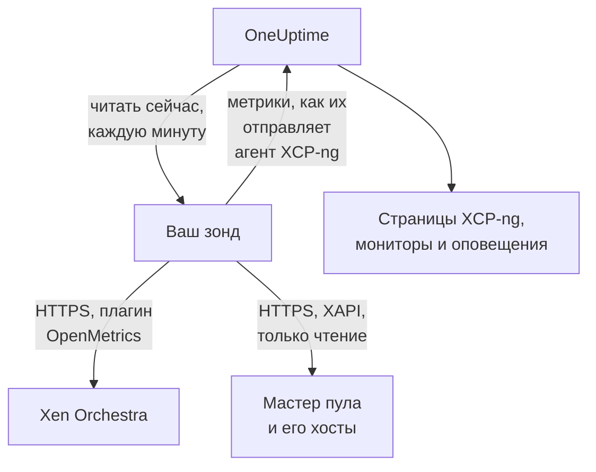

# XCP-ng без агента

Отслеживайте пулы XCP-ng, ничего не устанавливая: их читает зонд OneUptime — либо через Xen Orchestra, которая ими управляет, либо, для пула без Xen Orchestra, прямо из XAPI на мастере пула. Каждый пул получает те же страницы, [мониторы XCP-ng](/docs/monitor/xcp-ng-monitor) и шаблоны, что и пул, который отправляет [агент XCP-ng](/docs/telemetry/xcp-ng). Нет агента, который нужно устанавливать, обновлять или держать запущенным.

:::cards
- [Перед началом](#перед-началом): зонд, которому доступна Xen Orchestra или пул, и доступ только на чтение.
- [Подключение Xen Orchestra](#подключение-xen-orchestra): все пулы, которыми она управляет, через одно подключение.
- [Подключение пула без Xen Orchestra](#подключение-пула-без-xen-orchestra): один пул, читаемый с его мастера.
- [Аварийные сигналы, HA и резервные копии](#аварийные-сигналы-ha-и-резервные-копии): что зонд читает помимо метрик, и оповещения, которые он предлагает.
- [Устранение неполадок](#устранение-неполадок): что означает каждое сообщение и что его исправит.
:::

## Как это работает

Каждую минуту зонд читает каждое подключение и отправляет прочитанное в OneUptime:

- **Xen Orchestra**: зонд читает плагин OpenMetrics в Xen Orchestra с секретом плагина — точно так же, как агент XCP-ng, — поэтому каждый пул, которым управляет Xen Orchestra, приходит с теми же сериями. С API-токеном он также читает аварийные сигналы, HA и резервные копии каждого пула из REST API Xen Orchestra.
- **XAPI пула**: зонд входит на мастер пула и делает те же чтения, что и сам плагин Xen Orchestra: записи пула и метрики каждого работающего хоста, прочитанные с этого хоста. Из них он получает те же серии, что отдаёт плагин, поэтому пул читается точно так же, как через Xen Orchestra. Кроме того, он помещает сообщения XAPI пула — например, о сбое ВМ или о хосте, потерянном HA, — в ленту пула.

Каждый пул регистрируется по своему UUID при первом чтении, как и пулы агента, и появляется в разделе **XCP-ng → Все пулы**.

## Какой способ подключения выбрать

| | Xen Orchestra, с зонда | XAPI пула, с зонда | Агент XCP-ng |
|---|---|---|---|
| Что вы запускаете | Зонд, который у вас уже работает, или новый | Зонд, который у вас уже работает, или новый | Агент, на отдельной машине |
| Что он читает | Все пулы, которыми управляет Xen Orchestra | Один пул | Все пулы, которыми управляет Xen Orchestra |
| Что нужно | Секрет плагина OpenMetrics и, по желанию, API-токен только для чтения | Учётная запись пула: root или пользователь Active Directory с ролью read-only | Секрет плагина OpenMetrics |
| Где хранятся секреты | В зашифрованном виде в OneUptime, отправляются только зонду | В зашифрованном виде в OneUptime, отправляются только зонду | В файле агента `.env` |
| Аварийные сигналы, HA и резервные копии | Все три, а также недостающие исправления, с API-токеном | Аварийные сигналы и HA, без резервных копий | Нет |

Все три отправляют одинаковые серии. Пул в каждый момент читает только один из них, поэтому его история остаётся одной линией, кто бы его ни читал.

## Перед началом

- **Зонд, которому доступен адрес по TCP 443.** Обычно это [пользовательский зонд](/docs/probe/custom-probe) в той же сети. В OneUptime Cloud общие зонды никогда не получают секреты XCP-ng, поэтому добавьте собственный зонд. В самостоятельно размещённом экземпляре читать могут и собственные зонды экземпляра.
- **Для Xen Orchestra:** Xen Orchestra 6.9 или новее с включённым плагином OpenMetrics: следуйте разделу [Включение плагина OpenMetrics](/docs/telemetry/xcp-ng#включение-плагина-openmetrics) и скопируйте его секрет. По желанию — API-токен пользователя Xen Orchestra со встроенной ролью **Read only**: OneUptime проверяет, что он только читает, и предупреждает вас до истечения его срока.
- **Для пула без Xen Orchestra:** XCP-ng 8.2 или новее и адрес его мастера. Роли XAPI действуют только для пользователей Active Directory, поэтому его единственная локальная учётная запись, `root`, может изменить в пуле всё. Для доступа только на чтение присоедините пул к Active Directory и назначьте пользователю роль `read-only`.

> [!IMPORTANT]
> Подключайте пул через Xen Orchestra или через его XAPI, но не обоими способами: второе подключение, которое читает пул, оставляет его первому.

## Подключение Xen Orchestra

:::steps
### Откройте подключения
В OneUptime откройте **XCP-ng → Подключения** и нажмите **Подключить XCP-ng**.

### Выберите Xen Orchestra
В разделе **Что читать** выберите **Xen Orchestra**. Введите **Адрес Xen Orchestra**, по которому вы открываете её в браузере, например `https://xo.example.com`, и выберите зонд, которому она доступна.

### Введите секрет плагина
Вставьте **Секрет OpenMetrics**. Добавьте **API-токен** пользователя с правами только на чтение, если он у вас есть.

### Проверьте подключение и доверьтесь сертификату
Нажмите **Проверить подключение**. Xen Orchestra подписывает свой сертификат сама, поэтому проверка показывает его: сверьте его отпечаток, затем нажмите **Доверять этому сертификату**. В результате перечислены пулы, которые отдаёт Xen Orchestra, с их хостами, ВМ и репозиториями хранения.

### Назовите его и подключите
По умолчанию имя — это имя хоста Xen Orchestra, и каждый пул, который она читает, его показывает. Нажмите **Подключить XCP-ng**, и откроется страница подключения.
:::

## Подключение пула без Xen Orchestra

:::steps
### Начните со страницы подключений
В OneUptime откройте **XCP-ng → Подключения** и нажмите **Подключить XCP-ng**.

### Выберите пул
В разделе **Что читать** выберите **Пул без Xen Orchestra**. Введите **Адрес мастера пула**, например `https://10.0.0.10`, и выберите зонд, которому он доступен.

### Введите учётную запись
Введите **Имя пользователя** и **Пароль**: `root` или пользователя Active Directory с ролью read-only, записанного с доменом, например `EXAMPLE\oneuptime`.

### Проверьте подключение и доверьтесь сертификату мастера
Нажмите **Проверить подключение**. Каждый хост XCP-ng подписывает свой сертификат сам, поэтому проверка показывает сертификат мастера: сверьте его отпечаток, затем нажмите **Доверять этому сертификату**. В результате сказано, какую версию XCP-ng выполняет мастер и что может читать учётная запись, и есть предупреждение, если учётная запись может изменять пул.

### Назовите пул и подключите
Нажмите **Подключить XCP-ng**, и откроется страница подключения.
:::

Страница подключения показывает, как идёт его чтение. До первого чтения, которое начинается в течение минуты, на ней написано **Проверка**, затем **Сбор идёт**, а прочитанные пулы появляются в разделе **Пулы, которые оно читает**.

Если 20 минут ни один зонд не приходит за подключением, потому что он офлайн или слишком старый, страница показывает **Сбор не идёт** и сообщает об этом. Если ни одному зонду нельзя читать подключение, она сразу показывает **Сбор не идёт** и говорит, что изменить: не хватает секрета, имени пользователя или пароля, не задан зонд для чтения, его зонду нельзя его читать (общий зонд в OneUptime Cloud или зонд другого проекта) или его зонд отключён.

## Пулы, которые уже отправляет агент

Пул, который зарегистрировал агент XCP-ng, переходит к первому подключению, которое его читает: его история продолжается одной линией, а в ленте пула сказано, что агент можно остановить.

> [!WARNING]
> Остановите агент XCP-ng, как только зонд начнёт читать его пулы. Пока работают оба, каждая метрика приходит дважды.

Чтобы вернуться, откройте страницу пула **Настройки**. Её карточка **Сбор данных** предлагает **Использовать агент XCP-ng** для пула, который читает зонд, и **Собирать зондом** для пула, который отправляет агент. Пул, возвращённый агенту, остаётся за ним, что бы ни читало подключение.

## Сертификаты

Зонд никогда не пропускает проверку сертификатов. Каждое подключение выполняет полное рукопожатие TLS, а затем:

- если доверенного сертификата нет, сертификат должен быть выдан центром сертификации, которому доверяет машина зонда, для введённого адреса;
- если доверенный сертификат задан, адрес должен предъявить именно этот сертификат, распознаваемый по отпечатку SHA-256, какое бы имя в нём ни стояло. Собственный сертификат Xen Orchestra не называет никакого адреса, и ему доверяют именно так.

Чтобы проверить отпечаток, выполните `openssl s_client -connect xo.example.com:443 </dev/null | openssl x509 -noout -fingerprint -sha256` на машине зонда и сравните его с самим сертификатом: на мастере пула — `openssl x509 -noout -fingerprint -sha256 -in /etc/xensource/xapi-ssl.pem`.

Для пула вы доверяете сертификату мастера. Пул сам перечисляет сертификат, который отдаёт каждый его хост, и зонд читает каждый другой хост, привязывая его к этому сертификату. Когда мастером становится другой хост, зонд переходит только к хосту, за который пул поручился при последнем чтении. Когда сертификат меняется, чтение останавливается с сообщением **Сертификат изменился**, и показывается новый сертификат: ничего не отправляется, пока вы не доверитесь ему на странице подключения.

## Сохранённые секреты

Секрет, токен и пароль зашифрованы и доступны только для записи: никто не может прочитать их обратно, и API никогда их не возвращает. Они отправляются только зонду, который читает подключение, и он держит их в памяти.

Сохранённый секрет отправляется только по адресу, через зонд и на сертификат, для которых его ввели. Изменение адреса, зонда или доверенного сертификата в разделе **Изменить подключение** требует ввести его заново, поэтому никто, кто может изменить подключение, не может отправить его в другое место, а сохранённый API-токен, который не ввели заново, забывается. Доверие сертификату, который зонд нашёл по сохранённому адресу, их сохраняет. **Удалить API-токен** удаляет токен из OneUptime: отзовите его и в Xen Orchestra.

## API-токен

API-токен необязателен: метрики приходят через секрет плагина, а токен читает аварийные сигналы, HA и резервные копии каждого пула. С токеном каждое чтение проверяет его не чаще раза в час:

- **Он только читает.** Токен, пользователь которого — администратор или чья роль может что-либо изменять, не проходит проверку и показывается как проблема на странице подключения. OneUptime хранит только токены с правами только на чтение.
- **Он читает то, что нужно OneUptime.** На список, который пользователю нельзя читать, Xen Orchestra отвечает пустым списком, поэтому токен должен читать аварийные сигналы, сообщения и журналы резервного копирования. Встроенная роль **Read only** читает все три.
- **Когда истекает его срок.** Xen Orchestra забывает токен в тот момент, когда истекает его срок. За две недели до этого об этом сообщают страница подключения и лента каждого пула, который оно читает. Создайте новый токен для того же пользователя и введите его в разделе **Изменить подключение**.

## Аварийные сигналы, HA и резервные копии

Помимо метрик, зонд читает то, что XCP-ng и Xen Orchestra сообщают о каждом пуле. Что именно он читает, зависит от подключения:

| | Xen Orchestra, с API-токеном | XAPI пула |
|---|---|---|
| Сообщения и аварийные сигналы XAPI | Читаются | Читаются |
| HA и мастер пула | Читаются | Читаются, вместе с собственным планом HA |
| Задания резервного копирования и их запуски | Читаются | Не читаются: резервные копии — это функция Xen Orchestra |
| Недостающие исправления | Читаются каждые шесть часов, если их включает подписка Xen Orchestra | Не читаются: их определяет Xen Orchestra |

Подключение к Xen Orchestra без API-токена читает только метрики, как и агент XCP-ng.

- **На страницах пула.** Страница пула **Обзор** показывает состояние HA и последние запуски каждого задания резервного копирования, страница хоста — его недостающие исправления, а страница ВМ — её последнюю резервную копию. Сообщения с приоритетом от 1 до 4, смена мастера, включение или выключение HA, потеря HA способности выдержать отказ хоста и неудачные запуски резервного копирования попадают в раздел пула **Лента**, а каждое сообщение и каждый запуск резервного копирования — это запись на странице пула **Журналы**.
- **В виде оповещений.** В разделе пула **Рекомендации** для каждого из них есть шаблон в группах **Аварийные сигналы XCP-ng** и **Резервные копии**: VM Crashed, HA Host Failed, HA State File Lost, HA Protected VM Restart Failed, Storage Failed to Plug, Storage GC Out of Space, XAPI Alarm, Pool Master Changed и Backup Job Failed. [Монитор XCP-ng](/docs/monitor/xcp-ng-monitor) добавляет HA Cannot Tolerate a Host Failure и VM Not Backed Up.
- **С первого чтения.** Сообщения XAPI, появившиеся до первого чтения пула, не учитываются, а каждое сообщение учитывается один раз. Первое чтение журналов резервного копирования заглядывает на неделю и один день назад, поэтому последние запуски каждого задания видны сразу.

## Справочник

| Параметр | По умолчанию | Примечания |
|---|---|---|
| Читать каждые | 1 минута | От 1 до 60 минут. Каждая минута соответствует агенту XCP-ng; большую Xen Orchestra читайте реже, чтобы меньше её нагружать. |
| Одновременные чтения | 4 на зонд | Чтение, которое медленнее своего интервала, пропускается и никогда не накапливается. |
| Самое большое чтение | Около 48 МиБ | Для более крупных Xen Orchestra нужен агент XCP-ng. |
| Сообщения XAPI | 200 за чтение | С момента подключения пула, каждое доставляется один раз, начиная с самого старого. |
| Запуски резервного копирования | 20 за чтение | Первое чтение заглядывает на неделю и один день назад. Запуск, который Xen Orchestra через три дня всё ещё считает ожидающим, больше не ждут. |
| Недостающие исправления | Каждые 6 часов | Через Xen Orchestra, до 100 хостов за проверку. |
| Проверка подключения | 90 секунд на запуск | Проверка, которую ни один зонд не взял вовремя или которая длится дольше 150 секунд, считается неудачной. |

## Устранение неполадок

:::details Сертификат не является доверенным
Xen Orchestra и хосты XCP-ng по умолчанию подписывают собственные сертификаты. Сверьте показанный отпечаток с сертификатом, затем нажмите **Доверять этому сертификату**.
:::

:::details Сертификат изменился
Ничего не отправляется, пока вы не доверитесь новому сертификату. Если вы его обновили, сверьте новый отпечаток, доверьтесь ему и снова введите секреты в разделе **Изменить подключение**.
:::

:::details Xen Orchestra отклонила секрет
Снова скопируйте секрет в Xen Orchestra из **Settings → Plugins → openmetrics** и введите его в разделе **Изменить подключение**.
:::

:::details Плагин OpenMetrics не отвечает
Загрузите **openmetrics** в разделе **Settings → Plugins** в Xen Orchestra и включите **Auto-load**, чтобы он возвращался после перезапуска.
:::

:::details У этой Xen Orchestra нет плагина OpenMetrics
Плагину нужна Xen Orchestra 6.9 или новее, а в Xen Orchestra Appliance — лицензия Premium. Без неё подключите каждый пул через его XAPI.
:::

:::details Ни один пул не подключён
Xen Orchestra не сообщает ни об одном подключённом пуле. Добавьте или заново подключите пулы в Xen Orchestra, затем проверьте снова.
:::

:::details API-токен может изменять Xen Orchestra
OneUptime хранит только токены с правами только на чтение. Создайте токен для пользователя с копией встроенной роли **Read only** и без других ролей.
:::

:::details API-токен не может читать аварийные сигналы, сообщения или резервные копии
Дайте пользователю токена копию встроенной роли **Read only** в Xen Orchestra: она читает все три.
:::

:::details Срок действия API-токена истёк
Создайте в Xen Orchestra новый токен для пользователя с правами только на чтение и введите его в разделе **Изменить подключение**. Метрики тем временем продолжают поступать.
:::

:::details XAPI отклонил вход
Проверьте имя пользователя и пароль. Пользователь Active Directory пишется с доменом, например `EXAMPLE\oneuptime`.
:::

:::details Этот хост не является мастером пула
Участник пула отвечает адресом своего мастера, который указан в сообщении. Введите этот адрес и проверьте снова.
:::

:::details Учётная запись не может читать пул
Назначьте пользователю Active Directory роль read-only в пуле или используйте учётную запись, у которой она есть.
:::

:::details Зонд не получает ответа
Сеть зонда не может достучаться до адреса по TCP 443. Разрешите это в брандмауэре или выберите зонд в той же сети.
:::

:::details Зонд не взял это в работу
Зонд офлайн или работает на версии OneUptime старше чтения XCP-ng. Проверьте в таблице **Пользовательские зонды**, что он подключён, и обновите его.
:::

:::details Это подключение слишком велико, чтобы читать его с зонда
Его метрики больше, чем может быть одна выгрузка зонда. Используйте для него [агент XCP-ng](/docs/telemetry/xcp-ng).
:::

## Дальнейшие шаги

:::cards
- [Монитор XCP-ng](/docs/monitor/xcp-ng-monitor): оповещения по пулам, хостам, ВМ и репозиториям хранения.
- [Пользовательский зонд](/docs/probe/custom-probe): запустите зонд в сети пулов.
- [Агент XCP-ng](/docs/telemetry/xcp-ng): читайте Xen Orchestra агентом.
:::
