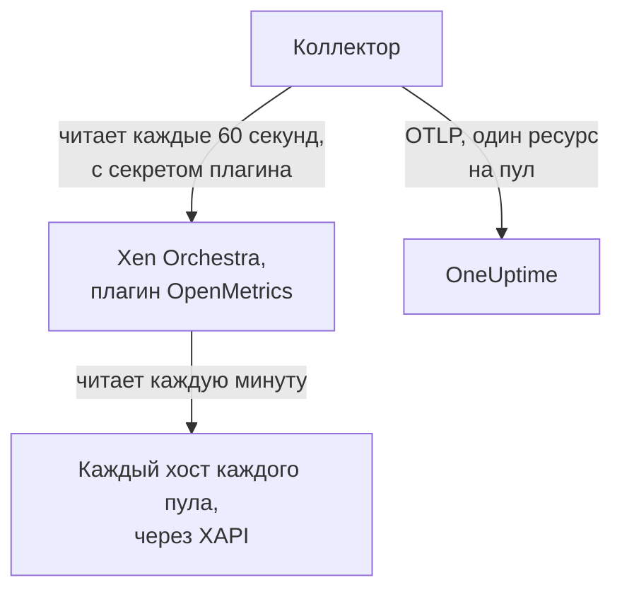

# Агент XCP-ng

Агент XCP-ng от OneUptime следит за пулами XCP-ng, которыми управляет Xen Orchestra: их хостами, ВМ, репозиториями хранения и виртуальными дисками. Это стандартный OpenTelemetry Collector, который читает собственный плагин OpenMetrics Xen Orchestra с секретом плагина и отправляет прочитанное в OneUptime, где каждый пул появляется со своим инвентарём. Ни один пароль пула или Xen Orchestra никогда не попадает к агенту. [Мониторы XCP-ng](/docs/monitor/xcp-ng-monitor) создают оповещения по поступающим данным. Чтобы читать те же пулы без установки чего-либо, зондом OneUptime, см. [XCP-ng без агента](/docs/telemetry/xcp-ng-agentless).

:::cards
- [Установка агента](#установка-агента): Включите плагин, затем используйте скрипт установки или Docker Compose.
- [Сертификат Xen Orchestra](#сертификат-xen-orchestra): Как агент доверяет Xen Orchestra, никогда не пропуская проверку.
- [Что собирает агент](#что-собирает-агент): Каждый ряд плагина и счётчики, которые на самом деле являются скоростями.
- [Устранение неполадок](#устранение-неполадок): Диагностический скрипт и типичные проблемы.
:::

## Что вы получаете

- **Каждый пул отдельно.** Каждый пул, которым управляет Xen Orchestra, становится пулом XCP-ng в OneUptime, распознаётся по своему UUID в XAPI и называется так, как его называет Xen Orchestra. Два пула за одной Xen Orchestra — это два пула, а переименовать пул в OneUptime безопасно: телеметрия привязывается к нему по UUID.
- **Его инвентарь.** Хосты, ВМ, репозитории хранения и виртуальные диски пула с их состоянием и метриками. Управляющие домены (dom0) сообщают о себе как ВМ, и страницы пула скрывают их, если вы не попросите их показать.
- **Один агент на Xen Orchestra.** Плагин отдаёт каждый пул, к которому подключена его Xen Orchestra, поэтому один агент читает их все, а пул, подключённый позже, появляется при следующем чтении.

## Как это работает

Агент — это один контейнер, который вы запускаете с Docker Compose на одной машине: стандартный OpenTelemetry Collector без собственного образа OneUptime. Каждые 60 секунд он запрашивает у Xen Orchestra `/openmetrics/metrics` с секретом плагина в качестве токена Bearer, по собственному адресу и сертификату Xen Orchestra. Плагин читает метрики каждого хоста через XAPI с разрешением 60 секунд. Коллектор оставляет ряды пулов, группирует их по пулам и отправляет в OneUptime по OTLP.



Каждый пул регистрируется сам с первыми данными под UUID, который агент ставит на его ряды как `xcp_ng.pool.id`, и именем, которое ему даёт Xen Orchestra, `xcp_ng.pool.name`. Пул без имени в Xen Orchestra называется «Pool» с началом его UUID, пока вы его не переименуете.

## Перед началом работы

- Xen Orchestra 6.9 или новее, подключённая к пулам, за которыми вы хотите следить, с плагином OpenMetrics. На Xen Orchestra Appliance (XOA) плагину нужна лицензия Premium; Xen Orchestra, собранная из исходников, включает его.
- Docker Engine 20.10 или новее с плагином Docker Compose v2, `curl` и `openssl` на машине, с которой Xen Orchestra доступна по HTTPS.
- Сертификат на Xen Orchestra, в котором указан адрес, к которому подключается агент. Самоподписанный сертификат, который Xen Orchestra создаёт для себя, не указывает ни одного, поэтому ни один современный TLS-клиент не может его проверить, а Xen Orchestra, собранная из исходников, отдаёт обычный HTTP, пока вы не дадите ей сертификат: см. [Сертификат Xen Orchestra](#сертификат-xen-orchestra).
- Ключ приёма. Создайте его в разделе **Настройки проекта → Телеметрия и APM → Ключи приёма** и скопируйте значение.
- Исходящий HTTPS с этой машины на ваш URL OneUptime.

### Поддерживаемые версии

| | Поддерживается | Почему |
| --- | --- | --- |
| Xen Orchestra | 6.9 или новее, с плагином OpenMetrics `xo-server-openmetrics` 1.9 | Плагин сохраняет свой секрет при перезапуске Xen Orchestra, содержит исправления утечек памяти при чтении и отдаёт каждый ряд, который читают страницы пула: состояние хостов и ВМ, репозитории хранения и виртуальные диски. Более старый плагин мог создать новый секрет при перезапуске и отрезать агента, пока кто-нибудь не скопирует его заново. |
| XCP-ng | 8.3 LTS | Поддерживается Vates до 30 ноября 2028 года. Срок жизни XCP-ng 8.2 закончился 16 сентября 2025 года. |
| XenServer | Ещё не проверено | Xen Orchestra сообщает о пуле XenServer, которым управляет, теми же рядами, так что это должно работать, но никто ещё не проверял его с OneUptime. |

### Где запускать агент

Агент общается с Xen Orchestra по HTTPS, поэтому он может работать на любой машине с Docker и маршрутом до неё: на самой машине Xen Orchestra, на хосте мониторинга или на небольшой служебной ВМ. Лучше выберите машину, ВМ которой не работает на отслеживаемых пулах: когда пул падает, ваш мониторинг не должен падать вместе с ним. Один агент читает одну Xen Orchestra; для нескольких см. [Чтение нескольких Xen Orchestra](#чтение-нескольких-xen-orchestra).

## Включение плагина OpenMetrics

Агент читает каждый пул через плагин OpenMetrics Xen Orchestra с секретом плагина.

:::steps
### Включите плагин

В Xen Orchestra откройте *Settings → Plugins*, найдите **openmetrics** и включите его. При первом запуске он создаёт секрет, и Xen Orchestra сохраняет его между перезапусками.

### Скопируйте его секрет

Откройте настройки плагина и скопируйте его **Prometheus secret**: вы передадите его агенту на следующем шаге. Там же можно ввести и сохранить собственный секрет. Держите его в тайне: у кого он есть, тот может читать метрики каждого пула.

### Проверьте, что он отвечает

Плагин отвечает по собственному адресу Xen Orchestra и с её собственным сертификатом, на `/openmetrics/metrics`, и только на запрос, который передаёт его секрет. Его проверке работоспособности секрет не нужен, поэтому только этот запрос может пропустить проверку сертификата с `-k`; агент никогда так не делает:

```bash
curl -k https://xo.example.com/openmetrics/health
```

Он отвечает `{"status":"ok"}`, пока плагин работает. Ответ `404` означает, что плагин не включён.
:::

## Установка агента

:::steps
### Установите и запустите агент

Каждый OneUptime раздаёт скрипт установки и файлы агента своего релиза: команды ниже скачивают их с `https://oneuptime.com`, поэтому на самостоятельно размещённом OneUptime замените этот адрес на свой URL. Скрипт установки сначала сохраняется в файл `install.sh`, чтобы вы могли прочитать его перед запуском.

:::tabs
@tab install.sh
Скачайте скрипт установки и запустите его на машине, где будет работать агент:

```bash
curl -fsSL https://oneuptime.com/install/xcp-ng-agent -o install.sh
bash install.sh
```

Скрипт спрашивает ваш URL OneUptime, ключ приёма, адрес Xen Orchestra в том виде, в каком вы открываете её в браузере (например, `https://xo.example.com` или `https://10.0.0.5:8443`), секрет плагина (не отображается при вводе) и то, как эта Xen Orchestra должна называться в OneUptime. Затем он читает сертификат Xen Orchestra: сертификат, которому эта машина уже доверяет, проверяется по её набору CA; любой другой показывается с отпечатком SHA-256, и вы отвечаете **y**, чтобы доверять этому сертификату и никакому другому, после того как сравните отпечаток с отпечатком на машине Xen Orchestra. Он никогда не отключает проверку. Наконец, он запрашивает у плагина метрики с секретом и называет пулы, о которых сообщает Xen Orchestra, прежде чем что-либо устанавливать. Он устанавливает агент в `/opt/oneuptime-xcp-ng-agent`, записывает с правами `0600` файл `.env` и `xo-ca.pem` — сертификаты, которым агент доверяет для Xen Orchestra, — и запускает агент с Docker Compose. При повторном запуске скрипт заново использует всё из этого `.env`, а не спрашивает снова; так [обновляется агент](#обновление-агента).
@tab Docker Compose
Скачайте `docker-compose.yml` и `otel-collector-config.yaml` с вашего OneUptime в новую папку:

```bash
mkdir oneuptime-xcp-ng-agent && cd oneuptime-xcp-ng-agent
curl -fsSLO https://oneuptime.com/install/xcp-ng-agent/docker-compose.yml
curl -fsSLO https://oneuptime.com/install/xcp-ng-agent/otel-collector-config.yaml
```

Создайте рядом с ними файл `.env`. В нём хранится секрет плагина, поэтому закройте его от других с помощью `chmod 600 .env`:

```bash title=".env"
ONEUPTIME_URL=YOUR_ONEUPTIME_URL
ONEUPTIME_TELEMETRY_INGESTION_KEY=YOUR_TELEMETRY_INGESTION_TOKEN
XO_SCHEME=https
XO_ADDRESS=xo.example.com
XO_OPENMETRICS_SECRET='your-plugin-secret'
XO_NAME='Xen Orchestra'
XO_TLS_SERVER_NAME=
```

`XO_ADDRESS` — это `host` или `host:port` Xen Orchestra без `https://`. Заключите секрет плагина в одинарные кавычки и запишите каждый `$` в нём как `$$`: коллектор читает значение ещё раз и принял бы `$` за начало переменной. Секрет с `'` внутри нельзя заключить в одинарные кавычки: пусть его запишет скрипт установки, или выберите в Xen Orchestra другой секрет.

Затем сохраните сертификат Xen Orchestra как `xo-ca.pem` рядом с `docker-compose.yml`: агент проверяет Xen Orchestra по этому файлу и ничему другому. Чтобы доверять собственному сертификату Xen Orchestra, прочитайте его и перед использованием сравните его отпечаток с отпечатком на машине Xen Orchestra:

```bash
openssl s_client -connect xo.example.com:443 -servername xo.example.com </dev/null 2>/dev/null \
  | openssl x509 -out xo-ca.pem
openssl x509 -in xo-ca.pem -noout -fingerprint -sha256
```

Если сертификат выпустил ваш собственный CA, скопируйте вместо этого сертификат этого CA в `xo-ca.pem`; если его выпустил публичный CA, скопируйте набор CA этой машины (`cp /etc/ssl/certs/ca-certificates.crt xo-ca.pem`). Запустите агент:

```bash
docker compose up -d
```
:::

### Убедитесь, что агент работает

```bash
docker compose ps
docker logs -f oneuptime-xcp-ng-agent
```

`docker compose ps` показывает коллектор, `oneuptime-xcp-ng-agent`. После запуска в его журналах должна появиться такая строка:

```text
Everything is ready. Begin running and processing data.
```

### Найдите пулы в OneUptime

Откройте **Продукты → Инфраструктура → XCP-ng → Все пулы**. Каждый пул, о котором сообщает Xen Orchestra, появляется примерно через минуту после первого чтения под именем, которое ему даёт Xen Orchestra, со своими хостами, ВМ и хранилищем. Его страница **Топология** рисует их одной картой: см. [Топология](/docs/telemetry/topology#открыть-карту-отдельного-ресурса).
:::

## Сертификат Xen Orchestra

Агент проверяет сертификат Xen Orchestra при каждом чтении, по `xo-ca.pem` и ничему другому, и никогда не пропускает проверку: секрет плагина передаётся в каждом запросе. `xo-ca.pem` содержит одно из трёх:

- **Собственный сертификат Xen Orchestra**, закреплённый по отпечатку SHA-256 (`XO_TLS_FINGERPRINT`): агент доверяет этому сертификату и никакому другому.
- **CA, который его выпустил** (`XO_CA_FILE`), для сертификата вашего собственного CA.
- **Набор CA этой машины**, для сертификата, которому эта машина уже доверяет, например выпущенного публичным CA.

В любом случае сертификат должен указывать адрес, к которому подключается агент. Агент проверяет имена, на которые выпущен сертификат, его альтернативные имена субъекта (subject alternative names), как это делает любой современный TLS-клиент, и никогда не сам субъект. Самоподписанный сертификат, который Xen Orchestra создаёт для себя, не указывает ни одного, поэтому агент не может ему доверять, закреплён он или нет, и завершается ошибкой `x509: certificate is not valid for any names`; скрипт установки останавливается на таком сертификате и объясняет почему.

### Дайте Xen Orchestra сертификат с её адресом

Используйте сертификат вашего собственного CA или публичного, либо создайте на машине Xen Orchestra самоподписанный сертификат с адресом Xen Orchestra, указав её имя и адрес в альтернативных именах субъекта:

```bash
sudo mkdir -p /etc/ssl/xo
sudo openssl req -x509 -newkey rsa:2048 -nodes -days 825 \
  -subj "/CN=xo.example.com" \
  -addext "subjectAltName=DNS:xo.example.com,IP:10.0.0.5" \
  -keyout /etc/ssl/xo/key.pem -out /etc/ssl/xo/cert.pem
```

Укажите HTTPS-слушателю xo-server на эти два файла, которые должен уметь читать пользователь, от имени которого работает xo-server (по умолчанию root), в отдельном файле конфигурации: `/etc/xo-server/config.httpscert.toml` на XOA или рядом с `config.toml` xo-server для Xen Orchestra, собранной из исходников. Слушатели Xen Orchestra пронумерованы, и второй, `http.listen.1`, — её HTTPS-слушатель:

```toml
[http.listen.1]
port = 443
cert = '/etc/ssl/xo/cert.pem'
key = '/etc/ssl/xo/key.pem'
```

Затем перезапустите xo-server командой `systemctl restart xo-server` и установите агент или снова запустите скрипт установки: он прочитает новый сертификат и покажет его отпечаток для проверки. Или пусть Xen Orchestra сама запросит сертификат Let's Encrypt, как это умеет XOA (см. документацию Xen Orchestra): ему доверяют публично, поэтому агенту не нужно никаких настроек. Если сертификат называет Xen Orchestra другим именем, чем адрес в `XO_ADDRESS`, задайте этому имени `XO_TLS_SERVER_NAME`; скрипт установки заполняет его из сертификата, когда может.

Когда закреплённый сертификат обновляется, агент перестаёт читать Xen Orchestra, пока не начнёт доверять новому. Снова запустите скрипт установки: он покажет новый отпечаток и остановится, ничего не меняя. Проверьте этот отпечаток на машине Xen Orchestra, затем запустите скрипт ещё раз с ним: `XO_TLS_FINGERPRINT=<new fingerprint> bash install.sh`. При установке через Docker Compose заново запишите `xo-ca.pem` и выполните `docker compose up -d --force-recreate`.

## Переменные окружения

Скрипт установки записывает их в `/opt/oneuptime-xcp-ng-agent/.env`; установка через Docker Compose читает их из `.env` рядом с `docker-compose.yml`. После изменения переменной выполните `docker compose up -d` в этой папке.

| Переменная | Обязательна | Описание |
| --- | --- | --- |
| `ONEUPTIME_URL` | Да | Ваш URL OneUptime, например `https://oneuptime.com`, или ваш собственный экземпляр. Если экземпляр работает только по HTTP, используйте `http://` и его порт. |
| `ONEUPTIME_TELEMETRY_INGESTION_KEY` | Да | Ключ приёма из раздела **Настройки проекта → Телеметрия и APM → Ключи приёма**. |
| `XO_URL` | Скрипт установки | Адрес Xen Orchestra в том виде, в каком вы открываете её в браузере, например `https://xo.example.com` или `https://10.0.0.5:8443`. Скрипт установки выводит из него `XO_SCHEME` и `XO_ADDRESS`. |
| `XO_SCHEME` | Нет | `https`, по умолчанию. `http` только в лаборатории: тогда секрет передаётся по сети незашифрованным. |
| `XO_ADDRESS` | Да | `host` или `host:port` Xen Orchestra без схемы. |
| `XO_OPENMETRICS_SECRET` | Да | Секрет плагина OpenMetrics, передаваемый как токен Bearer. Каждый `$` в нём записывается как `$$`. |
| `XO_NAME` | Нет | Как эта Xen Orchestra называется в OneUptime: задаётся как `xen_orchestra.name` на каждом пуле, который она читает, и показывается в **Настройки** каждого пула. По умолчанию — адрес Xen Orchestra. |
| `XO_TLS_FINGERPRINT` | Скрипт установки | Отпечаток SHA-256 собственного сертификата Xen Orchestra в том виде, в каком его выводит `openssl x509 -fingerprint -sha256`, двоеточия необязательны, когда агент доверяет этому сертификату и никакому другому. Скрипт установки отклоняет сертификат, который ему не соответствует. |
| `XO_CA_FILE` | Скрипт установки | Набор CA, выпустивший сертификат Xen Orchestra; скрипт установки проверяет сертификат по нему и копирует его в `xo-ca.pem`. |
| `XO_TLS_SERVER_NAME` | Нет | Имя, по которому проверяется сертификат Xen Orchestra, когда `XO_ADDRESS` — адрес, не указанный в сертификате. Пусто: хост из `XO_ADDRESS`. |
| `ONEUPTIME_AI_XO_READ_TOKEN` | Нет | Токен пользователя Xen Orchestra с копией встроенной роли **Read only** и ничем больше: [ИИ-агент](#ии-агент) работает, когда он задан, и читает с ним. |
| `ONEUPTIME_AI_XO_WRITE_TOKEN` | Нет | Только для исправлений: токен другого пользователя, чья роль их разрешает. Без него ИИ-агент ничего не меняет. |
| `XCP_NG_POOL_ID` | Нет | UUID XAPI пула, который обслуживает ИИ-агент. Пусто: единственный пул, который видит его токен чтения. |
| `ONEUPTIME_AI_AGENT_RESOURCE_NAME` | Нет | Заменяет `XCP_NG_POOL_ID` как пул, под которым регистрируется ИИ-агент. |
| `ONEUPTIME_AI_INVESTIGATION` | Нет | `true` или `false`: может ли OneUptime AI выполнять команды ИИ-агента только для чтения во время расследования. Пусто: включено. |
| `ONEUPTIME_AI_FIXES` | Нет | `off`, `ask-for-approval`, `automatic` или `bypass-approval`: как OneUptime AI может применять исправление. Пусто: `ask-for-approval`, когда запись разрешена, иначе `off`. |
| `ONEUPTIME_AI_ALLOW_WRITES` | Нет | `true` позволяет ИИ-агенту применять исправления с токеном для изменений. Любое другое значение оставляет его только для чтения. |
| `ONEUPTIME_AI_WRITE_TARGETS` | Нет | `vm/<uuid>`, `host/<uuid>`, `pbd/<uuid>` или `schedule/<uuid>`, которые может затрагивать исправление, через запятую, `*` — любая последовательность символов. Пусто: все. |
| `ONEUPTIME_AI_PROTECTED_TARGETS` | Нет | То же для того, что OneUptime AI никогда не должен менять, кто бы это ни одобрил: ВМ, в которой работает ИИ-агент, и собственная ВМ Xen Orchestra. |
| `LOG_LEVEL` | Нет | Уровень журналирования ИИ-агента: `debug`, `info` (по умолчанию), `warn` или `error`. |
| `COMPOSE_PROFILES` | Нет | `xcp-ng-ai-agent` запускает ИИ-агента. Скрипт установки записывает это значение, когда задан токен чтения, и удаляет, когда не задан. |

## Что собирает агент

Каждую минуту агент читает плагин, который через XAPI читает циклические базы данных (round-robin) каждого хоста с разрешением 60 секунд. Он оставляет ряды `xcp_*` и переносит пул каждого ряда на ресурс, с которым их отправляет, как `xcp_ng.pool.id` (UUID пула, который никогда не меняется) и `xcp_ng.pool.name`:

| Категория | Ряды |
| --- | --- |
| Пул | `xcp_pool_connected`, присутствует, пока Xen Orchestra подключена к пулу |
| Хосты | `xcp_host_status` (его состояние питания и включён ли он), `xcp_host_uptime_seconds`, `xcp_host_cpu_average`, `xcp_host_cpu_core_usage`, `xcp_host_load`, `xcp_host_load_average`, `xcp_host_memory_*`, `xcp_host_running_vcpus`, `xcp_host_network_*` по физическому интерфейсу, `xcp_host_disk_*` по репозиторию хранения, `xcp_host_power_consumption_watts` |
| ВМ | `xcp_vm_status`, `xcp_vm_uptime_seconds`, `xcp_vm_cpu_usage`, `xcp_vm_cpu_core_usage`, `xcp_vm_runstate_*` (конкуренция за CPU), `xcp_vm_memory_*`, `xcp_vm_network_*` по интерфейсу, `xcp_vm_disk_*` по диску, `xcp_vm_power_consumption_watts` |
| Хранилище | `xcp_sr_physical_size_bytes`, `xcp_sr_physical_usage_bytes`, `xcp_sr_virtual_size_bytes`, `xcp_vdi_virtual_size_bytes`, `xcp_vdi_physical_usage_bytes` |
| XOSTOR | `xcp_xostor_*`, на пулах с XOSTOR |

Управляющие домены сообщают о себе как ВМ с `is_control_domain="true"`. Каждый ряд Xen Orchestra сохраняет своё имя и свои метки, например `uuid`, `host_name`, `vm_name`, `sr_name` и `tags`; [монитор XCP-ng](/docs/monitor/xcp-ng-monitor#собираемые-метрики) перечисляет их все.

### Счётчики, которые являются скоростями

Xen Orchestra объявляет восемь рядов пропускной способности счётчиками и называет их `_total`, хотя каждый содержит скорость в секунду из XAPI: `xcp_host_network_receive_bytes_total`, `xcp_host_network_transmit_bytes_total`, `xcp_vm_network_receive_bytes_total`, `xcp_vm_network_transmit_bytes_total`, `xcp_vm_network_receive_errors_total`, `xcp_vm_network_transmit_errors_total`, `xcp_vm_disk_read_bytes_total` и `xcp_vm_disk_write_bytes_total`. Если читать их как счётчики, каждый график сетевой и дисковой пропускной способности был бы неверным: падающая скорость читается как сброс счётчика. Процессор агента `transform/xcp-ng-rates` превращает их в gauge с неизменными именами и значениями, поэтому OneUptime хранит их как скорости, которыми они и являются, в байтах или ошибках в секунду. OneUptime также преобразует любой ряд, который всё ещё приходит как счётчик, от коллектора, который вы настроили сами.

### Что добавляет OneUptime

OneUptime выводит для каждого пула четыре ряда 0/1 по мере поступления его данных, и их читают шаблоны оповещений:

| Ряд | 1, пока |
| --- | --- |
| `xcp_ng.host.running` | Xen Orchestra сообщает, что хост в состоянии Running; 0, пока он Halted или его состояние Unknown |
| `xcp_ng.host.enabled` | хост включён; 0 в режиме обслуживания или во время эвакуации, когда XAPI не запускает на нём ни одной ВМ |
| `xcp_ng.vm.running` | ВМ в состоянии Running; 0, пока она Halted, Paused или Suspended |
| `xcp_ng.vm.stopped_after_running` | ВМ, работавшая за последние 24 часа, находится в состоянии Halted или Paused |

Он также ставит на каждую точку `xcp_ng.scope` (`pool`, `host`, `vm`, `sr`, `vdi` или `xostor`) и `xcp_ng.id` (UUID этого объекта), по которым фильтруют мониторы и панели: см. [Идентификация ресурсов](/docs/monitor/xcp-ng-monitor#идентификация-ресурсов).

### Что агент не сохраняет

- Собственные ряды процесса Xen Orchestra (`xo_*`), которые не относятся ни к одному пулу, и собственные ряды чтения коллектора.
- Мощность хоста, которую Xen Orchestra читает через IPMI: плагин отправляет это значение без его пула, поэтому оно тоже не относится ни к одному пулу. Оценочная доля каждой ВМ, `xcp_vm_power_consumption_watts`, сохраняется.

## Что показывают страницы пула

Откройте пул через **Продукты → Инфраструктура → XCP-ng → Все пулы**. Его меню содержит:

| Страница | Что она показывает |
| --- | --- |
| **Обзор** | Состояние пула и то, что требует внимания, его хосты, ВМ и хранилище, самые загруженные ВМ и хосты и Xen Orchestra, из которой он читается, с версией агента. |
| **Хосты**, **ВМ**, **Хранилище** | Каждый хост, ВМ и репозиторий хранения, у каждого своя страница и свои графики. **ВМ** скрывает управляющие домены, если вы не попросите их показать, а страница репозитория хранения показывает его виртуальные диски. |
| **Топология** | Пул, его хосты, ВМ на каждом хосте и репозитории хранения, которые они используют, одной картой. |
| **Использование ресурсов** | Графики хостов, ВМ, хранилища, дисков и сети пула во времени, по одной линии на хост, ВМ или репозиторий хранения. |
| **Рекомендации** | [Шаблоны оповещений](/docs/monitor/xcp-ng-monitor#готовые-шаблоны-оповещений), которые можно включить, каждый — один монитор. |
| **Метрики**, **Журналы** | Каждый ряд пула в обозревателях, ограниченный им. Агент отправляет только метрики, поэтому **Журналы** показывают только журналы, которые вы отправляете с `xcp_ng.pool.id` пула. |
| **Инциденты**, **Оповещения**, **Плановое обслуживание** | Те, в которых упоминается пул. |
| **Лента** | Что происходило с пулом в OneUptime: когда его добавили, изменили, архивировали или восстановили, кто его владельцы, и правила владельцев и меток, которые к нему применялись. |
| **Владельцы** | Кого о нём уведомляют, вручную или по правилам владельцев. |
| **Настройки** | Его имя, Xen Orchestra, из которой он читается, его имя там и версия агента, а также срок хранения его телеметрии. |
| **Документация** | Эта установка с уже подставленными вашим URL и ключом. |

**Обзор** пула называет его состояние, **Исправно**, **Деградация** или **Неисправно**, по тому, что требует внимания, и показывает это в разделе **Требует внимания**, самое срочное первым:

- **Критично:** хост в состоянии Halted или в состоянии, которое Xen Orchestra не может определить (Unknown); репозиторий хранения, заполненный более чем на 95 %, куда ВМ уже не могут писать.
- **Стоит взглянуть:** отключённый хост, в режиме обслуживания или во время эвакуации; ВМ в состоянии Halted или Paused, работавшая за последние 24 часа; репозиторий хранения, заполненный более чем на 90 %, где срабатывает оповещение Storage Repository Near Full, или выделенный сверх своего размера через thin provisioning.

Приостановленная ВМ (Suspended) приостановлена намеренно и никогда не учитывается, как и ВМ, которую никто не видел работающей сутки, или управляющий домен. Библиотеки ISO и съёмные носители не содержат дисков ВМ, поэтому цифры хранилища пула их не учитывают.

Когда Xen Orchestra перестаёт сообщать о пуле на 15 минут, пул становится **Отключено**, а его страницы сохраняют то, что он сообщил последним. Хост, ВМ, репозиторий хранения или виртуальный диск, которых больше нет в отчётах Xen Orchestra, покидают инвентарь через 15 минут; остановка ВМ никогда её не удаляет.

## Пометка пулов метками проекта

Атрибут ресурса, начинающийся с `oneuptime.label.`, становится меткой проекта на каждом пуле, который читает агент: `oneuptime.label.<dimension>=<value>` — это метка `<dimension>:<value>`. Добавьте атрибуты в процессор `resource` в `otel-collector-config.yaml` рядом с `oneuptime.agent.version`:

```yaml
processors:
  resource:
    attributes:
      # ...existing attributes...
      - key: oneuptime.label.team
        value: platform
        action: upsert
      - key: oneuptime.label.env
        value: production
        action: upsert
```

Коллектор читает свою конфигурацию только при запуске: выполните `docker compose restart oneuptime-xcp-ng-agent`. После этого пулы показывают метки `team:platform` и `env:production`. Метки сравниваются без учёта регистра, поэтому существующая метка `Production` используется повторно, а не дублируется, и агент никогда не удаляет метку, которую кто-то добавил в OneUptime. Повторный запуск скрипта установки заменяет отредактированный `otel-collector-config.yaml`, а ваш сохраняется рядом как `otel-collector-config.yaml.bak.<timestamp>`.

## Чтение нескольких Xen Orchestra

Один агент читает одну Xen Orchestra и каждый пул, которым она управляет. Чтобы читать вторую Xen Orchestra с той же машины, установите второй агент в отдельную папку с отдельным `.env`, например `INSTALL_DIR=/opt/oneuptime-xcp-ng-agent-lab bash install.sh`, и дайте ему собственное `container_name` в его `docker-compose.yml` (например, `oneuptime-xcp-ng-agent-lab`): два контейнера не могут иметь одно имя. Дайте каждому свой `XO_NAME`, чтобы **Настройки** каждого пула говорили, какая Xen Orchestra его читает, и передайте папку диагностическому скрипту через `-d`.

Никогда не позволяйте двум агентам читать один и тот же пул через две Xen Orchestra, которые обе им управляют: в OneUptime это один пул по его UUID, и о нём сообщалось бы дважды.

## ИИ-агент

`docker-compose.yml` агента также содержит **ИИ-агент XCP-ng**, `oneuptime-xcp-ng-ai-agent` (образ `oneuptime/resource-ai-agent:release`), в профиле `xcp-ng-ai-agent`. Пока OneUptime AI расследует инцидент или оповещение в пуле, он выполняет через него REST-команды `xo-cli` только для чтения, например `xo-cli rest get vms fields=name_label,power_state filter=power_state:Halted` или `xo-cli rest get pbds fields=attached,host,SR filter=!attached?`, и, только если вы это разрешите, применяет исправления, например запуск ВМ или подключение PBD репозитория хранения. Бинарного файла `xo-cli` в нём нет: каждая команда превращается ровно в один вызов REST API Xen Orchestra по тому адресу и с тем `xo-ca.pem`, которые использует коллектор. Он появляется на странице пула **ИИ-агент** в OneUptime.

- **Ему нужен собственный токен только для чтения.** Секрет OpenMetrics читает только метрики, поэтому ИИ-агент читает REST API Xen Orchestra (Xen Orchestra 6.9 или новее) с `ONEUPTIME_AI_XO_READ_TOKEN` — токеном пользователя Xen Orchestra с копией встроенной роли **Read only** и ничем больше. Запустите `install.sh` с заданным токеном или введите его, когда первая установка его запросит: скрипт спрашивает Xen Orchestra, знает ли она этот токен, хранит его в `.env` с режимом 600 и запускает ИИ-агента. Прежде чем агент что-либо запустит, и каждые 5 минут он проверяет, что токен может только читать: токен администратора или токен, чьи роли разрешают изменение, ничего не запускает.
- **Один пул на ИИ-агент.** `XCP_NG_POOL_ID` — это пул, который он обслуживает, его UUID XAPI, как его показывают **Настройки** пула. Если оставить его пустым, агент обслуживает единственный пул, который видит его токен. Для Xen Orchestra с несколькими пулами README агента показывает, как запустить ещё по одному на пул. Пулу, который читает зонд, агент XCP-ng не нужен: README также показывает, как запустить для него один только ИИ-агент из того же `docker-compose.yml`.
- **ИИ-расследования включены по умолчанию.** Как только агент подключается, OneUptime AI расследует с его помощью инциденты и оповещения в пуле, а страница **Обзор** пула показывает статус агента. Чтобы отключить это, задайте `ONEUPTIME_AI_INVESTIGATION=false` там, где работает агент (как это сделать, показывает **Изменить** в разделе **Что может делать ИИ** на странице ИИ-агента), или не указывайте токен.
- **Исправлениям нужен второй токен.** Агент работает только для чтения, если вы не задали `ONEUPTIME_AI_ALLOW_WRITES=true` и `ONEUPTIME_AI_XO_WRITE_TOKEN` — токен другого пользователя, чья роль разрешает исправления (копия роли **VMs power state manager** с добавленными привилегиями, которые перечисляет README агента). Он используется для самого изменения и больше ни для чего. `ONEUPTIME_AI_WRITE_TARGETS` (`vm/<uuid>`, `host/<uuid>`, `pbd/<uuid>`, `schedule/<uuid>`) ограничивает, что может затрагивать исправление; укажите UUID ВМ, в которой работает агент, и собственной ВМ Xen Orchestra в `ONEUPTIME_AI_PROTECTED_TARGETS`. `ONEUPTIME_AI_FIXES` в том же `.env` задаёт, как выполняются исправления, — `ask-for-approval` (каждое одобряет человек), `automatic` или `bypass-approval`, — а страница ИИ-агента показывает это только для чтения ([Что может делать ИИ, задаётся агентом](/docs/ai/infrastructure-ai-agents#что-может-делать-ии-задаёт-агент)).
- **Он проверяет сертификат Xen Orchestra так же, как коллектор**, по его subjectAltName и только по `xo-ca.pem`, поэтому сертификат, который Xen Orchestra выпускает для себя сама, здесь тоже отклоняется ([Сертификат Xen Orchestra](#сертификат-xen-orchestra)). Он никогда не читает Xen Orchestra по `http://`: его токены передавались бы по сети незашифрованными.
- Он работает от UID 1000 без capabilities и с корневой файловой системой только для чтения, никогда не читает пользователей, роли, серверы, плагины и remotes Xen Orchestra, никогда не фильтрует по свойству, в котором хранятся секреты, и никогда ничего не редактирует, не удаляет, не откатывает и не клонирует.

Что он может запускать, как работают исправления и как устранять неполадки: [Infrastructure AI Agents](/docs/ai/infrastructure-ai-agents#пулы-xcp-ng). В README агента есть роли и привилегии для обоих токенов.

## Запуск как службы systemd

Чтобы агент запускался вместе с машиной и перезапускался при сбое, установите его юнит systemd. Он предполагает, что агент находится в `/opt/oneuptime-xcp-ng-agent`, куда его помещает скрипт установки:

```bash
sudo curl -fsSL https://oneuptime.com/install/xcp-ng-agent/systemd/oneuptime-xcp-ng-agent.service -o /etc/systemd/system/oneuptime-xcp-ng-agent.service
sudo systemctl daemon-reload
sudo systemctl enable --now oneuptime-xcp-ng-agent
```

## Обновление агента

Агент сообщает версию коллектора, закреплённую в его файлах, в поле **Версия агента** на страницах **Обзор** и **Настройки** каждого пула. Если она старше версии, которую закрепляет этот выпуск OneUptime, рядом с ней появляется предупреждающий знак. Выберите его, чтобы увидеть эти команды.

Образ коллектора закреплён в `docker-compose.yml`, а его конфигурация — это файл рядом, поэтому одно лишь скачивание образа не продвигает агента вперёд. Снова запустите `install.sh`: он использует все значения из вашего существующего `.env` (ничего не спрашивается повторно), так же проверяет сертификат Xen Orchestra, обновляет `docker-compose.yml` и `otel-collector-config.yaml` (отредактированный вами файл сохраняется как `<file>.bak.<timestamp>`), скачивает образ и пересоздаёт агента, чтобы коллектор прочитал свою новую конфигурацию. Агенту, установленному не в `/opt/oneuptime-xcp-ng-agent`, нужна его папка: `INSTALL_DIR=<folder> bash install.sh`.

```bash
curl -fsSL https://oneuptime.com/install/xcp-ng-agent -o install.sh
bash install.sh
```

Устанавливали через Docker Compose? В папке агента снова скачайте оба файла (и повторите изменения, которые в них вносили), затем скачайте образ и пересоздайте агента. Ваши `.env` и `xo-ca.pem` остаются:

```bash
curl -fsSLO https://oneuptime.com/install/xcp-ng-agent/docker-compose.yml
curl -fsSLO https://oneuptime.com/install/xcp-ng-agent/otel-collector-config.yaml
docker compose pull
docker compose up -d --force-recreate
```

## Удаление агента

```bash
cd /opt/oneuptime-xcp-ng-agent
docker compose down
```

Затем выключите плагин OpenMetrics в Xen Orchestra, если его больше ничто не читает.

## Устранение неполадок

:::details Сначала запустите диагностический скрипт
У агента есть скрипт [`troubleshoot.sh`](https://oneuptime.com/install/xcp-ng-agent/troubleshoot.sh), который проверяет всю цепочку в том порядке, в каком идут данные: контейнер; адрес Xen Orchestra из собственной сети агента; проверку работоспособности плагина; сертификат Xen Orchestra по `xo-ca.pem` и то, остаётся ли закреплённый сертификат тем, который она показывает; секрет плагина; пулы, о которых сообщает Xen Orchestra; формат ключа приёма; собственные метрики коллектора; и принимает ли OneUptime ключ приёма. Последняя проверка важнее всего. OneUptime отклоняет неверный ключ с `401` (`422` для отключённого ключа или ключа браузера), а коллектор считает обе ошибки постоянными: он отбрасывает пакет и записывает одну ошибку `Exporting failed`, которую легко пропустить, пока контейнер остаётся исправным. Скрипт вызывает `GET <url>/otlp/v1/validate` из сети агента и сразу получает `200` (действителен) или `401` (недействителен), а на старых серверах переходит к `POST /fluentd/v1/logs`. Он никогда не выводит секрет или ключ.

```bash
curl -fsSL https://oneuptime.com/install/xcp-ng-agent/troubleshoot.sh -o troubleshoot.sh
bash troubleshoot.sh    # add -d <dir> if you installed outside /opt/oneuptime-xcp-ng-agent
```

В конце он выводит вердикт с наиболее вероятной причиной.
:::

:::details Xen Orchestra отклоняет секрет (401)
Коллектор записывает в журнал `server returned HTTP status 401 Unauthorized`. Снова скопируйте секрет из *Settings → Plugins → openmetrics*, задайте его в `XO_OPENMETRICS_SECRET` в `.env`, в одинарных кавычках и с каждым `$`, записанным как `$$`, и выполните `docker compose up -d` в папке агента. До версии 6.8 Xen Orchestra могла создать новый секрет при перезапуске: обновите её.
:::

:::details Плагин не отвечает (404, 500, 502 или 503)
Xen Orchestra отвечает, но её плагин OpenMetrics — нет. Включите плагин в *Settings → Plugins → openmetrics* и убедитесь, что версия Xen Orchestra 6.9 или новее. XOA для плагина нужна лицензия Premium. `/openmetrics/health` отвечает `{"status":"ok"}` без секрета, пока плагин работает.
:::

:::details Ошибки сертификата
- `x509: certificate is not valid for any names`: сертификат не указывает ни одного адреса, как собственный самоподписанный сертификат Xen Orchestra. [Дайте Xen Orchestra сертификат с её адресом](#дайте-xen-orchestra-сертификат-с-её-адресом).
- `x509: certificate is valid for <names>, not <address>`: подключайтесь по одному из этих имён или задайте одно из них в `XO_TLS_SERVER_NAME`.
- `x509: cannot validate certificate for <IP> because it doesn't contain any IP SANs`: `XO_ADDRESS` — IP-адрес, который сертификат не указывает. Задайте в `XO_TLS_SERVER_NAME` имя, которое он указывает, или снова запустите скрипт установки, который это сделает.
- `x509: certificate signed by unknown authority`: `xo-ca.pem` не содержит ни этого сертификата, ни CA, который его выпустил. Сертификат обновлён, или в файле другой: проверьте новый отпечаток на машине Xen Orchestra и запустите с ним скрипт установки, `XO_TLS_FINGERPRINT=<new fingerprint> bash install.sh`, или заново запишите файл.
- `unable to read CA cert`: `xo-ca.pem` отсутствует или не читается. Снова запустите скрипт установки.
:::

:::details Чтение превышает время ожидания (context deadline exceeded)
Xen Orchestra потратила на сбор метрик больше 50 секунд — предела агента, — поэтому это чтение ничего не отправляет: чаще всего ей не отвечает хост одного из её пулов. Проверьте хосты пулов в Xen Orchestra; агент прочитает снова через минуту.
:::

:::details Пул в состоянии «Отключено»
OneUptime помечает пул как отключённый, когда для него ничего не прочитано за 15 минут; OneUptime проверяет каждые 5 минут, а время, когда он сам не получал данные, не учитывается.

1. Если отключены все пулы этой Xen Orchestra, проверьте агент: `docker compose ps` и `docker logs oneuptime-xcp-ng-agent` в папке агента.
2. Если только один, Xen Orchestra больше о нём не сообщает: в Xen Orchestra в *Settings → Servers* сервер пула должен быть подключён. Хосты, ВМ и хранилище пула остаются такими, какими Xen Orchestra сообщила о них в последний раз.
:::

:::details Пул отсутствует
Xen Orchestra сообщает только о пулах, к которым подключена, а агент читает только эту Xen Orchestra. Подключите сервер пула в Xen Orchestra в *Settings → Servers*; пул появится в OneUptime при следующем чтении. Пулу, которым управляет другая Xen Orchestra, нужен собственный агент рядом с той Xen Orchestra.
:::

:::details Графики пропускной способности выглядят неправильно
Восемь рядов `_total`, содержащих скорости, должны приходить в OneUptime как gauge. Если вы заменили поставляемый `otel-collector-config.yaml` своим, оставьте в нём процессор `transform/xcp-ng-rates`. Читайте их как есть, в байтах или ошибках в секунду: скорость в секунду от них была бы скоростью скорости.
:::

:::details Отправка метрик без агента
Агент — это одна стандартная конфигурация коллектора, поэтому коллектор, который у вас уже работает, может делать ту же работу: скопируйте задание чтения и процессоры из поставляемой конфигурации в свою. Атрибут ресурса `xcp_ng.pool.id` регистрирует каждый пул в OneUptime, процессор `groupbyattrs` делает каждый пул одним ресурсом, а удаление `service.name` и `service.instance.id` не даёт данным попасть в сервис: оставьте все три и `transform/xcp-ng-rates`.
:::

## Что плагин пока не покрывает

Плагин OpenMetrics Xen Orchestra отдаёт метрики, поэтому часть того, за чем вы следите в пуле XCP-ng, в нём пока нет:

- **Тревоги**, кроме тревог XOSTOR, **состояние HA**, **мастер пула**, **недостающие патчи**, **резервные копии** и **снимки**, а также **состояние канала** физических интерфейсов хоста (PIF). Они поступают из REST API Xen Orchestra, в [#10997](https://github.com/OneUptime/oneuptime/issues/10997).
- **Пулы без Xen Orchestra** или за XOA без лицензии Premium, которая нужна плагину: их напрямую через XAPI читает зонд OneUptime ([#10999](https://github.com/OneUptime/oneuptime/issues/10999)), см. [XCP-ng без агента](/docs/telemetry/xcp-ng-agentless).
- **Подключение без агента**: зонд OneUptime сам читает плагин Xen Orchestra, как это умеет VMware ([#10996](https://github.com/OneUptime/oneuptime/issues/10996)), на той же странице.

## Дальнейшие шаги

:::cards
- [Мониторинг XCP-ng](/docs/monitor/xcp-ng-monitor): Оповещения для пулов, хостов, ВМ и репозиториев хранения.
- [Агент Proxmox](/docs/telemetry/proxmox): Мониторинг кластеров Proxmox VE тем же способом.
- [OpenTelemetry-коллектор на хосте](/docs/telemetry/host-otel-collector): Взгляд операционной системы изнутри ваших ВМ.
:::
