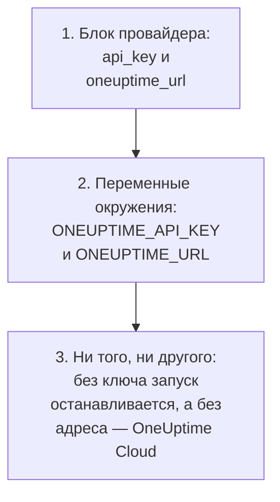
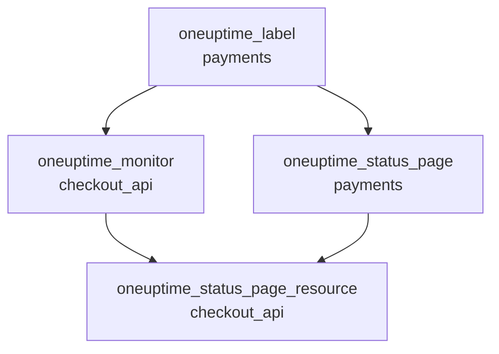

# Полное руководство

Это руководство охватывает то, что идёт после первого apply: как провайдер находит свой API-ключ, как организовать конфигурацию для одного или нескольких проектов, как ресурсы ссылаются друг на друга, как читать записи, которыми вы не управляете, как держать state в безопасности и как обновляться. Впервые работаете с провайдером? Начните с [Быстрого старта](/docs/terraform/quick-start).

:::cards
- [Настройка провайдера](#настройка-провайдера): API-ключ и адрес, и откуда провайдер их берёт.
- [Организация конфигурации](#организация-конфигурации): Файлы, проекты и много ресурсов из одного блока.
- [Чтение того, что уже есть](#чтение-того-что-уже-есть): Источники данных и как поиск находит совпадение.
- [Безопасность state](#безопасность-state): Удалённый backend и то, что никогда нельзя коммитить.
:::

## Настройка провайдера

Провайдер принимает две настройки. Каждая берётся из блока провайдера, а если её там нет, то из переменной окружения:

| Настройка | Переменная окружения | Когда не задано ни то, ни другое |
| --- | --- | --- |
| `api_key` | `ONEUPTIME_API_KEY` | Провайдер останавливается до того, как что-либо запланировано: `Missing API Key` |
| `oneuptime_url` | `ONEUPTIME_URL` | `https://oneuptime.com`, то есть OneUptime Cloud |



`oneuptime_url` — это адрес вашего OneUptime без `/api`: провайдер добавляет `https://`, когда у адреса нет схемы, и `/api` в конце. `api_key` — чувствительное значение, поэтому Terraform никогда его не выводит.

Ключ должен быть API-ключом проекта, которым вы управляете, с правом создавать, читать, изменять и удалять каждый вид записей в вашей конфигурации: см. [Создайте API-ключ проекта](/docs/terraform/quick-start#создайте-api-ключ-проекта). Мастер-ключ API OneUptime с собственным хостингом не принадлежит ни одному проекту, поэтому создание с ним завершается ошибкой `ProjectId required`.

### Передача ключа провайдеру

:::tabs
@tab Переменная окружения
```bash
export ONEUPTIME_API_KEY="<your-api-key>"
# Only on a self-hosted OneUptime:
export ONEUPTIME_URL="https://oneuptime.example.com"
```

```hcl title="main.tf"
provider "oneuptime" {}
```
@tab Переменная Terraform
```hcl title="variables.tf"
variable "oneuptime_api_key" {
  description = "API key of the OneUptime project"
  type        = string
  sensitive   = true
}

provider "oneuptime" {
  api_key = var.oneuptime_api_key
}
```

```hcl title="terraform.tfvars"
oneuptime_api_key = "<your-api-key>"
```
:::

Переменная окружения держит ключ вне любых файлов. Файл переменных удобен на вашей машине: добавьте `terraform.tfvars` в `.gitignore`. В конвейере задайте `TF_VAR_oneuptime_api_key` вместо того, чтобы писать файл.

### Запуск в CI/CD

Передайте заданию ключ как секрет в переменной окружения `ONEUPTIME_API_KEY`:

:::tabs
@tab GitHub Actions
```yaml title=".github/workflows/oneuptime.yml"
name: OneUptime
on:
  push:
    branches: [main]

jobs:
  apply:
    runs-on: ubuntu-latest
    env:
      ONEUPTIME_API_KEY: ${{ secrets.ONEUPTIME_API_KEY }}
    steps:
      - uses: actions/checkout@v4
      - uses: hashicorp/setup-terraform@v3
      - run: terraform init -input=false
      - run: terraform plan -input=false -out=tfplan
      - run: terraform apply -input=false tfplan
```
@tab GitLab CI
```yaml title=".gitlab-ci.yml"
apply:
  image:
    name: hashicorp/terraform:latest
    entrypoint: [""]
  rules:
    - if: $CI_COMMIT_BRANCH == $CI_DEFAULT_BRANCH
  script:
    - terraform init -input=false
    - terraform plan -input=false -out=tfplan
    - terraform apply -input=false tfplan
```
:::

В GitHub добавьте секрет в **Settings → Secrets and variables → Actions**; в GitLab добавьте маскированную переменную CI/CD с тем же именем. Храните state в [удалённом backend](#безопасность-state), чтобы каждый запуск начинался с state, оставленного предыдущим.

## Организация конфигурации

Структура, которая хорошо работает:

```text
oneuptime/
├── main.tf          # the terraform and provider blocks
├── variables.tf     # input variables
├── outputs.tf       # the IDs other configurations need
├── shared.tf        # labels, teams and monitor statuses
├── monitors.tf      # monitors and monitor groups
├── status-pages.tf  # status pages and their domains
└── on-call.tf       # on-call policies and escalation rules
```

- **Одна конфигурация на проект.** API-ключ принадлежит одному проекту, поэтому конфигурация естественным образом управляет одним.
- **Общие записи — один раз.** Определите метки, команды и статусы мониторов в одном файле и ссылайтесь на них по адресу во всех остальных местах.

### Управление несколькими проектами

Чтобы управлять несколькими проектами из одной конфигурации, задайте провайдеру псевдоним для каждого, каждый с ключом своего проекта. Ресурс указывает используемый псевдоним через `provider`:

```hcl
provider "oneuptime" {
  alias   = "production"
  api_key = var.production_api_key
}

provider "oneuptime" {
  alias   = "staging"
  api_key = var.staging_api_key
}

resource "oneuptime_label" "staging_critical" {
  provider = oneuptime.staging

  name  = "critical"
  color = "#FF5733"
}
```

Объявите `production_api_key` и `staging_api_key` как переменные с пометкой `sensitive`, как выше.

### Много ресурсов из одного блока

`for_each` создаёт по ресурсу для каждого элемента map. Эти мониторы разделяют критерии и отличаются только именем и адресом:

```hcl
variable "websites" {
  type = map(string)
  default = {
    homepage = "https://example.com"
    docs     = "https://docs.example.com"
  }
}

resource "oneuptime_monitor" "website" {
  for_each = var.websites

  name                = "Website: ${each.key}"
  monitor_type        = "Website"
  monitoring_interval = "*/5 * * * *"

  monitor_steps = [{
    monitor_destination      = each.value
    monitor_destination_type = "URL"

    criteria = [
      {
        name                  = "Offline"
        filter_condition      = "Any"
        change_monitor_status = true
        monitor_status_id     = data.oneuptime_monitor_status.offline.id

        filters = [
          {
            check_on    = "Is Online"
            filter_type = "False"
          }
        ]
      }
    ]
  }]
}
```

Добавьте сайт в map, и следующий apply создаст его монитор. Удалите один, и apply его удалит.

## Ссылки на другие ресурсы

Ресурс, который называет атрибут другого, зависит от него, и Terraform упорядочивает работу по этим ссылкам. Здесь метка создаётся первой и удаляется последней, потому что монитор и страница состояния её называют:



```hcl
resource "oneuptime_label" "payments" {
  name        = "payments"
  description = "Payment infrastructure"
  color       = "#2ECC71"
}

resource "oneuptime_monitor" "checkout_api" {
  name         = "Checkout API"
  description  = "Availability of the checkout API"
  monitor_type = "Manual"
  labels       = [oneuptime_label.payments.id]
}

resource "oneuptime_status_page" "payments" {
  name                  = "Payments Status"
  page_title            = "Payments Status"
  is_public_status_page = true
  labels                = [oneuptime_label.payments.id]
}

resource "oneuptime_status_page_resource" "checkout_api" {
  status_page_id = oneuptime_status_page.payments.id
  monitor_id     = oneuptime_monitor.checkout_api.id
  display_name   = "Checkout API"
}
```

`depends_on` нужен редко: добавляйте его только для порядка, который Terraform не видит по атрибутам. Списки ID, такие как `labels`, являются множествами, поэтому смена их порядка ничего не меняет.

## Чтение того, что уже есть

У каждого ресурса есть источник данных с тем же именем. Источник данных читает запись, которой эта конфигурация не управляет, созданную в панели управления или другой конфигурацией, чтобы вы могли ссылаться на неё, не забирая её под своё управление.

```hcl
data "oneuptime_label" "critical" {
  name = "critical"
}

data "oneuptime_monitor_status" "offline" {
  is_offline_state = true
}

data "oneuptime_status_page" "main" {
  id = "5f8a1b2c-3d4e-4f6a-8b9c-0d1e2f3a4b5c"
}

resource "oneuptime_monitor" "database" {
  name         = "Database Health"
  monitor_type = "Manual"
  labels       = [data.oneuptime_label.critical.id]
}
```

Как поиск находит совпадение:

| Вы задаёте | Он находит | Ошибки |
| --- | --- | --- |
| `id` | Запись с этим ID | `Not Found`, когда ни у одной записи его нет |
| Любые другие простые аргументы, один или больше | Единственную запись, совпадающую со всеми | `Not Found`, когда не совпадает ни одна, `Ambiguous Match`, когда совпадает больше одной |
| `id` и другой аргумент, или ничего | Ничего | `Invalid Lookup` |

Простые аргументы — это текст, числа и истина или ложь: имя, приоритет, флаг вроде `is_offline_state`. По спискам, значениям JSON, отметкам времени и секретам искать нельзя. Чтобы забрать запись под управление, а не только читать её, [импортируйте её](/docs/terraform/importing-resources).

## Безопасность state

State Terraform хранит ID и атрибуты всего, чем он управляет, включая секреты. Держите его в удалённом backend с блокировкой, чтобы команда делила один state, а два запуска никогда не писали его одновременно. Подойдёт любой стандартный backend, например бакет S3:

```hcl
terraform {
  backend "s3" {
    bucket       = "my-terraform-state"
    key          = "oneuptime/production.tfstate"
    region       = "us-east-1"
    encrypt      = true
    use_lockfile = true
  }
}
```

`use_lockfile` требует Terraform 1.10 или OpenTofu 1.10 или новее. До них backend S3 блокирует с помощью таблицы DynamoDB (`dynamodb_table`).

- **Никогда не правьте state вручную.** Используйте `terraform state mv` и `terraform state rm`.
- **Никогда не коммитьте `terraform.tfstate` или файл `.tfvars` с секретом внутри.**

## Дрейф и то, что его не вызывает

`terraform plan` сравнивает OneUptime с вашей конфигурацией и показывает различия. Некоторые различия никогда не показываются:

- **Время сравнивается как момент.** `2030-06-01T02:00:00Z` и то, как сервер записывает тот же момент, равны.
- **Значения по умолчанию, которые добавляет сервер** к шагам монитора или к значению JSON, не считаются отличием от написанного вами.
- **То, что сервер поддерживает в актуальном состоянии**, например текущий статус монитора, тоже не отличие.

А вот значение, которое вы вычисляете при каждом запуске, — отличие: `timestamp()` даёт новое время при каждом запуске, поэтому план всегда его показывает. Пишите вместо этого фиксированное время:

```hcl
resource "oneuptime_scheduled_maintenance_event" "database_upgrade" {
  title       = "Database upgrade"
  description = "Planned PostgreSQL upgrade"
  starts_at   = "2030-06-01T02:00:00Z"
  ends_at     = "2030-06-01T04:00:00Z"
}
```

## Обновление провайдера

:::steps
### Прочитайте примечания к выпуску

В [Terraform Registry](https://registry.terraform.io/providers/oneuptime/oneuptime) и в [выпусках провайдера на GitHub](https://github.com/OneUptime/terraform-provider-oneuptime/releases) перечислено, что изменилось.

### Поднимите ограничение версии

`{{TERRAFORM_PROVIDER_VERSION}}` уже берёт каждый выпуск {{TERRAFORM_PROVIDER_MAJOR}}.x. Новой мажорной версии нужно новое ограничение.

### Скачайте новую версию

```bash
terraform init -upgrade
```

### Запустите план перед apply

Запустите `terraform plan` и применяйте, только когда он пуст или показывает ожидаемые изменения.
:::

На OneUptime с собственным хостингом сначала обновите OneUptime, а потом провайдер: провайдер не должен быть новее вашего OneUptime. См. [Настройка собственного хостинга](/docs/terraform/self-hosted).

## Дальнейшие шаги

:::cards
- [Шаги монитора](/docs/terraform/monitor-steps): Решите, что проверяет монитор и что означает каждый результат.
- [Примеры](/docs/terraform/examples): Готовые конфигурации для распространённых ресурсов.
- [Импорт ресурсов](/docs/terraform/importing-resources): Передайте под управление Terraform то, что вы создали в панели управления.
- [Устранение неполадок](/docs/terraform/troubleshooting): Частые ошибки и как их исправить.
:::
