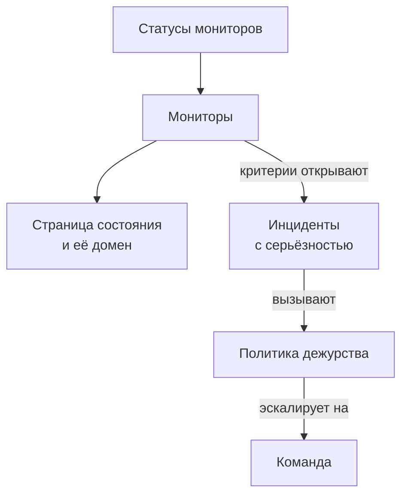

# Примеры

Готовые конфигурации для ресурсов, с которых начинается большинство проектов. Каждый блок применяется как есть поверх настройки провайдера ниже, а большинство взято из сквозных тестов провайдера, которые применяют их к настоящему OneUptime при каждом изменении.

:::cards
- [Мониторы](#мониторы): Мониторы веб-сайта, API, ping, порта, SSL-сертификата, heartbeat и ручные.
- [Страницы состояния](#страницы-состояния): Страница состояния с группой и монитором, и собственный домен.
- [Команды и дежурства](#команды-и-дежурства): Команда и политика дежурства, которая её вызывает.
- [Инциденты и обслуживание](#инциденты-и-обслуживание): Серьёзности, состояния, объявленный инцидент и окно обслуживания.
:::



## Настройка провайдера

Каждый пример предполагает эту настройку, с API-ключом в переменной окружения `ONEUPTIME_API_KEY`:

```hcl title="main.tf"
terraform {
  required_providers {
    oneuptime = {
      source  = "oneuptime/oneuptime"
      version = "{{TERRAFORM_PROVIDER_VERSION}}"
    }
  }
}

provider "oneuptime" {
  # On a self-hosted OneUptime, add your OneUptime's address:
  # oneuptime_url = "https://oneuptime.example.com"
}
```

## Метки

Метки сортируют и фильтруют записи. Большинство ресурсов принимают множество ID меток в `labels`:

```hcl
resource "oneuptime_label" "production" {
  name        = "production"
  description = "Production infrastructure"
  color       = "#FF5733"
}
```

## Мониторы

Мониторы ниже задают свой статус тремя из статусов, с которых начинается каждый проект, прочитанными через источники данных:

```hcl
data "oneuptime_monitor_status" "operational" {
  name = "Operational"
}

data "oneuptime_monitor_status" "degraded" {
  name = "Degraded"
}

data "oneuptime_monitor_status" "offline" {
  name = "Offline"
}
```

`monitor_steps` каждого монитора говорят, что он проверяет и как оценивается каждый результат: каждый атрибут объяснён в разделе [Шаги монитора](/docs/terraform/monitor-steps).

### Монитор веб-сайта

Offline, когда сайт не отвечает, online, когда он отвечает кодом 200. Сквозной тест `35-monitor-with-steps` применяет монитор с этими проверками:

```hcl
resource "oneuptime_monitor" "website" {
  name                = "Website"
  description         = "Homepage availability and status code"
  monitor_type        = "Website"
  monitoring_interval = "*/5 * * * *"
  labels              = [oneuptime_label.production.id]

  monitor_steps = [{
    monitor_destination      = "https://example.com"
    monitor_destination_type = "URL"
    request_type             = "GET"

    criteria = [
      {
        name                  = "Offline"
        description           = "The website does not respond"
        filter_condition      = "Any"
        change_monitor_status = true
        monitor_status_id     = data.oneuptime_monitor_status.offline.id

        filters = [
          {
            check_on    = "Is Online"
            filter_type = "False"
          }
        ]
      },
      {
        name                  = "Online"
        description           = "The website responds with 200"
        filter_condition      = "All"
        change_monitor_status = true
        monitor_status_id     = data.oneuptime_monitor_status.operational.id

        filters = [
          {
            check_on    = "Is Online"
            filter_type = "True"
          },
          {
            check_on    = "Response Status Code"
            filter_type = "Equal To"
            value       = "200"
          }
        ]
      }
    ]
  }]
}
```

### Монитор API

`POST` с заголовками и телом JSON, degraded, когда ответ медленный. Сквозной тест `35-monitor-with-steps` применяет похожий монитор API:

```hcl
resource "oneuptime_monitor" "orders_api" {
  name         = "Orders API"
  description  = "Health check of the orders API"
  monitor_type = "API"

  monitor_steps = [{
    monitor_destination      = "https://api.example.com/v1/health"
    monitor_destination_type = "URL"
    request_type             = "POST"
    request_headers = {
      "Content-Type" = "application/json"
      "Accept"       = "application/json"
    }
    request_body = jsonencode({ check = "health" })

    criteria = [
      {
        name                  = "Offline"
        description           = "The API does not answer, or answers with an error"
        filter_condition      = "Any"
        change_monitor_status = true
        monitor_status_id     = data.oneuptime_monitor_status.offline.id

        filters = [
          {
            check_on    = "Is Online"
            filter_type = "False"
          },
          {
            check_on    = "Response Status Code"
            filter_type = "Greater Than Or Equal To"
            value       = "500"
          }
        ]
      },
      {
        name                  = "Slow"
        description           = "The API takes more than two seconds"
        filter_condition      = "All"
        change_monitor_status = true
        monitor_status_id     = data.oneuptime_monitor_status.degraded.id

        filters = [
          {
            check_on    = "Response Time (in ms)"
            filter_type = "Greater Than"
            value       = "2000"
          }
        ]
      },
      {
        name                  = "Online"
        description           = "The API answers in time"
        filter_condition      = "All"
        change_monitor_status = true
        monitor_status_id     = data.oneuptime_monitor_status.operational.id

        filters = [
          {
            check_on    = "Is Online"
            filter_type = "True"
          }
        ]
      }
    ]
  }]
}
```

### Монитор Ping

Монитор Ping принимает имя хоста или IP-адрес вместо URL:

```hcl
resource "oneuptime_monitor" "gateway" {
  name         = "Gateway"
  description  = "The gateway answers ping"
  monitor_type = "Ping"

  monitor_steps = [{
    monitor_destination      = "gateway.example.com"
    monitor_destination_type = "Hostname"

    criteria = [
      {
        name                  = "Unreachable"
        filter_condition      = "Any"
        change_monitor_status = true
        monitor_status_id     = data.oneuptime_monitor_status.offline.id

        filters = [
          {
            check_on    = "Is Online"
            filter_type = "False"
          }
        ]
      },
      {
        name                  = "Reachable"
        filter_condition      = "All"
        change_monitor_status = true
        monitor_status_id     = data.oneuptime_monitor_status.operational.id

        filters = [
          {
            check_on    = "Is Online"
            filter_type = "True"
          }
        ]
      }
    ]
  }]
}
```

### Монитор порта

Монитор порта добавляет `port` для проверки, в виде числа:

```hcl
resource "oneuptime_monitor" "database_port" {
  name         = "Database port"
  description  = "PostgreSQL accepts connections"
  monitor_type = "Port"

  monitor_steps = [{
    monitor_destination      = "db.example.com"
    monitor_destination_type = "Hostname"
    port                     = 5432

    criteria = [
      {
        name                  = "Closed"
        filter_condition      = "Any"
        change_monitor_status = true
        monitor_status_id     = data.oneuptime_monitor_status.offline.id

        filters = [
          {
            check_on    = "Is Online"
            filter_type = "False"
          }
        ]
      },
      {
        name                  = "Open"
        filter_condition      = "All"
        change_monitor_status = true
        monitor_status_id     = data.oneuptime_monitor_status.operational.id

        filters = [
          {
            check_on    = "Is Online"
            filter_type = "True"
          }
        ]
      }
    ]
  }]
}
```

### Монитор SSL-сертификата

Offline, когда сертификат недействителен, degraded, когда он истекает через 14 дней или меньше, как у нового монитора SSL-сертификата в панели управления:

```hcl
resource "oneuptime_monitor" "certificate" {
  name         = "example.com certificate"
  description  = "The TLS certificate of example.com"
  monitor_type = "SSL Certificate"

  monitor_steps = [{
    monitor_destination      = "https://example.com"
    monitor_destination_type = "URL"

    criteria = [
      {
        name                  = "Not valid"
        description           = "Expired, self-signed, untrusted or not reachable"
        filter_condition      = "Any"
        change_monitor_status = true
        monitor_status_id     = data.oneuptime_monitor_status.offline.id

        filters = [
          {
            check_on    = "Is Not A Valid Certificate"
            filter_type = "True"
          }
        ]
      },
      {
        name                  = "Expires soon"
        description           = "Valid, and expires in 14 days or less"
        filter_condition      = "All"
        change_monitor_status = true
        monitor_status_id     = data.oneuptime_monitor_status.degraded.id

        filters = [
          {
            check_on    = "Is Valid Certificate"
            filter_type = "True"
          },
          {
            check_on    = "Expires In Days"
            filter_type = "Less Than Or Equal To"
            value       = "14"
          }
        ]
      },
      {
        name                  = "Valid"
        filter_condition      = "All"
        change_monitor_status = true
        monitor_status_id     = data.oneuptime_monitor_status.operational.id

        filters = [
          {
            check_on    = "Is Valid Certificate"
            filter_type = "True"
          }
        ]
      }
    ]
  }]
}
```

### Ручной монитор

Ручной монитор ничего не проверяет: его статус вы задаёте сами. Ему не нужны `monitor_steps`:

```hcl
resource "oneuptime_monitor" "payment_provider" {
  name         = "Payment provider"
  description  = "Set by hand during the provider's incidents"
  monitor_type = "Manual"
}
```

### Монитор heartbeat

Монитор входящих запросов ждёт запросов, а не отправляет их: здесь это задание резервного копирования, которое отмечается каждую ночь. Он переходит в offline, когда запрос не приходил 25 часов:

```hcl
resource "oneuptime_monitor" "nightly_backup" {
  name         = "Nightly backup"
  description  = "The backup job sends a heartbeat when it finishes"
  monitor_type = "Incoming Request"

  monitor_steps = [{
    criteria = [
      {
        name                  = "No heartbeat"
        filter_condition      = "Any"
        change_monitor_status = true
        monitor_status_id     = data.oneuptime_monitor_status.offline.id

        filters = [
          {
            check_on    = "Incoming Request"
            filter_type = "Not Recieved In Minutes"
            value       = "1500"
          }
        ]
      },
      {
        name                  = "Heartbeat received"
        filter_condition      = "All"
        change_monitor_status = true
        monitor_status_id     = data.oneuptime_monitor_status.operational.id

        filters = [
          {
            check_on    = "Incoming Request"
            filter_type = "Recieved In Minutes"
            value       = "1500"
          }
        ]
      }
    ]
  }]
}

output "nightly_backup_heartbeat_key" {
  value     = oneuptime_monitor.nightly_backup.incoming_request_secret_key
  sensitive = true
}
```

Задание отправляет запрос на `https://oneuptime.com/heartbeat/YOUR_SECRET_KEY` с ключом, который выводит `terraform output -raw nightly_backup_heartbeat_key`: см. [Мониторинг входящих запросов](/docs/monitor/incoming-request-monitor). Агент серверного монитора подключается так же, с `server_monitor_secret_key`.

### Группа мониторов

Группа мониторов показывает набор мониторов с одним статусом:

```hcl
resource "oneuptime_monitor_group" "storefront" {
  name        = "Storefront"
  description = "Everything the shop needs"
}

resource "oneuptime_monitor_group_resource" "website" {
  monitor_group_id = oneuptime_monitor_group.storefront.id
  monitor_id       = oneuptime_monitor.website.id
}

resource "oneuptime_monitor_group_resource" "orders_api" {
  monitor_group_id = oneuptime_monitor_group.storefront.id
  monitor_id       = oneuptime_monitor.orders_api.id
}
```

## Страницы состояния

### Страница состояния с группой и монитором

Страница состояния показывает ресурсы и может раскладывать их по группам. Сквозной тест `42-status-page-resources` применяет эту настройку:

```hcl
resource "oneuptime_status_page" "public" {
  name                  = "Public Status"
  description           = "Customer-facing status page"
  page_title            = "System Status"
  page_description      = "Check our system status and incident history"
  is_public_status_page = true
}

resource "oneuptime_status_page_group" "services" {
  status_page_id = oneuptime_status_page.public.id
  name           = "Services"
}

resource "oneuptime_status_page_resource" "website" {
  status_page_id       = oneuptime_status_page.public.id
  status_page_group_id = oneuptime_status_page_group.services.id
  monitor_id           = oneuptime_monitor.website.id
  display_name         = "Website"
}
```

### Собственный домен

Вместе работают три ресурса: домен вашего проекта, страница состояния и домен страницы состояния, который их связывает. Сервер сам заполняет `full_domain` и токен проверки CNAME: не задавайте их. Сквозные тесты `12-status-page-domain` и `25-status-page-with-domain` применяют эту настройку:

```hcl
resource "oneuptime_domain" "company" {
  domain = "example.com"
}

resource "oneuptime_status_page_domain" "status" {
  domain_id      = oneuptime_domain.company.id
  status_page_id = oneuptime_status_page.public.id
  subdomain      = "status"
}

output "status_page_address" {
  # The subdomain and the domain, such as status.example.com.
  value = oneuptime_status_page_domain.status.full_domain
}
```

Новый домен должен пройти проверку DNS, прежде чем страница состояния начнёт на нём отвечать.

## Команды и дежурства

### Команда и её участники

```hcl
resource "oneuptime_team" "sre" {
  name        = "SRE"
  description = "Site reliability engineering"
}

variable "alice_user_id" {
  description = "Alice's user ID, the last part of the address of her page under Users"
  type        = string
}

resource "oneuptime_team_member" "alice" {
  team_id = oneuptime_team.sre.id
  user_id = var.alice_user_id
}
```

Человек, который уже состоит в проекте, сразу попадает в команду. Все остальные получают приглашение и попадают в команду, как только принимают его. Сквозной тест `33-team-crud` применяет команду.

### Политика дежурства, которая вызывает команду

Первое правило политики вызывает команду, а политика начинается заново, до двух раз, когда никто не подтверждает:

```hcl
resource "oneuptime_on_call_policy" "primary" {
  name                                             = "Primary on-call"
  description                                      = "First line for production incidents"
  repeat_policy_if_no_one_acknowledges             = true
  repeat_policy_if_no_one_acknowledges_no_of_times = 2
}

resource "oneuptime_escalation_rule" "first_line" {
  on_call_duty_policy_id    = oneuptime_on_call_policy.primary.id
  name                      = "Page the SRE team"
  description               = "Moves on after 5 minutes without an acknowledgement"
  order                     = 1
  escalate_after_in_minutes = 5
}

resource "oneuptime_team_on_call_duty_escalation_rule" "sre" {
  on_call_duty_policy_id                 = oneuptime_on_call_policy.primary.id
  on_call_duty_policy_escalation_rule_id = oneuptime_escalation_rule.first_line.id
  team_id                                = oneuptime_team.sre.id
}
```

Критерии монитора вызывают политику через `on_call_policy_ids` у открываемых ими инцидентов: см. [Инциденты и оповещения](/docs/terraform/monitor-steps#инциденты-и-оповещения).

## Инциденты и обслуживание

### Серьёзности и состояния

Серьёзности ранжируют влияние инцидента, а состояния — это этапы его жизни. `order` — это место, на котором стоит каждое из них:

```hcl
resource "oneuptime_incident_severity" "sev1" {
  name        = "SEV-1"
  description = "Full outage, all hands"
  color       = "#E74C3C"
  order       = 1
}

resource "oneuptime_incident_state" "mitigated" {
  name        = "Mitigated"
  description = "Impact contained, fix in progress"
  color       = "#F39C12"
  order       = 3
}
```

`oneuptime_alert_severity` и `oneuptime_alert_state` работают так же для оповещений. Сквозные тесты `03-incident-severity` и `04-incident-state` применяют их.

### Объявление инцидента

Обычно инциденты открывают мониторы, но инцидент — тоже ресурс, что удобно для game day. Это настоящий инцидент, поэтому держите учения подальше от своих страниц состояния:

```hcl
resource "oneuptime_incident" "drill" {
  title                     = "Disaster recovery drill"
  description               = "A game day: we fail over the database"
  incident_severity_id      = oneuptime_incident_severity.sev1.id
  is_visible_on_status_page = false

  should_status_page_subscribers_be_notified_on_incident_created = false
}
```

Сквозной тест `28-incident-crud` применяет инцидент.

### Плановое обслуживание

Окно обслуживания с фиксированным временем, показанное на ваших страницах состояния:

```hcl
resource "oneuptime_scheduled_maintenance_event" "database_upgrade" {
  title                       = "Database maintenance"
  description                 = "Planned PostgreSQL upgrade: writes pause briefly"
  starts_at                   = "2030-06-01T02:00:00Z"
  ends_at                     = "2030-06-01T04:00:00Z"
  is_visible_on_status_page   = true
  monitors                    = [oneuptime_monitor.website.id]
  change_monitor_status_to_id = data.oneuptime_monitor_status.degraded.id
}
```

Время задаётся в формате RFC 3339, и тот же момент, записанный иначе, не считается изменением. Сквозной тест `30-scheduled-maintenance-crud` применяет события обслуживания.

Чтобы перевести мониторы события в статус на время его проведения, привяжите их через `monitors` и задайте в `change_monitor_status_to_id` один из ваших статусов мониторов: мониторы переходят в него, когда событие начинается, и возвращаются в рабочий, когда оно заканчивается. Terraform изменяет `change_monitor_status_to_id` на месте, пока событие не началось. После начала события его мониторы уже в этом статусе, и apply, который его меняет, завершается ошибкой «Change Monitor Status to can no longer be changed: this event has already started.»

## Зонды

Собственный зонд выполняет проверки из вашей сети. Его ключ — это секрет, с которым зонд входит в систему, поэтому передавайте его в переменной:

```hcl
variable "probe_key" {
  description = "The key the probe signs in with"
  type        = string
  sensitive   = true
}

resource "oneuptime_probe" "eu_west" {
  key           = var.probe_key
  name          = "EU West"
  description   = "Probe in our eu-west-1 network"
  probe_version = "1.0.0"

  should_auto_enable_probe_on_new_monitors = true
}
```

Запустите зонд, задав `PROBE_ID` равным `id` зонда, а `PROBE_KEY` — ключу: см. [Пользовательские probes](/docs/probe/custom-probe). Сквозной тест `23-probe-crud` применяет зонды.

## Дальнейшие шаги

:::cards
- [Шаги монитора](/docs/terraform/monitor-steps): Каждый атрибут проверок и критериев монитора.
- [Импорт ресурсов](/docs/terraform/importing-resources): Передайте под управление Terraform то, что вы создали в панели управления.
- [Полное руководство](/docs/terraform/complete-guide): Источники данных, state, CI/CD и обновления.
:::
