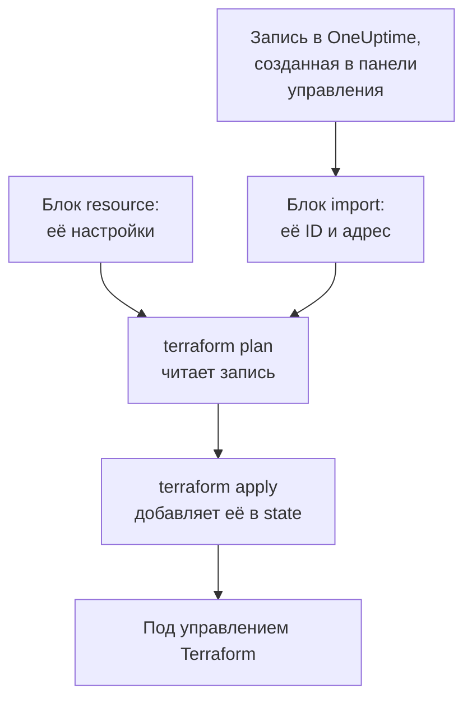

# Импорт ресурсов

Чтобы управлять OneUptime через Terraform, не нужно начинать с нуля. Импортируйте мониторы, страницы состояния, команды и другие записи, которые у вас уже есть, и дальше Terraform будет управлять ими такими, какие они есть. Импорт только читает: в OneUptime ничего не меняется, пока вы не примените запланированное изменение.

:::cards
- [Как работает импорт](#как-работает-импорт): Что читает импорт и что пишете вы.
- [Импорт одного ресурса](#импорт-одного-ресурса): Со страницы ресурса в панели управления, в четыре шага.
- [Импорт многих ресурсов](#импорт-многих-ресурсов): Блоки импорта для целого списка и конфигурация, которую Terraform напишет за вас.
- [Прекратить управление ресурсом](#прекратить-управление-ресурсом): Верните его панели управления, не удаляя.
:::

## Как работает импорт

Импорт связывает запись, которая уже есть в OneUptime, с блоком `resource` в вашей конфигурации. Вы пишете блок `import` с ID записи и адресом, по которому она должна попасть. Следующий `terraform plan` читает запись по ID и показывает, что она будет импортирована, вместе с каждым отличием записи от вашей конфигурации. `terraform apply` добавляет её в state Terraform, и с этого момента запись управляется так же, как всё, что создал Terraform.



Напишите блок `resource` так, чтобы он описывал запись такой, какая она уже есть. Там, где они расходятся, план показывает импорт и изменение, а его применение меняет запись в OneUptime.

### Что можно импортировать

Любой ресурс провайдера можно импортировать по ID, кроме `oneuptime_file`: API OneUptime не умеет читать файл обратно, поэтому провайдер отвечает `Import Not Supported`. Источники данных никогда не импортируются. Чтобы использовать запись в конфигурации, не управляя ею, прочитайте её [источником данных](/docs/terraform/complete-guide#чтение-того-что-уже-есть).

## Перед началом

- **Terraform 1.5 или новее либо OpenTofu 1.6 или новее.** Блоки `import` на этой странице требуют этих версий. Более старый Terraform импортирует из [командной строки](#импорт-из-командной-строки).
- **API-ключ, который может читать то, что вы импортируете.** Импорт читает каждую запись ключом провайдера, а для управления ею потом нужны ещё и разрешения на её изменение и удаление. См. [Создайте API-ключ проекта](/docs/terraform/quick-start#создайте-api-ключ-проекта).
- **Провайдер в вашей конфигурации**, настроенный как в [Быстрый старт](/docs/terraform/quick-start#направьте-terraform-на-oneuptime).

## Импорт одного ресурса

Панель управления пишет конфигурацию ресурса, который вы открыли, вместе с его блоком `import`, так что вручную вы пишете его редко.

:::steps
### Откройте страницу Terraform ресурса

Откройте монитор, страницу состояния или другой ресурс в панели управления. В его боковом меню откройте **Для разработчиков**, затем **Terraform**.

### Скопируйте его конфигурацию

Страница пишет блок `resource` ресурса по его текущим настройкам и блок `import` с его ID. Поместите оба в файл `.tf`:

```hcl title="status-pages.tf"
resource "oneuptime_status_page" "public_status" {
  name       = "Public Status"
  page_title = "Acme Status"

  # Secrets are not shown here: master_password, embedded_overall_status_token.
  # Terraform leaves them as they are in OneUptime.
}

import {
  to = oneuptime_status_page.public_status
  id = "68a1b2c3-d4e5-4f6a-8b9c-0d1e2f3a4b02"
}
```

Она пишет настройки, которые отличаются от значений по умолчанию, а комментарий после каждого ID называет запись, на которую он указывает. Секреты никогда не показываются: нужные ресурсу секреты читаются из переменных с пометкой `sensitive`, а комментарий называет те, которые она пропускает.

### Запустите план

Выполните `terraform plan`. Он заканчивается строкой `Plan: 1 to import, 0 to add, 0 to change, 0 to destroy.`: Terraform нашёл запись, и ваша конфигурация с ней совпадает.

### Примените

Выполните `terraform apply`. Страница состояния теперь в state Terraform, и следующий план отвечает `No changes.` После этого блок `import` можно удалить или оставить как заметку о том, откуда взялся ресурс: когда ресурс уже под управлением, блок больше ничего не делает.
:::

### Напишите блоки сами

Без панели управления вы пишете оба блока сами. Начните блок `resource` с атрибутов, которые нужны ресурсу, и выполните `terraform plan`. Там, где конфигурация расходится с записью, план показывает изменение рядом с импортом:

```text
  # oneuptime_label.critical will be updated in-place
  # (imported from "68a1b2c3-d4e5-4f6a-8b9c-0d1e2f3a4b03")
  ~ resource "oneuptime_label" "critical" {
      ~ color = "#FF5733" -> "#000000"
    }

Plan: 1 to import, 0 to add, 1 to change, 0 to destroy.
```

Перенесите значение записи в свою конфигурацию (здесь `color = "#FF5733"`) и запускайте план снова, пока он не покажет импорт без изменений. ID записи есть в трёх местах:

| Где | Как |
| --- | --- |
| Страница ресурса | Её карточка с подробностями заканчивается строкой **ID**. Нажмите на ID или на кнопку копирования рядом, чтобы скопировать ID целиком. |
| Адресная строка | ID идёт после названия списка: `/dashboard/<project-id>/monitors/<monitor-id>`. |
| API | У каждой записи её ID лежит в `_id`. |

## Импорт многих ресурсов

Чтобы импортировать все мониторы, страницы состояния или другие ресурсы одного вида, начните с их списка.

:::steps
### Откройте страницу Terraform списка

Откройте список, затем **Для разработчиков** и **Terraform** в его боковом меню, например **Мониторы → Для разработчиков → Terraform**.

### Скопируйте блоки импорта

Страница пишет блок `import` для каждой записи (первых 100) с адресом, составленным из имени записи. Поместите их в отдельный файл, например `imports.tf`:

```hcl title="imports.tf"
import {
  to = oneuptime_monitor.homepage
  id = "68a1b2c3-d4e5-4f6a-8b9c-0d1e2f3a4b01"
}

import {
  to = oneuptime_monitor.checkout_api
  id = "68a1b2c3-d4e5-4f6a-8b9c-0d1e2f3a4b05"
}
```

### Дайте Terraform написать конфигурацию

Запустите план с именем файла для конфигурации, которую напишет Terraform. Файла ещё не должно быть: Terraform пишет только в новый файл.

```bash
terraform plan -generate-config-out=monitors.tf
```

Terraform читает каждую запись и пишет блок `resource` для каждого блока `import`, у которого его нет. Он предупреждает, что генерация конфигурации экспериментальная, поэтому прочитайте то, что он написал.

### Проверьте и примените

В новом файле замените ID других записей ссылками на их ресурсы, например `labels = [oneuptime_label.critical.id]`, чтобы Terraform знал, в каком порядке работать. Запускайте `terraform plan`, пока он не покажет только импорт, затем выполните `terraform apply`.
:::

### Весь проект

Импортируйте проект список за списком, начиная с записей, на которые ссылаются другие. Тогда каждый блок ресурса сможет ссылаться на предыдущие по адресу, а не по ID:

```mermaid title="Сначала импортируйте записи, на которые ссылаются другие"
flowchart TB
    S["Метки, команды,<br/>статусы мониторов<br/>и серьёзности инцидентов"] --> M["Мониторы, страницы<br/>состояния и политики<br/>дежурства"]
    M --> L["То, что их связывает:<br/>ресурсы страниц<br/>состояния, правила<br/>эскалации и участники<br/>команд"]
```

Записи, с которыми начинается каждый проект, например его статусы мониторов и серьёзности инцидентов, часто лучше читать источниками данных, чем импортировать: тогда Terraform может на них ссылаться, но никогда их не меняет и не удаляет. Проект импортирован, когда `terraform plan` отвечает `No changes.`

## Импорт из командной строки

`terraform import` импортирует по одному ресурсу и работает в любой версии Terraform и OpenTofu. Сначала напишите блок `resource`, затем выполните команду с адресом блока и ID записи:

```bash
terraform import oneuptime_status_page.public_status 68a1b2c3-d4e5-4f6a-8b9c-0d1e2f3a4b02
terraform import oneuptime_label.critical 68a1b2c3-d4e5-4f6a-8b9c-0d1e2f3a4b03
terraform import oneuptime_team.sre 68a1b2c3-d4e5-4f6a-8b9c-0d1e2f3a4b04
```

Каждая команда заканчивается строкой `Import successful!`. В отличие от блока `import`, команда сразу записывает state, без плана для предварительной проверки: после неё выполните `terraform plan` и меняйте конфигурацию, пока план не ответит `No changes.`

## Прекратить управление ресурсом

Чтобы вернуть ресурс панели управления, не удаляя его, замените его блок `resource` блоком `removed`, который сохраняет запись:

```hcl
removed {
  from = oneuptime_team.sre

  lifecycle {
    destroy = false
  }
}
```

План сообщает, что команда больше не будет управляться Terraform, и ничего не уничтожает. Примените его, затем удалите блок `removed`. Блок `removed` с `destroy = false` требует Terraform 1.7 или новее либо OpenTofu 1.10 или новее. В более старой версии выполните вместо этого `terraform state rm oneuptime_team.sre`.

> [!WARNING]
> Удаление блока `resource` удаляет его запись в OneUptime при следующем apply. В Terraform то же самое делает блок `removed` без `destroy = false`: всегда пишите блок `lifecycle`.

## Полезно знать

- **Импорт ничего не меняет, а следующий apply меняет.** Применение плана, который показывает изменение рядом с импортом, меняет запись в OneUptime. Сначала добейтесь, чтобы план показывал только импорт.
- **Секреты не читаются обратно.** Секрета, который OneUptime никогда не отдаёт, например `secret_value` секрета монитора, нет в state после импорта. Если ваша конфигурация его задаёт, первый план показывает его как изменение, а применение записывает секрет заново.
- **Одна конфигурация на каждую запись.** Запись, импортированная в две конфигурации, при каждом apply возвращается к тому, что говорит каждая из них.
- **Импортированные записи – это управляемые записи.** `terraform destroy` удаляет их из OneUptime, как и записи, созданные Terraform.

## Устранение неполадок

:::details Сообщение «Cannot import non-existent remote object»
Ни у одной записи нет такого ID, или API-ключу провайдера нельзя её читать: OneUptime в обоих случаях отвечает одинаково. Проверьте ID и то, что ключ может читать записи этого вида.
:::

:::details Сообщение «Import Not Supported»
`oneuptime_file` – единственный ресурс, который нельзя импортировать. Не включайте его, а вместо этого дайте Terraform создать новый файл.
:::

:::details Сообщение «Invalid ID format»
Это не ID записи, а, например, имя. Импорт принимает ID, UUID вроде `68a1b2c3-d4e5-4f6a-8b9c-0d1e2f3a4b02`: скопируйте его со страницы ресурса.
:::

:::details Сообщение «Target generated file already exists»
`-generate-config-out` указывает на файл, который уже существует. Укажите новый файл или перенесите содержимое файла в другое место и удалите его.
:::

:::details Сообщение «Resource already managed by Terraform»
`terraform import` получил адрес, который уже есть в state. Импортируйте запись по другому адресу или проверьте через `terraform state list`, что находится по этому адресу.
:::

## Дальнейшие шаги

:::cards
- [Полное руководство](/docs/terraform/complete-guide): Источники данных, ссылки между ресурсами и state.
- [Шаги монитора](/docs/terraform/monitor-steps): Читайте и меняйте то, что проверяет импортированный монитор.
- [Примеры](/docs/terraform/examples): Готовые конфигурации для распространённых ресурсов.
- [Устранение неполадок](/docs/terraform/troubleshooting): Частые ошибки и способы их исправить.
:::
