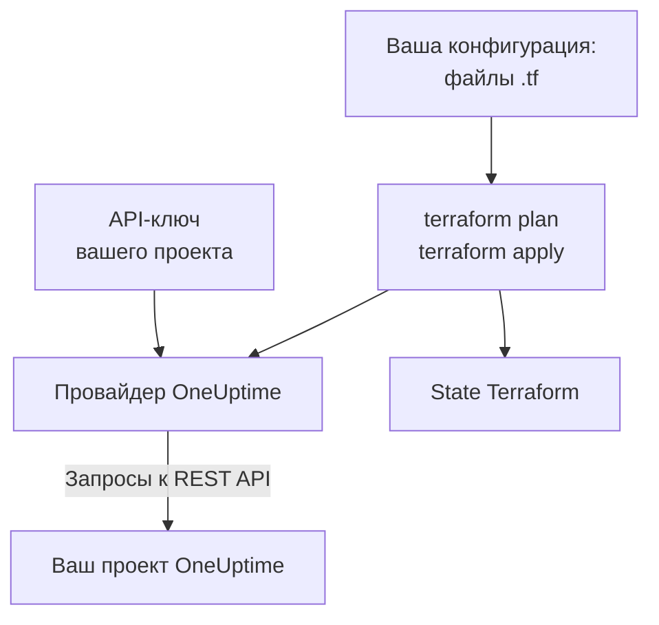

# Обзор Terraform

Провайдер Terraform для OneUptime управляет вашим проектом OneUptime как кодом. Опишите мониторы, страницы состояния, политики дежурства, команды, метки и другие записи проекта в файлах `.tf`, посмотрите с помощью `terraform plan`, что изменится, и внесите изменение командой `terraform apply`. Он работает с OneUptime Cloud и с OneUptime на собственном хостинге, а также с OpenTofu так же, как с Terraform.

:::cards
- [Как работает провайдер](#как-работает-провайдер): Ваша конфигурация, план и запросы к API за ними.
- [Установка провайдера](#установка-провайдера): Блок провайдера и версия, которую нужно выбрать.
- [Пусть конфигурацию напишет панель управления](#пусть-конфигурацию-напишет-панель-управления): Конфигурация и блоки import для того, что у вас уже есть.
- [Чем можно управлять](#чем-можно-управлять): Ресурсы, источники данных и как записываются их атрибуты.
:::

## Как работает провайдер

Провайдер — это плагин, который Terraform скачивает из реестра. При `terraform apply` он превращает каждое изменение плана в запрос к REST API OneUptime, сделанный с API-ключом вашего проекта. Terraform хранит созданное в своём state, поэтому следующий план показывает только то, что изменилось с тех пор.



API-ключ принадлежит одному проекту и определяет, что Terraform может в нём читать и изменять, поэтому одна конфигурация управляет одним проектом. Чтобы управлять несколькими, задайте провайдеру по [псевдониму](/docs/terraform/complete-guide#управление-несколькими-проектами) для каждого.

## Перед началом

- **Terraform 1.5 или новее либо OpenTofu 1.6 или новее.** Блокам `import`, которые пишет панель управления, нужны эти версии.
- **API-ключ вашего проекта.** [Быстрый старт](/docs/terraform/quick-start#создайте-api-ключ-проекта) показывает, как создать его в **Настройки проекта → Расширенный → Ключи API**.
- **В OneUptime Cloud — тариф Growth или выше.** API-ключи проекта работают только на нём.

## Установка провайдера

Добавьте провайдер в файл `.tf`. `terraform init` скачивает его из Terraform Registry, а `tofu init` — из OpenTofu Registry:

```hcl title="main.tf"
terraform {
  required_providers {
    oneuptime = {
      source  = "oneuptime/oneuptime"
      version = "{{TERRAFORM_PROVIDER_VERSION}}"
    }
  }
}

provider "oneuptime" {
  # The API key comes from the ONEUPTIME_API_KEY environment variable.
  # On a self-hosted OneUptime, add your OneUptime's address:
  # oneuptime_url = "https://oneuptime.example.com"
}
```

Не храните ключ в файлах: экспортируйте его перед запуском Terraform или передайте в переменной с пометкой `sensitive`. В [Полном руководстве](/docs/terraform/complete-guide#настройка-провайдера) перечислены все способы передать провайдеру ключ и адрес.

### Выбор версии

Версии провайдера следуют версиям OneUptime: провайдер {{TERRAFORM_PROVIDER_MAJOR}}.x собран из OneUptime {{TERRAFORM_PROVIDER_MAJOR}}.x. Ограничение выше, `{{TERRAFORM_PROVIDER_VERSION}}`, берёт самый новый выпуск {{TERRAFORM_PROVIDER_MAJOR}}.x, и это правильный выбор для OneUptime Cloud. На OneUptime с собственным хостингом используйте самый новый провайдер, который не новее вашего OneUptime: в разделе [Настройка собственного хостинга](/docs/terraform/self-hosted) показано, как его закрепить.

## Пусть конфигурацию напишет панель управления

Ресурс, который у вас уже есть, не нужно писать вручную. У каждого ресурса в панели управления OneUptime (монитора, страницы состояния, рабочего процесса, политики дежурства и остальных) в боковом меню есть раздел **Для разработчиков**, свёрнутый, пока вы его не откроете. Его страница **Terraform** пишет конфигурацию за вас, заполненную данными вашего проекта.

:::steps
### Откройте ресурс

Откройте монитор, страницу состояния или другой ресурс, которым должен управлять Terraform.

### Откройте его страницу Terraform

В боковом меню откройте **Для разработчиков**, затем **Terraform**.

### Скопируйте конфигурацию

Страница пишет конфигурацию ресурса по его текущим настройкам, вместе с блоком `import`. Комментарий после каждого ID называет запись, на которую он указывает (`incident_severity_id = "..." # Critical Incident`).

### Запустите план и примените

Запустите `terraform plan`: он показывает, что ресурс импортируется, и что менять нечего. Примените его, и с этого момента ресурсом управляет Terraform.
:::

Под конфигурацией в блоке **Что добавить дальше** есть то, что часто добавляют рядом с ресурсом, ссылаясь на него по адресу: команда-владелец для инцидента, группа мониторов для страницы состояния, правило эскалации для политики дежурства.

На страницах списков (например, **Инциденты** или **Мониторы**) есть такой же раздел. Там страница **Terraform** пишет новый ресурс с полями, которые заполняет большинство, используя записи вашего проекта: инцидент с одной из ваших серьёзностей, монитор с критериями, которые новый монитор получает в панели управления, связанный с вашими статусами. Она даёт готовые **Типовые конфигурации** (страница состояния с группой и монитором, политика дежурства, которая вызывает команду, еженедельная ротация дежурств) и блок `import` для каждого ресурса, который у вас уже есть (первые 100), готовый для `terraform plan -generate-config-out`. Обе страницы также дают блок провайдера для вашего OneUptime: правильный `oneuptime_url` и ограничение версии, подходящее вашему OneUptime.

Секреты на этих страницах никогда не показываются. Когда конфигурации нужен секрет (например, заголовок `Authorization` монитора), она читает его из переменной Terraform с пометкой `sensitive`. Ненужные ей секреты опускаются, и Terraform оставляет их такими, какие они в OneUptime.

В том же разделе есть страница **API** с командами `curl` для ресурса и страница **ИИ-ассистенты**, которая подключает Claude, GitHub Copilot или Cursor к [серверу MCP](/docs/ai/mcp-server).

## Чем можно управлять

У провайдера есть ресурс для каждого вида записей, которые можно создать через API OneUptime, с именем `oneuptime_<name>`. С этих ресурсов начинается большинство конфигураций:

| Ресурс | Что это |
| --- | --- |
| `oneuptime_monitor` | Монитор: веб-сайт, API, ping, порт, SSL-сертификат, сервер, входящий запрос, ручной и все остальные типы |
| `oneuptime_monitor_status` | Статус монитора, например Operational, Degraded или Offline |
| `oneuptime_monitor_group` | Группа мониторов, показываемая с одним статусом |
| `oneuptime_status_page` | Публичная или закрытая страница состояния |
| `oneuptime_status_page_domain` | Собственный домен страницы состояния |
| `oneuptime_domain` | Домен вашего проекта, подтверждённый для страниц состояния |
| `oneuptime_label` | Метка, чтобы сортировать и фильтровать записи |
| `oneuptime_team`, `oneuptime_team_member` | Команда и её участники |
| `oneuptime_on_call_policy`, `oneuptime_escalation_rule` | Политика дежурства и правила, которые она вызывает по порядку |
| `oneuptime_incident`, `oneuptime_incident_severity`, `oneuptime_incident_state` | Инциденты, их серьёзности и их состояния |
| `oneuptime_alert`, `oneuptime_alert_severity`, `oneuptime_alert_state` | Оповещения, их серьёзности и их состояния |
| `oneuptime_scheduled_maintenance_event` | Окно планового обслуживания |
| `oneuptime_probe` | Собственный зонд, который проверяет из вашей сети |

В [Terraform Registry](https://registry.terraform.io/providers/oneuptime/oneuptime/latest/docs) перечислены все ресурсы со всеми их атрибутами.

### Чтение того, что уже есть

У каждого ресурса есть источник данных с тем же именем, например `data "oneuptime_label"`. Источник данных читает запись, которой эта конфигурация не управляет, например созданную в панели управления. Найдите её по `id` или по другим простым аргументам: каждый заданный аргумент должен совпасть, и совпасть со всеми может ровно одна запись.

```hcl
data "oneuptime_monitor_status" "offline" {
  name = "Offline"
}

# Any plain argument works. Set several, and all of them must match.
data "oneuptime_monitor_status" "offline_state" {
  is_offline_state = true
}
```

Отсутствие совпадения или больше одного совпадения — это ошибка, а не пустой или случайный ответ. Правила приведены в [Полном руководстве](/docs/terraform/complete-guide#чтение-того-что-уже-есть).

### Переименованные ресурсы

Имена ресурсов сохраняют целыми слова вроде IoT и vCenter: `oneuptime_iot_fleet` и `oneuptime_vcenter`, тогда как у старых провайдеров были `oneuptime_io_t_fleet` и `oneuptime_v_center` (то же самое для их правил меток, владельцев и лент). Старые имена по-прежнему работают как устаревшие псевдонимы, и план, который использует одно из них, сообщает об этом. Чтобы перейти, переименуйте ресурс в конфигурации и добавьте блок `moved`, и Terraform сохранит существующий ресурс, а не заменит его:

```hcl
# Was: resource "oneuptime_io_t_fleet" "factory"
resource "oneuptime_iot_fleet" "factory" {
  name = "Factory floor"
}

moved {
  from = oneuptime_io_t_fleet.factory
  to   = oneuptime_iot_fleet.factory
}
```

Перенос ресурса в другой тип требует Terraform 1.8 или новее. На более старом движке пока оставьте старое имя: оно продолжает работать.

## Как записываются атрибуты

Атрибуты следуют API OneUptime, в snake_case:

| Вид значения | Как его записать | Пример |
| --- | --- | --- |
| Текст, числа, истина или ложь | Как есть | `is_public_status_page = false` |
| Ссылка на другую запись | Её ID, обычно `id` другого ресурса | `incident_severity_id = oneuptime_incident_severity.sev1.id` |
| Список ссылок | Множество ID, порядок которых не важен | `labels = [oneuptime_label.critical.id]` |
| Цвет, домен и другие обёрнутые значения | Их простое значение | `color = "#FF5733"` |
| Дата и время | Текст в формате RFC 3339 | `starts_at = "2030-06-01T02:00:00Z"` |
| Проверки монитора | Типизированные вложенные атрибуты: см. [Шаги монитора](/docs/terraform/monitor-steps) | `monitor_steps = [{ ... }]` |
| Другие структурированные настройки | JSON, записанный через `jsonencode()` | `log_monitor = jsonencode({ ... })` |

Два вида значений принадлежат серверу, и их вы не указываете:

- **ID внутри ресурса.** У шагов и критериев монитора, а также у их шаблонов инцидентов и оповещений, есть ID, которые выдаёт сервер и сохраняет при каждом apply, поэтому инциденты продолжают указывать на критерии, которые их открыли.
- **То, что сервер поддерживает в актуальном состоянии.** Текущий статус монитора или время последнего полученного heartbeat могут измениться между `terraform plan` и концом `terraform apply`. Для всего, что вы не задали, провайдер сохраняет запланированное значение, а следующий refresh читает значение сервера, поэтому это никогда не приводит к сбою apply и не показывается как изменение.

## Получить помощь

- Ошибки и запросы функций: [github.com/OneUptime/oneuptime/issues](https://github.com/OneUptime/oneuptime/issues).
- Провайдер генерируется из спецификации OpenAPI OneUptime в [основном репозитории OneUptime](https://github.com/OneUptime/oneuptime). Опубликованный репозиторий провайдера доступен только для чтения, поэтому сообщайте о проблемах в основной репозиторий.

## Дальнейшие шаги

:::cards
- [Быстрый старт](/docs/terraform/quick-start): Создайте API-ключ и примените первые ресурсы за десять минут.
- [Полное руководство](/docs/terraform/complete-guide): Аутентификация, структура проекта, источники данных, state и обновления.
- [Шаги монитора](/docs/terraform/monitor-steps): Решите, что проверяет монитор и что означает каждый результат.
- [Примеры](/docs/terraform/examples): Готовые конфигурации для распространённых ресурсов.
- [Импорт ресурсов](/docs/terraform/importing-resources): Передайте под управление Terraform то, что вы создали в панели управления.
:::
