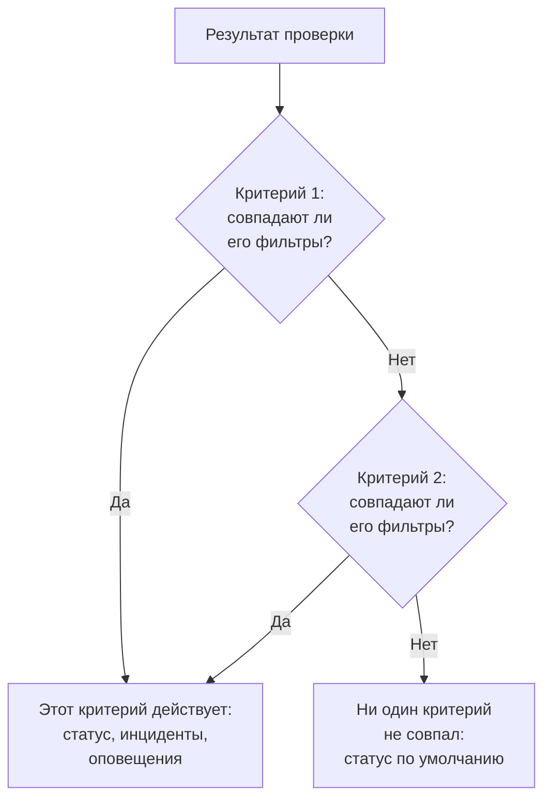
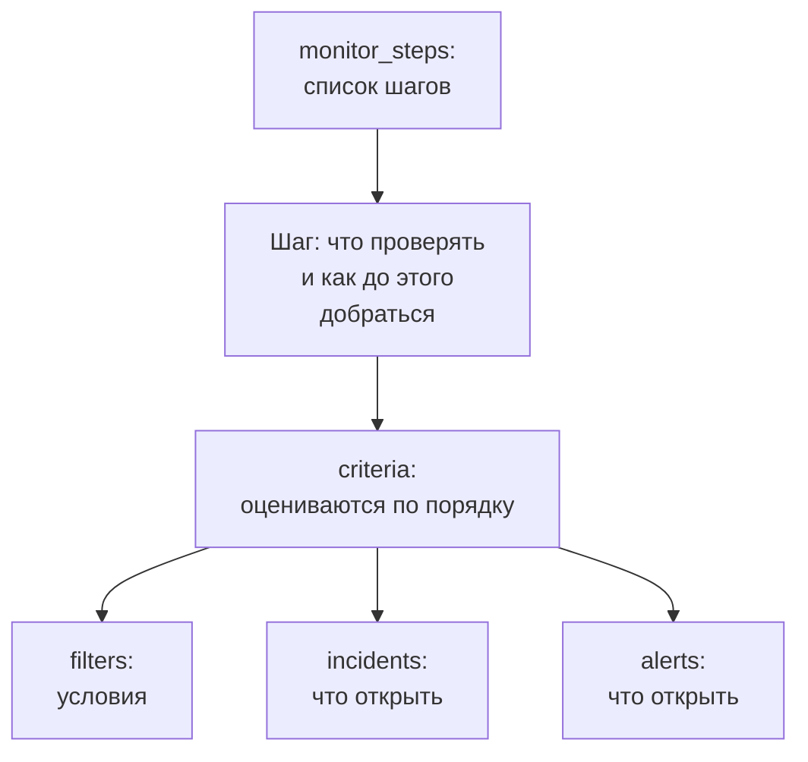

# Шаги монитора

`monitor_steps` — это атрибут `oneuptime_monitor`, который говорит, что проверяет монитор и как оценивается каждый результат: адрес для проверки, запрос для отправки и критерии, которые превращают результат в статус монитора, инцидент или оповещение. На этой странице объясняется каждая его часть.

:::cards
- [Как оценивается проверка](#как-оценивается-проверка): Критерии по порядку и первый совпавший.
- [Как писать шаги](#как-писать-шаги): Их форма, полный пример и два правила для значений.
- [Справочник по фильтрам](#справочник-по-фильтрам): Что может проверять фильтр и как он сравнивает.
- [Частые ошибки](#частые-ошибки): Что чаще всего идёт не так и как это исправить.
:::

## Как оценивается проверка

Каждая проверка даёт результат: ответ зонда, значение, которое вернул скрипт, или телеметрию, которую читает проверка. Затем критерии шага оценивают его по порядку. Первый критерий, фильтры которого совпали, решает, что произойдёт: он может изменить статус монитора, открыть инциденты и открыть оповещения. Критерии после него для этой проверки не рассматриваются.



Поэтому порядок критериев важен: ставьте первыми критерии, которые оповещают, самый серьёзный первым, а критерий нормального состояния — последним. В разделе [Атрибуты критерия](#атрибуты-критерия) объясняется почему, и единственное исключение.

## Как писать шаги

`monitor_steps` — это список типизированных объектов, записанных прямо в HCL. Здесь нет `jsonencode()`, нет обёртки `{_type, value}`, нет ключей в camelCase и нет ID, которые нужно писать: провайдер превращает ваш HCL в формат API, а сервер выдаёт свой ID каждому шагу, критерию, шаблону инцидента и шаблону оповещения. Он сохраняет эти ID при каждом apply, сопоставляя каждый критерий и шаблон с тем, который он заменяет, по имени, а иначе по позиции, поэтому результаты зондов остаются при своём шаге, а инциденты продолжают указывать на критерии, которые их открыли.



Самый маленький полезный шаг проверяет один адрес и имеет один критерий с одним фильтром:

```hcl
resource "oneuptime_monitor" "example" {
  name         = "Example"
  description  = "The smallest monitor_steps"
  monitor_type = "Website"

  monitor_steps = [{
    monitor_destination      = "https://example.com"
    monitor_destination_type = "URL"
    request_type             = "GET"

    criteria = [
      {
        name             = "Check if online"
        description      = "The website responds"
        filter_condition = "All"

        filters = [
          {
            check_on    = "Is Online"
            filter_type = "True"
          }
        ]
      }
    ]
  }]
}
```

Везде в `monitor_steps` действуют два правила:

- **Не указывайте то, чем не пользуетесь.** Атрибут, который вы не задали, не отправляется в API. Никогда не пишите `[]`, `{}` или `""` как заполнитель: провайдер отклоняет пустые строки, списки и map, поэтому отсутствующее значение всегда означает «не задано».
- **Значения фильтров — строки.** `value` фильтра — это строка, даже для числа: `value = "200"`, а не `value = 200`. Числовые настройки, такие как `port`, — числа.

:::details Переход с провайдера 1.x, где monitor_steps был JSON
В провайдере 1.x `monitor_steps` был строкой JSON, записанной через `jsonencode({ _type = "MonitorSteps", value = { ... } })`. Перепишите её типизированными атрибутами с этой страницы: уберите обёртки `_type` и `value`, запишите ключи camelCase в snake_case (`monitorDestination` становится `monitor_destination` и `monitor_destination_type`, `filterCondition` становится `filter_condition`, `checkOn` становится `check_on`) и удалите каждый `id`. Теперь все ID выдаёт сервер, что также покончило с жёстко заданными случайными ID из issue [#2291](https://github.com/OneUptime/oneuptime/issues/2291). State, сохранённый как строка JSON, сам не обновляется: примените новую конфигурацию.
:::

### Полный пример

Этот монитор веб-сайта проверяет то же, что монитор веб-сайта в сквозных тестах провайдера (тест `35-monitor-with-steps`): offline, когда сайт не отвечает, online, когда он отвечает кодом 200.

```hcl
resource "oneuptime_monitor_status" "operational" {
  name                 = "Operational"
  description          = "Monitor is operational"
  color                = "#2ecc71"
  priority             = 1
  is_operational_state = true
}

resource "oneuptime_monitor_status" "offline" {
  name                 = "Offline"
  description          = "Monitor is offline"
  color                = "#e74c3c"
  priority             = 3
  is_operational_state = false
}

resource "oneuptime_monitor" "website" {
  name         = "Website"
  description  = "Website monitor with explicit steps"
  monitor_type = "Website"

  monitor_steps = [{
    monitor_destination      = "https://example.com" # what to check
    monitor_destination_type = "URL"                 # URL, Hostname or IP
    request_type             = "GET"                 # the HTTP method

    criteria = [ # judged in order: the first match decides
      {
        name                  = "Offline"
        description           = "Check if website is offline"
        filter_condition      = "Any"
        change_monitor_status = true
        create_incidents      = false
        create_alerts         = false
        monitor_status_id     = oneuptime_monitor_status.offline.id

        filters = [
          {
            check_on    = "Is Online"
            filter_type = "False"
          }
        ]
      },
      {
        name                  = "Online"
        description           = "Check if website is online"
        filter_condition      = "All" # All: every filter, Any: at least one
        change_monitor_status = true
        create_incidents      = false
        create_alerts         = false
        monitor_status_id     = oneuptime_monitor_status.operational.id

        filters = [
          {
            check_on    = "Is Online"
            filter_type = "True"
          },
          {
            check_on    = "Response Status Code"
            filter_type = "Equal To"
            value       = "200" # a string, even for a number
          }
        ]
      }
    ]
  }]
}
```

Критерий ссылается на статус через его ресурс, как здесь делает `oneuptime_monitor_status.offline.id`, или на статус, который уже есть в вашем проекте, через [источник данных](/docs/terraform/complete-guide#чтение-того-что-уже-есть).

## Атрибуты шага

Каждый элемент `monitor_steps` — это одна вещь для проверки:

| Атрибут | Тип | Кто использует | Примечания |
| --- | --- | --- | --- |
| `monitor_destination` | string | Веб-сайт, API, Ping, IP, Порт, SSL-сертификат, NTP | URL, имя хоста или IP-адрес для проверки. Требует `monitor_destination_type`. |
| `monitor_destination_type` | string | те же | `URL`, `Hostname` или `IP`, в зависимости от того, что принимает тип монитора: URL для мониторов веб-сайта, API и SSL-сертификата; имя хоста или IP-адрес для мониторов Ping, IP, Порт и NTP. |
| `port` | number | Порт, NTP | TCP-порт для проверки, например `443`. Для NTP — UDP-порт, на котором отвечает сервер времени: `123`, если не задан. |
| `request_type` | string | Веб-сайт, API | HTTP-метод: `GET`, `POST`, `PUT`, `DELETE`, `HEAD` или `PATCH`. Если он не задан, сервер использует `GET`. |
| `request_headers` | map(string) | Веб-сайт, API | Заголовки для отправки: `{ "Accept" = "application/json" }`. |
| `request_body` | string | API | Тело запроса в виде текста. |
| `do_not_follow_redirects` | bool | Веб-сайт, API | Остановиться на первом ответе вместо перехода по перенаправлениям. |
| `allow_self_signed_certificates` | bool | Веб-сайт, API | Принимать самоподписанный сертификат TLS. |
| `tls_client_certificate` | string | Веб-сайт, API | Клиентский сертификат для взаимного TLS: PEM или ссылка `{{monitorSecrets.name}}`. |
| `tls_client_key` | string (чувствительный) | Веб-сайт, API | Закрытый ключ клиентского сертификата. Задайте его вместе с сертификатом. |
| `tls_client_key_passphrase` | string (чувствительный) | Веб-сайт, API | Парольная фраза закрытого ключа. |
| `request_timeout_in_ms` | number | Проверки, которые выполняет зонд | Сколько может длиться одна попытка, в миллисекундах. Зонд снижает всё, что выше 60000, до 60000. |
| `retry_count` | number | Проверки, которые выполняет зонд | Повторные попытки после неудачной первой: `0` проверяет один раз, `3` — до четырёх раз. Зонд снижает всё, что выше 3, до 3. |
| `custom_code` | string | Custom JavaScript Code, Synthetic | Скрипт, который выполняет шаг. |
| `screen_size_types` | list(string) | Synthetic | `Mobile`, `Tablet` и `Desktop`. |
| `browser_types` | list(string) | Synthetic | `Chromium` и `Firefox`. |
| `retry_count_on_error` | number | Synthetic | Повторные попытки, когда скрипт завершается ошибкой: `0` запускает его один раз. |
| `criteria` | list (обязательный) | Все | Как оценивается каждый результат: см. [Атрибуты критерия](#атрибуты-критерия). |

### Настройки каждого типа монитора

Типы мониторов, у которых есть что настроить помимо адреса, хранят свои настройки (запрос к логам, подключение к базе данных, кластер для наблюдения) в собственном атрибуте, в виде сырого JSON, записанного через `jsonencode()`: `log_monitor`, `trace_monitor`, `llm_monitor`, `metric_monitor`, `exception_monitor`, `profile_monitor`, `dns_monitor`, `domain_monitor`, `dnssec_monitor`, `sql_monitor`, `database_monitor`, `external_status_page_monitor`, `network_device_monitor`, `kubernetes_monitor`, `docker_monitor`, `docker_swarm_monitor`, `host_monitor`, `podman_monitor`, `proxmox_monitor`, `vmware_monitor`, `ceph_monitor`, `storage_array_monitor`, `iot_monitor` и `probe_status_monitor`.

Их JSON такой же, как в панели управления, с ключами в camelCase. ID внутри него записывается так, как его записывает API: `{ _type = "ObjectID", value = "..." }`. Монитор Logs, который считает ошибки одного сервиса:

```hcl
resource "oneuptime_service" "checkout" {
  name = "checkout"
}

resource "oneuptime_monitor" "checkout_errors" {
  name         = "Checkout errors"
  monitor_type = "Logs"

  monitor_steps = [{
    log_monitor = jsonencode({
      attributes          = {}
      body                = "error"
      severityTexts       = ["Error"]
      telemetryServiceIds = [{ _type = "ObjectID", value = oneuptime_service.checkout.id }]
      lastXSecondsOfLogs  = 300
    })

    criteria = [
      {
        name             = "Errors found"
        filter_condition = "Any"

        filters = [
          {
            check_on    = "Log Count"
            filter_type = "Greater Than"
            value       = "0"
          }
        ]
      }
    ]
  }]
}
```

> [!TIP]
> Самый простой способ получить правильный JSON: настройте монитор в панели управления, затем откройте его раздел **Для разработчиков** и **Terraform**. Страница пишет `monitor_steps` монитора вместе с `jsonencode()` и всем остальным.

## Атрибуты критерия

Каждый элемент `criteria` — это одно правило: когда его фильтры совпадают, сделать то, что оно говорит.

Критерии оцениваются сверху, и решает первый совпавший, поэтому ставьте первыми критерии, которые оповещают, самый серьёзный первым (критический, затем предупреждение), а критерий нормального состояния — последним. Критерий нормального состояния наверху — самый частый способ построить монитор, который никогда не оповещает: широкое правило вроде `Is Online` равно `True` или значение метрики `Greater Than` `0` совпадает почти с каждой проверкой, и критерии под ним никогда не рассматриваются. Поставленный последним, он совпадает, только когда не совпало ничего выше, а это то, что вам нужно.

Сгруппированные мониторы метрик — единственное исключение. Когда запрос монитора метрик сгруппирован (`groupByAttributeKeys` задан в JSON `metric_monitor`, в `metricViewConfig.queryConfigs[].metricQueryData.groupByAttributeKeys`), монитор открывает по одному оповещению или инциденту на каждую группу (каждый хост, контейнер или точку монтирования), и оцениваются все критерии, так что критический критерий и критерий предупреждения могут сработать для разных хостов в одной проверке. Хост, который нарушает оба, всё равно вызывается только один раз, первым совпавшим критерием, поэтому самый серьёзный по-прежнему идёт первым. См. [Мониторинг метрик](/docs/monitor/metrics-monitor).

| Атрибут | Тип | Что это |
| --- | --- | --- |
| `name` | string (обязательный) | Имя, которое показывает панель управления. |
| `description` | string | Описание, которое показывает панель управления. |
| `filter_condition` | string (обязательный) | `All`: должен совпасть каждый фильтр. `Any`: достаточно одного. |
| `filters` | list (обязательный) | Условия, хотя бы одно: см. [Справочник по фильтрам](#справочник-по-фильтрам). |
| `change_monitor_status` | bool | Меняет ли совпадение статус монитора. |
| `monitor_status_id` | string | ID `oneuptime_monitor_status`, на который нужно переключиться. Задайте его, когда `change_monitor_status` равно `true`. |
| `create_incidents` | bool | Открывает ли совпадение инциденты. |
| `incidents` | list | Инциденты, которые нужно открыть. Не указывайте его, если только не `create_incidents = true`. |
| `create_alerts` | bool | Открывает ли совпадение оповещения. |
| `alerts` | list | Оповещения, которые нужно открыть. Не указывайте его, если только не `create_alerts = true`. |
| `is_enabled` | bool | `true` на сервере, если не задано. Задайте `false`, чтобы сохранить критерий, но не оценивать по нему. |
| `incident_grouping` | string (JSON) | Только мониторы входящих запросов: по инциденту на каждое значение, найденное в запросе, например `jsonencode({ groupByJSONPath = "..." })`. |
| `open_for_every_email` | bool | Только мониторы входящих писем: `true` открывает инцидент (и оповещение) для каждого подходящего письма, а не один за раз. |

### Инциденты и оповещения

Элемент `incidents` принимает `title` и `description` (оба обязательны), `incident_severity_id`, `auto_resolve_incident`, `remediation_notes`, `on_call_policy_ids`, `label_ids`, `owner_team_ids`, `owner_user_ids`, `show_incident_on_status_page` и `is_private`. Элемент `alerts` принимает то же самое, с `alert_severity_id` и `auto_resolve_alert` и без `show_incident_on_status_page`.

Этот критерий переводит монитор в offline, открывает инцидент, который вызывает политику дежурства, и закрывает его, когда сайт возвращается:

```hcl
criteria = [
  {
    name                  = "Offline"
    description           = "The site is unreachable"
    filter_condition      = "Any"
    change_monitor_status = true
    monitor_status_id     = oneuptime_monitor_status.offline.id
    create_incidents      = true

    filters = [
      {
        check_on    = "Is Online"
        filter_type = "False"
      }
    ]

    incidents = [
      {
        title                 = "Website is down"
        description           = "The website did not respond to the probe."
        incident_severity_id  = oneuptime_incident_severity.critical.id
        auto_resolve_incident = true
        on_call_policy_ids    = [oneuptime_on_call_policy.primary.id]
      }
    ]
  }
]
```

## Справочник по фильтрам

У фильтра есть `check_on` (на что смотреть), `filter_type` (как сравнивать) и `value` (с чем сравнивать, в виде строки; не указывайте его для проверок «истина или ложь», таких как `True` и `False`).

Фильтр также может оценивать окно времени вместо последней проверки: задайте `evaluate_over_time = true`, длину окна в `evaluate_over_time_minutes` и в `evaluate_over_time_type` — как читается окно: `Average`, `Sum`, `Maximum Value`, `Minimum Value`, `All Values` или `Any Value`.

`All Values` означает, что каждая проверка в окне нарушила правило, поэтому он совпадает только тогда, когда окно покрыто данными: только что созданный монитор ждёт, пока окно заполнится, вместо того чтобы совпасть на первой проверке. Задайте окно не меньше двух `monitoring_interval` монитора; иначе в окне одна проверка, и «все значения» означает то же, что «любое значение». `Any Value` совпадает на одной нарушающей проверке, так задумано.

`evaluate_over_time_no_data_policy` говорит, что делает фильтр, пока в окне недостаточно данных: `Ignore` (по умолчанию) не совпадает, `Trigger` считает отсутствие данных сбоем, как это делает heartbeat, а `Treat As Zero` сравнивает окно как один ноль.

### Что может проверять фильтр

Значения `check_on`, которые чаще всего использует каждый тип монитора. Редактор критериев в панели управления предлагает те же и перечисляет их все:

| Тип монитора | Значения `check_on` |
| --- | --- |
| Веб-сайт / API | `Is Online`, `Response Time (in ms)`, `Response Status Code`, `Response Body`, `Response Header`, `Response Header Value`, `JavaScript Expression`, `Is Request Timeout` |
| Ping / IP | `Is Online`, `Response Time (in ms)`, `Packet Loss (in %)`, `Jitter (in ms)`, `Is Request Timeout` |
| Порт | `Is Online`, `Response Time (in ms)` (общее время подключения в панели управления), `Port DNS Lookup Time (in ms)`, `Port TCP Connect Time (in ms)`, `Is Request Timeout` |
| SSL-сертификат | `Is Valid Certificate`, `Is Not A Valid Certificate`, `Is Self Signed Certificate`, `Is Expired Certificate`, `Expires In Days`, `Expires In Hours` |
| Входящий запрос | `Incoming Request`, `Request Body`, `Request Header`, `Request Header Value`, `JavaScript Expression` |
| Входящая почта | `Email Received`, `Email Subject`, `Email From Address`, `Email To Address`, `Email Body` |
| Сервер | `Is Online`, `CPU Usage (in %)`, `Memory Usage (in %)`, `Disk Usage (in %)` (с `disk_path`), `Server Process Name` |
| Логи | `Log Count` |
| Трассировки | `Span Count` |
| Исключения | `Exception Count` |
| Профили | `Profile Count`, `Function Share (in %)` |
| ИИ / LLM | `Bad AI Answers (in %)`, `Bad AI Answers`, `AI Answers` |
| Метрики | `Metric Value` (фильтры метрик могут принимать JSON в `metric_monitor_options`) |
| Собственный код / Synthetic | `Result Value` (может сравнивать одно поле возвращённых данных, указанное в JSON `custom_code_monitor_options`, например `jsonencode({ resultValuePath = "status" })` — см. ниже), `Error`, `Execution Time (in ms)` |
| DNS | `DNS Is Online`, `DNS Response Time (in ms)`, `DNS Record Value`, `DNS Record Exists` |
| Домен | `Domain Expires In Days`, `Domain Is Expired`, `Domain Registrar`, `Domain Name Server` |
| DNSSEC | `DNSSEC Chain Is Valid`, `DNSSEC DS Record Exists At Parent`, `DNSSEC Signature Expires In Days` |
| SQL-запрос | `SQL Is Online`, `SQL Query Row Count`, `SQL Query Scalar Value` |
| Состояние базы данных | `Database Is Online`, `Database Metric` (с JSON в `database_monitor_options`, указывающим ряд, например `jsonencode({ metricType = "oneuptime.monitor.database.connections.used.percent" })`), `Database Collection Error` |
| Внешняя страница состояния | `External Status Page Is Online`, `External Status Page Active Incidents`, `External Status Page Component Status` |
| NTP | `NTP Is Online`, `NTP Is Synchronized`, `NTP Stratum`, `NTP Clock Offset (in ms)`, `NTP Response Time (in ms)`, `NTP Root Dispersion (in ms)` (`NTP Is Online` и `NTP Is Synchronized` не принимают `value`) |
| Сетевое устройство (SNMP) | `SNMP Device Is Online` (оно отвечает на ping или SNMP), `SNMP Walk Is Succeeding` (false, когда оно отвечает, но обойти его нельзя), `SNMP OID Value` (фильтры SNMP могут принимать JSON в `snmp_monitor_options`) |

### Как сравнивает фильтр

| Вид | Значения `filter_type` |
| --- | --- |
| Истина или ложь | `True`, `False` |
| Числа | `Equal To`, `Not Equal To`, `Greater Than`, `Less Than`, `Greater Than Or Equal To`, `Less Than Or Equal To` |
| Текст | `Contains`, `Not Contains`, `Starts With`, `Ends With`, `Is Empty`, `Is Not Empty` |
| Heartbeat | `Recieved In Minutes`, `Not Recieved In Minutes` (написаны так, как их пишет API) |
| Процессы сервера | `Is Executing`, `Is Not Executing` |
| Скрипты | `Evaluates To True` |
| Аномалии для метрик, логов и трассировок | `Anomalously High`, `Anomalously Low`, `Anomalous` |

Фильтр, который совпадает, когда SSL-сертификат истекает через 14 дней или меньше:

```hcl
filters = [
  {
    check_on    = "Expires In Days"
    filter_type = "Less Than Or Equal To"
    value       = "14"
  }
]
```

Провайдер проверяет `check_on`, `filter_type` и другие фиксированные списки при планировании, поэтому опечатка приводит к ошибке до того, как что-либо отправлено в API. Значения — это имена, которые API даёт вариантам редактора критериев в панели управления.

### Сравнение одного поля результата скрипта

Скрипт монитора собственного кода или монитора Synthetic возвращает `data`, и фильтр `Result Value` сравнивает его. Когда `data` — объект или массив, `custom_code_monitor_options` указывает одно поле, которое нужно сравнить: **Путь к полю** фильтра Result Value в панели управления. Используйте точки для вложенных полей и `[n]` для элементов массива, а чтобы сравнить значение целиком, не указывайте этот атрибут:

```hcl
monitor_steps = [{
  custom_code = <<-EOT
    const response = await axios.get("https://api.example.com/health");
    // For example { status: "UP", checks: [{ name: "db", latency: 12 }] }
    return { data: response.data };
  EOT

  criteria = [
    {
      name             = "Unhealthy"
      filter_condition = "Any"
      filters = [
        {
          check_on                    = "Result Value"
          filter_type                 = "Not Equal To"
          value                       = "UP"
          custom_code_monitor_options = jsonencode({ resultValuePath = "status" })
        },
        {
          check_on                    = "Result Value"
          filter_type                 = "Greater Than"
          value                       = "500"
          custom_code_monitor_options = jsonencode({ resultValuePath = "checks[0].latency" })
        }
      ]
    }
  ]
}]
```

`Greater Than` и другие числовые условия совпадают только с полем, которое является числом, а поле, отсутствующее в возвращённых данных, совпадает только с `Is Empty`. Как работают пути и условия, см. в разделе [Оповещения по возвращённым данным](/docs/monitor/custom-code-monitor#оповещения-по-возвращённым-данным).

## Частые ошибки

1. **Пустые заполнители.** `incidents = []`, `request_headers = {}` и `description = ""` отклоняются: вместо этого не указывайте атрибут.
2. **Число там, где нужна строка.** `value` фильтра — строка, даже для числа: `value = "200"`. Числовые настройки, такие как `port`, `retry_count`, `request_timeout_in_ms` и `evaluate_over_time_minutes`, принимают числа.
3. **Неверный тип назначения.** `monitor_destination_type = "URL"` с голым именем хоста или `Hostname` с полным URL приводят к сбою проверки. Мониторы веб-сайта и API принимают URL; мониторы Ping, IP и Порт принимают имена хостов или IP-адреса.
4. **Смена статуса без статуса.** `change_monitor_status = true` без `monitor_status_id` совпадает, но переключаться не на что.
5. **ID.** Ни у одного элемента `monitor_steps` нет атрибута `id`. Если вы переходите со старого JSON, удалите их: ID выдаёт сервер.
6. **JSON, написанный вручную.** Пишите `log_monitor` и другие настройки через `jsonencode()`, чтобы Terraform заключал их в кавычки и каждый раз писал JSON одинаково. Для `metric_monitor` передавайте весь объект, который пишет панель управления: сервер его нормализует.

## Когда ни один критерий не совпал

Проверка, которая не совпала ни с одним критерием, переводит монитор в статус по умолчанию: рабочий статус проекта, тот, который панель управления выбирает для нового монитора. Его открытые инциденты, критерии которых включили автоматическое закрытие, тоже закрываются. Чтобы самим решать каждый исход, заканчивайте список широким критерием нормального состояния, как это делают примеры на этой странице.

## Монитор без шагов

`monitor_steps` необязателен, но у монитора, созданного без него, нет критериев, по которым оценивать результат: зонды пропускают монитор без шагов, и он остаётся в статусе, с которого начал. Ваш state хранит атрибут пустым, и план остаётся чистым. Ручному монитору шаги никогда не нужны: его статус вы задаёте сами. Любому другому типу нужен хотя бы один шаг, чтобы что-то проверять.

## Формат передачи

За провайдером API по-прежнему говорит на своём JSON, в котором каждый сложный объект обёрнут как `{_type, value}`:

```json
{
  "_type": "MonitorSteps",
  "value": {
    "monitorStepsInstanceArray": [
      {
        "_type": "MonitorStep",
        "value": {
          "monitorDestination": { "_type": "URL", "value": "https://example.com" },
          "requestType": "GET",
          "monitorCriteria": {
            "_type": "MonitorCriteria",
            "value": { "monitorCriteriaInstanceArray": [ { "_type": "MonitorCriteriaInstance", "value": { "...": "..." } } ] }
          }
        }
      }
    ]
  }
}
```

Провайдер строит это из вашего HCL при записи и читает обратно в HCL, опуская то, чем управляет сервер (ID и добавляемые им значения по умолчанию). Вы встретите это, только если сами читаете ответы API, например в скрипте, который читает `monitorSteps`.

## Дальнейшие шаги

:::cards
- [Примеры](/docs/terraform/examples): Мониторы Ping, порта, SSL-сертификата и API, готовые к использованию.
- [Полное руководство](/docs/terraform/complete-guide): Источники данных, state и обновления.
- [Мониторинг метрик](/docs/monitor/metrics-monitor): Запросы метрик, группировка и аномалии.
- [Устранение неполадок](/docs/terraform/troubleshooting): В том числе несогласованный результат после apply для монитора.
:::
