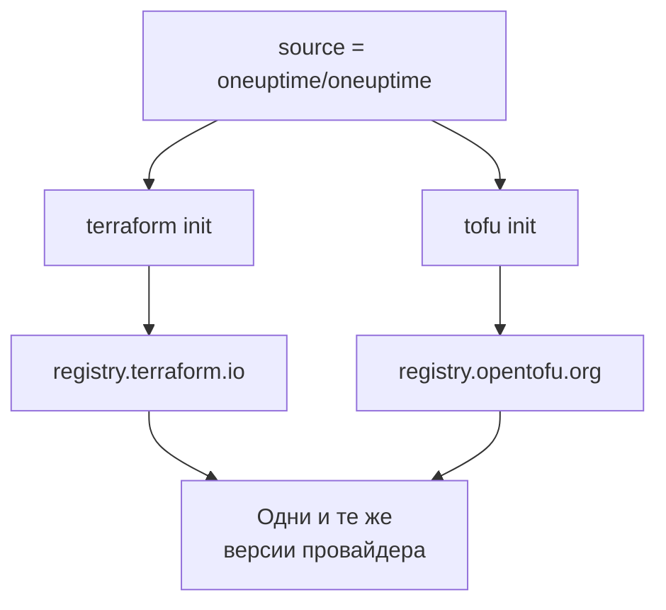

# OpenTofu

Провайдер OneUptime работает с [OpenTofu](https://opentofu.org) так же, как с Terraform. Он публикуется в [OpenTofu Registry](https://search.opentofu.org/provider/oneuptime/oneuptime/latest), и каждый релиз перед публикацией проходит одни и те же сквозные тесты в обоих. Ваша конфигурация не меняется: запускайте `tofu` везде, где эта документация запускает `terraform`.

:::cards
- [Используйте провайдер с OpenTofu](#используйте-провайдер-с-opentofu): Та же конфигурация, запущенная через `tofu`.
- [Чем OpenTofu отличается от Terraform](#чем-opentofu-отличается-от-terraform): Реестры, файлы блокировки, файлы `.tofu` и версии.
- [Перенос конфигурации в OpenTofu](#перенос-конфигурации-в-opentofu): Переведите существующую конфигурацию за четыре шага.
- [Повторно используемый модуль](#повторно-используемый-модуль): Мониторы, политика дежурства и страница состояния для одного сервиса.
:::

## Используйте провайдер с OpenTofu

Вам нужен OpenTofu 1.6 или новее. Объявите провайдер так же, как для Terraform:

```hcl title="main.tf"
terraform {
  required_providers {
    oneuptime = {
      source  = "oneuptime/oneuptime"
      version = "{{TERRAFORM_PROVIDER_VERSION}}"
    }
  }
}

provider "oneuptime" {
  # The API key comes from the ONEUPTIME_API_KEY environment variable.
  # On a self-hosted OneUptime, add your OneUptime's address:
  # oneuptime_url = "https://oneuptime.example.com"
}
```

Затем запустите его через `tofu`:

```bash
export ONEUPTIME_API_KEY="<your-api-key>"
tofu init
tofu plan
tofu apply
```

`tofu init` скачивает провайдер из OpenTofu Registry. Всё в разделах [Быстрый старт](/docs/terraform/quick-start), [Полное руководство](/docs/terraform/complete-guide), [Шаги монитора](/docs/terraform/monitor-steps), [Примеры](/docs/terraform/examples) и [Импорт ресурсов](/docs/terraform/importing-resources) применимо как есть, а конфигурация, которую пишут страницы **Terraform** панели управления, работает без изменений.

### Не указывайте реестр в адресе источника

`source = "oneuptime/oneuptime"` не называет реестр, поэтому каждый инструмент читает его из своего:



Не указывайте имя хоста. С ним каждый инструмент использует этот реестр: с `registry.terraform.io/oneuptime/oneuptime` OpenTofu тоже скачивает из Terraform Registry, а Terraform отклоняет копию из OpenTofu Registry с `authentication signature from unknown issuer`.

## Чем OpenTofu отличается от Terraform

| Тема | В OpenTofu |
| --- | --- |
| Реестр | `oneuptime/oneuptime` – это `registry.opentofu.org/oneuptime/oneuptime`, который публикует те же версии, что и Terraform Registry. |
| Подписи | `tofu init` сообщает, что проверка подписи пропущена: в OpenTofu Registry нет ключа подписи для этого провайдера, поэтому OpenTofu проверяет загрузку по контрольным суммам реестра. |
| Блок `terraform` | Остаётся `terraform`: это часть языка, и OpenTofu читает его как есть. |
| Файлы `.tofu` | OpenTofu 1.8 и новее читает и файлы `.tofu`, а файл `.tf`, рядом с которым лежит одноимённый файл `.tofu`, пропускает. Terraform читает только файлы `.tf`. |
| `required_version` | Версии OpenTofu начинаются с 1.6.0, поэтому `>= 1.5.0`, написанное для Terraform, допускает любой OpenTofu. |
| Файл блокировки | Называет `registry.opentofu.org/oneuptime/oneuptime`. Смена инструмента переписывает эту запись: закоммитьте изменение. |
| State | OpenTofu читает state, записанный Terraform, как есть. |
| Переменные | `TF_VAR_name` задаёт переменную и в OpenTofu. |
| Файл конфигурации CLI | `~/.tofurc` или `~/.terraformrc` либо файл, который называет `TF_CLI_CONFIG_FILE`. |
| Блок `removed` | Его блок `lifecycle` требует OpenTofu 1.10 или новее. Без него OpenTofu забывает ресурс и сохраняет запись, тогда как Terraform её уничтожает. |
| Перемещение в переименованный тип ресурса | Блок `moved` из `oneuptime_io_t_fleet` в `oneuptime_iot_fleet` или между другими переименованными типами требует OpenTofu 1.12 или новее. |

## Перенос конфигурации в OpenTofu

Конфигурация, которой управляет Terraform, переходит в OpenTofu как есть, вместе со своим state:

:::steps
### Установите OpenTofu

Установите OpenTofu: для провайдера достаточно 1.6, а 1.12 или новее умеет ещё и перемещать ресурс в переименованный тип, например `oneuptime_io_t_fleet` в `oneuptime_iot_fleet`.

### Инициализируйте через tofu

В папке конфигурации выполните `tofu init`. Он скачивает провайдер из OpenTofu Registry и сообщает, что изменил файл блокировки: запись провайдера теперь называет OpenTofu Registry.

### Запустите план

Выполните `tofu plan`. Он читает state, оставленный Terraform, и отвечает `No changes.`

### Закоммитьте файл блокировки

Закоммитьте `.terraform.lock.hcl` и с этого момента запускайте конфигурацию через `tofu`, в том числе в CI.
:::

## Повторно используемый модуль

[`Examples/opentofu/`](https://github.com/OneUptime/oneuptime/tree/master/Examples/opentofu) в репозитории OneUptime содержит готовые к запуску конфигурации и модуль, который настраивает один сервис: монитор сайта для каждого переданного адреса, метку на всём, что он создаёт, политику дежурства с одним правилом эскалации и страницу состояния со списком мониторов. Это обычный HCL, поэтому он работает и в Terraform.

```hcl title="main.tf"
module "storefront" {
  source = "github.com/OneUptime/terraform-provider-oneuptime//modules/monitoring-and-incident-response?ref=vX.Y.Z"

  service_name          = "storefront"
  status_page_is_public = true

  monitors = {
    homepage = { url = "https://example.com" }
    checkout = { url = "https://example.com/checkout" }
    api      = { url = "https://api.example.com/health", expected_status_code = "204" }
  }
}
```

Замените `vX.Y.Z` опубликованной версией провайдера, например самой новой из [релизов провайдера](https://github.com/OneUptime/terraform-provider-oneuptime/releases): модуль публикуется вместе с провайдером, и его репозиторий меняется с каждым релизом.

Модуль не создаёт статусы мониторов и серьёзности инцидентов. Он ищет по имени те, с которыми начинается каждый проект: `Operational`, `Offline` и `Critical Incident`. Если в вашем проекте они переименованы, задайте `operational_monitor_status_name`, `offline_monitor_status_name` или `incident_severity_name`.

Его правило эскалации никого не вызывает, пока вы не скажете кого: добавьте в него команду с помощью выходных значений модуля:

```hcl title="main.tf"
resource "oneuptime_team" "storefront" {
  name = "Storefront"
}

resource "oneuptime_team_on_call_duty_escalation_rule" "storefront" {
  on_call_duty_policy_id                 = module.storefront.on_call_policy_id
  on_call_duty_policy_escalation_rule_id = module.storefront.escalation_rule_id
  team_id                                = oneuptime_team.storefront.id
}
```

## Дальнейшие шаги

:::cards
- [Быстрый старт](/docs/terraform/quick-start): Создайте API-ключ и примените первые ресурсы.
- [Использование реестра](/docs/terraform/registry): Как нумеруются версии и файл блокировки.
- [Настройка собственного хостинга](/docs/terraform/self-hosted): Ваш собственный OneUptime и зеркало для машин без интернета.
- [Устранение неполадок](/docs/terraform/troubleshooting): Частые ошибки и способы их исправить.
:::
